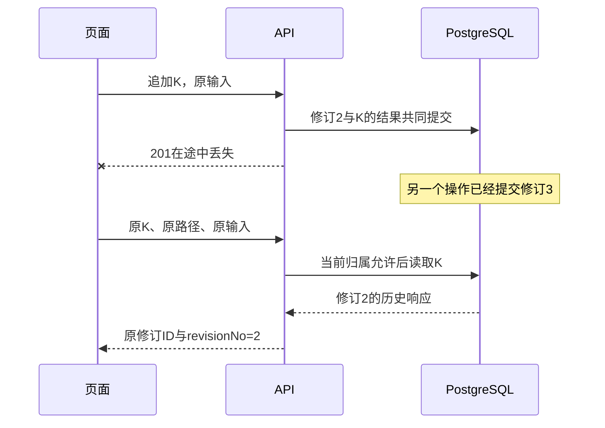
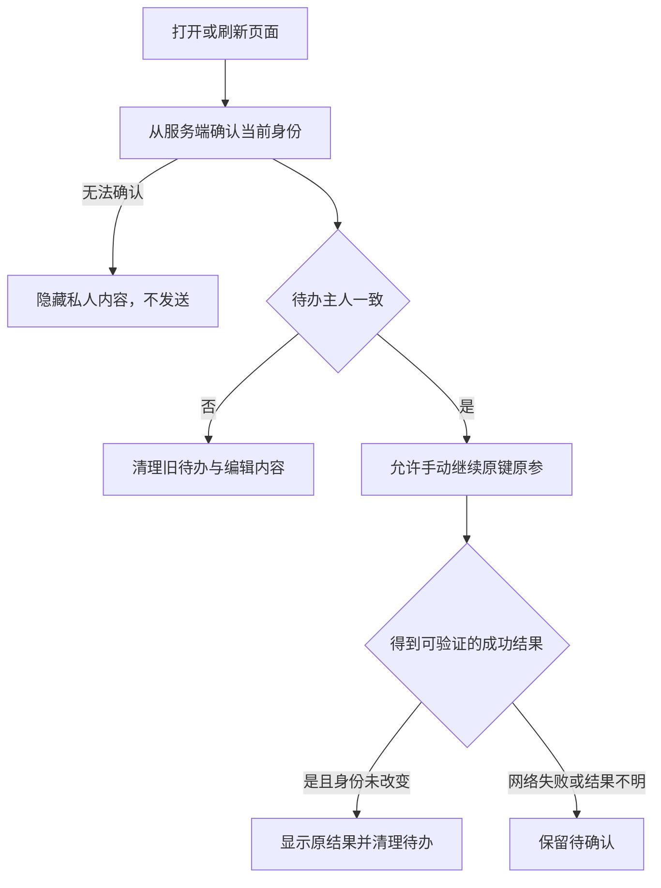
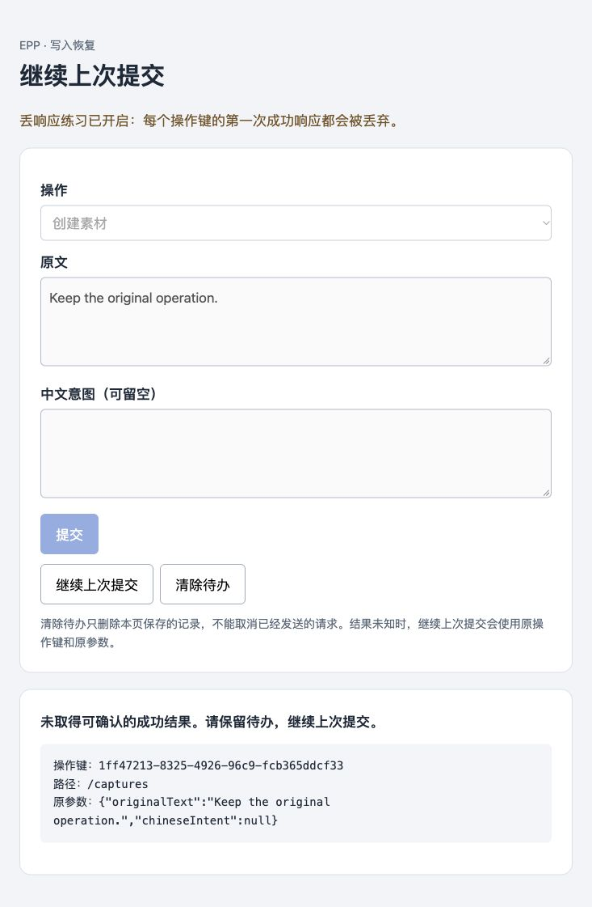
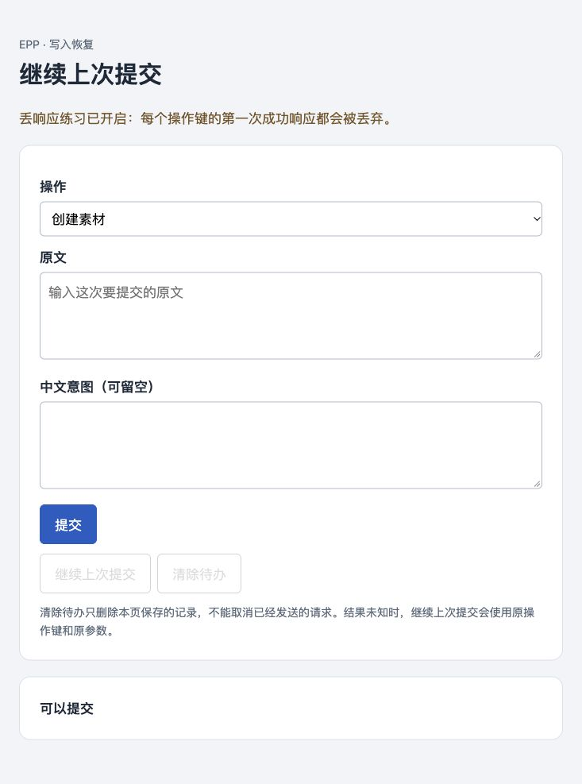

# 第 30 章 创建素材与追加修订怎样承受重试

第二十九章让采纳操作在响应丢失后找到原结果，但保存素材的入口仍然是另一回事。用户在编辑框里写了一段话，点击保存，页面一直转圈；刷新以后再次提交，服务会产生第二条素材。若第一次是在追加修订，重发还会产生下一版。数据库事务没有失效：两个请求各自都完整提交了，只是服务不知道它们表示同一次决定。

这次把操作身份扩展到 `POST /captures` 和 `POST /captures/:id/revisions`，并把客户端也放回链条。服务器保存回执，浏览器保存待确认的身份与输入；刷新、断线、换账号以及旧客户端请求，分别有明确的行为。原文相等不充当去重依据，追加修订也不再拿当前最新版冒充第一次的结果。

代码从[第 29 章](https://github.com/SamChowRock/epp-public/tree/part-04/chapter-29)继续，完成状态为[第 30 章](https://github.com/SamChowRock/epp-public/tree/part-04/chapter-30)。Node 24.22.1、PostgreSQL 18、Prisma 7.10.1、Postman、DBeaver和Chrome沿用前章；浏览器页面、固定身份夹具与故障代理的准备见[本章环境入口](../../environment-setup.md#第-30-章在同一页签恢复待确认的提交)。练习使用非空VERIFY副本，保留旧素材、修订、候选和采纳回执。尚未有真实登录，当前用户由服务端固定；第五篇把同一能力接到Cookie会话，不能将练习身份当成认证。

时间参考（估算）：阅读约125～150分钟，跟做另加110～140分钟；按正文、可展开的完整事务与页面状态机代码、两张机制图及迁移、竞争、故障恢复和身份对照估算，非读者实测。可在结构迁移核对后、正式API重放通过后、浏览器恢复完成后分别停下；故障约束必须先移除，服务与代理停妥，再离开练习。

## 30.1 先区分重试、再次记录与再次编辑

### 两次相同的文本，不一定是一件事

先在第 29 章的VERIFY服务发两次原创建请求，Body都用 `{"originalText":"Take a break."}`。保存两次201中的ID，DBeaver按这两个ID查询captures及其revision_no=1的修订。两份素材都有自己的身份，这符合“今天记一次，明天又主动记一次”。不能在original_text上加唯一约束，强迫每个人只记录一次相同的话。

问题出在另一种经历：第一次实际上已经提交，客户端不知道；第二次只是想确认第一次。两次HTTP的requestId不同，Body又与主动再次记录完全一样，仅靠服务器观察请求内容无法区分。操作身份必须由能区分意图的调用方保存，在第一次发送之前就决定。

追加修订也一样。连续两次向 `/captures/原ID/revisions` 提交相同正文，可能产生第2版和第3版。修订号唯一约束防的是同一个素材出现两份第2版，不会阻止两次合法的顺序追加。幂等解决同一意图重复发送，版本校验解决编辑是否基于过期前提，内容比较解决两个版本有哪些差异；三个判断不能互相替代。

保留这些旧请求作为对照。本章新增**可选**请求头 `Idempotency-Key`，使用小写UUID。它是本项目明确约定的接口字段，不依赖浏览器自动生成，也不意味着代理或框架自动替我们实现了幂等。请求体保持已有契约：

```http
POST /captures
Content-Type: application/json
Idempotency-Key: 30000000-0000-4000-8000-000000000001

{"originalText":"Take a break.","chineseIntent":null}
```

导入配套 `requests/chapter-30.postman_collection.json`；在集合变量中保存自己生成的createKey、revisionKey、nextRevisionKey。先保存集合，等30.3完成代码并启动正式VERIFY API后，再按01～09操作；01完成后把响应ID填入captureId。在Postman的Headers中核对键与变量，保存请求。首次发送与重试使用同一值；只有用户明确开始另一件事时才生成新值。不要在每次请求的Pre-request Script里无条件生成UUID，那样点击Send重试就会悄悄变成新操作。正文中的UUID只用于说明，跟做时为自己的新操作生成一次并保存。

### 用户、动作与操作键共同划定身份

本章的身份是 `(userId, action, operationId)`。创建动作叫 `create-capture/v1`，追加叫 `append-revision/v1`。同一个用户在同一动作下复用键，必须仍指向同一份输入；另一用户使用同一键是独立操作。创建和追加即使误用了相同字符串，也不会读到对方的响应类型。

动作为什么放进主键？上一章只有采纳，主键以用户和操作键界定统一空间；这次允许不同写入类别各自管理键，因此把类别明确放进身份。两种设计都可以成立，关键是把范围写进契约，并让锁名、查询和约束一致。不能只在查回执时带action，主键却仍限制另一个范围。

路径目标不放进主键。若追加操作K原本针对素材A，重试时把URL换成B，应被识别为K改了意图，而不是自动获得第二个可成功的位置。目标和输入放在请求指纹中；锁仍只按用户、动作和K协调。采纳继续使用自己的command_receipts，本章不改写其历史，也不把采纳结果塞进新的创建响应。

请求指纹从**解析后的业务输入**计算。创建省略chineseIntent，与显式null都表示没有意图，因而归一成null；追加的chineseIntent仍必填。inputSource省略时是manual，chunks省略时是null。文本的空白、大小写和chunks顺序都保持：本章原文契约没有授权丢弃这些区别。

```ts
const normalized = {
  originalText: input.originalText,
  chineseIntent: input.chineseIntent ?? null,
};
const fingerprint = createHash('sha256')
  .update(JSON.stringify([action, targetId, normalized])).digest('hex');
```

固定字段顺序避免对象键排列改变摘要。不要直接哈希原始HTTP字节；格式化JSON、属性顺序和省略默认值不该凭空制造不同操作。反过来，也不要为了让重试通过而trim原文。摘要只能比较输入，不能替代用户范围、权限和业务对象的真实ID。

## 30.2 回执保存的是过去的决定

### 创建与追加分别需要找回什么

创建第一次返回素材ID、原文、意图和createdAt，Location指向 `/captures/原ID`。后来即使追加了新修订，重发创建K仍返回第一次的原文；GET详情则返回当前最新版。两者不同不是缓存过期，而是回答的问题不同：一个是“那次创建返回了什么”，一个是“现在是什么”。

追加需要保存原修订ID、captureId、revisionNo、原文、意图、来源、chunks和createdAt。若K产生了第2版，另一次操作已产生第3版，K重放依然返回第2版。不能先查最大版号，再拿那一行拼响应；那会把别人的后续编辑误认成这次提交的结果。



### 追加新表，保留已有业务事实

本章新增 `capture_write_receipts`，不修改第29章迁移，也不给无键历史生成虚构的键。从第29章自行实现时，先在 `prisma/schema.prisma` 的User和Capture模型中各加入下面这一行；已有关系保持：

```prisma
captureWriteReceipts CaptureWriteReceipt[]
```

再在同文件新增完整模型：

```prisma
model CaptureWriteReceipt {
  userId String @map("user_id") @db.Uuid
  action String @db.Text
  operationId String @map("operation_id") @db.Uuid
  captureId String @map("capture_id") @db.Uuid
  fingerprint String @db.Text
  statusCode Int @map("status_code")
  location String? @db.Text
  response Json @db.JsonB
  recordedAt DateTime @default(now()) @map("recorded_at") @db.Timestamptz(3)
  user User @relation(fields: [userId], references: [id], onDelete: Restrict, onUpdate: Restrict, map: "capture_write_receipts_user_id_fkey")
  capture Capture @relation(fields: [captureId], references: [id], onDelete: Restrict, onUpdate: Restrict, map: "capture_write_receipts_capture_id_fkey")
  @@id([userId, action, operationId], map: "capture_write_receipts_pkey")
  @@index([captureId], map: "capture_write_receipts_capture_id_idx")
  @@map("capture_write_receipts")
}
```

主键的字段顺序与SQL保持一致，生成客户端后才有 `userId_action_operationId` 查找键。保留下面手写CHECK，Prisma模型不能表达JSON顶层形状及Location与动作的关系。

创建目录 `prisma/migrations/20261116160000_capture_write_receipts/`，将以下完整SQL保存为其中的 `migration.sql`；完成分支已经包含该文件，直接核对即可，不再执行第二份同义CREATE：

```sql
BEGIN;
SET LOCAL lock_timeout = '2s';
SET LOCAL statement_timeout = '10s';

CREATE TABLE public.capture_write_receipts (
  user_id uuid NOT NULL,
  action text NOT NULL CHECK (action IN ('create-capture/v1', 'append-revision/v1')),
  operation_id uuid NOT NULL,
  capture_id uuid NOT NULL,
  fingerprint text NOT NULL CHECK (fingerprint ~ '^[0-9a-f]{64}$'),
  status_code integer NOT NULL CHECK (status_code = 201),
  location text,
  response jsonb NOT NULL CHECK (jsonb_typeof(response) = 'object'),
  recorded_at timestamptz(3) NOT NULL DEFAULT CURRENT_TIMESTAMP,
  CONSTRAINT capture_write_receipts_pkey PRIMARY KEY (user_id, action, operation_id),
  CONSTRAINT capture_write_receipts_user_id_fkey FOREIGN KEY (user_id) REFERENCES public.users(id) ON DELETE RESTRICT ON UPDATE RESTRICT,
  CONSTRAINT capture_write_receipts_capture_id_fkey FOREIGN KEY (capture_id) REFERENCES public.captures(id) ON DELETE RESTRICT ON UPDATE RESTRICT,
  CONSTRAINT capture_write_receipts_location_check CHECK (
    (action = 'create-capture/v1' AND location IS NOT NULL AND location = '/captures/' || capture_id::text)
    OR (action = 'append-revision/v1' AND location IS NULL))
);
CREATE INDEX capture_write_receipts_capture_id_idx ON public.capture_write_receipts(capture_id);

COMMIT;
```

user_id和capture_id分别引用既有用户及素材。response只保存公开Schema验证过的JSON，status_code保存201；创建的location保存原资源路径，追加没有Location时保存null。外键证明引用存在，不能单独证明调用者有权访问；重放之前仍查当前归属。

回执不是免费缓存。它增加了原文的另一份副本，备份、读取权限、后续删除和账号生命周期都要覆盖它。当前与采纳回执一样不自动清理，客户端可持原键恢复；保留期限变化的推导沿用[支线29A](../chapter-29-idempotency/side-01-retry-boundaries.md)，不能靠定时DELETE悄悄释放旧键。

先停妥VERIFY写入口，在DBeaver保留至少一份旧素材、修订以及旧采纳回执的ID和字段。按前章方式备份到独立副本，配置 `.env.database-verify`；不要把日常DEV当故障库。在配套分支根目录执行：

```bash
nvm use
npm ci
unset DATABASE_URL SHADOW_DATABASE_URL
npm run db:verify -- migrate deploy
npm run db:verify -- migrate status
npm run db:verify -- migrate diff --from-config-datasource --to-schema prisma/schema.prisma --exit-code
npm run prisma:generate
```

此处先核对结构并生成客户端；类型检查与构建放在30.3代码改完之后。完成分支也沿同一顺序核对，不需要改写迁移。

这里的迁移名用于稳定标识同一份变更，不代表业务记录的发生时间。Prisma按迁移历史登记已执行脚本；部署已有后续章节数据库时，也只追加本次缺失的迁移，不改写已执行文件及校验和。检查旧行逐字段保持、新回执表为空，再继续联调。先在VERIFY验证，日常DEV沿同样停写和核对步骤升级。

新服务启动会读取新表并核对主键；30.3会加入对应探针。表缺失、读取所需列权限不足或唯一身份约束不符，都应拒绝就绪；不能以“兼容旧版”为由默默退回无幂等路径。遇到迁移锁超时，沿前章先查首因和实际回滚，再处理失败历史；不要删除回执表让启动暂时成功。

## 30.3 同一身份只保存一份成功决定

### 先协调操作，再读取结果

用 `CaptureCommands` 承担带键的创建和追加，原 `CapturesService` 保留无键路径。这样兼容逻辑在入口清楚分开，不把可选字段一路混进存储内容。Controller通过 `@Headers('idempotency-key')` 取得可选头并选择服务；输入验证、指纹、事务与重放在新服务内完成，直接调用它的测试也不能绕过校验。

在 `src/captures.controller.ts` 的 `@nestjs/common` 导入中增加 `Headers`，并新增 `import { CaptureCommands } from './capture-commands.js';`。保留已有Schema、类型、Response及拦截器导入。将构造函数改为：

```ts
constructor(private readonly captures: CapturesService, private readonly commands: CaptureCommands) {}
```

替换创建和追加这两个方法，其余读取与PATCH方法保持：

```ts
  @Post()
  @UseInterceptors(new ResponseSchemaInterceptor(CaptureResponseSchema))
  async create(
    @Body(new SchemaPipe(CreateCaptureSchema)) input: CreateCaptureInput,
    @Res({ passthrough: true }) response: Response,
    @Headers('idempotency-key') key: string | undefined,
  ) {
    const capture = key === undefined ? await this.captures.create(input.originalText, input.chineseIntent)
      : await this.commands.create(key, input);
    response.setHeader('Location', `/captures/${capture.id}`);
    return capture;
  }

  @Post(':id/revisions')
  @UseInterceptors(new ResponseSchemaInterceptor(RevisionResponseSchema))
  appendRevision(
    @Param('id') id: string,
    @Body(new SchemaPipe(AppendRevisionSchema)) input: AppendRevisionInput,
    @Headers('idempotency-key') key: string | undefined,
  ) { return key === undefined ? this.captures.appendRevision(id, input) : this.commands.appendRevision(id, key, input); }
```

空头、非法UUID和同名头被合并后的多值都应400；只有**没有这个头**才走旧路径。不要用 `if (!operationId)` 把错误输入当成旧客户端。请求范围来自服务端用户注入，任何正文里的userId都不能改变它。

事务按下列顺序工作：取得操作级建议锁；用新的SQL语句读取已有结果；复核当前归属并比较指纹；没有结果才写业务；校验公开响应，插入回执；等待外层事务确认提交后返回。锁名使用动作、用户和操作键，与主键一致。取锁和读结果分开，沿用READ COMMITTED的逐语句快照；把二者揉成一条语句会丢掉等待后重新取得快照的前提。

新建 `src/capture-commands.ts`，以下完整文件包含入口校验、指纹、事务及错误映射。先顺着create和appendRevision进入execute，再对照取锁、重放、首次写入三个分支；无需把不同段落的片段自行拼成类。

<details>
<summary>展开完整 CaptureCommands 实现</summary>

```ts
import { createHash, randomUUID } from 'node:crypto';
import { setTimeout as delay } from 'node:timers/promises';
import { Prisma } from './generated/prisma/client.js';
import { DatabaseService } from './database.service.js';
import { ApplicationState } from './application-state.js';
import { AppendRevisionSchema, CreateCaptureSchema, CaptureResponseSchema, RevisionResponseSchema } from './capture-contract.js';
import type { Capture } from './capture.js';
import type { CaptureRevision } from './capture-revision.js';
import { RevisionConflictError } from './capture-revision.js';
import { CaptureNotFoundError, InvalidCaptureError } from './captures.service.js';
import { OperationConflictError } from './candidates.service.js';
import { StorageFailureError } from './database-errors.js';
import { HttpError } from './http.js';

const validId = (id: string) => /^[0-9a-f]{8}-[0-9a-f]{4}-[0-9a-f]{4}-[0-9a-f]{4}-[0-9a-f]{12}$/.test(id);
export function validateIdempotencyKey(key: unknown): asserts key is string {
  if (typeof key !== 'string' || !validId(key)) {
    throw new HttpError(400, 'Idempotency-Key must be one lowercase UUID', 'INVALID_IDEMPOTENCY_KEY');
  }
}
type Content = { originalText: string; chineseIntent: string | null; inputSource?: 'manual'; chunks?: { text: string }[] | null };

/** userId comes only from the server's identity provider, never the request body. */
export class CaptureCommands {
  constructor(private readonly database: DatabaseService, private readonly state: ApplicationState,
    private readonly userId: string) {}

  async create(key: string, input: unknown): Promise<Capture> {
    validateIdempotencyKey(key);
    const parsed = CreateCaptureSchema.safeParse(input);
    if (!parsed.success) throw new InvalidCaptureError('Invalid capture content');
    return this.execute('create-capture/v1', key, null, {
      originalText: parsed.data.originalText, chineseIntent: parsed.data.chineseIntent ?? null,
    }) as Promise<Capture>;
  }
  async appendRevision(id: string, key: string, input: unknown): Promise<CaptureRevision> {
    validateIdempotencyKey(key);
    if (!validId(id)) throw new CaptureNotFoundError('Capture not found');
    const parsed = AppendRevisionSchema.safeParse(input);
    if (!parsed.success) throw new InvalidCaptureError('Invalid revision content');
    return this.execute('append-revision/v1', key, id, {
      originalText: parsed.data.originalText, chineseIntent: parsed.data.chineseIntent,
      inputSource: 'manual', chunks: parsed.data.chunks ?? null,
    }) as Promise<CaptureRevision>;
  }

  private async execute(action: string, operationId: string, target: string | null, content: Content) {
    const fingerprint = createHash('sha256').update(JSON.stringify([action, target, content])).digest('hex');
    const result = await this.state.track(() => this.database.run('captureCommand', async () => {
      for (let attempt = 0; ; attempt++) {
        try {
          return await this.database.client.$transaction(async tx => {
            await tx.$executeRaw`SET LOCAL lock_timeout = '1s'`;
            const lockKey = JSON.stringify(['capture-write', this.userId, action, operationId]);
            await tx.$queryRaw`SELECT pg_advisory_xact_lock(hashtextextended(${lockKey}, 0))::text`;
            // Separate statement after acquiring the lock: READ COMMITTED gets a fresh snapshot.
            const previous = await tx.captureWriteReceipt.findUnique({
              where: { userId_action_operationId: { userId: this.userId, action, operationId } },
            });
            const captureId = target ?? previous?.captureId ?? randomUUID();
            if (target !== null || previous) {
              const owned = await tx.$queryRaw<{ id: string }[]>`
                SELECT id FROM public.captures WHERE id = ${captureId}::uuid
                AND user_id = ${this.userId}::uuid FOR SHARE`;
              if (!owned.length) return 'missing' as const;
            }
            if (previous) {
              if (previous.fingerprint !== fingerprint || (target !== null && previous.captureId !== target)) {
                return 'operation-conflict' as const;
              }
              if (previous.statusCode !== 201 || previous.location !== (target === null ? `/captures/${captureId}` : null)) {
                throw new StorageFailureError();
              }
              const response = target === null ? CaptureResponseSchema.parse(previous.response) : RevisionResponseSchema.parse(previous.response);
              if ((target === null ? response.id : (response as CaptureRevision).captureId) !== captureId) throw new StorageFailureError();
              return response;
            }
            let response: Capture | CaptureRevision;
            if (target === null) {
              const now = new Date();
              await tx.capture.create({ data: { id: captureId, userId: this.userId,
                originalText: content.originalText, chineseIntent: content.chineseIntent, createdAt: now,
                revisions: { create: { id: randomUUID(), revisionNo: 1,
                  originalText: content.originalText, chineseIntent: content.chineseIntent,
                  inputSource: 'manual', chunks: Prisma.DbNull, createdAt: now } },
              }, select: { id: true } });
              response = CaptureResponseSchema.parse({ id: captureId, ...content, createdAt: now.toISOString() });
            } else {
              const rows = await tx.$queryRaw<{ id: string; captureId: string; revisionNo: number; createdAt: Date }[]>`
                INSERT INTO public.capture_revisions
                  (id, capture_id, revision_no, original_text, chinese_intent, input_source, chunks)
                SELECT ${randomUUID()}::uuid, ${captureId}::uuid, revision_no + 1,
                  ${content.originalText}, ${content.chineseIntent}, 'manual',
                  ${content.chunks === null ? null : JSON.stringify(content.chunks)}::jsonb
                FROM public.capture_revisions WHERE capture_id = ${captureId}::uuid
                ORDER BY revision_no DESC LIMIT 1
                ON CONFLICT (capture_id, revision_no) DO NOTHING
                RETURNING id, capture_id AS "captureId", revision_no AS "revisionNo", created_at AS "createdAt"`;
              if (!rows[0]) {
                const existing = await tx.captureRevision.count({ where: { captureId } });
                if (!existing) throw new StorageFailureError();
                return 'revision-conflict' as const;
              }
              response = RevisionResponseSchema.parse({ ...content, ...rows[0], createdAt: rows[0].createdAt.toISOString() });
            }
            await tx.captureWriteReceipt.create({ data: { userId: this.userId, action, operationId,
              captureId, fingerprint, statusCode: 201, location: target === null ? `/captures/${captureId}` : null,
              response: response as Prisma.InputJsonValue,
            } });
            return response;
          }, { isolationLevel: Prisma.TransactionIsolationLevel.ReadCommitted, maxWait: 2000, timeout: 5000 });
        } catch (error) {
          // Only known-aborted transactions can retry; unknown commit outcomes escape.
          if (!(error instanceof Prisma.PrismaClientKnownRequestError) || error.code !== 'P2034' || attempt >= 2) throw error;
          await delay(25 * 2 ** attempt + Math.floor(Math.random() * 25));
        }
      }
    }));
    if (result === 'missing') throw new CaptureNotFoundError('Capture not found');
    if (result === 'operation-conflict') throw new OperationConflictError('Operation identity was already used for another request');
    if (result === 'revision-conflict') throw new RevisionConflictError();
    return result;
  }
}
```

</details>

创建需要在同一事务中插入captures及初始修订。追加沿用既有修订号唯一约束；同一键先等待同一操作，取得锁后读到第一人的结果，不再分配新版号。不同键表示不同编辑，仍可能竞争同一修订号；出现REVISION_CONFLICT应由用户重新查看编辑前提，不自动生成新键或把任意唯一冲突当成成功。

`CaptureCommands`通过构造函数接收database、state和userId。在 `src/captures.module.ts` 新增 `CaptureCommands` 和 `DEVELOPMENT_USER_ID` 导入（分别来自 `./capture-commands.js`、`./database-config.js`）；DatabaseService、ApplicationState沿用已有导入。在 `CapturesModule.providers` 增加下面的Provider，与Controller的构造注入配对；不要让页面传来的userId覆盖第三个参数：

```ts
{ provide: CaptureCommands,
  useFactory: (database: DatabaseService, state: ApplicationState) =>
    new CaptureCommands(database, state, DEVELOPMENT_USER_ID),
  inject: [DatabaseService, ApplicationState] },
```

在 `src/database.service.ts` 的onModuleInit中，将下列探针放在既有学习记录唯一约束检查之后、commandReceipt探针之前。StorageFailureError已从 `./database-errors.js` 导入；原catch中的日志、关闭连接和启动失败处理保留。

```ts
await this.client.captureWriteReceipt.findMany({ take: 1 });
const writeKeys = await this.client.$queryRaw<{ definition: string; condeferrable: boolean }[]>`
  SELECT pg_get_constraintdef(oid) AS definition, condeferrable
  FROM pg_constraint WHERE conrelid = 'public.capture_write_receipts'::regclass
    AND conname = 'capture_write_receipts_pkey' AND contype = 'p' AND convalidated
`;
if (writeKeys.length !== 1 || writeKeys[0]?.definition !== 'PRIMARY KEY (user_id, action, operation_id)'
  || writeKeys[0].condeferrable) throw new StorageFailureError();
```

这项启动检查验证读取与主键，并不代替真正的INSERT权限验收；新回执表为空时也要执行它。

新建素材仍使用嵌套写入，把父记录与初始修订交给同一个tx。追加在已确认归属后执行以下语句；读最大版号和尝试插入在一个SQL中完成，争号失败不插行：

```sql
INSERT INTO public.capture_revisions
  (id, capture_id, revision_no, original_text, chinese_intent, input_source, chunks)
SELECT $1::uuid, $2::uuid, revision_no + 1, $3, $4, 'manual', $5::jsonb
FROM public.capture_revisions WHERE capture_id = $2::uuid
ORDER BY revision_no DESC LIMIT 1
ON CONFLICT (capture_id, revision_no) DO NOTHING
RETURNING id, capture_id, revision_no, created_at;
```

这里的$1～$5依次是服务端生成的修订ID、已验证目标、原文、意图和chunks；配套用Prisma参数化模板传入，不拼接原文。如果没有返回行，再区别原素材根本没有初始修订（存储结构异常）与合法争号失败（REVISION_CONFLICT），不能把两者都说成正常重试。

公开结果先经过CaptureResponseSchema或RevisionResponseSchema，再保存：

```ts
await tx.captureWriteReceipt.create({ data: {
  userId: this.userId, action, operationId, captureId, fingerprint,
  statusCode: 201,
  location: target === null ? `/captures/${captureId}` : null,
  response: response as Prisma.InputJsonValue,
} });
return response;
```

外层 `state.track`覆盖事务完整Promise，关闭时等待在途工作；`database.run`保留安全错误分类。预期的missing、operation-conflict与revision-conflict先作为事务结果返回，再在数据库错误包装之外映射404/409，避免把业务冲突统一包成500。只有外层事务Promise完成，Controller才可返回201。

回执插入发生在业务之后，却仍使用同一个tx。故意令最后的回执INSERT失败，业务必须一起回滚。若改用根client保存回执，它可能借到另一连接，丢掉共同提交的保证。HTTP响应、普通日志和浏览器sessionStorage都不属于这个数据库事务，不能把它们的失败倒推成业务回滚。

### 唯一约束冲突后，不能留在坏事务里继续查

建议锁是各参与者遵守的协调协议，主键是最后的存储防线。正确的同键请求先取同一把锁，后来的请求从正常事务中重读成功回执，通常不会靠主键异常来“认出”重试。若存在绕过操作锁的写入口，唯一约束仍会拒绝第二份身份，但当前事务已经失败。

不要在交互式事务的catch里继续 `findUnique`，试图把数据库异常变成成功；应让整个事务回滚，修复不遵守协议的入口。若确实设计为捕获唯一冲突后恢复，也必须先退出失败事务，再在新事务中重新检查身份、归属与完整指纹。不能把任何P2002都套进同一个恢复分支：冲突也可能来自修订号、业务关系或别的约束。

与第28、29章一样，内部自动重试只处理明确已中止的事务，不处理未知提交。操作锁等待有上限，超过预算返回存储不可用；客户端保留原键和原输入。事务回调可以执行多次，但同一成功操作只留下一个结果，这比承诺“代码只运行一次”准确。

### 用数据库与两条请求核对承诺

代码补齐后，在配套根目录执行以下命令。确认3000没有前章服务占用；本节使用正式API及VERIFY，浏览器夹具到30.4才启动。

```bash
nvm use
npm run check
unset DATABASE_URL
NODE_ENV=development PORT=3000 node --env-file=.env.database-verify --enable-source-maps dist/src/server.js
```

出现服务就绪日志后，Postman集合baseUrl设为 `http://127.0.0.1:3000`。先按01～09检查顺序重放，再另存新键K，将创建请求复制为两个请求页，使用相同Body与K，紧接着发送；精确强制重叠由专用回归补充，不能仅凭手动点得快就断言两条事务已经重叠。

两条连接同时发送同键同参时，两边都201，ID、时间与Location相同；数据库只增加一条素材、一个初始修订和一份回执。只看两次201不能证明正确：无键路径同样会返回两次201，却产生两个ID。

然后改变K的原文，应该409 OPERATION_CONFLICT，不增加任何行。换新键K2、仍使用原来的文本，应创建另一个ID。对追加做相同对照，再用新键追加下一版，重放旧键，检查旧版号仍保持。

在DBeaver按本次操作定位，不把整个库的历史总量当作验收前提。将operation_id替换为自己保存的createKey；追加时同时把action改为append-revision/v1，并使用revisionKey：

```sql
SELECT action, operation_id, capture_id, status_code, location,
       response->>'id' AS result_id,
       response->>'revisionNo' AS revision_no
FROM public.capture_write_receipts
WHERE user_id = '10000000-0000-4000-8000-000000000001'
  AND action = 'create-capture/v1'
  AND operation_id = '30000000-0000-4000-8000-000000000001';
```

取该行capture_id填入下面的查询，核对业务与修订；重放第2版时，将返回修订ID与回执response中的id比较，再看同素材当前最大版号：

```sql
SELECT c.id AS capture_id, c.user_id, r.id AS revision_id,
       r.revision_no, r.original_text, r.chinese_intent
FROM public.captures c JOIN public.capture_revisions r ON r.capture_id = c.id
WHERE c.id = '30000000-0000-4000-8000-000000000010'
ORDER BY r.revision_no;
```

跨用户对照使用专用夹具：用户由启动进程时的LAB_USER_ID指定，绝不从业务请求体读取。甲与乙同键同参得到不同素材，乙访问甲的素材404；甲改过归属后也不能凭旧键绕过当前归属检查。夹具只用于本机虚构数据；真正的会话入口在第五篇复用同组断言。

### 让最后一次INSERT失败，再用原键恢复

保持本节正式VERIFY API运行，其他练习请求暂停。DBeaver确认 `SELECT current_database(), current_user;` 是独立副本，并结束前次未提交事务。给这轮故障单独生成一个小写UUID，保存为failKey；以下SQL中的 `30000000-0000-4000-8000-000000000099` 都要换成它。先查询确认此键还没有回执，不能用已经成功的键，否则请求直接重放，不会触发INSERT。

```sql
SELECT action, capture_id FROM public.capture_write_receipts
WHERE user_id = '10000000-0000-4000-8000-000000000001'
  AND operation_id = '30000000-0000-4000-8000-000000000099';

BEGIN;
SET LOCAL lock_timeout = '2s';
ALTER TABLE public.capture_write_receipts
  ADD CONSTRAINT ch30_reject_one_write
  CHECK (user_id <> '10000000-0000-4000-8000-000000000001'::uuid
    OR operation_id <> '30000000-0000-4000-8000-000000000099'::uuid) NOT VALID;
COMMIT;
```

NOT VALID只略过已有行检查，新INSERT仍受约束。约束限定用户与本轮键，创建和追加两个动作都拒绝。DBeaver记下甲的素材数、修订数及一个已有素材的修订清单，下面这条查询只在其他写入已暂停的故障对照中比较前后，不要求基线为零：

```sql
SELECT
  (SELECT count(*) FROM public.captures
   WHERE user_id = '10000000-0000-4000-8000-000000000001') AS captures,
  (SELECT count(*) FROM public.capture_revisions r JOIN public.captures c ON c.id = r.capture_id
   WHERE c.user_id = '10000000-0000-4000-8000-000000000001') AS revisions;
```

在Postman复制01，Idempotency-Key改为failKey，Body用 `{"originalText":"Rollback this practice write.","chineseIntent":null}`，保存而不再修改。发送应500；素材、修订数都不增加，本轮回执仍为零。再复制05，目标设为刚记录的已有素材、键仍为failKey、Body用 `{"originalText":"Rollback this revision.","chineseIntent":null}`。发送也应500，原修订清单与数量保持，回执仍为零。两个动作的身份独立，故可在这次受控实验中使用同一字符串；平时分别生成更便于追踪。

前面的业务INSERT执行过，末步失败仍不留下行，才说明业务与回执共同回滚。只看到500不够；若数据变了，先检查是否把回执写到了根client，不要删数据掩盖问题。

单独移除本轮约束，再分别重发刚保存的两条请求，保留各自原路径、键和Body。创建应201、增加一素材和初始修订；追加应201、原素材增加一版；本轮按键查询得到两个不同action的回执。再次重发，各自返回第一次成功结果，数量不再增加。

```sql
BEGIN;
SET LOCAL lock_timeout = '2s';
ALTER TABLE public.capture_write_receipts DROP CONSTRAINT ch30_reject_one_write;
COMMIT;
```

若在加约束、失败观察或移除期间中断，先结束DBeaver未完成事务，再检查下面的结果；有约束就从失败观察或移除继续，无约束且已有回执就核对并重放，不重新加约束冒充首次写入。DDL若超时，先ROLLBACK并处理持锁原因，再重做该块。

```sql
SELECT conname, pg_get_constraintdef(oid) AS definition
FROM pg_constraint
WHERE conrelid = 'public.capture_write_receipts'::regclass
  AND conname = 'ch30_reject_one_write';
```

清理只移除自己的实验约束，不删除成功回执。实验结束确认查询返回零行，再继续浏览器练习。

## 30.4 浏览器要保存的是待确认的提交

### 写入待办成功以后，才允许发送

只在内存变量里保存UUID经不起刷新。页面需要先保存这次操作的主人、动作入口、键和业务输入，再发请求。本章使用当前源、当前页签的sessionStorage：刷新后仍可读取，关闭页签不作为持久离线队列；相同源的新页签也不是共享的全局待办。完整页面在 `examples/write-retry/`，不需要新增前端框架。

```js
const pending = {
  owner: confirmedIdentity,
  operationId: crypto.randomUUID(),
  path: '/captures',
  body: JSON.stringify({ originalText, chineseIntent: null }),
};
sessionStorage.setItem('epp.pending-write.v1', JSON.stringify(pending));
// setItem成功后，才用pending中的固定内容发送。
```

存储可能被禁用、超过配额或抛异常。此时页面停在未发送状态，不能先发出去再弹一句“保存失败”。若网络报错、返回无法识别的成功正文，或请求被取消，仍保留待确认项；“取消等待”不证明服务没有提交。再次点击“继续上次提交”读取保存的原始输入，不使用用户刚在编辑框改过的内容。

页面只允许一条待确认操作，避免首次练习就引入队列调度。存在待办时先解决它，再开始新操作；明确清除只删除本地恢复依据，不能撤销已经发出的业务。成功验证返回结果后才清理，用户再次主动提交使用新键。API层同键冲突是最后防线，前端禁用按钮只是帮助用户表达意图。

### 刷新后，先认主人，再显示内容

页面启动先读取服务端当前身份，成功确认后才取出和展示属于它的待办。网络不可用时，不能用旧identity缓存冒充当前登录者；应隐藏待办正文并等待恢复。当前身份与保存主人不同，清除旧待办与编辑内容，禁止发送。请求返回后还要确认页面仍处于原身份代次，否则甲的迟到响应可能出现在乙的页面里。



主人不是权限凭证。前端比较只能避免拿错本地草稿，后端仍从真实身份限定用户和资源；恶意脚本可以修改sessionStorage，不能因此取得别人的数据。业务正文不能设置userId，旧回执也不能绕过已经撤销的访问资格。

sessionStorage含原文，是私人数据副本。不要把会话Cookie、密码或CSRF Token存进去，不把待办整体写到控制台。页面使用textContent呈现原文与结果，不把用户输入拼到innerHTML。恢复协议也不替代XSS防护；同源恶意脚本仍可能读取本地存储。

### 把恢复规则落实为一个状态机

下面的 `examples/write-retry/pending.mjs` 不依赖DOM。storage负责本页签存储，identify读取服务端身份，send发送已保存的记录，changed通知界面重绘。owner是 `[userId, sessionId]` 的JSON字符串；当前固定身份使用fixed-lab占位，真实会话篇再使用实际sessionId。body在第一次提交时序列化成字符串，重试直接发送该字符串，不重新读取编辑框。

epoch只表示本页内的身份代次。初始化、清理身份或放弃本地待办会增加它；每次异步操作记住开始时的epoch，返回时若不一致便丢弃迟到结果。它不是修订号、操作键或登录凭据。发送前重新确认身份防止恢复旧主体待办，发送后再次确认防止结果显示给已切换的主体；Cookie切换与实际POST的绑定由后面会话篇的服务端检查承担。

<details>
<summary>展开完整 pending.mjs：保存、恢复、身份确认与成功验证</summary>

```js
// No DOM or network globals: the same state transitions run in the page and tests.
export const STORAGE_KEY = 'epp.pending-write.v1';
const uuidPattern = /^[0-9a-f]{8}-[0-9a-f]{4}-[0-9a-f]{4}-[0-9a-f]{4}-[0-9a-f]{12}$/;
export function validPath(path) {
  return path === '/captures' || /^\/captures\/[0-9a-f-]{36}\/revisions$/.test(path);
}
export class PendingWrite {
  constructor({ storage, identify, send, uuid, changed = () => {} }) {
    Object.assign(this, { storage, identify, send, uuid, changed });
    this.epoch = 0;
    this.state = { owner: null, pending: null, result: null, phase: 'checking' };
  }
  update(patch) { Object.assign(this.state, patch); this.changed(this.state); }
  remove() { this.storage.removeItem(STORAGE_KEY); }
  clearIdentity() {
    this.epoch++;
    this.controller?.abort();
    // Even if storage throws, forget all visible content and suppress late callbacks.
    this.update({ owner: null, pending: null, result: null, phase: 'signed-out' });
    try { this.remove(); return true; }
    catch { this.update({ phase: 'storage-error' }); return false; }
  }
  async checkIdentity(epoch) {
    const identity = await this.identify();
    if (epoch !== this.epoch) return false;
    if (!identity || typeof identity.userId !== 'string' || !identity.userId) {
      this.clearIdentity(); return false;
    }
    const owner = JSON.stringify([identity.userId, identity.sessionId ?? 'fixed-lab']);
    if (this.state.owner && this.state.owner !== owner) {
      if (this.clearIdentity()) this.update({ owner, phase: 'identity-changed' });
      return false;
    }
    this.update({ owner }); return true;
  }
  async verifyIdentity() {
    if (!this.state.owner || this.state.phase === 'unavailable') {
      await this.initialize();
      return ['ready', 'pending'].includes(this.state.phase);
    }
    const epoch = this.epoch;
    try {
      const matched = await this.checkIdentity(epoch);
      return matched || (this.epoch === epoch + 1 && this.state.phase === 'identity-changed');
    } catch { return false; }
  }
  async initialize() {
    const epoch = ++this.epoch;
    this.update({ owner: null, pending: null, result: null, phase: 'checking' });
    try {
      if (!await this.checkIdentity(epoch)) return;
      const raw = this.storage.getItem(STORAGE_KEY);
      let record = null;
      try { record = raw ? JSON.parse(raw) : null; } catch { this.remove(); }
      if (record && (record.owner !== this.state.owner || !uuidPattern.test(record.operationId)
        || !validPath(record.path) || typeof record.body !== 'string')) {
        this.remove(); record = null;
      }
      this.update({ pending: record, phase: record ? 'pending' : 'ready' });
    } catch { if (epoch === this.epoch) this.update({ phase: 'unavailable' }); }
  }
  async submit(path, body) {
    if (this.state.pending || !this.state.owner
      || !['ready', 'success', 'identity-changed', 'storage-error'].includes(this.state.phase)) return;
    if (!validPath(path)) throw Error('Unsupported write path');
    // Lock before awaiting identity, so a double click cannot allocate two intents.
    this.update({ result: null, phase: 'checking' });
    const epoch = this.epoch;
    try { if (!await this.checkIdentity(epoch)) return; }
    catch { if (epoch === this.epoch) this.update({ phase: 'unavailable' }); return; }
    const record = { owner: this.state.owner, operationId: this.uuid(), path, body: JSON.stringify(body) };
    try { this.storage.setItem(STORAGE_KEY, JSON.stringify(record)); }
    catch { this.update({ phase: 'storage-error' }); return; }
    this.update({ pending: record });
    await this.dispatch(record, epoch);
  }
  async retry() {
    if (!this.state.pending || ['sending', 'checking'].includes(this.state.phase)) return;
    const epoch = this.epoch;
    this.update({ result: null, phase: 'checking' });
    try { if (!await this.checkIdentity(epoch)) return; }
    catch { if (epoch === this.epoch) this.update({ phase: 'unavailable' }); return; }
    await this.dispatch(this.state.pending, epoch);
  }
  async dispatch(record, epoch) {
    this.update({ phase: 'sending' });
    const controller = new AbortController();
    this.controller = controller;
    try {
      const result = await this.send(record, { signal: controller.signal, isCurrent: () => epoch === this.epoch });
      if (epoch !== this.epoch) return;
      // Another tab may have logged out while this request was in flight.
      if (!await this.checkIdentity(epoch)) return;
      this.remove();
      this.update({ pending: null, result, phase: 'success' });
    } catch (error) {
      if (epoch !== this.epoch) return;
      if (error.status === 401) { this.clearIdentity(); return; }
      // A session mismatch can be reported as 403. Do not leave A's draft
      // visible after the trusted identity endpoint confirms B. Offline checks
      // preserve the original operation so connectivity loss is still recoverable.
      try { if (!await this.checkIdentity(epoch)) return; } catch { /* outcome remains unknown */ }
      if (epoch === this.epoch) this.update({ phase: 'uncertain' });
    }
  }
  clearPending() {
    this.epoch++;
    this.controller?.abort();
    this.update({ pending: null, result: null, phase: this.state.owner ? 'ready' : 'signed-out' });
    try { this.remove(); } catch { this.update({ owner: null, phase: 'storage-error' }); }
  }
}

// The session expectation comes from the persisted operation, never from a new
// /me or /csrf result. The server still authenticates the actual cookie and must
// reject a mismatch before executing the command (the header is not a credential).
export async function writeHeaders(owner, { sessionMode, csrfMode, request }) {
  const headers = { 'Content-Type': 'application/json' };
  if (sessionMode) {
    const [, sessionId] = JSON.parse(owner);
    if (typeof sessionId !== 'string' || !sessionId || sessionId === 'fixed-lab') throw Error('Missing session identity');
    headers['X-Expected-Session'] = sessionId;
  }
  if (csrfMode) {
    headers['X-EPP-Request'] = '1';
    const { csrfToken } = await request('/auth/csrf');
    if (typeof csrfToken !== 'string' || !csrfToken) throw Error('Invalid CSRF response');
    headers['X-CSRF-Token'] = csrfToken;
  }
  return headers;
}
function storedText(value, maxLength) {
  return typeof value === 'string' && value.length <= maxLength && /\S/.test(value)
    && !value.includes('\0') && value.isWellFormed();
}
function validSuccess(value, path) {
  if (!value || !uuidPattern.test(value.id) || !storedText(value.originalText, 2000)
    || !(value.chineseIntent === null || storedText(value.chineseIntent, 2000))
    || typeof value.createdAt !== 'string'
    || !/^\d{4}-\d\d-\d\dT\d\d:\d\d:\d\d(?:\.\d+)?Z$/.test(value.createdAt)
    || !Number.isFinite(Date.parse(value.createdAt))) return false;
  if (path === '/captures') return true;
  return value.captureId === path.split('/')[2]
    && Number.isInteger(value.revisionNo) && value.revisionNo > 0 && value.revisionNo <= 2147483647
    && ['manual', 'unknown'].includes(value.inputSource)
    && (value.chunks === null || (Array.isArray(value.chunks) && value.chunks.length <= 25
      && value.chunks.every(chunk => chunk && storedText(chunk.text, 200))));
}
export async function sendPendingWrite(record, { request, sessionMode, csrfMode, signal, isCurrent }) {
  const headers = await writeHeaders(record.owner, { sessionMode, csrfMode, request });
  headers['Idempotency-Key'] = record.operationId;
  if (!isCurrent()) throw Error('Local identity cleared');
  const result = await request(record.path, { method: 'POST', headers, body: record.body, signal, expectedStatus: 201 });
  if (!validSuccess(result, record.path)) throw Error('Invalid success response');
  return result;
}

export async function loginSession(model, { userId, password, sessionMode, csrfMode, request }) {
  if (!sessionMode) throw Error('Login is unavailable in fixed-identity practice');
  // Clear before issuing login, including the callbacks of an earlier write.
  if (!model.clearIdentity()) throw Error('Cannot clear the previous operation');
  const headers = { 'Content-Type': 'application/json' };
  if (csrfMode) headers['X-EPP-Request'] = '1';
  // Login has no existing session to bind and requires no CSRF token. The
  // browser supplies Origin and handles HttpOnly Set-Cookie without JS access.
  await request('/auth/login', { method: 'POST', headers, expectedStatus: 200,
    body: JSON.stringify({ userId, password, label: 'Write retry practice' }) });
  await model.initialize();
}
```

</details>

从第29章自行实现时，按以上内容新建pending.mjs；页面外壳 `index.html`、DOM与fetch接线 `page.mjs`、固定身份夹具 `api-fixture.mjs`、同源故障代理 `server.mjs` 直接从[本章配套页面目录](https://github.com/SamChowRock/epp-public/tree/part-04/chapter-30/examples/write-retry)取得，保留在同一个examples/write-retry目录，不复制进src。它们是本章的练习工具，不要求读者另造一套UI。page.mjs通过changed更新按钮与textContent，页面回到前台先隐藏内容、确认身份后才显示；request检查HTTP状态并解析JSON。完整状态机保留供后续真实会话使用的writeHeaders和loginSession，本章不启用sessionMode或csrfMode。

| 入口 | 本章职责 | 使用边界 |
| --- | --- | --- |
| 正式API | Controller接收可选键，验证输入并调用带键或无键服务 | 兼容性、完整路由与产物重启验收 |
| api-fixture.mjs | 服务端固定甲/乙，调用同一个CaptureCommands | 仅虚构用户及所需读取；缺键400，不支持PATCH和候选 |
| server.mjs | 提供同源页面并转发到固定回环端口，按键截断首次201 | 保持运行才保留本轮“已经丢过”的集合 |
| pending.mjs / page.mjs | 保存待办、核对主人、原样恢复及显示结果 | 无法改变服务端认证或撤销已提交业务 |

### 在已提交以后丢掉响应，再刷新同一页签

使用同源练习代理加载页面；它只将请求转到明确配置的本机API，不接受客户端传入任意目标。默认不丢响应，开启故障模式后，先消费完整上游201，再让下游收到201响应头和未完成的JSON正文，随后中断连接。这样才确定本次实验是“已经提交、响应丢失”，而不是在请求送达之前就关网。只在发送任何响应字节前关连接，浏览器可能透明重试，页面直接显示成功；这不证明故障未发生。原键能防住透明重试，而传到一半的正文让这轮人工恢复更容易稳定观察。

```bash
# 先在DBeaver的VERIFY副本准备两个虚构用户；甲已存在则保持。
# INSERT INTO public.users(id) VALUES
# ('10000000-0000-4000-8000-000000000001'),
# ('10000000-0000-4000-8000-000000000002') ON CONFLICT (id) DO NOTHING;

# 第一终端：先在原正式API终端按Ctrl+C，等退出并释放3000。
# 完成npm run check后，以VERIFY配置启动甲的固定身份夹具。
unset DATABASE_URL
NODE_ENV=development API_PORT=3000 \
LAB_USER_ID=10000000-0000-4000-8000-000000000001 \
node --env-file=.env.database-verify examples/write-retry/api-fixture.mjs

# 第二终端：保持此代理运行，再在Chrome打开 http://127.0.0.1:3030。
PORT=3030 TARGET_PORT=3000 DROP_SUCCESS_ONCE=true \
node examples/write-retry/server.mjs
```



图中编辑框与新提交按钮被禁用，原操作键和输入仍在下方。这个界面表示结果未知；数据库里已经存在同键回执，不能据它判断业务未执行。

页面提交后显示待确认。此时先在DBeaver查本次操作键，确认业务和回执都在，再刷新页面。页面重新获取当前身份后，“继续上次提交”应仍可用；发送后取得原ID，数据库没有增加第二份素材。页面核对201和JSON形状；Location另外在Postman的Headers和数据库回执中逐值核对，不把页面成功提示当作完整HTTP契约验证。


恢复得到的ID与首次落库的 `df415c9f-…` 相同；上方待办已清除，重新点击提交将是另一件事。

接着在页面操作下拉框选“追加修订”，目标ID填刚创建的素材ID，原文填另一段虚构文本，再提交并保留待确认。不要清除待办，也不要重启代理。在Postman复制集合06，请求直连 `http://127.0.0.1:3000/captures/刚才的素材ID/revisions`，生成另一个新键，Body换为第三版文本与chineseIntent:null，发送并确认201、revisionNo=3。此请求绕过故障代理，页面中的原键不变。然后刷新原页签、继续上次提交，应恢复第2版；DBeaver按该素材ID查询历史，应同时看到第2、3版。若这不是一个只有初始修订的新素材，则按自己的基线版号比较，不强求数字为2和3。


这轮先让页面追加第2版并丢响应，再由另一请求成功追加第3版，最后刷新、继续旧操作。结果中的revisionNo仍是2，数据库最大版号为3；二者各自符合历史回执与当前数据的语义。

再准备一条甲的待办，保留同一页面源与页签。在第一终端Ctrl+C停止甲的固定身份夹具并等待退出，第二终端代理保持运行。在同一配套根目录按相同端口、同一VERIFY启动乙：

```bash
unset DATABASE_URL
NODE_ENV=development API_PORT=3000 \
LAB_USER_ID=10000000-0000-4000-8000-000000000002 \
node --env-file=.env.database-verify examples/write-retry/api-fixture.mjs
```

看到夹具就绪后刷新原页面。待办不能显示甲的原文，也不能自动提交；Chrome Network中应只有身份确认及用户主动发出的请求，不应出现甲的旧POST。在Postman向 `http://127.0.0.1:3000/captures` 发送GET读取乙的列表，它也不应增加甲的内容；不要在页面里寻找不存在的列表控件。改变端口会改变源并得到另一份存储，不能用这种方式伪装成“同页签切换身份已验证”。



图中原文为空、继续按钮禁用。单张空页面不能证明没有重发，还要对照乙的列表和数据库：甲的旧键仍只属于甲，乙没有对应新行。这里是在相同源与页签内改变服务器固定主体，未新开另一个端口逃开原存储。

固定身份夹具不是退出登录。它让我们在身份篇之前改变服务端主体，检查恢复协议对主体变化的反应；夹具不提供密码、Cookie或权限结论。第五篇用真实登录、退出、CSRF与资格检查完成同一组对照。

### 从固定身份接到会话，不换掉恢复协议

第38章之后，页面以 `/auth/me` 确认当前userId和sessionId；同一用户重新登录也可能是新会话，旧待办按当前页面策略清除，不能靠“还是同一账号”忽略一次明确退出。退出先清理编辑内容和本地待办，再发服务端撤销请求；撤销失败要明确显示仍需确认，不能谎称Cookie已失效。

第40章加入CSRF后，每次需要时取得当前会话Token，附在写请求头；操作键仍保留，Token不能从旧待办恢复。页面与API同源，APP_ORIGIN配置为页面实际源，代理保留Cookie和Origin；同源不意味着可以跳过CSRF、来源或权限检查。旧会话已失效时应401，资格撤销应403，而不是为了拿回历史响应暂时绕过认证。

另一页签可能在本页确认身份与实际发送之间改变共享Cookie。仅在浏览器先GET一次身份不足以把下一次POST绑定到那个身份；真实会话章节使用 `X-Expected-Session` 携带待办原主人的sessionId，在写入边界比较它与Cookie解析出的实际sessionId；不一致便拒绝，不能接受页面指定的sessionId作为登录凭据。否则旧主体的原文可能被作为新主体的一次合法创建写入。这个检查独立于幂等表中的用户范围：后者能隔离回执，不能猜出浏览器正文原本属于谁。

## 30.5 旧客户端、旧结果与交付怎样同时成立

无键请求继续按旧契约工作，不会因为缺键被拒，也不会由服务端临时生成一个客户端不知道的键。旧客户端断线后仍只能查询已有素材、历史和自身保存的结果；找不到结果不等于首次未提交，相同文本也不能证明就是那次操作。它缺少的是可靠的操作对应关系，升级客户端之前不能许诺安全自动重发。

带键请求则必须一路保留字段。在 `src/openapi.ts` 的createOpenApiDocument内，document定义之前增加以下参数，ParameterObject沿用已有类型导入：

```ts
const idempotencyKey: ParameterObject = { name: 'Idempotency-Key', in: 'header', required: false,
  schema: { type: 'string', pattern: '^[0-9a-f]{8}-[0-9a-f]{4}-[0-9a-f]{4}-[0-9a-f]{4}-[0-9a-f]{12}$' },
  description: 'Save one lowercase UUID before sending. Reuse it only with the original parsed input and target. Scoped to current user and action; no automatic expiry. Matching success replays the original 201; changed input returns 409 OPERATION_CONFLICT. Missing header keeps legacy behavior.' };
```

在 `/captures` 的post对象增加 `parameters: [idempotencyKey]`；在 `/captures/{id}/revisions` 的post对象将parameters改为 `[idempotencyKey, 原有id路径参数]`，保留原路径参数对象。两处201说明覆盖首次与重放，400补非法键，409分别写明OPERATION_CONFLICT和原有REVISION_CONFLICT；503说明带键请求保留原键原参，未带键不能据未知结果自动重发。创建的Location仍保留在201响应headers中。重新构建后打开Swagger核对这两个POST，确认键是可选头，不能只修改说明文字而遗漏parameters。

网关丢弃这个头会让新请求退回旧语义，因此发布时实际从使用端经过入口核对，而不是只测服务函数。成功响应仍受原公开Schema约束，不能顺手把用户ID或内部回执暴露给旧客户端。

先结束浏览器故障练习：在两个终端分别Ctrl+C停止夹具与代理，等两者退出。此时3000不再由乙的夹具提供服务。回配套根目录，用正式API重新接VERIFY：

```bash
nvm use
npm run check
unset DATABASE_URL
NODE_ENV=development PORT=3000 node --env-file=.env.database-verify --enable-source-maps dist/src/server.js
```

Postman恢复baseUrl为 `http://127.0.0.1:3000`。正式API在本章仍是固定开发用户甲；不要把夹具返回的FIXTURE_REQUIRES_KEY当成正式无键兼容失败。先发集合04两次，均应201但ID不同；再验收PATCH、候选以及前章原采纳重放。

自动回归在另一个终端运行 `npm test`，它从 `.env.test` 的显式TEST_DATABASE_URL选择已迁移的独立测试库；不把当前API环境或日常DEV当作测试配置。回归脚本含约束与竞争故障，测试期间暂停该库其他写入口。完成后按前章方式交付dist及锁定依赖到独立目录，提供运行环境配置；停妥本节正式API后再启动产物，避免端口混用。用已经成功的创建键和追加键，在产物停止、重新启动之后重放；原ID、时间、版号与Location保持。浏览器待办和数据库回执分别经得起页面刷新和进程重启，才说明恢复依据不只停在某个内存对象里。

最后保留第29章原采纳键再发一次，结果不变；无键创建、PATCH意图和候选接口继续按各自契约工作。第31章从本章继续整合表达身份，创建与追加的恢复能力不应在切分支后消失。后续受限运行身份必须对新表拥有读回执与插入成功结果的列权限；漏授权会导致整个事务回滚，不能通过暂时改成无键请求绕过去。

本章分别改变了三个条件：相同文本换新键、旧键对应对象已经有新版、页面恢复时主体已经变化。由此可区分新意图与重试、过去结果与现在状态、恢复便利与访问权限。更换数据库、前端框架或客户端都不会免除这些判断。

## 附录：本章必要技术点速查

| 名称 | 本章用途 | 必要注意点 |
| --- | --- | --- |
| Idempotency-Key | 创建、追加的可选操作身份 | 小写UUID；有头但非法不能回退无键路径 |
| userId/action/operationId | 精确界定操作范围 | 路径目标放指纹，不放主键放宽身份 |
| response与Location | 找回当时的公开结果 | 不拿当前最新版替换历史快照 |
| pg_advisory_xact_lock | 同身份串行决定 | 新语句读取等待后已提交结果；事务结束释放 |
| 唯一约束／失败事务 | 最后防线及恢复边界 | 已失败事务不能继续查；不把所有P2002都当重试 |
| sessionStorage | 同源同页签刷新恢复 | 发送前写成功；不是跨设备队列或登录凭证 |
| 身份代次／会话绑定 | 防止跨账号显示或提交 | 前端确认与后端请求身份必须一起核对 |
| 无键旧请求 | 保持原客户端兼容 | 不自动获得安全重发保证 |

官方查阅：[PostgreSQL 18建议锁](https://www.postgresql.org/docs/18/explicit-locking.html#ADVISORY-LOCKS)、[事务快照](https://www.postgresql.org/docs/18/transaction-iso.html)、[sessionStorage](https://developer.mozilla.org/en-US/docs/Web/API/Window/sessionStorage)。

[上一章：幂等与审计](../chapter-29-idempotency/chapter.md) · [下一章：一致性整合](../chapter-31-integration/chapter.md) · [本篇导读](../README.md) · [全书目录](../../README.md)
