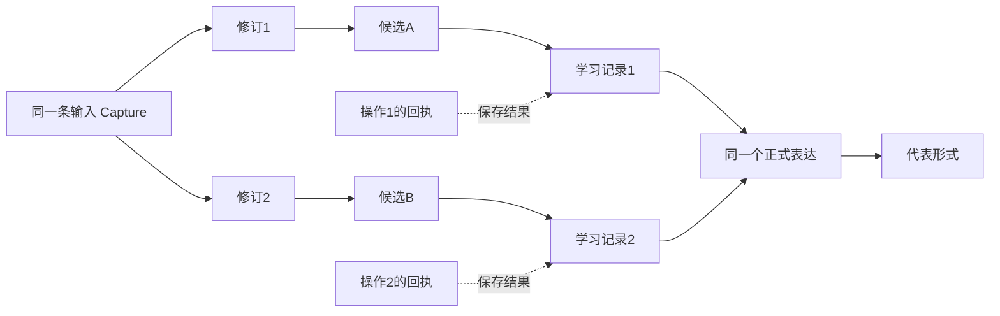
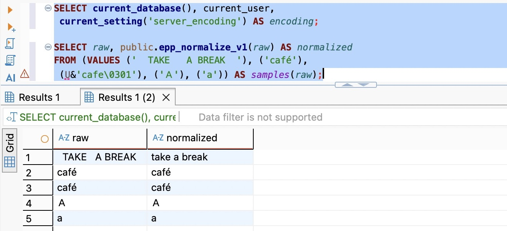
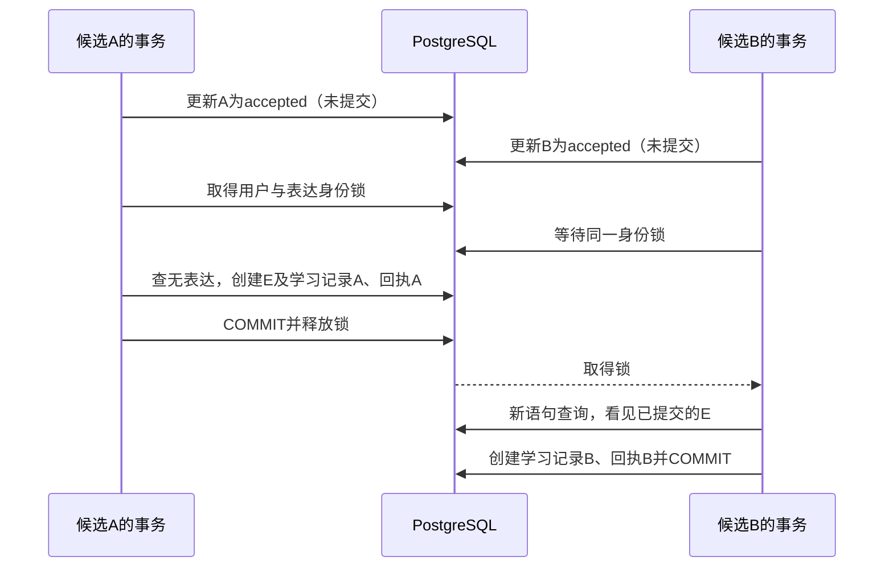
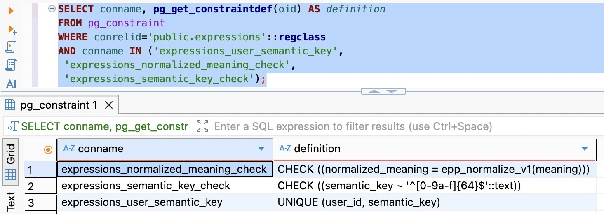
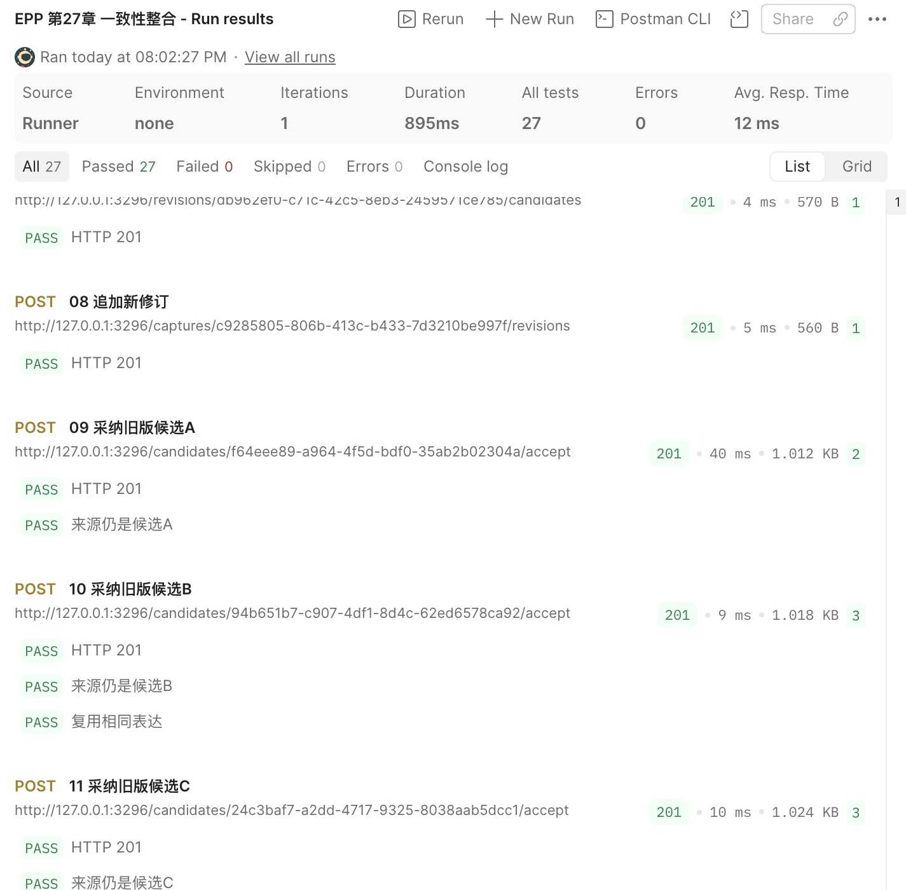
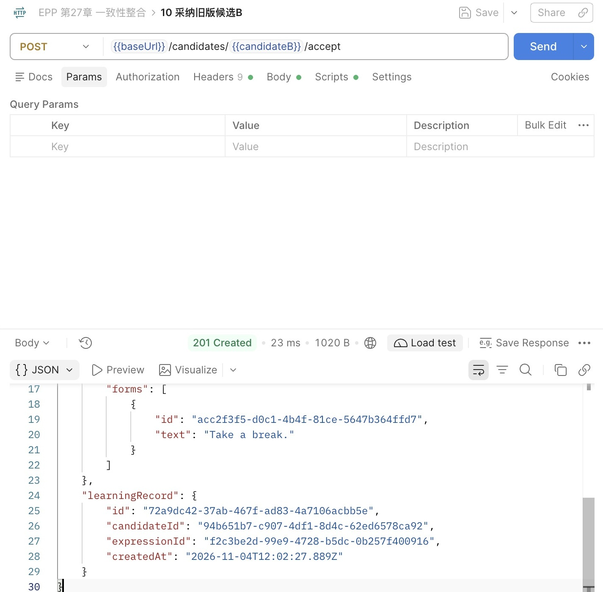
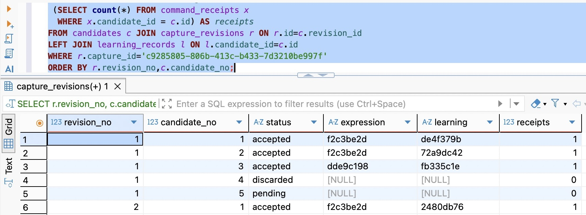
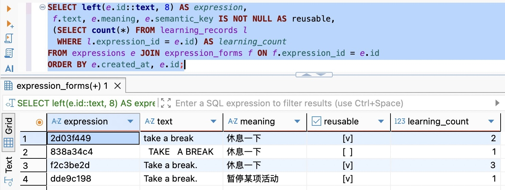
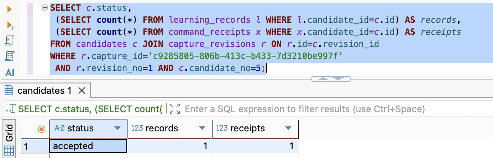
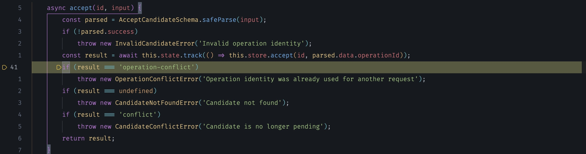

# 第31章 一致性整合：完成可靠的候选采纳

第二十九章解决了一个很具体的尴尬：数据库已经采纳，客户端却只看到连接断开。现在，客户端保留operationId重发，可以取回原来的201结果，而不是再次创建一套表达和学习记录。第二十五章以来建立的修订、状态、事务、并发与幂等，终于能够共同回答“这次操作有没有完成”。

不过，还有一种重复不属于重发。昨天我从一段对话里保存了 `Take a break.`，今天又从另一段输入里选中了同一句话。它们是两个候选、两次决定、两个操作身份，不能以幂等键相同为由阻止第二次采纳。若含义也相同，却每次增加一个正式表达，后面的学习列表就会被同一个内容切成多个身份。

反过来，只看英文相同便强行归到一起也不可靠。`bank` 可以表示银行，也可以表示河岸。本章要在已有完整采纳链中补上这层判断，并把旧数据库一起带过来：怎样确定哪些内容可以复用，怎样防住两个不同候选同时创建相同表达，怎样保留每次采纳的来处，又怎样继续解释已经保存过的旧结果。

代码起点为 `part-04/chapter-30`，沿用 Node.js 24.22.1、PostgreSQL 18、Prisma 7.10.1 和前章开发配置。本章完成状态为 `part-04/chapter-31`，不增加依赖。仍使用固定开发用户和人工填写的候选；生成、相似推荐与向量并非本章的运行前提。

阅读约 165～195 分钟，跟做另加 105～140 分钟，选做支线 31A 另留时间。可先完成模型与事务实现，再停写迁移和联调，最后核对旧回执与恢复，不要在代码仍缺新必填字段时启动写入。

## 31.1 先把一次采纳的不同身份放回同一条链

先看今天的候选究竟承诺什么。Capture保持一条输入记录的身份；CaptureRevision保存某一版输入；Candidate引用具体修订，保存当时准备采纳的英文与中文义项。新修订出现后，旧候选仍然描述那一版内容，不能悄悄改挂到最新版本。

Expression表示正式表达的身份，ExpressionForm保存它的显示形式。LearningRecord则记下某个用户从哪个候选采纳了哪个表达。因此，复用Expression不要求复用LearningRecord：今天的决定仍有自己的来源。回头查询昨天那次采纳时，也不能因为今天出现了更好的拼写，就把昨天的candidateId改成今天的。

这与“我的收藏中每个商品只占一行”是两种需求。收藏关系通常以用户和商品唯一；这里的学习记录承担采纳来源，允许同一用户从不同候选指向同一个表达。若以后要显示“我共有几个不同表达”，应按表达身份组织查询；若要显示“我是从哪里收录的”，就读取学习关系。把两种行粒度混为一谈，常见结果是列表数量变少了，来源也丢了。第三十二章会用实际查询继续区分它们。



沿着图再问一次“重复的是谁”。同一operationId重发，是同一个操作，重放原结果；换一个operationId再次采纳同一个已accepted候选，是新的命令碰到不再成立的状态前提，仍然409；不同候选内容相同，是不同来源指向同一表达，允许各自成功。三个判断依次使用操作身份、候选状态和表达身份，不靠一个通用的“去重”布尔值解决。

第三十章又让创建与追加在响应丢失后保留原ID和版号，带键与无键客户端均继续可用。

本章只改变第三个判断。候选创建、放弃、修订追加的输入契约不变，采纳Body仍只有operationId；归属判断仍沿候选、修订、输入查询。表达复用增加用户范围：即使两个人保存了相同文本，也不共享一个人的显示形式、创建时间或后续编辑权。当前用户仍来自开发常量，尚不能把这个范围条件称为真实认证。

把纸分成左右两栏。左栏记这次单击之前已经存在的东西：输入甲、它的第一版、从第一版选出的候选甲。右栏先留白，准备写这次成功后才有的事实。若库里还没有对应表达，右栏要填一个表达、一条代表形式、一条学习记录、一份成功回执；左栏的候选状态同时从待选变为已采纳。现在换一个来源，新候选乙引用另一版输入，却有相同英文和义项。第二次只须在右栏再添一条学习记录和一份回执，同时改变乙的状态。前一行的表达编号应当抄下来复用，来源候选编号却必须改填乙。这里有两个事实各出现了两次，一个是人做了两次决定，一个是客户端可能发送了两次请求；只有前者要求学习记录增加两条。

用这张纸可以先设计客户端，即使还没写新查询。采纳按钮对应列表中的某条候选，按下时要保存这个候选的完整编号和本次操作编号。若请求发出后页面暂时没有收到结果，用户想确认刚才那一下，接下来要带回这两个原编号。若用户回到另一段输入，明确选中另一条候选，这次才领新的操作编号。按显示英文做前端缓存键，会让两张卡片误用同一份采纳结果；按按钮点击次数直接累加学习计数，又会把重放也加进去。应当用成功响应里的学习记录编号标识已经展示过的那一次决定。后端能正确重放，页面仍需用正确的身份解释它。

一个容易忽略的反例是，两条候选甚至可能来自同一修订。用户从同一段话挑出两种值得学习的表达，候选序号只负责区分当时的备选项。若让修订编号充当采纳操作编号，第一条成功后，第二条就无法作为独立命令交代；若让正式表达编号充当操作编号，第一次采纳时连表达是否已存在都还不知道。能够用来重发的编号必须在发请求之前就确定，响应中才知道的学习记录编号适合以后定位结果，不适合拿来发起这次写入。身份看起来都是一串 UUID，生命周期却不允许任意替换。

从库里反向读时，再把箭头方向换过来。拿到学习记录，可以沿候选回到那一版素材，也可以沿表达得到当时关联的正式对象；只有同一条学习记录同时握着这两条引用。单从表达出发，根据英文搜索一个候选再去找原文，会碰到两个同样合理的候选，搜索结果的任意顺序都可能把昨天的来源换成今天的。单从输入编号出发直接读当前文本，则会在追加修订后把今天写的内容错放到昨天的决定上。后面的迁移要保护的正是这些已经写进关系里的选择，而非让新算法把旧决定再算一次。

把这组身份翻译成第一条只读 SQL，可以先在 DBeaver 的编辑器里只写学习表的三列。下列查询只用于自己管理的练习库，确认连接和样本后再执行。即使还没部署本章迁移，这三列也已存在。

```sql
SELECT l.id AS learning_id, l.candidate_id, l.expression_id
FROM public.learning_records AS l
WHERE l.user_id = '10000000-0000-4000-8000-000000000001'
ORDER BY l.created_at, l.id;
```

一行先读最左列，把它念成“一次有编号的决定”，然后读中间与右侧两列，分别回答“从哪里来”和“指向谁”。尚未采纳任何候选时结果可以是空表，不能据此断言候选表也是空的。如果要知道哪个待选项还没有去处，就得从候选表出发向学习表做左连接，让没有匹配的候选也保留一行；若目标是解释已经完成的采纳，从学习表出发就已经排除了未选择项。先回答哪种缺席应当看得见，再决定从哪张表开始写，这个判断会反复用到。

## 31.2 给相同内容一个可重建的身份，同时保留原文

### 文本相等要先成为一条明确规则

我希望 `Take a break.` 和 `  TAKE   A BREAK.  ` 在义项同为“休息一下”时复用。最直接的做法是在创建前trim、转小写，然后查数据库。但trim到底去掉哪些字符？英文以外的大小写怎么算？旧数据回填用SQL，在线请求用JS，两边是否真是同一个函数？这些差别一旦进入唯一键，就会变成持久化行为，不能只当作展示格式。

本章选择一个有意保守的v1规则：Unicode采用NFC；连续的ASCII空白折叠成一个普通空格，再去掉首尾普通空格；仅将ASCII的A到Z转成a到z。英文和义项都经过这套规则，标点不删除，全角字母不折成半角，不做词形还原，也不判断同义句。

NFC处理的是等价的Unicode表示。例如重音字母é既可能以一个字符保存，也可能以e加组合重音保存，规范化让这两种编码得到一致结果。NFKC还会折叠兼容字符，作用更强，却也会放弃更多区别。当前没有把这些区别视为无关的业务依据，所以保留它们。这里的ASCII大小写折叠同样是一项产品决定，不是适用于密码、商品编码或所有语言文本的默认清洗。

因此，这个“义项身份”是**同一用户下，规范化英文与规范化义项这一对值的精确身份**，不是机器已经理解了含义。`休息一下` 与 `稍作休息` 可能指向同一个意思，但v1仍分开；相同英文而中文义项不同，也分开。保守重复可以留待人工确认，误合并则会把本来不同的学习内容混在一起。改变这条规则需要另一次数据演进，支线31A会继续展开。

规范化只生成比较用的值。候选的englishText、chineseMeaning和正式表达的显示文本都保留原样，否则“去重”会顺手改掉用户输入。复用时采用已有代表的显示形式，新候选自己的拼写仍能从来源链读回。当前每个表达仍只有一个代表形式；ExpressionForm的存在不意味着已经允许把 `have a rest` 自动添加成 `take a break` 的另一个形式。

从一对日常输入手算比较过程。第一位学习者的候选写成两个单词，中间一次按了制表键，结尾有一个英文句号；同一个人的第二条候选将这两个单词全部大写，中间多打了两个空格，仍带句号。先分别取英文原值与义项原值，得到两个二元组。对每一个分量单独做规范化，空白段各自缩成一个空格，英文字母落到同一种大小写，句末的点仍占一个位置。若两个义项也是同样的文字，最后才有依据判定二元组相等。如果第二句少了句号，差别会一直保留到最后一步，尽管朗读出来可能听不出区别。每一步都能解释哪些差异已经消失，还剩什么需要比较。

为何两个分量必须各自处理？假定有一组英文以空格结尾，另一组义项以空格开头。如果把英文和义项先连成一句长文字，再折叠空白，那么字段的分隔处很容易在折叠时消失。同样的问题甚至不需要空白，只要前一组的英文比后一组多一个字母，而后一组的义项正好从那个字母开始，拼完就可能一样。把两个分量放进有位置的数组，先后和边界都成为被计算的输入。版本标记还告诉以后维护者，这个输入是按哪套办法构成的。比较两个摘要时能回答的问题很窄，只有在同一规则、同一字段顺序、同一编码下产生，才有这层比较意义。

在这一步切勿用页面排版判断两个值是否相同。普通页面显示会把一些连着的空白压在一起，字体也可能让全角与半角的差别很不明显。要看清楚，可以在迁移成功后的校验库里把两个原值、两个比较值和数据库的相等判断放在同一行显示。先看最后那一格的真或假，再去两边的值中解释原因。若只拿鼠标在结果网格里选中文字凭肉眼比对，恰好会遗漏这条规则最需要说明的差别。给显示字段留原值，也使我们有材料解释“页面上明明大小写不同，为什么算同一表达”的疑问。

### 把规则放在回填与在线请求都能调用的位置

这次不在Node和SQL中各写一份近似实现。追加迁移 `prisma/migrations/20261104160000_expression_identity/migration.sql`，先定义有版本的数据库函数。它们没有读取业务表，同一输入产生同一输出；服务端通过带参数查询调用。

```sql
CREATE FUNCTION public.epp_normalize_v1(value text) RETURNS text
LANGUAGE sql IMMUTABLE STRICT PARALLEL SAFE
RETURN translate(btrim(regexp_replace(normalize(value, NFC), E'[ \t\n\r\f\013]+', ' ', 'g')),
  'ABCDEFGHIJKLMNOPQRSTUVWXYZ', 'abcdefghijklmnopqrstuvwxyz');

CREATE FUNCTION public.epp_identity_v1(english text, meaning text) RETURNS text
LANGUAGE sql IMMUTABLE STRICT PARALLEL SAFE
RETURN encode(sha256(convert_to(jsonb_build_array('epp-expression/v1',
  public.epp_normalize_v1(english), public.epp_normalize_v1(meaning))::text, 'UTF8')), 'hex');
```

正则中的空白范围是显式列出的：普通空格、制表、换行、回车、换页及垂直制表，不依赖JavaScript的 `\s` 与数据库字符分类刚好相同。translate只替换列出的ASCII字母，也避免lower随数据库locale变化。STRICT表示传入NULL便返回NULL，不能替代业务字段必填；IMMUTABLE是我们对规则稳定性的声明，不能在原函数名下改算法后假装历史比较值仍然有效。PostgreSQL的normalize要求UTF8数据库，先在DBeaver执行 `SHOW server_encoding`。[字符串函数官方说明](https://www.postgresql.org/docs/18/functions-string.html)可用来核对这些具体语义。

为什么又计算摘要，而不是直接把两个长文本建成联合唯一键？两个输入各允许2000个UTF-16单元，用完整文本建立B-tree唯一索引可能碰到[单条索引项的大小限制](https://www.postgresql.org/docs/18/btree.html)。摘要把查找键控制为64个十六进制字符。JSON数组带上规则版本，保留字段边界，避免直接拼接出现 `ab+c` 与 `a+bc` 的歧义。数据库以UTF8字节计算SHA-256；Node不再另造一种序列化来计算同一个键。

摘要不是额外的语义判断，也不是加密。持有文本的人可以重新计算，不能把它当作匿名化后允许随意记录的内容。在在线复用时，我们还会比较实际的规范化值；若摘要命中但值不一致，就失败回滚，不能以“碰撞很少见”为由把内容关联错。迁移同样先检查这一情况再选择代表。

完整迁移应用后，再打开 `database/chapter-27/01-inspect.sql`，在校验库连接里执行规范化样例；此时函数才实际存在。第一行应为 `take a break`，两种café应相同，全角Ａ仍与ASCII a不同。观察结果后再决定是否接受这套业务规则；不要为了让几条样例合并，继续追加没有边界的replace。



图31-1：同一数据库函数折叠ASCII空白和大小写，并统一两种café编码；全角Ａ仍保留。

写第一份规则对照时，不必先翻迁移代码。想证明英文空白变化可以复用，就让两份输入只在英文上有这一处差异，义项完全相同；想证明义项参与身份，就固定英文再换义项。两项同时改变最后得到不同摘要，并不能说明究竟哪一个分量起了作用。DBeaver 里新开同一校验库的 SQL 编辑器，等 31.3 的迁移完成再运行下面的只读语句。每个样本是一行，故意让预期相同与预期不同的两类都出现。

```sql
WITH samples(label, left_en, right_en, left_zh, right_zh) AS (
  VALUES
    ('空白', E'Take\ta break.', '  TAKE A BREAK. ', '休息', '休息'),
    ('标点', 'Take a break.', 'Take a break', '休息', '休息'),
    ('义项', 'bank', 'bank', '银行', '河岸')
)
SELECT label, public.epp_normalize_v1(left_en) AS lhs,
       public.epp_normalize_v1(right_en) AS rhs,
       public.epp_identity_v1(left_en, left_zh) =
       public.epp_identity_v1(right_en, right_zh) AS same_key
FROM samples ORDER BY label;
```

先写出中间两列再选最后一列，是为了辨认“英文比较值一致，整体键却不同”这个正常结果。空白行的两列应相同，键也相同；标点行在句末还留着差别，键不同；义项行的英文看起来完全一样，键仍不同。把义项行右边的中文改回银行，只重新执行这个 SELECT，两列英文都不会变，键的判断却会翻转。这一次没有往表达表放进任何一行，观察到的只是规则对输入的作用。要让相等的键落实为复用的表达，还需要下一节的用户范围、事务和真正的来源记录。

若以后看到同一个摘要出现在两位用户的结果里，也不要因上面的对照就直接说数据库重复了。函数输入只有英文和义项，没有用户编号；规则相同的两个人当然可以得到相同比较值。数据库查找与唯一约束才把用户编号和摘要配成一对。把用户塞进摘要再省掉查询里的用户条件，会让检查所有权变得难以审读；保持单独的用户列，可以在结果表格中看清楚两行属于谁，也能对普通关系使用外键。摘要负责把长的复合内容变成有限长度的查找材料，归属仍由数据模型表达。

### 新字段描述当前判断，旧字段继续描述历史

Prisma模型在 `prisma/schema.prisma` 增加以下字段和关系；已有id、meaning、createdAt、forms及learningRecords保持：

```prisma
// User 中增加反向关系：expressions Expression[]
// Expression 中增加：
userId            String  @map("user_id") @db.Uuid
normalizedMeaning String  @map("normalized_meaning") @db.Text
semanticKey       String? @map("semantic_key") @db.Text
user User @relation(fields: [userId], references: [id],
  onDelete: Restrict, onUpdate: Restrict, map: "expressions_user_id_fkey")
@@unique([userId, semanticKey], map: "expressions_user_semantic_key")

// ExpressionForm 中增加：
normalizedText String @map("normalized_text") @db.Text
@@index([expressionId], map: "expression_forms_expression_id_idx")
```

表达增加userId，是因为复用身份必须在一个用户范围内裁决；旧表达的归属可以从已有学习记录推导。normalizedMeaning和normalizedText保存可核对的比较值。形式表按expressionId加索引，配合读取代表形式；并不因此再给完整长文本建唯一索引。

最容易让人困惑的是semanticKey为什么允许NULL。第二十七至二十九章可能已经采纳过两个内容相同的候选，它们分别生成E1、E2，学习记录和回执各自保存对应ID。如果现在只留一个表达，再把外键全部指过去，旧回执里仍有另一个ID；进一步修改回执JSON，又违背了前章“重放原结果”的承诺。

我们选择保留两条旧表达，只从同一用户的同组旧内容中选一条，供今后的新采纳复用。代表持有semanticKey，其他历史副本的key为NULL；所有显示字段、ID、时间和引用都保留。NULL不是未知义项，也不是待删除标记，只表示“不作为新采纳的复用入口”。PostgreSQL默认唯一约束允许多个NULL，因此可以同时保留这些旧行，又保证每个非空身份键最多有一个代表。[唯一约束的NULL规则](https://www.postgresql.org/docs/18/ddl-constraints.html#DDL-CONSTRAINTS-UNIQUE-CONSTRAINTS)正好服务于这条明确需求。

旧内容回填不能凭感觉。迁移先验证每个表达恰好有一个形式，且学习记录只归属于一个用户；没有来源或跨用户的历史都主动报错。正常前章实现满足这个前提，但手工SQL或其他导入可能不满足。报错时应回到原始来源修复，不能SELECT第一条就当作找到答案。

在完整迁移中，下面的审核放在新增列之前；异常由数据库抛出，沿外层事务整体回滚。

```sql
DO $$ BEGIN
  IF EXISTS (SELECT e.id FROM public.expressions e
    LEFT JOIN public.expression_forms f ON f.expression_id = e.id
    GROUP BY e.id HAVING count(f.id) <> 1)
    OR EXISTS (SELECT e.id FROM public.expressions e
    LEFT JOIN public.learning_records l ON l.expression_id = e.id
    GROUP BY e.id HAVING count(DISTINCT l.user_id) <> 1) THEN
    RAISE EXCEPTION 'Expression history needs owner/form review';
  END IF;
END $$;
```

在校验通过后，迁移追加列、用版本化函数回填，再按created_at/id选代表。关键回填片段如下，前后的事务、异常检查、字段收紧和约束见配套完整迁移：

```sql
ALTER TABLE public.expressions ADD COLUMN user_id uuid,
  ADD COLUMN normalized_meaning text, ADD COLUMN semantic_key text;
ALTER TABLE public.expression_forms ADD COLUMN normalized_text text;
UPDATE public.expression_forms SET normalized_text = public.epp_normalize_v1(text);
UPDATE public.expressions e SET user_id = owners.user_id,
  normalized_meaning = public.epp_normalize_v1(e.meaning),
  semantic_key = public.epp_identity_v1(f.text, e.meaning)
FROM (SELECT DISTINCT expression_id, user_id FROM public.learning_records) owners,
  public.expression_forms f
WHERE owners.expression_id = e.id AND f.expression_id = e.id;
```

回填之后、选择代表之前，还要用以下检查拦住“同一摘要对应不同规范化值”；失败时不猜测合并对象。

```sql
DO $$ BEGIN
  IF EXISTS (SELECT e.user_id, e.semantic_key FROM public.expressions e
    JOIN public.expression_forms f ON f.expression_id = e.id
    GROUP BY e.user_id, e.semantic_key
    HAVING count(DISTINCT jsonb_build_array(f.normalized_text, e.normalized_meaning)) > 1) THEN
    RAISE EXCEPTION 'Expression identity collision needs review';
  END IF;
END $$;
```

通过上面的检查后，再选择代表：

```sql
WITH ranked AS (
  SELECT id, row_number() OVER (PARTITION BY user_id, semantic_key ORDER BY created_at, id) AS position
  FROM public.expressions
)
UPDATE public.expressions e SET semantic_key = NULL FROM ranked r
WHERE e.id = r.id AND r.position > 1;
```

row_number在每个用户、每个身份组内编号。created_at选较早记录，id处理同一时间的并列，保证重复执行同一选择规则有确定依据。这个顺序只定义复用代表，不代表最早的一条内容质量最好。这里不能用MIN(id)去猜时间，也不能把“查询先返回的一行”当作稳定顺序。

随后user_id、两个规范化字段收紧为NOT NULL；表达增加用户外键与 `(user_id, semantic_key)` 唯一约束，规范化列以CHECK核对对应显示字段计算值，非空摘要必须是64位小写十六进制。CHECK负责本行派生值，跨表“这个摘要究竟对应哪个形式”仍由写入事务和复用时的值比较承担。不要声称几条CHECK已经阻止一切任意SQL破坏。

下面是迁移末尾的实际收紧代码，执行完才COMMIT。迁移开头的BEGIN、有限lock_timeout和statement_timeout保持；所有审核、回填与收紧属于同一事务。

```sql
ALTER TABLE public.expressions ALTER COLUMN user_id SET NOT NULL,
  ALTER COLUMN normalized_meaning SET NOT NULL,
  ADD CONSTRAINT expressions_user_id_fkey FOREIGN KEY (user_id) REFERENCES public.users(id)
    ON DELETE RESTRICT ON UPDATE RESTRICT,
  ADD CONSTRAINT expressions_user_semantic_key UNIQUE (user_id, semantic_key),
  ADD CONSTRAINT expressions_normalized_meaning_check
    CHECK (normalized_meaning = public.epp_normalize_v1(meaning)),
  ADD CONSTRAINT expressions_semantic_key_check CHECK (semantic_key ~ '^[0-9a-f]{64}$');
ALTER TABLE public.expression_forms ALTER COLUMN normalized_text SET NOT NULL,
  ADD CONSTRAINT expression_forms_normalized_text_check
    CHECK (normalized_text = public.epp_normalize_v1(text));
CREATE INDEX expression_forms_expression_id_idx ON public.expression_forms(expression_id);
```

现在反过来，从空白开始写迁移前的审核查询。我们想找到“不能自动决定归属或代表形式”的表达，因此根表应当是全部旧表达。先在纸上列出三行：甲有一个形式、两次来源，两次来源都属于同一人；乙有一个形式、没有来源；丙有两个形式、一次来源。甲可以推导归属且形式唯一，乙的归属未知，丙不知道选哪个形式。预期异常表只出现乙和丙。这个小表足以检验好几种貌似合适的 SQL 写法。

先只解决形式个数。在表达表后左连接形式表，连接键是形式行的表达编号等于根行编号，按根行编号分组。这里要数右表的主键。一个表达没有任何形式，左连接仍保留一行，右表主键是空；数星号会报一，数右表主键才报零。然后加 HAVING，对分组后的数字挑出不等于一的组。WHERE 在分组前处理单行，那时还不知道一组有几个形式，不能在那个位置判断这个数字。读完这些再回看上面的审核，第一半正是把这个问题写成“是否存在任意一个异常组”。

归属检查同样从表达左连接学习记录，但要改被数的对象。对甲，数来源主键得到二，数不同的用户编号才得到一。我们需要知道能不能无歧义地填入一个用户编号，只有第二个数字在回答这个问题。对乙，左连接后的用户编号为空，数不同用户得到零，于是即使一条学习关系也没有，它仍出现在异常表里。两道检查分开写还有一个好处：如果先把形式和来源都连上，甲的同一个形式会跟两条来源各配成一行，形式数就被来源数放大。一个合法可回填的表达可能因此被错判。配套审核脚本让两个计数各自针对根行求值，结果网格会把两个数字放在同一行。

选代表也可以先写成只读查询。假设同一用户同一组有三条旧表达，其中两条创建时间相等。先只选编号、用户、键、创建时刻，按用户和键观察哪些行属于同一组；接着在选择列里加上窗口编号。窗口内按创建时间升序排列，并列时用完整编号升序补足。三行还应当完整显示，只是多了一列一、二、三。若一加分组就只剩下一行，你已经把第二和第三行的身份丢掉，后续更新便不知道该把谁的复用键置空。窗口保留每一行，普通聚合把一组收成一行，这正是两者在本次维护里的关键区别。

把这个推导放回迁移次序。刚回填完时三行都有相同的非空键，若这时就加唯一约束，数据库会拒绝已有数据。先验证同键下确实是相同比较值，再只把第二、三行的复用键清空，最后才装唯一约束。若反过来先清空，原先作为一组的比较材料就分散了，摘要关联不符的旧行可能已经避开检查。清空后再去跑未加过滤的窗口查询，也不能期待得到原编号结果，因为此时空键可能属于许多原本不同的组。想在升级后复查当时的分组，应从保存的形式与义项重新计算比较键，而非把所有空键看成一组。

这段顺序还说明恢复时该观察什么。迁移开始到提交之前，做审核的会话能看到自己刚写的列和临时重复键，另一普通读取会话不能把这些中间态当成可交付结构。完成后，应当在新查询中看到旧行都在、每个内容组有一个可复用代表、有键行的比较值仍可从原值推导。单查“有没有重复非空键”会漏掉整个组都被置空的情况：零个代表同样没有违反“至多一个”。数据库的唯一约束守住上界，迁移的选择步骤和后验对账共同确认正常历史确实留下一个入口。

## 31.3 在同一事务里复用表达，保留每一次决定

### 两个不同候选会绕开已有的候选锁

第二十八章的pending条件更新和candidate_id唯一约束，已经防住两个请求重复采纳同一个候选。但A、B是两条不同候选，更新的不是同一行，两个请求都可能先查到“没有这个表达”，然后各自创建。第二十九章的操作锁也不解决它：A、B有不同operationId，理应各自通过。

所以，我们要协调的是**还可能不存在的表达身份**。已有用户／操作锁不动，先完成候选归属、回执重放与pending条件更新，再计算表达键，按用户和键取得事务级建议锁，取到锁后重新查询表达。相同身份的两个事务在这里排队；不同身份仍可并行。唯一约束留作数据库防线，不把建议锁当作任意写入者都会遵守的强制约束。



READ COMMITTED下，取锁之后的独立SELECT会取得新的语句快照，因此能看到前一个事务刚提交的表达。若把查表达与等锁塞进同一条语句，不能仅凭“语句里写了锁”便断言查询使用了等锁后的新快照。这正是第二十八、二十九章反复区分取锁位置与读取位置的原因。

当前每个采纳只处理一个候选和一个表达身份，顺序固定为操作锁、候选条件更新、表达身份锁。放弃只更新候选，不持有表达锁，因此没有反向锁序。未来若增加批量采纳、合并两个表达或账户处置，必须重新列出所有写入入口和锁顺序；不能把本章顺序机械扩展为“循环里挨个锁就行”。账户状态和处置入口尚未建立，本章不添加一个没有竞争对手的全用户门闩来制造完整感。

把两个合作的采纳会话当成结账的两位同事。甲乙各自核对自己手里的候选，看到的都是合法的待选状态。两人各自更新自己的候选行，完全不必在这里相互等待。此时让第三个会话查询，在他们都还没提交的条件下，第三方仍会看见两条待选；各事务内部则知道自己的条件更新已经成功。状态更新成功只是自己取得了继续处理这一候选的资格。页面若在这一步就宣布采纳成功，后面一次查找或回执写入失败，读者就会看到一个永远找不到学习来源的成功提示。

接下来假设甲先取得表达锁，乙在同一个身份上等待。若甲成功提交，乙要做的是少写一条表达，多写自己的来源；若甲最终回滚，乙应当创建自己的表达，仍能正常完成。这两个结局在乙开始等待时不可区分，乙不能记住等待之前的查空结果，也不能因为自己等过就推断甲肯定成功。等待只解决“谁先作决定”，新查询才回答“在我能作决定时，库里实际有什么”。如果把一次未命中缓存在事务外，重试时沿用，就会恰好失去锁后重读的保证。

考虑只设唯一约束、两个会话都先尝试插入的方案。约束能阻止重复的正式身份落库，但失败的一方还欠用户一条本来合法的学习来源。若直接返回冲突，用户选了不同候选却被当作同一候选重复采纳，改变了产品规则。要用冲突插入实现相同效果，就得让失败的一方能转入查已有代表、核对实际值、创建自己的学习记录这条路径，而且不能在已经中止的事务里继续写。本章用事务锁把共同判断放到插入之前，两边的成功路径可以直接读出来；唯一约束继续保护所有入口。将来再比较不同实现，评判标准应包括两条候选都能留下来处，而不能只数最后有几个表达。

有时读者会想把锁提前到整个请求最前面。可此时手里只有候选编号与操作编号，尚未读到候选所属修订，也没有用于比较的英文与义项。如果随手拿候选编号作锁名，乙与甲拿的仍是两个不同的锁。若把锁放大到固定用户，每次采纳都能排队，写两条完全不同的表达也无端互等。先解决操作重放、再取得候选、从已保存内容算键，锁的范围恰好随可获得的事实缩小。哪怕同一个用户连续提交两条英文相同而义项不同的候选，也只有在真正共享的事实处才需要协调。

### 把新判断插进原有提交链

在 `src/prisma-candidate.store.ts` 的accept事务里，用以下部分替换原来的“每次create表达”。位置仍在claimed.count检查之后、创建learningRecord之前；回执读取和写入、错误映射与有限P2034重试沿用第二十九章。

```ts
const [identity] = await tx.$queryRaw<{
  normalizedText: string; normalizedMeaning: string; key: string;
}[]>`
  SELECT public.epp_normalize_v1(${candidate.englishText}) AS "normalizedText",
    public.epp_normalize_v1(${candidate.chineseMeaning}) AS "normalizedMeaning",
    public.epp_identity_v1(${candidate.englishText}, ${candidate.chineseMeaning}) AS key
`;
if (!identity) throw new Error('Expression identity is missing');
const expressionLock = JSON.stringify(['expression', DEVELOPMENT_USER_ID, identity.key]);
await tx.$queryRaw`SELECT pg_advisory_xact_lock(hashtextextended(${expressionLock}, 0))::text`;
let expression = await tx.expression.findUnique({
  where: { userId_semanticKey: { userId: DEVELOPMENT_USER_ID, semanticKey: identity.key } },
  include: { forms: true },
});
if (expression) {
  if (expression.normalizedMeaning !== identity.normalizedMeaning || expression.forms.length !== 1
    || expression.forms[0]?.normalizedText !== identity.normalizedText) {
    throw new Error('Expression identity does not match');
  }
} else {
  expression = await tx.expression.create({ data: {
    id: randomUUID(), userId: DEVELOPMENT_USER_ID, meaning: candidate.chineseMeaning,
    normalizedMeaning: identity.normalizedMeaning, semanticKey: identity.key,
    forms: { create: { id: randomUUID(), text: candidate.englishText,
      normalizedText: identity.normalizedText } },
  }, include: { forms: true } });
}
```

这里有两个哈希，各自承担不同责任。SHA-256摘要进入持久化唯一键，命中后还要比对规范化值；hashtextextended把协调用的字符串映射为建议锁编号，它的碰撞只会让原本无关的请求多等一会儿。它不能替代数据库里的完整身份，也不作为对外稳定算法。锁的语义和生命周期见[PostgreSQL建议锁说明](https://www.postgresql.org/docs/18/explicit-locking.html#ADVISORY-LOCKS)。

表达找到以后，不更新它的meaning、forms或createdAt。否则第二次采纳将顺带编辑第一次保存的正式内容，也改变正在学习的对象。学习记录仍按当前候选新建：

```ts
const learningRecord = await tx.learningRecord.create({ data: {
  id: randomUUID(), userId: DEVELOPMENT_USER_ID, candidateId: id, expressionId: expression.id,
} });
```

随后照旧用AcceptanceSchema构建公开响应、保存回执，再提交整个事务。Schema只投影原先承诺的id、显示内容、时间和来源；新加的userId、semanticKey、normalizedMeaning、normalizedText不会因为ORM返回了它们就泄漏到接口。旧回执不需要补字段，依然能通过同一个公开Schema重放。这次内部模型增加的信息，不应迫使调用方了解数据库的比较键。

存储函数、唯一约束与新列都是这段代码的运行前提。`src/database.service.ts`启动时继续试读模型，并额外核对expressions_user_semantic_key确为不可延迟的 `UNIQUE (user_id, semantic_key)`，调用一次epp_identity_v1确认函数可用；错误使用安全码EXPRESSION_CONSTRAINT_MISSING，不打印连接串或文本。这里是启动防错，不能替代迁移历史、SQL约束和旧数据核对。

沿代码看一次命中后不写的字段。假设甲创建了英文全部大写的代表，乙的英文使用标题大小写。乙拿到 identity 后先查同一用户的非空键，在 expression 对象里看到的是甲的显示字符串；如果接下来拿它与乙的原始字符串直接做等号，两条规范化一致的输入反而会在复核时失败。复核要拿甲的比较值与乙刚算出的比较值比，同时确认已有表达只有一个形式。通过后响应里保留两个不同的显示位置。用户看正式词条能继续认出第一次选定的写法，看来源候选又能认出自己这次提交的那一项。能在一次响应中同时保住二者，才说明规范化没有越权改写展示。

回滚也要分创建与命中两条路径推导。假设事务最后保存回执失败，甲走的是新建表达路径，那么本次新加的形式、表达、学习记录、候选状态应一起撤销。若失败的换成乙，乙用的是早已存在的代表，撤销只能撤掉乙这次的新关系与状态，不能顺手删除甲的表达和形式。数据库事务天然以本次写入为边界，事后补偿脚本却容易按响应里的编号把原来就有的对象也删掉。测试清理尤其要分辨“本次结果引用了这个对象”和“本次测试首次创建了这个对象”；两句都能取得相同编号，只有后者才可能对清理范围提供依据。

另一个需要读准的位置是重放。库里若已保存本操作的成功回执，会先核对动作、候选与请求指纹，然后直接从保存的响应解析公开结构。在这一分支没有必要重新取得表达身份锁，也不必重新比较内容。若把候选必须待选的判断移到回执读取之前，所有原本成功过的操作都会因为候选已采纳而无法重放。若把重放改为用今天的规则重新找表达，以前指向历史副本的响应又可能悄悄换成代表。这两种重排看起来都节约了分支，破坏的却分别是响应丢失后的恢复与旧结果的可解释性。

### 在完整旧数据上应用追加迁移

空库上全部成功，只说明新的建表序列能执行。先保留第三十章数据库中的样本（其中可以含更早的采纳）；如果还没有重复表达，可以在升级前用两个不同候选、两个operationId采纳相同文本与义项。旧版会产生两条表达，正好构成本章要处理的历史。保存两次响应和它们的操作身份；不要在当前已升级库启动旧程序来补造旧数据。

先停止旧写入者，按[25.3 的备份与独立恢复](../chapter-25-revisions/chapter.md#先备份再在另一个库恢复一次)为本次第三十章状态生成新归档，恢复到独立的全新校验库。把 VERIFY 配置指向这次恢复的库，先在 DBeaver 核对库名并执行 `database/chapter-27/02-history-audit.sql` 第一条，异常结果应为空。保存用户、素材、修订、候选、表达、形式、学习记录、采纳回执和素材写入回执这九张表的旧字段基线，包括完整编号、关系、时间及回执 JSON。表中原本没有某类回执时也记下零行；若第 30 章留下了带键的创建或追加，就连同操作类型、状态码和 Location 一起核对。只有采纳回执参与本章采纳事务，另一张回执表仍是需要随旧库带过来的事实。

在项目根目录检查完成代码，向已恢复旧数据的 VERIFY 部署随本章提供的追加迁移：

```bash
nvm use
npm ci
npm run check
unset DATABASE_URL SHADOW_DATABASE_URL
npm run db:verify -- migrate deploy
npm run db:verify -- migrate status
npm run db:verify -- migrate diff --from-config-datasource --to-schema prisma/schema.prisma --exit-code
```

`db:verify` 读取 `.env.database-verify`，`db` 读取 DEV 的 `.env.database`，API读取自己的 `.env` 或进程配置；先分别确认数据库名。已有DEV要沿同样的停写和核对顺序升级，命令改为 `npm run db -- migrate deploy`。不要把VERIFY验证成功当作DEV已经更新。迁移有显式BEGIN／COMMIT、2秒lock_timeout和30秒statement_timeout，小规模已有数据在停写窗口完成；大表需要重新估算锁持有与回填成本，不能原样照搬这份一次性UPDATE。

模型和存储实现已一起修改后再执行这些命令。SQL函数只随完整迁移创建，不单独执行CREATE片段；check会生成客户端，但不会连接数据库或应用DDL。



图31-2：从pg_constraint读取实际定义，用户与非空身份键的唯一约束和规范化CHECK已经落库。

部署和比较都完成后，先别急着从开发地址发送采纳。刚才运行迁移的是校验库的命令，API 将来要连接的却是它启动时读到的目标。先在 DBeaver 的校验连接执行前文的三行规则对照，再回到开发连接检查当前库名和约束定义；开发库也完成升级、保有旧学习编号之后，才启动指向它的应用。若校验库查得到函数而开发服务启动失败，先沿两个连接各查一次实际目标。把正确的查询放在错误的数据库窗口执行，很容易得到完全可信却与问题无关的绿勾。

对照旧样本时，建议从上一章保存的一次带键追加说起。响应中的输入编号告诉你是哪一份素材，修订编号与版号才确定追加的那一版；采纳回执里的候选又可能来自更早一版。迁移期间只改变表达表与形式表中的派生字段，不应让带键追加领取下一个版号。升级后若需要确认追加兼容，在原操作的同一素材上重放原请求，比较原修订编号与版号，再在修订列表确认没有新版本。若改用一个新的操作编号，前端虽然发的是同一份文字，后端验证的却已经是另一条追加命令。这个区别能解释为什么对账基线要把素材写入回执和采纳回执分别保存。

最后把“回到旧版”拆成两个不同的恢复目标。只是想看迁移前的两个独立表达，可以把停写时的归档另行恢复到一个新库，不对这份副本执行本章迁移，按原编号读取，那是过去一刻的真实状态。如果需要继续承接迁移后已经发生的新采纳，只恢复迁移前归档就会失去归档之后的来源。此时先定位最后成功提交的学习记录与配套回执，再决定如何保留这些新增事实。旧程序还能读出列表，至多说明部分读取兼容，不能证明它能填写新的表达归属、比较字段和复用身份。把恢复目标说成“能读到哪一笔、能否再写下一笔”，比只要求进程重新启动更能检验交付。

### 用保存的请求看到这些差别

迁移完成后启动 `npm run dev`。在Postman导入 `requests/chapter-27.postman_collection.json`，把baseUrl设成实际开发地址，确认没有环境变量覆盖，然后按01～17发送。01会清除本集合上一轮ID并建立新样本，所以已经开始后不要为了重试采纳重新发送01；操作身份在第一次发送之前就保存在集合变量中。

01～07创建一条输入、读取初始修订，再保存五个候选。A是 `Take a break.`／“休息一下”，B只改变英文大小写和空白，C英文相同而义项为“暂停某项活动”，D、E是另外两种说法。08先追加新修订，09～11才采纳旧修订的A、B、C。

对照09与10的响应：expression.id相同，learningRecord.id不同，candidateId各自指回A、B。B的candidate.englishText保留原空白和大小写，expression.forms返回代表形式。11的expression.id不同，证明英文相同不够；中文义项这条比较条件确实参与了判断。

12放弃D，13再采纳D得到409；14读取旧修订候选列表，状态依次为accepted、accepted、accepted、discarded、pending。E没有被选择，不等于被放弃，不写discardedAt，也没有学习记录。15用B原operationId重放原201；16换新operationId再次采纳B得到409。17读取当前Capture，内容已经是08的新修订，但先前学习关系的来源仍是旧修订。



图31-3：本机集合01～17执行完成，27项断言通过；09、10分别核对来源，10额外核对表达复用。



图31-4：B返回已有的 `Take a break.`，learningRecord仍保存B自己的candidateId。



图31-5：修订1的A、B共享expression却有不同learning；D、E分别为discarded和pending。修订2的最后一行是随后调试时额外采纳的同内容候选，也引用同一表达。图中仅缩短ID显示，实际存储仍是完整UUID。

遇到结果不符，先比较具体身份，不要先怀疑事务：复用失败看两个规范化值及用户范围；重放失败看operationId和candidateId；来源变了看LearningRecord.candidateId及候选revisionId。HTTP201只能证明该次请求成功返回，学习记录数量与来源仍需在数据库联查核对。

若库里已经做过一次练习，再按相同顺序运行集合，最容易误判的是“第一条成功后表达表应当多一行”。本轮候选和操作都是新的，但比对的是这个用户已经有的所有代表。上轮留下了同样的正式表达，本轮第一条就会走复用分支。观察时把结论写成两句：对本次两条新候选，应该产生两个不同的学习编号；对这两次采纳返回的表达编号，两者应当相同。至于表达表增加一行还是零行，要在请求前先查明该身份有无代表。不能用一份只适用于空库的总数断言，去评判一个本应兼容历史的实现。

试着不用表达总数，单独写一次本轮对账。打开刚才两个响应，从各自的 candidate 对象复制完整编号。思路是先圈定本轮候选，左连接它对应的学习记录，再选学习编号与表达编号。用下面的查询时把两个零值示例分别替换为甲乙的真实编号；它们都是文本里完整的 UUID。若不替换，占位只会选不到本轮记录。这里从候选出发，即使某一次没有留下学习记录，结果仍能显示缺的是哪一侧。

```sql
SELECT n.id AS candidate_id, n.status, l.id AS learning_id, l.expression_id
FROM public.candidates n
LEFT JOIN public.learning_records l ON l.candidate_id = n.id
WHERE n.id IN ('00000000-0000-4000-8000-000000000001'::uuid,
               '00000000-0000-4000-8000-000000000002'::uuid)
ORDER BY n.id;
```

不要根据第一行就是甲来认人；排序用的是编号，建候选的先后不决定编号字典序。在结果网格里先按 candidate_id 对回各自响应，再横向看学习编号和表达编号。这种对法能识别一种光看总量识别不了的错：两行都成功，也都有来源，却把乙关联到了错误的表达。接着保持两个编号不变，只重放乙，再执行原查询。若两行的所有输出字段都相同，还应回到 Postman 对比乙的旧学习编号及公开 JSON；查询证明来源未换，响应比较才证明调用方拿回原结果。

## 31.4 把生成与语义能力放在正确的边界外

此时记录、修订、候选、正式表达与学习来源已经能够闭环。未来接AI时，不需要把所有东西重写成一个“生成并采纳”接口。生成读取指定修订，产出候选内容；用户采纳时使用候选快照和稳定ID，执行本章已经建立的状态与提交规则。生成失败不能留下accepted，生成成功也不自动成为学习事实。

为什么不在持有表达锁的事务里问模型“这两个是不是一个意思”？首先，网络等待会占住事务和连接，延迟也难以界定；更关键的是，第二次询问可能得到不同答案。若提交前提依赖一次外部判断，就需要先把判断所依据的输入、版本与结果固定下来，再让写入事务验证它仍然适用。后面的任务与语义篇会分别建立这两个环节，本章不把远程调用偷偷插进临界区。

相似推荐也不是唯一身份。向量检索可以说“这些表达值得比较”，却不能单凭分数高就覆盖外键。词义相关、形式相近、语境可替换，是不同关系；哪一种能合并，要有明确的领域决定。一个推荐结果可以过期或重新计算，而LearningRecord的来源与CommandReceipt的成功结果不能随推荐波动。

如果将来确实允许一个义项有多个词汇形式，ExpressionForm会接住形式之间的关系。但那时必须重新定义主形式的选择、别名唯一范围、形式新增入口、响应中的顺序及数量。本章AcceptanceSchema仍要求一个代表形式，不能只往表中插入第二条就算功能完成。当前多形式异常会使复用失败，是在阻止没有完成契约演进的状态继续扩散。

同样，账户处置将引入“用户是否还允许写入”这一共同前提。届时采纳、修订、候选写入和处置应在用户生命周期规则下协调；现在只有固定开发用户，既没有处置状态也没有处置操作。本章通过userId限定复用范围，为后面的身份与权限接入保持归属，但不提前宣称已经完成账号生命周期一致性。

这些接口边界并不是把问题推迟。它们使当前事务只依赖已经持久化、可核对的事实，也让新增能力能找到自己负责的位置。判断AI生成的改动时，可以直接沿依赖问：它是否把外部等待放进锁内，是否用相似度代替身份，是否为了去重改写来源，是否让一次内部字段增加改变了旧回执。每个问题都能在现有代码和数据里找到检验位置。

用一个翻译场景拆开“像”和“相同”。一位学习者给两条表达填写了完全相同的中文义项，一条是请求对方暂时等候，一条是命令对方立刻停手。在某些对话中两者都可以译成“等一下”，在具体语气和适用场合上却值得分别学习。中文相同是可检查的文本事实，把两条英文合成一个正式对象则会改变学习目标。反过来，一个英文词可以在两个上下文里写法相同、义项不同。生成工具提出两个候选正有价值，采纳事务却没有资格因为它们一起生成就抹掉其中一个。这两类例子刚好说明，模型给建议的单位和数据库判定唯一性的单位并不天然一致。

再沿时间推一遍。用户先打开修订一，让外部工具提出表达，等待期间又在另一窗口写了修订二。若生成结果只带输入编号，回来的时候按“最新修订”保存候选，读者以后查到的原文就会与生成时读到的原文不符。修订编号能让结果继续指回修订一；用户愿不愿意把旧素材中的建议采纳，仍由一次独立选择决定。现有集合里的“先追加、再采纳旧候选”已经能检查后半段，不需要真的调用生成工具。要试这个判断，只对比追加前候选中的修订编号与采纳后候选的修订编号，再看当前素材读回的原文，它们服务于不同时间的问题。

把网络等待移到事务之前也不是把同一串代码简单换行。设想工具已经返回一句建议，读者在页面预览时把义项改得更准确。如果采纳按钮临时再让模型生成一次，后端得到的可能已经不是读者刚刚确认的那句。要能解释这笔决定，保存候选时就得固定英文、义项、来源修订；采纳命令随后只引用这个已保存候选。这样即使后来工具升级、当时的输入无法再次生成完全相同的输出，当前事务仍能按已保存事实工作。这里需要的可重现性是“给定保存的输入，决定可以被核对”，不要求外部工具再次作出一模一样的建议。

相似推荐还有一个容易在三条记录上暴露的问题。假设甲乙共享语境，乙丙共享另一种用法，甲与丙却指不同事物。两次成对比较都达到某个阈值，若每次达到阈值就合并对象，最后三条会共用一个身份。再调高阈值，也回答不了旧学习记录该归到哪一边。精确比较采用同一对规范化值，可以逐条重算并检查整组；相似匹配适合排出“先给读者看哪一条”的顺序，过了今天换一套排序也无须迁移来源。两种动作的后果一个是永久改变引用，一个是调整展示，这正是应该分开承诺的原因。

如果产品经理提出“以后都显示更自然的拼写”，先把它翻译成具体读回需求。只是候选卡片上展示润色建议，可以保留原候选并额外说明建议，采纳事实无需改变。若希望正式表达也改名，则要交代旧来源详情看到哪个显示名、旧回执返回哪个字符串，以及两个人同时编辑时谁能改成功。如果还要求确认用户对哪份文字点了同意，就不能只存最后一个显示名。从现在的契约能直接推出一条限制：成功回执继续返回当次公开内容，任何新的展示政策都不能倒过来重算那份回执。这让需求讨论有了可验收的句子，也解释了为什么本章对找到的代表只读不改。

## 31.5 让新旧数据一起通过迁移、读取与恢复

迁移后在DBeaver刷新表结构，打开01-inspect.sql的表达与来源查询。原两条表达都应存在，其中一条reusable为true，另一条false；旧学习记录的expression_id各自保持。另为这组迁移前样本保存并采纳第三个规范化相同的候选（图中旧样本无句号，不能直接用集合里的带句号样本代替），应指向代表，表达总数不增加，学习记录增加一条。之后用升级前保存的两个operationId重放，两份JSON都应与原响应一致，其中一份仍然引用不再承担复用入口的旧表达。



图31-6：前两行是升级前保存的无句号样本，都仍存在；代表有两条学习来源，历史副本保留原来的一条。后两行是Postman的带句号样本，标点和不同义项仍形成不同身份。

这个结果看起来没有“把重复清干净”，但满足了本章的两个目标：新写入不再无条件复制表达，旧事实仍然可解释。查询旧记录时，不得加 `semantic_key IS NOT NULL` 过滤掉历史；读取应从学习记录沿expression_id关联。将来确实要合并旧身份，需要迁移引用、保留可解释的旧ID解析和审计规则，不能借本次规范化回填顺手完成。

在结果网格里把历史验证做成两次不同方向的核对。第一次从旧学习记录编号出发，确认表达编号、候选编号和修订编号逐项保持。第二次从重放结果里的旧表达编号出发，回到表达表核对它的显示义项，再到形式表看原有显示英文。第一种走法能发现引用被挪走，第二种走法能发现引用没动但被引用内容已被覆盖。仅比较旧响应 JSON 相同也不够：回执是单独保存的快照，即使当前表发生了错误修改，它仍可能原样返回。反过来，只确认当前表可读也不能证明原操作仍能重放。必须让这两条证据在同一组编号上相遇。

针对复用入口，可从刚才的迁移再推导一份独立的只读对账。假设同组旧表达有三条，迁移后预期是总行数三、有键行数一。先从表达和形式的连接里取用户、表达编号以及按原文重算的键，再按用户和重算键分组。不要按现存的可空键分组，否则没有键的旧副本会跑到另一个组，无法和它的代表对照。也不要连接所有学习来源再数表达，那样一个有两次采纳的代表会在分组之前出现两次。先前已审核每个表达恰好一个形式，这是下列明细能保持一行一个表达的前提。

```sql
WITH compared AS (
  SELECT e.user_id, e.id, e.semantic_key,
         public.epp_identity_v1(f.text, e.meaning) AS rebuilt
  FROM public.expressions e
  JOIN public.expression_forms f ON f.expression_id = e.id
)
SELECT user_id, rebuilt, count(*) AS expressions,
       count(semantic_key) AS reusable,
       count(*) FILTER (WHERE semantic_key IS NOT NULL
                         AND semantic_key <> rebuilt) AS mismatched
FROM compared
GROUP BY user_id, rebuilt
ORDER BY user_id, rebuilt;
```

每一行先看 expressions，知道这是多大的旧组，再看 reusable 是否恰为一，最后看 mismatched 是否为零。计数非空键能发现没人持有入口或持有者过多，最后一项则检查持有者是否拿对了键。若只留“非空键格式正确”的检查，键从另一组错配过来也可能有六十四个字符。要专看异常组，可在排序前加入 HAVING，将对应的两个聚合表达式分别与一和零比较，用 OR 连接。先把正常与异常都能展示的完整结果算明白，再裁去正常行，避免对一张意外的空表误报“没有异常”。这份检查不能取代迁移前的形式及归属审核，缺少形式的行在内连接时就已消失。

再从时间上区分什么可比较。在停写的恢复库里，升级前后没有新的合法写入，旧主键集合和旧字段可以逐行核对；开放采纳后，正常新增已经会改变学习记录总数，再拿全库总数与升级前对照必然出现差额。这时用保存过的旧样本核对保持，用刚刚提交的新候选单独核对增量。两种读法一起使用，就能解释“旧两条都没动，为什么代表的来源计数从一变成二”。数据库里确实多出一段关系，变化发生在新建的学习行中，不要求修改表达的创建时间或替换旧关系。

### 失败时分辨哪一层已经改变

迁移的历史审核发现孤立表达时，会抛出 `Expression history needs owner/form review`。CLI 有时只显示事务已经中止（`current transaction is aborted`）；这时在失败库重跑历史审核的第一条只读查询，定位缺少归属或形式的表达。由于函数创建、字段增加与回填在同一显式事务里，这次失败不应留下半批规范化字段。先在DBeaver检查列是否存在、函数是否存在，再查看_prisma_migrations的logs；迁移历史中可能记录失败尝试，这不代表业务DDL已经提交。

如果是预期之外的真实旧数据，先确认它的来源，而不是直接删除。只有隔离实验中明确人为添加的故障样本才按实验范围撤除。确认数据前提已修复、事务确已回滚后，才将失败尝试登记为rolled-back并再次deploy：

```bash
npm run db:verify -- migrate resolve --rolled-back 20261104160000_expression_identity
npm run db:verify -- migrate deploy
```

上面两步用于 VERIFY。若失败的库是 DEV，两步均用 `npm run db` 指向同一个 DEV。resolve只影响迁移历史，不撤销字段、不修复数据，也不证明恢复完成。本章实测用旧版创建的重复表达加一条孤立故障表达触发审核失败；修复后重新部署，原七表旧字段逐项保持，重复组留下一个复用代表。若失败来自等锁超时，先定位持锁会话和事务，不要盲目调大超时并反复运行。

在线路径也要看失败位置。完成集合01～17后，候选E仍为pending。复制13到一个单独保存的请求，把URL中的candidateD改为candidateE，Body填写一个新生成并固定保存的operationId；不要发送前自动换身份。打开03-expression-lock.sql，它使用E的 `Pause for a moment.`／“停一会儿”，先在会话 B 用 E 的完整候选编号核对状态、数本候选的学习记录，再按用户与这次新操作编号查采纳回执。起点应为待选、零条来源、没有本次回执。随后在独立会话 A 只执行 BEGIN 与取锁 SELECT。这个脚本构造与应用JSON.stringify完全相同的字符串；JSON里多一个空格也会改变锁哈希，不能用“解析后相等”推断锁编号相同。

A暂不释放时，在Postman采纳对应pending候选。每次锁获取最多等1秒，超时映射为503。会话B查询应仍为pending，学习记录和回执没有增加；事务前面已做的候选条件更新也回滚了。A单独执行ROLLBACK，再用同一operationId重发，应成功创建或复用对应表达；原五候选列表中E此时才变为accepted，14里最初的pending断言不再适用于这个完成了额外实验的样本。若客户端只是超时，尚不知道服务端在哪一步结束，仍按前章保存身份、查询或重放处理，不能把任何超时都说成已经回滚。


图31-7：DBeaver持有表达身份锁，本机HTTP请求返回503后，E仍为pending，学习记录与回执均为0。



图31-8：会话A执行ROLLBACK释放锁，再用原operationId请求成功；数据库显示accepted、学习记录1、回执1。这两次HTTP由本机脚本触发，持锁和结果观察在DBeaver完成。

为了知道那次等待究竟卡在哪里，先区分三只钟。进入交互事务时可能要等一个可用连接；已经在事务里的语句请求锁时受本地锁等待期限控制；整个事务从开始到完成还有总期限。当前实现的事务选项给等待取得事务两秒、事务执行五秒，SQL 把单次锁等待设为一秒。它们起点不同，不能把三个数相加就当成每次请求的固定超时。拿到连接并顺利走到表达锁才发生的一秒等待，与一直没能取得事务的失败，哪怕前端看到类似的临时不可用，也应查不同位置。本实验只改变一个条件，让合作会话持有确定的表达锁，因此对原因的判断有明确依据。

为什么要保存请求前的读数？若起点已有回执，原键重放会直接返回原响应，根本到不了故意等待的表达锁。若候选本来已经放弃，状态冲突也会更早返回。结果看起来“锁没有起作用”，实际上前置条件已经选择了另一条路径。比较前后读数时，会话 B 要能看见新的已提交结果。在 DBeaver 确认该编辑器使用自动提交，重新执行查询，别只翻看上一次的结果网格。这个先后关系让失败后库里仍然待选成为可检验的事实。

### 在调试器里区分候选内容与正式内容

用VS Code附加到 `npm run dev`。先在 `src/candidates.service.ts` 的 `const result = await ...` 下一条可执行语句设断点，再发送一条可复用表达的采纳。暂停发生在store事务返回之后，适合慢慢观察result，不会把数据库事务一直挂在断点里。

重点比较result.candidate.englishText与result.expression.forms[0].text，再核对result.learningRecord.candidateId。候选保留本次拼写，正式表达返回原代表，学习记录仍引用本次候选。表达的createdAt可以早于本次采纳；这正是复用，而不是时间写错。不要展开数据库连接对象或在截图中显示环境变量。



图31-9：当前开发编译的candidates.service.js第41行实际暂停，对应TS中await之后的判断。本次由本机请求重放触发，黄色行证明执行已从存储层返回；候选来源与表达复用仍要结合响应和数据库核对。

如果要研究查找分支，可以在prisma-candidate.store.ts中表达查询结束之后短暂停下，比较identity和expression。首次创建时expression为null，后来的相同身份能取到代表；恢复执行后再读提交事实。事务内暂停会消耗事务和客户端等待时间，长时间停住引出的失败需要解除断点后用原操作身份恢复，不能据此测量正常接口耗时。

灰色断点先核对附加进程、.dev编译产物与source map，不要对着另一章的dist等待。若路径映射未绑定，可在当前同一次编译的 `.dev/src/candidates.service.js` 对应语句上设断点，确认命中行和变量，再继续。只看红点不算实际命中；调试结束移除实验断点并断开连接。

### 用可交付产物核对恢复位置

最后运行 `npm run check`，再在独立目录只带dist、package.json、package-lock.json、.npmrc，使用同版Node执行 `npm ci --omit=dev`。通过进程配置提供该环境DATABASE_URL，以 `NODE_ENV=production PORT=3001 node dist/src/server.js` 启动。这个目录没有源码和开发配置文件；默认docs为404，也不启动Inspector或文件监听。

发送一次新采纳，正常退出并重启，再用相同operationId重放。核对原JSON、expression.id、learningRecord.id与数据库行数，确认结果来自持久化事实。开发模式另保存一次源码，观察自动重新编译、进程重启与已提交数据仍在；构建dist不应破坏.dev中的调试进程。最小自动化入口仍为npm test，沿用 `.env.test` 中的 `TEST_DATABASE_URL`，只连接独立校验库，其中回滚用例会临时加CHECK。表达开始复用以后，测试从采纳结果拿到一个expressionId，不代表这个对象就是测试新建的；清理必须保留测试前已有的表达及来源。配套用例为普通样本加独立标识，并由 `test/cleanup.mjs` 在一笔事务中清理本次来源，只删除本次新增且已无来源引用的表达；另用复用既有表达的回归核对旧形式、学习记录和回执保持。不能先删形式、再等外键阻止删除表达，那时前一次删除可能已经提交。

本章实测覆盖了同身份并发创建、不同义项分离、末步回执失败回滚、摘要关联不符时拒绝复用、旧记录升级、旧回执重放、缺少身份约束时拒绝启动，以及独立产物重启。这里的“可靠”有具体边界：单库、固定开发用户、已保存候选、明确的v1规则。外部生成、账号处置和相似合并需要各自的新前提，不能由这一次通过替它们背书。

中断时留下当前章节代码、迁移状态、目标库、Postman集合变量与已提交样本；关闭实验事务和调试连接，正常停止自己的API。下次先核对结构与样本，再从未完成的请求继续。切换Git分支不会回滚数据库；升级后的新必填列会让旧创建路径失败，恢复应使用理解新结构的修复产物，或在隔离环境验证成套备份，不能以旧版偶尔能GET为依据恢复全部写入。

本章完成代码为 `part-04/chapter-31`，配套入口集中在 `database/chapter-27/README.md`。下一章从这些已经保存的学习记录和表达出发，建立有明确用户范围、字段投影与数量上限的查询，让客户端能够稳定读取新旧内容。

## 知识支线

[支线31A：规范化规则变了，身份与历史怎样继续成立](side-01-identity-evolution.md)从商品编码与表达身份对照，推导错误合并的代价、规则版本与旧身份的处理。

## 附录：本章必要技术点速查

| 名称 | 本章用途 | 必要注意点与官方入口 |
| --- | --- | --- |
| normalize／NFC | 统一Unicode等价表示 | UTF8数据库；不同于兼容折叠NFKC，[字符串函数](https://www.postgresql.org/docs/18/functions-string.html) |
| regexp_replace、btrim、translate | 显式ASCII空白与大小写规则 | 比较值不覆盖原文；规则版本不可原地改义，[字符串函数](https://www.postgresql.org/docs/18/functions-string.html) |
| jsonb_build_array、convert_to、sha256、encode | 组成有边界和版本的输入，生成固定长度比较键 | 摘要命中仍核对实际值，不是加密，[JSON函数](https://www.postgresql.org/docs/18/functions-json.html)、[二进制函数](https://www.postgresql.org/docs/18/functions-binarystring.html) |
| row_number OVER | 按用户及身份分组选择旧代表 | created_at并列时以id稳定排序，[窗口函数](https://www.postgresql.org/docs/18/functions-window.html) |
| UNIQUE(user_id, semantic_key) | 每个用户的非空身份最多一个复用入口 | 默认允许多个NULL；不等同全部旧行已经去重，[约束](https://www.postgresql.org/docs/18/ddl-constraints.html) |
| pg_advisory_xact_lock | 协调尚不存在的表达身份 | 所有参与写入者遵循同一字符串与锁序，事务结束释放，[显式锁](https://www.postgresql.org/docs/18/explicit-locking.html) |
| Prisma $queryRaw／交互式事务 | 参数化调用规则，原子提交状态、来源及回执 | 取锁后独立查询；不加入外部网络等待，[原始查询](https://www.prisma.io/docs/orm/v7/prisma-client/using-raw-sql/raw-queries)、[事务](https://www.prisma.io/docs/orm/v7/prisma-client/queries/transactions) |
| migrate deploy／status／diff／resolve | 追加迁移、核对实际结构及登记失败恢复 | resolve不修复数据，diff不证明旧内容没变，[Prisma CLI](https://www.prisma.io/docs/orm/v7/reference/prisma-cli-reference) |

[上一章：创建素材与追加修订怎样承受重试](../chapter-30-write-retry/chapter.md) · [下一章：构建可供客户端使用的查询接口](../chapter-32-queries/chapter.md) · [第四篇导读](../README.md) · [全书目录](../../README.md)
