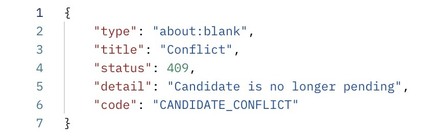
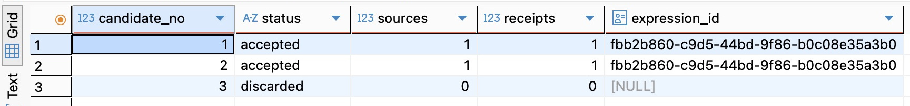
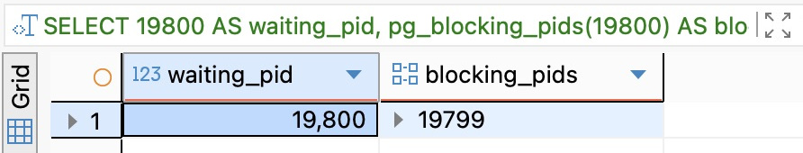
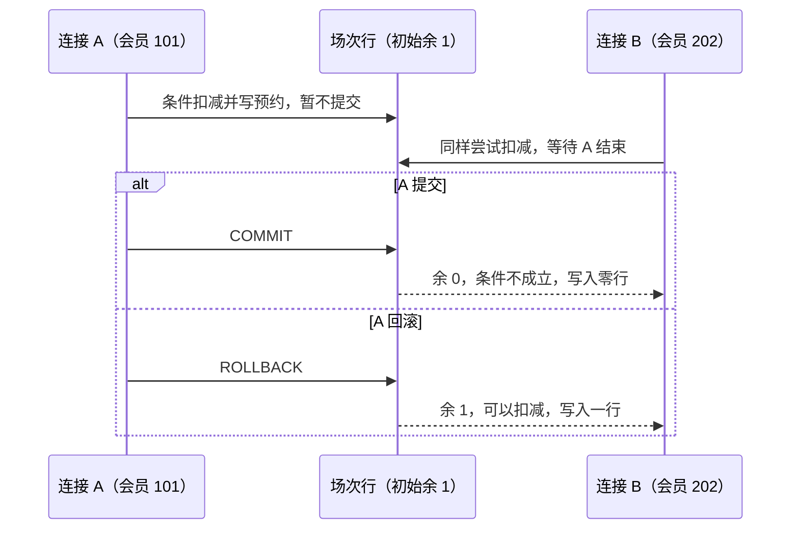
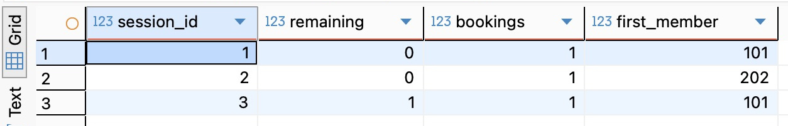
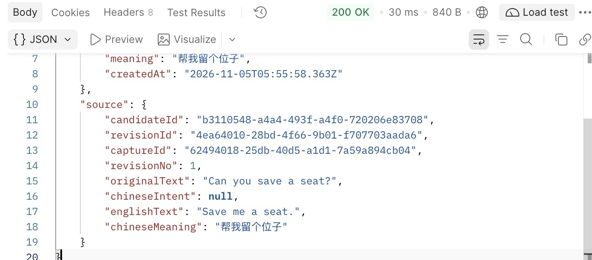

# 第31章 第四篇回顾：让采纳经得起竞争与重试

一个标签页还停在旧版原文上。你点了“采纳”，页面却报网络错误。另一个标签页里的“放弃”按钮还能点。此时如果有人问“这条表达到底收进去了没有”，两个页面都答不了。但数据库应该答得出来，而且能指出收的是哪一版、哪一个候选，以及重试时该把哪一次结果还给你。

先完成第22～30章。本章从 [第三十章配套代码](https://github.com/SamChowRock/epp-book-code/tree/part-04/chapter-30) 继续，使用 `part-04/chapter-31` 的请求集合和两个 SQL 文件。保持原有 API、模型、迁移和启动方式，不用回填旧数据。准备已经完成第三十章升级的独立校验库 VERIFY，里面只放练习资料。按[上一章 30.4](../chapter-30-indexes/chapter.md#304-区分查询次数返回体积和连接占用)的启动命令，让本次开发 API 明确连接这个库；在 DBeaver 的同名连接运行 `SELECT current_database();` 核对。下文的端口按 API 为本机 3000、故障代理为 3010 来写。

## 31.1 一次采纳里，究竟什么不能重复

取一句原文 `Can you save a seat?`。候选 A 是 `Save me a seat.`，候选 B 是 `SAVE ME A SEAT.`，两者在这次练习里都表示“帮我留个位子”。现在把原文改成 `Can you save two seats?`。如果只在候选身上记原文记录的 ID，过几天点开 A，会以为它是针对两个位子给出的建议。第二十二章给每次输入另存一版；第二十三章让候选引用那一版。这就留出了两条都正确的读法：打开记录看最新的两个位子，打开当时的学习来源看一个位子。

再想想“重复”。同一个候选只能被采纳一次，所以学习记录的 `candidate_id` 唯一。可 A 和 B 是两个不同的候选，各自采纳，理应留下两条来源。第二十七章让同一用户下、按既定规则处理后英文与中文义项均相同的候选引用同一个正式表达。这里去掉的是多余的表达身份，学习记录不能跟着合并。只把英文改成大写不会自动创造一个新义项；反过来，拼写相同也不意味着两个不同释义应该合并。

还剩一种重复：点一次按钮，发送了两次请求。页面第一次发送前生成一个小写 UUID，存在这次操作的 `operationId` 里；网络重试沿用它。另一次独立决定才新建身份。业务提交时，库里同时保存“哪个用户、哪次操作、采纳哪个候选、应返回什么”。这张成功结果记录叫**回执**。一次请求的 `X-Request-Id` 方便查这一次传输的日志，重发时会换；不能拿它找回上次的业务结果。

把这些关系落实到 `src/prisma-candidate.store.ts` 的 `accept`。两个不同操作都可能先读到 `pending`（尚未决定）。真正争胜的是下面这一步；即使前一次读取成立，写的时候也要再问一遍：

```ts
const claimed = await tx.candidate.updateMany({
  where: { id, status: 'pending' },
  data: { status: 'accepted', acceptedAt },
});
if (claimed.count !== 1) return 'conflict';
```

放弃也只能改仍为 pending 的同一行。规定哪些转换合法，是**状态机**；把前提放进实际修改，是**条件写入**。两笔事务改同一行时，数据库让后写的一方等前一方结束，这才有机会在已提交的新版本上重新判断。“先”在这里指谁取得并成功提交这次状态变化，不是哪个按钮先亮，也不是哪个响应先到。一个写入者若最后回滚，等它的那个人仍可能成功。

取得候选后，采纳还要找到或新建表达，写学习来源，保存回执。它们在一个**事务**里一起提交；最后一步失败，前面那次状态变化也撤销。同一操作的两次请求还要排队：应用按用户和操作身份取事务级建议锁，即请数据库让使用同一把锁的代码轮流进入这段处理；事务结束便释放。在当前隔离级别，拿锁后另发一条查询，可以看见上一位刚提交的回执。先查候选仍属当前用户，再查回执，匹配便返回原结果。若先用“已采纳”拒绝一切，合法重试就会误报冲突。不同操作即使碰不到同一把操作锁，也仍受候选的条件写入和学习来源的唯一约束保护。不同候选若要复用同一表达，则由表达身份自己的锁和唯一约束协调。

## 31.2 把采纳和放弃换个顺序，再丢掉一次响应

在 Postman 的本地工作区导入代码仓库的 `requests/chapter-31.postman_collection.json`。这是一次需要在中间停下查库的实验，逐项 Send。集合变量 `baseUrl` 指向 API，`proxyUrl` 指向代理；如果开发服务改了端口，两处转发配置须对应。01 新建原文，同时为 A、B、C 各留一个操作身份。02 记下第一版的 `revisionId`，03～05 为这一版保存三个候选，06 追加第二版。此后不要再按 01，它会为另一轮换掉整组变量。在 Variables 里保留这一轮的 ID；候选和操作都不要凭显示文本去找。

在 DBeaver 打开 `database/chapter-31/01-outcome.sql`，把全零 UUID 换成刚才 **02 的第一版** ID。每个候选一行，分别数它的学习来源和成功回执，而不是统计全库总数。06 以后应看见三行 pending，各为 0、0。若是零行，先核对连接和修订版本；第二版确实没有这三个候选。下面是取证的主体：

```sql
SELECT n.candidate_no, n.status,
  (SELECT count(*) FROM public.learning_records l WHERE l.candidate_id = n.id) AS sources,
  (SELECT count(*) FROM public.command_receipts r WHERE r.candidate_id = n.id) AS receipts,
  (SELECT l.expression_id FROM public.learning_records l WHERE l.candidate_id = n.id) AS expression_id
FROM public.candidates n
WHERE n.revision_id = '00000000-0000-0000-0000-000000000000'::uuid
ORDER BY n.candidate_no;
```

为了让“没有收到响应”和“没有提交”真的分开，在代码根目录另开终端运行已有的实验代理。它把请求转发给 API，等上游的第一份 201 完整返回后，丢掉这份响应并断开客户端连接；之后的成功请求正常透传。

```bash
nvm use
TARGET_PORT=3000 PORT=3010 node examples/lost-acceptance-response.mjs
```

现在发 07。Postman 看见连接失败；代理终端应出现 `Upstream 201 consumed; dropping the client response.`。若没有这行，先查端口、代理及写入结果，不把普通的连不上当成本次故障。**先别重发**。在 DBeaver 重跑刚才的查询（若使用手动事务，先结束旧的读取事务）：A 已是 accepted，来源 1、回执 1。08 从另一标签页的立场放弃 A，返回 409／`CANDIDATE_CONFLICT`。09 直连 API，向同一个 A 再发原来的 `operationA`，却得到 201。再发一次 09，比较两份响应中的 `candidate.acceptedAt`、`learningRecord.id` 和 `expression.id`；数据库仍是 1、1。201 在这里回答“这次操作成功时返回什么”，不能用来数新写了几行。



图31-1。看响应体最后一行的错误码。这里的 409 告诉你候选已经不能放弃；它没有回答原来那次采纳返回了哪条学习记录，那个问题要拿原操作身份去查。

用 C 把先后颠倒。10 先放弃，返回 200；11 才来采纳，得到 409。C 是 discarded，来源和成功回执都是 0。这两次按次序送达，便于解释两种终态；它们本身不能证明两个会话曾在数据库里同时等待。下一节会故意把一个事务停在提交前，让第二个写入者真的等它。

还可以故意犯一个与等待无关的错误：12 用 A 已成功的操作身份去采纳仍 pending 的 B。此时返回的同样是 409，错误码却是 `OPERATION_CONFLICT`：这个身份已有结果，目标对不上。重查 B，应仍为 pending。13 用 B 自己的身份采纳，得到 201。回到 DBeaver，用同一个第一版修订 ID 再查一次。



图31-2。先看候选 1 和 2，两行的 `sources` 和 `receipts` 都是 1，最右侧的表达 ID 完全相同。再看候选 3，状态是 discarded，两项计数都是 0，表达 ID 为空。你拿到的 UUID 会不同，可以在自己的结果网格里做同样的对照。

这条查询只数本轮指定修订。库里早就有同一表达，仍应满足上面的关系，没有理由要求整张表达表又多一行。也不要反推“一条回执都没有就从来没人请求”：当前只保存成功采纳，放弃、冲突以及很早版本中没有操作身份的采纳都没有这类凭证。

中途离开时保留已发到哪一项、第一版 ID 和操作身份；回来先查三行，再决定恢复哪一步。结果未知的采纳只用原目标、原身份重发。库里仍在跑的请求也可能尚未提交，某一刻查不到行不能证明它最终失败。不要为“再试一次”新建整套候选。实验代理用完按 Ctrl+C；日常请求一直直连 API。

## 31.3 两个人抢最后一个预约名额

把确认对象换成一次有座位上限的活动。场次 1 只剩一个位子，会员 101、202 各想订一席。两张预约单不相同，在预约单上要求“同一会员同一场只准一单”，这两单都完全合法。真正共享的是场次的最后一个名额。先数一数已有预约，再分别插入，看起来也做了校验；但两人都可能在对方提交前看到还剩一席。即使把各自的查和插包进事务，也没有让两个人必须修改同一行。

这里把剩余名额放在场次行上，让每次占座都要修改这一行；另存一条“哪位会员订了哪一场”。由此得到三个可以分开检查的承诺：余量不能扣成负数；同一会员不能在同一场占两席；扣掉一席和写下预约必须一起成功。若容量为一百，也还是只需争同一场次行，不必给所有场次加一把全局锁。代价是热门场次的写入会在该行排队；任何取消或人工调整入口也必须维护同一个计数。

在 VERIFY 里为同一个数据库打开两个**独立连接**的 SQL 编辑器 A、B，平时都用自动提交，只在下文的 BEGIN 和 COMMIT 之间保留事务。分别执行 `SELECT current_database(), pg_backend_pid();`：库名相同、进程号不同才算两位参与者。若进程号相同，复制数据库连接配置并从副本打开 B。不要用数据库的临时表：只对创建它的会话可见，第二位参与者就看不到同一份名额了。

打开 `database/chapter-31/02-last-seat.sql`，按编号选中一段再执行。一个编号里有多条语句时，选中整段，用 SQL Editor 菜单的 Execute SQL script 执行选区；不要把提交和待观察的语句一起选中。第 2 段只在 A 执行一次，创建专用的 `ch31_booking` 命名空间并提交，B 才看得见。两个表的关系如下；脚本另外准备了三场，初始余量分别是 1、1、2。若命名空间已经存在，先回滚失败事务并用第 6 段核对之前做到哪一步，不要删掉未知对象。

```sql
CREATE TABLE ch31_booking.sessions (
  id integer PRIMARY KEY,
  remaining integer NOT NULL CHECK (remaining >= 0)
);
CREATE TABLE ch31_booking.bookings (
  session_id integer REFERENCES ch31_booking.sessions NOT NULL,
  member_id integer NOT NULL,
  PRIMARY KEY (session_id, member_id)
);
```

让 A、B 都先执行第 3 段，开启事务，查看场次 1 的余量。两边都看见 1，这一眼只够展示给用户。第 4 段才决定谁能订到。下面的 `seat` 是一条语句内给中间结果起的名字：UPDATE 确实拿到名额才返回场次 ID；INSERT 从这个结果取行，空结果自然什么也不插。

```sql
WITH seat AS (
  UPDATE ch31_booking.sessions SET remaining = remaining - 1
  WHERE id = 1 AND remaining > 0 RETURNING id
)
INSERT INTO ch31_booking.bookings (session_id, member_id)
SELECT id, 101 FROM seat RETURNING session_id, member_id;
```

A 用会员 101 执行这一段，看到返回一行，**不要提交**。B 把 101 改成 202，执行同一段，结果还没回来。此时保留 A、B 的窗口，在第三个空闲连接执行下面这句。把两处 19800 都换成第 1 段记下的 B 的进程号。第一列标出查的是谁，第二列列出正在阻塞它的数据库进程。

```sql
SELECT 19800 AS waiting_pid, pg_blocking_pids(19800) AS blocking_pids;
```



图31-3。这次运行中，B 的进程号是 19800，网格把它显示成 19,800。右侧的 19799 正是先前记下的 A。趁 B 还在等待时读这两列，A 结束事务或 B 等待超时后，这次阻塞关系便会消失。

切回 A 执行第 5 段 COMMIT。现在 B 才返回，结果集是零行，B 也执行 COMMIT。第 3 段选的是 PostgreSQL 的 Read Committed（读已提交）：普通读取看到该条语句开始时已经提交的数据；写到别人正在改的行时，要等对方结束，再对新的行版本检查条件。A 一提交，B 重新判断的便是 `0 > 0`。因为 B 从来没有扣到名额，后面也没有预约行可写。[PostgreSQL 18 对等待后重查条件的说明](https://www.postgresql.org/docs/18/transaction-iso.html#XACT-READ-COMMITTED)



图31-4。沿 B 的同一次等待往下看：它没有改请求，也没有重新点击，结果却取决于 A 结束事务的方式。B 如果取得一行，还要自己提交才能订到。

第 6 段把余量和订到的人放在同一行，场次 1 应为「余 0、预约 1、会员 101」。换场次 2 再做一遍：两边第 3、4 段里的 `id = 1` 都换成 `id = 2`，仍由 A 用 101 先写、B 用 202 等。**这次 A 执行 ROLLBACK**。B 应返回一行，B 提交后，场次 2 为「余 0、预约 1、会员 202」。第一次也是 A 先拿到一行，但 RETURNING 只说明这条语句在当前事务里做了什么，不保证 A 最终订到。若超过脚本设的 60 秒等锁期限，B 会报超时，而不是“名额已满”；在 B 回滚，确认 A 是否仍在事务中并结束它，查第 6 段再决定是否重试。长时间停在事务里，连接也可能因脚本的空闲保护断开，重新连接后以已提交结果为准。

第三场还有两个位子。这次回到自动提交，会员 101 用第 4 段把 `id` 改为 3，执行两次。第一次成功，第二次有余量可扣，却在插预约时碰到主键重复（SQLSTATE `23505`）。


图31-5。读 Detail 里的键值就能定位冲突。会员 101 在场次 3 已有一单。现在单独执行第 6 段，检查刚才那条失败语句有没有把剩余名额扣掉。



图31-6。场次 1 和 2 都只订出一席。对照最后一列，先写者提交时由 101 订到，先写者回滚时由 202 订到。场次 3 初始有两席，重复预约报错后仍有一条预约、剩一席，说明那次失败的扣减已经撤销。

若为了消掉红字在 INSERT 后添上 `ON CONFLICT DO NOTHING`，重复不再抛错，前面的扣减反倒可能提交，最后一席凭空消失。完成核对后，先结束两个连接中的实验事务，再执行第 9 段清理本轮建立的预约表。

把实验带回接口设计，还要回答客户端没收到响应怎么办。场次加会员的唯一键能挡住第二张预约，却不能区分“刚才那次成功了”“更早就订过”或“现在又想订”。如果产品承诺重试同一次动作能拿回原结果，就要像采纳那样在扣减前按操作身份查结果，校验场次与动作，成功结果和预约一起提交。再改变一个条件：允许取消、取消后能重订。此时一个永久的「场次＋会员」历史唯一键会挡住重订。如果要保留历史，应给每次预约自己的身份，只约束同一人同一场的**有效预约**最多一条；取消也只允许“有效→已取消”的那一次归还名额，并与状态变化一起提交。旧预约的成功回执不能证明它今天仍有效，今天的状态应另查。这些是预约产品需要补的判断，没有理由为此给 EPP 加一个预约接口。

## 31.4 从学习列表查回来源，也查清是谁的来源

回到 A 和 B。采纳结果里各有一个不同的 `learningRecord.id`，表达 ID 却相同。若列表按表达去重，第二次采纳从学习历史里消失；若星图每条来源都画一个点，同一个正式表达又被画了两遍。因而学习列表按来源给行，星图按表达给点，节点的 `recordCount` 才表示它有几个可见来源。相同表达如果在本轮以前就出现过，节点计数可以大于 2；检查的是本轮两个来源都能找回。

发送 14、15：在同一个 `expressionId` 范围内按最新在前每次取一条，14 保存 `nextCursor`，15 携带它续读。对照 09、13 返回的学习记录 ID：没有别的写入且时间依次递增时，B 在前，A 随后；若同在一毫秒，顺序由 ID 降序决定。要验证的是两条来源都找得回、表达相同，而不是背下字母顺序。若练习库已有同一表达的来源，继续沿边界找齐这两条。若之后又有新的采纳排到页首，沿旧边界向后读不会把这个新来源变成第二页；重新取首页才能看到它。实时翻页不能用来证明某一时刻的全库总数。若 15 返回 `INVALID_CURSOR`，保留原查询范围、页长和服务密钥，重新从 14 取边界；不要重新发送采纳。也可以 GET `/star-map?limit=100`，按表达 ID 对照节点。若表达较旧不在首页，用 `mode=cursor` 从星图自己的首页沿 `nextCursor` 继续找，不能借学习列表的游标。

再发 16，只凭 A 的**学习记录 ID**取历史详情。看 `source.revisionNo` 与 `source.originalText`，应是第 1 版的一个位子；打开 `GET /captures/{{captureId}}` 才是记录当前的两个位子。这两个答案若都显示最新原文，页面照样可能返回 200，却已经讲错了历史。



图31-7。看 `source` 里的 `revisionNo: 1` 和单数的 `a seat`。这里查的是当时的学习来源，原文后来改为复数也不会改变这个答案。

同一份列表还面对两个独立问题。第一个是“允许读哪些行”：学习记录属于当前用户、引用的表达属于当前用户、候选沿修订找到的原始记录也属于当前用户。列表、详情和星图的计数都要守住相同边界；只在页面过滤，会让总数、翻页甚至详情暴露别人的资料。第二个是“怎样少读一些就得到这一页”：第三十章让索引按用户、创建时间和 ID 排列，数据库有机会从这一位用户的有序记录开始取；若又指定表达 ID，还可能要继续筛，不能因为结果只有一行就认定数据库只读了一行。要查实际成本，可在同一 VERIFY 运行上章的 `database/chapter-30/03-owned-page.sql`，先辨认其中的归属连接、排序和 LIMIT；那是普通首页第一条查询的计划，不是本节按表达筛选后所有读取的成本。加快查找的索引不会替服务判断谁有权读，给游标签名也不会证明拿它的人是谁。

第四篇走到这里，服务仍把每次请求视为同一位开发用户。在本机把 `userId` 塞进 Body、从别人那里复制一个资源 ID，都不能建立身份。下一篇要接起来的是这条链的起点：先验证请求者是谁，再让查询、写入和重放全部使用服务端确认的用户。即使对方知道一次真实成功的操作身份，服务也应先确认资源此刻对他可见，再决定能否返回那份历史结果。

## 附录：本章必要技术点速查

| 名称 | 本章怎么用 | 核对入口 |
| --- | --- | --- |
| 条件更新、RETURNING | 用返回行数判断这一次是否取得待处理候选或余量；提交前仍可撤销 | [PostgreSQL 18 UPDATE](https://www.postgresql.org/docs/18/sql-update.html) |
| Read Committed、行锁 | 两个事务修改同一行时，后写者等待，再检查当前版本 | [事务隔离](https://www.postgresql.org/docs/18/transaction-iso.html) |
| 主键、CHECK、事务 | 分别限制重复预约、单行负余量，以及扣减与写单能否拆开提交 | [约束](https://www.postgresql.org/docs/18/ddl-constraints.html) |
| WITH 中的数据修改 | 只把实际扣到的场次交给 INSERT；出现错误时整条语句失败 | [WITH 查询](https://www.postgresql.org/docs/18/queries-with.html#QUERIES-WITH-MODIFYING) |
| 操作身份与回执 | 区分同一成功请求重放、同身份换目标、候选已终结 | [第26章](../chapter-26-idempotency/chapter.md) |
| 游标与归属 | 原查询范围内从已返回边界续读；签名与索引都不授予访问权 | [第29章](../chapter-29-pagination/chapter.md) |

时间参考（估算）：阅读约45～60分钟；跟做另加40～60分钟。按两种相反的状态变化、一次响应丢失、三个预约场次、六张实拍对照和来源翻页估算；不含前章环境准备。

[本章配套代码](https://github.com/SamChowRock/epp-book-code/tree/part-04/chapter-31) · [上一章：索引与执行计划](../chapter-30-indexes/chapter.md) · [第四篇导读](../README.md) · [全书目录](../../README.md)
