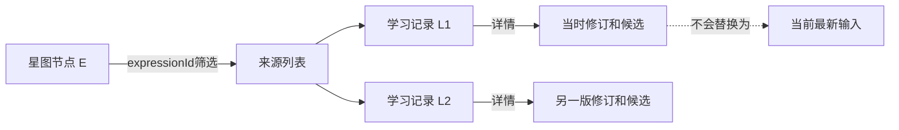
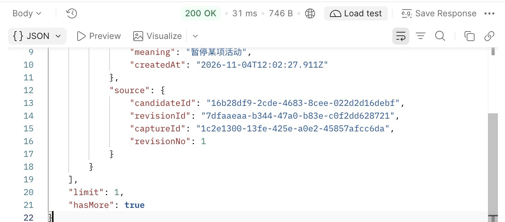
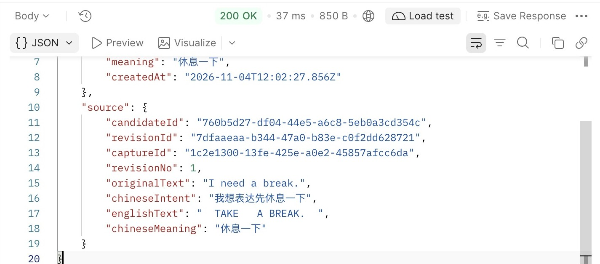
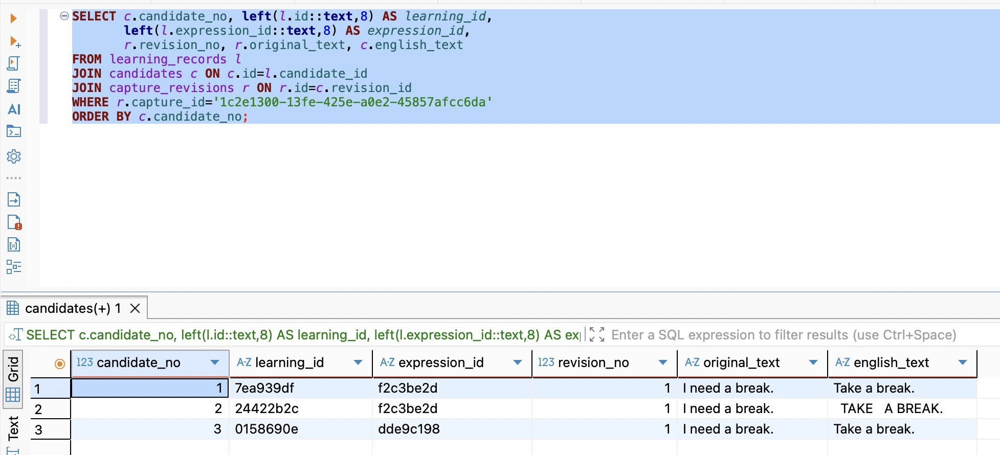
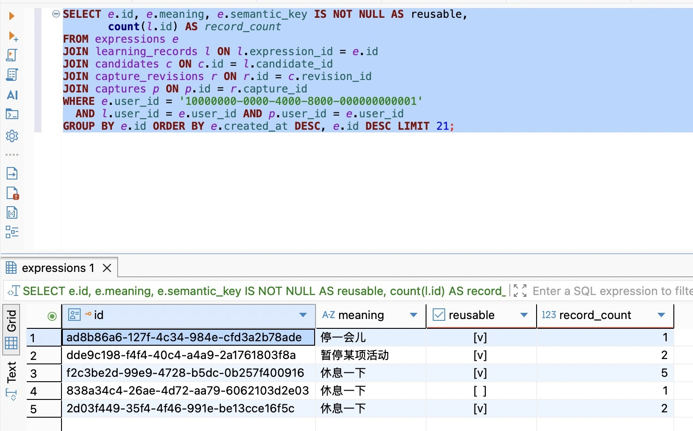
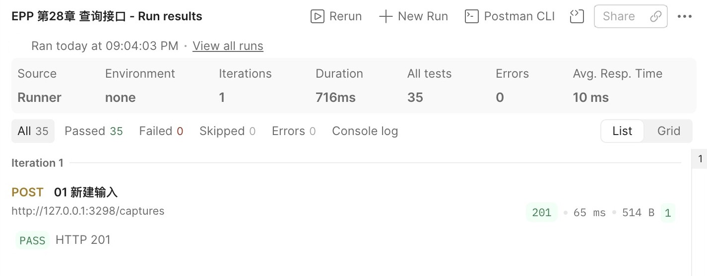
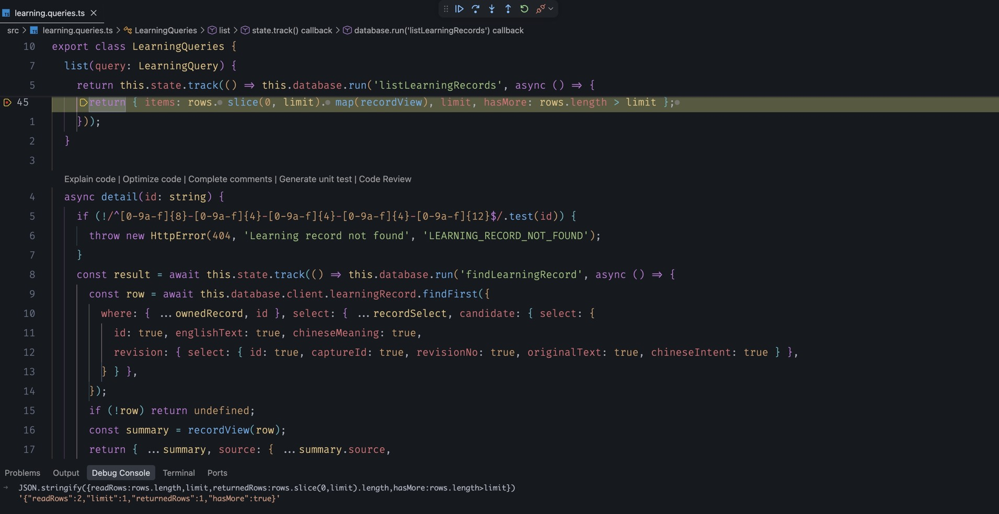

# 第32章 构建可供客户端使用的查询接口

第三十一章让两个内容相同的候选能够复用正式表达，同时保留两条学习来源。写入已经能区分“同一个操作重试”“同一个候选再次采纳”和“不同候选采纳相同内容”。现在轮到读取：客户端打开自己的内容列表时，一行究竟应该代表一个表达，还是一次收录？点进去以后，要看当前输入，还是当时决定采纳的那一版？

这些问题不能靠把ORM结果序列化来回答。数据库为保存事实拆了多张表，页面却需要一个有明确用途的结果。少返回一层关系，客户端可能要逐条补请求；多返回全部关系，又会把原文、内部比较键和不断增长的历史一起带走。本章沿已有数据建立基础星图、学习记录列表和详情，让调用方能按稳定身份从概览走回来源。

代码从 `part-04/chapter-31` 继续，完成状态为 `part-04/chapter-32`。仍使用Node.js 24.22.1、Prisma 7.10.1、PostgreSQL 18和固定开发用户，不增加依赖，也不修改模型或已有迁移。日常观察继续使用Postman、DBeaver和VS Code；本章选择HTTP请求走通调用过程，完整页面由后续客户端篇承担。

主线阅读约 130～155 分钟，跟做另加约 80～105 分钟。可以在能手算节点与来源之后暂停一次，在列表和星图都完成有界查询后再暂停一次，最后连同详情、历史样本与产物重启一起核对。支线 32A 的快照与读模型讨论另计。

## 32.1 先决定一行代表什么，再决定查哪些表

### 星图节点与学习来源是两种行粒度

假设昨天和今天各采纳了一次 `Take a break.`。两个LearningRecord指向同一个Expression。星图可以只画一个表达节点，再告诉我它有两条来源；来源列表则应该显示两条记录，分别保留自己的candidateId、revisionId和时间。两种视图都正确，前提是没有把其中一种数量说成另一种。

本章的基础星图只提供节点。节点ID就是已有expression.id，附带代表文本、义项、表达创建时间和recordCount。recordCount表示当前用户可见的采纳来源数，不能叫练习次数、熟练度或掌握程度。尚未建立语义关系与练习事实，因此不返回虚构的连线、相似度、坐标和颜色等级。后面的客户端可以布置节点，但位置本身不会凭空成为领域事实。

学习列表的一项则以learningRecord.id为身份。它包含采纳时间、表达摘要和来源定位；详情再增加当时的输入与候选内容。列表不展开每个表达的全部来源，否则外层即使只有20项，一个表达仍可能带出几万条嵌套记录。



沿图调用时，expressionId用来找“这个表达有哪些来源”，learningRecord.id用来找“这一条来源是什么”。两个ID都是UUID，不代表可以互换。若把表达ID填到学习详情路径，正常结果是404；不要因为它长得像合法ID就怀疑数据库丢行。

三个入口的职责由此确定：

| 入口 | 一项代表什么 | 本章参数 |
| --- | --- | --- |
| `GET /star-map` | 一个有可见学习来源的表达身份 | limit |
| `GET /learning-records` | 一次采纳留下的学习记录 | limit、可选expressionId |
| `GET /learning-records/:id` | 指定学习记录及其历史来源 | 不接受查询参数 |

这不是为每张表都创建一套CRUD。ExpressionForm、Candidate和CaptureRevision仍参与关系查询，但调用方不需要知道每一层怎样存储，也不需要请求一份CommandReceipt才能显示来源。接口按用途组织，表按事实组织，两者不必同构。

先用三个采纳决定画出一张页面草图。周一收录“稍等”，表达叫甲，来源记为一；周二收录“请坐”，表达叫乙，来源记为二；周三从另一段对话再收录“稍等”，复用甲，来源记为三。只看这组数据，星图有两个节点，甲旁标二，乙旁标一。点甲应打开两行，点第一条或第三条要看到各自不同的素材。若拿周三的来源编号去更新周一的那条列表项，节点数字或许还能加对，但周一那段对话的入口就丢了。把行的主键写进草图，比先讨论返回的是数组还是对象更容易发现这种错误。

再换一张草图，要求显示最近发生的收录。上面三次发生在三天，最近的是来源三，其次二，再次一。若改按表达创建时间排，乙比甲新，即使周三的决定刚完成，甲也会排在乙后面。这个次序对星图有解释力，对“最近收录”却不对。因此同一个响应中可能同时出现早先的表达创建时间和刚发生的学习记录创建时间，客户端给时间列命名时要先想清楚在说谁。用同一字段填入两个位置，只会让一个平静无重复的演示库看起来正确。

从简单 SQL 接上这一判断，可以先不用任何连接：让数据库给出每条学习记录的编号、它引用的表达编号和采纳时间。先按学习时间倒排，在纸上为每个不同的表达画一条横线，每见到一条学习记录，就在对应横线旁记一个点。三行得到两条横线与三个点，这个动作相当于按表达编号分组数行。若一开始就把相同的表达编号去重，横线仍有两条，点数却无法还原。若一开始只看最近两行，点数也会偏少。两种删减都应在自己真正想限制的对象上进行，不能为了让第一页更短而先随意丢行。

这个手算也帮我们选客户端请求顺序。在概览上只要认出是哪条表达以及有多少来源，给出代表文本、义项和节点编号就够了；用户点中某节点，才知道该向服务器索取哪一个表达的来源。等他再点中其中一条，才需要取得那条修订的原文。在概览时替每个节点先取齐全部详情，会让一次打开页面的代价随着历史总量增长，也让用户还未选择的原文被提前取出。相反，只返回节点编号而不返回展示文本，页面又会为了绘制每个节点逐一补请求。以一次具体点击划分字段，能推导出恰好够用的摘要。

### 历史副本继续拥有可访问的身份

前章迁移保留了旧重复表达，只为其中一个代表留下semanticKey。假设E1、E2曾分别被采纳，旧回执仍可能返回E2。基础星图应把两个既存身份都列出来，它们的来源列表也分别可读；不能为了让图显得干净，在查询里加 `semantic_key IS NOT NULL`。

这里的节点不是“全世界唯一语义”，而是当前数据库中有用户来源的正式表达身份。新采纳复用E1，旧E2仍有自己的历史。若将来要把两者展示成一个概念组，需要另行定义分组ID、成员与点击行为；直接按显示文本去重会丢掉E2的入口。前章保留旧数据的决定，必须在读取时继续成立。

没有采纳来源的表达不进入星图；pending和discarded候选也不会变成学习记录。现有候选列表仍能查看它们，本章不通过制造空学习记录来统一所有状态。

拿升级前就存在的一对旧表达再算一遍。假设昨天和前天已经分别保存过同义的甲、甲副本，两者原先各有一条来源，今天新增的第三条来源只复用甲。那么节点仍是两个，计数分别是二和一。把显示文本当作前端组件的列表键，两个节点可能争用同一个组件状态，点副本却展示甲的来源；这时后端并没有少给一行。让组件键、选中态和后续查询参数都沿用响应里的表达编号，就能把“看起来一样”与“同一对象”分开。将来需要按概念聚合时，还可以在这一层之上设计新的分组，原有的两个入口仍可追溯。

在实际练习库里，数字常常比这张小表大。先在响应里挑一个确定的表达编号，按这个编号看来源，再抽一条学习编号检查详情。如果历史副本从未出现在自己的数据库，就记录当前实际具备的样本，不要把一个普通的新表达冒称为副本。若已经按上一章做过非空升级，可以直接沿保存下来的两个旧学习编号读取，借此比较两个节点，而不用靠首页刚好能同时显示它们。这样一来，验证入口是否存在与验证首页的排序就各有证据。

## 32.2 把存储关系变成公开响应

### 先写出响应允许包含的字段

前章采纳响应适合确认一次写入，本章列表适合展示很多条来源。两者都引用Expression，不要求拥有相同形状。列表采用一个平坦的表达摘要：id、text、meaning和createdAt；代表形式表的ID在这次用途里没有作用，便不返回。日后表达允许多个形式时，需要明确扩展这个摘要，不能让数据库加一行就使客户端得到不确定的text。

在 `src/learning-contract.ts` 中建立公开Schema，继续复用前文已有的文本与时间约束。下面是摘要、列表与星图的核心定义：

```ts
export const ExpressionSummarySchema = z.object({
  id: z.uuid(), text: OriginalTextSchema, meaning: OriginalTextSchema,
  createdAt: z.iso.datetime(),
});
export const LearningSummarySchema = z.object({
  id: z.uuid(), createdAt: z.iso.datetime(), expression: ExpressionSummarySchema,
  source: z.object({ candidateId: z.uuid(), revisionId: z.uuid(), captureId: z.uuid(),
    revisionNo: z.number().int().positive() }),
});
export const LearningListSchema = z.object({
  items: z.array(LearningSummarySchema).max(100),
  limit: z.number().int().min(1).max(100), hasMore: z.boolean(),
});
export const StarMapSchema = z.object({
  nodes: z.array(ExpressionSummarySchema.extend({
    recordCount: z.number().int().positive(),
  })).max(100),
  limit: z.number().int().min(1).max(100), hasMore: z.boolean(),
});
```

详情用LearningSummarySchema.extend扩展source，增加originalText、可空chineseIntent、englishText和chineseMeaning。前两项取自候选绑定的修订，后两项取自候选。这样，正式表达可以保留代表形式，详情仍能显示用户本次候选的原拼写。

```ts
export const LearningDetailSchema = LearningSummarySchema.extend({
  source: LearningSummarySchema.shape.source.extend({
    originalText: OriginalTextSchema,
    chineseIntent: StoredChineseIntentSchema.nullable(),
    englishText: OriginalTextSchema, chineseMeaning: OriginalTextSchema,
  }),
});
```

为什么既要手工投影又要Schema？投影说明从哪条关系取哪个事实，并把数据库Date转换为公开ISO字符串；Schema检查最终形状、约束和字段白名单。两者工作不同。TypeScript的类型不会在运行时删除多余字段；把对象断言成某个接口，更不等于它已经不含userId或semanticKey。

沿用ResponseSchemaInterceptor，让Zod解析返回值。它默认剔除对象中未声明的属性；若缺少必要字段或数据不符合约束，则让服务返回安全的500，而不是把一份残缺详情当200交付。输入Schema却使用strict拒绝未知参数，因为调用方写错筛选项不应被静默忽略。输出裁去未公开字段与输入拒绝不支持的意图，不是同一个策略。

试着给详情中的四段文字各找一个失配时能看出来的样本。当时的素材原文是一句请求休息的话，当前素材已经改成建议暂停；本次候选刻意使用大写，正式表达则可能来自更早一次采纳。若把这四处都写成相同文本，无论投影从哪张表取，看起来都能通过。让不同来源的值有可辨认的差异，才能发现“读了正确类型，却拿错业务事实”。例如把当前素材原文错填到详情，仍是一条合法字符串，响应 Schema 当然不能靠字符串长度发现它属于第二版。

中文意图也有独立含义。原修订允许未填写时保存空值，详情应保留这个事实。中文义项来自候选，它可以在没有中文意图的来源中存在。若映射时顺手用候选义项填补修订意图，前端将会显示用户从未在素材上填写的注释。数据库的空值、对象缺少一个必需字段和真正输入的空字符串在这里有不同意义。公开结构中明确出现一个值为空的字段，使客户端能显示“当时未填”；字段意外缺失则说明这份详情没有满足约定。需要给页面一个友好提示时，在展示层决定用语即可，无需在存储投影中创造历史。

再把日期转换单独看。数据库驱动交给程序的是日期对象，公开接口承诺的是带时区语义的时间字符串。本地调试窗口可能把同一时刻显示成读者所在时区，响应则由显式转换得到统一表示。核对两个界面时先比较时刻，再说明采用哪种显示格式。对来源一和表达甲，它们的日期数值如果不同，先看各自字段的拥有者；把较早的表达时间当成新采纳没有生效，可能导致用户重新发送一次没有必要的命令。读接口清楚标出每个时间属于哪个对象，本身就在减少这种错误操作。

### 用户范围必须参与关系匹配

固定开发用户仍由服务端常量提供，不能开放 `?userId=` 让调用方挑选身份。以后认证机制会替换这个来源，本章先把读范围放在正确位置。

最容易漏掉的是详情。列表写了where.userId，不代表详情可以直接findUnique({where:{id}})。知道一个ID只是知道对象的地址，不证明有权读取它；来源里的Capture也有归属。当前数据库用各自外键保证“引用的行存在”，没有跨多张表强制所有user_id相等，所以查询需要同时约束学习记录、表达和输入的归属。

在 `src/learning.queries.ts` 先定义本章三个查询共同使用的来源范围：

```ts
const ownedRecord = {
  userId: DEVELOPMENT_USER_ID,
  expression: { userId: DEVELOPMENT_USER_ID },
  candidate: { revision: { capture: { userId: DEVELOPMENT_USER_ID } } },
} satisfies Prisma.LearningRecordWhereInput;
```

这里的satisfies让编译器核对对象是否符合Prisma查询条件类型，同时保留字面量的推导结果，不执行数据库校验。最终保证范围的是实际where。即使有人通过其他写入途径构造了跨用户关系，本章查询也不能沿那条关系返回对方原文；它会排除该项。排除不代表坏数据已经修复，维护时仍应查明来源。

对于详情，缺失、非法或不属于当前用户的ID统一返回404，不另发请求告诉调用方“这个ID确实属于别人”。对于列表，expressionId只是筛选条件：有效UUID没有匹配项时返回200与空items，既不暗示表达存在，也不把正常空结果写成存储错误。真正的数据库失败则是500或503，不能catch后返回[]。

从空白写一条范围正确的来源明细，可以先不选原文。左边写学习记录作根，往右顺着两支引用画箭头：一支直接到表达，另一支到候选、候选指向修订、修订再指向输入。每一次 JOIN 的 ON 只回答两张表中哪两行有关联。WHERE 则回答这组已经关联起来的事实是否属于本次读取范围。即使把三张表的用户字段都写进 SELECT，也只是把值显示出来，仍没限制任何一行。先写下目标用户，再把每一支走到能检查归属的位置，最后才决定要向客户端展示哪些列。

```sql
SELECT l.id AS learning_id, e.id AS expression_id,
       n.id AS candidate_id, r.id AS revision_id, r.capture_id
FROM public.learning_records l
JOIN public.expressions e ON e.id = l.expression_id
JOIN public.candidates n ON n.id = l.candidate_id
JOIN public.capture_revisions r ON r.id = n.revision_id
JOIN public.captures c ON c.id = r.capture_id
WHERE l.user_id = '10000000-0000-4000-8000-000000000001'
  AND e.user_id = l.user_id AND c.user_id = l.user_id
ORDER BY l.created_at DESC, l.id DESC
LIMIT 2;
```

已有上一章样本时，可以直接在核对过的开发库中执行它。在 DBeaver 的结果网格里，横向看一行，每个编号都应能顺着刚才的箭头读出来。然后先不看成品 SQL，自己重写为“只读刚刚保存的某条来源”：保留所有连接和归属条件，在 WHERE 末尾加一项学习编号等于这次响应的完整编号。此时唯一的学习主键已经把范围收窄为最多一行，排序和数量截取不再负责选中目标。若想看另一条来源，即使它引用同一个表达也应更换学习编号；若想看这整个表达的所有匹配来源，则应改筛表达编号并继续保留有界排序。这个一行条件的区别，决定了前端点击列表项和点击节点时为何进入不同接口。

还有一个看似多余的连接。列表只返回 captureId，这个值已经在修订表上，为何还要经过输入表？因为返回哪个编号与按谁的归属判断是两件事。修订上有指针，真正的输入所有者却在被指向的输入行上。移除查询中的输入关系，列名可能仍能编译，所有权条件却失去了事实来源。用正常的两位用户各自保存的内容来推理，只要候选属于乙的输入，甲的读取就没有理由带上那段原文。业务层的固定用户是查询的起点，数据库匹配的每条关系让这个范围一直延伸到最后一列。

### 选字段与选关系分别限制什么

Prisma默认读取模型的标量字段；include关系也可能带出相关模型的全部标量。我们在查询入口显式select，先减少读取和后续映射接触的信息，再通过公开Schema验证。对照[Prisma 7字段选择](https://www.prisma.io/docs/orm/v7/prisma-client/queries/select-fields)时，要区分“没有读取”与“读取后没有输出”，两种边界都应有理由。

```ts
const expressionSelect = {
  id: true, meaning: true, createdAt: true,
  forms: { select: { text: true }, orderBy: { id: 'asc' }, take: 2 },
} satisfies Prisma.ExpressionSelect;
const recordSelect = {
  id: true, createdAt: true, expression: { select: expressionSelect },
  candidate: { select: { id: true, revision: { select: {
    id: true, captureId: true, revisionNo: true,
  } } } },
} satisfies Prisma.LearningRecordSelect;
```

为什么forms取2而不是1？当前契约要求恰好一个代表形式。取1会把异常的多个形式藏起来，取全部又会失去嵌套数量边界。取2足以区分0、1和多于1；投影时只接受长度为1。这个上限用于发现当前模型的不一致，并不是多形式产品规则。

```ts
type ExpressionRow = Prisma.ExpressionGetPayload<{ select: typeof expressionSelect }>;
type RecordRow = Prisma.LearningRecordGetPayload<{ select: typeof recordSelect }>;
function expressionView(row: ExpressionRow) {
  if (row.forms.length !== 1) throw new Error('Expected one expression form');
  return { id: row.id, text: row.forms[0]!.text, meaning: row.meaning,
    createdAt: row.createdAt.toISOString() };
}
function recordView(row: RecordRow) {
  return { id: row.id, createdAt: row.createdAt.toISOString(),
    expression: expressionView(row.expression),
    source: { candidateId: row.candidate.id, revisionId: row.candidate.revision.id,
      captureId: row.candidate.revision.captureId,
      revisionNo: row.candidate.revision.revisionNo } };
}
```

GetPayload从实际select推导结果类型，避免手写一份与查询逐渐分离的内部接口。日期显式toISOString，继续沿用连接UTC与数据库timestamptz的约定。表达创建时间可能早于学习记录时间；两个字段各自描述创建表达与这次采纳，不能为了让页面“看起来一致”强行改成同一个时间。

关系字段不等于一个不受限制的嵌套JSON。这里candidate、revision、expression都是单个对象；唯一数组forms有检测上限。没有返回该修订的所有候选、Capture的所有历史或Expression的所有学习记录，才真正限制了返回结果的规模。

可以用一个小的“拿两条”推导检查自己的投影。假定关系表里没有代表形式，取到的是空数组，此时不能把表达义项冒充英文文本；如果有一个形式，读取它的文本；如果发现两个，便已知道“恰好一个”的前提不成立。无论库里真实总数是二还是一百，针对这项判断都不需要再取第三个。这里的两条承担的是辨别基数的责任。稍后列表查询也多拿一条，但那一条回答列表是否被截断，应用仍可成功交付前面的结果。相同的编程手段，用于验证数据契约与用于提示更多结果，面对多出来的一行必须作不同决定。

在代码审阅时，不妨从最终 JSON 逆向划掉无用字段。要返回表达的显示文本，需要知道代表形式；要检查代表恰好一个，又需要保留一个有界数组直至投影处。形式编号只用来稳定内部排序，公开结果无需包含它。类似地，筛选时使用 userId 并不要求把它也返回给页面。让“需要参与比较”“需要取到程序里”“需要发给客户端”成为三个独立判断，才能解释为何同一列能出现在 WHERE 或 ORDER BY 中却不出现在 SELECT 结果中。前端知道从哪个节点点过来，并不需要看到数据库如何选择唯一形式。

## 32.3 先提供有界列表，再把分页问题留在明处

### 默认值和上限都属于公开契约

只提供 `limit=100` 的示例，并不等于接口有上限；如果不传就读全部，第一次调用仍可能取走整个用户的数据。本章两个新列表默认20、最多100，响应明确回显生效limit。这个约定只属于新查询，不在本章悄悄改变前面 `/captures` 已有的读取契约。

参数用HTTP层的字符串定义，不先用Number转换再校验。否则空字符串可能变0，科学计数法、前导零和重复参数数组也可能意外被接受。在 `learning-contract.ts` 增加：

```ts
export const LearningQuerySchema = z.object({
  limit: z.string().regex(/^(?:[1-9]\d?|100)$/).optional(),
  expressionId: z.uuid().regex(/^[0-9a-f-]+$/).optional(),
}).strict();
export const StarMapQuerySchema = LearningQuerySchema.omit({ expressionId: true });
export type LearningQuery = z.infer<typeof LearningQuerySchema>;
```

沿用simple查询解析器，重复limit会成为数组，无法通过string检查；unknown字段由strict拒绝。星图不接受expressionId，详情不接受任何查询参数。这里没有开放orderBy、include或任意字段名让客户端直传ORM：支持一个查询选项，就要同时承诺它的意义、数据范围、成本和错误行为。

先在 Postman 的 Params 面板里观察一次没有填写上限的读取。在这一章，缺少该项意味着接受服务端约定，所以接下来即使实际只有三条，响应也应写生效上限为二十；它承诺的是最大交付规模，不是本次恰好有几条。再启用一项值为一的上限，如果库中至少有两条匹配记录，结果里可见的条数变为一，同时应有“还有更多”的提示。若只剩一条匹配，上限仍为一，但提示改变。能预测最后一种情况，才算分清了参数、匹配数与返回数。

在界面里取消勾选参数，与保持勾选但把值擦空，会生成不同的实际地址。前者让服务端采用默认值，后者发送了一个存在却没有合法内容的指令。页面若根据表单中空文本直接拼接参数，就可能想请求默认首页却收到输入错误。构造请求时先判断用户是否选择了上限，选择了才按契约提供十进制表示；然后读回服务端返回的生效值。这样即使界面里显示“默认”，也不用在客户端另外猜一个默认常数。已有素材列表的默认行为并未因这两个新入口而改变，复用前端参数组件时要保留各自契约。

### 多取一行只回答“还有没有”，不回答“共有多少”

本章的学习列表查询放在LearningQueries.list中。构造函数接收已有DatabaseService和ApplicationState；后者让关闭服务时知道查询仍在途，前者维持安全日志与数据库错误映射。

```ts
list(query: LearningQuery) {
  const limit = Number(query.limit ?? '20');
  return this.state.track(() => this.database.run('listLearningRecords', async () => {
    const rows = await this.database.client.learningRecord.findMany({
      where: { ...ownedRecord,
        ...(query.expressionId ? { expressionId: query.expressionId } : {}) },
      select: recordSelect,
      orderBy: [{ createdAt: 'desc' }, { id: 'desc' }], take: limit + 1,
    });
    return { items: rows.slice(0, limit).map(recordView), limit,
      hasMore: rows.length > limit };
  }));
}
```

假设limit为20：读到21行，返回前20行并标hasMore=true；读到20行，表示该次查询没有观察到第21行。items.length只是本次返回数量，不能改名total。读取一个额外位置可以回答这里需要的问题，不必为每次列表额外COUNT全部匹配行。

筛选、排序、截取在数据库里按同一查询意图执行。若先取最近20条，再在JS里按expressionId筛选，一个确实有很多来源的表达也可能只返回空集，hasMore还会失去对应范围。决定hasMore的第21行必须与返回项服从同样的用户和表达条件。

createdAt降序让新来源靠前；id降序补齐同一毫秒下的并列，形成确定顺序。UUID随机值并不代表更晚发生，它只在时间相等时提供稳定补充。没有ORDER BY便没有可依赖的数据库行顺序；[PostgreSQL的LIMIT说明](https://www.postgresql.org/docs/18/queries-limit.html)特别提醒这一点。此处先确定单次截取的顺序，下一章再讨论跨请求翻页时的插入、移动与游标。

hasMore=true时，本章还没有合法的“下一页”参数。客户端可以提示只展示最近一部分，但不能自行猜 `offset=20` 或 `cursor=最后ID`；服务会拒绝这些未知参数。将不完整写进响应，比把20条摆成全量内容可靠。若业务此刻必须遍历全部来源，分页就是当前必要能力，不能仅调大上限；本书在紧接着的第三十三章完成它。

把取一条的情况故意设计得不那么顺手。纸上从新到旧写五条来源，它们指向的表达依次是乙、乙、甲、乙、甲。现在要显示甲的一条最近来源。沿第一条到第五条扫描，先圈出第三、五条；按原有时间顺序，第三条应该显示，第五条只负责告诉你还有更多。如果先拿最新两条再筛甲，就得到空列表；如果筛后只拿第三条，又无法区分库里真的只有这一条还是还藏着第五条。这五行不需要真实大库也能推翻两种常见实现。将甲换成从未出现过的丙，正确结果才是空列表且没有更多。

可以把手算翻译成一条独立可跑的 SELECT，在 DBeaver 里直接用 VALUES 当作五行临时输入，无需插入业务表。序号在这个小样本里代替先后次序，数字越大表示越新。先仅执行括号中 VALUES，看清每一行；恢复整个语句，用实际显示的两个序号检验自己刚才圈出的行。

```sql
WITH sources(seq, expression_name) AS (
  VALUES (5, '乙'), (4, '乙'), (3, '甲'), (2, '乙'), (1, '甲')
)
SELECT seq, expression_name
FROM sources
WHERE expression_name = '甲'
ORDER BY seq DESC
LIMIT 2;
```

结果应是三和一。把查询看作存储返回给应用的内部数组，它的长度是二；外部只显示序号三，长度超过一意味着还有一条。只换 WHERE 中的甲为乙，数据库应给五和四，但并没有告诉调用方还有序号二这第三条乙；探测行证明有更多，无法说明究竟多几条。再把乙改成丙，数据库没有匹配，内部数组为空，公开数组也为空。这三次都只读取常量，足以先检验条件与截取的组合，再把表达名换成真实关系的编号，把单列序号换成实际的时间和编号排序。

如果两条采纳恰好具有相同的存储时间，再推一次第一名。先划掉时间较早的所有行，剩下的并列组仍可能大于上限，不能因为它们都叫“今天刚采纳”就任选一条。在并列组中按完整编号降序，编号较大的排在前面，哪一条被截掉也有了明确定义。比较时要在完整 UUID 上做，图上截短的前八位不保证唯一。这里没有承诺用户实际按按钮的先后能精细到每一次比较，数据库只承诺按写出的字段提供稳定次序。如果需求真的要“最后一次人的动作”，必须先定义和记录足以区分该动作的事实。

### 星图从表达出发，计数仍受来源范围限制

星图不能先取20条LearningRecord再在JS按expressionId去重，否则两个来源共享表达时，节点数量会不足，而且更早的表达可能永远看不到。查询根改为Expression，条件要求至少存在一条可见来源，返回每个表达的受限计数：

```ts
const rows = await this.database.client.expression.findMany({
  where: { userId: DEVELOPMENT_USER_ID,
    learningRecords: { some: ownedRecord } },
  select: { ...expressionSelect,
    _count: { select: { learningRecords: { where: ownedRecord } } } },
  orderBy: [{ createdAt: 'desc' }, { id: 'desc' }], take: limit + 1,
});
return { nodes: rows.slice(0, limit).map(row => ({
  ...expressionView(row), recordCount: row._count.learningRecords,
})), limit, hasMore: rows.length > limit };
```

将这段放在starMap方法中，像list一样解析已验证的limit，并使用state.track与database.run('readStarMap', ...)。some只决定这个表达是否进入结果，_count决定公开的来源数量；二者使用同样的ownedRecord。只过滤外层表达，却对所有用户的学习关系计数，会把不该公开的存在信息混进数字。

表达节点按表达的createdAt排序，不按最近一次采纳排序。因此再次采纳旧表达会增加recordCount，但不会自动把节点移动到最前面。若产品以后需要“最近学习”排序，应先定义使用采纳时间还是练习时间，再改变查询；不能复用一个含义不匹配的createdAt来凑结果。

limit限制返回根对象数量，不保证扫描、排序与COUNT成本也只涉及20行。关系select也不承诺每次只有一条SQL；实际Prisma策略可能分批读取关联表。这里不启用预览特性，不在循环里为每行另发详情查询。先通过查询事件观察实际行为，第三十五章再以执行计划和数据规模决定索引与性能调整；不能仅看ORM代码一行就宣布不存在N+1或已经足够快。

从来源明细自己改写星图的核账 SQL 时，最容易卡在选择列上。先把前面明细查询的 LIMIT 和 ORDER BY 暂时拿掉，留下完整的可见匹配关系；此时每行已经过学习、表达和输入三个归属条件检查。把 SELECT 暂时改成只有表达编号与学习编号，在自己的样本里数同一表达出现几次。接着用表达编号 GROUP BY，选择表达编号和 count(l.id)。学习编号本身不能再作为一项普通输出，因为同一组内有多个不同的学习编号，数据库无法知道你要哪一个。若在 GROUP BY 后面又添上学习编号以消除报错，等于把组重新拆成一次采纳一个组，结果每行的计数都会退回一。

分组得到一行一个表达之后，才按表达的创建时间和表达编号排序，最后限制节点数量。配套观察 SQL 中，表达编号是这张根表的主键，表达自己的义项和创建时间都由这一个编号决定，所以可以与该主键分组一起使用；候选的英文和采纳时间却未必只有一个。想把其中一条候选的原文也放进节点，就得额外回答按哪种规则挑代表，而本章已经有表达自己的代表形式，根本无需从来源中任选一条。说明聚合结果代表什么，通常也能解释哪些栏位此时该退出查询。

回到刚才的五行样本，若改成取最近两个节点，先取两条来源再去重只剩乙，另一条甲的节点就消失了。正确做法要先得到甲、乙两组以及各自完整的来源数二、三，再按节点自己的创建顺序决定返回谁。假设乙是上周才创建的新表达，甲是去年创建的旧表达，那么乙先显示；给甲再加一条今天的新来源，甲的数字从二变三，节点次序仍可以保持。这解释了为什么保存后刷新星图，有时变化的是老节点角上的数字，而非列表头部多出一个节点。此时检查写入用新学习编号读详情，比盯着星图第一行更直接。

对于当前用户有一条来源的表达，“至少存在”和“数出一条”表面上都能让它显示。把条件想成两步就能分清用途：是否存在决定可不可以画这个点，数量决定这个点旁边应该写几。假如以后增加一种合法的来源可见性规则，入口条件和计数条件都需要跟着变；只改其中一个，可能出现可见节点旁写了不该算的数量，或节点还在、数字却是零的矛盾。在本章，代码共用同一个条件对象，人手写对账 SQL 则让同一份通过筛选的明细参与分组。这两种写法结构不同，却能在同一组普通样本上相互验证。

## 32.4 用历史数据走完概览、来源和详情

### 详情沿采纳时的修订读取

在LearningQueries.detail中，先按现有路径约定拒绝非法ID，再把ID与ownedRecord放进同一个findFirst条件。不能先取裸行、返回后才在页面判断用户。查询只为详情增加必要的原文列：

```ts
const row = await this.database.client.learningRecord.findFirst({
  where: { ...ownedRecord, id },
  select: { ...recordSelect, candidate: { select: {
    id: true, englishText: true, chineseMeaning: true,
    revision: { select: { id: true, captureId: true, revisionNo: true,
      originalText: true, chineseIntent: true } },
  } } },
});
if (!row) return undefined;
const summary = recordView(row);
return { ...summary, source: { ...summary.source,
  originalText: row.candidate.revision.originalText,
  chineseIntent: row.candidate.revision.chineseIntent,
  englishText: row.candidate.englishText, chineseMeaning: row.candidate.chineseMeaning,
} };
```

这一段放在state.track与database.run('findLearningRecord', ...)内。拿到undefined后，在数据库错误包装层外抛 `new HttpError(404, 'Learning record not found', 'LEARNING_RECORD_NOT_FOUND')`；否则把正常缺失错误放进database.run，会被统一当成存储失败。非法路径ID也返回同样404。这里沿用前文的小写字面UUID规则，路径中百分号编码由httpBoundary先拒绝，不把不同编码当作新身份入口。

写详情 SQL 时，不妨从刚才那条只取编号的明细开始，而不是再从素材表起笔。保持由学习编号限定一条的条件，保留候选指向修订的连接，然后把修订原文和意图加进选择列，再加候选英文与义项。此处不需要计算最大修订号。如果你写着写着需要一个“按时间倒序取第一条修订”的子查询，就已经在回答这条素材现在是什么，而非这次采纳源自哪一版。一个简单的检验是只追加新版、不创建任何新候选；对同一个学习编号再问一次，本章详情里的原文仍应与第一次相同。

无法从详情响应单独判断原因时，可以在 DBeaver 只读核对三个编号。先从学习行读 candidate_id，再按这个编号读候选的 revision_id，最后以修订编号和输入编号对应到那一行具体版本。对照 Postman 返回的 source 三个定位字段，第一次出现差异的地方就是接下来需要检查的投影。如果编号都正确而显示文本不同，重点移到读取的是哪张表的文本，或页面是否仍展示上次选中那条记录的响应。把这些编号保留下来，能由客户端证据找回数据库事实；只记一句“文字不对”则常会在上一版和当前版之间来回猜测。

### 注册不止是增加一个Controller

新增 `src/learning.controller.ts`，让三个方法分别使用对应查询Schema和响应Schema：

```ts
@Controller()
export class LearningController {
  constructor(private readonly queries: LearningQueries) {}
  @Get('learning-records')
  @UseInterceptors(new ResponseSchemaInterceptor(LearningListSchema))
  list(@Query(new SchemaPipe(LearningQuerySchema)) query: LearningQuery) {
    return this.queries.list(query);
  }
  @Get('learning-records/:id')
  @UseInterceptors(new ResponseSchemaInterceptor(LearningDetailSchema))
  detail(@Param('id') id: string,
    @Query(new SchemaPipe(EmptyObjectSchema)) _query: object) {
    return this.queries.detail(id);
  }
  @Get('star-map')
  @UseInterceptors(new ResponseSchemaInterceptor(StarMapSchema))
  starMap(@Query(new SchemaPipe(StarMapQuerySchema)) query: Pick<LearningQuery, 'limit'>) {
    return this.queries.starMap(query);
  }
}
```

在现有CapturesModule.controllers加入LearningController，并注册LearningQueries工厂，注入DatabaseService、ApplicationState。当前查询仍围绕同一组捕获与采纳事实，不再造一个只转发调用的Store接口；将来数据源或职责真正分开，再按已知变化拆模块。

```ts
{ provide: LearningQueries,
  useFactory: (database: DatabaseService, state: ApplicationState) =>
    new LearningQueries(database, state),
  inject: [DatabaseService, ApplicationState] },
```

还要沿请求实际经过的地方检查两处。`http-boundary.ts`在Nest匹配之前维护路径与方法约定，增加三个GET入口；对它们POST应为405并带Allow: GET，未定义路径仍404。`request-observation.ts`增加固定标签 `/star-map`、`/learning-records`、`/learning-records/:id`，保持日志不含原始路径ID、筛选值和原文。只加装饰器会留下前置404或无法归类的日志。

OpenAPI同步三个路径、公开Schema、limit与expressionId参数、空结果和错误语义。现有ETag与条件请求继续适用；304没有JSON正文，应使用同一URL之前保存的表示。当前Express处理链在请求带Cache-Control: no-cache时会发送完整200响应；研究缓存时检查实际请求头，不把“没看到304”直接归因于查询没有生效。

### 从现有库继续，不为读接口制造迁移

在DBeaver先核对当前库与用户，保留前章学习记录和回执。模型没有变化，所以本章不生成空迁移，也不重填semanticKey。日常联调先使用DEV：数据库CLI的 `.env.database` 与API的 `.env` 都应指向它。项目根目录运行：

```bash
nvm use
npm ci
npm run check
npm run db -- migrate status
npm run db -- migrate diff --from-config-datasource --to-schema prisma/schema.prisma --exit-code
npm run dev
```

独立VERIFY使用 `npm run db:verify -- migrate status` 和同样的diff参数，读取 `.env.database-verify`；启动校验API时也要通过自己的配置明确指向VERIFY，不能只改CLI配置便以为服务已换库。对照DBeaver中的current_database()、current_user与服务的非敏感目标信息，确认库名与身份一致。首次建立独立校验库才按前篇部署全部迁移并准备固定用户，已有31章库只核对状态，不重新初始化。

导入 `requests/chapter-28.postman_collection.json`，确认baseUrl是本次开发服务。01～11复用前章写入链准备样本：A、B同义项，C义项不同；08先追加新修订，09～11仍采纳初版候选。D、E保持未选择，不会进入学习列表。01每次运行会新建输入并更新本集合变量，中断后继续查询，不为重发GET重新执行全部准备。

12 读取星图首页，最多 100 个节点。每个节点代表一个表达，recordCount 是该表达可见的学习来源数。星图按表达创建时间排列，A、B 复用旧表达时，即使刚刚采纳，它也可能排在首页之外。13 把学习列表 limit 设为 1，应只有一个 items 元素且 hasMore=true。14 按 A、B 共用的 expressionId 查询：在本轮刚采纳的来源中找到两个 candidateId，核对 learningRecord.id 不同、expression.id 相同。



图32-1　请求13的响应末尾。items只包含一条来源，limit与hasMore明确说明这不是全部记录；向上滚动仍可查看该项的身份与表达摘要。

15用B采纳响应中保存的learningRecord.id打开详情。source.revisionId应等于初版，source.originalText仍是 `I need a break.`；source.englishText保留B的大小写和空白，expression.text返回代表形式。集合分别与B保存时的候选文本、A采纳时返回的代表文本比较；如果原有代表恰好采用B的写法，两者相同也正确，不能要求它们必然不同。16读取当前Capture却是 `Let us pause here.`。这不是接口彼此矛盾，而是一个读取当前内容，一个读取历史来源。



图32-2　请求15的source仍显示revisionNo=1、原输入和B的原候选拼写。接口返回的是采纳来源，不用当前输入覆盖它。

在DBeaver执行 `database/chapter-28/01-read-model.sql`。第一条业务查询按学习记录连接来源，第二条按表达分组计数；比较同一expression_id的出现次数。SQL中的用户条件与HTTP相同，观察SELECT结果不需要COMMIT。旧重复表达即使reusable为false，仍应出现在有来源的结果里。查询里的LIMIT 21用于观察“默认20加一条探测”，不是让页面返回21条。



图32-3　为看清本轮A、B、C，图中观察查询按本轮captureId筛选，并仅显示ID前八位。A、B的learning_id不同，expression_id相同；三条来源的revision_no都是1，original_text仍是初版输入。短ID仅用于画面对照，接口和表中的身份仍是完整UUID。



图32-4　配套SQL按表达分组，f2c3be2d开头的表达有5条来源，其中包含既有的3条和本轮A、B，不能只数上一图的筛选结果。838a34c4开头的旧副本reusable未勾选，即semantic_key为NULL，但仍有1条来源，因此继续出现在读取结果中。reusable说明未来是否用它做内容复用，不代表学习记录是否可见。

17用一个不存在的有效expressionId得到200空items与hasMore=false；18、19分别验证超上限与重复limit为400，20验证客户端传userId被拒绝，21用非法详情身份得到404。空筛选不是异常，坏参数不是空结果。若返回503，应按X-Request-Id查看database.failed的安全错误码，恢复连接或解除阻塞后再发GET；不要通过返回空数组让页面假装用户没有收录过内容。



图32-5　集合按01～21顺序执行，35条断言通过。断言涵盖成功读取、正常空集和预期的400／404；全部通过不等于所有请求都应该是200。

按正常操作核对一次空结果时，先区分自己问的是集合还是单个对象。在列表上选一个合法的表达筛选值，即使没有任何匹配，也有一份完整可展示的结果：当前条件、已生效上限、空数组、没有更多。此时页面可以提供清除筛选，不能据此清掉用户此前保存的全部学习状态。详情的语义则是取得某条具体记录，缺少该对象时没有可以用空数组代替的详情。界面应让用户退回来源列表重新选择。两个请求都可能“没有数据”，但页面合理的下一步由请求类型决定。

再看有内容却和预期条数不符的情况。假设概览给某个表达写五，而点开只看见两条。先检查本次来源请求是否设置上限二以及 hasMore 的实际值；若为真，两条只是当前截取，不能说还丢了三次采纳。再查来源请求里的 expressionId 与点中节点的完整编号，一个历史副本可能有完全相同的显示文本。最后看两个请求是否发生在不同的提交之后。要做精确对账，选一个暂时没有其他练习写入的时间段，在数据库以同一表达编号和同一可见范围数行，不拿独立请求的两个截图相减。按这个顺序，页面截取、对象选错与观察时刻变化可以分别解释。

还要小心一次浏览器缓存命中的读回。如果返回无正文的三百零四，页面依赖的是之前保存的那一份对应表示。把全列表地址的缓存给带表达筛选的地址使用，可能让数字看起来正确，来源却全是另一组。记录完整请求目标、筛选条件和对应响应的验证标记，方便区分“本次未重新传输内容”与“服务器返回一个空列表”。日常 Postman 核对历史字段时，直接看一次有正文的成功响应最简单；有意研究条件读取时，再对同一地址、同一筛选带上前次验证标记，分别观察状态与正文有无。

### 在断点中观察“多取”与“少返回”

VS Code选择Run and Debug中的 `EPP: attach to npm run dev` 并启动附加。打开 `src/learning.queries.ts`，在list方法的 `return { items: rows.slice(0, limit)... }` 行左侧设置断点（本章完成代码第45行）。Postman发送 `/learning-records?limit=1`。至少两条来源存在时，在Debug Console分别输入 `rows.length`、`limit`，应得到2和1；也可以用Watch保存这两个表达式。按Continue后，Postman公开items只有1条，hasMore为true。再看recordView：内部是candidate.revision嵌套对象，公开结果已经整理为source；这一变化来自明确投影，不是序列化器猜出了页面需求。



图32-6　本机HTTP请求命中TypeScript第45行，黄色行尚未返回。Debug Console中的只读表达式显示readRows=2、limit=1、returnedRows=1、hasMore=true；这里只比较数组长度，没有再次执行SQL。实拍请求由本机命令行发起，与Postman调用相同入口。

若要观察完整响应Schema，可沿前章方法在ResponseSchemaInterceptor的map回调查看value与schema.parse结果。只观察虚构样本，不展开连接串或环境对象。查询返回后的断点通常已不持有数据库事务，但仍占用HTTP在途请求；长暂停可能使客户端超时。继续或断开后重新发送GET，不能拿人为暂停的时长评价SQL性能。

灰色断点先核对附加端口、当前.dev产物和source map。需要时在同一次开发编译的learning.queries.js对应return处绑定，确认黄色暂停行和实际变量。保存源码观察编译与进程重启，原学习ID仍可读取；收尾移除实验断点、断开调试并正常停止本次API。

还可以在一次成功详情上做一个与界面无关的反向检验。在 Postman 复制 source.captureId 回到现有素材详情入口，看到的是该输入当前最新修订的显示内容。再用 source.revisionId 在 DBeaver 定位被采纳的具体修订，把两个结果分别写在“现在展示”和“当时依据”两栏。当前实现读取素材时按版号降序取最新修订，历史详情则按候选上的外键取指定修订。因此只去素材表里看一眼保留的旧原文字段，不能用来裁决哪一个 HTTP 响应正确。数据从哪条读取规则而来，比列名看起来是不是叫原文更重要。

如果两个结果碰巧相同，先看两个编号是否确实指向不同版本，以及新版本的文字有没有真的改过。只追加了意图或两版文字刚好相同，原文相等是合理结果。可以把上面的核对范围缩到本集合刚创建的输入：第一次修订写休息的句子，第二次修订写暂停的句子，两个候选选择仍来自第一次修订。这时既有可区分的文本，也有版号作为独立依据。不要为了让老数据与书中截图长得一样就去修改已经采纳的候选；用有意设计的新样本验证变式，用保存的旧编号验证兼容，两者可以在同一个库里各自成立。

复查可见列时可以从相反方向读一次：在详情响应找到本次候选原文，切到来源列表按表达筛选，找到对应学习编号的摘要。应能沿摘要的几个编号再打开详情，而不应要求列表同时展示详情的所有文字。若这条学习记录很旧，超过本章单次上限，不需要放宽全体读者的列表约束来验证它是否仍存在；直接按已保存的学习编号读详情即可。这个检查把“知道对象地址后能否读取”与“是否能完整遍历历史”分开，后者才是下一章要补的能力。

### 查询新增之后，旧写入与交付方式仍要成立

在独立目录仅放dist、package.json、package-lock.json、.npmrc，用相同Node运行 `npm ci --omit=dev`；通过进程环境提供DATABASE_URL，以 `NODE_ENV=production PORT=3001 node dist/src/server.js` 启动。默认docs为404，没有Inspector或watch。新查询不会因为复制了源码才偶然可用。

先拿升级前保存的learningRecord.id读详情，再用原operationId重放旧采纳，比较原JSON；停止并重启产物后再读同一ID。读接口本身不应改动候选状态、表达键、来源或回执。开发自动重启与生产重启各自验证已有数据保持，不用“新建一次成功”代替旧数据兼容。

本章最小自动检查覆盖列表上限与并列顺序、过滤先于截取、旧修订详情、旧副本可见、跨用户来源排除、公开字段以及坏参数。它们通过 `.env.test` 中的 `TEST_DATABASE_URL` 连接独立校验库，沿用前章事务清理并保留已有表达；正常实践用保存的请求与只读SQL观察。当前阶段交付的是可解释、有上限的读取契约，尚不是全量星图或完整遍历能力。

下次继续时保留当前目标库、章节代码、Postman变量和已保存的学习ID。无需重新采纳来制造可查询数据。第三十三章就在这些列表上增加翻页，并研究当同一时间有多行、两次请求之间又新增记录时，“下一页”究竟应该从哪里继续。

## 知识支线

[支线32A：查询视图、快照与读模型的取舍](side-01-read-models.md)从订单列表解释行粒度、聚合膨胀、多次读取和独立读模型的成本。

## 附录：本章必要技术点速查

| 名称 | 本章用途 | 注意点与官方入口 |
| --- | --- | --- |
| select与嵌套select | 只读取用途需要的标量及关系 | 读取字段选择不等于用户授权，[Prisma 7字段选择](https://www.prisma.io/docs/orm/v7/prisma-client/queries/select-fields) |
| 关系where、some、过滤计数 | 排除不属于用户的来源，按表达计数 | 根对象、来源与计数使用一致范围，[关系查询](https://www.prisma.io/docs/orm/v7/prisma-client/queries/relation-queries) |
| take、orderBy | 有界截取与确定并列顺序 | 多取一行不代表总数或分页，[过滤与排序](https://www.prisma.io/docs/orm/v7/prisma-client/queries/filtering-and-sorting)、[PostgreSQL LIMIT](https://www.postgresql.org/docs/18/queries-limit.html) |
| SchemaPipe与响应Interceptor | 拒绝不支持的查询，检查公开响应 | 输入strict与输出投影职责不同，[Nest管道](https://docs.nestjs.com/pipes)、[拦截器](https://docs.nestjs.com/interceptors) |
| satisfies、GetPayload | 核对选择形状并推导内部结果类型 | 不提供运行时权限或字段删除，[TypeScript satisfies](https://www.typescriptlang.org/docs/handbook/release-notes/typescript-4-9.html#the-satisfies-operator)、[Prisma类型安全](https://www.prisma.io/docs/orm/v7/prisma-client/type-safety) |
| GROUP BY与聚合 | 对照表达数和来源数 | 先明确聚合的行粒度，[PostgreSQL表表达式](https://www.postgresql.org/docs/18/queries-table-expressions.html) |

本章完成代码状态为 `part-04/chapter-32`，配套入口为 `database/chapter-28/README.md`。

[上一章：一致性整合：完成可靠的候选采纳](../chapter-31-integration/chapter.md) · [下一章：分页与时间：下一页从哪里继续](../chapter-33-pagination/chapter.md) · [第四篇导读](../README.md) · [全书目录](../../README.md)
