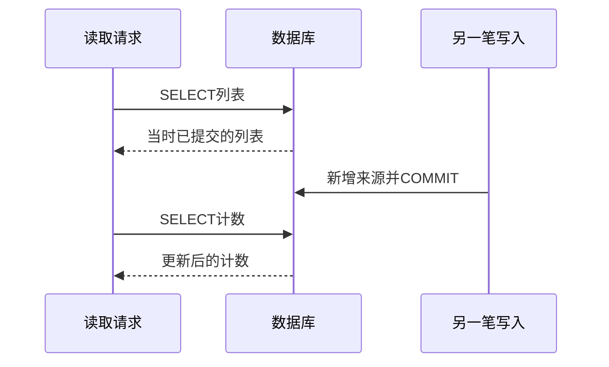

# 支线32A：查询视图、快照与读模型的取舍

主线没有把所有表都返回，而是为星图和来源列表分别确定结果形状。这个决定看起来像接口字段整理，背后却影响聚合正确性、读取成本和以后能否演进。换成一个订单后台，更容易看清问题。

## 先确定一行的身份，才能解释数量

订单列表通常一行一笔订单，详情里才展开商品。但如果SQL把订单同时连接商品明细和支付尝试，再直接COUNT或SUM，结果可能出乎意料。某订单有3条商品明细、2次支付尝试，连接后可能得到6行。COUNT(*)是6，不是商品数3，也不是支付次数2；把订单金额SUM六遍更不会变成正确营业额。

JOIN生成的是满足连接条件的组合，不知道哪一列在你的页面里代表“只算一次”。DISTINCT有时能消掉重复展示，却不自动修复所有聚合。例如两件商品恰好同价，SUM(DISTINCT price)会把两个合法金额也合成一个；问题出在聚合粒度，不是少写了一个去重关键字。

一种直接的处理是先在各自粒度聚合，再连接摘要。商品明细按order_id聚合，支付尝试也按order_id聚合；外层再读订单的一行。另一种是列表只返回订单摘要与必要计数，点击详情后再取有界明细。前者适合确实需要同时比较的指标，后者减少概览中无用的展开。不是嵌套越深，接口就越完整。

回到EPP，学习记录、表达和候选也有不同粒度。星图从表达查，来源列表从学习记录查。一个表达有两条来源，显示一个节点与两条记录并不矛盾；若把学习记录先LIMIT再按表达去重，限制的是来源数量，不能解释为节点数量。本章把查询根与结果身份对齐，就是为了让这些数量有可核对的含义。

## 一次HTTP请求不自动等于一个数据库快照

假设订单列表先查20条订单，再单独查询每条的付款状态。期间付款成功，页面可能显示旧的订单汇总与新的付款状态。即使代码写在同一个async函数里，多个SELECT仍可能在不同时间观察到不同提交。

前面已经看到，PostgreSQL READ COMMITTED按语句取得快照。把两条查询放进默认事务，只保证每条语句各自读取已提交数据，不自动让它们看到同一时刻。若这份结果必须在一个一致快照下计算，可以在一条SQL中组合需要的事实，或按需求使用REPEATABLE READ事务；代价包括更长事务、连接占用与旧版本保留。不能为每个普通列表默认加长事务，却没有说明到底要防哪种矛盾。

同样，两次独立HTTP请求通常更不共享快照。先读星图，再读某节点来源，两次之间出现新采纳，recordCount与刚返回的items数量可能不同；而items本来又可能被limit截取。客户端不能用这两个数字简单相减判断丢数据。需要精确核账的导出、报表或结算，应另行定义范围和一致性时间点。

本章已有来源内容不可变、表达复用不改代表文本，因此普通详情不会因新采纳而改成另一个历史版本；新来源仍可能改变列表和计数。这个稳定性来自当前写入规则，不来自“GET天然一致”。以后允许编辑表达或合并身份，读取设计就需要重新核对这些假设。

## 什么时候才值得单独保存一份读模型

有时页面需要的摘要很复杂，每次从事务表连接、聚合都很昂贵。我们可以额外保存“每个用户的表达概览”，甚至放到专门搜索索引中。读取会简单，但系统从此要维护两份表示。

如果在同一个数据库事务里同步更新摘要，写入成本增加，所有影响摘要的入口都必须遵守规则。新增来源、撤销、合并、用户处置或历史修复，只漏一个入口就可能漂移。若通过后台任务异步更新，写入更容易分离，页面则需要接受延迟，并处理重复事件、失败重试、重建和新旧版本切换。

因此，读模型不只是“新建一张查询表”。还要回答：事实源在哪里，如何知道摘要落后，如何从事实重新生成，重建时在线查询读哪一版，权限删除多久能传播。不能仅把某次慢查询搬到后台，就说一致性问题消失了。

本章先从原表查询，尚未用生产数据规模证明其性能上限。我们先在代码中建立明确的公开投影，没有新增同步存储、消息队列或缓存。以后执行计划证明成本，或查询目的要求另一种结构，再用已经建立的契约隔开内部变化：调用方继续认learningRecord.id与expression.id，后端可以改变读取方案，但必须维持字段含义、范围与失败语义。

## 换一个约束，选择也应改变

若只是内部运营看大致趋势，允许几分钟延迟的汇总很合理；若用户刚采纳完立刻看详情，最好从提交的事实读取，或明确处理尚未同步的状态。若是导出某一天的全部来源，单次默认20条远远不够，还要定义完整遍历和日期边界。它们都是读取，却不应共享一个未经定义的“最终会一致”答案。

维护接口时，我会先保留行粒度、字段含义和用户范围，再决定怎样优化。检查AI生成的查询也一样：先找JOIN是否放大行数，LIMIT到底限制哪一层，COUNT是否包含不可见关系，多条查询是否需要共同快照。只有这些问题能回答，索引或缓存才是在优化一个正确结果。

## 附录：本支线必要技术点速查

| 名称 | 本支线用途 | 注意点与入口 |
| --- | --- | --- |
| JOIN与GROUP BY | 分辨连接产生的行组合和业务聚合粒度 | DISTINCT不能通用修复聚合重复，[PostgreSQL表表达式](https://www.postgresql.org/docs/18/queries-table-expressions.html) |
| READ COMMITTED／REPEATABLE READ | 判断多个SELECT是否共享快照 | 根据实际一致性需求选择，回看[事务章](../chapter-27-transactions/chapter.md)、[隔离级别](https://www.postgresql.org/docs/18/transaction-iso.html) |
| 查询投影与独立读模型 | 区分即时组织结果和额外持久化副本 | 副本需要同步、重建、权限传播与失败恢复，不因读写拆开就自动可靠 |

[返回第32章](chapter.md) · [第四篇导读](../README.md)
