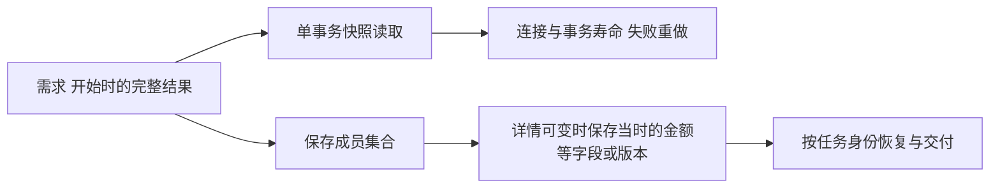

# 支线33A 完整导出、变化中的列表与地区日历

主线让列表按稳定边界继续，但有两个容易被同一句“分页已经做好”掩盖的需求：导出某一时刻的完整名单，以及按某个地区的日历安排未来工作。这两者改变了事实的定义，不能只换一个查询参数。

## 从向下浏览变成财务导出

假设一个后台按订单创建时间降序展示订单。用户向下浏览时，允许新订单留在顶部，下一次刷新再看；严格键集边界很好地满足这个交互。现在财务要求“导出周一上午十点时所有已付款订单”，且总金额必须可复核。我们需要确定的已经不只是顺序，还包括十点时哪些订单属于集合、金额和状态取哪一版。

给第一页记一个上限createdAt并不能冻结集合。一个订单可能九点创建、十点之后付款，后续页把它纳入了“已付款”；另一订单可能后来退款而离开集合。上限限制创建时间，没限制状态变化。即使不能改创建时间，也可能有一笔写入在 9:59 开始事务，插入一笔已付款订单，到 10:01 才提交。如果创建时间取 PostgreSQL 的 `now()`，它记的是事务开始的 9:59。十点查询时别人还看不到这笔订单，十点零一之后重查，它却满足“十点前创建”。先查询再以最大ID为上界也不能天然恢复提交历史，UUID更没有单调提交的承诺。

先试着把两页查询放进同一个只读事务。按 PostgreSQL 默认的 READ COMMITTED（读已提交），每条 SELECT 看的是它开始时已经提交的数据；第二页仍可能看到两次查询之间才付款的订单。要让两页都按第一次查询时的情况读取，可以选 REPEATABLE READ（可重复读）：第一次查询确定哪些行、哪些版本可见，后续查询沿用这份快照。如果十点零五才开始查，固定下来的也是十点零五的视图。要在事后还原十点的报表，需要十点时留下的快照或能够还原当时状态的历史记录。

### 两个会话看同一份已付款清单

报表要分两页读取已付款订单。为了一眼看清边界，练习只有五张订单，按唯一的整数 ID 降序，每页两张，金额以元计。两轮都由 A 读完第一页，B 随后在一次事务里确认一笔付款、修正另一笔金额并提交，A 再读第二页。两轮只换 A 的隔离级别。这样能分开看两件事：新付款的订单有没有取得一席之地，原本就合格的订单显示哪个金额。

**准备。** 在 DBeaver 的数据库导航器选独立 VERIFY 连接，从 SQL 编辑器菜单打开两个脚本，分别记作 A（读报表）和 B（维护订单）。用同一练习角色连接，两边保持自动提交，由下文的显式事务控制每轮边界。在两个编辑器分别选中并执行：

```sql
SELECT current_database(), current_user, pg_backend_pid();
```

核对库名都是目标 VERIFY、PID 不同。若 PID 相同，两个编辑器正在共享会话；在导航器复制这份 VERIFY 连接，用副本打开 B，再查一次。后面按 A、B 顺序选中对应的语句块执行；批量从头跑到底会错过两页之间的提交。表必须能被两个会话看见，因此在 VERIFY 的 public 下建一张专用普通表。在 B 执行：

```sql
BEGIN;
CREATE TABLE public.ch33a_paid_page (
  id integer PRIMARY KEY,
  paid boolean NOT NULL,
  amount integer NOT NULL
);
INSERT INTO public.ch33a_paid_page (id, paid, amount) VALUES
  (50, true, 50), (40, true, 40), (30, false, 30),
  (20, true, 100), (10, true, 10);
COMMIT;
```

若创建时提示同名表已存在，先在 B 执行 `ROLLBACK;`，核对是否是自己上一次留下的实验；只对本次确认创建的练习表做文末清理。准备成功后，在纸上写下最初的合格顺序：50、40、20、10。30 虽然位于 40 与 20 之间，尚未付款，不占页上的名额。假如没有任何人改动，第一页末项是 40，第二页应从 20 开始。

**第一轮，读已提交。** 在 A 执行以下两句，记下结果后停在这里，保持 A 的事务打开。SELECT 只取合格订单，金额作为输出列，不参与排序。

```sql
BEGIN ISOLATION LEVEL READ COMMITTED READ ONLY;
SELECT id, amount FROM public.ch33a_paid_page
WHERE paid ORDER BY id DESC LIMIT 2;
```

第一行是 50／50，第二行是 40／40（ID／金额）。现在切到 B，整块执行，等到 COMMIT 成功再切回 A。两条 UPDATE 应各影响一行。

```sql
BEGIN;
UPDATE public.ch33a_paid_page SET paid = true WHERE id = 30;
UPDATE public.ch33a_paid_page SET amount = 125 WHERE id = 20;
COMMIT;
```

在 A 写第二页时，保留第一页的付款条件和排序，加上末项给出的严格边界。先预测新入选的 30 排在哪里，再预测原来就入选的 20 会显示多少钱。

```sql
SELECT id, amount FROM public.ch33a_paid_page
WHERE paid AND id < 40 ORDER BY id DESC LIMIT 2;
```

结果是 **30／30、20／125**。A 仍在同一个只读事务内，但读已提交为第二条 SELECT 取得了新视图，B 的两项变更都已经可见。10 仍然合格，只是排到这一页的两个名额以外。保存这两行结果，在 A 执行 `COMMIT;`，结束第一轮。

**恢复起点，然后读可重复读。** 在 B 执行下面整块，将两项变化复原并提交。若省掉这一步，第二轮会从已经付款的 30 和已经涨到 125 元的 20 开始，便无法与第一轮比较。

```sql
BEGIN;
UPDATE public.ch33a_paid_page SET paid = false WHERE id = 30;
UPDATE public.ch33a_paid_page SET amount = 100 WHERE id = 20;
COMMIT;
```

在 A 开始新的只读事务，执行与第一轮完全相同的首页查询，停在相同的末项 40。这里第一条 SELECT 建立了这轮要沿用的快照；单独发出 BEGIN 还没有读到首页。

```sql
BEGIN ISOLATION LEVEL REPEATABLE READ READ ONLY;
SELECT id, amount FROM public.ch33a_paid_page
WHERE paid ORDER BY id DESC LIMIT 2;
```

现在 B 再执行第一轮那段付款、改金额及 COMMIT。等提交完成，A **在仍然打开的事务中**再次执行上面的第二页 SELECT（`paid AND id < 40`）。这次得到 **20／100、10／10**。30 的新付款状态未出现在 A 的快照里；20 在两种结果里都出现，金额却仍是 100。只看行数会觉得两轮都成功读了两项，只比 ID 可以查出成员差异，再比同一个 20 的金额才能查出版本差异。

最后在 A 执行 `COMMIT;`，再单独重发同一条第二页 SELECT。现在应看到 **30／30、20／125**。这第三个观察点能区分「B 忘记提交」和「B 已提交，A 暂时仍读旧版本」。如果可重复读轮在提交 A 之前就看到了新金额，先查 B 是否抢在 A 的首页 SELECT 之前提交，以及 A 两页之间是否结束或更换了事务。若 A 结束事务后仍只看到旧金额，回到 B 核对两条更新影响的行数、提交结果和连接的数据库。

**清理。** 两轮结束，确认 A 的事务已提交；中途停下则先在各自仍有未结束事务的编辑器执行 `ROLLBACK;`。在 B 删除本次创建的练习表，并核对 cleaned 为真。读事务尚未结束时会持有表锁，应先结束 A 再清理。

```sql
DROP TABLE public.ch33a_paid_page;
SELECT to_regclass('public.ch33a_paid_page') IS NULL AS cleaned;
```

A 能固定视图的条件，是两次 SELECT 由同一个数据库会话在同一个可重复读事务内执行。回到 EPP，浏览器在同一页点两次、换页签继续，或 Postman 原样传回游标，都会发出独立的 HTTP 请求。服务重新执行查询；即使连接池碰巧分到同一条连接，也不会继承这次 DBeaver 事务的快照。游标里的位置只回答从哪里接着读。第 34 章让界前和界后的素材分别改成匹配，用同一个区别解释实时遍历少见了哪一条。

数据库不需要先复制整张订单表，但必须保留这次读取还可能用到的旧版本。事务越久，这些旧版本就越晚才能清理，而且导出期间一直占用连接；请求断开、工作进程退出、导出持续很久，都需要另外处理。不能把数据库事务留在浏览器两次点击之间，期待用户一定马上翻下一页。

另一种方案是任务开始时保存成员ID，后续分批取详情。这样能恢复“名单里有哪些”，但不能自动恢复“当时金额是多少”：若详情后来被修改，只有ID仍不足以证明历史金额。业务若要求原值，可以在保存名单时一并存下当时的金额和币种，也可以引用不会改写的订单版本，或直接保留当时生成的导出文件。冻结成员和冻结内容是两个不同承诺。



选择取决于规模和可恢复要求。短小、可在一个事务内完成的内部报表可以先使用快照；耗时较长、需要中断恢复的导出更适合任务化，并明确保留哪些历史事实。这里不为EPP增加导出表和Worker，后续任务篇再提供运行机制；当前已足以识别“把页面cursor循环到null就算完整导出”缺少什么前提。

回到EPP，学习记录当前不可通过业务接口改createdAt，候选与修订内容也保留历史，因此实时遍历比一个频繁修改状态的订单列表稳定。但关系权限未来会变化，管理员也可能修复数据。不能因为当前演示数据不变，就把实时读取写进合同称作某时点的完整快照。需要固定报告时先明确观察时间、成员与内容，再选择机制。

[PostgreSQL隔离级别](https://www.postgresql.org/docs/18/transaction-iso.html)说明READ COMMITTED逐语句视图与REPEATABLE READ事务快照的差别；[维护与旧版本回收](https://www.postgresql.org/docs/18/routine-vacuuming.html)解释了长事务为何带来维护成本。事务快照也不是可长期保存并跨任意进程重启继续的业务凭证。

## 地区时区不等于一个固定偏移

一个用户从上海旅行到纽约。已经保存的采纳时间点没有变化，但“当地哪天发生”会随展示地区改变。若产品只是按当前地区展示列表，可以重新换算；若产品承诺“每天完成一次算连续”，就必须先决定这个“每天”按哪个地区：账户固定地区、行为发生时地区，还是当前设备地区。否则旅行会把历史连续天数改写。

这不是选择UTC或本地存储二选一。发生时刻仍保存时间点，业务若需要保留当时的地区规则，再保存明确的地区身份或日历归属依据。显示文本可以重算，但已经结算的业务日是否允许重算，是产品规则。后续练习篇会把这个问题接到练习事实，不在当前列表里提前加一个含义未定的day字段。

固定偏移 `-05:00` 只说明当地钟表比 UTC 慢五小时；`America/New_York`描述一套随日期变化的地区规则。夏天的纽约并非总是-05:00。对已经发生的时间点，偏移足以说明那次显示；对“以后每个周一九点”的预约，只留一个偏移会在季节转换后偏离用户的九点。

再改变一个条件：预约落在切换日的02:30。某天这一段本地钟表时间可能根本不存在；秋季某个01:30可能对应两个时间点。系统必须决定跳过、顺延、选择第一次还是第二次，或者直接要求用户重新选择。默认转换返回一个结果，不等于需求已经澄清。主线用两个本地午夜换算日期区间，也须对跨午夜变更、整日跳过等地区历史说明支持范围。

像 `America/New_York` 这样的地区名称来自 IANA 时区数据库，它记录各地在不同日期使用的规则，政府调整时区后也会更新。运行环境更新后，对未来日期的换算可能变化；已经承诺的预约到底保留原时间点还是坚持当地钟表时间，也需要明确。关键事实可以保存地区名称、原本地意图、已解析时间点及必要版本依据，具体保留量由可审计和变更要求决定，不是每条普通采纳记录都加一整套时间系统。[IANA时区数据库说明](https://www.iana.org/time-zones)是地区规则的权威入口。

## 把新要求放回主线的边界

面对“支持时间分页”这样的需求，可以沿三个具体问题继续：列表是在实时浏览还是冻结报告？排序键会不会改变或丢精度？用户说的一天属于哪个地区和哪套业务规则？这些答案决定数据库查询、续页状态以及时间字段保存什么。

EPP本章选择实时列表、当前不可由业务接口改写的毫秒排序键、显式UTC半开区间。它不阻止未来增加导出或地区日期入口，但新增能力需要重新说明一致性与日历语义，不能把一个可用游标扩张成所有读取问题的答案。

阅读约 32～40 分钟，DBeaver 双会话准备、两轮对照与清理另加约 15～22 分钟。主线的 23／25 小时对照可用来检查日历推导。

## 附录：本支线必要技术点速查

| 名称 | 作用 | 必要注意点与官方入口 |
| --- | --- | --- |
| REPEATABLE READ | 同一事务读取一致快照 | 不应跨用户点击长期持有，[隔离级别](https://www.postgresql.org/docs/18/transaction-iso.html) |
| 保存名单与保存当时的字段值 | 区分“哪些行”与“当时内容” | 保存ID不等于保存可变字段，历史关系仍有生命周期 |
| now／transaction_timestamp | 事务时间语义 | 不是提交时间，[当前时间函数](https://www.postgresql.org/docs/18/functions-datetime.html#FUNCTIONS-DATETIME-CURRENT) |
| IANA地区标识 | 依据日期换算当地钟表 | 规则可能更新，不等同固定UTC偏移，[时区数据库](https://www.iana.org/time-zones) |
| 不存在与重复本地时间 | 决定预约的歧义处理 | 必须定义业务策略，[PostgreSQL无效时间解释](https://www.postgresql.org/docs/18/datetime-invalid-input.html) |

[返回第三十三章](chapter.md) · [接第 34 章：排序没变，匹配集合仍会变](../chapter-34-paging-upgrade/chapter.md#排序没变匹配集合仍会变) · [第四篇导读](../README.md)
