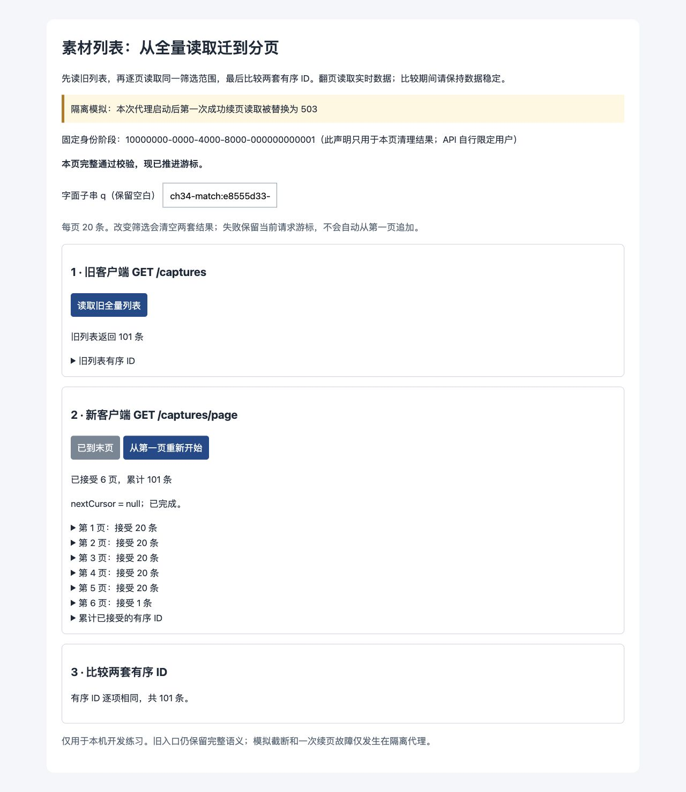
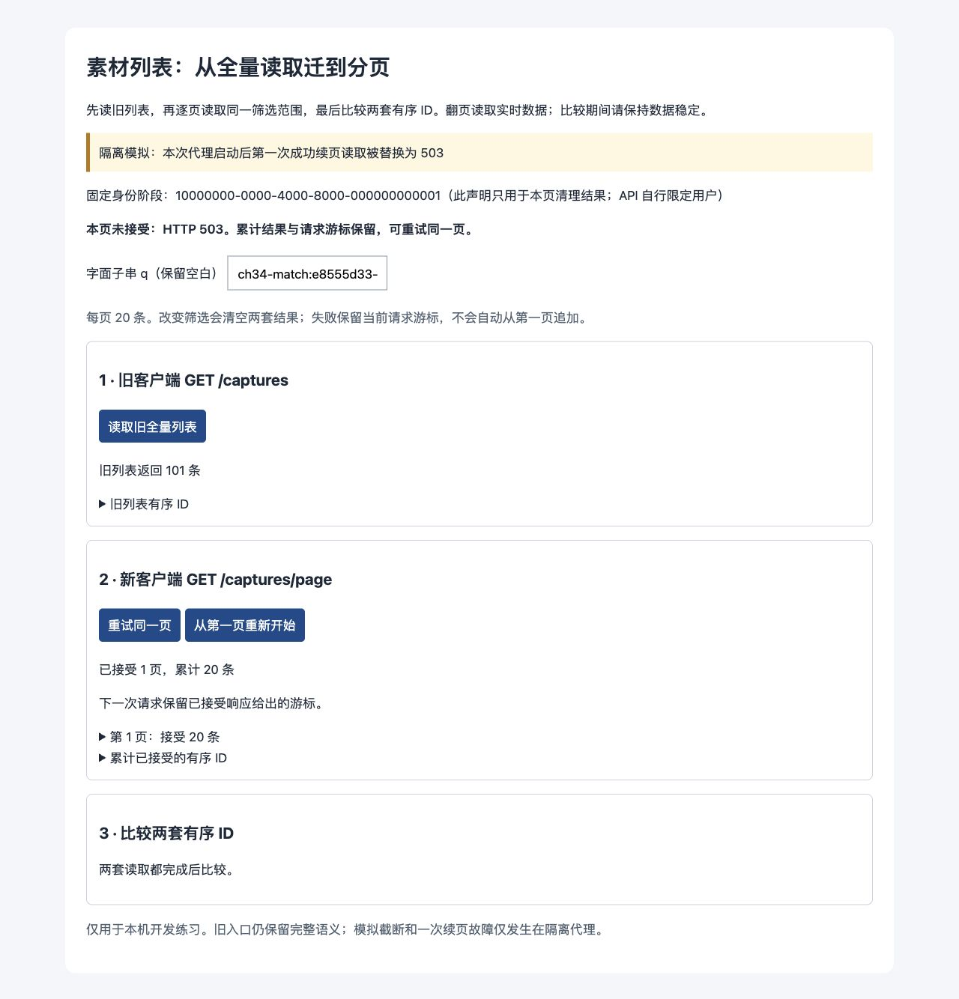
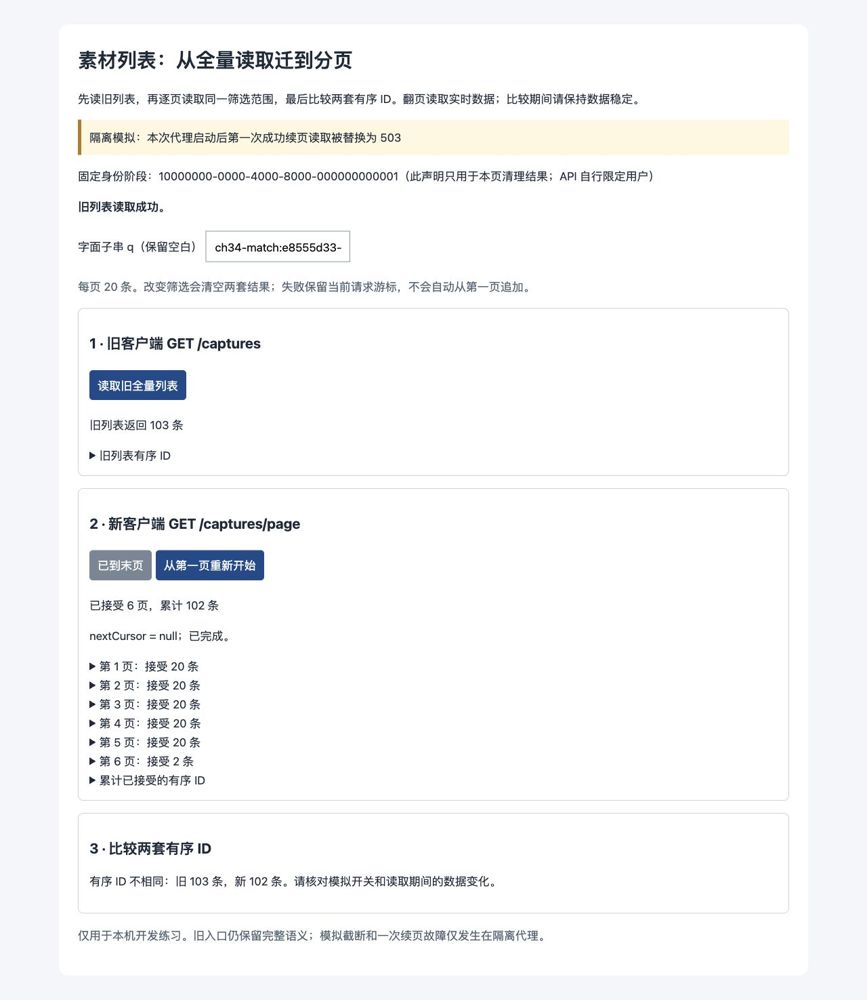
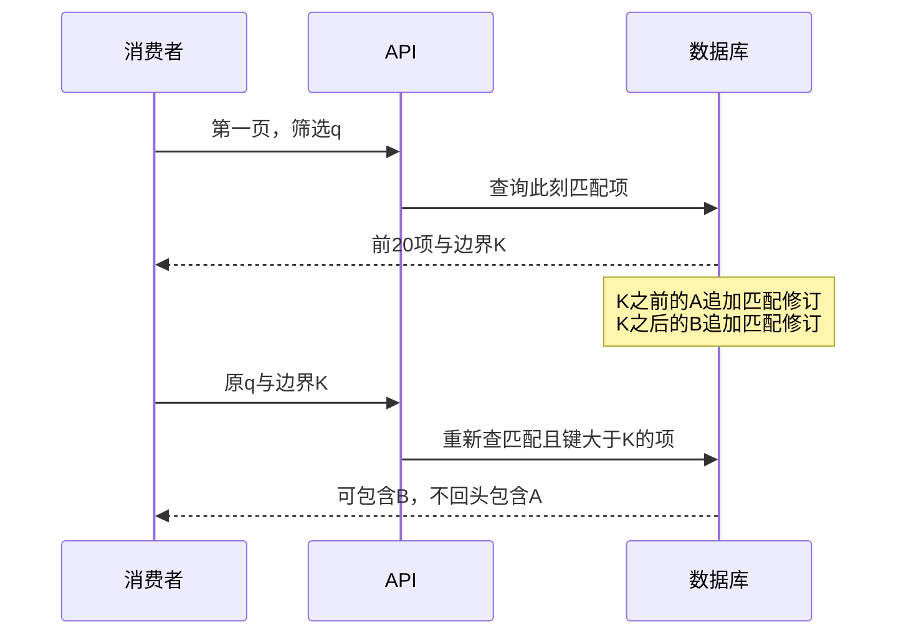

# 第34章 已有素材列表怎样从全量读取迁到分页

一个页面显示“共有101条素材”，升级后变成“共有100条”。Network里仍然是200，JSON也能解析，没有一处报错。这种故障比请求直接失败更难发现：服务只返回了一页，客户端却仍把它当作全部。

第33章已经给学习记录和星图加了续页，本章回到更早建立的素材列表。`GET /captures`按素材创建时间、ID升序排列，q检索最新修订中的原文，省略limit时返回全部匹配项；传limit只是截取前几项，并没有后续页。不能因为另一种列表已会分页，就假定所有消费者都会追游标。

从 `part-04/chapter-33` 继续，完成状态为 `part-04/chapter-34`，第35章从本章接续。仍用Node 24.22.1、PostgreSQL 18、Prisma 7.10.1以及原有Chrome、Postman、DBeaver；本章不增加依赖、表、迁移或索引。起点代码见[第33章配套](https://github.com/SamChowRock/epp-public/tree/part-04/chapter-33)。先按[本章环境入口](../../environment-setup.md#第-34-章比较旧列表与分页读取)确认独立VERIFY、固定游标密钥与两个回环端口。保留第30章的写入回执和前面各章留下的数据，练习只增加带本轮标记的虚构素材。

## 34.1 找出哪个客户端把一页当成全部

### 成功响应为什么仍可能破坏旧程序

旧脚本可能只有三行：

```js
const response = await fetch('/captures?q=practice');
const { items } = await response.json();
showCount(items.length);
```

它是否写错，要看当时的契约。如果接口承诺省略limit读全量，items.length确实是这次读取匹配的条数。现在服务为了省资源，悄悄加上默认limit=100，原请求不变、响应字段不变，脚本却少计一条。类型检查只能确认“数组里是素材”，不能确认“数组已经包含本次查询的全部素材”。

不仅统计会出错。导入程序可能把未出现的ID当作已删除；同步脚本可能覆盖一个原本完整的缓存；列表页面可能不再显示后面的内容。这些程序消费的是完整性约定，不能只用“字段没删、仍然200”判断向后兼容。反过来，明确发送limit=100的旧请求本来就只承诺前100项，不能替调用方补出过去没有的全量保证。

先列出真实消费者及用途。页面、定时脚本、手工Postman集合和外部集成不一定由同一个人发布。对每个消费者问一件具体的事：它拿到items之后，是显示这一批、累计全部，还是据缺失项做删除判断？最后一种尤其不能从一页结果推出全局不存在。

可以先用一个只有三项的旧列表推一遍事故。甲、乙、丙都匹配「练习」，保存在本机的上次同步结果里。下一次读取只返回甲和乙。如果旧服务明确承诺这是此刻的完整集合，同步程序可以认为丙此刻已不属于这个筛选结果；即便如此，也不能据此断定丙的素材记录已经删除，它也可能只是改了原文。若服务现在只给第一页，则连「不再匹配」都推不出来。丙可能紧挨着乙排在下一页。把一个完整集合换成一个前缀，动的是这些下游判断赖以成立的前提。

反过来分析页面需求，才能确定哪些消费者真的需要遍历到底。页面若只画最近收藏中的一个小窗口，读到足够多的卡片就可以停，只需准确标出展示的是一部分。某个批处理若要逐项处理这些素材，则要回答完成标准：最后一批怎样识别，途中停止后从哪里恢复，读取期间变化的成员算不算在内。即使两段前端代码现在都只有一次 fetch，后面的迁移也不该机械地给两者加上相同的循环。把「取多少」从「用于什么」倒推出来，才知道一次成功响应足不足以完成用户的动作。

现在给旧脚本换几组数量。零项、三项、刚好一百项，都无法暴露偷偷加了一百上限的错误，因为完整结果与截取后的数组相同。第一组能区分它们的大小是一百零一项；而只有所有结果都与当前 q 匹配时，这一项差异才会出现。往库里放一百零一条素材却只让十条匹配，不管最终读全量还是截一百都只能看见十条。因此本轮要控制的是「同一用户、同一筛选、最新修订命中」的数量，不能只看素材总表里有多少行。若担心生成很多无用数据，只需让有效集合跨过旧上限一条，再用少量不匹配项检查筛选边界。

还能从故障现象反推为什么要保留身份。假设新响应漏掉丙，却把乙返回了两次，界面总数仍是三。如果只对比 items.length，统计页看似正确，点开第三个位置却打开了另一条素材。只比标识集合又可能漏掉顺序变化，例如第一页末项与下一页首项互换，用户刷新时会感觉一条素材跳到别处。这里旧接口已经承诺素材创建键升序，迁移目标包括保住这条顺序。因此准备基准时保留有序 ID，再另外看最新原文和意图是否来自同一修订；前一项能证成员和顺序，后一项能查表示内容。

### 用101条数据把错误显出来

先取得本章辅助材料，业务源码仍从第33章跟写。保留当前33项目，另开本章配套完成状态 `part-04/chapter-34` 作对照，只复制以下路径到跟写目录；不要把其src覆盖到33项目后再当成逐步升级：

- `database/chapter-34/`：四份SQL。
- `requests/chapter-34-capture-pages.postman_collection.json`：本章独立集合。
- `examples/paging-upgrade/`：index.html、page.mjs、pager.mjs、server.mjs、README.md。
- `test/capture-pages.test.mjs`、`test/paging-upgrade-browser.test.mjs`：两套配套检查。

这些辅助文件只准备实验和消费者，新的CapturePages尚未接入服务。下面先比较旧读取，34.2按随文代码修改src，接线完成后才运行依赖新接口的capture-pages测试。如果直接检出完成状态做行为对照，跳过重复添加代码，仍按各步准备独立数据库与标记。

在DBeaver打开VERIFY连接，新建SQL编辑器，先执行 `SELECT current_database(), current_user;`。必须与独立副本的预期名称相符。打开配套 `database/chapter-34/` 的准备脚本，让01自动生成本轮新标记，整份执行准备事务：建立练习素材时一起建立初始修订，不直接造出缺少修订的父行。脚本使用已有固定开发用户，只为本轮新增样本分配身份；已提交的同轮数据用观察语句复读，不在不确定是否提交时重新插一遍。

运行 `01-seed.sql` 的整份事务，成功后的最后一个结果给出run_id和q，例如 `ch34-match:一串UUID`；实际复制自己的完整q。它新增105条素材、各两版修订：编号1～101的最新版本匹配，0在它们之前、102在之后，104只有历史版本匹配。不要复制示意文字作为筛选词。

接着在**同一SQL编辑器、同一数据库会话**执行 `02-observe.sql`。首个结果应该有101行，且1～101的素材创建时间完全相同；第二个结果显示104的第一版含q、第二版不含q。DBeaver可能只取一批结果，先取完结果集再判断总行数，不拿网格当前显示的前100行当成服务返回值。

临时表ch34_run、ch34_samples在COMMIT后仍保留，但断开连接就消失。在这个会话执行下列只读查询，把结果导出成这轮练习专用CSV，保存run_id、n、id、user_id、created_at；它是后来核对目标的依据，不含密码或游标：

```sql
SELECT run_id, n, id, user_id, created_at
FROM ch34_samples ORDER BY n;
```

不要在另一个新建连接的编辑器直接执行02～04。若01返回错误，先ROLLBACK，检查实际是否已有本轮临时表和已提交数据；若连接已经丢失，按保存的ID逐条复读，不凭原文批量删数据。新一轮使用新标记，前一轮可以保留，不会进入新q的范围。

观察查询要读取每个素材的最新修订，再按本轮标记筛选。看到101条匹配、少量不匹配，以及至少两条created_at相同后，才继续。不要用全库的101作为前提，也不要清空前章记录凑这个数字。保存这一轮的标记、同时间的两个ID、用于修改筛选归属的两个非匹配ID，后面的实验都从这些身份接起。

在项目根先完成安装、迁移状态核对和构建。迁移命令只部署此前已经建立的结构，本章没有新的SQL迁移：

```bash
nvm use
npm ci
npm run db:verify -- migrate status
npm run check
```

沿原开发入口启动API，使用VERIFY和已保存的CURSOR_HMAC_KEY。在VS Code把 `.env.database-verify` 复制为本轮私有的 `.env.paging-verify`，保留其中的DATABASE_URL，再从第33章私有配置加入同一份CURSOR_HMAC_KEY。不要把DEV地址复制进来，也不要公开两项值。用 `git check-ignore .env.paging-verify` 确认这个文件被忽略；没有输出时先停止，修正忽略规则后再保存秘密。该文件只承载这轮练习配置，不自动作为生产配置发布。

Shell中同名环境值优先于env文件，所以先清除继承值。显式载入这一份配置，再交给原有调试／自动重启脚本；开发监听和Inspector仍按前章运行：

```bash
unset DATABASE_URL CURSOR_HMAC_KEY
NODE_ENV=development PORT=3000 \
node --env-file=.env.paging-verify scripts/dev.mjs
```

从本章配套取 `examples/paging-upgrade/` 的完整页面文件到前章项目；这只是开发消费者，当前先使用旧读按钮，34.2才接入新API。第二个终端启动页面，正常模式默认不加任何限制：

```bash
PORT=3034 TARGET_PORT=3000 node examples/paging-upgrade/server.mjs
```

在Chrome打开 `http://127.0.0.1:3034`，输入本轮q，再读取旧列表。正常结果应为101。在Postman直连3000发送相同GET，核对有序ID，确认页面并未自行生成或过滤出这些素材。

接下来只停止页面代理，保留API和数据。在原端口重启代理并显式开启 `LEGACY_CAP=100`，刷新页面再读旧列表：

```bash
PORT=3034 TARGET_PORT=3000 LEGACY_CAP=100 \
node examples/paging-upgrade/server.mjs
```

这个模式先完整读取上游成功响应，再把items截为前100项，用来模拟旧完整性约定被改坏；它不能证明数据库读取量已经减少。页面明确标出实验限制；它是隔离故障演示，正式API的默认行为没有被修改。浏览器仍能收到200，却只数到100；直连API仍有101。对比少掉的ID，便能定位是入口返回范围改变，而非数据库丢行。


图34-1　真实浏览器读取隔离代理的旧列表，成功返回100条；顶部明确标出模拟模式，正式API未修改。

关闭该代理，去掉LEGACY_CAP，在同一端口重新启动。刷新后重读旧列表，恢复101。这一步同时是最小回退：还原原请求约定，不靠客户端把100写死为“总数”。后续分页对照必须在正常旧入口下进行，否则两个客户端比较的是不同条件。

准备完毕后可以自己写一条验证 SQL，判断那一百零一究竟数的是什么。先从本会话的映射选编号零、一、一百零二、一百零四，各拿一个素材标识。把它们接到修订表，只选择编号、素材标识、版号和「本版是否含本轮词」四列，暂时不筛任何一版。按素材编号、版号升序查看。每个编号最初应占两行，其中编号一是先不命中、后命中，一百零四正相反。现在把每组最后一行在纸上圈出，圈出的四行里只有编号一该出现在第一页候选中。若先把不含词的行删掉，再从每组剩下的行中选最后一版，就会把一百零四也圈进去。

可以先在 DBeaver 独立填完 SELECT 的那一列布尔表达式，再与下面对照。这里把是否命中当成**结果列**，保留了用来解释判定过程的不匹配版本。等看清哪个版本该代表素材，才把同一个判定移入正式查询的筛选条件。

```sql
SELECT s.n, s.id, r.revision_no,
       strpos(r.original_text COLLATE "C", 'ch34-match:' || s.run_id) > 0 AS matches
FROM ch34_samples AS s
JOIN public.capture_revisions AS r ON r.capture_id = s.id
WHERE s.n IN (0, 1, 102, 104)
ORDER BY s.n, r.revision_no;
```

此时在界面里可以同时保留三种行数。数据库准备了多少个父素材，是一百零五；刚才四个父素材展开成几行修订，是八；对全部父素材各取最新版后，有几项符合本轮 q，是一百零一。若有人拿第二种明细去数第三种结果，计数正确与否就会依赖每条记录恰有多少版本。另一个易错点是把样本编号当作排序键。编号只帮你在练习中认出哪个素材，编号一到一百零一共享同一创建时间，各自的 UUID 是独立生成的。第一个返回的标识不一定属于编号一，被截在一百项以外的也未必是编号一百零一。应从旧全量有序 ID 的最后一位取得确切答案。

按这三层证据定位代理实验里的差一条。数据库明细若已有一百零一项，直连 API 却只有一百，先检查 Postman 最终地址是否仍勾着 limit，以及 q 和目标库是否正确；不用先改查询语句。直连给一百零一，页面 Network 的原始 JSON 只有一百，差异出现于浏览器取得响应之前，结合当前代理模式就能缩小位置。若 Network 给的一百零一是完整数组，页面却只数一百，应检查显示层到底渲染了前若干项，还是比较逻辑真的丢了一项。每一步用的是同一个 q 和同一组标识，这样才不会把两个不同时间段的合法读数当成同一故障。

## 34.2 让两种读取约定并存

### 新入口明确说“这是一页”

可以让同一路由通过mode分流，也可以新增路径。上一章的学习列表原本已返回limit和hasMore，显式mode顺着它的已有结构继续；素材列表只有items，而且省略limit代表全量。本章选择 `GET /captures/page`，让新调用方主动进入分页契约，旧入口继续工作。它不是给整个API统一改版本，只为这个读取能力增加清楚的入口。

| 请求 | 当前承诺 | 消费者怎样继续 |
| --- | --- | --- |
| `GET /captures?q=...` | 全部匹配素材，旧升序 | 不存在本接口的下一页 |
| `GET /captures?q=...&limit=100` | 前100项，旧截取语义 | 不把它当成可遍历协议 |
| `GET /captures/page?q=...&limit=20` | 最多20项及续页信息 | 保存返回的nextCursor |
| `GET /captures/page?q=...&limit=20&cursor=...` | 原查询范围中边界之后的一页 | 收到合法响应后再更新游标 |

新响应总有items、limit、hasMore和nextCursor；最后一页明确返回false与null。空列表也是200和空数组，不借404表达“没有匹配项”。页长默认20、最大100；不提供Offset，连续读取使用已经学过的游标。新入口严格拒绝未知参数、重复值、空筛选和非法页长。

旧接口的参数处理也不能顺手收紧。它以前可能忽略未知参数；把cursor加到旧路径上，并不会神奇地获得续页，甚至可能每次都读同一个全量列表。迁移必须同时更新路径、参数、响应解析和结束条件，不能只看到请求里有一个叫cursor的字段。

### 取最新内容，沿素材身份继续

排序对象是素材，createdAt取素材最初创建的时间。修订更新内容，但不会把素材变成一条新创建的记录。q仍匹配最新修订的originalText：这是本章继续保持的业务含义，不是“只要某一版含这个词就算匹配”。

数据库查询分四层理解：选当前用户的素材；为每条素材找出最新修订；让最新原文满足q；在符合条件的素材中应用升序边界并取limit+1。LATERAL让子查询能引用外层这一条素材的id。这里最新修订最多返回一行，因此不会因一对多连接把同一素材扩成多项。[PostgreSQL的LATERAL说明](https://www.postgresql.org/docs/18/queries-table-expressions.html#QUERIES-LATERAL)

```sql
SELECT c.id, r.original_text, r.chinese_intent, c.created_at
FROM public.captures c
JOIN LATERAL (
  SELECT original_text, chinese_intent
  FROM public.capture_revisions
  WHERE capture_id = c.id
  ORDER BY revision_no DESC LIMIT 1
) r ON true
WHERE c.user_id = '10000000-0000-4000-8000-000000000001'
  AND strpos(r.original_text COLLATE "C", '本轮筛选词') > 0
ORDER BY c.created_at ASC, c.id ASC
LIMIT 21;
```

在DBeaver先用自己的q观察这个查询，参数必须换成本轮值。正式实现通过Prisma参数化绑定值，不拼接SQL字符串。COLLATE "C"和strpos延续原来区分大小写的字面子串判断，百分号与下划线不变成LIKE通配符；查询词里的空白也不自动trim，否则原来能区分的请求会被悄悄合并。

不要先从captures取21条，再在JavaScript筛最新原文。前21条中只有两条匹配，并不意味着整个集合只有两条；这样也无法正确判断hasMore。也不要先在修订表筛q再选最大revision_no，否则“旧版含词、新版已删词”的素材仍会留下。条件的位置就是业务语义的一部分。

假设上一页最后一个素材的键是(t,id)。两个排序字段都升序，续页条件为：

```text
c.created_at > t
OR (c.created_at = t AND c.id > id)
```

严格大于排除已交付的末项，ID负责同一毫秒内的并列。不能把第33章降序列表中的小于号原样抄过来。查询多取得的第21项只证明还有数据；nextCursor记第20项，下一页才能真正读到第21项。[PostgreSQL的LIMIT与确定顺序](https://www.postgresql.org/docs/18/queries-limit.html)

把上面的成品查询盖住，只给自己「搜当前原文并按素材创建顺序翻页」这句话，怎样开始？先写主表别名 c 和输出主键。结果里的一行要能打开一份素材，所以用素材标识做主键；若用修订标识作为行身份，同一份素材每次改文都会换一个翻页对象。再决定排序的时间来源：把新修订作为排序时钟，就会使刚改过的老素材从旧位置移走。现在要保住旧列表的升序，所以键选素材表上的创建时刻和素材标识。到这一步限定映射中编号一到一百零一，查看这批初始匹配素材的两列键，明明有一百零一项却只有一个时刻，第二个键的重要性便看得见了。

接着再补原文。先在编辑器只写针对一个已知素材标识的查询，从修订表取版号和原文，先按版号倒序，不限量。最上面那行是要拿来表示这份素材的版本；给它加一项上限，就得到「给我一个素材，返回它的当前内容」。把写死的那个素材标识替换为外层 c.id，把这段放到 LATERAL 括号里，它就能对每个父行使用那个父行的标识。输出的是最新一行的字段，因此增加 chinese_intent 时也从同一行取。若分别在不同查询中挑一个非空意图和一个最新原文，可能拼成历史上从未存在过的组合。

把这条语句停在「还没按 q 筛」的位置，仍应是一个有修订的素材对应一行。如果某父行缺少任何修订，当前内连接无法找到供展示的内容，它不会出现在结果里。配套准备脚本在同一事务为本轮父行建立初始与后续修订，正是让这里的前提成立。观察时若发现明细数量少，不应先把连接换成外连接、用空字符串补一行来凑数；需要分别检查父行是否属于当前用户，以及是否存在其当前版本。空串会掩盖数据不完整，也可能改变接口原本承诺的有效原文。

现在加入 q，让它作用在最新子查询已经交出的原文。假设版本一是「练习问候」，版本二是「练习告别」，搜「问候」应得零行，搜「练习」应得一行。直接连全部修订再搜「练习」却会有两行，先筛「问候」再取最高版又会错得一行。用这两个条件就能区分「输出重复」和「输出历史内容」两种错误。把整段真正写进程序时，q 作为值传入；未提供 q 则不加这条谓词。这样原文包含空格或者标点也仍按原本的字面意义比较，不必先改变用户输入再想办法还原。

最后才补继续位置。取两个时刻，较早时刻的最大标识排在较晚时刻的最小标识之前。若上一页停在较早时刻且标识很大，下页仍应包括较晚时刻的小标识。两个字段分别都要求更大，会挡住这条合法记录；只要求时间更大，又会把较早时刻还没读完的并列项全丢掉。写出「较晚，或相同时标识更大」再压缩成行值比较，读起来就知道比较的是全排序的后继。最后检查 ORDER BY 也按同一方向排列，否则 WHERE 虽然选对了候选，下一次签发的末项却无法正确描述已走过的部分。

### 游标既带位置，也带这一次查询的范围

签名沿用第33章CURSOR_HMAC_KEY，新素材游标使用独立资源名和升序版本，绑定当前用户、实际limit、q和边界。q省略与空字符串不是一回事：前者不筛选，后者按新契约拒绝。省略limit与显式20等价；limit=100获得的游标不能在limit=20请求中继续。

整轮遍历仍从第一页起计30分钟，续页继承最初到期时间。HMAC只验证原载荷未被改动，不加密q，不冻结结果，也不能代替每页的用户归属检查。游标进入URL，因此不要复制到公开截图、日志或工单。页面可以显示页号和已接收数，不需要显示完整载荷。

新增 `src/capture-pages.ts`。查询Schema与旧列表共用q规则，输出Schema明确允许游标；其余部分把校验、参数化查询和结果组装放在一个小类中。旧 `PrismaCaptureStore.list` 不改动。

<details>
<summary>完整 CapturePages：从请求范围到升序续页</summary>

```ts
import { createHmac, timingSafeEqual } from 'node:crypto';
import { z } from 'zod';
import { Prisma } from './generated/prisma/client.js';
import { CaptureResponseSchema, ListQuerySchema } from './capture-contract.js';
import { DatabaseService } from './database.service.js';
import { ApplicationState } from './application-state.js';
import { HttpError } from './http.js';

export const CapturePageQuerySchema = z.object({
  q: ListQuerySchema.shape.q,
  limit: z.string().regex(/^(?:[1-9]\d?|100)$/).optional(),
  cursor: z.string().min(1).max(2048).optional(),
}).strict();
export type CapturePageQuery = z.infer<typeof CapturePageQuerySchema>;
export const CapturePageSchema = z.object({
  items: z.array(CaptureResponseSchema).max(100), limit: z.number().int().min(1).max(100),
  hasMore: z.boolean(), nextCursor: z.string().nullable(),
});
const CursorSchema = z.object({
  v: z.literal(1), scope: z.string(), expires: z.number().int().positive(),
  at: z.iso.datetime({ precision: 3 }), id: z.uuid().regex(/^[0-9a-f-]+$/),
}).strict();
function signature(body: string, key: string) {
  return createHmac('sha256', Buffer.from(key, 'hex')).update(body).digest();
}
type Row = { id: string; originalText: string; chineseIntent: string | null; createdAt: Date };

export class CapturePages {
  constructor(private readonly database: DatabaseService, private readonly state: ApplicationState,
    private readonly cursorKey: string, private readonly userId: string) {}

  list(query: CapturePageQuery) {
    const limit = Number(query.limit ?? '20');
    const scope = JSON.stringify(['capture-list/v1', this.userId, 'createdAt-asc,id-asc', limit, query.q ?? null]);
    let expires = Date.now() + 30 * 60 * 1000;
    let boundary: z.infer<typeof CursorSchema> | undefined;
    if (query.cursor !== undefined) {
      try {
        if (query.cursor.length > 2048 || !/^[A-Za-z0-9_-]+\.[A-Za-z0-9_-]{43}$/.test(query.cursor)) throw new Error();
        const [body, mac] = query.cursor.split('.') as [string, string];
        const decoded = Buffer.from(body, 'base64url');
        const actual = Buffer.from(mac, 'base64url');
        if (decoded.toString('base64url') !== body || actual.toString('base64url') !== mac || actual.length !== 32 ||
          !timingSafeEqual(actual, signature(body, this.cursorKey))) throw new Error();
        boundary = CursorSchema.parse(JSON.parse(decoded.toString('utf8')));
        if (boundary.scope !== scope || boundary.expires <= Date.now() || boundary.at.startsWith('0000-') ||
          new Date(boundary.at).toISOString() !== boundary.at) throw new Error();
        expires = boundary.expires;
      } catch { throw new HttpError(400, 'Invalid or expired cursor; restart from the first page', 'INVALID_CURSOR'); }
    }
    return this.state.track(() => this.database.run('listCapturePage', async () => {
      // Read the latest snapshot before filtering; the immutable parent supplies the boundary.
      const rows = await this.database.client.$queryRaw<Row[]>(Prisma.sql`
        SELECT c.id, r.original_text AS "originalText", r.chinese_intent AS "chineseIntent", c.created_at AS "createdAt"
        FROM public.captures c
        JOIN LATERAL (SELECT original_text, chinese_intent FROM public.capture_revisions
          WHERE capture_id = c.id ORDER BY revision_no DESC LIMIT 1) r ON true
        WHERE c.user_id = ${this.userId}::uuid
          ${query.q === undefined ? Prisma.empty : Prisma.sql`AND strpos(r.original_text COLLATE "C", ${query.q}) > 0`}
          ${boundary === undefined ? Prisma.empty : Prisma.sql`AND (c.created_at, c.id) > (${new Date(boundary.at)}::timestamptz, ${boundary.id}::uuid)`}
        ORDER BY c.created_at ASC, c.id ASC LIMIT ${limit + 1}
      `);
      const hasMore = rows.length > limit;
      let nextCursor: string | null = null;
      if (hasMore) {
        const last = rows[limit - 1]!;
        const body = Buffer.from(JSON.stringify({ v: 1, scope, expires, at: last.createdAt.toISOString(), id: last.id })).toString('base64url');
        nextCursor = body + '.' + signature(body, this.cursorKey).toString('base64url');
      }
      return { items: rows.slice(0, limit).map(row => ({ ...row, createdAt: row.createdAt.toISOString() })), limit, hasMore, nextCursor };
    }));
  }
}
```

</details>

先只新增这个文件并运行 `npm run typecheck`；还没接HTTP时旧读取应照常工作，新路径尚不能取得分页响应。然后完成下面的接线。

新类构造时显式接收userId，避免把固定身份散落到查询和签名中。当前工厂传DEVELOPMENT_USER_ID；第38章换为本请求CURRENT_USER_ID。不能只把SQL换成登录用户、scope却还绑定固定用户，也不能只改scope却让SQL漏掉归属。

CapturePages.list中的游标校验放在database.run外部：签名不匹配属于400，不能被数据库错误包装误报503。真实数据库不可用仍返回失败，不能把异常转换成 `items: []`、nextCursor:null，否则消费者会把故障当作正常读完。

先在同一 DBeaver 会话检查排序与传输之间的接缝。把前面准备的一百零一项当作一副已排好的牌，只看前三张，纸上记下甲乙丙的真实 ID 和时刻。把页长临时想成二，第一次查询实际需要三张，但交给界面的是甲乙。第二次不读任何保存页码的表，只需在 WHERE 加上严格晚于乙的键，排序与原查询一致；第一张就应是丙。如果此时又读出乙，先看谓词有没有包含等号；如果丙不见而直接读到下一张，先看拿来比较的是不是多取的丙。这里的甲乙丙是有序位置，不用样本编号推算标识的大小。

也可以不用复制长标识，直接让 SQL 把第一页和下一页放在同一个结果网格中。尝试先独立写出三段：第一段从观察语句抽出「本轮合格素材的排序键」，第二段取最前两项并保留其中较后的键，第三段在原集合里严格越过该键再取两项。下面的 SELECT 只在准备好的会话里读取数据，使用同一个语句视图，方便把注意力放在位置推导上。

```sql
WITH eligible AS (
  SELECT c.created_at, c.id
  FROM ch34_samples s
  JOIN public.captures c ON c.id = s.id AND c.user_id = s.user_id
  JOIN LATERAL (
    SELECT original_text FROM public.capture_revisions
    WHERE capture_id = c.id ORDER BY revision_no DESC LIMIT 1
  ) r ON true
  WHERE strpos(r.original_text COLLATE "C", 'ch34-match:' || s.run_id) > 0
), first_two AS (
  SELECT * FROM eligible ORDER BY created_at, id LIMIT 2
), edge AS (
  SELECT * FROM first_two ORDER BY created_at DESC, id DESC LIMIT 1
), next_two AS (
  SELECT e.* FROM eligible e CROSS JOIN edge b
  WHERE (e.created_at, e.id) > (b.created_at, b.id)
  ORDER BY e.created_at, e.id LIMIT 2
)
SELECT 1 AS page, * FROM first_two
UNION ALL SELECT 2 AS page, * FROM next_two
ORDER BY page, created_at, id;
```

为什么 edge 里会有一处倒序？交付的是升序的前两条，要从这两条之中提取最大的那一条，可以把这个小集合倒过来，取首行。若在整个 eligible 上倒序再取一行，得到的是全集最后一条，其后当然读不到数据。最后用 UNION ALL 只是把两页按行摆放，保留页号以便核对，不能指望集合运算替你维持输入顺序，所以末尾还有一次明确排列。把结果的四个 ID 与旧读取的前四个逐项对照，就能在写签发代码之前排除一个常见疑问：不含签名的数据库比较本身能否准确接续。

正式服务把这两次读拆到两个请求，第一次取得的乙要离开数据库，经公开响应、页面和下一次请求再回来。签发的数据必须足以精确重建那一对值；SQL 只需要拿回两列，并不读取上次查询对象，也不要求数据库保存这个中间结果。注意这里用的是返回素材的创建时刻，若把修订时间混进去，签名仍然可以正确，数据库也可以合法地执行比较，结果却可能全部落在错误的一侧。若独立 SQL 对得上而 HTTP 次页对不上，在 VS Code 观察 rows 中实际交付末项的 id、createdAt，与同次响应里该项对照，再看下一次构造的两列条件。无需记录串里的校验值就能定位是选错了键还是解释错了键。

### 从HTTP入口接到公开响应

在 `src/captures.module.ts` 导入CapturePages，把下面的工厂加入已有providers。APP_CONFIG、AppConfig、DatabaseService、ApplicationState和DEVELOPMENT_USER_ID都已在本模块使用：

```ts
import { CapturePages } from './capture-pages.js';
// providers中新增，其他工厂保留
{ provide: CapturePages,
  useFactory: (database: DatabaseService, state: ApplicationState, config: AppConfig) =>
    new CapturePages(database, state, config.cursorKey, DEVELOPMENT_USER_ID),
  inject: [DatabaseService, ApplicationState, APP_CONFIG] },
```

在 `src/captures.controller.ts` 新增两个import，替换构造器，再在现有动态路径之前新增page方法。其余创建、列表、详情、修订方法保持：

```ts
import { CapturePages, CapturePageQuerySchema, CapturePageSchema } from './capture-pages.js';
import type { CapturePageQuery } from './capture-pages.js';
// CapturesController类内
constructor(private readonly captures: CapturesService,
  private readonly commands: CaptureCommands,
  private readonly pages: CapturePages) {}

@Get('page')
@UseInterceptors(new ResponseSchemaInterceptor(CapturePageSchema))
page(@Query(new SchemaPipe(CapturePageQuerySchema)) query: CapturePageQuery) {
  return this.pages.list(query);
}
```

在 `src/http-boundary.ts` 的allowed判断里，紧接旧根路径、先于detail插入静态路径分支：

```ts
const allowed = url.pathname === '/captures' ? ['GET', 'POST']
  : url.pathname === '/captures/page' ? ['GET']
  : detail ? ['GET', 'PATCH'] : revisions || candidates ? ['GET', 'POST'] : discard ? ['POST']
  : learningDetail || ['/learning-records', '/star-map'].includes(url.pathname) ? ['GET'] : undefined;
```

在 `src/request-observation.ts` 的route判断中，将原 `path === '/captures' ? '/captures'` 替换为以下一段，其余固定标签判断不动：

```ts
['/captures', '/captures/page'].includes(path) ? path
```

最后在 `src/openapi.ts` 导入两份Schema，在components.schemas添加 `CapturePage: schema(CapturePageSchema, 'output')`，并在paths增加：

```ts
'/captures/page': {
  get: {
    operationId: 'listCapturePage', summary: 'Read one page of matching captures',
    description: 'Latest revision literal q; createdAt and UUID ascending. Default limit 20, maximum 100. Signed cursors bind user, q and limit, expire 30 minutes after the first page. Live data, not a snapshot. Legacy GET /captures keeps its full default.',
    parameters: [ifNoneMatch, ...Object.entries(CapturePageQuerySchema.shape).map(([name, value]) => ({
      name, in: 'query', required: false, schema: schema(value.unwrap(), 'input'),
    } as ParameterObject))],
    responses: { '200': { ...jsonResponse('CapturePage', 'Matching page'), headers: etagHeaders },
      '304': notModified, '400': problem('Invalid query or INVALID_CURSOR'),
      '500': problem('Unexpected failure') },
  },
},
```

这里缩写了description文字；完整配套额外写明拒绝重复参数、末页null和不能跨资源。文件尾原有循环会为所有操作补503与X-Request-Id，不再为本路由另建一套错误格式。

`page`必须先于动态`:id`被识别。HTTP边界为它只允许GET，其他方法返回405及Allow；请求观察器也先匹配固定 `/captures/page`，否则会把所有新分页计进 `/captures/:id`，后面据日志判断迁移会出错。不要通过删除既有路径检查来让新入口“能进来”。

输出Schema声明四个字段，避免ResponseSchemaInterceptor将算出的nextCursor裁掉。OpenAPI要同时展示新入口的q、limit、cursor及400/503含义，旧路径描述保留省略limit取全量。控制器、边界、响应和文档是同一个契约的不同位置，缺一个就会出现“服务函数能算，客户端却不会用”。

重新运行 `npm run check`，确认 `.env.test` 的TEST_DATABASE_URL仍是独立测试库，再运行 `npm test`（会包含新接口与页面两套测试）。测试库和当前浏览器VERIFY分开，避免清理／并发实验干扰本轮标记。用原开发调试配置连接VS Code。在新查询返回行断下，观察rows.length、实际limit、返回末项ID及额外一项ID；不展开cursorKey。已有至少21项时应读21、返回20、边界指向返回的第20项。继续后在Postman核对响应，不用调试器里有值代替线上字段确实存在。

## 34.3 逐个迁移消费者并核对完整性

### 先让稳定数据的新旧结果相同

导入 `requests/chapter-34-capture-pages.postman_collection.json`，baseUrl指向当前API。先发旧全量请求保存有序ID，再发新首页，q和limit固定。每次成功后只把响应里的nextCursor复制到下一页变量；发送失败时保留当前请求使用的cursor，不复制空值覆盖它。最后一页null时停止，不能再省略cursor请求首页并把它追加到尾部。

集合中01是旧全量、02显式100、03新首页、04续页／原页重试、05改变筛选、06空集、07重复页长被拒绝。设置**集合变量**baseUrl、q和limit；若环境里存在同名变量，先删除或禁用覆盖，查看实际发送URL确认值。03成功后把nextCursor整串复制到集合变量cursor；发04成功后重复此动作。收到null时停止，不把字符串“null”保存为下一页。

本轮limit=20的页长应依次为20、20、20、20、20、1；末页hasMore=false、nextCursor=null。截图只需保留状态、项数和 ID，隐藏含有查询范围的 cursor。集合不会在 Tests 里自动更新 cursor，核对本页结果后再手动填入下一次请求。

在Chrome的正常练习页读取旧列表，再从分页首页开始。按页继续到末页，比较的不只是条数，还包括完整有序ID：101项逐项相同，才说明这轮稳定数据没有漏项、重复或顺序差异。两份列表恰好都长101，仍可能各自漏掉不同项。比较正文还需固定观察期间不写入，因为最新修订本身会变。



图34-2　同一轮稳定数据按20条续读，末页1条，101个有序ID与旧全量逐项相同。图中一次503模拟已经触发并成功重试。

再换三种条件：不存在的q应空页且nextCursor=null；用只能匹配一个页长的数据观察恰好一页；101条按100翻，应先100再1。新页的hasMore表示这一条SELECT是否多看到一项，不表示未来永远没有新数据。匹配项数量小于页长时已经结束，不能把“每页必须20项”当作有效响应的必要条件。

保存一页游标，把q改成另一词但保留原游标，应400/INVALID_CURSOR。再恢复q、只改limit，仍拒绝。学习记录与素材属于不同资源，两边各自从首页取得自己的续页值。当前 API 使用固定开发用户，真实会话切换留待身份篇。遇到400要从新查询首页开始并清掉旧累计结果；遇到503则先查请求ID和服务状态，恢复后重试原页。二者不能共用一个“永远重试当前cursor”的按钮逻辑。

按二十条分页时，可以先留出六行纸面记录，每行写「请求前已有多少，本页接受多少，接受后有多少」。在第五页填八十、二十、一百，还剩一条，故第五页响应仍应给出下一位置。第六页填一百、一、一百零一，这次才结束。对最后一页，由于本页不足页长，肉眼很容易相信读完了；若刚好只有一百项，第五页也应结束，尽管交付的正好是二十。能得出结束结论的是服务在匹配条件内没有多看到下一项，前端无法仅从整数除法确定这一点。对一百项使用另一个只含一百项的独立筛选时，不能把原来一百零一项的游标沿用到新筛选。

不必为了测恰好一页重造二十份素材。回看准备脚本，匹配编号都带本轮词和编号尾部。选择完整本轮词再接空格及 `#101`，在成员变化实验前只有编号一百零一的最新版符合；在 Postman 的 Params 中填这个完整 q（发送 URL 中的井号应编码为 `%23`），把新首页页长设为一。预计一次拿满一项，仍是 hasMore 为假、nextCursor 为空。再只把查询词换回完整本轮词，保持页长一，首页同样只有一项，却应为真且有下一位置。两次相同的返回项数配上相反的结束标记，就能检验消费端究竟听从哪一种事实。观察完恢复 q 和页长二十，从新首页重建要比较的那一轮，保留先前旧全量结果时也要确认它属于同一个 q。

在 Chrome 练习页展开每一页的标识时，优先看两处交界：第五页最后一项应是旧列表第一百个，第六页唯一一项应是旧列表第一百零一个。若相差一项，先从第一对不同的位置开始查，而非盯着最后的计数。两个列表只交换了同一批项的先后，可能是并列时忘了第二排序键；第二页起每页首项重复上一页尾，可能是比较条件把等号也算进来；第一页之后每页都缺一项，则检查用来签发的是返回末项还是额外的那行。这些是用差异形状提出的假设，需要回到实际键和查询验证，不能只凭相差的数目认定原因。

要区分内容错误与顺序错误，还可以在两边找到同一个 ID，比较它的 originalText 与 chineseIntent。页面的「有序 ID 逐项相同」只比较标识；它不会因为一边取了旧版本文本就自行报错。若两次读取之间确实没有写入，同一 ID 理应得到同一份最新修订内容，应回到 DBeaver 按版号倒序核对。若期间刚好有人追加修订，两边都可能读对各自那一刻的内容，即便项数、标识和排序丝毫不变。完整列表迁移能保护的是原契约在相同观察条件下的含义，不可能靠逐个比较标识凭空重建历史正文。

### 续页失败时，提交的是页面结果

把页面代理重启为下面的模式，API和数据不变。首页正常；第一次带cursor的分页GET会被代理替换为一次503，后续同请求正常转发。这是只读故障练习，默认不启用：

```bash
PORT=3034 TARGET_PORT=3000 FAULT_NEXT_PAGE_ONCE=true \
node examples/paging-upgrade/server.mjs
```

代理重启后刷新练习页，确认页首出现一次续页故障的模式说明，重新填本轮 q。读完首页记下已接受项数，然后点击下一页。失败后已接受数不变，待请求的cursor也不变；再点重试，成功后才追加这一页并推进。页长20时，典型变化是20→失败仍20→恢复40，而不是失败后直接跳到第三页。



图34-3　第一次续页被代理替换为503，页面仍累计20条，并保留同一请求游标；重试成功后才变成40条。

服务端没有修改业务，并不代表客户端不用考虑重复。双击下一页、两个响应先后回来、请求成功后显示前抛异常，都可能让同一页被累计两次。客户端应把“验证完整响应、接受这批items、保存nextCursor”视为一次本地状态变化。开始请求时锁定按钮和请求参数，不能收到任何200就先改游标，再慢慢解析正文。

`examples/paging-upgrade/pager.mjs` 不访问网络或存储，只管理已接受结果。下面是本页实际使用的完整状态模块；readForOwner末尾的身份复核为第38章接入真实会话留出边界，固定身份阶段也走相同接受顺序。

<details>
<summary>分页状态及接受前的身份复核</summary>

```js
// No network/storage: acceptance is atomic and scoped to one identity/filter epoch.
export const sameIds = (a, b) => a.length === b.length && a.every((item, i) => item.id === b[i].id);
export function validItem(item) {
 return item && typeof item.id === 'string' && /^[0-9a-f]{8}-[0-9a-f]{4}-[0-9a-f]{4}-[0-9a-f]{4}-[0-9a-f]{12}$/i.test(item.id)
  && typeof item.originalText === 'string' && /\S/.test(item.originalText) && item.originalText.length <= 2000 && (item.chineseIntent === null || typeof item.chineseIntent === 'string')
  && typeof item.createdAt === 'string' && /^\d{4}-\d\d-\d\dT\d\d:\d\d:\d\d\.\d{3}Z$/.test(item.createdAt) && Number.isFinite(Date.parse(item.createdAt)) && new Date(item.createdAt).toISOString() === item.createdAt;
}
export class Pager {
 constructor({limit=20}={}) { if(!Number.isInteger(limit)||limit<1||limit>100) throw Error('Invalid limit'); this.limit=limit; this.epoch=0; this.reset(null,''); }
 reset(owner,q) { this.epoch++; this.owner=owner; this.q=q; this.items=[]; this.pages=[]; this.cursor=null; this.done=false; this.requiresRestart=false; this.active=null; this.error=null; this.seenCursors=new Set(); }
 begin() { if(!this.owner||this.active||this.done||this.requiresRestart) return null; const ticket=Object.freeze({epoch:this.epoch,cursor:this.cursor}); this.active=ticket; this.error=null; return ticket; }
 current(ticket) { return this.active===ticket && ticket.epoch===this.epoch; }
 fail(ticket) { if(!this.current(ticket)) return false; this.active=null; this.error='failed'; return true; }
 invalidate(ticket) { if(!this.current(ticket))return false; this.reset(this.owner,this.q); this.requiresRestart=true; this.error='invalid-cursor'; return true; }
 accept(ticket,result) {
  if(!this.current(ticket)) return false;
  if(!result||!Array.isArray(result.items)||result.limit!==this.limit||typeof result.hasMore!=='boolean'
   ||result.items.length>this.limit||!result.items.every(validItem)
   ||(result.hasMore ? typeof result.nextCursor!=='string'||!result.nextCursor||result.nextCursor.length>2048||this.seenCursors.has(result.nextCursor)||result.items.length!==this.limit : result.nextCursor!==null)) throw Error('Invalid page');
  const ids=new Set(this.items.map(item=>item.id));
  for(const item of result.items) { if(ids.has(item.id)) throw Error('Duplicate ID'); ids.add(item.id); }
  // Mutate only after every field and every ID has passed validation.
  this.items=[...this.items,...result.items]; this.pages=[...this.pages,{count:result.items.length,ids:result.items.map(i=>i.id)}];
  if(result.nextCursor!==null)this.seenCursors.add(result.nextCursor);
  this.cursor=result.nextCursor; this.done=!result.hasMore; this.active=null; this.error=null; return true;
 }
}

// Shared by both page controls. Capture owner/session before issuing the request;
// never publish a response until identity has been rechecked after its arrival.
export async function readForOwner({owner,sessionId,path,request,identify,isCurrent,clearIdentity,accept}) {
 const headers=sessionId?{'X-Expected-Session':sessionId}:{};
 const result=await request(path,{headers});
 if(!isCurrent())return false;
 const confirmedOwner=await identify();
 if(!isCurrent())return false;
 if(confirmedOwner!==owner){clearIdentity();return false;}
 accept(result);return true;
}
```

</details>

`page.mjs` 中的下一页点击处理先调用begin取得ticket，然后用ticket.cursor构造请求。fetch的response.ok必须先检查；非2xx不进入accept。成功响应经过readForOwner确认身份仍一致、ticket仍是当前请求，再调用accept。400调用invalidate并清空旧对照；401／403清空身份和两套结果；其他失败调用fail，下一次begin仍取得原cursor。DOM输出使用textContent，不把素材拼成HTML。

新建页面文件时保留HTML中的filter、legacy、next、restart、progress、pages、comparison这些挂接点；配套 `examples/paging-upgrade/README.md` 说明页面文件与启动方式。此前的旧读按钮已经可用，现在页面请求的新路径开始返回四字段。运行 `node --test test/paging-upgrade-browser.test.mjs` 检查纯状态和独立回环代理，再回到本章正式API做上面的手动故障对照。代理测试中的合成上游不是数据库验收的替代。

每次重新开始查询增加本地代次；旧请求返回时先比较代次，再改变当前列表。即使AbortController已经请求取消，也仍检查代次，因为取消等待不保证旧回调不会完成。这里的代次只属于当前页面，不是数据库版本或分页快照。

若检测到重复ID或不前进的游标，本章页面停止并报告协议异常，不悄悄去重后声称完整。自动去重能遮住错误分页的重复页，最后条数少了也难以发现原因。对长时间持续增长的列表，反复自动加载可能一直没有末页；本章让读者逐页观察，不把无限循环当作完成条件。

把失败恢复按页面的实际动作慢放一次。第一页接受了二十项，手里有下一页的串，此刻还没有进行中的请求。点击下一页后，begin 返回一张记有当前代次、当前串的 ticket，同时将它放在 active 上。到这一步只说明有人正在读取，已接受页数还是一。代理交还一次服务不可用，页面捕获失败，释放 active 并留下错误提示；二十项和待用的串都原样保留。再按一次，新的 ticket 使用原位置；成功响应里的所有项通过检查后才一起追加到四十，下一位置也在同一次接受中替换。若在点击时就把游标清空，失败后的按钮只能回首页，原本一个可恢复的读取会被误变成从头开始。

这张 ticket 的身份比「两个请求的 URL 是否相同」更细。假设用户在请求发出后点重新开始，又重新输入原来的词。前后两个首页的地址、页长、筛选甚至返回值都可能完全相同，但旧请求属于已经放弃的那一轮。收到它时检查地址相等并不足以允许追加。reset 提高代次并清空 active，即使旧回调稍后继续，它手里的 ticket 也不是当前正在等的那一张。若等返回才去读界面输入框来决定把结果归给谁，就可能让旧请求替新筛选填写内容。开始时固定请求参数，接受时核对代次，这两个动作分别解决请求与响应归属的问题。

再看同一页内部发生错误时的状态。如果先追加每一项，到最后一个才发现标识重复，就会留下十九条新内容、旧的待请求位置。用户重试仍从原位置取到二十项，程序再也分不清哪些已经接受。实际的 accept 先拿旧标识建一个局部集合，沿本页逐项检查，把新标识先记在这个临时集合里，因此同页重复和跨页重复都能识别。数量、字段和下一位置之间的关系也在修改正式状态前检查。即使最后一项才暴露问题，前十九项没有发布到页面，原页仍是恢复起点。这里所谓一次接受发生在本地模型的一次同步调用，和数据库事务有不同的对象与寿命。

另外，检测到已见过的下一串能识别直接绕回旧位置，却不能证明任意新字符串一定代表数据库中的更大键。浏览器按协议把游标当不透明值，不负责拆出数据库排序字段重做签发判断。服务要用严格后继生成正确位置，前端则守住它能观察到的事实：是否再次看见同一串，是否再交付同一标识，已结束的页是否还带下一位置。本例在协议检查失败时保住累计状态、显示本页未接受；若相同请求一直给出相同坏结果，反复点击不会修复服务，应保留请求标识与页边界对照去查查询和响应映射。看到按钮仍可重试与这批数据已经接受，是两种不同的状态。

### 排序没变，匹配集合仍会变

下面只做一轮成员变化实验：先固定本轮 q，在页面接受第一页并停住，再向边界两侧的两个原本不匹配的素材各追加一次修订，最后沿原游标读完。A、B 由准备脚本的映射确定，先查它们的素材创建键，再按下文执行写入；本轮一共新增两条修订。

先预测两次读完会相差谁。如果在升序边界以前的 A 现在才加入集合，续页不会回头；在边界以后的 B 则有机会进入后续结果。从首页重新读或用旧全量读，两条都应可见。要验证这个预测，必须保住追加修订之前的第一页。

先点击“从第一页重新开始”，只读第一页，暂时不要继续。仍在原DBeaver会话中查本轮A、B的ID：

```sql
SELECT n, id, user_id, created_at
FROM ch34_samples WHERE n IN (0, 102) ORDER BY n;
```

n=0作为A，n=102作为B；它们的素材创建时间分别在匹配组之前和之后。用第30章追加修订请求，URL为 `{{baseUrl}}/captures/本条ID/revisions`，方法POST，Content-Type为application/json。A、B各生成并保存**不同**的Idempotency-Key，按下面Body填入本轮实际q；同一条请求未知结果时沿用它原来的键与Body：

```json
{
  "originalText": "这里替换为完整本轮q newly matching #0",
  "chineseIntent": null,
  "inputSource": "manual"
}
```

B把尾部改为#102。两次均应201、revisionNo=3；原键原Body各重发一次，返回同一修订ID和版号，不产生第4版。再在原 DBeaver 会话运行 02-observe.sql 的第二条查询，核对 A、B 的最新版号和原文，旧第1／2版仍在。不要同时执行 `03-live-membership.sql`：它是绕开HTTP只观察数据库成员变化的可选对照，不产生第30章回执；本节主线已经通过正式接口完成追加。

回到页面沿原cursor读到末页，累计102条；此时再读旧全量得到103条。展开两套ID，差异应只包含A，B已经被后续页读到。点击重新开始会清空两套结果，数据不再变化时重新遍历，二者就都为103。此处的差异来自查询时间，不能靠“把重复ID去掉”修好。



图34-4　真实浏览器在第一页之后，通过正式API给边界前后的两个合成素材追加修订。旧全量重新读到103条，原分页遍历只有102条；这是实时集合的变化。

反过来，另开一轮第一页后，把还未读到的匹配素材最新原文改成不含q，它会从后续结果里消失。把已经看过的素材改成另一段仍匹配的文本，页面上已接受的旧正文不会自动刷新。一次遍历可能保留早先内容和后来内容的混合；稳定的created_at/id只解决接着哪里读，不解决每一页看哪一个历史时刻。



甚至没有修订，也要考虑晚提交。一笔事务较早分配了created_at，却在第一页查询之后才提交；它的键可能落到已越过的位置。客户端只保留最后一个键，无法据此重建当时未提交的行。故障页重试也会重新查询：失败后保持cursor只保证不主动跳过位置，不保证取回第一次尝试时完全相同的那一页。[PostgreSQL READ COMMITTED的逐语句视图](https://www.postgresql.org/docs/18/transaction-iso.html#XACT-READ-COMMITTED)

若业务要求完整导出，先确定是“开始时的成员”“开始时的字段值”，还是“过程结束前出现过的所有记录”。前两者可考虑有界只读快照或保存明确版本的导出任务；第三种通常需要变化事件和结束水位，不能用实时列表末页替代。第33章支线33A已经讲过冻结成员、冻结内容与长事务成本，本章不新增导出表，也不在浏览器两次点击之间持有一个数据库事务。

把这次差异用三个集合算一遍，会比看到一百零二和一百零三更容易解释。记已经交付的首页为甲组，其中有原来的一百零一条中的二十条；在第一次读取的时刻，尚未交付的乙组有八十一条；不匹配的 A、B 一条在界前，一条在界后。修订完成后，数据库此刻的匹配集合是甲组、乙组加 A、B，一共一百零三。继续用旧边界时，WHERE 的成员条件能认出两个新匹配者，但严格后继只留下乙组和 B，一共八十二条。把已经交付的二十加上去，就得到一百零二。能单独指出差的是 A，这个解释才有可核对的预测。

这里改变的是两个素材当前原文，排序键根本没有改。若把 A 的新修订创建时刻误作素材创建时刻，会预测 A 刚刚被改过，应排到队尾，进而以为两条都该由后续页读到。要推翻这个预测，在 DBeaver 按同一素材标识并排选父行的 created_at、最新 revision_no 和该修订的 created_at，看版号已经到了三而父行仍落在原来的日期。回到前面查询的 SELECT 和 ORDER BY，界定位置的都是 c 的列。再查 B，排序规则完全相同，只因它原本就在后面才有机会被这轮看到。把「修改时间」「素材创建时间」「本次读取时间」分别指到三个事实，便不必把旧遍历漏见 A 解释成数据库漏写。

沿原游标读完后，如果两边数目恰好一样，也不能因此断言期间没有变化。设想界后的 B 刚加入，而另一条原本匹配、尚未交付的素材同时移出了集合，剩余数目便可能互相抵消。判断哪一轮该重做，先问消费者究竟需要观察哪些事实。实时浏览允许已经显示的项保持原样，下次刷新再统一取最新；要根据缺失项执行同步操作，就需要更强的成员与时间保证。直接把本地缓存中「这轮没见过」的项删掉，对 A 会得出错误决定。此处比较新旧列表的作用恰好是揭示这个条件，无法用增加一次总数查询来消除两次读取之间的变化。

## 34.4 何时可以退役全量读取

### 发布顺序要让两代消费者都有路可走

新API先发布，新客户端再迁移。第一步只增加新读取能力，旧客户端仍得到原响应；第二步逐个更新消费者，让它们识别nextCursor并正确处理失败。把旧入口删掉再通知客户端升级，会把一次可渐进的迁移变成同时发布所有程序的要求。


在练习中可以切回旧列表按钮，验证同一服务仍返回完整旧结果；随后恢复分页按钮。这证明客户端回退仍有兼容入口。反过来把服务回退到第33章，新客户端请求 `/captures/page` 会失败，不能因为数据库结构没变就称为无风险回退。代码、配置、客户端、数据库的兼容方向要分别判断。无迁移只是少了一类风险。

可以把发布安排画成四格，不必先背「先后端后前端」。横向写旧服务、新服务；纵向写发旧地址的客户端、只发新地址的客户端。左上格是已经在用的组合，读到旧全量。右上格要求新服务沿用旧地址、旧默认行为和原排序，这是服务先发布的前提。右下格是三十四章新增的组合，客户端明确请求分页并沿合法下一位置继续。剩下左下格最容易漏想：旧服务从未为静态地址注册分页处理器，不能交给新客户端所需的四字段页。逐格看完，才知道「先换服务，再换客户端」是为了始终踩在有可用契约的格子里。

静态地址的名字本身还容易造成误判。对一个只认素材详情的旧程序而言，字面值 page 可能被当作动态路径中的标识，而非被识别成分页操作。因此看到四百零四不能只凭状态码宣布新路径存在、只是暂时没有数据；一个真正接通的分页首页在没有匹配项时应该是成功页，带空数组和明确的结束标志。验证发布是否可用，取一笔已知标记的 q，核对状态、公开字段、页长以及下一页能否接续，比仅请求一个可能落入详情的字符串路径更有判断力。

再考虑操作中的回退。用户已在新客户端接受了前三页，临时改回旧列表读取，旧响应给的是整份集合，界面应替换当前分页结果或单独展示旧结果；若直接追加，前三页的素材会被重复显示。反过来，从旧列表重新启用分页，也不能拿旧列表最后一个 id 假充新首页的续页位置。服务并没有为那次旧读取签发游标，应清理新分页累计，从真实的首页开始。这里只改读取方式，不需要撤回本轮已经提交的素材或修订，回退页面状态与回滚业务写入是两项完全不同的动作。

如果已把新客户端发出，又需要把服务退回旧版本，先让这些消费者具备可操作的返回旧读取路径，并确认它们能接受全量语义及其资源开销。一个原本只向下浏览两页的手机页面，临时改读所有匹配项，功能也许仍对，但响应体和渲染时间会明显不同；同步脚本则可能需要完整读完，不能用一个空数组做降级成功。哪些消费者能够切回、如何确认切回后的结果正确，要由各自的使用方式决定。配套里的旧读按钮提供的是一次直观的兼容性对照，并不自动给其他真实消费者安装了降级策略。

### 用调用证据判断，而不只看新版页面

原有结构化日志已经记录method、固定route、status与请求ID。本章把新路由单列，因此可以分别统计成功的GET /captures和GET /captures/page；不靠记录q、完整URL或游标来区分。用练习页分别发一次旧读和分页读，在日志里找到对应的两条http.completed，再确认响应状态由哪一层产生。

在API终端查看同轮 `http.completed` 的method、route、status和requestId。旧读应为 `GET /captures 200`，分页为 `GET /captures/page 200`；改变q重放原cursor时，新路由为400。不要在日志中增加q或cursor来方便查找。

本节代理故意把上游成功响应改成503，所以**API记录200，浏览器看到503**；正式API并没有故障。若据API日志统计模拟失败会数错，需区分响应在哪一层被替换。真实服务数据库故障的503由API自身记录，不能用两者同名状态码推断同一故障来源。

统计旧路由还有调用，足以证明仍有消费者未迁移；一段时间没有调用，却未必证明全部完成。每月跑一次的脚本今天不会出现，休眠客户端也可能下周回来。维护消费者清单、负责人、调用周期和最后一次新入口成功记录；观察窗口应覆盖最长的已知执行周期与失败重试，不用任意的“连续一天为零”替所有场景作决定。

若一次旧读取只为生成小范围预览，迁移可以停在读取第一页，并明确界面显示“前20条”；若它负责逐项同步，就必须遍历到末页，并重新处理集合变化与中断恢复。不能给所有调用方机械地替换同一段循环，更不能为保留“总数”文案就把每次页面打开变成遍历全部数据。

本章不删除或默认限制旧接口，也不自动向旧响应加退役日期。实际计划停用时，应先明确通知范围、版本兼容窗口、无法升级的消费者怎么办，以及日期到达后返回什么。旧响应缓存和代理是否仍会掩盖变化，也要纳入核对。是否需要退役取决于维护与资源成本，不是新增入口存在就必须立刻删除旧路径。

日志统计也得先定「一行在数什么」。某人在练习页按一次旧读按钮获取一百零一项，只产生一次相应的旧列表读取；换成每页二十，要读完同一批数据需要六次新列表读取。若其中一次续页失败后又重试，实际请求数还会增加。由此不能把六比一解释成「六个人已迁移、一个人尚未迁移」，甚至不能仅由六次成功判断有一轮走到了末页，可能是六次相互独立的首页。路由和状态足以回答有没有旧流量，还不足以回答谁已经完整替代旧功能。后一个问题需要与已知消费者的运行周期和一次实际业务结果对照。

在练习页做一次有时间顺序的核对。先在 Chrome 的 Network 清楚辨认读取按钮发出的 GET，把列表路径与页面资源、身份确认请求分开；直连 API 的 Postman 请求也用自己的响应和时间记一笔。随后回到 API 终端，直连请求可用响应的 X-Request-Id 对照同一条日志。练习代理只转发选定响应头，不回传上游请求 ID；单独发一笔，再按上游路径、方法和时间对照，不能从代理返回的 503 里抄到上游 ID。即使两次点击相隔很近，前者经过练习代理，后者直接到 API，不能随意用最近一条二百日志解释旁边那个五百零三。若代理模式确实在上游成功后替换了响应，上游一次读取成功与页面一次接受失败可以同时成立，重试又是新的请求。记录「哪个位置观察到了什么」就能把这些数字放回各自的用途。

试着替一个每周执行一次的素材核对脚本填写交接说明。它过去省略 limit，读取全部匹配标识后与本地清单核对。改成分页以后，拿到首页二十条只说明新路径可达。需要在固定样本上实际运行到末页，比较拼接后的有序标识，在第二页读取中断时确认不会把剩余清单误判为缺失，才有依据说它已完成这项用途的迁移。之后哪怕连续三天看不到旧调用，也还没覆盖脚本的下一次正常执行机会。观察时间与执行周期相配，才能把「没有看见」变成有说明力的证据。

有时旧流量持续存在，负责页面的人却已经确认新版发布。先区分旧请求来自本章手动对照、仍在运行的脚本，还是尚未刷新的旧页面；不能把一次对照请求算作业务迁移失败，也不能在尚未弄清调用来源时直接关闭地址。如果当前日志只有固定路由，无法据此识别具体消费者，应如实保留这个未知，向拥有该流程的人核对最近一次正常运行。无需为了说明哪一页而把原文、筛选词或游标加入日志。对下一次能否退役旧入口真正有帮助的证据，是每个已知消费者的最后一次成功替代和仍需旧契约的理由。

### 原数据与交付产物也要接得上

运行原有回归与本章新增检查，测试库保持独立。除了分页样例，旧全量／limit、素材详情、修订追加、候选采纳和第30章回执重放都应继续工作。前章非空副本升级到34时没有新增迁移，旧行和迁移历史不应因为增加读取代码而变化；空库则仍按既有全部迁移准备，不能因“本章没迁移”误以为无需数据库结构。

沿第33章在独立目录只复制dist、安装文件与运行依赖，给生产进程提供VERIFY地址和持久游标签名密钥。先取分页首页保存nextCursor，停妥进程，保持同一数据与密钥启动新进程，再用原cursor续页；顺序与旧全量结果应能对上。只换密钥后旧cursor应拒绝，需要重新开始；不通过接收所有签名来“恢复兼容”。

第38章接入真实身份时，为CapturePages注入本请求用户ID；第39章现有资格检查继续限制分页，第40章保持浏览器同源与认证边界。分页是GET，并不要求为每一页发CSRF写入Token，但每次仍要认证并限定数据范围。旧游标属于另一个用户时拒绝；退出或资格撤销时先按当前认证／授权规则失败，而不是仅凭签名放行。页面换身份后清掉已加载的私人内容与旧游标，旧响应也不能重新填回。

第35章从这里继续看查询成本。有了limit+1，并不等于数据库最多访问21行；寻找匹配最新修订、排序及深处的边界可能仍很贵。先把契约迁对，再用实际执行计划判断该优化哪一层，不以“使用Cursor”代替性能证据。

怎样用一轮重启把「制品能启动」与「消费者还能继续」区分开？选本轮有多页的 q，保持数据静止，先在旧全量响应记下第二十与第二十一项的标识。新首页接受前二十项，末项应与旧列表的第二十项一致。服务停妥后，页面或 Postman 保留的是续页请求所需的 q、页长与原串；数据库保留的是素材及其版本，签发配置由进程启动时重新取得。恢复后在有效期限内发原续页请求，第一项应当就是先前记下的第二十一项。仅检查还能读第一页，能证明程序可用，却没走过旧进程签发、新进程解释这一段交接。

把条件单独换一次就能定位。相同数据、相同配置、原串已过期，重新签发的新首页可以正常使用，旧遍历却不能续；相同数据、尚未过期但换了密钥，也会表现为旧遍历被拒。客户端收到的是同一个重开提示，不需要服务把内部判定细节逐项公开。要区分原因，维护者需要知道首页取得的大致时间、两次启动之间配置是否有意更换，以及新的首页能否当场取得第二页。还有另一种结果：续页成功却找不到原来预期的下一项。此时应优先检查目标库和最新修订在窗口内有没有变化；范围合法不保证成员不变。三种结果对应不同的证据，不应都用清库、重跑准备步骤来试错。

把这份验收迁移到另一类消费者时，可以只保留两份必要材料：一份说明原来依据全量结果做了什么判断，一份记录新入口在哪一步给出了足以作出同一判断的事实。比如旧页面只展示头二十项，新页面收到合格首页就够了；若旧程序要检查某个标识是否出现在完整名单里，分页读到了那个标识可以提前确认存在，没在首页找到却还不能确认不存在。即使一直读到末页，也要说明这次判断基于稳定集合还是实时遍历。如果业务要在变化期间给出某一时刻的否定答案，就需要前章支线所说的成员依据。这个区分能让维护者决定哪些场景已迁完、哪些还需要另一种读取能力，而不是把所有未解决的完整性要求推给页面无限加载。

## 本章支线

[33A：完整导出、变化中的列表与地区日历](../chapter-33-pagination/side-01-snapshots-and-calendar.md)已覆盖实时分页与固定快照的边界。需要精确导出时回到其中的成员、内容与事务寿命推导；本章没有新增独立支线。

## 附录：本章必要技术点速查

| 技术点 | 在本章承担什么 | 易误判的边界 |
| --- | --- | --- |
| 全量契约与分页契约 | 决定消费者如何解释items | 字段不变、200不等于兼容 |
| 显式新路径 | 允许逐个迁移并观察旧调用 | 新服务兼容旧客户端，不保证旧服务兼容新客户端 |
| 最新修订与LATERAL | 每条素材取当前原文后筛q | 先筛历史修订会纳入已经不匹配的素材 |
| ASC双字段边界 | 同毫秒下仍有严格后继 | 使用大于；不能照抄降序小于 |
| limit+1 | 观察当前查询是否还有一项 | 游标取最后交付项，不取额外项 |
| 查询范围签名 | 绑定用户、排序、q、页长与期限 | 不加密、不授权、不冻结数据 |
| 页面结果确认 | 完整验证后一起接受items与nextCursor | 失败保留原页，不把null当作再次请求首页 |
| 本地代次 | 隔离旧筛选／身份的迟到结果 | 取消请求不能独自证明旧结果不会回来 |
| 固定路由统计 | 找出仍在使用旧接口的消费者 | 无流量不证明周期脚本已迁移 |

本章完成代码状态为 `part-04/chapter-34`；服务实现、SQL、请求集合与浏览器示例一起保存。结束练习用Ctrl-C停止页面代理及API，确认app.stopped后再关闭VERIFY连接。

仅做纯读取或03的SQL对照时，可在原SQL会话运行 `04-cleanup.sql`，按本轮临时ID映射删除练习修订及素材。若已按本章主线产生写入回执，外键会拒绝删除并让事务回滚；执行ROLLBACK后保留这轮样本与回执，不删约束或清空回执表来强行清理。需要重新练习时断开再连接，以新run_id开始即可。独立VERIFY的整体归档与回收沿原环境流程处理。

阅读约 165～195 分钟，跟做另加约 125～155 分钟，含在 DBeaver 从修订明细写到两页键值对照、逐页核对有序 ID 和故障后重试。可在旧入口基线、稳定数据六页对齐、成员变动对账后分别停下。首次安装和下载依赖另计。

[上一章：分页与时间](../chapter-33-pagination/chapter.md) · [下一章：索引与执行计划](../chapter-35-indexes/chapter.md) · [本篇导读](../README.md) · [全书目录](../../README.md)
