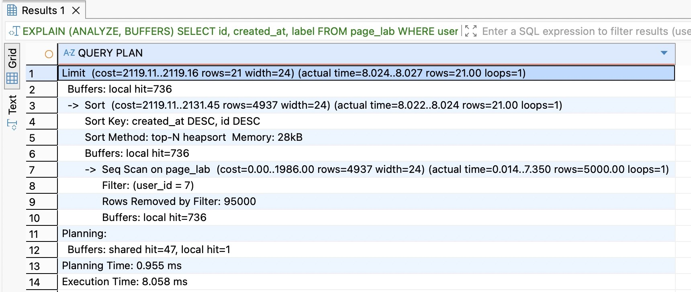
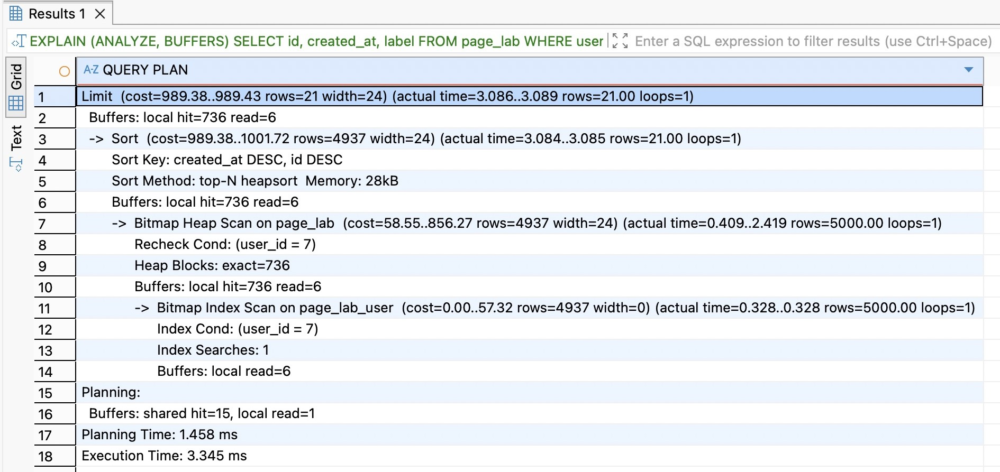
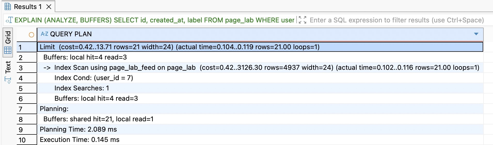
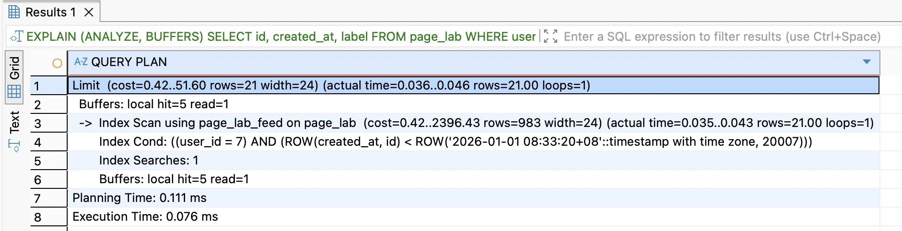
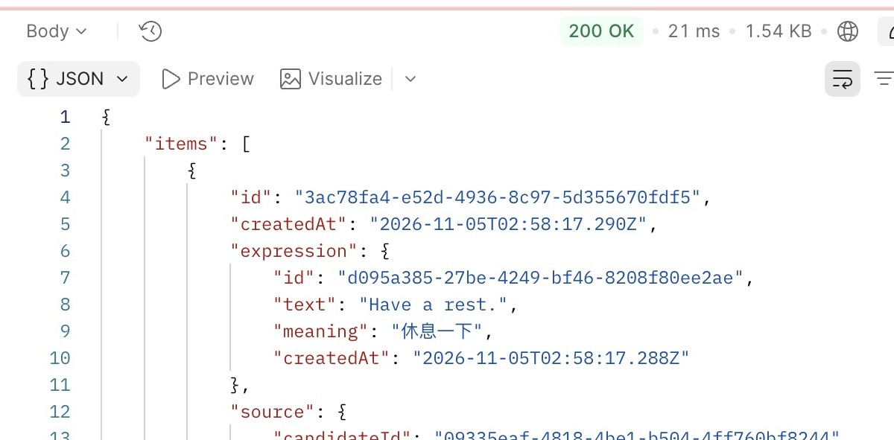
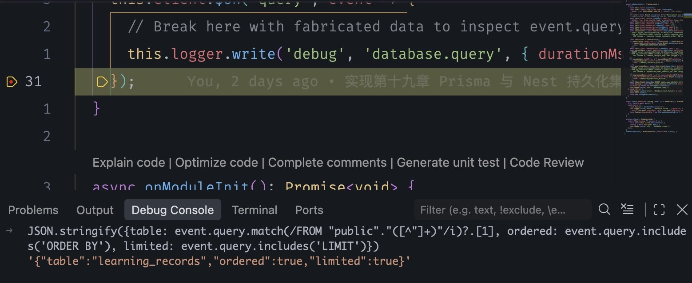

# 第35章 索引与执行计划：查询为什么变慢

打开学习记录，页面只要最近的二十条。假设你在浏览器里看到响应体很小，请求却等了很久。数据库可能沿着已经排好的记录读到第二十一条就停，也可能把十万条记录逐条看完，才知道哪二十条应该排在最前面。两种做法交给页面的 JSON 可以完全相同。从哪里能看出差别？

从第 34 章的 `part-04/chapter-34` 继续，配套状态为 `part-04/chapter-35`。本章先在 DBeaver 里用同一个查询改变一个条件，亲眼看数据库多做或少做了哪一步。再回到应用，查清一次页面请求真正向数据库问了几次，最后给学习列表追加一个经过比较的索引。沿用 Node.js 24.22.1、Prisma 7.10.1 和 PostgreSQL 18。先准备已有采纳记录的独立校验库 VERIFY，保留前章的 API 配置、固定游标密钥和已保存的请求。

第34章素材页采用了limit+1与双字段边界，但这只限制交付数量，不保证寻找匹配最新修订的工作量有界。本章先用已经具备足够样本的学习列表分析；素材页同样要按自己的完整SQL、筛选与分布观察，不能直接套用学习记录索引。

从第 34 章继续跟写时，在已有的配套代码浏览界面切到 `part-04/chapter-35` 查看本章实验文件。几个文件实际位于 `database/chapter-30/`，按下文引用的文件名取用即可。前四节需要的是这些查询和观察程序，校验库先保留原结构；若提前应用了新迁移，随后量到的将是已有列表索引的计划。实验可以在 35.3 做完文本比较、断开临时连接后暂停；下一次从已有数据的 VERIFY 和主线 API 开始，无需保留临时表。

## 35.1 从列表和详情看索引的收益与写入成本

先取同一个用户最近的一页学习记录。在 `src/learning.queries.ts` 的 `list` 方法里，`orderBy` 要求先按创建时间降序，同一时刻再按 ID 降序。`take: limit + 1` 多取一条判断还有没有下一页。把这次读取拆小，先只看学习记录这张表怎样找行，下面的 SQL 可以单独运行。应用另外还会检查表达和原始记录分别属于谁，35.5 会用带这些条件的完整查询再验证。

```sql
SELECT id, created_at, expression_id, candidate_id
FROM public.learning_records
WHERE user_id = '10000000-0000-4000-8000-000000000001'
ORDER BY created_at DESC, id DESC
LIMIT 21;
```

如果从表头往后读，遇到别人的记录就略过，遇到自己的就留下，那么读到第 21 条时还不能停。后面的行可能更新。换一种存法，另外维护一份按用户、时间和 ID 排好的条目，每个条目又能找到表里的那一行。数据库先找到这个用户的开头，顺着读，取够就可以停。这样一份帮助数据库找行的数据结构叫**索引**。这里采用 PostgreSQL 创建普通索引时默认的 B-tree。这里的“页”是数据库成块读写数据的单位，和页面上显示的第几页各有含义。B-tree 把这些块分层组织，上层用键值范围缩小查找范围，底层按顺序保存条目。索引决定可以怎样读，SQL 里的 ORDER BY 仍决定接口承诺的顺序。[PostgreSQL 的索引与排序](https://www.postgresql.org/docs/18/indexes-ordering.html)

再看详情。`detail(id)` 问的是“这个身份对应哪一条，我能看吗”。主键保证每行 ID 唯一，PostgreSQL 已为它建立唯一索引。在 DBeaver 执行配套文件 `database/chapter-30/02-upgrade.sql` 的第二条 SELECT，可以看到 `learning_records_pkey`。此前为防同一候选被采纳两次，数据库还维护 `learning_records_candidate_id_key`。前者有助于按学习记录 ID 定位，后者有助于按候选 ID 查重复。两者都没有把某个用户的最近记录排在一起。反过来，按 ID 找到详情以后，原来的归属检查仍要执行。

读得更省，写入时就多一份工作。每采纳一个候选，事务已经要写表行、主键和候选唯一键。加了列表索引，再插一行就要找到新条目的位置，写相应的索引页。在已有页放不下时，还要拆分页面。索引占用磁盘空间，读写时也会占用缓存。修改被索引的字段同样要维护新条目，旧版本需要后续清理。这使我们可以具体讨论设计取舍：读最近一页是常用操作，值得试一份有序索引；一个还没有读法和样本的未来字段，可以等有了查询再决定。

先盖住 SQL，只留下界面需要回答的一句话：“按本账号的采纳顺序，显示最近二十笔学习记录。”从空白编辑器写查询，可以先写 FROM，决定结果里的一行代表谁。两次采纳可能汇入同一个表达，页面却仍然有两个来源，所以要从学习记录出发。若从表达出发再按表达去重，写出来的更像星图，首页项数看着合理也已经换了问题。接着写 WHERE，保留固定用户。先只投影学习记录的标识和时间，在结果网格中，一项必须能沿着这个标识打开一条详情；不要拿表达标识临时代替学习记录标识。

然后才兑现“最近”。比如同一用户有甲、乙、丙三条学习记录，甲的创建时刻较早，乙丙都在同一毫秒内生成。页长改为一，乙丙究竟谁先出现？只写时间降序，两种答案都满足这条 SQL。今天顺序扫描选中乙，明天建完索引先看到丙，都不能算数据库算错。要使两次读取可以逐项比较，需要在时间后面补上唯一标识的方向，明确哪个先出现。这里按标识降序决胜负，不是因为较大的随机标识代表较晚提交，而是产品可以接受这个稳定的先后。取得这个顺序后才写 LIMIT，把要交付的二十项和探测下一页的一项相加。用户只有二十条时没有探测行，恰有二十一条时也只显示二十条；从响应数组长度不能区分这两种情况。

这个推导给建索引划了一条边界。主键回答“按这个值找，最多有几条”，联合索引回答“从这个用户开始，沿什么顺序读”。如果索引里只有用户和时间，一批同毫秒写入的记录会被放到一起，但组内仍可能需要额外整理。把标识也纳入排序键，数据库才有一条可供选择的完整有序路径。反过来，即便底层恰好用了这条路径，查询若省略最后一项排序键，接口也没有承诺那一项的顺序。优化之前固定两栏，优化之后用同一对栏位逐项核对，才能区分“读法变了”和“读出的页变了”。

还有一个常被忽略的成本：这份索引是整张表共同维护的。即使某个用户从不打开学习页，他的一次采纳仍然要为自己的记录放入一个条目。若一天做了许多次详情读取但很少打开列表，把这两类读取的次数加起来估算新索引的收益就会偏高，详情本已有主键可用。反过来，列表频繁打开而每个账号已有大量来源时，一次读省下的行数可能远多于一次写增加的条目。要作决定，至少要量清楚哪种请求变省、每次大致省了多少工作、所有采纳要共同付出什么。暂时没有足够业务数据时，下面的临时表可以先回答第一问，再回到真实查询回答后两问。

## 35.2 单列索引、联合索引与排序

打开 `database/chapter-30/01-compare.sql`，在 DBeaver 的独立 VERIFY 连接新建 SQL 编辑器。整个实验留在同一个编辑器、同一个数据库连接里。文件的第一步创建**临时表**，即只有这个连接能看到的实验表，断开连接就自动清除。在空白实验会话中按分号逐条选中执行。先做第 1 步，停在第 2 步。真实学习记录用 UUID，这个实验用小整数作身份，方便直接看出哪条应该排在前面。

```sql
CREATE TEMP TABLE page_lab (id integer PRIMARY KEY, user_id integer NOT NULL,
  created_at timestamptz NOT NULL, label text NOT NULL);
INSERT INTO page_lab SELECT n, n % 20, timestamptz '2026-01-01 00:00Z' +
  (n / 10) * interval '1 second', 'sample-' || n FROM generate_series(1,100) AS n;
ANALYZE page_lab;
```

`generate_series(1,100)` 给出 1 到 100 的整数。`n % 20` 让二十个用户交错出现，7、27、47、67、87 都属于用户 7。整数除法 `n / 10` 让相邻一组记录共用创建时间。先把第 2 步中的 `SELECT` 单独选中执行，最近一页的 ID 应为 87、67、47、27、7。最后一条 `ANALYZE page_lab` 让数据库采样行数、值分布等信息，下次选择读取方式时就有了依据。这一步更新的是供数据库估算的数据。

现在预测两种索引会省掉哪一步。第一种只按 `user_id` 建索引，用户 7 的条目容易定位，但同一用户内没有按时间排列的约定。数据库拿到他的所有候选行之后，还得比较它们。第二种把三列放进**同一个联合索引**。先按用户分组，同组内时间从新到旧，时间相同再按 ID 从大到小。这样“找到用户 7”的位置也恰好是“从他最近一条开始读”的位置。

```sql
-- 文件第 4、5 步。先记录下一节中尚未加索引时的结果，再分开执行这两句。
CREATE INDEX page_lab_user ON page_lab(user_id);
CREATE INDEX page_lab_feed ON page_lab(user_id, created_at DESC, id DESC);
```

列序来自当前问题。若产品改为“所有用户放在一起看最近动态”，用户 A 的最后一条和用户 B 的第一条在这份索引中相邻，它们的时间却可能相隔一年。这份顺序无法直接给出跨用户时间线。若改为“这个用户某个很少出现的表达”，现有索引能顺时间读，但可能跳过许多其他表达才凑够一页。把 expression_id 插在用户和时间之间适合后一种筛选，却打散了无表达筛选时的时间顺序。先比较两种请求各自的频率和计划，再决定第二份索引是否值得维护。[PostgreSQL 的多列索引](https://www.postgresql.org/docs/18/indexes-multicolumn.html)

在建第一份实验索引之前，先把“等值条件可以放在排序键之前”这句话算出来。写五张纸条，每张记用户、秒数和编号三栏。用户七的三张是第八秒八十七号、第六秒六十七号、第四秒四十七号；用户八的两张是第八秒八十八号和第六秒六十八号。先按用户归堆，堆内按秒数、编号倒排。用手指指到用户七的第一张，往下取两张，马上得到八十七和六十七。如果把纸条改按时间先排，两位用户就混在一起，仍然能从新往旧走，但途中必须判断每张属于谁。一个键可以提供顺序，却不一定同时缩小要访问的范围。在用户七只占二十分之一的实验中，这个差别值得专门观察。

只看现成样本还容易错过一个细节：全表每十个相邻编号大致同秒，同一用户的编号却隔二十才出现。所以这个实验的用户七在自己的组内没有时间并列。即便忘了第二个排序键，前五个编号仍有可能完全正确。要验证你会写并列条件，可以在同一编辑器另外选中以下只读样本。它不改变临时表，用 VALUES 给几条记录直接起名。先手填查询末尾的排序和页长，只选用户七中最近两条；最近一秒的两个编号应当是四十二、四十，用户八的四十三哪怕更新也不应出现。

```sql
SELECT id, tick
FROM (VALUES (7, 39, 9), (7, 40, 10), (7, 42, 10), (8, 43, 11))
  AS sample(user_id, id, tick)
WHERE user_id = 7
ORDER BY tick DESC, id DESC
LIMIT 2;
```

要检验自己设计的顺序，先保留用户和时间方向，只把编号改成升序。两行应该交换位置；把页长改成一，选择的那条记录也随之改变。现在恢复原来的两个降序键，想象产品增加一个条件：“只看第十秒以前的记录。”应当在确定前两项之前就排除第十秒及以后的行。结果只剩三十九号，少于两条完全合理。在外层对已经取出的四十二、四十再做时间筛选，则会得到空页。即使给两种写法都建了索引，也无法靠快慢比较判定谁符合需求，先算出的身份才是准绳。

若要在实验之外自行给新请求设计联合索引，可以把各列在一次请求中的取值写在纸条上。以“某人、指定表达、最近采纳”为例，前两项都固定，只有时间和标识在变化。先锁定前两项再沿后两项走是可选方案；若表达是可选条件，去掉它以后，同一人的条目会按不同表达分成几段，每段内部都从新到旧，段与段之间不能直接拼成时间顺序。还有一种实际选择是先沿本章的用户时间索引读，对表达逐条判断。如果该表达几乎每条都出现，很快就能凑满；若近万条里只有最老的一条符合，这种读法就很费。写一个“最常见”和一个“难找”的输入去比计划，比单从列名猜哪一列该靠前更可靠。

到这里尽量保留百行样本原样，不要先把两条建索引语句整块运行。下一节需要在同一份数据上依次留下三份结果。若已经建完两份才发现没有基线，最容易解释的补救是断开这个临时实验连接，在新的空会话从第一步重建。业务表用另一连接核对，不能为了重现教学顺序去删除业务索引。

## 35.3 用 EXPLAIN 看数据库实际读了多少行

回到文件第 2 步。SQL 前面加 `EXPLAIN`，数据库会列出准备采用的步骤，叫**执行计划**。例如先逐行扫描，接着排序，最后只取二十一条。加上括号里的 `ANALYZE`，这次会真正执行查询并把实测值写在估算旁边。前一节单独执行的 ANALYZE 是更新统计资料，两处同名，操作不同。括号里的 `BUFFERS` 再报告访问了多少数据块。我们始终用 SELECT 做这个实验。把同样的前缀加到 UPDATE 或 DELETE 上会真的写数据。

```sql
EXPLAIN (ANALYZE, BUFFERS)
SELECT id, created_at, label FROM page_lab WHERE user_id = 7
ORDER BY created_at DESC, id DESC LIMIT 21;
```

在 DBeaver 选中**整条语句连同 EXPLAIN**，执行 SQL 语句，看下方结果网格的 `QUERY PLAN` 列。只选下半段会看到用户记录。把结果列拉宽，从最深缩进往外读：扫描给上一层行，排序给 Limit 行，Limit 决定何时停。每一种独立的读取、筛选或排序步骤在图中占一个节点。每个节点第一组括号里的 `rows` 是预计产出的行数，`cost` 是规划器在当前成本模型下比较不同方案的估值。第二组的 `actual time` 单位是毫秒，`rows` 是实际交给上一层的行数。`loops` 是这一节点执行了几遍，多遍时行数和时间按每遍平均显示。父节点包含子节点的工作，直接相加会重复计算。[PostgreSQL 18 的 EXPLAIN 读法](https://www.postgresql.org/docs/18/using-explain.html)

先记录 100 行时的计划。现在做第 3 步，补到 100,000 行并重新采样。还用同一条 SELECT，同一个用户和页长。此时用户 7 占 5,000 行。图中 `Seq Scan` 表示逐块读表，`Filter` 是读到一行后才检查的条件。它交给上层 5,000 行，`Rows Removed by Filter` 显示另有 95,000 行被排除。`Sort` 虽然只需保留最大的 21 项（图中的 top-N），仍须接收全部 5,000 个候选，才能知道最后的 21 项是谁。



图35-1。先看扫描层的 5,000 与 95,000，再往上看 Limit 的 21。结果网格左边的行号是计划文本行号。

执行第 4 步建单列索引，再执行第 2 步。图35-2 的 `Bitmap Index Scan` 先标记哪些位置可能有用户 7 的行，`Bitmap Heap Scan` 按数据页去表里取这些行。这里的 heap 是存放表行的地方。这样取行有利于减少在不同页之间来回走，取出的顺序仍要交给 Sort 整理。这里两个扫描名中的 Bitmap 都指用来标记匹配位置的一组位。看到索引名称就结束诊断，会漏掉这 5,000 行的排序输入。



执行第 5 步建联合索引，再跑第 2 步。图35-3 的 `Index Cond` 写着 `user_id = 7`，数据库可以在索引里用它定位；`Index Scan` 顺着匹配条目读，同时回表取 `label`。上层取够 21 项就停，计划里也少了一层 Sort。实验表上原先的单列索引仍在，数据库是从可用读法中自己作的选择。



比较图35-1和图35-3里的 `Buffers`。这里的 `local` 指当前会话临时表及其索引使用的缓冲区，正式表通常显示 `shared`。`hit` 表示需要的块已经在相应的数据库缓冲区，`read` 表示需要把块读进来，操作系统仍可能已经缓存了数据。相同块反复访问也会计数。图35-3 中索引扫描预计可匹配约五千行，实际只交出 21 行，因为上层取够就停了。看到预计和实际相差很多，先检查父节点有没有提前停止，再判断统计资料是否估错。连续运行时耗时常会缩短，所以固定参数，先比“哪一层消失了、处理多少行”，再比多次运行的耗时。最后用第 8 步看索引大小，本例单列约 696 kB，联合约 3984 kB。它们是在这批整数和时间值上的实测，UUID 业务表应另外量。

继续做第 6、7 步。用户 7 的最大 ID 是 99987，此后每次减 20。第 4000 项为 20007。Offset 请求跳过前 4000 项再交出 21 项，Limit 的下一层至少要交出 4021 项。在本例深页中数据库甚至改选了先找行再排序。用上一页末项的一对值当作边界，取同一页可以这样写：

```sql
SELECT id, created_at, label FROM page_lab WHERE user_id = 7
AND (created_at, id) < (timestamptz '2026-01-01 00:33:20Z', 20007)
ORDER BY created_at DESC, id DESC LIMIT 21;
```



图35-4。看 `Index Cond`，这次连时间和 ID 的边界也用于定位。分别只执行第 6、7 步的 SELECT，结果应从 19987 到 19587，顺序相同。如果只看到“用到了索引”，还要看边界写在 `Index Cond` 还是 `Filter`。第三十三章的 Prisma 实现用两个 OR 分支表达同样的先后关系。规划器可能仅用用户定位，再逐行过滤这两个分支。这个行比较实验展示了一种可选读法，判断应用的深页要拿实际 SQL、参数和分布再看一次。保留这个连接和临时表，接下来还要在同一批行上比较文本条件。

读这几张计划时，可以在纸上给每个节点留两栏，一栏记“上层向它要多少”，一栏记“为交货，它从下层接收了多少”。以前三张图的首页为例，顶层都交出二十一行。无列表索引时，排序层交二十一行，却从扫描层接收了五千行；扫描层读遍十万行才交出这五千行。换单列索引，仍有五千行进入排序，改变的是定位这些行的办法。换有序联合索引，顶层只向下取够二十一行，访问路径自己就能保证后续行不会排到这二十一行前面。把三份结果都只记成“二十一行、几毫秒”，就无法回答下一次数据再涨十倍时更可能增长哪段工作。

为什么排序不能在收到第二十一条时自行宣布完成？可以把扫描的最后一条设想成全表最新的一条。若此刻还没读到它，之前留下的二十一条里至少有一条得让位。top-N 的办法是只保留目前最靠前的一小组，新来的行有资格再进入这组，因此截图中排序占用的内存可以很小。但省下的是保存全部候选所需的空间，检查最后一条的义务仍在。换成能提供完整目标顺序的索引，读到第二十一条以后，余下各项只可能更靠后，这时上层才有理由停。两者都使用“只要前几项”这个事实，省下的工作却不同。

遇到和图不同的计划时，先读数据而非调整数据库开关。在 DBeaver 另选 `SELECT count(*), count(*) FILTER (WHERE user_id = 7) FROM page_lab;` 执行。第一个数是表内总行数，第二个数在同一批行中只数用户七，两者应先为一百和五，再变为十万和五千。百行时数据库可能一次就能访问绝大部分表，给它提供一份索引并不强迫它走索引。若表内仍只有一百行，追查扩充步骤有没有在这个连接完成；若确为十万行且三份计划都有合理的扫描输出，再核对统计是否更新、两条索引是否按顺序建在这个临时表上。这样保留下来的是数据库在现有条件下的选择，手工关闭某种扫描得不到同样的证据。

深页还有一笔容易差一位的账。把最近一条算作第一项，则走到第 k 项要往后走 k 减一步，每步减二十，编号为 `99987 - 20 * (k - 1)`。把四千代入得到二万零七；它是已经展示的最后一项，而非下一页要包含的第一项。整数除法给它两千秒，即零点三十三分二十秒。边界比较要严格小于这对值；写成小于等于就会把刚读过的一项再交回来。若页长二十，二十一条里最后一条用来证明还有下一页，不能拿这条探测行当客户端的末项，否则下一次会少一条。这里为了对照两种数据库读法才直接取二十一行，应用生成游标另有裁切步骤。

想独立检验边界条件，可以先在空白处写出当时间比末项早时该不该保留，再写当时间相同、编号较小时该不该保留。两种情况任选其一就应进入下一页，所以组合关系是 OR；把它们误写成“时间更早并且编号也更小”，会漏掉早一秒但编号较大的记录。我们的十万行样本中时间随编号增长，这个错误写法可能碰巧也给出相同深页。用上一节的四行样本，把三十九号改成九十九号，仍放在第九秒；请求取第十秒四十号之后的记录。正确答案只剩九十九号。先在结果网格读到它，再换成两个独立的小于条件看它消失，就知道不能用两栏都单调变化的样本证明任意时间线都正确。

### 找一个不存在的子串会读多少行

继续使用同一编辑器中的 page_lab，在已扩充样本并建好用户、时间、ID 联合索引之后执行下面的查询。先删掉 AND 那一行跑一次，再保留它跑一次。

```sql
EXPLAIN (ANALYZE, BUFFERS)
SELECT id, label FROM page_lab
WHERE user_id = 7
  AND strpos(label COLLATE "C", 'no-such-label') > 0
ORDER BY created_at DESC, id DESC LIMIT 21;
```

只按账号取一页，数据库有机会按索引顺序读够 21 行就停。再加上这个从未出现的子串，结果虽然是零行，却须排查这个账号的全部候选。找计划里的 Filter、Rows Removed by Filter、实际行数和缓冲块读数。若选了顺序扫描，同时看 user_id 与文本条件是否合并成同一个 Filter，此时剔除数包含其他账号。再把搜索词改为 'sample-'，比较工作量。页大小限制的是返回行数，文本分布决定读够这一页需要检查多少内容。

第 34 章的素材搜索查的是最新修订的原文；本章的学习记录列表没有文本查询参数。这里的标签实验帮助估算字符串过滤可能留下的工作。改用 LIKE 时，百分号、下划线和反斜线的字面含义要逐一核对；查询表达式、排序规则和运算符也决定专用文本索引能否使用。保留“稀少命中、普遍命中、完全无命中”三份计划，再决定额外索引的体积和写入代价是否值得。

在这批有规律的标签上，还可把三个查询的答案算得更具体。用户七有五千条，所有标签都以 sample- 开头，普遍命中的查询只要找够二十一条就能交页；换成 sample-20007，只有二万零七号本身命中，因为样本里没有更长的同前缀编号。它恰在该用户的第四千项。即使数据库沿联合索引有序读取，在读到这一项时也不能立即结束：请求要的是最多二十一条，剩余的一千项中可能还有第二个匹配。直到扫完该用户，才知道结果只有一项。一个完全没有出现的词也得检查到最后。稀少命中和零命中交给界面的条数不同，所需的筛选工作可能非常接近。

自己写比较语句时，先在原查询里仅增加文本条件，保留同样的账号、排序、页长与投影。只选 SELECT 核对返回的编号，再带 EXPLAIN 检查 Filter 在哪一层。一份计划若显示用户等值在索引条件内，剩余过滤只需要解释账号内的标签；若两个条件都在读表后的过滤中，就要用全表十万条作为起点。同一个“排除了许多行”的现象，分母可能相差二十倍。把索引名、条件位置和分母对应起来以后，才知道下一步应当改善按账号取范围的能力，还是改善在范围内寻找文本的能力。做完文本比较和索引大小查询，再断开这条临时表连接。

## 35.4 区分查询次数、返回体积和连接占用

现在回到页面。一条查学习记录的 SQL 更快，会缩短这部分工作，但用户等的是从发送 HTTP 到拿到整页。假设先查 N 条学习记录，再在循环里为每条查一次表达，就产生 1 + N 次数据库往返，这种随列表长度增加的额外查询叫 **N+1**。每句都能按主键很快查到一行，累计来回的时间仍可能明显。换成 Promise.all 同时发送只是改变排队方式。

用现有服务做一次区分。先停下前一个开发进程。在代码仓库根目录，确认 .env.test 里的 TEST_DATABASE_URL 指向装有虚构记录的 VERIFY。npm run dev 平时读取 .env 的 DATABASE_URL。下面从测试配置文件取出 VERIFY 的连接串，只传给这次启动的开发进程。终端不会打印连接串。开发服务准备好以后才开始观察，启动时服务自己也会核对表与约束。校验库至少准备四条归属当前用户的学习记录；样本不足时可按第三十三章已保存步骤追加虚构采纳。

```bash
(
  verify_url=$(node -e 'const {parseEnv}=require("node:util"); const {readFileSync}=require("node:fs"); const u=parseEnv(readFileSync(".env.test","utf8")).TEST_DATABASE_URL; if(!u) process.exit(1); process.stdout.write(u)') || exit 1
  DATABASE_URL="$verify_url" DB_QUERY_DEBUG=true LOG_LEVEL=debug npm run dev
)
```

在 Postman 新开 GET，先后发 `/learning-records?limit=1` 和 `/learning-records?limit=3`。在每个响应的 Headers 找到 `X-Request-Id`，用这个值从开发终端筛出该次请求的 `database.query` 事件，数一数有几条。从两次响应的 Body 看实际返回的项数，同时看大小和耗时。本例两次分别给出 1 项和 3 项，两次都发了 5 条 SQL。沿查询事件检查到学习记录、表达、候选、表达形式、修订五组读取。关联数据按本页的身份成批读取。比如三条学习记录只用了两个表达，可以先收集两个表达的 ID，一次查回所需字段，再按 ID 对回原列表。自行改写批量读取时，保留用户范围和来源的原有顺序。两条记录引用同一表达，页面上仍应显示两条来源。这两次没有表现出“每多一项就多打一条”的模式；空页、其他关联策略或换 ORM 版本可能给出其他次数。



图35-5。页面用到表达和来源摘要。若把详情里的整段原文也放进列表，SQL 次数可能完全相同，响应仍会变大，编码、传输和解析都要处理更多字节。对照 `src/learning.queries.ts` 的 `recordSelect` 和 `detail`，前者只选来源身份，后者才读取历史原文。只在 JavaScript 最后删字段，数据库到应用之间仍会运回那些内容。处理过量返回，应同时看数据库取的列、关联取的行数和最终响应的字节数。

要核对数据库真的收到了哪条 SQL，在 VS Code 用已有的 **EPP: attach to npm run dev** 附加。在 `src/database.service.ts` 找到 `this.client.$on('query', event => { ... })`，给回调里的 `this.logger.write` 设置断点。单独重发一次 GET，暂停后在 Debug Console 输入：

```js
JSON.stringify({
  table: event.query.match(/FROM "public"\."([^"]+)"/i)?.[1],
  ordered: event.query.includes('ORDER BY'),
  limited: event.query.includes('LIMIT')
})
```



图35-6。这里观察的是查询形状。继续运行可能停在同一请求的下一条关联查询。取消断点后继续，重新发送一次，再测 HTTP 耗时。断点会暂停 Node 进程，消耗连接或请求的超时预算；长时间停住甚至可能得到 503。本机诊断仅用虚构数据，日常日志继续只写耗时与请求身份，诊断结束后按 Ctrl+C 停止进程，这次启动的临时设置随之结束。

还可能出现另一种慢：SQL 根本没有轮到执行。API 重复使用一组已经打开的数据库连接；所有连接都被借出时，后来者先在池中等待。把连接上限缩成 1，用配套的小程序单独观察。它只读 VERIFY，沿用 `.env.test` 的 TEST_DATABASE_URL，与运行中的 API 各有自己的连接池：

```bash
node --env-file=.env.test database/chapter-30/04-pool.mjs
```

程序先借走唯一连接，再发起 `SELECT 1`；此时打印 `total: 1, idle: 0, waiting: 1`。放回第一条连接后，第二次读取才完成，输出 `result: 1, waiting: 0`。这解释了为什么终端里 SQL 本身很短，用户却可能已经等了很久。真实故障要对照同一次 HTTP、查询事件和池状态。错误日志里的 waiting 是记录错误那个瞬间的值，超时请求离队后可能已是零。查持有连接的事务是否在等网络、是否忘记释放，再决定要改事务范围、读法还是池容量。任务领取会争用行，向量检索按相似度选近邻，到实际业务章节再按各自的查询目标设计索引。

把一笔 Postman 响应摊开，会有三种“条数”。例如请求三项，主查询取得四条学习记录，其中两条碰巧共用一个表达；数据库可能只需取回一份该表达的内容，应用却仍按学习记录的身份逐条组装，最后截取三条交付。主查询的四、去重后的表达数和响应里的三各有用途。若你把批量读取的表达按数据库返回的先后，用数组下标与学习记录一对一拼装，共用表达会让两边长度不同；即便长度相同，未声明的返回顺序也没有保证。应当用表达身份查回对应内容，展示顺序仍取自主查询。这也说明给表达表单独加一个排序索引，无法替代学习记录的时间顺序。

若同事说“页面从一项改成三项，查询数没有增加，所以多取两项是免费的”，可以从数据库和浏览器各找一处反证。取三项时通常有更多来源要组装，探测行的关联也可能参与这次读取；响应里的三份摘要都要编码传出。先比较两次响应中 items 的实际长度，再看每项是否包含相同种类的字段，最后看字节大小。若样本不足，两笔请求可能本来就交出相同数量，比较便回答不了“页长变大”的问题。即使样本足够，两项记录的正文长短也可能不同，因此字节数不会严格按一比三变化。把前章详情请求对准某一条相同的学习记录，可在 Body 里区分列表沿用了哪些来源标识、详情才补了哪段历史原文。

查询事件也要沿时间线解释。一次请求已经进入应用，可能先花时间取得连接；语句发到数据库以后才有索引能改善的扫描、排序与关联，读完以后还要组装返回。比如四十毫秒的 HTTP 请求里看到数个毫秒级查询，不能直接把剩余时间全算成连接等待，前后还有路由处理、传输和序列化。反过来，把开启断点时看到的长耗时拿来指导扩容，也会把自己的暂停算成服务负担。先用单次请求和请求标识分清有哪些语句，再取消暂停单独观察耗时；需要解释借连接的等待时，才到单连接程序中把那个条件明确制造出来。

读池程序可以精确到两次交接。第一位调用者借到连接后，哪怕暂时没有执行语句，连接仍由它持有，池的空闲数就是零。第二位调用者已经把查询交给池，得到一个尚未完成的 Promise，但还没拿到可以向数据库发送这句 SQL 的连接。此时看数据库里有没有一条很慢的 SELECT 会找错位置。第一位在 finally 归还后，池才有资源安排第二位执行，等待数回到零；第二位读到一只是说明指令完成。若程序改为先等待第二笔结束才释放第一条连接，就会形成“它等我归还，我等它完成”的局面，一直等到借用超时。沿着谁持有什么、在哪里归还来读，比凭错误出现的函数名猜哪条 SQL 慢更直接。

最后再回到最初那张慢页面。若同一请求标识下的语句条数随项目数增加，先追重复读取；若次数相近而详情响应特别大，先查是否取了列表根本用不到的历史内容；若只有放回连接后查询才能开始，先查借用者的工作范围。只有当请求中确实存在一条按用户取最近学习记录的慢读取，才有理由把刚才的有序索引作为这次交付的候选。一种症状可以同时有两处原因，下一节的迁移只负责改变其中一处。

## 35.5 将选定索引追加到已有库

实验给了一个值得带回 EPP 的候选。接下来要回答两个问题：完整归属检查会不会改变这份索引的作用，以及能否在保留旧数据的前提下交付。先在 DBeaver 对 **尚处于第三十四章结构（本章索引未应用）** 的 VERIFY 执行 `02-upgrade.sql`，保存数据库名、原有索引、来源行数、列表身份和顺序。再运行 `03-owned-page.sql`。它保留了当前版本 Prisma 为 `limit=3` 实际发出的第一条 SELECT，包含到表达、候选、修订和原始记录的关联。文件中 `PREPARE` 给带占位符的 SQL 命名，`EXECUTE` 把固定演示用户传给三个归属条件，另外两个参数 4、0 表示读取四条、跳过零条。同一个连接中依次执行准备、带 EXPLAIN 的执行、最后的 DEALLOCATE，下一次可以用同名重新准备。后续四次关联读取仍按 35.4 单独核对。

在一个保留前章 8 条学习记录的校验库上，迁移前后主表查询都用了顺序扫描。读取一页数据已经能看完这张小表，规划器有理由选择直接扫描。为检验规模变化，另一份隔离副本保留这 8 条，再加入 20,000 条属于同一用户的虚构来源，连同候选与修订一起建立，更新统计资料。下表比较同一个带归属检查的首条 SQL 在**同一批 20,008 条记录**上迁移前后的结果。

| 完整查询里观察的位置 | 创建索引前 | 创建索引后 |
| --- | --- | --- |
| 学习记录这一层交出多少行 | 顺序扫描交出 20,008 行 | 有序索引扫描交出 4 行 |
| 为获得前四项做了什么 | 关联并比较候选，再取排序靠前的四项 | 按目标顺序逐条查归属，取够即停 |
| 应用给客户端多少项 | 3 项，第 4 项用于 hasMore | 同样的 3 项和 hasMore |

想自己复现表中两万条记录的对照，先断开指向前章 VERIFY 的连接。用有建库权限的本机角色连接维护库 postgres，用 `CREATE DATABASE demo_ch30_lab TEMPLATE 你的校验库名;` 复制只含虚构数据的校验库，将示例中的源库名换成实际名称。源库必须仍是第 34 章结构（与33相同，本章索引未应用），且复制期间没有其他会话使用它。让新库沿用可创建索引的表属主连接。在新库新开 DBeaver 编辑器，切到手动提交，执行配套 `05-rehearse-scale.sql` 建两万条关联样本。它检查库名以 `_ch30_lab` 结尾，也检查目标索引尚未存在。读完下文的对账方法再动手。保持这个编辑器和事务，先留一份完整查询的计划与行结果，只执行下方迁移中的 CREATE INDEX，再留第二份，最后 ROLLBACK。回到 02 应看到原行数和原索引。正式迁移仍在另一个 VERIFY 连接里验证。

在这份新计划里，`Nested Loop` 意味着外层每拿到一条候选记录，内层拿它的关联键去找匹配行。向下找到 `learning_records_user_feed_idx`，再回头看与它同级、用主键访问表达等表的节点。若大量候选过不了归属检查，数据库得继续往后找，索引层就可能交出远多于四条。这里计数的是完整查询中某一层的工作，不能据此宣称正式服务有固定响应时间。对于筛表达、深游标或星图来源计数，都应保留它们自己的条件重新测。

读完整查询时先把别名写回业务名称。学习记录有两条要走的路：沿 expression_id 走一步到表达，沿 candidate_id 走到候选，再沿 revision_id 到修订、沿 capture_id 到素材。三个用户参数虽然填同一个值，各自约束的却是学习记录、表达和素材。主查询选出供后续读取使用的关联标识，这一步的关联目的是判断该行能否进入本页。后面为这三项补齐表达形式、修订号等展示字段，是另一项工作。看到第一句已经 JOIN 了几张表，不能据此假定接口已经拿到了这些表的所有公开字段。

在空白编辑器写这条读取时，先从学习记录起笔，给它一个短别名，只投影它的标识和时间。然后在 FROM 后把两条路各补一段 JOIN，每一段写一对实际键值相等，最后在 WHERE 写三处归属。容易写错的是把候选直接和素材连在一起，它保存的是修订标识；还可能把表达标识当作学习记录标识，使两笔共用表达的来源看起来重复。可先不限制页长，展开候选、修订和素材的标识检查一条已知的采纳。配套的 SQL 写的是 LEFT JOIN，后面的 WHERE 又要求关联行存在并满足归属；没有匹配到的空一侧过不了这些条件。自行推导时写成要求每段匹配的内连接，在这组条件下同样能交付符合条件的来源。比较两份 SQL 时核对行和顺序，具体用哪个连接节点交给规划器选择。

为什么不能先取学习表的前四行，最后再查这四行的关联是否合格？假设某次读取最前面的候选有一条不符合所有条件，后面仍有符合条件的来源。先截断再过滤只能给出三条，既可能少送记录，也可能把还有下一页误报成没有。SQL 中先表达完整条件、再对合格结果排序取四项，执行器则可以沿索引边读边检验，直到收够四条或真的没有更多。这里讨论的是两种写法对同一合同的保证，不需要更改任何归属来构造样本。当前规模副本里的新增行都从一份合法来源推导，正好说明全部匹配时能节省哪些工作，却不能拿来估计任意条件下的命中率。

要保存一份可读的前后对账，在 03 的 PREPARE 完成后，先照常执行带 EXPLAIN 的语句并保存计划。暂时保留同名准备语句，把同一段从 `EXECUTE chapter30_list(` 开始选到分号，单独执行，结果网格才会给出实际的四行，而非计划说明。复制这四行的学习记录标识、创建时间及顺序到对照区，然后按原文件执行 DEALLOCATE。建完索引后仍在同一个副本、同一事务，用完全相同的步骤再取一次。应逐项比对，包括第四个用于探测的标识；仅看两次都“四行”发现不了边界被推移。两次计划和行结果都取完再回滚。若已提前执行释放，重新执行 PREPARE 即可，无需为了找回名字重建样本。

副本中有两种相似的异常值得分开。另一编辑器能查到表却看不到刚加入的两万条，通常要先看是否仍在产生样本的那个会话，未提交的新增行只对本事务可见。相反，如果已经在同一会话，执行任何普通查询都提示当前事务失败，就向上找第一条失败的语句；后面的连续报错只是该事务无法继续的结果。执行回滚以后再用 02 查数据库名、行数和索引定义，三者回到副本的起点才适合重做。不要在这里顺手把迁移整块粘进来，里面的 COMMIT 会一并提交你原本打算撤销的样本。

具体修改只需要两处。在 `prisma/schema.prisma` 的 LearningRecord 模型末尾、`@@map` 之前加入：

```prisma
@@index([userId, createdAt(sort: Desc), id(sort: Desc)], map: "learning_records_user_feed_idx")
```

在模型里加这一行只描述期望的结构。保存文件、重新生成客户端或者看到编辑器能识别字段，都不会替非空库建索引。反过来，只在 DBeaver 手工建成一份索引，当前这个库可能立即受益，但下一位同事按迁移从空库重建时会得到另一种结构。规模副本里那次 CREATE INDEX 用来比较物理读法，最终要回滚；正式目标库要让迁移记录与实际结构一同推进。两者用同一份索引定义，承担的是不同的交付责任。

现在才取跨升级的业务基线，可以少消耗旧游标的有效期。规模演练结束后，重连原 VERIFY，按前节方式启动指向它的 API。在 Postman 选择学习记录的游标首页，明确传 `mode=cursor&limit=1`，使用至少有两条来源的样本。保存首页 ID、第一页返回的 nextCursor，马上带同样的模式和页长取第二页，把第一条后继 ID 也保存下来。再保存一个旧表达的星图计数和一份已有操作回执。准备好后停这份 API，确认没有其他写入，才开始下面的正式升级。两次读回之间如果另做采纳，星图计数当然可能变化，这时不能用差值评价迁移。

把实际结构变更追加在 `prisma/migrations/20261105090000_learning_feed_index/migration.sql`，保留已经应用过的迁移文件：

```sql
BEGIN;
SET LOCAL lock_timeout = '2s';
SET LOCAL statement_timeout = '30s';
CREATE INDEX learning_records_user_feed_idx ON public.learning_records
  (user_id, created_at DESC, id DESC);
COMMIT;
```

普通 CREATE INDEX 可以让其他连接继续读表，构建期间会与写入冲突。本章沿用有停写窗口的小库路径，先停止目标库的 API 和其他写入者。两秒是获取锁时允许等待的上限，三十秒约束该语句的总执行时间。二者是这次交付愿意承担的预算。已有数据留在原表，全程无需改时间、重新采纳或回填 ID。先用第三十四章代码状态确认历史迁移都已应用；切到本章文件后，status 应只多出这一项待应用迁移。项目根目录执行：

```bash
nvm use
npm run check
npm run db:verify -- migrate status
npm run db:verify -- migrate deploy
npm run db:verify -- migrate status
```

VERIFY 的 CLI 读取 `.env.database-verify`。运行测试的 `.env.test` 和启动 API 的 DATABASE_URL 各核对一次目标。升级后先在原库重跑 02、03，对照数据库名、旧列表的标识和顺序，以及新索引的实际列序与排序方向。回读旧回执和来源时，沿用升级前保存的操作标识与学习记录标识。若在另一个同样结构的空库成功建了索引，单看“部署成功”和索引名都发现不了错库，这两个旧标识才把验收落回原来的非空数据。

再按 35.4 的方法让 API 连接 VERIFY，沿用原密钥，等服务就绪后在 Postman 发回保存的续页请求，先对下一页，再用旧 ID 看详情、用原表达对星图来源数。若续页单独报游标无效，先查页长和筛选是否与首页相同，再查游标是否超出三十分钟有效期、进程是否加载了同一把密钥。过期时可以从新首页验证新游标翻页，但这次结果只能证明新签发的游标可用。索引负责数据库中行的访问路径，不能改变游标签名的有效期。完成旧数据对账后再运行 `npm test` 验证既有读写与翻页，避免把测试期间的操作算进迁移本身。

随后才按同样的停写、部署、复核顺序，把命令中的 `db:verify` 换成 `db` 应用于已确认的 DEV。独立交付产物沿用前章的 dist 和生产依赖，进程环境提供 DATABASE_URL 与持久游标密钥，正常停止并重启后仍能在有效期内接着翻页。

若部署卡在锁上，先读 migrate 输出并运行 status，再查 `pg_indexes` 和迁移记录。例如在目标库中执行下面的只读 SQL，确认是哪次尝试、是否已完成或已登记回滚。

```sql
SELECT migration_name, started_at, finished_at, rolled_back_at
FROM public._prisma_migrations
WHERE migration_name = '20261105090000_learning_feed_index'
ORDER BY started_at;
```

从另一个 DBeaver 连接检查当前事务，在确定归属后让占锁者正常结束。只有确认这次事务已回滚、索引确实没有留下、失败版本尚未完成时，才用下面两条命令登记“该次失败已回滚”并重试。它们是故障恢复分支，正常升级不需要执行。

```bash
npm run db:verify -- migrate resolve --rolled-back 20261105090000_learning_feed_index
npm run db:verify -- migrate deploy
```

如果索引已存在或定义对不上，保留现场，核对是否连错库或有人手工实施过变更。恢复接口旧版本时，这个普通索引可以留在库中；要撤销索引的维护成本，应另行评估并追加迁移。数据量已经无法在停写预算内完成时，需要换部署办法，支线 35A 继续讨论。下章回到业务一致性，把竞争、重试和查询所见的事实放进同一个有限名额预约场景。

## 知识支线

- [支线35A：写入不能停时，索引怎样交付](side-01-online-index.md)
- [支线35B：两个条件各选中百分之一，合起来有多少行](side-02-correlated-estimates.md)

## 附录：本章必要技术点速查

| 名称 | 本章用途 | 复查入口 |
| --- | --- | --- |
| B-tree 与联合索引 | 在用户范围内按时间与 ID 连续取行 | [多列索引](https://www.postgresql.org/docs/18/indexes-multicolumn.html) |
| ANALYZE | 数据量明显变化后更新统计样本 | [统计资料](https://www.postgresql.org/docs/18/sql-analyze.html) |
| EXPLAIN (ANALYZE, BUFFERS) | 对照估算、实际行数和块访问，定位多余工作 | [执行计划](https://www.postgresql.org/docs/18/using-explain.html) |
| pg.Pool | 用 totalCount、idleCount、waitingCount 辨别借用与等待 | [node-postgres 连接池](https://node-postgres.com/apis/pool) |
| CREATE INDEX、migrate deploy | 在有数据的校验库落实模型选定的索引 | [PostgreSQL 建索引](https://www.postgresql.org/docs/18/sql-createindex.html) |

阅读约 90～115 分钟，跟做计划对照、连接池观察和非空库升级另需约 65～90 分钟。独立副本的两万条来源演练另需约 15～25 分钟，支线另计。

[上一章：已有素材列表怎样从全量读取迁到分页](../chapter-34-paging-upgrade/chapter.md) · [下一章：第四篇回顾：让采纳经得起竞争与重试](../chapter-36-review/chapter.md) · [第四篇导读](../README.md) · [全书目录](../../README.md)
