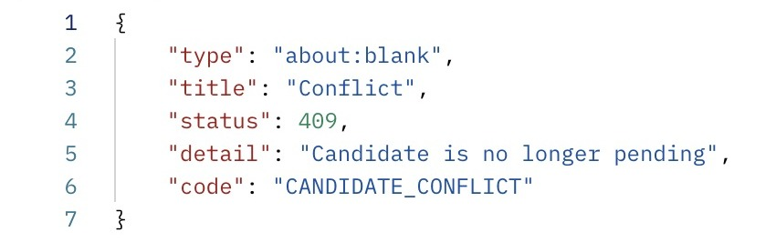
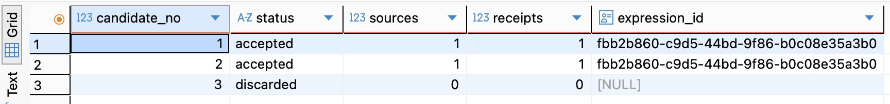
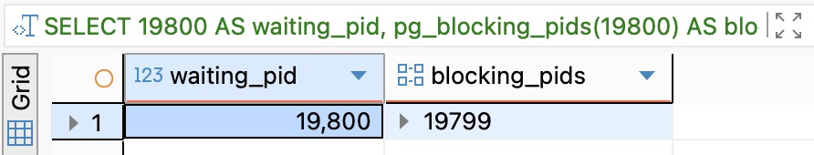
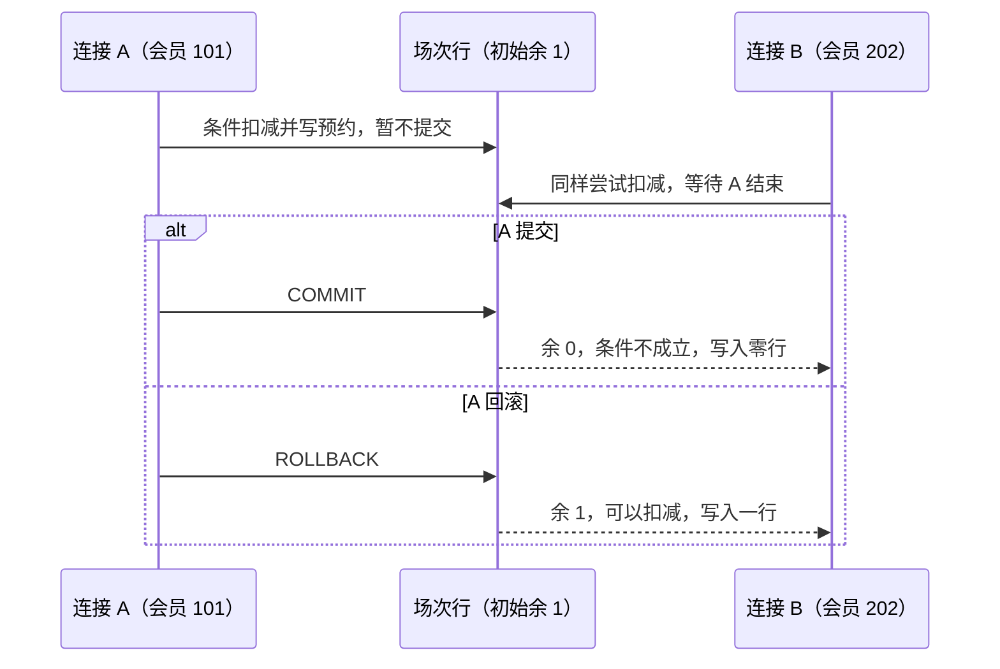
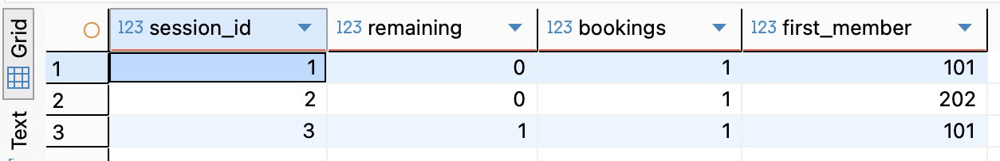
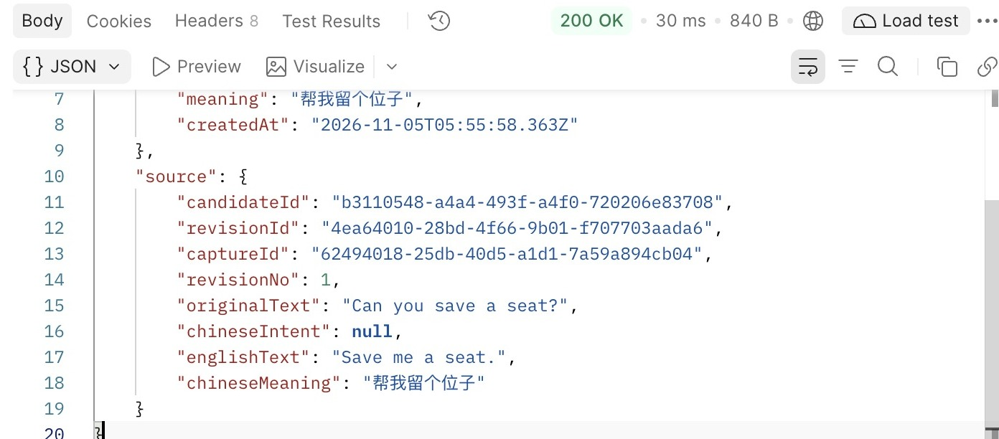

# 第36章 第四篇回顾：让采纳经得起竞争与重试

一个标签页还停在旧版原文上。你点了“采纳”，页面却报网络错误。另一个标签页里的“放弃”按钮还能点。此时如果有人问“这条表达到底收进去了没有”，两个页面都答不了。但数据库应该答得出来，而且能指出收的是哪一版、哪一个候选，以及重试时该把哪一次结果还给你。

先完成第25～35章。本章从 [第三十五章配套代码](https://github.com/SamChowRock/epp-public/tree/part-04/chapter-35) 继续，使用 `part-04/chapter-36` 的请求集合和两个 SQL 文件。保持原有 API、模型、迁移和启动方式，不用回填旧数据。准备已经完成第三十五章升级的独立校验库 VERIFY，里面只放练习资料。按[上一章 35.4](../chapter-35-indexes/chapter.md#354-区分查询次数返回体积和连接占用)的启动命令，让本次开发 API 明确连接这个库；在 DBeaver 的同名连接运行 `SELECT current_database();` 核对。下文的端口按 API 为本机 3000、故障代理为 3010 来写。

## 36.1 一次采纳里，究竟什么不能重复

取一句原文 `Can you save a seat?`。候选 A 是 `Save me a seat.`，候选 B 是 `SAVE ME A SEAT.`，两者在这次练习里都表示“帮我留个位子”。现在把原文改成 `Can you save two seats?`。如果只在候选身上记原文记录的 ID，过几天点开 A，会以为它是针对两个位子给出的建议。第二十五章给每次输入另存一版；第二十六章让候选引用那一版。这就留出了两条都正确的读法：打开记录看最新的两个位子，打开当时的学习来源看一个位子。

再想想“重复”。同一个候选只能被采纳一次，所以学习记录的 `candidate_id` 唯一。可 A 和 B 是两个不同的候选，各自采纳，理应留下两条来源。第三十一章让同一用户下、按既定规则处理后英文与中文义项均相同的候选引用同一个正式表达。这里去掉的是多余的表达身份，学习记录不能跟着合并。只把英文改成大写不会自动创造一个新义项；反过来，拼写相同也不意味着两个不同释义应该合并。

还剩一种重复：点一次按钮，发送了两次请求。页面第一次发送前生成一个小写 UUID，存在这次操作的 `operationId` 里；网络重试沿用它。另一次独立决定才新建身份。业务提交时，库里同时保存“哪个用户、哪次操作、采纳哪个候选、应返回什么”。这张成功结果记录叫**回执**。一次请求的 `X-Request-Id` 方便查这一次传输的日志，重发时会换；不能拿它找回上次的业务结果。

假定接班的人只拿到了五张卡片，上面分别写着素材 ID、修订 ID、候选 ID、表达 ID 和操作 ID。让他不打开源码就回答三个问题。第一，现在输入框里应该填什么？他要从素材走到当前修订。第二，用户当时为什么选择这一句？他要从学习记录找到候选，再沿候选找到当时的修订。第三，刚才断线的请求原本会返回什么？他要按用户和这次操作去核对回执。三次查找可能经过相同的表，但起点和终点各不相同。即使屏幕上碰巧出现同一句英文，也不能拿第三问的成功响应去填第一问的输入框。

可以再把一个条件换掉。假设 A 和 B 英文的大小写仍然不同，中文意思却一个是“帮我占座”，另一个是“替我保管一个座椅”。两个人眼里这也许是同一句英语，表达的精确身份却同时比较本章规定的英文和义项，只有两部分经过既定处理后都相同才复用。因而要把结果预测写成三列：有几次独立采纳，产生几条学习来源，这几条来源指向几个表达。两个候选、两次独立决定、相同内容身份，答案是二、二、一；将义项改成独立内容，最后一列应改成二。重复发送第一笔操作，则传输次数加一，这三列都不应增加。读者若在这里就预测错，后面即便每个请求都收到成功状态也会把正常复用报成“丢了一次学习”。

画这些卡片还有一个作用：辨认数据库此刻没有记录什么。素材当前是第二版这一事实，没有记录一个人看到第二版是几点，也不能证明另一标签页同步刷新过。第一个标签页携带第一版候选发起采纳，在本篇的规则下有明确意义，因为用户可以选择历史修订的候选；服务不会擅自把它改成第二版的候选。若产品改成“只可采纳当前版本”，数据库将多出一个随时间会改变的判断前提。先查到候选属于某一版仍然不够，必须定义追加修订和完成采纳谁先成立。这个改动没有在本章发生，做对照时也就不能把历史采纳解释成绕过规则。

把这些关系落实到 `src/prisma-candidate.store.ts` 的 `accept`。两个不同操作都可能先读到 `pending`（尚未决定）。真正争胜的是下面这一步；即使前一次读取成立，写的时候也要再问一遍：

```ts
const claimed = await tx.candidate.updateMany({
  where: { id, status: 'pending' },
  data: { status: 'accepted', acceptedAt },
});
if (claimed.count !== 1) return 'conflict';
```

放弃也只能改仍为 pending 的同一行。规定哪些转换合法，是**状态机**；把前提放进实际修改，是**条件写入**。两笔事务改同一行时，数据库让后写的一方等前一方结束，这才有机会在已提交的新版本上重新判断。“先”在这里指谁取得并成功提交这次状态变化，不是哪个按钮先亮，也不是哪个响应先到。一个写入者若最后回滚，等它的那个人仍可能成功。

取得候选后，采纳还要找到或新建表达，写学习来源，保存回执。它们在一个**事务**里一起提交；最后一步失败，前面那次状态变化也撤销。同一操作的两次请求还要排队：应用按用户和操作身份取事务级建议锁，即请数据库让使用同一把锁的代码轮流进入这段处理；事务结束便释放。在当前隔离级别，拿锁后另发一条查询，可以看见上一位刚提交的回执。先查候选仍属当前用户，再查回执，匹配便返回原结果。若先用“已采纳”拒绝一切，合法重试就会误报冲突。不同操作即使碰不到同一把操作锁，也仍受候选的条件写入和学习来源的唯一约束保护。不同候选若要复用同一表达，则由表达身份自己的锁和唯一约束协调。

把上面的写入条件拆成两次会发生什么？一个看似节省代码的做法，是在入口读取状态后把布尔值传给稍后的保存方法。另一个请求可能在这两个动作中间完成放弃，布尔值仍然是真。若保存时只带候选 ID，数据库顶多保证找得着这一行，不能知道程序原先是以 pending 为前提。相反，写入处把 ID 和原状态一起带入，数据库所返回的行数便有明确的解释。在本章的唯一 ID 下，影响一行表示取得这次转换，零行表示在实际修改时没有满足整组条件。单凭这个零还分不出 ID 不存在、不可见或状态已变，公开的冲突或未找到要结合服务已经做过的归属查询来读。

最后把“都在一个事务”也画成时间线。先让 A 完成条件更新，停在学习记录还没写入的瞬间。如果此时向另一个普通读取会话询问，它应继续看到上一次提交的候选状态。让采纳继续直到向客户端回传，断线若发生在数据库提交之前，两处最终可能什么都没留下；若发生在提交之后，两处应该能一起看见。这里的“两处”是业务链和该次成功回执，不能用某条说明“开始写入”的日志充当其中一处。下一节故意让断线只发生在后一种位置，这样可以有意构造一份未知结果给客户端，同时手里仍有可独立核对的数据库事实。

## 36.2 把采纳和放弃换个顺序，再丢掉一次响应

在 Postman 的本地工作区导入代码仓库的 `requests/chapter-31.postman_collection.json`。这是一次需要在中间停下查库的实验，逐项 Send。集合变量 `baseUrl` 指向 API，`proxyUrl` 指向代理；如果开发服务改了端口，两处转发配置须对应。01 新建原文，同时为 A、B、C 各留一个操作身份。02 记下第一版的 `revisionId`，03～05 为这一版保存三个候选，06 追加第二版。此后不要再按 01，它会为另一轮换掉整组变量。在 Variables 里保留这一轮的 ID；候选和操作都不要凭显示文本去找。

在 DBeaver 打开 `database/chapter-31/01-outcome.sql`，把全零 UUID 换成刚才 **02 的第一版** ID。每个候选一行，分别数它的学习来源和成功回执，而不是统计全库总数。06 以后应看见三行 pending，各为 0、0。若是零行，先核对连接和修订版本；第二版确实没有这三个候选。下面是取证的主体：

```sql
SELECT n.candidate_no, n.status,
  (SELECT count(*) FROM public.learning_records l WHERE l.candidate_id = n.id) AS sources,
  (SELECT count(*) FROM public.command_receipts r WHERE r.candidate_id = n.id) AS receipts,
  (SELECT l.expression_id FROM public.learning_records l WHERE l.candidate_id = n.id) AS expression_id
FROM public.candidates n
WHERE n.revision_id = '00000000-0000-0000-0000-000000000000'::uuid
ORDER BY n.candidate_no;
```

第一次实际写这条取证查询时，可以先不看成品。给定 revision_id，先从 candidates 挑出属于这一版的行。检查只有三行且每个候选编号出现一次，这一步定下了最终网格的粒度。然后针对其中一个候选，去 learning_records 查与其 ID 相等的行，预测它是零行还是一行；写成括号里的 count，没匹配时会返回数字零。回执也从自己的表独立计数。若将两张子表都内连接回去才统计，还 pending 的候选会因找不到学习记录先消失，后面即使写了 count 也变不出三行零。错误网格在全员已成功的库里可能似乎正常，所以一定先用三条 pending 检验查询。

最右侧表达 ID 可以直接取自该候选对应的学习来源，因为这一步已经有“每个候选最多一条学习来源”的唯一约束。这里若取不到来源，应让单值子查询返回 NULL，告诉接班人尚无可追的表达。把它改写为随便取一条的 LIMIT，反倒可能在将来约束丢失时把重复数据隐藏起来。注意同一表里两个字段为空也可能来自完全不同的事：A 尚未采纳时表达 ID 为空，C 已放弃时表达 ID 也为空。要解释给用户听，还得并排读取状态。教材里保留编号、状态、两类计数和表达身份五列，恰好让你从一行区分这两种原因。

用 Postman 时，把 Variables 里的第一版身份和候选身份抄到本轮的一小张记录上，并给 07、09 留两个空格写结果。失败的响应没有可供提取的业务 ID，只能沿发送前留住的身份继续追。如果中途重新导入集合、换了工作区或重新发 01，变量可能已经属于另一套素材。一个简单的核对是：从 02 记住的第一版 ID 出发应能找到 03～05 的三条候选；只看到三条同样的文字还不能说明你接回了上次实验。

为了让“没有收到响应”和“没有提交”真的分开，在代码根目录另开终端运行已有的实验代理。它把请求转发给 API，等上游的第一份 201 完整返回后，丢掉这份响应并断开客户端连接；之后的成功请求正常透传。

```bash
nvm use
TARGET_PORT=3000 PORT=3010 node examples/lost-acceptance-response.mjs
```

现在发 07。Postman 看见连接失败；代理终端应出现 `Upstream 201 consumed; dropping the client response.`。若没有这行，先查端口、代理及写入结果，不把普通的连不上当成本次故障。**先别重发**。在 DBeaver 重跑刚才的查询（若使用手动事务，先结束旧的读取事务）：A 已是 accepted，来源 1、回执 1。08 从另一标签页的立场放弃 A，返回 409／`CANDIDATE_CONFLICT`。09 直连 API，向同一个 A 再发原来的 `operationA`，却得到 201。再发一次 09，比较两份响应中的 `candidate.acceptedAt`、`learningRecord.id` 和 `expression.id`；数据库仍是 1、1。201 在这里回答“这次操作成功时返回什么”，不能用来数新写了几行。



图36-1。看响应体最后一行的错误码。这里的 409 告诉你候选已经不能放弃；它没有回答原来那次采纳返回了哪条学习记录，那个问题要拿原操作身份去查。

做 09 的时候，先把看到的时间当作一道题：如果返回的是今天重新采纳一次的时间，还是昨天那笔决定的时间，单用状态码能分辨吗？两种实现都可能选择返回 201。实际应检查接受时间与原回执里的值相同，学习记录 ID 保持，表达身份保持，再看数据库计数有没有变。若响应看起来稳定、库里却多出来源，是写入行为重复；若库里没多出来源、响应换了学习记录 ID，是重放给调用者的内容有误。这两类问题需要从不同的地方下手，不能因为某一列正确就放过另一列。

若在 07 后的数据库网格仍然读到 pending，先按可观测的顺序排查。看代理是否确实报告已消费上游 201；没有这条信息，就不能假定已经走到设计的断点。再看网格用的数据库名和 revision_id 是否和本轮一致。结果标签页是上一次执行取得的结果，切回标签页不会自动重新发送 SQL。重新执行时若还处在固定快照的旧事务里，结束该次读取，再用空闲会话核对。只有把“上游收到了什么”“现在读哪个身份”“这次读取用的哪个快照”都对应起来，两边仍矛盾，才有理由回到事务实现查哪份事实漏写。

用 C 把先后颠倒。10 先放弃，返回 200；11 才来采纳，得到 409。C 是 discarded，来源和成功回执都是 0。这两次按次序送达，便于解释两种终态；它们本身不能证明两个会话曾在数据库里同时等待。下一节会故意把一个事务停在提交前，让第二个写入者真的等它。

还可以故意犯一个与等待无关的错误：12 用 A 已成功的操作身份去采纳仍 pending 的 B。此时返回的同样是 409，错误码却是 `OPERATION_CONFLICT`：这个身份已有结果，目标对不上。重查 B，应仍为 pending。13 用 B 自己的身份采纳，得到 201。回到 DBeaver，用同一个第一版修订 ID 再查一次。



图36-2。先看候选 1 和 2，两行的 `sources` 和 `receipts` 都是 1，最右侧的表达 ID 完全相同。再看候选 3，状态是 discarded，两项计数都是 0，表达 ID 为空。你拿到的 UUID 会不同，可以在自己的结果网格里做同样的对照。

这条查询只数本轮指定修订。库里早就有同一表达，仍应满足上面的关系，没有理由要求整张表达表又多一行。也不要反推“一条回执都没有就从来没人请求”：当前只保存成功采纳，放弃、冲突以及很早版本中没有操作身份的采纳都没有这类凭证。

到这里应能把两个 409 交给界面作不同处理。C 已放弃后再采纳，界面可刷新这个候选的状态，提示本次选择没有成立。拿 A 的原操作身份去处理 B，则 B 仍可被独立采纳；客户端应排查为什么把已经对应 A 的待办拿来装 B。遇到冲突就自动给所有请求换一个操作身份，会丢掉判断上一笔究竟有没有成功的依据。重新发送 09 是在找回那一次决定；发送 13 是用户对另一个候选作出新的决定，动作分界在用户的意图变化，不在重试按钮被按了几下。

如果你要向同事交接本轮结果，不妨先只给他最后的三行网格，请他说明哪两件事还回答不了。仅从 A、B 指向相同表达，推不出是 A 首次创建了这个表达还是复用了练习开始前就存在的表达；仅从 C 没有成功回执，也推不出用户从未点击过采纳。再交给他这次回执中的具体身份和代理丢弃响应的记录，就能还原这次试验设置的先后，而无须把库中没记过的行为写成结论。业务查询能讲清留存的事实，传输观察能缩小一次请求经过的位置，两套证据各有用途。

中途离开时保留已发到哪一项、第一版 ID 和操作身份；回来先查三行，再决定恢复哪一步。结果未知的采纳只用原目标、原身份重发。库里仍在跑的请求也可能尚未提交，某一刻查不到行不能证明它最终失败。不要为“再试一次”新建整套候选。实验代理用完按 Ctrl+C；日常请求一直直连 API。

## 36.3 两个人抢最后一个预约名额

把确认对象换成一次有座位上限的活动。场次 1 只剩一个位子，会员 101、202 各想订一席。两张预约单不相同，在预约单上要求“同一会员同一场只准一单”，这两单都完全合法。真正共享的是场次的最后一个名额。先数一数已有预约，再分别插入，看起来也做了校验；但两人都可能在对方提交前看到还剩一席。即使把各自的查和插包进事务，也没有让两个人必须修改同一行。

这里把剩余名额放在场次行上，让每次占座都要修改这一行；另存一条“哪位会员订了哪一场”。由此得到三个可以分开检查的承诺：余量不能扣成负数；同一会员不能在同一场占两席；扣掉一席和写下预约必须一起成功。若容量为一百，也还是只需争同一场次行，不必给所有场次加一把全局锁。代价是热门场次的写入会在该行排队；任何取消或人工调整入口也必须维护同一个计数。

要把这个要求写进 SQL，先给每个判断选一行作对象。场次编号能定位那个还剩一席的总量，两名会员谁来都会改同一行。预约明细的主键能定位一个具体的人和场次的组合，两个不同的人却注定是两个不同的键。如果误把这两个判断合并成一句“给预约单加唯一约束就好了”，你只解决了同一人重复，尚未建立总量上限。反过来，只看余量也不够。若一个场次初始有十席，同一人重复发起两次完全可以都扣成功，仍然没有负数，却占去了两名会员的机会。用一人两次和两人一次这两组输入各走一遍，就能知道谁负责身份、谁负责容量。

还可以从查询方向复算。若这场开始时有两个名额，且本实验没有取消、增开或转让，那么“已提交预约数加当前余量”等于二。从场次出发外连接预约计数，空场次才能显示为预约数零；这时应当数匹配到的会员列，不能把为了保留场次而出现的空占位行也算成一张预约。你可在第六段执行前手写期待的一行，分别标出余量、人数、会员。等式合得上仍然只是第一关：把本该归会员一零一的那张单换成会员二零二，人数和余量都一样，真正的归属已经错了。图中保留订到的人，正是为了继续做第二关。

若将来允许后台调整容量或迁移历史预约，只凭“余量加预约数”不能猜出原始容量。实验给出了每场各自的初始数字，所以我们有独立参照。产品若需要长期对账，就得能取到容量以及调额凭据等对应事实，或把容量保存为可追溯的值。否则对账人员看见总数七，只能知道今天有几席已经订出、几席还可用，无法判断本应是七还是八。这也是为什么先写业务不变量时，要写清它依赖哪些保留的数据。

在 VERIFY 里为同一个数据库打开两个**独立连接**的 SQL 编辑器 A、B，平时都用自动提交，只在下文的 BEGIN 和 COMMIT 之间保留事务。分别执行 `SELECT current_database(), pg_backend_pid();`：库名相同、进程号不同才算两位参与者。若进程号相同，复制数据库连接配置并从副本打开 B。不要用数据库的临时表：只对创建它的会话可见，第二位参与者就看不到同一份名额了。

打开 `database/chapter-31/02-last-seat.sql`，按编号选中一段再执行。一个编号里有多条语句时，选中整段，用 SQL Editor 菜单的 Execute SQL script 执行选区；不要把提交和待观察的语句一起选中。第 2 段只在 A 执行一次，创建专用的 `ch31_booking` 命名空间并提交，B 才看得见。两个表的关系如下；脚本另外准备了三场，初始余量分别是 1、1、2。若命名空间已经存在，先回滚失败事务并用第 6 段核对之前做到哪一步，不要删掉未知对象。

```sql
CREATE TABLE ch31_booking.sessions (
  id integer PRIMARY KEY,
  remaining integer NOT NULL CHECK (remaining >= 0)
);
CREATE TABLE ch31_booking.bookings (
  session_id integer REFERENCES ch31_booking.sessions NOT NULL,
  member_id integer NOT NULL,
  PRIMARY KEY (session_id, member_id)
);
```

让 A、B 都先执行第 3 段，开启事务，查看场次 1 的余量。两边都看见 1，这一眼只够展示给用户。第 4 段才决定谁能订到。下面的 `seat` 是一条语句内给中间结果起的名字：UPDATE 确实拿到名额才返回场次 ID；INSERT 从这个结果取行，空结果自然什么也不插。

```sql
WITH seat AS (
  UPDATE ch31_booking.sessions SET remaining = remaining - 1
  WHERE id = 1 AND remaining > 0 RETURNING id
)
INSERT INTO ch31_booking.bookings (session_id, member_id)
SELECT id, 101 FROM seat RETURNING session_id, member_id;
```

读这段 WITH 不妨倒过来推一次。希望给会员 101 新建多少行？拿到一个名额就建一行，没有拿到就建零行。于是 INSERT 的输入应该是一个“零行或一行”的查询，而不是固定的一行 VALUES。再向前追，谁能在同一份数据里决定这个数量？正好是带有 remaining > 0 条件的修改。让它 RETURNING 实际动过的场次 ID，INSERT 就只能消费成功扣减的那一行，不会把“已经满了”误当作仍可插入。两步交换信息用的是 RETURNING 所交出的数据，不需要在同一条语句的其他位置再查一次场次表，猜测刚才那步是否生效。

有一种错误写法看上去更直白：先把看到的余量存进变量，在界面上算出新值零，再发“把 remaining 设为零”。两人从同一个一算起，写出的零完全一样，第二位很可能以为也成功扣过一席。最终余量零与单条正确路径的结果相同，问题要到对照两份预约单才暴露。由数据库在修改处针对当前行做减一，同时检验余量，才能把“这是不是我能扣到的一份”落到自己的语句结果上。对这个小实验来说，把表设计成整数只是起点，写的表达式和它在哪一个时刻取值也决定了约束是否被维护。

A 用会员 101 执行这一段，看到返回一行，**不要提交**。B 把 101 改成 202，执行同一段，结果还没回来。此时保留 A、B 的窗口，在第三个空闲连接执行下面这句。把两处 19800 都换成第 1 段记下的 B 的进程号。第一列标出查的是谁，第二列列出正在阻塞它的数据库进程。

```sql
SELECT 19800 AS waiting_pid, pg_blocking_pids(19800) AS blocking_pids;
```



图36-3。这次运行中，B 的进程号是 19800，网格把它显示成 19,800。右侧的 19799 正是先前记下的 A。趁 B 还在等待时读这两列，A 结束事务或 B 等待超时后，这次阻塞关系便会消失。

切回 A 执行第 5 段 COMMIT。现在 B 才返回，结果集是零行，B 也执行 COMMIT。第 3 段选的是 PostgreSQL 的 Read Committed（读已提交）：普通读取看到该条语句开始时已经提交的数据；写到别人正在改的行时，要等对方结束，再对新的行版本检查条件。A 一提交，B 重新判断的便是 `0 > 0`。因为 B 从来没有扣到名额，后面也没有预约行可写。[PostgreSQL 18 对等待后重查条件的说明](https://www.postgresql.org/docs/18/transaction-iso.html#XACT-READ-COMMITTED)



图36-4。沿 B 的同一次等待往下看：它没有改请求，也没有重新点击，结果却取决于 A 结束事务的方式。B 如果取得一行，还要自己提交才能订到。

第 6 段把余量和订到的人放在同一行，场次 1 应为「余 0、预约 1、会员 101」。换场次 2 再做一遍：两边第 3、4 段里的 `id = 1` 都换成 `id = 2`，仍由 A 用 101 先写、B 用 202 等。**这次 A 执行 ROLLBACK**。B 应返回一行，B 提交后，场次 2 为「余 0、预约 1、会员 202」。第一次也是 A 先拿到一行，但 RETURNING 只说明这条语句在当前事务里做了什么，不保证 A 最终订到。若超过脚本设的 60 秒等锁期限，B 会报超时，而不是“名额已满”；在 B 回滚，确认 A 是否仍在事务中并结束它，查第 6 段再决定是否重试。长时间停在事务里，连接也可能因脚本的空闲保护断开，重新连接后以已提交结果为准。

把两轮的时间点摆在一张纸上：两个会话都读到一；A 取得一行返回；B 尚无返回；A 结束事务；B 得到最终结果；B 再结束事务。前面三个时间点在两轮完全一样，只有第四个时间点的提交决定不同。如果同事只截到“A 已返回一行，B 一直在转圈”，他还不能判定哪位会员最终订到。向他要的下一项证据应是 A 的事务结果和双方结束后的实际预约，而不是页面转圈持续了多久。

还有一个看似反常的现象值得准备：A 已经把余量改为零，但旁观会话执行普通 SELECT 仍可能立即看到一，而 B 发出的扣减语句正在等待。普通读取可以从已提交版本得到一致的答案；B 想改同一行，需要等正在占有修改权的事务作决定。两位读者的动作不同，看到“一个没等，一个在等”并不矛盾。若在 B 所在的同一编辑器继续点执行观察 SQL，它的会话还在等上一个语句，无法充当旁观者。先记录 PID，再从确认不同的连接取阻塞信息，才能检查到刚才那一段等待。

若中途先结束了 A，才打开第三个窗口，阻塞列表为空也符合预期。它回答的是执行观察语句的那一刻，无法回放已经结束的等待。需要复验时先查第六段确认哪一场还具备初始条件。已经订满的场次从一开始就没有可扣的行，即使重复相同点击顺序也不会重现原来的等待。这个细节同样适用于记录服务：拿一个已终结的候选反复测试，得到的都是终态判断，不能说明两个竞争者原本怎样从 pending 分出胜负。

第三场还有两个位子。这次回到自动提交，会员 101 用第 4 段把 `id` 改为 3，执行两次。第一次成功，第二次有余量可扣，却在插预约时碰到主键重复（SQLSTATE `23505`）。


图36-5。读 Detail 里的键值就能定位冲突。会员 101 在场次 3 已有一单。现在单独执行第 6 段，检查刚才那条失败语句有没有把剩余名额扣掉。



图36-6。场次 1 和 2 都只订出一席。对照最后一列，先写者提交时由 101 订到，先写者回滚时由 202 订到。场次 3 初始有两席，重复预约报错后仍有一条预约、剩一席，说明那次失败的扣减已经撤销。

若为了消掉红字在 INSERT 后添上 `ON CONFLICT DO NOTHING`，重复不再抛错，前面的扣减反倒可能提交，最后一席凭空消失。

回想第三场的第二次调用。此时“仍有可扣名额”是真，“这个人尚未订过”是假。把更新和插入写在同一条语句，前一判断成立并不足以让更新独自提交，插入抛出的错误把这条语句整体撤销。若事先把它拆成两次自动提交，第一步已经交付给数据库，应用随后捕获第二步的重复错误，也无法靠退出函数使余量自动加回。补一条加一又是新的动作，自己也可能失败或重复执行。要为一次本地业务决定提供的全成全不成承诺，应该放回能同时管理这两项事实的事务边界。

这时看看第六段的 min(member_id) 能回答什么。对于只有一张单的场次，它告诉你赢家是谁。假设把场次三剩下的一席合法地给了另一位会员，人数成了二，最小会员编号只代表其中一人，再用它宣称“我列出了全部持票人”就过头了。要给两位分别发预约确认，应从明细取各自的键，要核总量才从场次做聚合。回顾采纳那边的 SQL 也有同样的限制：取一个表达身份之所以足够，是候选到学习记录的单一性成立，并非所有一对多关系都可以用一个标量替代。

把实验带回接口设计，还要回答客户端没收到响应怎么办。场次加会员的唯一键能挡住第二张预约，却不能区分“刚才那次成功了”“更早就订过”或“现在又想订”。如果产品承诺重试同一次动作能拿回原结果，就要像采纳那样在扣减前按操作身份查结果，校验场次与动作，成功结果和预约一起提交。再改变一个条件：允许取消、取消后能重订。此时一个永久的「场次＋会员」历史唯一键会挡住重订。如果要保留历史，应给每次预约自己的身份，只约束同一人同一场的**有效预约**最多一条；取消也只允许“有效→已取消”的那一次归还名额，并与状态变化一起提交。旧预约的成功回执不能证明它今天仍有效，今天的状态应另查。这些是预约产品需要补的判断，没有理由为此给记录服务加一个预约接口。

完成核对后，先结束两个连接中的实验事务，再执行第 9 段清理本轮建立的预约表。

## 36.4 从学习列表查回来源，也查清是谁的来源

回到 A 和 B。采纳结果里各有一个不同的 `learningRecord.id`，表达 ID 却相同。若列表按表达去重，第二次采纳从学习历史里消失；若星图每条来源都画一个点，同一个正式表达又被画了两遍。因而学习列表按来源给行，星图按表达给点，节点的 `recordCount` 才表示它有几个可见来源。相同表达如果在本轮以前就出现过，节点计数可以大于 2；检查的是本轮两个来源都能找回。

发送 14、15：在同一个 `expressionId` 范围内按最新在前每次取一条，14 保存 `nextCursor`，15 携带它续读。对照 09、13 返回的学习记录 ID：没有别的写入且时间依次递增时，B 在前，A 随后；若同在一毫秒，顺序由 ID 降序决定。要验证的是两条来源都找得回、表达相同，而不是背下字母顺序。若练习库已有同一表达的来源，继续沿边界找齐这两条。若之后又有新的采纳排到页首，沿旧边界向后读不会把这个新来源变成第二页；重新取首页才能看到它。实时翻页不能用来证明某一时刻的全库总数。若 15 返回 `INVALID_CURSOR`，保留原查询范围、页长和服务密钥，重新从 14 取边界；不要重新发送采纳。也可以 GET `/star-map?limit=100`，按表达 ID 对照节点。若表达较旧不在首页，用 `mode=cursor` 从星图自己的首页沿 `nextCursor` 继续找，不能借学习列表的游标。

用一张缩小的列表推一次续页。假设同一表达现在只有本轮两条来源，时间相同，学习记录 ID 中较大的那条放在前面。页长是一，查询会多取一项探测是否还有下一页。第一屏交付的是排在前的那条，用**已经交付的最后一条**作为继续位置；多取的那条只证明还可以往下找，不能顺手把它变成游标边界，否则第二屏正好把它跳过去。收到第二屏时，用两次响应里的学习记录 ID 对回 A、B，再分别圈出它们相同的表达 ID。同表达连续出现两次对这个列表是正确的；只记表达 ID 去重的前端，会把第二条真实来源藏掉。

若练习前该表达就有三条旧来源，而你只操作了两次，列表页长仍是一，能从两页看完哪些事实？能证明已经出现的身份确实属于这个范围，仍不能证明其他来源不存在。想找齐本轮的两份，要把首次采纳返回的两个学习记录 ID 当成目标，一页页沿返回的边界前进；遇到最后一页仍凑不齐，应对照成功回执与数据库里的来源关系，别通过再次采纳制造匹配样本。反过来，如果只是要确认 A 指向哪版原文，已经知道学习记录 ID，就可直接读详情。按本轮身份查证和把整个集合遍历一遍是两种成本不同的任务，选择要由接手者的问题决定。

再从断点恢复的角度想一次。刷新页面以后，旧的下一页游标还在，但用户已经切换了表达筛选或日期。拿这条边界去填另一个列表，不知道新列表中哪些项曾经交付给该页面。正确的读法是把筛选、已展示的明细和继续位置看作同一轮浏览保存；换范围时从首页重新建立这三者。这里即使所有写入都可靠、数据库没有丢记录，也可能因为客户端拼接了两轮浏览而看似少一项。排查时应先确认是哪份列表、按什么粒度、从哪一轮边界取下一页，再回到写入侧寻找缺失。

再发 16，只凭 A 的**学习记录 ID**取历史详情。看 `source.revisionNo` 与 `source.originalText`，应是第 1 版的一个位子；打开 `GET /captures/{{captureId}}` 才是记录当前的两个位子。这两个答案若都显示最新原文，页面照样可能返回 200，却已经讲错了历史。



图36-7。看 `source` 里的 `revisionNo: 1` 和单数的 `a seat`。这里查的是当时的学习来源，原文后来改为复数也不会改变这个答案。

同一份列表还面对两个独立问题。第一个是“允许读哪些行”：学习记录属于当前用户、引用的表达属于当前用户、候选沿修订找到的原始记录也属于当前用户。列表、详情和星图的计数都要守住相同边界；只在页面过滤，会让总数、翻页甚至详情暴露别人的资料。第二个是“怎样少读一些就得到这一页”：第三十五章让索引按用户、创建时间和 ID 排列，数据库有机会从这一位用户的有序记录开始取；若又指定表达 ID，还可能要继续筛，不能因为结果只有一行就认定数据库只读了一行。要查实际成本，可在同一 VERIFY 运行上章的 `database/chapter-30/03-owned-page.sql`，先辨认其中的归属连接、排序和 LIMIT；那是普通首页第一条查询的计划，不是本节按表达筛选后所有读取的成本。加快查找的索引不会替服务判断谁有权读，给游标签名也不会证明拿它的人是谁。

最后用相同的一笔历史给自己出一个交接题。若打开学习列表能看见 A，读详情却显示第二版，应该重跑哪一段？先按这个 learningRecord.id 查它引用的候选，再沿候选的 revision_id 读那一版原文，手里保留独立查询的结果。若数据库链仍到第一版，问题更接近详情读路径选择了“取最新”，重新生成候选或重放采纳都不能修好它。若星图上同一表达只有一个节点且来源数比预计多，先从来源列表辨认是否混入本轮以前的合法历史，再判断计数是否越过了用户范围；节点数和参与统计的来源数本来就不是同一个数。逐层排除时，每一次读取都应能说出它试图排除哪一种解释。

自己独立做完的标志可以是一份很短的交接说明。只选本轮的 A，写下第一版原文、当前原文、成功操作身份、学习记录身份，以及你从哪个独立入口读到它们。再补一行，如果明早接班人遇到相同目标的原身份、另一次新决定、或者同一人同一场的再次预约，各该先查哪一份事实。能用自己保存的 ID 和本轮查询结果解释这三种情况，就能够把修订、事务与重试组合到下一项业务需求里。

第四篇走到这里，服务仍把每次请求视为同一位开发用户。在本机把 `userId` 塞进 Body、从别人那里复制一个资源 ID，都不能建立身份。下一篇要接起来的是这条链的起点：先验证请求者是谁，再让查询、写入和重放全部使用服务端确认的用户。即使对方知道一次真实成功的操作身份，服务也应先确认资源此刻对他可见，再决定能否返回那份历史结果。

## 附录：本章必要技术点速查

| 名称 | 本章怎么用 | 核对入口 |
| --- | --- | --- |
| 条件更新、RETURNING | 用返回行数判断这一次是否取得待处理候选或余量；提交前仍可撤销 | [PostgreSQL 18 UPDATE](https://www.postgresql.org/docs/18/sql-update.html) |
| Read Committed、行锁 | 两个事务修改同一行时，后写者等待，再检查当前版本 | [事务隔离](https://www.postgresql.org/docs/18/transaction-iso.html) |
| 主键、CHECK、事务 | 分别限制重复预约、单行负余量，以及扣减与写单能否拆开提交 | [约束](https://www.postgresql.org/docs/18/ddl-constraints.html) |
| WITH 中的数据修改 | 只把实际扣到的场次交给 INSERT；出现错误时整条语句失败 | [WITH 查询](https://www.postgresql.org/docs/18/queries-with.html#QUERIES-WITH-MODIFYING) |
| 操作身份与回执 | 区分同一成功请求重放、同身份换目标、候选已终结 | [第29章](../chapter-29-idempotency/chapter.md) |
| 游标与归属 | 原查询范围内从已返回边界续读；签名与索引都不授予访问权 | [第33章](../chapter-33-pagination/chapter.md) |

阅读约 82～102 分钟，跟做另加约 56～78 分钟，沿用前章的环境。

[本章配套代码](https://github.com/SamChowRock/epp-public/tree/part-04/chapter-36) · [上一章：索引与执行计划：查询为什么变慢](../chapter-35-indexes/chapter.md) · [下一章：安全地保存密码与秘密](../../part-05-identity/chapter-37-secrets/chapter.md) · [第四篇导读](../README.md) · [全书目录](../../README.md)
