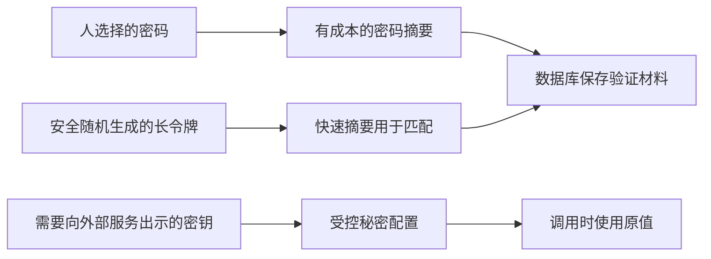
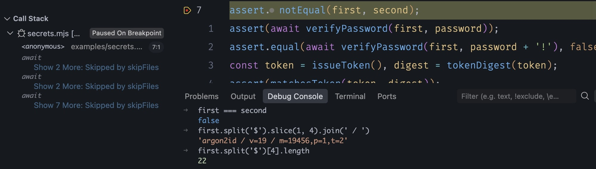
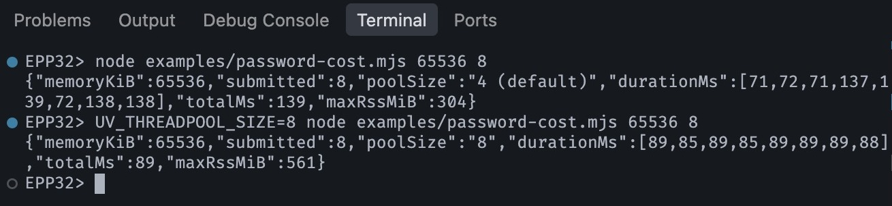
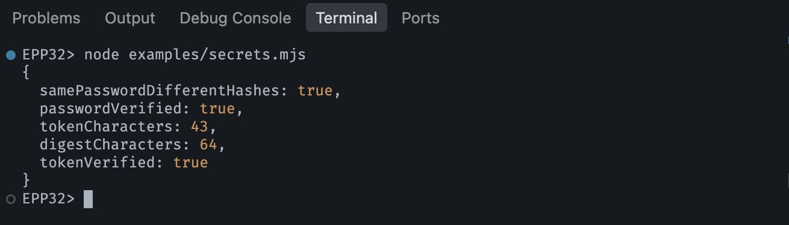
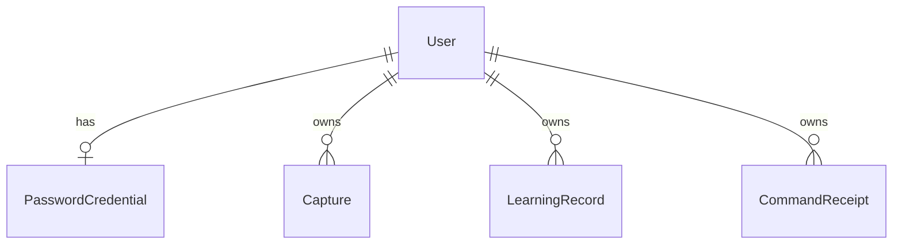
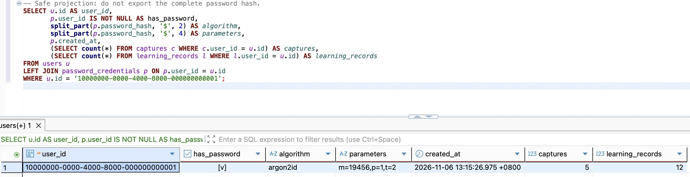

# 第32章 安全地保存密码与秘密

第四篇已经让一条学习来源说得清自己从哪版原文、哪个候选而来，也让重复采纳能够找回原结果。现在还有一个重要前提藏在程序里：这些操作的用户，始终是固定的开发用户。知道一个 userId 就代表拥有这个身份吗？当然不行。要换掉固定身份，先得准备一种能验证身份的凭据。

本章从第三十一章完成状态继续，配套分支为 `part-05/chapter-32`。先做好密码与随机令牌的保护，再给**原来那个用户**增加密码凭据。用户 ID、已有原文、修订、表达、学习来源和回执都保留。暂时不增加登录 HTTP 接口，主服务仍只在本机使用固定身份；下一章才用密码换会话，并从请求中识别用户。完成密码表，不等于现在的 API 已经需要登录。

保持 Node 24.22.1、PostgreSQL 18 和原有开发链路。第一阶段只做独立密码与令牌实验，不连接数据库；第二阶段检查秘密进入程序与离开程序的地方；最后再在已有非空数据的 VERIFY 演练迁移和初始化，确认以后才对日常 DEV 做相同步骤。可以分别停在这三个位置，不必一口气改完所有文件再运行。

## 32.1 同样是秘密，为什么不能都存成摘要

假设数据库备份被拿走，里面有用户密码、登录令牌和邮件服务的访问密钥。三种东西都不能明文交给别人，但服务使用它们的方式不同，这会直接决定保护方法。

验证密码只需要回答“这次输入是否与设置时相符”，不需要恢复用户当时输入的文字。密码因此可以经过单向计算，再把结果保存下来。这样的计算结果叫**摘要**。这里的“单向”并不是承诺攻击者永远找不到原文：若密码是一个常见短词，他可以猜一个词、计算一次、比较结果，反复尝试。猜中并不需要逆向解开算法。

SHA-256 很适合快速确认数据是否相同，却也让上述猜测非常快。仅仅把密码换成 SHA-256，数据库里看不到明文了，猜测成本却没有充分增加。密码专用算法会有意让每次猜测消耗时间和内存。第三十二章的第一项工作就是让这个成本有明确参数，也有可测量的后果。

登录令牌则可以由服务随机生成，完全不需要人记住。用安全随机源生成 32 字节，相当于从 2 的 256 次方种可能中选择一个值；猜测者没有“用户喜欢生日”这样的捷径。对这种足够长、均匀随机的令牌，快速摘要可以满足服务端只做匹配的需要。把六位验证码也套进这个结论就错了：它只有一百万种可能，拿到普通摘要后很容易枚举。验证码需要不同的存储与限次设计，不能用随机令牌的字节长度替它作保证。

邮件供应商的访问密钥又不同。应用必须把原密钥发给供应商，才能调用服务，单向摘要无法代替它。它应放在权限受控的秘密配置中；确需持久化到业务库时，才考虑用独立管理的密钥做可恢复的加密。**加密**需要密钥来恢复明文，谁能拿到解密密钥，谁仍有机会恢复数据。数据库和解密密钥放在同一份公开备份里，就没有实现预想的隔离。

还有前章的游标签名密钥。HMAC 使用密钥计算校验值，用来判断游标内容是否被改过。签名不隐藏内容，Base64 只是编码，也不是加密。分页数据、登录令牌和数据库口令不能因为都长得像一串字符，就共用同一把密钥或同一种处理流程。



这张图还隐含了一个威胁边界：摘要主要减少存储泄露后直接得到秘密的机会。正在运行的应用必须短暂接触用户输入；攻击者若已经控制应用进程，可以在那里截获输入。日志、调试器、备份、进程权限与传输保护因此仍然重要，不能由“数据库已经哈希”一笔带过。

## 32.2 用 Argon2id 验证密码，也量出它的成本

先考虑两个用户设置相同密码。如果直接保存同一种确定性计算结果，两行会相同，攻击者还能把预先算好的常用密码结果反复使用。解决办法是在每次生成密码摘要时，额外加入一段独立随机值，叫**盐值（salt）**。盐值随验证材料一起保存，不靠保密提供安全性；它让每一份验证材料都需要单独计算。盐相同的固定字符串，或者所有用户共用一个盐，不能实现这个目的。

本章使用 Argon2 的 Argon2id 变体。可以把一次计算粗略理解成：按参数分配工作内存，经过多轮处理得到固定长度结果；攻击者尝试一个候选密码，也得承担相应成本。它不是把 SHA-256 多调用几次的别名。内存大小、轮数与内部并行度共同影响成本，不能只盯住“几轮”。

截至本章核查的 2026-11-06，Node 24.22.1 已有 `crypto.argon2` 原语，能够计算结果。但密码存储还需要记录盐、算法和参数，并在验证时恢复相同条件。这里使用 `argon2` 0.45.1 提供的编码与验证接口，不另写一套密码记录格式。这个包包含原生实现，后面的干净安装必须核对目标平台可加载它；“TypeScript 能编译”不能证明原生模块可运行。[Node 对应版本文档](https://nodejs.org/download/release/v24.22.1/docs/api/crypto.html#cryptoargon2algorithm-parameters-callback)与[库的版本说明](https://github.com/ranisalt/node-argon2/releases/tag/v0.45.1)说明了这两个层次。

项目已有 `package.json` 的安装脚本允许清单，也增加 `"argon2@0.45.1": true`；保留其他已有项，依赖与锁文件一起保存。它允许的是这个固定版本的原生模块安装步骤，不是放开所有依赖的脚本。

在项目根目录执行：

```bash
nvm use
npm install --save-exact argon2@0.45.1
```

新增 `src/password.ts`。前一半先确定输入的含义，后一半才进行密码计算：

```ts
import { argon2id, hash, verify } from 'argon2';

const options = { type: argon2id, memoryCost: 19456, timeCost: 2, parallelism: 1, hashLength: 32 } as const;

function passwordText(value: unknown): string {
  if (typeof value !== 'string' || value.length > 256 || !value.isWellFormed()) {
    throw new Error('PASSWORD_INPUT_INVALID');
  }
  const text = value.normalize('NFC');
  const length = [...text].length;
  if (length < 15 || length > 128) throw new Error('PASSWORD_INPUT_INVALID');
  return text;
}

export async function hashPassword(value: unknown): Promise<string> {
  return hash(passwordText(value), options);
}

export async function verifyPassword(encoded: string, value: unknown): Promise<boolean> {
  // shortcut: only this chapter's stored profile is accepted; add old/new profiles before changing costs.
  if (!/^\$argon2id\$v=19\$m=19456,(?:p=1,t=2|t=2,p=1)\$[A-Za-z0-9+/]{22}\$[A-Za-z0-9+/]{43}$/.test(encoded)) {
    throw new Error('PASSWORD_RECORD_INVALID');
  }
  let text: string;
  try { text = passwordText(value); }
  catch { return false; }
  return verify(encoded, text);
}
```

输入规则需要在设置和验证时保持一致。这里先拒绝非字符串、超过 256 个 UTF-16 单元或包含孤立代理项的输入，再做 NFC 规范化，按 Unicode 码点数接受 15～128 个字符。原始输入上限用于约束进入后续处理的数据量；它也可能拒绝规范化后很短、规范化前却极长的组合字符串。这是明确的输入范围，不是把任意长输入截断后继续验证。

为什么要说 NFC？例如 `é` 可以是一个预组合码点，也可以是 `e` 后接组合重音；肉眼相同的输入可能有不同字节。这里在两条路径中做相同的规范化。我们没有 `trim()`，也不转小写，前后空格和大小写仍是密码的一部分。密码不是前章用来合并表达的“语义身份”，不能复用表达规范化函数。

15 个字符的下限参考单因素密码使用建议；这个本地入口允许密码管理器生成的长随机密码，不强制混入几类字符。长度并不能证明一个密码难猜：十五个相同字符仍然很差。面向用户的注册与改密还要检查常见或泄露密码、限制在线尝试，并考虑恢复流程，后续章节会接到公开入口；本章的输入规则不宣称已经实现完整身份安全标准。关于 Unicode 与密码策略的依据见 [NIST SP 800-63B-4](https://pages.nist.gov/800-63-4/sp800-63b.html#passwordver)。

`memoryCost: 19456` 的单位是 KiB，即 19 MiB；`timeCost: 2` 是两轮；`parallelism: 1` 是算法内部的一条计算通道，**不是服务最多接一个请求**。这是 OWASP 给出的一个最低配置组合，用作本章实测起点，不是所有机器与业务的最佳值。库自身默认参数不同，所以这里显式填写，不让升级依赖悄悄改变成本。[OWASP 密码存储建议](https://cheatsheetseries.owasp.org/cheatsheets/Password_Storage_Cheat_Sheet.html#argon2id)

`hash` 每次生成新盐，返回的字符串同时包含算法、版本、参数、盐和结果。这种格式通常叫 PHC 编码。可以把它的形状读成：

```text
$argon2id$v=19$m=19456,p=1,t=2$盐的编码$结果的编码
```

`m`、`p`、`t` 对应上面的三个参数，参数顺序可能因实现而不同。字符串里的版本 19 是 Argon2 算法版本，不是 Node 版本。盐与结果看起来都是 Base64，不能因此把它当成可解密的密码。数据库只需保存完整字符串，不拆开漏存某一项。

验证时必须用**保存的**盐与参数重新计算。再次调用 `hashPassword` 后比较两个字符串会失败，因为它又生成了一份盐。`verifyPassword` 先限制可接受的记录格式和成本，再交给库验证。这段限制也避免损坏的数据库值要求程序分配任意大的内存；记录损坏抛出 `PASSWORD_RECORD_INVALID`，普通输入错误或密码不相符返回 false，两者不能混成一次“密码输错”。库的内部故障继续向外抛，由操作入口给出安全错误。

当前验证器只接收本章这一个参数组合。以后提高成本时，先让读取端同时接受明确列出的旧、新组合，再改变写入参数；旧记录必须仍能验证。等用户提供正确密码后才能计算新结果，不能对旧摘要再哈希来假装升级。若要移除旧组合，应先确定剩余旧凭据的处理路径。这与前面扩展数据读写范围的兼容升级是同一种顺序问题。

现在运行一个不连接数据库的对照。新增 `examples/secrets.mjs` 时，先只放密码部分；32.3 再接令牌部分。其密码部分如下：

```js
import assert from 'node:assert/strict';
import { hashPassword, verifyPassword } from '../dist/src/password.js';
const password = 'Fabricated example password 32';
const first = await hashPassword(password);
const second = await hashPassword(password);
assert.notEqual(first, second);
assert(await verifyPassword(first, password));
assert.equal(await verifyPassword(first, password + '!'), false);
console.log({ samePasswordDifferentHashes: first !== second, passwordVerified: true });
```

```bash
npm run check
node examples/secrets.mjs
```

应该看到两个 true；它们是实验结果，不是密码内容。这里的示例字符串只是公开的虚构测试输入，不能作为日常账号密码。想观察 PHC 的结构，可以在 VS Code 新建一次 Node 调试配置，程序选 `examples/secrets.mjs`，cwd 设为项目根目录，在生成 second 后暂停。在 Watch 添加 `first === second`、`first.split('$').slice(1, 4)`、`first.split('$')[4].length`，也可以在 Debug Console 逐条求值。它们分别显示 false、算法与成本、盐编码长度 22；控制台里可给第二项再接 `.join(' / ')`，把数组显示为一行。不要展开包含真实输入的作用域或把完整凭据截图分享。改动 TypeScript 后先重新 `npm run check`，这个脚本读取的是 dist，不会自动重编译；主服务仍沿用 `npm run dev`。



图32-1。程序停在 `assert.notEqual(first, second)`，两次计算已完成；控制台显示 false、Argon2id 的版本与成本，以及盐编码长度 22。图中打开的是本章完整配套文件，下面的令牌代码留到32.3再读；此处没有展示完整哈希。

接下来量成本。新建 `examples/password-cost.mjs`，用同一条虚构输入，分别提交有限数量的异步计算，只打印时长与资源用量：

```js
import { hash, argon2id } from 'argon2';
import { performance } from 'node:perf_hooks';

// Separate processes give each sample its own lifetime peak RSS.
const memoryCost = Number(process.argv[2] ?? 19456);
const count = Number(process.argv[3] ?? 1);
if (![19456, 65536].includes(memoryCost) || ![1, 4, 8].includes(count)) {
  throw new Error('Use memory 19456 or 65536 and concurrency 1, 4 or 8');
}
const started = performance.now();
const durations = await Promise.all(Array.from({ length: count }, async () => {
  const begin = performance.now();
  await hash('Fabricated capacity sample only', { type: argon2id, memoryCost, timeCost: 2, parallelism: 1 });
  return Math.round(performance.now() - begin);
}));
console.log(JSON.stringify({ memoryKiB: memoryCost, submitted: count,
  poolSize: process.env.UV_THREADPOOL_SIZE ?? '4 (default)',
  durationMs: durations, totalMs: Math.round(performance.now() - started),
  maxRssMiB: Math.round(process.resourceUsage().maxRSS / 1024) }));
```

保存后，在项目根目录执行：

```bash
node examples/password-cost.mjs 19456 1
node examples/password-cost.mjs 19456 8
node examples/password-cost.mjs 65536 8
UV_THREADPOOL_SIZE=8 node examples/password-cost.mjs 65536 8
```

每条命令是一个新进程。第一个参数是 KiB，第二个是同时提交的任务数。实验固定两轮、一条算法通道；把内存改为 65536 即 64 MiB，不同时改变其他条件。输出 `durationMs` 是每项从提交到完成的耗时，包含排队；`totalMs` 是这一批的总耗时，不能把每项时长相加当作总耗时。`maxRssMiB` 是进程生命周期峰值常驻内存，包含 Node 与模块，不等于 Argon2 内存参数本身。

为什么八个 Promise 不一定一起计算？这个库把异步原生工作交给 libuv 线程池；默认四个工作线程，其余任务先等待。调大线程池可以让更多工作同时运行，也可能让它们一起争用 CPU 和内存。八个 64 MiB 的计算，单工作区内存就可能接近 512 MiB，还没算应用与数据库。`parallelism` 是单次算法内部参数，`UV_THREADPOOL_SIZE` 是共享工作线程数量，两者不是同一个并发开关。



图32-2。本机这一轮，四线程总耗时139毫秒、峰值RSS约304MiB；八线程总耗时89毫秒、峰值RSS约561MiB。前者的任务耗时分成约72与138毫秒两组，后者更接近同一批完成。这是理解排队与内存代价的观察样本，不是接口容量承诺。

测量时关闭断点，不同时跑其他压力实验。用多轮结果和目标环境的内存余量判断，而不是凭本机一次最快值选参数：若单次计算已经满足延迟目标，增加内存后仍有容量余量，可以评估更高成本；若主要耗时来自队列，先限制进入密码计算的并发与等待队列，再检查 CPU、线程池和其他共享任务。无限接收后再超时，未必取消已经开始的计算，仍会占资源。第35章把这条限制接到公开入口；本章只允许本地有限任务。

到这里可以停下：密码函数、独立对照和成本实验已经可运行，数据库还没改变。下一次从令牌函数继续，不需要重新安装已有依赖。

## 32.3 随机令牌只保存摘要，比较前先确定字节

下一章会在登录成功后给客户端一段随机令牌。服务端保存它的摘要，客户端带回原值时再计算摘要查找记录。拿走数据库中的摘要，不应等于拿走可直接发送给服务的令牌；应用只接受原令牌，不能另加一个“凭摘要登录”的入口。

随机源使用 `crypto.randomBytes`。`Math.random()` 没有为不可预测的秘密设计；时间戳、递增号和用户 ID 也不能代替秘密。32 字节编码成不带填充的 Base64URL 后是 43 个字符，编码改变了表示方式，没有增加或减少原有随机位数。

新增 `src/token.ts`：

```ts
import { createHash, randomBytes, timingSafeEqual } from 'node:crypto';

export function issueToken(): string {
  return randomBytes(32).toString('base64url');
}

export function tokenDigest(value: unknown): string {
  if (typeof value !== 'string' || !/^[A-Za-z0-9_-]{43}$/.test(value)
    || Buffer.from(value, 'base64url').toString('base64url') !== value) {
    throw new Error('TOKEN_INPUT_INVALID');
  }
  return createHash('sha256').update(value, 'ascii').digest('hex');
}

export function matchesToken(value: unknown, expected: string): boolean {
  if (!/^[0-9a-f]{64}$/.test(expected)) return false;
  let actual: string;
  try { actual = tokenDigest(value); }
  catch { return false; }
  return timingSafeEqual(Buffer.from(actual, 'hex'), Buffer.from(expected, 'hex'));
}
```

第一次见这个往返检查，容易觉得只是多余的格式洁癖：既然长度和字符都对了，为什么还要解码后重新编码？因为解码器可能接受宽松表示。同一段字节可能出现不同末位填充比特的文本。这里明确只接受生成器使用的那一种规范表示，避免存储、索引与调用者各自理解“同一个令牌”。一个具体反例是 42 个 A 后接 B：长度合格，字符也合格，但解码再编码会变成不同字符串，因此被拒绝。

我们对规范令牌的 ASCII 文本做 SHA-256，输出 64 个小写十六进制字符。令牌、摘要都只接受这一种表示；不要在另一处改成对解码后的随机字节摘要，却仍拿来查同一列。规则本身不神秘，关键是签发、保存和验证一致。

`matchesToken` 先检查摘要长度与字符，再把两份摘要都变成 32 字节 Buffer，最后调用 `timingSafeEqual`。它避免比较过程随相同前缀长度变化；长度不同直接拒绝，因为长度是公开格式，不是秘密。API 要求两个 Buffer 等长，不能把异常当作正常密码不匹配路径。

这个函数不是把整个登录过程变成“恒定时间”。数据库是否查到记录、过期检查、错误分支、日志与网络都会影响时间；对密码不存在的账号直接返回，还可能比真正计算密码快很多。应在完整登录路径里考虑这些差异。也不要把数据库索引查摘要描述成逐字节恒定时间比较：下一章可以按摘要索引定位会话，安全依据是原令牌的不可猜测性和不接受摘要本身；这里的直接比较函数用于已经持有期望摘要的场景。

将下面内容加入 `examples/secrets.mjs`，import 放到文件顶部：

```js
import { issueToken, tokenDigest, matchesToken } from '../dist/src/token.js';
const token = issueToken();
const digest = tokenDigest(token);
assert(matchesToken(token, digest));
assert.equal(matchesToken(issueToken(), digest), false);
console.log({ tokenCharacters: token.length, digestCharacters: digest.length, tokenVerified: true });
```

重新 `npm run check`，再运行脚本，看到长度 43、64 和验证 true。实验不打印令牌和摘要。修改最后一个令牌字符后应该失败，但不要把这个实验称为“证明没有碰撞”；我们验证的是输入范围与匹配路径，密码学强度来自所选原语及其使用条件。



图32-3。配套完整示例把两段结果汇总在一个对象中；按正文逐段跟写时会输出两个对象，字段含义一致。两份密码记录不同仍可验证同一密码，令牌为43个字符，摘要为64个十六进制字符；画面没有显示秘密原值。

把条件改成“给用户发送六位找回码”，此处普通 SHA-256 的方案就不再直接成立。若改成“供应商密钥，需要原样调用”，摘要也不能恢复原文。能区分这两种变化，比给所有秘密套同一个工具函数更重要。

## 32.4 让秘密只出现在需要它的地方

密码表做对了，还可能在另一条路径泄露：为了排错打印整个请求 Body，或把包含 Cookie 的 headers 塞进错误日志。第三十三章增加登录路由之前，先回到现在已有的配置与日志入口，确认它们没有这种习惯。

`src/app-logger.ts` 不是任意对象透传。它从 fields 中取出 method、route、status、code、durationMs 等明确字段，再组装输出；数据库错误也只取有限代码，不直接输出驱动 error、params、stack 或连接串。保留这条做法。把新字段随手 spread 进日志，可能绕过原本的限制。密码哈希和令牌摘要虽然不是明文，也不是可随意公开的调试字段：前者仍可用于离线猜测，后者可能关联会话与行为。

用一条当前已有的 Postman 读取请求检查日志。复制响应 `X-Request-Id`，回到运行 `npm run dev` 的终端查这次请求，应该能对应开始、存储和完成事件。这里需要的是“执行哪一步、耗时多少、结果码是什么”，不需要“用户刚输入什么密码”。开发时若开了 `DB_QUERY_DEBUG`，查询事件在调试器里能带参数；因此后面的密码命令明确拒绝开启它。数据库自身的语句日志、GUI 查询历史和外部采集也需要单独控制，应用不打印不等于所有层都不会记录。

秘密配置继续分环境：`.env` 给本机开发 API，`.env.database` 给 DEV 迁移与本地初始化，`.env.database-verify` 给 VERIFY，`.env.test` 只供隔离测试。它们被 Git 忽略，但 ignore 只是不把未跟踪文件加入 Git，不会撤销已经提交或已经泄露的秘密，也不限制其他本机进程读取。

在编辑器中确认目标后，对本地已存在的文件收紧权限：

```bash
chmod 600 .env .env.database .env.database-verify .env.test
```

某个文件尚未建立就先按前章建立，不用为避免报错创建空配置。`600` 表示只有文件所属用户可读写；它不能防住同一账号下的恶意程序或管理员。不要在书稿、截图、issue 或聊天里复制连接串。出现连接错误时先核对数据库名、主机和错误代码，分享时仍去掉密码等敏感部分。

Node 加载 env 文件时，已有进程环境变量优先。若终端里残留 DATABASE_URL，命令看起来指定 VERIFY，实际仍可能读到旧值。执行迁移和密码命令前，在当前终端清除这些覆盖项，再用 DBeaver 确认两份配置对应的连接。生产进程由托管环境注入秘密，不把开发 `.env` 随 dist 复制；同一把签名密钥的持久性与轮换仍按第29章处理，不能每次启动随机换掉后又要求旧游标继续有效。

如果凭据已经出现在日志，删掉那一行不等于恢复安全。先界定暴露的是哪一项、能授权什么；供应商密钥要在供应商处撤销或轮换，已泄露会话要服务端撤销，数据库口令需要更换并更新合法调用者，密码哈希泄露则需按影响范围处理密码与会话。检查备份和日志副本的访问范围，同时修掉原来的输出路径。没有一个通用“再哈希一遍”能完成这些恢复。

本章给本地管理者的错误信息可以具体到 `PASSWORD_ALREADY_EXISTS`，帮助避免覆盖已有凭据。将来对未登录的远程请求，则不能用“这个账号没有密码”之类差异提示枚举账号。内部故障也不能统一伪装成密码错误：对外信息克制，内部用有限事件和错误码定位，两者需要同时成立。

## 32.5 给已有用户增加凭据，不搬动旧记录

现在数据库里有一个 users 行，captures、expressions、learning_records 和 command_receipts 都已经引用它。建立密码登录不需要“创建一个真正用户，再把开发数据搬过去”。原用户本来就是本地身份，只是此前调用者没有经过验证。

让 `PasswordCredential` 的主键同时引用 `User.id`，就表达了“一个用户至多一份密码凭据”。用户可以暂时没有密码，因此 User 一侧是可选关系；凭据不能离开用户单独存在，因此数据库外键限制它。将来增加其他登录方式，是给同一个用户增加身份关联，不是每种登录都复制一次学习记录。



在 `prisma/schema.prisma` 的 User 中增加一行 `passwordCredential PasswordCredential?`，再新增：

```prisma
model PasswordCredential {
  userId String @id(map: "password_credentials_pkey") @map("user_id") @db.Uuid
  passwordHash String @map("password_hash") @db.Text
  createdAt DateTime @default(now()) @map("created_at") @db.Timestamptz(3)
  user User @relation(fields: [userId], references: [id], onDelete: Restrict, onUpdate: Restrict, map: "password_credentials_user_id_fkey")

  @@map("password_credentials")
}
```

这里不增加 username、email 或 Session；这些是后续注册与登录的工作。也不放一个所有读者共用的默认密码，更不在迁移里替旧用户生成无人知道的“初始密码”。迁移只增加结构，旧用户没有凭据行，直到管理者主动初始化。

新增 `prisma/migrations/20261106090000_password_credentials/migration.sql`：

```sql
BEGIN;
SET LOCAL lock_timeout = '2s';
SET LOCAL statement_timeout = '10s';

CREATE TABLE public.password_credentials (
  user_id uuid NOT NULL,
  password_hash text NOT NULL,
  created_at timestamptz(3) NOT NULL DEFAULT CURRENT_TIMESTAMP,
  CONSTRAINT password_credentials_pkey PRIMARY KEY (user_id),
  CONSTRAINT password_credentials_user_id_fkey FOREIGN KEY (user_id)
    REFERENCES public.users(id) ON DELETE RESTRICT ON UPDATE RESTRICT
);

COMMIT;
```

这次是新增表，不改变八张旧业务表的内容。不要修改已应用的旧迁移。事务和超时仍按前章处理：锁等待失败先检查实际状态和迁移历史，不能为了继续操作直接删库、删旧表或跳过失败登记。

先在已经完成第31章、含有旧虚构记录的 VERIFY 操作。DBeaver 打开该连接的新 SQL 编辑器，运行下面的查询，把结果导出到**本机私有目录**或保留结果页；同时按已有学习记录 ID 保存一份详情响应，以后比较内容与来源。这里只列 ID 与归属，不复制原文或秘密：

```sql
SELECT current_database(), current_user;
SELECT id, created_at FROM users ORDER BY id;
SELECT id, user_id FROM captures ORDER BY id;
SELECT id, user_id, candidate_id, expression_id
FROM learning_records ORDER BY id;
SELECT user_id, operation_id, candidate_id
FROM command_receipts ORDER BY user_id, operation_id;
```

若 VERIFY 是空库，先按前章建固定开发用户和一组采纳样本；一个空列表无法证明旧归属保留。迁移前停止写入该库的 API 与实验；日常 DEV 保持独立。终端在项目根目录执行：

```bash
unset DATABASE_URL SHADOW_DATABASE_URL DB_QUERY_DEBUG
npm run db:verify -- migrate status
npm run db:verify -- migrate deploy
npm run db:verify -- migrate status
npm run check
```

第一次 status 应指出本章待应用迁移；部署成功后再次 status 应无待应用项。回到 DBeaver 刷新 Tables，看到 password_credentials，再展开 Constraints 查看主键与外键。运行 `SELECT count(*) FROM password_credentials;`，首次升级应为 0；旧 SQL 查询结果应保持。重复实践时可能已经有凭据，先核对事实，不要删除已有行来凑这个初始结果。

此时重启刚才停止的 VERIFY API，才能核对 HTTP 详情。沿用[30.4的独立开发连接](../../part-04-consistency/chapter-30-indexes/chapter.md#304-区分查询次数返回体积和连接占用)，确认 `.env.test` 指向同一 VERIFY，把该启动命令中的 `DB_QUERY_DEBUG=true` 改成 `DB_QUERY_DEBUG=false`。在另一个终端保持这个进程运行，等 `app.ready` 后核对 Postman 的 baseUrl，再按旧 ID 读取；不要直接用默认读取 DEV 配置的 `npm run dev` 代替。后面写代码时自动重启，密码命令仍在原来的操作终端执行。

接下来新增 `src/password-credential.ts`：

```ts
import type { PrismaClient } from './generated/prisma/client.js';
import { hashPassword, verifyPassword } from './password.js';
import { DEVELOPMENT_USER_ID } from './database-config.js';

export async function initializeDevelopmentPassword(db: PrismaClient, password: unknown): Promise<void> {
  const passwordHash = await hashPassword(password);
  await db.passwordCredential.create({
    data: { userId: DEVELOPMENT_USER_ID, passwordHash }, select: { userId: true },
  });
}

export async function verifyDevelopmentPassword(db: PrismaClient, password: unknown): Promise<boolean> {
  const credential = await db.passwordCredential.findUnique({ where: { userId: DEVELOPMENT_USER_ID } });
  return credential !== null && await verifyPassword(credential.passwordHash, password);
}
```

初始化故意使用 create，而不是 upsert。两次操作即使同时开始，也只能有一个插入成功；另一个由 user_id 主键拒绝，Prisma 返回 P2002。先读“没有”再写不是保护，真正保护旧值的是唯一约束和不执行 UPDATE。散列先算完，再提交单条插入，不必拿着数据库事务等待耗时计算。外键还会拒绝一个不存在的用户，不能静默新建账号来掩盖连接或数据准备错误。

配套的 `scripts/password.mjs` 是一次性本地入口，它复用现有 DatabaseService 打开与关闭连接，只接受 `init` 或 `verify`。下面给出完整入口；不把它挂到任何 Controller：

```js
import { DatabaseService } from '../dist/src/database.service.js';
import { parseDatabaseConfig } from '../dist/src/database-config.js';
import { AppLogger } from '../dist/src/app-logger.js';
import { initializeDevelopmentPassword, verifyDevelopmentPassword } from '../dist/src/password-credential.js';

let db;
try {
  const mode = process.argv[2];
  if (process.argv.length !== 3 || !['init', 'verify'].includes(mode) || process.stdin.isTTY) {
    throw new Error('PASSWORD_COMMAND_INVALID');
  }
  const chunks = [];
  let size = 0;
  for await (const chunk of process.stdin) {
    size += chunk.length;
    if (size > 1024) throw new Error('PASSWORD_INPUT_INVALID');
    chunks.push(chunk);
  }
  const password = new TextDecoder('utf-8', { fatal: true, ignoreBOM: true }).decode(Buffer.concat(chunks));
  const config = parseDatabaseConfig(process.env);
  if (config.queryDebug) throw new Error('PASSWORD_QUERY_DEBUG_FORBIDDEN');
  db = new DatabaseService(config, new AppLogger('error'));
  await db.onModuleInit();
  if (mode === 'init') {
    await initializeDevelopmentPassword(db.client, password);
    console.log('PASSWORD_CREATED');
  } else {
    const valid = await verifyDevelopmentPassword(db.client, password);
    console.log(valid ? 'PASSWORD_MATCH' : 'PASSWORD_NO_MATCH');
    if (!valid) process.exitCode = 1;
  }
} catch (error) {
  const allowed = new Set(['PASSWORD_COMMAND_INVALID', 'PASSWORD_INPUT_INVALID',
    'PASSWORD_QUERY_DEBUG_FORBIDDEN', 'PASSWORD_RECORD_INVALID']);
  console.error(error?.code === 'P2002' ? 'PASSWORD_ALREADY_EXISTS'
    : allowed.has(error?.message) ? error.message : 'PASSWORD_OPERATION_FAILED');
  process.exitCode = 1;
} finally {
  try { await db?.onModuleDestroy(); }
  catch { console.error('PASSWORD_CLOSE_FAILED'); process.exitCode = 1; }
}
```

管道输入最多读取 1024 字节，使用严格 UTF-8 解码，不悄悄替换坏字节。`ignoreBOM: true` 的意思是忽略 BOM 的特殊处理，保留开头 U+FEFF 作为密码字符；否则解码器默认会去掉它，令输入与密码函数的约定不一致；密码函数再检查自己的字符规则。不要给读取过程加 `trim()`，也不要使用默认追加换行的 echo。这里以输入结束为边界，因此最后的换行也属于输入。连接配置错误、运行失败与断开失败都返回非零；只输出有限状态码，不打印整个异常。若成功插入后连接在返回前断开，失败码也不能证明“没保存”，先核对凭据存在和验证结果再重试。

两个新文件保存后，先重新生成编译产物。前面的 check 还没有包含刚新增的 `src/password-credential.ts`；脚本导入的是 dist，不能跳过这一步：

```bash
npm run check
```

在 DBeaver 新建结果页，只看安全投影，不打开包含完整 password_hash 的表数据页：

```sql
SELECT u.id AS user_id,
       p.user_id IS NOT NULL AS has_password,
       split_part(p.password_hash, '$', 2) AS algorithm,
       split_part(p.password_hash, '$', 4) AS parameters,
       p.created_at,
       (SELECT count(*) FROM captures c WHERE c.user_id = u.id) AS captures,
       (SELECT count(*) FROM learning_records l WHERE l.user_id = u.id) AS learning_records
FROM users u
LEFT JOIN password_credentials p ON p.user_id = u.id
WHERE u.id = '10000000-0000-4000-8000-000000000001';
```


首次初始化前先运行这段投影，保存 has_password=false 和旧计数的结果页。此前已有凭据时不追求 false，核对后从 verify 继续。

本地设置密码用 zsh 的隐藏读取，内容不直接写在命令行，也不存入配置文件。先关闭 shell 命令跟踪；否则变量展开可能被诊断输出记录。把下面这一组当作一个完整操作执行：

```bash
unset DATABASE_URL SHADOW_DATABASE_URL DB_QUERY_DEBUG
set +x
if IFS= read -rs 'epp_password?为 VERIFY 输入一个新的长密码：'; then
  printf '\n'
  printf '%s' "$epp_password" |
    NODE_ENV=development node --env-file=.env.database-verify scripts/password.mjs init
  password_status=$?
  printf 'exit=%s\n' "$password_status"
fi
unset epp_password
```

`read -s` 不回显，`-r` 保留反斜杠，`IFS=` 避免读取时吃掉首尾空格，只有读取成功才进入管道；`printf '%s'` 不追加换行。输入后应看到 `PASSWORD_CREATED` 和 exit=0。立即重跑上述安全投影，保留这次成功后的结果页，作为 created_at 和旧计数的比较基线。若误按 Ctrl+C，中断后也执行 `unset epp_password`，不要把变量打印出来检查。不要把真实密码传成 argv、export 成环境变量或用一次性命令字面量写入 shell 历史。这里减少的是不必要的持久副本，不承诺 JavaScript 字符串能从进程内存可靠擦除。

然后运行同一组读取与管道命令，将结尾 `init` 改为 `verify`，输入刚才的密码，得到 `PASSWORD_MATCH` 和 exit=0。改一个字符，再运行 verify，应得到 `PASSWORD_NO_MATCH` 和 exit=1。第三次用 init 输入另一条有效长密码，应得到 `PASSWORD_ALREADY_EXISTS`；随后用**第一条**密码 verify 仍成功，说明拒绝重复初始化没有把旧值覆盖。


第一次初始化后 has_password 从 false 变成 true，algorithm 为 argon2id，parameters 对应本章成本。两次失败操作后 created_at 保持，旧记录计数与前面相同。计数只是辅助观察；还要重跑迁移前保存的 ID／归属查询，并按保存的学习记录 ID 在 Postman 读取详情，逐项核对旧来源，而不是只看列表第一页有没有那条记录。



图32-4。一次隔离演练的初始化后结果：固定用户已有密码凭据，算法为 argon2id，成本为 `m=19456,p=1,t=2`；素材与学习记录计数分别为5和12。你的计数、创建时间可以不同；计数与初始化前比较，created_at 与首次初始化成功后保存的结果比较。单张结果图只能说明当前状态，不能单独证明旧记录未变或重复初始化未覆盖。

如果结果不符，先按边界找证据：没有新表，检查 CLI 实际目标与迁移历史；表存在但没有凭据，检查初始化的有限错误码；提示已存在，用 verify 核对，不通过删除行重新初始化；verify 不匹配，确认空格、换行、NFC 与实际目标，不打印用户输入。`PASSWORD_RECORD_INVALID` 表示保存内容不符合当前读取规则，要检查是否读到了不同成本版本或错误数据，不能让用户无限重试密码。

VERIFY 正常后先停止本次 VERIFY API，再按第22章已经建立的备份与恢复步骤备份 DEV，并核对归档可恢复到独立空库；停止 DEV 写入，在 DBeaver 确认目标，再把上述命令中的 `db:verify` 换为 `db`、`.env.database-verify` 换为 `.env.database`，完成 DEV 的迁移与独立密码初始化。DEV 使用自己的密码，不把 VERIFY 凭据复制过去。旧用户 ID 和旧记录仍然原样保留。

DEV 升级后，确认 `.env` 指向 DEV，才重新 `npm run dev`，在 Postman 读取保存过的旧详情、星图与学习来源，确认新表没有改变旧契约。已有 `.env.test` 必须指向升级后的独立 VERIFY，才运行 `npm test`；它包含有限的密码输入、令牌表示、并发初始化与旧值保持回归，常规跟做仍以刚才的实际操作为主。

交付方式仍分两步。先在维护环境完成迁移；再将 `dist`、`package.json`、`package-lock.json`、`.npmrc` 复制到独立运行目录，用固定 Node 执行 `npm ci --omit=dev`，由启动环境提供 DATABASE_URL、CURSOR_HMAC_KEY，使用原有 `npm start`。额外执行下面这个无数据库检查，确认产物中的密码依赖可以加载，而不只是 API 恰好未调用它：

```bash
node --input-type=module -e '
import { hashPassword, verifyPassword } from "./dist/src/password.js";
const value = "Fabricated deployment check";
const encoded = await hashPassword(value);
if (!await verifyPassword(encoded, value)) throw new Error("PASSWORD_CHECK_FAILED");
console.log("PASSWORD_RUNTIME_OK");'
```

不要跨操作系统复制 node_modules，原生模块应在目标环境重新安装。管理脚本不在日常服务启动路径里，也不是生产 API 的一部分；本章的开发用户初始化只在受控维护目录运行。生产模式没有 Inspector、没有自动重启，也不自动读开发秘密。此时接口仍未接认证，不能因为产物能启动就直接开放公网。

收尾时停止本次 API 和调试进程，DBeaver 断开实验连接，保留已提交数据。下次恢复先查看迁移状态、has_password 与保存的旧记录 ID；若凭据已存在，从 verify 继续，不重新初始化。下一章会使用这份凭据建立会话，原 userId 将第一次从经过验证的请求中取得。

## 附录：本章必要技术点速查

| 名称 | 本章用途 | 必要注意点 |
| --- | --- | --- |
| Argon2id | 对人选择的密码增加单次猜测成本 | 内存、轮数、内部并行度共同影响成本，须实测 |
| 盐与 PHC 编码 | 保存每份凭据的独立随机盐、算法和成本 | 盐不保密；验证复用旧盐，不重新 hash 后比字符串 |
| `argon2.hash` / `verify` | 生成与核对密码验证材料 | 本章固定 0.45.1；异常不一律当作密码错误 |
| NFC | 统一等价 Unicode 表示 | 设置与验证相同，不 trim、不转小写 |
| `randomBytes(32)` | 生成不可预测的长令牌 | 43 个 Base64URL 字符是表示长度，不是 43 字节随机数 |
| SHA-256 | 计算高熵令牌摘要 | 不据此采用普通摘要存密码或短验证码 |
| `timingSafeEqual` | 对固定长度摘要进行比较 | Buffer 等长；不保证整个请求恒定时间 |
| `UV_THREADPOOL_SIZE` | 对照异步原生计算的排队 | 进程启动前设置；调大也会扩大资源压力 |
| `PasswordCredential.userId` | 一对一可选密码凭据 | 主键防重复，外键保归属，create 不覆盖旧值 |
| `read -rs` / `printf '%s'` | 隐藏读取并原样传入本地命令 | 关闭 xtrace，不附加换行，结束清除 shell 变量 |
| `.env` 与 600 权限 | 控制本机配置入口和读写权限 | 忽略 Git 不等于加密；进程环境优先 |

官方入口：[npm 安装脚本策略](https://docs.npmjs.com/cli/install/)、[Node 24.22.1 crypto](https://nodejs.org/download/release/v24.22.1/docs/api/crypto.html)、[argon2 0.45.1](https://github.com/ranisalt/node-argon2/tree/v0.45.1)、[Argon2 RFC 9106](https://www.rfc-editor.org/rfc/rfc9106.html)、[PostgreSQL 18 约束](https://www.postgresql.org/docs/18/ddl-constraints.html)。本章原理与参数依据的核查日期为 2026-11-06。

时间参考（估算）：阅读约100～120分钟；编码与跟做另加65～90分钟。按密码与令牌机制、两个独立实验、一次非空库升级、三种凭据结果及干净产物检查估算，不含前章环境安装。

本章完成代码分支：`part-05/chapter-32`，起点：`part-04/chapter-31`。

[上一章：第四篇回顾](../../part-04-consistency/chapter-31-review/chapter.md) · [第五篇导读](../README.md) · [全书目录](../../README.md)
