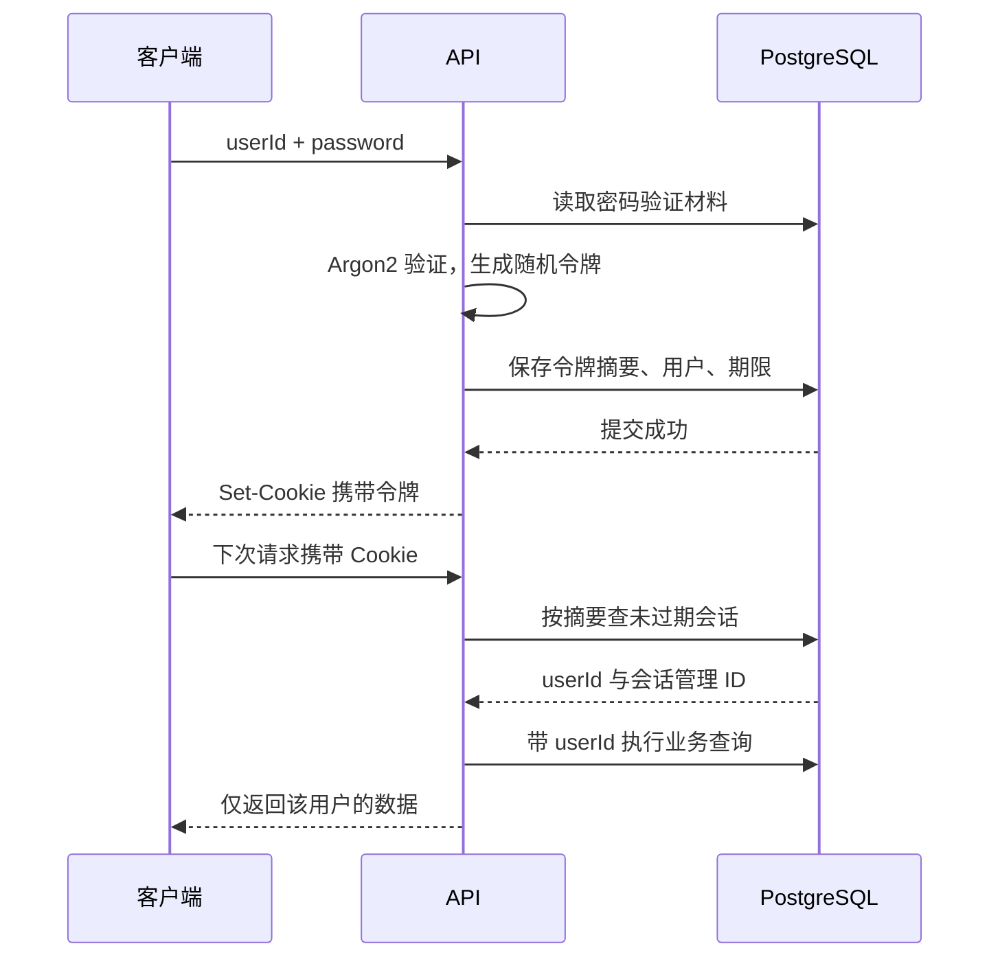
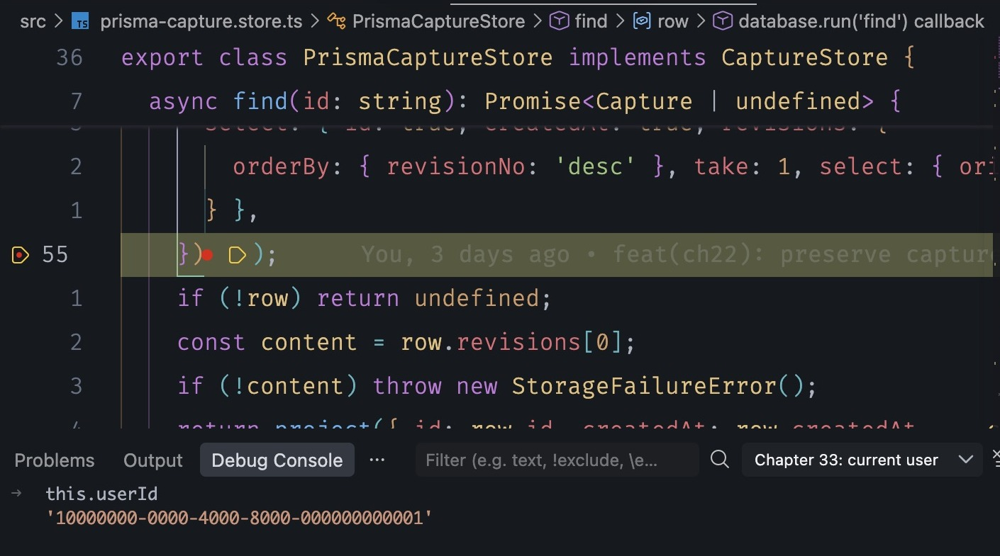
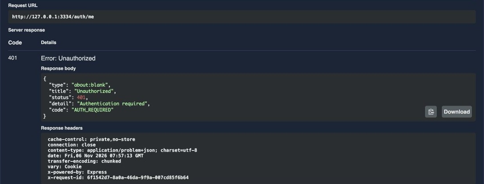
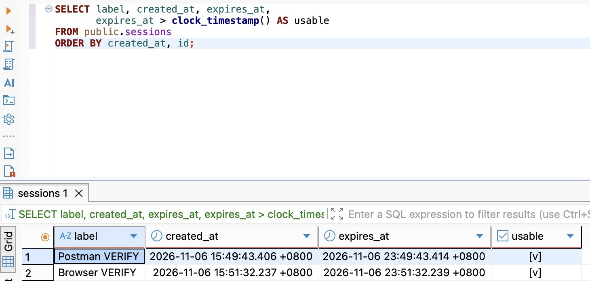
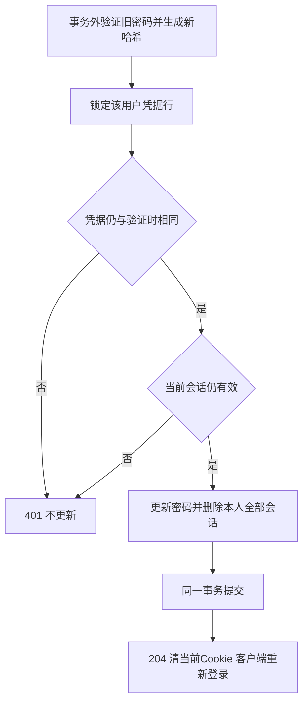
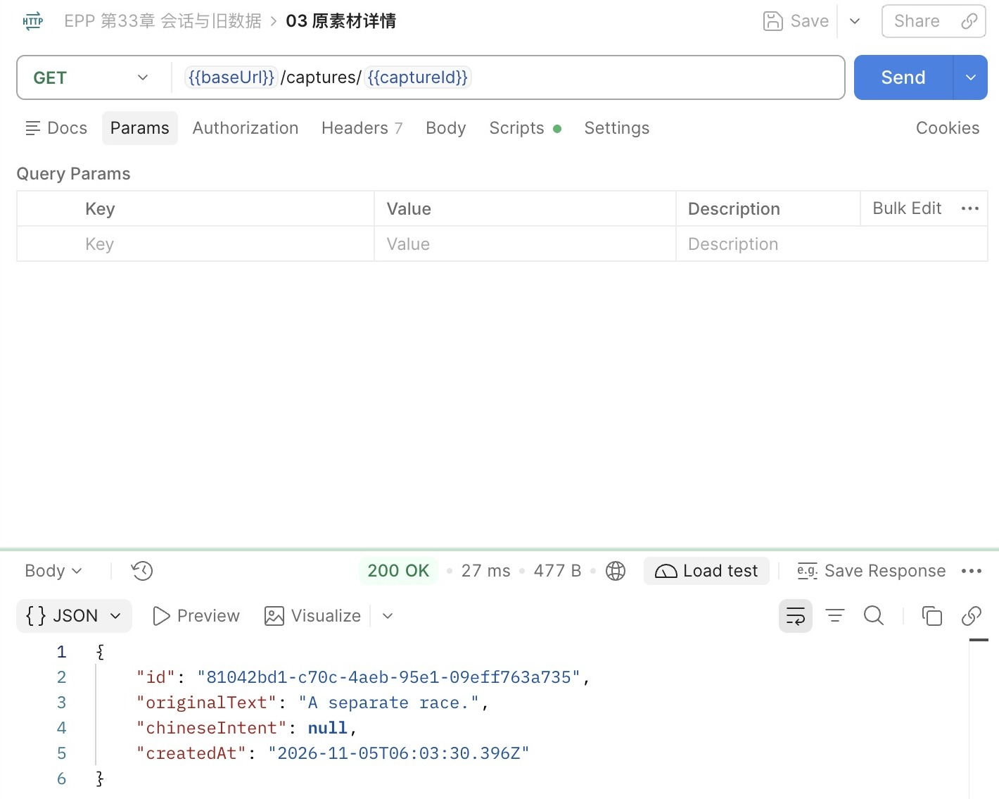

# 第33章 Session 与 Cookie：登录状态从哪里来

上一章已经给原用户设置了密码，数据库只保存验证材料。但原来的 `GET /captures` 仍然不需要密码。这章要把两件事接起来：一次验证密码，换得一份可以持续使用、也能被撤销的登录凭据；以后每个请求，都从这份凭据找到用户，再沿原来的归属条件读写数据。

起点是第32章完成状态，完成代码分支为 `part-05/chapter-33`。继续使用 Node 24.22.1、PostgreSQL 18、原有 Nest／Prisma 和 Argon2 依赖，没有新增包。我们先追加会话表，再接通登录和旧业务，随后加入会话管理与改密。每一阶段都能构建并留下明确状态。仍使用已有用户的 UUID 登录，注册时的联系信息和密码重置留到第36章。

这次会改变旧客户端的使用方式：接上认证以后，没有有效 Cookie 的业务请求返回401。数据库里的旧记录不会搬家，也不需要重新导入。先在第32章已有虚构记录和凭据的非空 VERIFY 完成全流程，最后再升级 DEV。只在本机同源入口练习；公开浏览器入口的完整保护在第35章继续。

## 33.1 密码通过以后，服务端保存什么

每次请求都传密码，当然也能验证身份，但它会让密码反复经过更多调用链，还会让每次读取都承担 Argon2 成本。我们需要一份使用期较短、可按一次登录撤销的凭据。服务验证密码成功后生成随机令牌，把令牌摘要、所属用户和有效期存成一行。这样的服务端登录记录就是这里的 **Session（会话）**。

一个用户可能同时在两个客户端登录，所以会话不能与用户一对一。A、B两次登录各有一行，各有不同令牌；撤销B不需要修改用户密码，也不影响A。客户端持有令牌原值，服务端只保存上一章的 SHA-256 摘要。持有原值的人就能代表该会话发请求，因此它仍是秘密；不知道密码却偷到令牌的人，也能在失效前使用它。

会话行的 `id` 则是管理标识，用于列表和撤销。它不是令牌，知道这个 UUID 不能登录。把管理标识和登录秘密分开，才能让“撤销这台设备”不必把秘密返给前端。`label` 是用户输入的备注，不是经过验证的设备指纹；两个会话都叫“我的电脑”也完全可能。



还有两个常见选择值得比较。`express-session` 是 Nest 官方文档介绍的成熟接法，它管理 Cookie 和服务端 Session 存储，适合通用会话对象；默认 MemoryStore 不适合生产。本章选择一个窄的数据库实现，是为了让令牌摘要、明确的关系字段和“改密码同时撤销全部会话”落在已有 PostgreSQL 事务里。不再叠加一份通用序列化会话或 Redis，也不自己实现密码算法和随机数。

另一种选择是签名 JWT：请求携带能验证签名、包含有效期和身份的令牌，服务可以不查会话表。但是如果要求立刻撤销其中一个设备，便需要额外撤销状态、版本检查或接受剩余有效期内继续有效。当前已有数据库、流量有限，又明确需要会话列表和撤销，数据库查询是合理成本。“以后有多个进程”也不直接意味着要换 JWT：多个进程可以读同一个会话表。真正要变更，应先量会话查询成本，并说清允许多长的撤销延迟。

先新增迁移 `prisma/migrations/20261106100000_sessions/migration.sql`，不改第32章迁移：

```sql
BEGIN;
CREATE TABLE public.sessions (
  id uuid CONSTRAINT sessions_pkey PRIMARY KEY,
  user_id uuid NOT NULL,
  token_digest text NOT NULL CONSTRAINT sessions_token_digest_key UNIQUE,
  label text NOT NULL,
  created_at timestamptz(3) NOT NULL DEFAULT CURRENT_TIMESTAMP,
  expires_at timestamptz(3) NOT NULL,
  CONSTRAINT sessions_user_id_fkey FOREIGN KEY (user_id) REFERENCES public.users(id)
    ON DELETE RESTRICT ON UPDATE RESTRICT,
  CONSTRAINT sessions_token_digest_format CHECK (token_digest ~ '^[0-9a-f]{64}$'),
  CONSTRAINT sessions_label_length CHECK (char_length(label) BETWEEN 1 AND 60),
  CONSTRAINT sessions_expiry_after_creation CHECK (expires_at > created_at)
);
CREATE INDEX sessions_user_id_expires_at_idx ON public.sessions(user_id, expires_at);
COMMIT;
```

唯一摘要支持按令牌定位一行；`user_id, expires_at` 索引用于某用户的有效会话查询与清理。外键保持归属，删除用户时必须明确处理会话。过期时间必须晚于创建时间；如果以后要做“已撤销”审计，可以另存撤销事件，本章直接删除行，不把会话表兼作审计历史。

`prisma/schema.prisma` 的 User 增加 `sessions Session[]`，再增加对应模型。CHECK 由 SQL 迁移维护，Prisma模型并不能完整表达它：

```prisma
model Session {
  id String @id(map: "sessions_pkey") @db.Uuid
  userId String @map("user_id") @db.Uuid
  tokenDigest String @unique(map: "sessions_token_digest_key") @map("token_digest") @db.Text
  label String @db.Text
  createdAt DateTime @default(now()) @map("created_at") @db.Timestamptz(3)
  expiresAt DateTime @map("expires_at") @db.Timestamptz(3)
  user User @relation(fields: [userId], references: [id], onDelete: Restrict, onUpdate: Restrict, map: "sessions_user_id_fkey")

  @@index([userId, expiresAt], map: "sessions_user_id_expires_at_idx")
  @@map("sessions")
}
```

在DBeaver打开自己的VERIFY连接，执行第32章 `database/chapter-32/01-before.sql`，保存原用户、素材和学习来源的身份与归属；按已知captureId、learningId保存旧接口详情，另保存凭据创建时间。不要导出密码哈希。停止这个库的写入进程，在项目根目录确认 `.env.database-verify` 仍指向该库，再运行：

```bash
nvm use
unset DATABASE_URL SHADOW_DATABASE_URL DB_QUERY_DEBUG
npm run db:verify -- migrate status
npm run db:verify -- migrate deploy
npm run db:verify -- migrate status
npm run check
```

`status` 首次应指出本章新增迁移待执行，`deploy`应用它，最后报告已同步。DBeaver刷新public，查看sessions列、外键和两项索引，第一次升级应为零行。再运行旧投影对照；本次迁移没有 UPDATE 旧业务表或密码表。若提示已应用，先查当前状态，不删除新表重来。若失败，沿第20章先区分SQL事务是否回滚和迁移历史是否登记失败，不用reset处理有数据的库。

第一阶段到这里可以暂停：只有表与模型增加，旧HTTP行为尚未改变，且不需要再次初始化密码。下一步先编译会话逻辑，最后才一起切换入口与业务身份，避免出现“登录成功了，实际仍读固定用户”的半接通状态。

新增 `src/auth-context.ts`，只定义通过认证后可使用的身份：

```ts
import type { Request } from 'express';
import { HttpError } from './http.js';

export const CURRENT_USER_ID = Symbol('CURRENT_USER_ID');
export type SessionIdentity = Readonly<{ userId: string; sessionId: string }>;
export type AuthenticatedRequest = Request & { auth?: SessionIdentity };
export function requireSession(request: AuthenticatedRequest): SessionIdentity {
  if (!request.auth) throw new HttpError(401, 'Authentication required', 'AUTH_REQUIRED');
  return request.auth;
}
```

这里没有 `request.auth ?? DEVELOPMENT_USER_ID`。一旦允许缺凭据回退到开发身份，之后所有保护都会出现匿名入口。`Readonly`防止误写类型，实际保存时还会冻结对象；它不是权限检查，数据库查询仍要带归属条件。

新增 `src/auth-contract.ts`：

```ts
import { z } from 'zod';
import { isPostgresText } from './postgres-text.js';

export const UserIdSchema = z.string().regex(/^[0-9a-f]{8}-[0-9a-f]{4}-[0-9a-f]{4}-[0-9a-f]{4}-[0-9a-f]{12}$/);
const PasswordInput = z.string().min(1).max(256).refine(value => value.isWellFormed());
export const LoginSchema = z.object({
  userId: UserIdSchema, password: PasswordInput,
  label: z.string().min(1).max(60).refine(isPostgresText).regex(/\S/).default('Current login'),
}).strict();
export const ChangePasswordSchema = z.object({ currentPassword: PasswordInput, newPassword: PasswordInput }).strict();
export const SessionIdentitySchema = z.object({ userId: z.uuid(), sessionId: z.uuid() });
export const SessionListSchema = z.object({ items: z.array(z.object({
  id: z.uuid(), label: z.string(), createdAt: z.iso.datetime(), expiresAt: z.iso.datetime(), current: z.boolean(),
})) });
export type LoginInput = z.infer<typeof LoginSchema>;
export type ChangePasswordInput = z.infer<typeof ChangePasswordSchema>;
```

UUID使用已有小写规范格式。HTTP层先约束输入类型与长度，设置新密码仍调用第32章完整规范化和长度规则。登录失败不区分“没有这个用户”和“密码不正确”，避免把接口做成账号探测器。格式错误可以400；凭据不匹配统一401。

新增 `src/session.service.ts`，第一阶段先写下面的构造、密码计算入口、login与authenticate，类最后补上右花括号；列表与改密方法稍后再加：

```ts
import { randomUUID } from 'node:crypto';
import { DatabaseService } from './database.service.js';
import { ApplicationState } from './application-state.js';
import { hashPassword, verifyPassword } from './password.js';
import { issueToken, tokenDigest } from './token.js';
import { HttpError } from './http.js';
import type { SessionIdentity } from './auth-context.js';
import type { ChangePasswordInput, LoginInput } from './auth-contract.js';

export const SESSION_SECONDS = 8 * 60 * 60;
type Credential = { passwordHash: string };
const unauthorized = () => new HttpError(401, 'Credentials or session are invalid', 'AUTH_REQUIRED');

export class SessionService {
  private dummyHash = '';
  private activePasswords = 0;
  constructor(private readonly database: DatabaseService, private readonly state: ApplicationState) {}
  async onModuleInit(): Promise<void> { this.dummyHash = await hashPassword(issueToken()); }

  private passwordWork<T>(work: () => Promise<T>): Promise<T> {
    if (this.activePasswords >= 2) throw new HttpError(429, 'Password service is busy', 'AUTH_BUSY');
    this.activePasswords++;
    return this.state.track(work).finally(() => { this.activePasswords--; });
  }

  login(input: LoginInput) {
    return this.passwordWork(async () => {
      const credential = await this.database.run('readLoginCredential', () => this.database.client.passwordCredential.findUnique({
        where: { userId: input.userId }, select: { passwordHash: true },
      }));
      const verified = await verifyPassword(credential?.passwordHash ?? this.dummyHash, input.password);
      if (!credential || !verified) throw unauthorized();
      const token = issueToken(), id = randomUUID();
      const result = await this.database.run('createSession', () => this.database.client.$transaction(async tx => {
        await tx.$executeRaw`SET LOCAL lock_timeout = '1s'`;
        const [current] = await tx.$queryRaw<Credential[]>`
          SELECT password_hash AS "passwordHash" FROM public.password_credentials
          WHERE user_id = ${input.userId}::uuid FOR UPDATE
        `;
        if (current?.passwordHash !== credential.passwordHash) return 'changed' as const;
        await tx.$executeRaw`DELETE FROM public.sessions WHERE user_id = ${input.userId}::uuid AND expires_at <= clock_timestamp()`;
        if (await tx.session.count({ where: { userId: input.userId } }) >= 20) return 'limit' as const;
        await tx.$executeRaw`
          INSERT INTO public.sessions(id, user_id, token_digest, label, expires_at)
          VALUES (${id}::uuid, ${input.userId}::uuid, ${tokenDigest(token)}, ${input.label},
            clock_timestamp() + interval '8 hours')
        `;
        return 'created' as const;
      }, { maxWait: 2000, timeout: 5000 }));
      if (result === 'changed') throw unauthorized();
      if (result === 'limit') throw new HttpError(429, 'Revoke an existing session before logging in again', 'SESSION_LIMIT');
      return { token, identity: { userId: input.userId, sessionId: id } };
    });
  }

  async authenticate(token: string): Promise<SessionIdentity | undefined> {
    let digest: string;
    try { digest = tokenDigest(token); } catch { return undefined; }
    const rows = await this.state.track(() => this.database.run('authenticateSession', () => this.database.client.$queryRaw<SessionIdentity[]>`
      SELECT id AS "sessionId", user_id AS "userId" FROM public.sessions
      WHERE token_digest = ${digest} AND expires_at > clock_timestamp()
    `));
    return rows[0];
  }
```

上面的代码块还在类内部，当前文件末尾加一个 `}` 后执行 `npm run check`，此时还不把它接进HTTP。密码计算上限2个意味着同时最多两项在线密码工作，忙时立刻429，不积累无界队列。`ApplicationState.track`把它纳入原有排空关闭。不存在的用户也用进程启动时生成的dummyHash执行验证，减少明显的路径差异；这并不保证所有错误请求的耗时完全相同。

为什么验证密码后还锁一次凭据行？设A读到了旧哈希，正在算Argon2；B此时已经改密并删除全部会话。若A随后直接插入，会把旧密码换成一份新会话。因此把昂贵计算放在事务外，进入事务后用 `FOR UPDATE` 取当前哈希，与先前验证的那份逐字比较。不相同便拒绝，不需要再次运行Argon2。后面的改密也锁同一行，两个决定才有共同的排队位置。

数据库时间决定期限。`clock_timestamp()`取真正执行时刻；`CURRENT_TIMESTAMP`取事务开始时刻。在等待锁的事务里，这两个时间可能不同。登录先清理本人的过期行，再限制最多20个会话。计数与新增处在同一凭据行锁内，两个并发登录不会同时绕过上限。达到上限时先从一个仍有效的会话撤销旧登录；如果所有客户端都丢失了Cookie，只能等固定期限结束或通过之后的恢复流程处理，不能悄悄驱逐一台未知设备。

## 33.2 用 Cookie 传递令牌，让请求带上正确身份

服务端已经能验证令牌，但客户端如何保存和回传？浏览器有自己的Cookie存储区，响应里的 `Set-Cookie` 指示它保存一项；以后匹配目标的请求会带上 `Cookie`。Cookie是传递与存储机制，Session是服务端记录。两者不是同一份东西，也不是靠Cookie里写了userId就完成认证。

新增 `src/session-http.ts`。先看这个文件前半部：

```ts
import type { RequestHandler, Response } from 'express';
import type { AppConfig } from './config.js';
import type { AuthenticatedRequest } from './auth-context.js';
import { SessionService, SESSION_SECONDS } from './session.service.js';
import { HttpError } from './http.js';

export const sessionCookieName = (config: AppConfig) => config.appOrigin.startsWith('https:') ? '__Host-epp_session' : 'epp_session';
const cookieOptions = (config: AppConfig) => ({ path: '/', httpOnly: true, sameSite: 'strict' as const,
  secure: config.appOrigin.startsWith('https:') });
export function setSessionCookie(response: Response, config: AppConfig, token: string): void {
  response.cookie(sessionCookieName(config), token, { ...cookieOptions(config), maxAge: SESSION_SECONDS * 1000 });
}
export function clearSessionCookie(response: Response, config: AppConfig): void {
  response.clearCookie(sessionCookieName(config), cookieOptions(config));
}

function readCookie(header: string | undefined, name: string): string | undefined {
  if (header === undefined) return undefined;
  if (header.length > 4096) throw new HttpError(400, 'Cookie header is too large', 'COOKIE_INVALID');
  const matches = header.split(';').map(part => part.trim()).filter(part => part.slice(0, part.indexOf('=')) === name);
  if (matches.length > 1) throw new HttpError(400, 'Duplicate session cookie', 'COOKIE_INVALID');
  return matches[0]?.slice(name.length + 1);
}

export const privateResponses: RequestHandler = (_request, response, next) => {
  response.setHeader('Cache-Control', 'private, no-store');
  response.vary('Cookie');
  next();
};
```

`HttpOnly`让页面脚本不能直接读到此Cookie，浏览器仍会自动发送；它不能阻止恶意脚本在同源页面发请求。`Path=/`让全站请求使用同一凭据，不作为访问控制。没有Domain时Cookie限制在当前主机；Cookie不按端口隔离，127.0.0.1:3000与:3001会共用同名项，不能用换端口制造两个独立设备。

`SameSite=Strict`收紧跨站携带；“站”与“源”并不相同，来源origin包含协议、主机和端口，不能只靠SameSite识别所有不可信来源。HTTPS入口还使用Secure，并命名为 `__Host-epp_session`，其前缀要求Secure、Path=/且不设Domain。HTTP回环实践使用另一个名字 `epp_session`；不能把这个HTTP例外用于公网。

过期固定8小时，不随请求滑动。浏览器Max-Age负责本地留存，数据库expires_at负责服务端是否接受；即使客户端修改本地过期时间，服务端也不延长。退出清Cookie时复用名字、Path和安全属性，不能只返回一个同名但路径不同的空值。

所有业务与认证响应使用 `private, no-store`，错误也一样。否则同一URL对不同用户返回不同内容时，缓存可能混淆身份。已有ETag继续用于条件读取，但认证必须先于判断304，未登录不能凭旧ETag绕过。`Vary: Cookie`表达响应依赖Cookie，不能取代no-store。

在 `config.ts` 的AppConfig增加 `appOrigin: string`，EnvironmentSchema增加 `APP_ORIGIN: z.string().optional()`。在 `parseConfig` 的CURSOR_HMAC_KEY检查后、return前加入下面的判断，并把appOrigin放入返回对象：

```ts
  if (value.NODE_ENV === 'production' && !value.APP_ORIGIN) throw new ConfigError('APP_ORIGIN');
  const appOrigin = value.APP_ORIGIN ?? `http://127.0.0.1:${value.PORT ?? file.data.port}`;
  try {
    const origin = new URL(appOrigin);
    if (origin.origin !== appOrigin || origin.username || origin.password
      || !['http:', 'https:'].includes(origin.protocol)
      || (origin.protocol === 'http:' && !['127.0.0.1', 'localhost', '[::1]'].includes(origin.hostname))) {
      throw new Error('Invalid origin');
    }
  } catch { throw new ConfigError('APP_ORIGIN'); }
```

开发默认当前回环端口，生产必须显式配置。`.env.example`增加 `APP_ORIGIN=http://127.0.0.1:3000`。它表示用户实际访问的源，不是数据库地址，不接受末尾斜杠、路径或用户口令。若以后HTTPS反向代理转到本机HTTP，填的是外部HTTPS源；此时API仍只监听本机。不要根据任意Host或转发头决定Cookie安全性。

接着在 `session-http.ts` 后面加入入口边界：

```ts
export function sessionBoundary(service: SessionService, config: AppConfig): RequestHandler {
  // shortcut: per-process limits for the loopback chapter; shared/proxy-aware controls belong to chapter 35.
  const attempts = new Map<string, { until: number; count: number }>();
  return (request: AuthenticatedRequest, response, next) => {
    void (async () => {
      const path = request.url.split('?')[0];
      if (request.method === 'DELETE' && (request.headers['transfer-encoding'] !== undefined
        || (request.headers['content-length'] !== undefined && request.headers['content-length'] !== '0'))) {
        throw new HttpError(400, 'DELETE does not accept a body', 'BODY_NOT_ALLOWED');
      }
      if (!['GET', 'HEAD'].includes(request.method)) {
        if ((request.headers.origin !== undefined && request.headers.origin !== config.appOrigin)
          || request.headers['sec-fetch-site'] === 'cross-site') {
          throw new HttpError(403, 'Request origin is not allowed', 'ORIGIN_REJECTED');
        }
      }
      if (path === '/auth/login' || path === '/auth/password') {
        const now = Date.now();
        for (const [key, value] of attempts) if (value.until <= now) attempts.delete(key);
        const key = request.socket.remoteAddress ?? 'unknown';
        let entry = attempts.get(key);
        if (!entry) {
          if (attempts.size >= 1000) throw new HttpError(429, 'Try again later', 'AUTH_RATE_LIMIT');
          entry = { until: now + 60000, count: 0 }; attempts.set(key, entry);
        }
        if (++entry.count > 10) {
          response.setHeader('Retry-After', String(Math.max(1, Math.ceil((entry.until - now) / 1000))));
          throw new HttpError(429, 'Try again later', 'AUTH_RATE_LIMIT');
        }
      }
      if (path === '/auth/login') return;
      const token = readCookie(request.headers.cookie, sessionCookieName(config));
      const identity = token === undefined ? undefined : await service.authenticate(token);
      if (identity) request.auth = Object.freeze(identity);
      else if (path !== '/auth/logout') throw new HttpError(401, 'Authentication required', 'AUTH_REQUIRED');
    })().then(() => next(), (error: unknown) => { response.setHeader('Connection', 'close'); next(error); });
  };
}
```

入口顺序有几个刻意的决定。登录允许没有旧Cookie，它会生成全新令牌，不接受客户端指定会话秘密。退出也允许没有或已过期的会话，否则客户端恰恰在凭据失效时不能清理自己。其余已知业务路由都必须找到有效身份。重复出现两个同名Cookie直接拒绝，不能让代理、框架和应用各选不同的一份。

Cookie会被浏览器自动携带，因此在本章首次写入时就建立最小来源边界：明确的Origin必须等于配置值，cross-site请求拒绝；所有POST／PATCH继续经过原有严格JSON与16KiB限制，DELETE不接受正文，不开放CORS，也不通过GET修改状态。缺少Origin不代表可信，只是在当前没有简单表单写入、跨域预检不放行的条件下允许原生客户端。以后改变这些条件，必须重新判断，第35章会展开CSRF与代理；不能将这段窄入口直接描述为任意部署下的完整CSRF方案。

一分钟10次的计数对登录和改密合计，成功失败都计算；以socket的真实对端地址分桶，不信任X-Forwarded-For。密码计算同时2项和速率限制解决不同问题：前者约束眼下内存工作，后者限制一段时间内的尝试。429时看Retry-After再试，AUTH_BUSY没有固定秒数。多进程、共享出口和代理会改变效果，当前不承诺分布式限流。

新增 `src/auth.controller.ts`，先建立imports、构造器、login与me，稍后的方法先不加入。完整imports中后面才使用的符号可以先保留：

```ts
import { Body, Controller, Delete, Get, HttpCode, Inject, Param, Post, Query, Req, Res, UseInterceptors } from '@nestjs/common';
import type { Response } from 'express';
import { APP_CONFIG } from './config.js';
import type { AppConfig } from './config.js';
import { requireSession } from './auth-context.js';
import type { AuthenticatedRequest } from './auth-context.js';
import { LoginSchema, ChangePasswordSchema, SessionIdentitySchema, SessionListSchema, UserIdSchema } from './auth-contract.js';
import type { LoginInput, ChangePasswordInput } from './auth-contract.js';
import { EmptyObjectSchema } from './candidate-contract.js';
import { SchemaPipe } from './schema.pipe.js';
import { ResponseSchemaInterceptor } from './response-schema.interceptor.js';
import { SessionService } from './session.service.js';
import { setSessionCookie, clearSessionCookie } from './session-http.js';

@Controller('auth')
export class AuthController {
  constructor(private readonly sessions: SessionService, @Inject(APP_CONFIG) private readonly config: AppConfig) {}
  @Post('login')
  @HttpCode(200)
  @UseInterceptors(new ResponseSchemaInterceptor(SessionIdentitySchema))
  async login(@Body(new SchemaPipe(LoginSchema)) input: LoginInput,
    @Query(new SchemaPipe(EmptyObjectSchema)) _query: object,
    @Res({ passthrough: true }) response: Response) {
    const result = await this.sessions.login(input);
    setSessionCookie(response, this.config, result.token);
    return result.identity;
  }
  @Get('me')
  @UseInterceptors(new ResponseSchemaInterceptor(SessionIdentitySchema))
  me(@Req() request: AuthenticatedRequest, @Query(new SchemaPipe(EmptyObjectSchema)) _query: object) {
    return requireSession(request);
  }
```

当前类末尾同样补 `}`。`@Res({ passthrough: true })`让我们设置响应头，但仍由Nest序列化返回值；不要手工response.send后又返回对象。只有会话事务成功后才设置Cookie。ProblemFilter错误分支在已有 `removeHeader('Location')` 附近补 `response.removeHeader('Set-Cookie')`，避免响应投影校验失败时仍发出成功Cookie。

新增 `src/auth.module.ts`：

```ts
import { Module, Scope } from '@nestjs/common';
import { REQUEST } from '@nestjs/core';
import { DatabaseModule } from './database.module.js';
import { DatabaseService } from './database.service.js';
import { ApplicationState } from './application-state.js';
import { AuthController } from './auth.controller.js';
import { SessionService } from './session.service.js';
import { CURRENT_USER_ID, requireSession } from './auth-context.js';
import type { AuthenticatedRequest } from './auth-context.js';

@Module({
  imports: [DatabaseModule], controllers: [AuthController],
  providers: [
    { provide: SessionService, useFactory: (db: DatabaseService, state: ApplicationState) => new SessionService(db, state),
      inject: [DatabaseService, ApplicationState] },
    { provide: CURRENT_USER_ID, scope: Scope.REQUEST,
      useFactory: (request: AuthenticatedRequest) => requireSession(request).userId, inject: [REQUEST] },
  ],
  exports: [SessionService, CURRENT_USER_ID],
})
export class AuthModule {}
```

`CURRENT_USER_ID`每个请求求一次值。依赖它的provider也会随请求创建，这叫请求作用域的传播；数据库池和SessionService仍是单例，不随请求重建。原来把用户常量写进查询，改成“在共享store里写一个currentUserId属性”会造成并发串用户。当前让每份store构造时拿到只读userId，互不覆盖。

具体修改三处：`PrismaCaptureStore`、`PrismaCandidateStore` 的构造函数改为 `(database: DatabaseService, userId: string)`，均声明 `private readonly`，文件中原来的DEVELOPMENT_USER_ID改成 `this.userId`。不能只改查询：新建数据的归属、候选采纳、回执的复合键和表达的建议锁键都必须使用同一当前用户。移除这两文件的旧常量import。

`LearningQueries`的用户条件以前在模块顶层创建，现在必须移到实例里；分页游标的scope也带当前用户：

```ts
export class LearningQueries {
  private readonly ownedRecord: Prisma.LearningRecordWhereInput;
  constructor(private readonly database: DatabaseService, private readonly state: ApplicationState,
    private readonly cursorKey: string, private readonly userId: string) {
    this.ownedRecord = { userId, expression: { userId }, candidate: { revision: { capture: { userId } } } };
  }

  list(query: LearningQuery) {
    const page = pageRequest(query, 'learning-records', this.userId, this.cursorKey);
    const { limit } = page;
    return this.state.track(() => this.database.run('listLearningRecords', async () => {
      const rows = await this.database.client.learningRecord.findMany({
        where: { ...this.ownedRecord, ...page.where, ...(query.expressionId ? { expressionId: query.expressionId } : {}) },
        select: recordSelect, orderBy: [{ createdAt: 'desc' }, { id: 'desc' }], take: limit + 1, skip: page.offset,
      });
      return { items: rows.slice(0, limit).map(recordView), limit, hasMore: rows.length > limit, ...pageResult(page, rows, this.cursorKey) };
    }));
  }
```

其余detail、starMap方法中的旧 `ownedRecord` 全部换成 `this.ownedRecord`，旧常量换成 `this.userId`。只改列表、不改详情，会留下知道ID即可读取别人的路径。这里保留已经存在的归属规则；第34章再深入账号状态与权限，不需要为了章节顺序暂时制造泄漏。

在 `captures.module.ts` 导入AuthModule与CURRENT_USER_ID，imports加入AuthModule，替换下面三个工厂，其他服务和ObservedCaptureStore的包装不变：

```ts
{ provide: LearningQueries,
  useFactory: (database: DatabaseService, state: ApplicationState, config: AppConfig, userId: string) =>
    new LearningQueries(database, state, config.cursorKey, userId),
  inject: [DatabaseService, ApplicationState, APP_CONFIG, CURRENT_USER_ID] },
{ provide: PrismaCandidateStore,
  useFactory: (database: DatabaseService, userId: string) => new PrismaCandidateStore(database, userId),
  inject: [DatabaseService, CURRENT_USER_ID] },
{ provide: PrismaCaptureStore,
  useFactory: (database: DatabaseService, userId: string) => new PrismaCaptureStore(database, userId),
  inject: [DatabaseService, CURRENT_USER_ID] },
```

`DatabaseService.onModuleInit`移除“固定开发用户必须存在”的检查与常量import，改为检查passwordCredential和session所需列可读取；保留全部原有结构与约束检查。系统可以没有用户却仍正常启动，匿名请求应401；不应该启动时悄悄seed用户和密码。

```ts
await this.client.passwordCredential.findMany({ take: 1, select: { userId: true, passwordHash: true } });
await this.client.session.findMany({ take: 1 });
```

接线前，`http-boundary.ts`的allowed判断增加 `/auth/login` POST、`/auth/me` GET。后面各管理方法也按33.3的表逐项加入，方法不符仍405。`request-observation.ts`为这些路由登记固定模板，包含 `/auth/sessions/:id`，不记录输入密码、Cookie、摘要或实际会话ID。最后在 `app.ts`导入SessionService和三个HTTP函数；保留观察器和docs入口，把业务边界顺序换成：

```ts
app.use(privateResponses);
app.use(httpBoundary);
app.use(sessionBoundary(app.get(SessionService), config));
app.use(captureBody);
```

这里使用middleware而非先给每个controller贴Guard，是为了让身份验证明确处在正文解析和现有条件响应之前，并给后续请求作用域provider提供身份。Nest Guard适合接下来按路由或能力判断权限，不能因为选择middleware就省掉业务层的归属条件。

保存后运行 `npm run check`。原测试中直接new PrismaCandidateStore的地方补显式测试userId；旧HTTP测试需要真实会话，33.5会一并调整。此时运行旧测试得到401不意味着数据库丢了数据，不要把断言改成接受任意状态。

从 `.env.test`取VERIFY地址启动开发进程，保持与第30章相同的环境隔离方法：

```bash
unset DATABASE_URL TEST_DATABASE_URL DB_QUERY_DEBUG APP_ORIGIN
verify_url=$(node --env-file=.env.test -p 'process.env.TEST_DATABASE_URL || ""')
if [[ -n "$verify_url" ]]; then
  DATABASE_URL="$verify_url" DB_QUERY_DEBUG=false APP_ORIGIN=http://127.0.0.1:3000 npm run dev
fi
unset verify_url
```

这里的shell变量只保存连接字符串，不打印它。先确认 `.env.test` 的目标，终端原有环境变量仍可能影响启动；停止VERIFY后再换回DEV。若3000被另一服务占用，先停止自己原来的进程，或同时修改PORT、APP_ORIGIN与客户端baseUrl，不能只换一个。此时DB_QUERY_DEBUG关闭，避免在查询事件断点里展开秘密参数。

Postman导入 `requests/chapter-33.postman_collection.json`，使用本地轻量客户端或秘密只留本机的变量。baseUrl填实际地址，userId填第32章原用户；password仅保存本地值，禁止共享或导出，原文与截图也不要包含密码。先单独发送未登录的GET /auth/me，应401。再发送“01 登录”。密码可能含双引号、反斜杠或换行，不能把它直接插进 `"password": "{{password}}"` 这种JSON字符串模板，否则Postman替换变量后可能生成非法JSON，或者改变密码的实际字符。这里先序列化整个对象：在请求的 **Scripts → Pre-request** 中保存下面的代码，本章集合已经带好。

```js
pm.variables.set("authBody", JSON.stringify({
  userId: pm.variables.get("userId"),
  password: pm.variables.get("password"),
  label: "Postman VERIFY",
}).replaceAll('{{', '\\u007b\\u007b'));
```

Body选择raw、JSON，正文只保留 `{{authBody}}`，外面不加引号。`JSON.stringify`负责转义，变量读取仍取本机配置；脚本不打印秘密，`authBody`只用当前运行的局部变量，响应脚本随后unset，不保存成共享集合值。改密请求使用相同方式生成currentPassword与newPassword：

```js
pm.variables.set("authBody", JSON.stringify({
  currentPassword: pm.variables.get("password"),
  newPassword: pm.variables.get("newPassword"),
}).replaceAll('{{', '\\u007b\\u007b'));
```

还有一层Postman模板替换：序列化后的密码若包含 `{{literal}}`，而环境恰好有literal变量，客户端可能再次展开它。脚本只把JSON字符串里的双左花括号转成 `\u007b\u007b`，发送前不再出现内部模板起始符；服务端JSON解析后恢复原来的两个花括号。不要替换单个左花括号，那会破坏JSON对象本身。局部变量清除也不会删除Postman历史或Console，仍只能在受控本机使用，不分享含秘密的请求记录。

不要为了方便请求模板而限制密码字符，也不要手动转义本地变量本身。变量保存原密码，序列化只改变JSON表示；服务解析后仍应得到相同字符。变量优先级可能让环境值覆盖集合值，发送前核对选中的环境。
成功200，Body只有userId和sessionId。客户端Cookie管理器保存了一项epp_session；只观察属性，不复制值到收藏、日志或截图。继续发送“02 当前身份”，应200，两个身份字段相同。若登录200、下一次仍401，依次查jar是否禁用、host是否从127.0.0.1换成localhost、Secure是否要求HTTPS、路径与期限是否匹配，最后按数据库会话确认服务端记录。不要先去重设密码。

现在可以在VS Code用原来的attach配置连接开发进程，在 `PrismaCaptureStore.find` 方法设置断点，Postman发送GET /captures/{{captureId}}，沿用已经保存的素材ID。只在Watch加入 `this.userId`，或在sessionBoundary赋值后看 `request.auth?.userId`；不要展开request.headers、输入对象或密码计算局部变量。当前userId应与/auth/me一致。Continue后再发一次无断点请求，确认正常200，调试暂停的等待不作为数据库性能结果。



图33-1：Postman携带已有Cookie读取素材详情，在PrismaCaptureStore.find内命中断点，Debug Console只求值this.userId。这里显示的用户ID与登录身份一致；黄色位置是源码映射后的实际暂停点，不要求与你设置的行号完全相同。

## 33.3 看见会话，再分别撤销和退出

只实现登录，很容易把“退出”写成前端删除Cookie。这样当前浏览器看起来退出了，先前复制的令牌却仍有效。服务端撤销必须让那一行不再参与认证。客户端清Cookie负责本地状态，删除行负责服务器决定，两个动作都需要。

先在SessionService类里、authenticate之后增加list与revoke：

```ts
  async list(identity: SessionIdentity) {
    const rows = await this.state.track(() => this.database.run('listSessions', () => this.database.client.$queryRaw<{
      id: string; label: string; createdAt: Date; expiresAt: Date;
    }[]>`
      SELECT id, label, created_at AS "createdAt", expires_at AS "expiresAt"
      FROM public.sessions WHERE user_id = ${identity.userId}::uuid AND expires_at > clock_timestamp()
      ORDER BY created_at DESC, id DESC LIMIT 20
    `));
    return { items: rows.map(row => ({ ...row, createdAt: row.createdAt.toISOString(),
      expiresAt: row.expiresAt.toISOString(), current: row.id === identity.sessionId })) };
  }

  async revoke(userId: string, id: string): Promise<void> {
    await this.state.track(() => this.database.run('revokeSession', () => this.database.client.session.deleteMany({ where: { id, userId } })));
  }
```

列表只返回本人未过期会话，最多20个，按创建时间和id稳定排序，明确current标记。没有令牌原值，也没有摘要；数据库只存摘要不意味着可以把摘要当普通界面字段公开。revoke把userId与会话id一起作为删除条件。对不存在或不属于自己的ID均返回204，既便于重复撤销，也不泄漏别人是否有这行记录。

在AuthController中增加以下方法：

```ts
  @Get('sessions')
  @UseInterceptors(new ResponseSchemaInterceptor(SessionListSchema))
  list(@Req() request: AuthenticatedRequest, @Query(new SchemaPipe(EmptyObjectSchema)) _query: object) {
    return this.sessions.list(requireSession(request));
  }
  @Delete('sessions/:id')
  @HttpCode(204)
  async revoke(@Req() request: AuthenticatedRequest, @Param('id', new SchemaPipe(UserIdSchema)) id: string,
    @Query(new SchemaPipe(EmptyObjectSchema)) _query: object, @Res({ passthrough: true }) response: Response) {
    const identity = requireSession(request);
    await this.sessions.revoke(identity.userId, id);
    if (id === identity.sessionId) clearSessionCookie(response, this.config);
  }
  @Post('logout')
  @HttpCode(204)
  async logout(@Req() request: AuthenticatedRequest, @Body(new SchemaPipe(EmptyObjectSchema)) _input: object,
    @Query(new SchemaPipe(EmptyObjectSchema)) _query: object, @Res({ passthrough: true }) response: Response) {
    if (request.auth) await this.sessions.revoke(request.auth.userId, request.auth.sessionId);
    clearSessionCookie(response, this.config);
  }
```

同步HTTP白名单、路由日志模板和OpenAPI，当前已经接通的接口如下：

| 方法与路径 | 输入 | 成功结果 |
| --- | --- | --- |
| POST /auth/login | userId、password、可选label | 200，身份与Set-Cookie |
| GET /auth/me | 无查询参数 | 200，当前身份 |
| GET /auth/sessions | 无查询参数 | 200，items安全投影 |
| DELETE /auth/sessions/:id | 小写UUID，无正文 | 204，撤销本人指定会话 |
| POST /auth/logout | JSON空对象 `{}` | 204，当前会话撤销并清Cookie |

路径匹配增加 `const sessionDetail = /^\/auth\/sessions\/([^/]+)$/.exec(url.pathname)`；allowed在旧业务判断之前根据上述固定路径选择方法。和原详情一样，sessionDetail中的百分号编码不接受；否则应用与框架可能对同一个路径解释不同。未知路径仍404，错误不设置Cookie。

OpenAPI的 `components.securitySchemes` 增加 `{ sessionCookie: { type: 'apiKey', in: 'cookie', name: cookieName } }`，document顶层 `security: [{ sessionCookie: [] }]`；login、logout各自 `security: []`。`createOpenApiDocument(cookieName = 'epp_session')`接受实际Cookie名，app里调用 `createOpenApiDocument(sessionCookieName(config))`。认证接口按上表登记JSON请求、响应Schema和状态码，业务响应补401，写入补403，登录与改密补429，并说明private/no-store。Cookie不能像任意Authorization头一样由Swagger UI脚本直接设置；应在同源/docs调用登录，让浏览器处理Set-Cookie，再发业务请求。导出的默认文档描述HTTP回环Cookie名。

运行check后，Postman发送会话列表。要观察两个设备，用两份独立Cookie jar：Postman是一份，浏览器同源/docs是另一份。浏览器访问与APP_ORIGIN完全相同的地址，展开POST /auth/login、Try it out，填写相同用户凭据和另一个label，Execute后清掉编辑器里的密码。不要分享含请求正文的界面。两个Postman标签页通常共享jar，不能冒充两台设备；同一jar重复登录只是换掉本地Cookie，服务端原行仍存在，可在列表撤销。

回到Postman刷新列表，将浏览器那一行的管理ID填入targetSessionId，发送DELETE。Postman继续GET /auth/me仍200，原浏览器GET /auth/me变401。先不要重新登录，紧接着用下面的数据库投影确认只剩Postman那一行；把客户端结果和服务端行的变化对照，才能排除“删除了错误的一行”。当前设备也可被撤销，此时响应同时清Cookie，下一次必须重新登录。



图33-2：先由Postman撤销浏览器那份会话，再在原浏览器请求GET /auth/me，响应为401／AUTH_REQUIRED，并保留private/no-store。这里没有用清理浏览器Cookie代替服务端撤销。

DBeaver在同一个VERIFY连接运行安全投影，观察服务端事实：

```sql
SELECT label, created_at, expires_at,
       expires_at > clock_timestamp() AS usable
FROM public.sessions
ORDER BY created_at, id;
```



图33-3：这是撤销前的状态，Postman与浏览器分别登录后，查询显示两行及各自期限。完成上一步DELETE后刷新，应只剩Postman那一行。这里按客户端时区显示时间，usable在数据库当前时刻计算；图中没有令牌、摘要或会话管理ID。

这份不含ID和摘要的投影适合截图。日常逐行诊断可使用配套 `database/chapter-33/01-session-projection.sql` 中的id与user_id，但不要把会话标识发布出去。撤销后行消失；客户端删除Cookie却没有撤销时，行仍在。空表也不能证明所有客户端已经删除Cookie，只能说明现有令牌在服务端找不到会话。

然后在Postman发送“07 退出”。需要Content-Type application/json与空对象正文；不是GET，也不是无正文POST。重复发送仍204，即使Cookie已过期或缺失也能清理。格式错误或重复同名Cookie仍400，不为了“退出总要成功”放开入口校验。

过期也需要亲自观察，但不必等8小时。重新登录，仅在VERIFY复制当前会话管理ID，在DBeaver执行下面事务，替换占位符为真实UUID。它同时把created_at调早，避免破坏expires_at必须晚于created_at的CHECK：

```sql
-- VERIFY only. Replace with the public session ID returned by /auth/me.
-- This changes only the selected live session; it does not change the password or old records.
BEGIN;
UPDATE public.sessions
SET created_at = LEAST(created_at, clock_timestamp() - interval '2 seconds'),
    expires_at = clock_timestamp() - interval '1 second'
WHERE id = '00000000-0000-0000-0000-000000000000'::uuid
RETURNING id, expires_at;
COMMIT;
```

RETURNING只应一行。再次GET /auth/me返回401，而SQL仍能看到这条过期行；逻辑失效不依赖清理任务已运行。本章在下次本人成功登录时删除过期行，没有全库后台清理任务。以后用户量增加，要按执行计划和保留需求安排清理，不让过期行无界堆积。

此阶段可以暂停：关掉自己的API和DBeaver连接，保留表与业务数据。恢复时先核对目标、迁移，再登录。会话在数据库里，进程重启不会清空；开发模式随机游标签名密钥可能变化，所以旧分页游标失效与会话失效是两件事。

## 33.4 主动改密，为什么必须同时撤销全部会话

用户怀疑密码泄漏，改成新密码。如果旧会话仍能用，攻击者无需再次输入密码就能继续访问。因此本章选择明确策略：主动改密要出示当前有效会话和旧密码，成功后撤销该用户的全部会话，包括发起改密的这一份；客户端重新登录。忘记旧密码属于后面的恢复流程，不能在此接口允许跳过。

最直接的三步是更新密码、删会话、清Cookie。但前两步若分开提交，中间失败就会留下“密码改了、旧会话还在”的状态。把它们放进一个数据库事务；Cookie只能在提交后清理，响应丢失不改变数据库事实。

还有一个并发细节：中间件检查会话有效后，Argon2会花时间，事务还可能等锁。在真正改密时，当前会话可能已被另一请求撤销或已经过期。不能把请求刚进门时的结论永远当真。加入 `SessionService.changePassword`，完整方法如下：

```ts
  changePassword(identity: SessionIdentity, input: ChangePasswordInput): Promise<void> {
    return this.passwordWork(async () => {
      const credential = await this.database.run('readChangeCredential', () => this.database.client.passwordCredential.findUnique({
        where: { userId: identity.userId }, select: { passwordHash: true },
      }));
      if (!credential || !await verifyPassword(credential.passwordHash, input.currentPassword)) throw unauthorized();
      let passwordHash: string;
      try { passwordHash = await hashPassword(input.newPassword); }
      catch (error) {
        if (error instanceof Error && error.message === 'PASSWORD_INPUT_INVALID') {
          throw new HttpError(400, 'New password does not meet the input policy', 'PASSWORD_INPUT_INVALID');
        }
        throw error;
      }
      const changed = await this.database.run('changePassword', () => this.database.client.$transaction(async tx => {
        await tx.$executeRaw`SET LOCAL lock_timeout = '1s'`;
        const [current] = await tx.$queryRaw<Credential[]>`
          SELECT password_hash AS "passwordHash" FROM public.password_credentials
          WHERE user_id = ${identity.userId}::uuid FOR UPDATE
        `;
        if (current?.passwordHash !== credential.passwordHash) return false;
        const locked = await tx.$queryRaw<{ id: string }[]>`
          SELECT id FROM public.sessions WHERE id = ${identity.sessionId}::uuid
            AND user_id = ${identity.userId}::uuid FOR UPDATE
        `;
        if (locked.length !== 1) return false;
        // A time predicate can run before FOR UPDATE waits; check again after owning the lock.
        const [active] = await tx.$queryRaw<{ valid: boolean }[]>`
          SELECT expires_at > clock_timestamp() AS valid FROM public.sessions WHERE id = ${identity.sessionId}::uuid
        `;
        if (!active?.valid) return false;
        await tx.passwordCredential.update({ where: { userId: identity.userId }, data: { passwordHash } });
        await tx.session.deleteMany({ where: { userId: identity.userId } });
        return true;
      }, { maxWait: 2000, timeout: 5000 }));
      if (!changed) throw unauthorized();
    });
  }
```

旧密码验证与新哈希生成在锁外完成，减少持锁时间。锁内先比较旧凭据是否仍是先前验证的版本，再锁住属于本人的当前会话行。拿到会话行锁以后，用第二条SQL读取数据库当前时间判断期限，最后才更新凭据并删除全部会话。

为什么不是在FOR UPDATE的WHERE里加过期条件？执行器可能先判断WHERE，再等待锁；若阻塞方只锁行，随后回滚且未改变行，等待结束并不会因时间流逝而重新判断。分成“拿锁”和“检查现在的期限”两条语句，才能拒绝等待会话锁期间已经过期的请求。同一用户的登录与改密都先锁password_credentials这一行，因而不会交叉错过：



如果登录先拿到锁，它可以成功创建会话，随后改密删掉它；登录200不保证这个会话之后不会被撤销。如果改密先拿到锁，旧密码验证已经通过的登录请求，进锁后也会发现哈希变化而401。两种顺序最终都没有旧会话残留。1秒锁等待与5秒交互事务上限用于避免无限等，锁超时沿数据库错误边界返回；不能把未知结果简单当成“改密没发生”。

在AuthController末尾加入：

```ts
  @Post('password')
  @HttpCode(204)
  async password(@Req() request: AuthenticatedRequest, @Body(new SchemaPipe(ChangePasswordSchema)) input: ChangePasswordInput,
    @Query(new SchemaPipe(EmptyObjectSchema)) _query: object, @Res({ passthrough: true }) response: Response) {
    await this.sessions.changePassword(requireSession(request), input);
    clearSessionCookie(response, this.config);
  }
```

HTTP白名单、日志路由与OpenAPI补POST /auth/password，严格JSON包含currentPassword和newPassword。同样拒绝额外字段与查询参数。新密码使用第32章规范化和长度策略，过短返回400；当前仍不是完整的泄露密码库筛查，公开注册与恢复会继续补策略。

运行check，Postman重新登录并让另一个独立jar也登录同一用户。先用错旧密码改密，预期401，原会话仍有效；再给不符合长度的新密码，预期400，凭据不应改变。最后填本地保存的新长密码，单独发送本章集合最后一个请求，预期204。不要运行整个集合把改密夹在反复创建会话中。

随后两边GET /auth/me都401，DBeaver该用户的会话行归零。旧密码登录401，新密码登录200，并获得一个新的管理ID。这些断言要连起来看：仅看到204不足以证明所有会话确实撤销；仅看到Cookie空了也不能证明数据库修改成功。

如果请求超时，不要立刻再发改密。先尝试用新密码登录：成功说明新凭据已可用，再核对会话列表；新密码不匹配时再尝试旧密码。若二者都失败，先看429、数据库可用性和服务端请求ID，不反复猜密码或重新init。登录响应也可能丢失，服务器留下一个客户端没拿到令牌的会话；下一次登录会创建另一份，之后通过列表撤销遗留记录，不根据label自动合并。

要研究锁等待，在VERIFY的DBeaver会话A执行 `BEGIN`，按本人user_id对password_credentials做 `SELECT user_id ... FOR UPDATE`，不要选password_hash。另一个客户端发送改密；第三个观察连接查询pg_stat_activity，只显示pid、state、wait_event_type、wait_event以及pg_blocking_pids(pid)，不要输出query正文或参数。看到API正在Lock等待，立即在A执行ROLLBACK释放；若超过1秒先失败，则释放后核对事实再重做。真实“观察到等待”比先后点击两个按钮更能解释锁在保护什么。

本章验证还控制了两种竞争顺序：让改密先进入等锁队列，再让旧密码登录进入，释放后分别204／401；顺序反过来是登录200／改密204，两轮最终会话均为零。另一次在改密等待凭据锁时让当前会话过期，释放后改密401且密码保持。不能从这些有限实验推断任意并发程序都正确，但它们确实检验了这里的关键时序。

撤销只保证之后重新认证的请求不能继续；一个已经通过认证、正在写业务事务的请求可能完成。当前没有中途取消所有请求的机制，也没有让每条业务SQL都重新联查Session。金融等高敏操作若要求在提交点重新检查资格，需要像改密一样把检查加入自己的事务；不要把“每次请求查库”讲成“任何时刻立即中止”。

## 33.5 登录以后，原来的记录仍在哪里

现在回到最初的问题：第16章开始留下的素材和学习来源，会不会变成“登录前数据”？它们本来就属于同一个用户，只是以前由程序替请求选中了那个用户。今天换的是身份来源，不是业务数据的所有者。登录userId与原归属一致时，原captureId、learningId、修订、表达和回执全部沿用；重新导入只会制造重复记录，改user_id则是在转移归属，二者都不是本章迁移。

用Postman当前有效会话，按最初保存的ID读取素材详情、学习来源详情与星图。对照原字段和关联身份，不要求某条旧记录一定出现在首页；分页与排序仍遵守第29章契约。DBeaver重跑第32章旧归属投影与计数，密码表created_at仍是首次初始化的时间；主动改密只更新哈希，不伪造新的用户或凭据创建记录。



图33-4：同一Postman Cookie jar登录后，用既有captureId得到200与原内容。这个响应证明本次读取可用，旧数据保持还需和升级前保存的ID、字段及归属逐值对照。

自动回归也必须沿真实认证路径。原业务测试不是每一项都要测密码，所以新增 `test/session-fixture.mjs`：在真实测试数据库给固定测试用户插入一条随机令牌摘要与期限，HTTP请求正常携带Cookie，中间件照常查库。测试结束只按本测试创建的ID清理，没有测试模式绕过认证的分支：

```js
import { randomUUID } from 'node:crypto';
import { DatabaseService } from '../dist/src/database.service.js';
import { DEVELOPMENT_USER_ID } from '../dist/src/database-config.js';
import { issueToken, tokenDigest } from '../dist/src/token.js';

// Existing business regressions use a real session row; authentication has its own HTTP tests.
export async function sessionFetch(t, app, userId = DEVELOPMENT_USER_ID) {
  const db = app.get(DatabaseService).client, id = randomUUID(), token = issueToken();
  await db.session.create({ data: { id, userId, tokenDigest: tokenDigest(token),
    label: 'Business regression', expiresAt: new Date(Date.now() + 3600000) } });
  t.after(() => db.session.deleteMany({ where: { id } }));
  const authenticatedFetch = (url, options = {}) => {
    const headers = new Headers(options.headers); headers.set('Cookie', 'epp_session=' + token);
    return globalThis.fetch(url, { ...options, headers });
  };
  authenticatedFetch.cookie = 'epp_session=' + token;
  return authenticatedFetch;
}
```

旧HTTP测试在createApp与监听之后使用 `const fetch = await sessionFetch(t, app)`，并导入这个帮助函数；原有清理注册顺序保持会话先清理、应用后关闭。用node:http发送304条件请求的测试不能自动使用这个fetch包装，需要显式加该fixture的cookie。直接构造store的事务测试补入测试用户ID；生产配置测试补APP_ORIGIN，测试的接口语义不因接入认证被放宽。

新增sessions.test.mjs再走真正登录接口，用两个本轮临时用户测试素材、修订、候选、采纳、学习来源和星图的隔离。两个用户使用相同operationId，回执仍按各自userId分开；A不能读取B的详情、修改B的素材或采纳B的候选。获取身份不等于自动完成这些归属判断，这也正是下一章要继续研究的边界。

确认 `.env.test` 指向升级后的独立VERIFY，再运行 `npm test`；不能为了满足新表要求把测试改到日常DEV。测试会建立与清理自己的用户、凭据和会话，不应改变原来的业务样本。只看到全绿仍不够：测试前后的非空旧表投影要对照，干净空库也应能重放全部迁移且不自动生成账号。

最后核对真实交付产物。沿前章在新的运行目录只复制dist、package.json、package-lock.json、.npmrc，安装 `npm ci --omit=dev`。提供DATABASE_URL、持久CURSOR_HMAC_KEY与APP_ORIGIN；例如本机产物端口3001时：

```bash
NODE_ENV=production PORT=3001 APP_ORIGIN=http://127.0.0.1:3001 npm start
```

这里其余秘密由受控进程环境提供，不复制开发.env，不用会回显口令的命令。先请求业务得到401，再用独立客户端登录后读取原详情200，退出后同一Cookie再请求401。确认/docs为404、没有Inspector监听，正常停止后日志出现资源关闭；密码、Cookie、摘要不进入日志。原生Argon2必须在这个只装运行依赖的目录实际登录成功，不能用开发目录node_modules代替产物验收。

VERIFY通过以后，按[第22章的备份与独立恢复步骤](../../part-04-consistency/chapter-22-revisions/chapter.md#先备份再在另一个库恢复一次)保护DEV，停止其写入，确认.env.database目标，再将迁移命令换成 `npm run db -- ...`。不复制VERIFY密码，不再次init，不改旧归属。启动第33章代码后所有旧客户端先登录；回退到第32章虽然能读新表之外的旧数据，却恢复了固定开发身份，不能把它称作保留认证保护的安全回退。

这一章结束时，你能从一个200或401追到Cookie、会话行、有效期和实际用户，再追到原业务的归属条件。下一章在这个身份基础上增加账号状态与操作权限：会话有效，只说明这份凭据被接受，还不能替每个业务决定“现在允许做什么”。

[第五篇导读](../README.md) · [上一章：密码与秘密](../chapter-32-secrets/chapter.md) · [全书目录](../../README.md)

## 附录：本章必要技术点速查

| 名称 | 本章用途 | 回查时注意 |
| --- | --- | --- |
| Session / Cookie | 服务端记录／客户端传递机制 | 不能把userId或管理UUID当登录令牌 |
| HttpOnly / Secure / SameSite | 限制脚本读取、传输与跨站携带 | 不独立承担全部XSS、CSRF和权限保护 |
| __Host- 前缀 | HTTPS Cookie主机约束 | Secure、Path=/、无Domain；回环HTTP用另一名字 |
| APP_ORIGIN | 明确允许的源与Cookie策略 | 含协议、主机、端口，无路径；生产必填 |
| CURRENT_USER_ID / Scope.REQUEST | 给本请求的store传递只读身份 | 作用域向依赖方传播，数据库池仍单例 |
| FOR UPDATE | 串行化同用户登录与改密决定 | 昂贵密码计算放锁外，锁内重查前提 |
| clock_timestamp() | 在真正检查时判断期限 | CURRENT_TIMESTAMP固定在事务开始时刻 |
| private, no-store / Vary | 防止身份相关响应误缓存 | 鉴权先于304，错误也覆盖 |
| 401 / 403 / 429 | 凭据失效／来源拒绝／入口或计算限额 | 结合code与Retry-After，不盲目重试改密 |
| POST /auth/password | 主动改密并撤销本人全部会话 | 有效会话加旧密码，超时先读事实 |

本章按2026-11-06可取得的一手资料核对以下边界：

- [Nest Session](https://docs.nestjs.com/techniques/session)：成熟中间件入口与MemoryStore限制。
- [Nest请求作用域](https://docs.nestjs.com/fundamentals/injection-scopes)：请求provider与依赖传播。
- [MDN Set-Cookie](https://developer.mozilla.org/en-US/docs/Web/HTTP/Reference/Headers/Set-Cookie)：属性、前缀和客户端行为。
- [OWASP Session管理](https://cheatsheetseries.owasp.org/cheatsheets/Session_Management_Cheat_Sheet.html)：不可预测令牌、生命周期与服务端撤销。
- [OWASP CSRF防护](https://cheatsheetseries.owasp.org/cheatsheets/Cross-Site_Request_Forgery_Prevention_Cheat_Sheet.html)：简单请求、来源检查与配置前提。
- [PostgreSQL 18行锁](https://www.postgresql.org/docs/18/explicit-locking.html#LOCKING-ROWS)：锁保持到事务结束及并发等待。
- [RFC 9111缓存安全](https://www.rfc-editor.org/rfc/rfc9111.html#section-7.3)：敏感响应与缓存边界。

- [Postman请求前脚本](https://learning.postman.com/docs/tests-and-scripts/write-scripts/pre-request-scripts)：在发送前准备局部JSON正文，避免把密码当作JSON语法片段。

时间参考（估算）：阅读约125～150分钟；编码与跟做另加150～190分钟。按约8300字中文讲解、四百余行核心代码、两张机制图、四阶段接线、两个独立客户端、过期与改密竞争及产物验证估算；不含前章环境安装，不把等待或重复排错叠入阅读时间。

本章完成代码分支：`part-05/chapter-33`，起点：`part-05/chapter-32`。


[下一章：鉴权与授权](../chapter-34-authorization/chapter.md)
