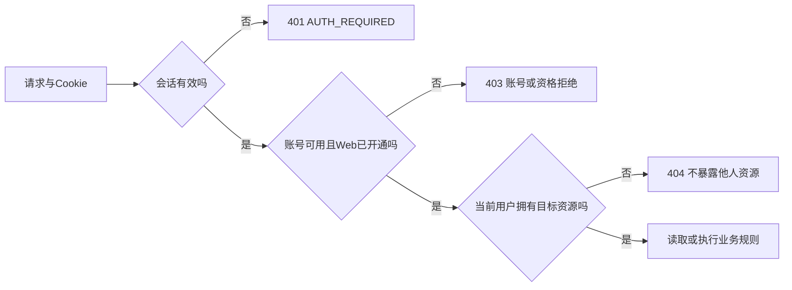
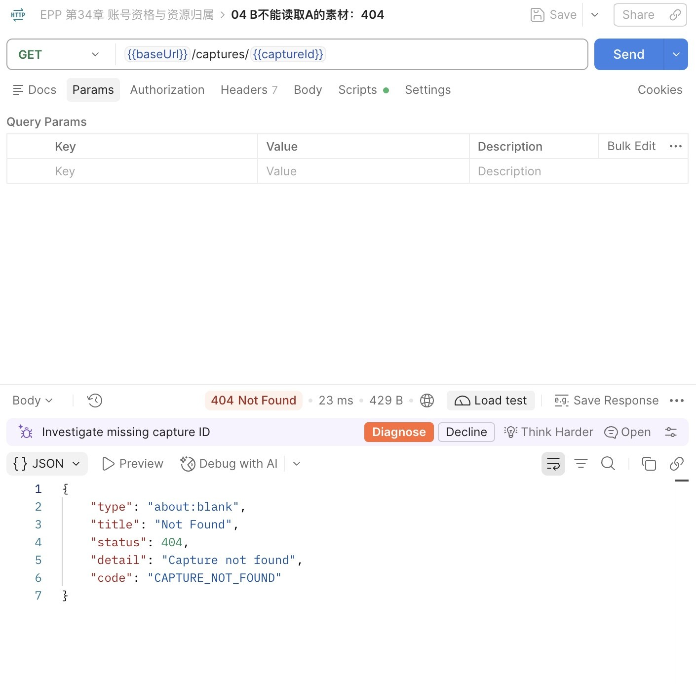
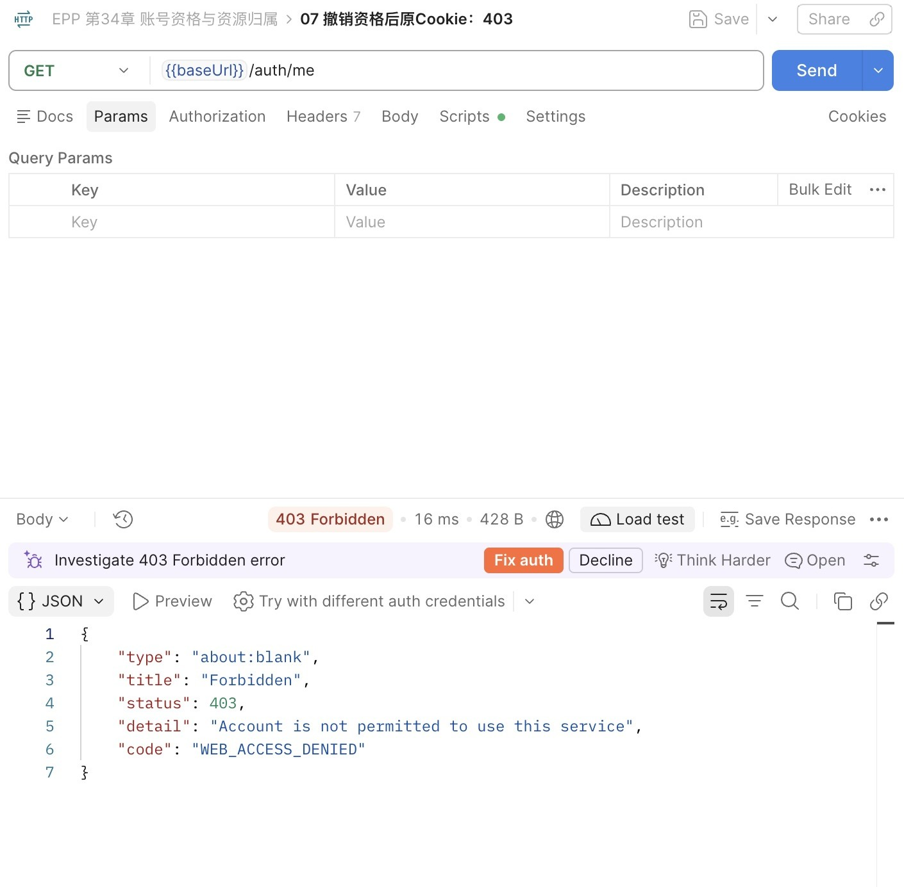
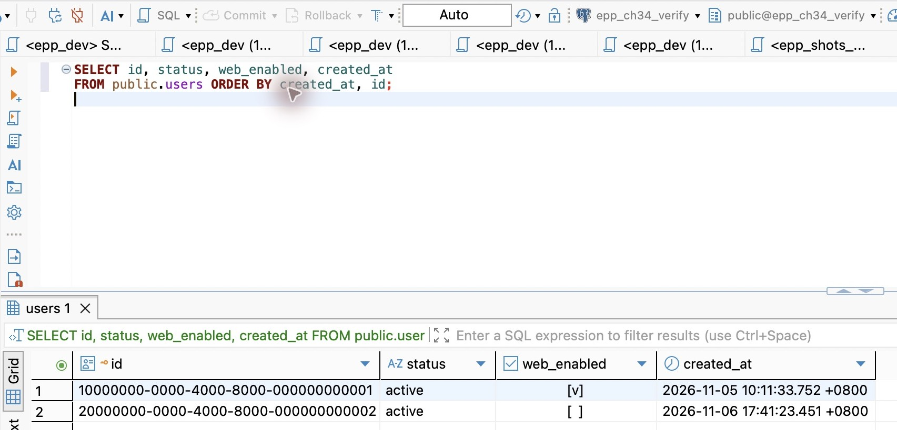
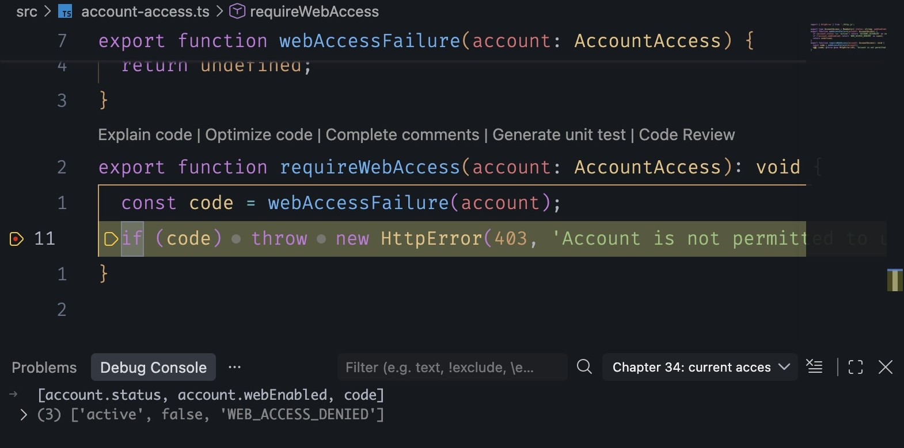
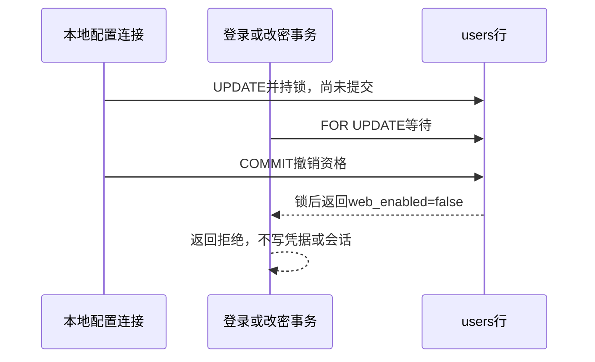

# 第34章 鉴权与授权：登录了也不代表能操作

上一章已经能用Cookie找到会话，再把用户ID交给素材、候选和学习查询。现在让一个已经登录的人暂停使用服务，会发生什么？如果把“允许使用”写进登录响应或前端按钮，旧Cookie仍能发请求；如果直接删除用户，已有素材、凭据和会话的外键又会阻止删除。我们需要表达一件更窄的事：用户和数据都还在，但当前请求不能继续。

本章从 `part-05/chapter-33` 继续。先沿已有归属条件说明权限在哪里判断，再给账号增加状态和Web使用资格，用第二个本地账号观察跨账号拒绝，最后改变资格，检查原会话的行为。这里只管理当前Cookie服务入口；注册、权限后台和完整冻结删除各有后续章节，不为一个入口提前建角色体系。

阅读约85～105分钟；编码与跟做另加90～120分钟。第一次可做到两个账号的详情对照；第二次保留同一Cookie观察撤销与恢复。离开前结束SQL事务、退出会话并停自己的API，保留数据和已保存的ID，回来不重新初始化密码。

## 34.1 三个问题，分别在哪里回答

“鉴权”在团队交流里有时指验证身份，有时泛指权限检查。本章把判断拆开，避免争论词义时漏掉实现：认证确认这个请求持有哪个有效会话；入口资格确认该用户此刻能否使用服务；资源授权确认他能否操作这一份数据。

例如A已经登录，拿着B的captureId请求详情。随机UUID可以降低猜中ID的概率，却不能证明请求者有权读取。用户可能从分享的链接、日志或联调记录中得到ID。上一章已经把查询限定为同一个id与当前userId；这里要保留这个条件：

```ts
where: { id, userId: this.userId },
```

它来自 `PrismaCaptureStore.find`，this.userId由服务验证的Session提供，不从URL查询参数或正文接收。素材列表也按userId过滤；修订与候选沿素材关系核对所有者；采纳、回执和表达身份同时带userId。权限入口检查通过，不会让这些条件失去必要性。即使将来增加管理员，也不能直接删除所有归属条件，把“可管理某种资源”误解成“任意查询都不限用户”。



401表示这次请求没有可接受的会话；403表示身份已知，但这个入口拒绝操作；404用于账号可用时的他人资源与不存在资源。这里选择同样的404，是为了不向A确认B的记录是否存在。它不是把错误吞掉：服务端仍能从安全日志里的路径模板、状态与请求ID判断失败发生在哪一层。业务状态冲突仍按原来的409处理，不能因为引入权限就把“候选已丢弃”都改成403。

我们的入口目前只需要两个事实：`status`表示账号是否可用，取active或disabled；`web_enabled`表示是否开通当前Cookie API。Postman、curl同样调用这一入口，也要受它约束，服务不会根据User-Agent判断“是不是Web”。两列分开后，可以表示“账号仍可用，但没有Web资格”，也可以表示“原本有Web资格，但账号整体被停用”。恢复status不应顺手把web_enabled设为true。

为什么不用roles数组？当前没有多个角色、组织或按动作分配的权限，只有一个入口许可。布尔字段能准确表达当前事实。若改成团队共享，同一用户可能在甲团队能编辑、在乙团队只能读；给用户全局贴一个editor就会丢掉权限范围。此时要先确定“用户在目标团队中的关系”，再比较本次动作与资源状态。角色只负责其中一部分，不能替代资源判断。本章主线保持个人数据模型，章末支线完整推导这种需求变化。

这里也不把许可写进Session表：那会变成登录时快照，修改用户后旧会话还拿着旧值。当前每次认证读取账号事实，回答的是请求进入时能否使用；若要求许可变化与业务提交严格排序，还要像34.5一样建立共同的事务边界。

## 34.2 新字段的默认值，也是一项权限决定

先处理已有数据。第33章所有已有用户都能使用当前入口，本章升级需要保留这个行为；之后创建的用户则默认不开通Web。两者并不矛盾：兼容性回填只作用于迁移时已经存在的行，数据库默认值约束未来插入。

沿[第22章的备份与独立恢复](../../part-04-consistency/chapter-22-revisions/chapter.md#先备份再在另一个库恢复一次)准备非空VERIFY。保存原用户ID、created_at、原captureId与内容、学习来源和归属；会话仍有效时也保存期限供本地比较，但不把Cookie或会话标识放进截图。确认应用、DBeaver和迁移配置都指向VERIFY，再停止这个库的写入。

新增 `prisma/migrations/20261106110000_account_access/migration.sql`：

```sql
BEGIN;
ALTER TABLE public.users
  ADD COLUMN status text NOT NULL DEFAULT 'active',
  ADD COLUMN web_enabled boolean NOT NULL DEFAULT false,
  ADD CONSTRAINT users_status_check CHECK (status IN ('active', 'disabled'));

-- Preserve access for existing accounts; later INSERTs keep the false default.
UPDATE public.users SET web_enabled = true;
COMMIT;
```

这次ALTER会取得表锁，UPDATE只改变新列。把它们放在同一事务内，可避免别的连接恰好在“加列”和“回填”之间插入一个新用户，随后被无意开通。事务提交后，新INSERT才继续，省略web_enabled得到false。大表要单独评估锁等待和回填成本，本章的小型本地库不意味着任意规模都可以在高峰直接执行。

如果现有用户里已有人不应该开通，先列出逐个账号的决定，修改迁移策略或在停写窗口内完成明确配置；不要盲目把这里的兼容假设搬到另一个项目。当前旧版本没有账号状态，因此迁移统一回填active，并未覆盖之前已经存在的冻结规则。

在Prisma的User模型新增：

```prisma
status     String  @default("active") @db.Text
webEnabled Boolean @default(false) @map("web_enabled")
```

数据库CHECK约束是允许值的最终边界，Prisma的String类型本身不能拒绝拼错的状态。数据库列名和TypeScript属性名用map对应；不用修改用户ID、密码表或业务表，也不重建sessions。随后在 `DatabaseService.onModuleInit` 现有启动检查中增加：

```ts
await this.client.user.findMany({ take: 1, select: { id: true, status: true, webEnabled: true } });
```

即使users为空，查询也会检查列是否存在，防止服务在旧结构上先启动、等第一个用户请求才失败。字段默认值和CHECK还要通过迁移及数据库实验确认，不能从启动成功推出它们都正确。

```bash
unset DATABASE_URL SHADOW_DATABASE_URL DB_QUERY_DEBUG
npm run db:verify -- migrate status
npm run db:verify -- migrate deploy
npm run db:verify -- migrate status
npm run check
```

先确认 `.env.database-verify` 确实是独立库，再执行命令。DBeaver运行 `database/chapter-34/01-access-projection.sql` 的安全投影：

```sql
SELECT id, status, web_enabled, created_at
FROM public.users ORDER BY created_at, id;
```

旧用户应为active/true，ID和created_at保持。旧素材、学习来源与字段逐值对照保存的结果，不靠总行数相等判断数据没有被换掉。若遇迁移失败，沿第20章检查实际结构和迁移记录，不能直接reset、删库或把resolve当作修复SQL。

## 34.3 建立第二个本地账号，亲眼看见资源边界

DBeaver切到VERIFY，先选一个新的UUID并保存。下面的ID只是本章虚构账号B的例子；已经存在就先查明，不重复INSERT，不用ON CONFLICT更新成自己想要的状态：

```sql
INSERT INTO public.users(id)
VALUES ('20000000-0000-4000-8000-000000000002')
RETURNING id, status, web_enabled, created_at;
```

此时B是active/false，还没有密码。创建用户、创建凭据、开通入口是三次有不同含义的操作。上章密码工具固定作用于开发用户，现在只扩展它的目标选择，不让初始化顺便开通权限。

将 `src/password-credential.ts` 的两个函数分别改名为initializePassword与verifyPasswordCredential，并增加可选userId，默认仍为原固定用户；旧命令省略UUID时行为保持。完整文件是：

```ts
import type { PrismaClient } from './generated/prisma/client.js';
import { hashPassword, verifyPassword } from './password.js';
import { DEVELOPMENT_USER_ID } from './database-config.js';

export async function initializePassword(db: PrismaClient, password: unknown, userId = DEVELOPMENT_USER_ID): Promise<void> {
  const passwordHash = await hashPassword(password);
  await db.passwordCredential.create({
    data: { userId, passwordHash }, select: { userId: true },
  });
}

export async function verifyPasswordCredential(db: PrismaClient, password: unknown, userId = DEVELOPMENT_USER_ID): Promise<boolean> {
  const credential = await db.passwordCredential.findUnique({ where: { userId } });
  return credential !== null && await verifyPassword(credential.passwordHash, password);
}
```

`create`继续让主键冲突拒绝覆盖，传不存在用户由外键拒绝；verify返回密码材料是否匹配，不表示账号有登录资格。维护脚本可以检查停用账号的凭据，这与HTTP入口拒绝它没有矛盾。`scripts/password.mjs`同步两处import和调用，并在读取标准输入之前验证参数：

```js
import { UserIdSchema } from '../dist/src/auth-contract.js';
import { DEVELOPMENT_USER_ID } from '../dist/src/database-config.js';
// 原try块内，读取stdin之前：
const mode = process.argv[2];
const userId = process.argv[3] ?? DEVELOPMENT_USER_ID;
if (![3, 4].includes(process.argv.length) || !UserIdSchema.safeParse(userId).success ||
  !['init', 'verify'].includes(mode) || process.stdin.isTTY) {
  throw new Error('PASSWORD_COMMAND_INVALID');
}
```

下面两处调用变为 `initializePassword(db.client, password, userId)` 与 `verifyPasswordCredential(db.client, password, userId)`；字节上限、UTF-8解码、隐藏输入和错误输出保持第32章约定。当前测试对原函数的import同步改名。改完先check生成dist，再使用CLI，避免把旧产物的参数错误当作密码问题。

此处有两个连接变量容易混淆：HTTP测试要求TEST_DATABASE_URL，密码工具读DATABASE_URL。先在当前终端清除残留覆盖，然后显式取出VERIFY连接，整个过程不打印连接字符串：

```bash
unset DATABASE_URL TEST_DATABASE_URL DB_QUERY_DEBUG APP_ORIGIN
verify_database_url=$(node --env-file=.env.test -e '
const value = process.env.TEST_DATABASE_URL;
if (!value) process.exit(1);
process.stdout.write(value);
')
if test -n "$verify_database_url"; then
IFS= read -rs 'local_password?输入B的虚构本地密码：' &&
  printf '%s' "$local_password" |
  DATABASE_URL="$verify_database_url" DB_QUERY_DEBUG=false NODE_ENV=development node scripts/password.mjs init 20000000-0000-4000-8000-000000000002
unset local_password
fi
```

这是交互式zsh终端中的步骤；连接读取失败或为空时，if块不会执行初始化。`.env.test`必须提前确认是VERIFY。PASSWORD_CREATED才是初始化成功；重复init返回PASSWORD_ALREADY_EXISTS而不改旧密码。UUID是目标标识，可以放参数；密码只能走隐藏输入和stdin，不能放shell历史。

先不要给B开通。本章下一节接好检查后，B的正确密码也应403，而原账号A仍200。为了观察归属，稍后明确开通B，再让它请求A原来保存的captureId：详情与修改都404，A再登录后内容仍是原值。B自己的列表只包含B的素材；空列表并不意味着全库没有记录。若要创建B的素材，使用普通POST /captures，只传原文等业务字段，userId由会话决定；当前创建素材的z.object Schema沿用前文行为：剥离未声明字段，控制器只取业务字段。因此夹带userId、status或webEnabled不会改变素材归属或账号资格；请求仍可能创建一份属于当前会话用户的素材。拒绝未知字段是另一种契约，不能把“字段被丢弃”误写成“整条请求被拒绝”。

## 34.4 资格每次读取，改动才能影响现有会话

新增 `src/account-access.ts`，集中表达当前入口的判断：

```ts
import { HttpError } from './http.js';

export type AccountAccess = Readonly<{ status: string; webEnabled: boolean }>;
export function webAccessFailure(account: AccountAccess) {
  if (account.status !== 'active') return 'ACCOUNT_DISABLED' as const;
  if (!account.webEnabled) return 'WEB_ACCESS_DENIED' as const;
  return undefined;
}
export function requireWebAccess(account: AccountAccess): void {
  const code = webAccessFailure(account);
  if (code) throw new HttpError(403, 'Account is not permitted to use this service', code);
}
```

status不是active就拒绝，是为了遇到未来新状态时默认停止，而不是让未知状态悄悄获得权限。这里不查数据库，也不替业务判断资源归属，只把两个当前事实转成统一403。优先返回ACCOUNT_DISABLED，再看WEB_ACCESS_DENIED，方便恢复时知道先核对哪一层。

让 `SessionService.authenticate` 返回会话身份与当前账号事实。返回类型从SessionIdentity改成 `SessionIdentity & AccountAccess`，查询替换为：

```sql
SELECT s.id AS "sessionId", s.user_id AS "userId", u.status, u.web_enabled AS "webEnabled"
FROM public.sessions s JOIN public.users u ON u.id = s.user_id
WHERE s.token_digest = ${digest} AND s.expires_at > clock_timestamp()
```

上面是原 `$queryRaw<(SessionIdentity & AccountAccess)[]>` 模板里的SQL，digest仍由tokenDigest生成，作为参数传入。不要把 `u.status='active' AND u.web_enabled=true`直接塞进WHERE：那会把“已知身份但无资格”过滤成“没有会话”，错误变成401，也让logout找不到应该删除的会话。联查使会话和资格来自同一条语句的数据库快照，而不是两次独立查询之间再猜用户发生了什么。

在 `session-http.ts` 导入requireWebAccess，把原来的identity赋值改为：

```ts
if (identity) {
  if (path !== '/auth/logout') requireWebAccess(identity);
  request.auth = Object.freeze({ userId: identity.userId, sessionId: identity.sessionId });
}
else if (path !== '/auth/logout') throw new HttpError(401, 'Authentication required', 'AUTH_REQUIRED');
```

它仍位于privateResponses、HTTP路径检查之后，正文解析之前；账号被拒绝时不进入业务控制器。只把两个身份字段交给request.auth，避免让后面代码把本次权限快照当长期事实。logout是窄例外：有效会话仍能被撤销，Cookie仍会清除；原来的JSON、Origin、重复Cookie等入口校验不跳过。不能把“无需业务资格”理解成“整个路径不校验”。

登录还没有会话，不能靠这个分支检查。`session.service.ts`导入AccountAccess和webAccessFailure，在login事务的lock_timeout之后、凭据行锁之前插入：

```ts
const [account] = await tx.$queryRaw<AccountAccess[]>`
  SELECT status, web_enabled AS "webEnabled" FROM public.users WHERE id = ${input.userId}::uuid FOR UPDATE
`;
if (!account) return 'changed' as const;
const denied = webAccessFailure(account);
if (denied) return denied;
```

仍先验证密码，错误密码与不存在用户统一401；只有凭据正确才返回资格拒绝。这里不把403直接throw进database.run，因为它负责把数据库错误映射成存储错误；业务判断先作为事务结果返回，在原changed/limit判断之后补上：

```ts
if (result !== 'created') throw new HttpError(403, 'Account is not permitted to use this service', result);
```

created才设置Cookie。拒绝登录不创建新会话，也不清除客户端已有Cookie：A登录后尝试B被拒绝，jar里仍可能是A。不要看到B的登录请求标题就以为后续已变成B；登录成功后用/auth/me核对身份，做B的归属演练前必须先看到B登录200。

当前接口都经过同一个入口，因此复用middleware比在每个controller复制条件更不容易漏。以后出现路由特定能力时，可以用Nest Guard和元数据表达不同要求；Guard仍不能代替数据库查询中的userId条件。现在不另加一套装饰器系统。OpenAPI版本改0.14.0，为登录与所有受保护的GET/写操作补403及上述两个错误码，保留logout的Origin拒绝说明；所有响应仍声明private/no-store和请求ID。

运行check，沿第33章启动VERIFY开发进程，明确同一个PORT与APP_ORIGIN：

```bash
DATABASE_URL="$verify_database_url" DB_QUERY_DEBUG=false PORT=3000 APP_ORIGIN=http://127.0.0.1:3000 npm run dev
```

如果终端已经换过，重新执行前面的连接读取步骤，不能依赖上次shell变量还在。独立生产进程继续使用npm start和生产环境，不以dev启动验证交付产物。端口被自己的旧服务占用时先退出旧进程，不去停止不属于这次练习的服务。

Postman导入 `requests/chapter-34.postman_collection.json`。baseUrl指向同一API，password与secondPassword只留在本机，captureId填A的旧素材，secondUserId填刚创建的B。集合复用上一章JSON.stringify并转义连续双花括号的Pre-request脚本；密码变量保存原字符，Body使用未加引号的{{authBody}}。不用运行整个集合。

依次发送01、02，A登录与原素材应200；03使用B的正确凭据，先得到403/WEB_ACCESS_DENIED。此时在DBeaver按B的已保存ID开通：

```sql
BEGIN;
SET LOCAL lock_timeout = '1s';
UPDATE public.users SET web_enabled = true
WHERE id = '20000000-0000-4000-8000-000000000002'
  AND status = 'active' AND web_enabled = false
RETURNING id, status, web_enabled;
```

检查返回恰为B的一行，随后单独执行COMMIT。零行可能是已经开通、账号停用或ID错误，先ROLLBACK再查当前事实；不要把WHERE删掉“让它成功”。这是本地配置入口，拥有数据库管理权限的人在独立环境操作。运行中的API没有给普通用户开放修改资格的HTTP接口，也没有因为有人知道UUID就允许配置它。

重新发送03，成功200后B才成为当前jar的用户。发送04、05读取与修改A的素材应404，再发06看B自己的列表。换回01、02核对A原内容保持，然后重新登录B。



图34-1：Postman在B成功登录后读取A的既有素材，返回404／CAPTURE_NOT_FOUND。先前A用同一captureId读到200；单看这张404不能区分资源不存在与不属于当前用户。

现在保留B的Cookie，DBeaver只把B的web_enabled改false并提交，07应403；重新开通并提交，08用原Cookie恢复200，不重新登录。



图34-2：对同一API发送/auth/me，得到403／WEB_ACCESS_DENIED。这轮没有重新登录；恢复资格后同一jar请求恢复200。图中展示的是拒绝时的一次响应，是否保留原会话及期限要结合数据库前后投影判断。



图34-3：同一VERIFY的用户投影。A保持active且web_enabled勾选；B仍是active，但取消Web资格后不勾选。这里只查询账号事实，没有显示凭据或会话摘要；这张图不是新用户默认值或迁移前后数据保持的单独证明。

要看清“许可变化没有改会话”，在DBeaver用第33章安全会话投影比较同一行的created_at、expires_at；只在本地核对ID，不截图标识或摘要。撤销资格时会话行仍在，期限不延长。恢复会恢复所有尚未过期且未撤销的旧Cookie，包括曾经复制出去的那份。若目的是真正让旧凭证失效，要撤销对应会话；暂停资格不是凭据轮换。

然后分别把B的status改disabled、恢复active。status=disabled时，即使web_enabled=true也返回403/ACCOUNT_DISABLED；恢复active但web_enabled=false仍是403/WEB_ACCESS_DENIED。最后在受限状态发送09退出，204后再恢复资格，10仍401。这个比较证明退出删除了会话，不是只让它暂时用不了。

前一步已经退出，断点演练要先建立新的有效会话：把B恢复为active且Web已开通并提交，重新发送03登录得到200；随后只撤销B的Web资格并提交，保留这次新Cookie。若直接沿用退出后的jar，请求会401，不会进入下面的资格判断。

需要定位时，连接当前VERIFY开发进程的Inspector，在VS Code给 `src/account-access.ts` 的 `if (code)` 行设置断点。使用B的有效Cookie发送GET /auth/me，暂停后在Debug Console求值 `[account.status, account.webEnabled, code]`，只观察这三个值。不要展开整个request、Cookie、密码和数据库连接。移除本章断点并Continue后，再发送同一个请求，核对无暂停时的403与日志请求ID；暂停造成的等待不用于评价接口性能。



图34-4：请求实际停在requireWebAccess的拒绝分支，求值结果为active、false、WEB_ACCESS_DENIED。账号可用而入口未开通，对应图34-2的403；图中没有展开会话身份或请求秘密。继续后还要移除断点重发，确认普通运行结果。

## 34.5 请求停止在哪里，必须有明确的先后关系

“下一次请求生效”有一个具体边界：权限UPDATE提交之后开始的认证查询会读取新状态；之前已经通过入口的业务请求可能继续完成。只有点击数据库单元格、没有提交事务，另一个连接当然看不到。若某次读仍200，先核对是否同一个库、同一个用户和已提交，再核对请求开始时间，不先假定服务缓存了角色。

普通素材写入沿用这个入口边界，不给每条SQL再增加用户行锁。完整冻结要协调在途任务、其他入口和后续数据处理，留在综合篇实现。登录发新Cookie与改密更敏感，本章则把资格检查放进其事务，和管理员更新用户行明确排序。

login已按user→credential持锁，改密必须遵守同样顺序，不能让一个先锁凭据再等用户、另一个先锁用户再等凭据。在changePassword事务的lock_timeout之后加同样的用户查询，只把参数换成identity.userId：

```ts
const [account] = await tx.$queryRaw<AccountAccess[]>`
  SELECT status, web_enabled AS "webEnabled" FROM public.users WHERE id = ${identity.userId}::uuid FOR UPDATE
`;
if (!account) return 'invalid' as const;
const denied = webAccessFailure(account);
if (denied) return denied;
```

原来凭据变化、session不存在、锁后已过期的false都改成 `'invalid' as const`，成功true改成 `'changed' as const`。会话仍先FOR UPDATE拿锁，再用第二条SQL判断clock_timestamp，不能退回第33章已经验证会出错的单条时间过滤。事务返回后分别处理：

```ts
if (changed === 'invalid') throw unauthorized();
if (changed !== 'changed') throw new HttpError(403, 'Account is not permitted to use this service', changed);
```

密码验证与新哈希仍在事务外完成，减少持锁时间；开始昂贵计算时有资格，不代表等锁结束后仍有，所以锁后读取的新状态才决定是否提交。已有凭据哈希比较继续防止使用被替换的旧密码；资格与凭据是两种不同的变化，不能只留其中一次检查。



反过来，敏感事务已经持有user行锁，配置UPDATE就要等它结束：登录可能先200，随后这个新Cookie请求403；改密可能先204，全部会话已经撤销，配置更新随后完成。这不是撤销失败，而是两个事务的提交先后。要让读者自己判断，必须观察真正的锁等待，而非只看两个窗口谁先点Send。

人工切三个窗口不适合在API的1秒lock_timeout内抢时间。先用配套 `database/chapter-34/06-account-lock.sql` 单独观察第一把用户行锁，再把结果对应回上面的HTTP路径。它不发登录、不改密码，也不临时放宽API配置。

沿第17章打开连接同一VERIFY的三个独立DBeaver连接A、L、O，不只是同一连接下的三个编辑标签。A代表配置，L代表敏感事务，O只观察。先在A、L分别运行 `SELECT pg_backend_pid();`，保存不同的PID；O的观察SQL用这两个值替换占位0。两轮开始前均按03开通B并提交，确认active/true。

第一轮，A执行下面一组SQL，保留事务；返回的false此时还没有提交：

```sql
BEGIN;
SET LOCAL idle_in_transaction_session_timeout = '60s';
SET LOCAL lock_timeout = '30s';
UPDATE public.users SET web_enabled = false
WHERE id = '20000000-0000-4000-8000-000000000002'
RETURNING id, status, web_enabled;
```

L执行BEGIN与相同两项SET，然后执行：

```sql
SELECT status, web_enabled FROM public.users
WHERE id = '20000000-0000-4000-8000-000000000002' FOR UPDATE;
```

此时L应等待。在O运行以下查询，只显示状态和阻塞关系，不展示SQL正文或参数：

```sql
SELECT pid, state, wait_event_type, wait_event, pg_blocking_pids(pid) AS blocked_by
FROM pg_stat_activity WHERE pid IN (0, 0) ORDER BY pid;
```

用已保存PID替换两个0。看到L的wait_event_type为Lock、blocked_by包含A后，在A执行COMMIT。L随后读到active/false，说明等锁后得到的是已提交的新行，应该拒绝创建会话或修改凭据；本实验只读取这一步。L执行ROLLBACK释放锁。随后重新开通B并提交，再开始第二轮。

第二轮先执行L的BEGIN、SET和SELECT，读到active/true后保留锁；再执行A的BEGIN、SET和UPDATE。O现在应看到A被L阻塞。L执行ROLLBACK释放锁，A的UPDATE才返回false，再在A执行COMMIT。这里的ROLLBACK只用于结束观察，不代表一次HTTP改密已经成功；完整HTTP路径由配套回归验证先200／204、后配置生效的终态。

这两轮单独给SQL连接30秒锁等待和60秒事务空闲保护，给人工观察留出时间；应用仍保持1秒锁等待与5秒事务期限。若超时，A、L都先ROLLBACK，空闲保护已经断开时重新连接，再查询已提交状态后重来。不要整文件执行。最后确认没有未结束事务，并按下一步需要恢复B的资格。自动回归用独立连接捕捉真实阻塞，覆盖完整登录／改密的两个先后顺序，结束后清理测试账号和会话。

测试入口还是 `.env.test` 的独立VERIFY与 `npm test`。本章新增authorization.test.mjs检查新账号默认拒绝、原Cookie随资格变化、受限退出与锁竞争；sessions.test.mjs里为正常会话测试创建的用户要显式webEnabled:true。不能为了让旧测试通过把数据库默认值改回true。原有资源隔离测试继续覆盖素材、修订、候选、采纳、学习来源、星图与operationId；一次403不能代替这些404和用户范围断言。

还有两种恢复容易混淆。数据库不可用时应是503等存储错误，不放行、不伪装为密码错误；权限配置提交响应丢失时，先按ID查询状态，确认事实后再决定是否修改。若旧客户端把所有403都跳转到登录页，这一章后会反复登录又被拒绝，应该区分ACCOUNT_DISABLED、WEB_ACCESS_DENIED与ORIGIN_REJECTED，提示相应处理，而不是自动重置密码。

独立产物仍按第33章只复制dist、package.json、锁文件和.npmrc，干净安装运行依赖，提供VERIFY连接、持久游标密钥与APP_ORIGIN。核对原账号登录200、旧详情200、资格撤销后403、受限退出204和之后401；默认/docs关闭、无Inspector，SIGTERM排空并关闭连接。图形客户端和生产产物是不同证据，不能只用开发进程的截图宣称交付入口正确。

验证通过后，才按第22章备份并在独立库恢复日常DEV，停写后使用 `npm run db -- migrate deploy` 升级它。迁移保留旧账号资格，但VERIFY的第二账号、虚构密码与开通操作不搬进DEV；日常账号逐个确认。回到第33章旧代码会忽略新资格字段，不能把代码回退当作仍保持本章授权行为的安全回退。

本章结束时，身份来源、入口资格和资源归属都有明确位置；下一章继续处理跨域、CSRF、代理和成本边界。它们解决另一类问题：即使账号确实有资格，也要知道请求是否来自允许的浏览器上下文、是否消耗了过多资源。

## 本章支线

[34A：从“我的记录”走到团队权限](side-01-authorization-models.md)以双资料库场景推导角色、成员关系、动作与资源状态，展开列表过滤、批量处理、字段权限及撤销竞争。阅读约40～50分钟，单列于主线；这是当前个人归属模型之外的设计讲解，不为EPP增加团队功能。

## 附录：本章必要技术点速查

| 名称 | 本章用途 | 回查时注意 |
| --- | --- | --- |
| status / web_enabled | 账号可用性与Cookie入口许可 | 两个事实分开；恢复状态不隐式开通 |
| DEFAULT / UPDATE / CHECK | 新用户默认拒绝、旧用户兼容回填、状态合法值 | 回填只做一次；Prisma String不代替CHECK |
| JOIN users | 每次认证联查最新资格 | 不把受限用户过滤成不存在会话 |
| 401 / 403 / 404 | 无有效会话、已知身份无资格、资源不可见 | 业务冲突和存储故障保留原语义 |
| FOR UPDATE | 登录/改密与资格更新排序 | user→credential→session；锁后读取状态 |
| clock_timestamp() | 会话锁等待之后再检查期限 | 时间条件不能只在等待前求值 |
| password.mjs init / verify [UUID] | 为已有本地用户初始化或验证凭据 | 省略仍为原用户；不创建账号、不覆盖、不授予资格 |
| RETURNING / COMMIT / ROLLBACK | 看清目标行与提交状态 | 零行不等于成功，失败后先结束事务 |
| Request scope | 每个请求使用独立用户ID | 不能由客户端传参覆盖；单例数据库池保持共享 |

原始资料：[OWASP授权检查](https://cheatsheetseries.owasp.org/cheatsheets/Authorization_Cheat_Sheet.html)说明默认拒绝和逐请求检查的原则；[PostgreSQL 18显式锁](https://www.postgresql.org/docs/18/explicit-locking.html)与[事务隔离](https://www.postgresql.org/docs/18/transaction-iso.html)用于核对等待后读取和提交可见性；[Nest授权](https://docs.nestjs.com/security/authorization)用于区分Guard、角色和资源策略；[HTTP 401、403、404语义](https://www.rfc-editor.org/rfc/rfc9110.html#name-client-error-4xx)用于选择响应。文档中的通用原则不替代本章的具体许可决定。

本章完成代码分支：`part-05/chapter-34`，起点：`part-05/chapter-33`。

[上一章：Session与Cookie](../chapter-33-sessions/chapter.md) · [下一章：浏览器入口保护](../chapter-35-browser-boundary/chapter.md) · [第五篇导读](../README.md) · [全书目录](../../README.md)
