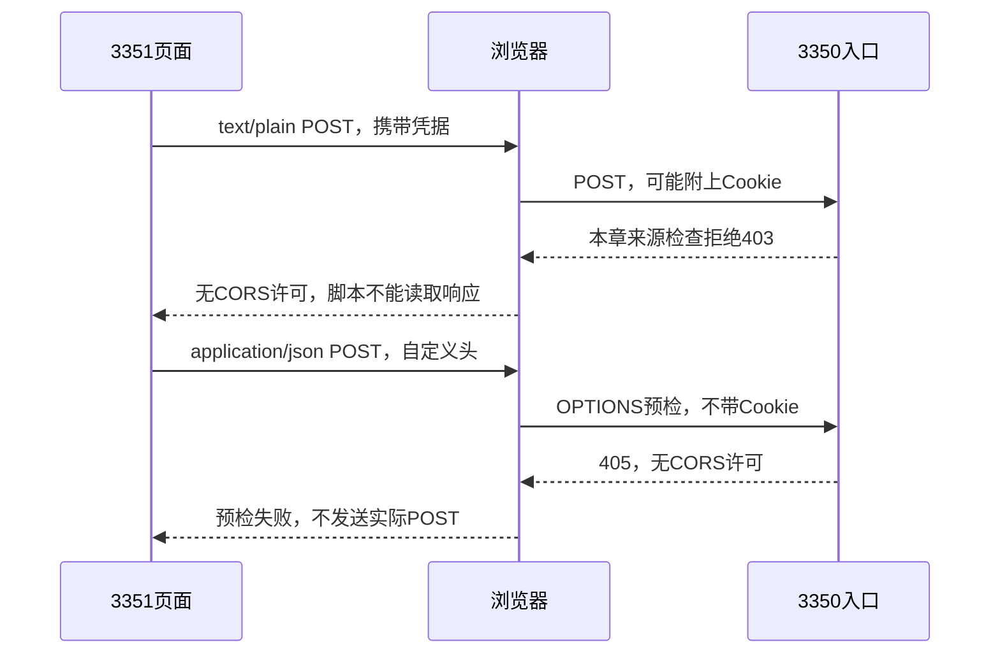
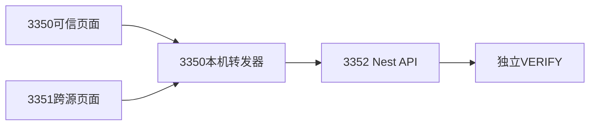
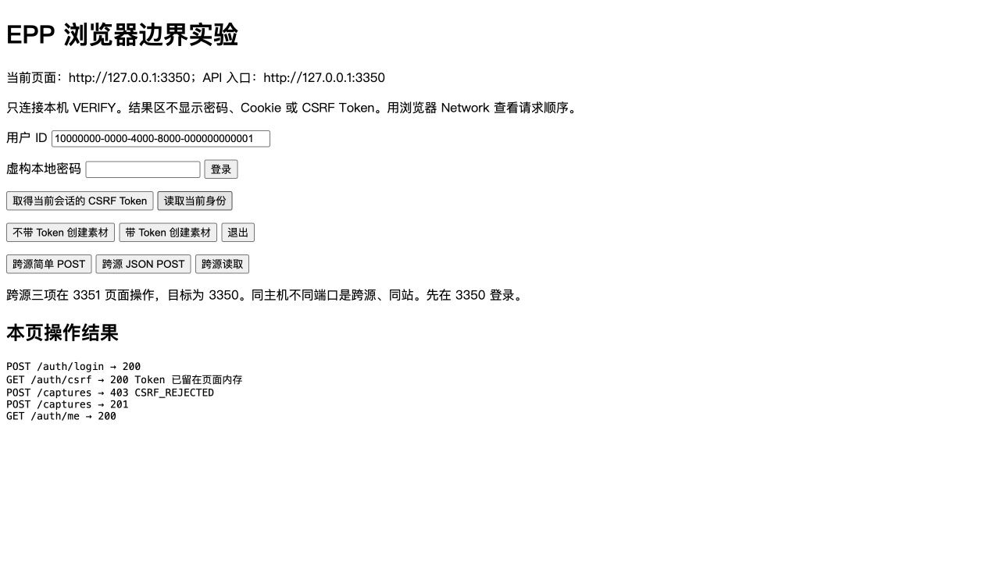
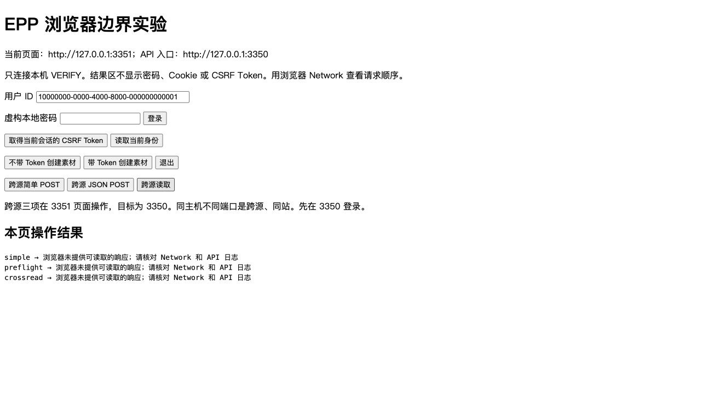
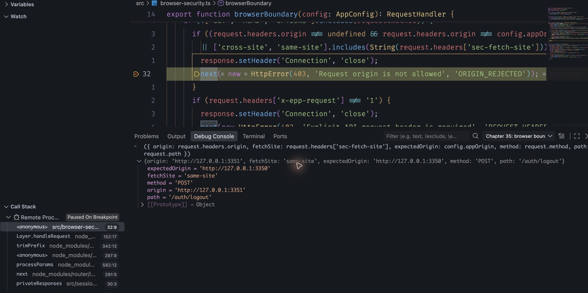
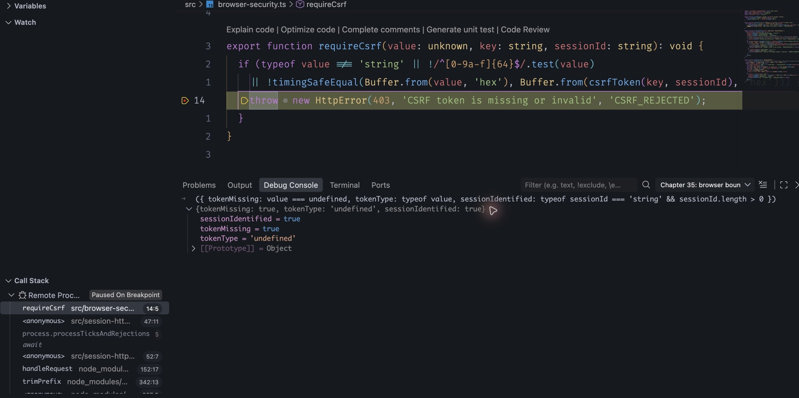

# 第35章 保护基于浏览器的服务入口

上一章解决了“这个账号现在能不能用，以及这份数据是不是他的”。但服务收到合法Cookie，仍不能直接推出用户有意发起了操作。浏览器可能在另一个页面的指挥下，把Cookie一起送来；攻击者也可能完全不用浏览器，连续提交密码，让服务忙于计算。

本章从 `part-05/chapter-34` 继续，分别处理浏览器请求来源、写操作的额外证明、输入与计算成本，以及代理提供的信息。保留原用户、密码、会话和业务数据，不增加表或迁移。主线仍采用同源页面与Cookie API；用两个本机端口改变来源，观察浏览器与服务端各自做了什么。跨源产品接入要重新设计许可范围，不能为了消除一条控制台报错直接开放所有来源。

阅读约120～145分钟；编码、浏览器联调与产物核对另加110～145分钟，按本章解释、代码和实验估算。可以先完成35.2并停在Postman的合法创建，再继续后面三节。中断时保留VERIFY和旧记录，结束自己的服务；回来重新核对目标库，登录并重新获取Token，不初始化或覆盖密码。

## 35.1 浏览器替谁携带Cookie，又允许谁读响应

先看一个前端熟悉的动作：页面用fetch请求接口。这里有两个独立决定。浏览器要不要附上Cookie，取决于Cookie作用域、SameSite及fetch的credentials；页面脚本能不能读取响应，则受同源策略和CORS控制。把它们合成一句“跨域不能请求”会漏掉已经发生的写入。

**源（origin）由协议、主机、端口组成。** `http://127.0.0.1:3350`和`http://127.0.0.1:3351`不同源。SameSite里的“站”采用另一种分组：通常看协议和可注册域，例如example.com；不是简单截取域名最后两段，而是按公共后缀规则确定，不按端口区分。这两个本机地址跨源却同站；同为HTTPS的app.example.com与另一个子域也可能同站，却不是同源。Cookie本身也不按端口隔离。因此，SameSite=Strict不是“只有我的前端端口能发Cookie”。不要在同一个主机的其他端口运行不可信服务，再把端口差异当成凭据隔离。

第三十三章设置的HttpOnly阻止普通页面脚本直接读会话Cookie；Secure限制它经安全连接发送；SameSite限制跨站携带。这三项各有用途，均不等于服务器已经核实操作意图。若允许另一个同站来源诱导浏览器写入，Cookie仍可能被附上。

例如用户在3350登录，又打开3351页面。后者发出一个Content-Type为text/plain的POST。只要满足浏览器的简单请求条件，它可以先发出去，之后才因响应没有CORS许可而向脚本报错。假如服务不检查来源、接受这个正文并修改数据，控制台的“跨域错误”不会撤销那次修改。

这类借用浏览器已有身份发起操作的攻击，称为**跨站请求伪造（CSRF）**。名字里的“跨站”不要反过来限制你的检查范围：不可信的同站子域同样需要考虑。登录也有风险：诱导用户浏览器登录攻击者的账号，可能让用户误把后续内容存到对方账户中，所以不能只保护登录之后的写接口。

JSON与自定义请求头会改变浏览器路径。跨源脚本试图发送application/json或X-EPP-Request时，通常先发OPTIONS预检，询问目标是否允许这个源、方法和请求头。预检不带会话凭据；被拒绝后，实际写请求不会发送。普通GET则可能已经到达服务，只有响应读取被阻止。[MDN的CORS说明](https://developer.mozilla.org/en-US/docs/Web/HTTP/Guides/CORS)把这两条路径分开了。



当前没有跨源客户端需求，最小选择是让页面和API共享一个公开源，不调用enableCors，也不回显Origin。后续若确实把前端放到不同源，要同时设计精确允许列表、带凭据响应、预检、Cookie策略和CSRF校验。带凭据时不能把Access-Control-Allow-Origin设为星号；允许某个来源意味着信任那里的脚本读取响应，不是只允许它显示一个页面。Postman不会替浏览器执行这些限制，Postman成功不能证明网页也能成功。

## 35.2 让写请求提供会话之外的证明

先选方案，再加代码。同源JSON API可以要求一个普通表单无法设置的自定义头，并拒绝不可信Origin；跨源脚本想加头会遇到预检。这是有效的一层保护。我们再让已有会话的写操作带一个**CSRF Token**，用来明确绑定当前会话，也便于观察“Cookie正确，但写入仍被拒绝”的原因。

Token不是另一个登录凭据。服务仍先验证Cookie，取得真实sessionId，再校验Token。攻击者单独知道Token不能登录；反过来，只要恶意脚本已经能在我们的源里执行，它就能请求Token并发起操作。CSRF防护不替代XSS防护、输出安全或资源归属检查。[OWASP的CSRF指导](https://cheatsheetseries.owasp.org/cheatsheets/Cross-Site_Request_Forgery_Prevention_Cheat_Sheet.html)同样强调这些配合关系。

有会话存储时，可以生成随机Token放在会话记录里，再比较客户端提交的值；也可以由服务器秘密和会话身份推导一个不可伪造的值。本章选择后者：复用第29章已管理的HMAC密钥，使用独立用途前缀，不新增列。它不是把sessionId本身当Token，也不是把Cookie原值交给JavaScript。

### 先建立可单独检查的Token函数

新增 `src/browser-security.ts`，先放入下面两个函数。文件里的浏览器中间件与限流函数稍后再追加：

```ts
import { createHmac, timingSafeEqual } from 'node:crypto';
import type { RequestHandler } from 'express';
import type { AppConfig } from './config.js';
import { HttpError } from './http.js';

export function csrfToken(key: string, sessionId: string): string {
  return createHmac('sha256', Buffer.from(key, 'hex'))
    .update('epp:csrf:v1:' + sessionId).digest('hex');
}

export function requireCsrf(value: unknown, key: string, sessionId: string): void {
  if (typeof value !== 'string' || !/^[0-9a-f]{64}$/.test(value)
    || !timingSafeEqual(Buffer.from(value, 'hex'), Buffer.from(csrfToken(key, sessionId), 'hex'))) {
    throw new HttpError(403, 'CSRF token is missing or invalid', 'CSRF_REJECTED');
  }
}
```

同一密钥对同一会话身份会算出相同HMAC。固定前缀把这里的用途与分页游标签名分开；游标签的是编码后的游标正文，CSRF签的是此前缀加UUID。十六进制检查同时固定字节长度，之后才能安全调用timingSafeEqual；不能拿两个任意长度的Buffer直接比较。

这不是一次性Token。同一有效会话可以多次使用，不把两个标签页的正常写入相互作废。换会话要重新取得；退出、改密撤销全部会话后，旧Token也失去对应的有效身份。开发进程未设置持久密钥时，重启会换密钥，数据库Cookie可能还有效，旧Token却会403。此时重新GET Token即可，不必删会话或改密码。生产沿用已有必填持久密钥；轮换该密钥同时影响游标与CSRF，应安排客户端刷新。

### 只从有效会话取得Token

在 `src/auth-contract.ts` 追加：

```ts
export const CsrfSchema = z.object({ csrfToken: z.string().regex(/^[0-9a-f]{64}$/) });
```

在 `AuthController` 导入CsrfSchema与csrfToken，新增下面的方法。constructor里已有的config继续使用，不增加另一个密钥来源：

```ts
@Get('csrf')
@UseInterceptors(new ResponseSchemaInterceptor(CsrfSchema))
csrf(@Req() request: AuthenticatedRequest,
  @Query(new SchemaPipe(EmptyObjectSchema)) _query: object) {
  return { csrfToken: csrfToken(this.config.cursorKey, requireSession(request).sessionId) };
}
```

`http-boundary.ts` 的只读认证路径列表增加 `/auth/csrf`；`request-observation.ts` 的固定路径标签列表也增加它。路径检查、控制器与日志一起接通后再check。响应仍经过privateResponses，具有private/no-store；不将Token放进URL、日志或共享缓存。Cookie保持HttpOnly，前端只把这个新值放在页面内存。

账号被暂停后也要能退出。将 `sessionBoundary` 原来的资格判断改成：

```ts
if (!['/auth/logout', '/auth/csrf'].includes(path ?? '')) requireWebAccess(identity);
```

csrf例外只允许已有有效会话取得用于退出的Token，不绕过业务资格。未登录、过期或已撤销的会话仍401。此时可编译启动，已有客户端尚未被强制要求Token；它是一个可暂停的中间阶段。

### 先挡住不允许的浏览器来源，再验证Token

沿用browser-security.ts已有的RequestHandler、AppConfig与HttpError导入。browserBoundary先执行下面的写请求检查，后面的35.3再在同一函数前部加入安全响应头：

```ts
export function browserBoundary(config: AppConfig): RequestHandler {
  return (request, response, next) => {
    if (!['GET', 'HEAD', 'OPTIONS'].includes(request.method)) {
      if ((request.headers.origin !== undefined && request.headers.origin !== config.appOrigin)
        || ['cross-site', 'same-site'].includes(String(request.headers['sec-fetch-site']))) {
        response.setHeader('Connection', 'close');
        next(new HttpError(403, 'Request origin is not allowed', 'ORIGIN_REJECTED')); return;
      }
      if (request.headers['x-epp-request'] !== '1') {
        response.setHeader('Connection', 'close');
        next(new HttpError(403, 'Explicit API request header is required', 'REQUEST_HEADER_REQUIRED')); return;
      }
    }
    next();
  };
}
```

Origin完整匹配启动配置，不使用endsWith，不从请求Host拼出“允许的源”。字面值null也拒绝：它可能来自沙箱iframe、file页面等，不能视为自己。Sec-Fetch-Site是浏览器补充的上下文；本章没有信任同站子域，因此same-site与cross-site都拒绝。GET、HEAD不得承担业务写入；OPTIONS进入原路径契约，由它返回405，不能拿它触发认证或密码计算。

缺少Origin并不自动拒绝，因为Postman等客户端可能不发送它；这时写请求仍必须带X-EPP-Request: 1，有会话时还必须有正确Token。这个固定头不是秘密，也不是认证。非浏览器调用者能自己设置它们，所以服务端的会话、账号与归属条件仍是最终边界。

在 `app.ts` 导入browserBoundary，把privateResponses移到Swagger注册之前，随后注册browserBoundary。这样开发文档及错误响应也能得到公共响应头；已有请求日志仍在最前面。写操作的来源检查发生在读取正文与密码计算之前。

最后在 `session-http.ts` 导入requireCsrf，删除此前直接检查Origin的代码块，把已认证分支改为：

```ts
if (identity) {
  if (!['/auth/logout', '/auth/csrf'].includes(path ?? '')) requireWebAccess(identity);
  if (!['GET', 'HEAD'].includes(request.method)) {
    requireCsrf(request.headers['x-csrf-token'], config.cursorKey, identity.sessionId);
  }
  request.auth = Object.freeze({ userId: identity.userId, sessionId: identity.sessionId });
}
else if (path !== '/auth/logout') throw new HttpError(401, 'Authentication required', 'AUTH_REQUIRED');
```

login仍在这个分支之前返回，它没有新会话可绑定，靠精确来源检查、固定请求头和JSON契约保护；登录成功会生成全新的会话。logout有有效会话时需要Token，避免被别的页面强制退出；没有有效会话时继续允许带固定头与JSON空对象重复退出，以清除失效Cookie。登录失败不会自动清掉原Cookie，所以切账号失败后不能把旧Token当作新账号的Token。

浏览器一侧也要接上这份契约。在同源页面中，最小请求顺序如下；实验页的 `examples/browser-boundary/client.js` 用同样的流程，但把Token留在页面变量里，便于反复比较：

```js
const csrfResponse = await fetch('/auth/csrf', { credentials: 'include' });
if (!csrfResponse.ok) throw new Error('先检查会话或服务状态');
const { csrfToken } = await csrfResponse.json();
const saved = await fetch('/captures', {
  method: 'POST', credentials: 'include',
  headers: {
    'Content-Type': 'application/json',
    'X-EPP-Request': '1',
    'X-CSRF-Token': csrfToken,
  },
  body: JSON.stringify({ originalText: 'Browser boundary example.' }),
});
const result = await saved.json();
if (!saved.ok) throw new Error(result.code);
```

这段在已有有效登录的同源页面里运行，不在Node终端里运行；Node的fetch不会自动共享浏览器Cookie。登录的POST同样带JSON类型与固定头，但不带新会话的Token。普通读取不需要这两个写请求头。所有请求只指向自己的同源API，不能把手动添加的Token带到用户提供的任意URL；CORS不能阻止目标服务器收到主动发送给它的秘密。

这一步开始旧写客户端会收到403，需要同时更新请求。先沿第34章的VERIFY开发入口启动，若仍使用3000端口，集合baseUrl明确改为 `http://127.0.0.1:3000`；3350页面与转发器到35.5才启动。导入 `requests/chapter-35.postman_collection.json`，选一个空白的本地Environment；baseUrl指向自己的API，password只保留在本机，captureId填第34章保存的旧素材。不要在多个变量范围放同名csrfToken。01登录成功后发02，脚本把响应Token保存到当前Environment；03先读旧素材；04故意不带Token，403/CSRF_REJECTED；05带Token，201；06伪造其他Origin，403；07仍能读取身份；08正常退出。这个顺序把身份有效与操作被允许分开。

同时更新手写的 `src/openapi.ts`，否则服务已有新接口，Swagger却仍展示旧契约。导入CsrfSchema，在components.schemas增加 `Csrf: schema(CsrfSchema, 'output')`，版本改为0.15.0，paths增加：

```ts
'/auth/csrf': { get: {
  operationId: 'csrfToken', summary: 'Get a session-bound CSRF token',
  responses: { '200': jsonResponse('Csrf', 'CSRF token; private, no-store') },
} },
```

在末尾遍历每个path及operation的原有循环中，为写操作追加参数，保留已经存在的路径参数：

```ts
if (operation === path.post || operation === path.patch || operation === path.delete) {
  operation.parameters = [...(operation.parameters ?? []),
    { name: 'X-EPP-Request', in: 'header', required: true,
      schema: { type: 'string', enum: ['1'] } },
    ...(pathname === '/auth/login' ? [] : [{
      name: 'X-CSRF-Token', in: 'header' as const,
      required: pathname !== '/auth/logout', schema: { type: 'string' },
      description: 'From GET /auth/csrf; required for logout with a live session.',
    }]),
  ];
}
```

写操作403说明补ORIGIN_REJECTED、REQUEST_HEADER_REQUIRED与CSRF_REJECTED，保留账号资格错误；GET /auth/csrf不声明账号资格拒绝，因为受限账号也能取Token。429响应补Retry-After的可选说明，只对频率限制承诺该头。不要删除原401、存储失败和响应头定义。check通过后重新打开Swagger，才能看到更新契约。

33、34章集合在当前分支也已补写请求头。切换Cookie身份之后都需要重跑02；更早章节的集合保持对应版本的说明，在当前版本复用写请求时，同样补两个头。不要批量运行带改密或配置前置条件的整套集合。Swagger也新增这两个header参数：先执行登录、再GET /auth/csrf，把当前Token仅填入本地的写请求参数，别把它填进Cookie或截图；生产默认仍不开放文档。

## 35.3 保护响应解释，也给请求成本设边界

CSRF回答了一个问题，却没有限制正文大小、计算量，也不能阻止页面把用户原文当HTML执行。继续沿现有链路处理这些不同的成本。

### 响应头不能替代安全的输出方式

在browserBoundary函数的请求检查之前增加：

```ts
response.setHeader('X-Content-Type-Options', 'nosniff');
response.setHeader('X-Frame-Options', 'DENY');
response.setHeader('Referrer-Policy', 'no-referrer');
if (!(config.docsEnabled && /^\/(?:docs(?:\/|$)|openapi\.json$)/.test(request.path))) {
  response.setHeader('Content-Security-Policy', "default-src 'none'; frame-ancestors 'none'; base-uri 'none'");
}
if (config.appOrigin.startsWith('https:')) {
  response.setHeader('Strict-Transport-Security', 'max-age=31536000');
}
```

nosniff配合准确Content-Type，限制浏览器把响应猜成别的可执行类型；frame-ancestors与X-Frame-Options限制嵌入；no-referrer减少导航时的来源信息泄漏。当前业务返回JSON，CSP可以不允许加载任何资源。开发Swagger需要脚本，所以这里只为它保留一个窄例外，不能为了它把全部业务响应都改成允许任意脚本。

CSP作用于承载页面的文档。API响应上有CSP，并不会替另一个前端页面约束脚本；部署时前端文档也需要自己的策略。实验页从独立入口加载一个脚本，用textContent显示结果，没有把用户输入拼进innerHTML。用户原文可以包含尖括号，存储层不应为了避免XSS而破坏原文；在展示上下文正确转义、避免危险DOM入口，才是这里需要保持的分工。[OWASP响应头说明](https://cheatsheetseries.owasp.org/cheatsheets/HTTP_Headers_Cheat_Sheet.html)可以按用途回查。

HSTS告诉浏览器在一段时间内对该主机使用HTTPS，不配置端口白名单。本机HTTP实验不发送它；公开HTTPS源才设置。我们不顺手加includeSubDomains或preload，因为那会扩大到尚未核验的子域或长期列表。API在TLS终止代理后看到HTTP连接，并不意味着外部源是HTTP；这里依据明确配置的公开APP_ORIGIN，后面再讲代理提供的信息。

在createApp中加 `app.disable('x-powered-by')`，减少无用的框架标识；这不隐藏服务漏洞，更不能替代依赖维护。当前只需这些固定头，直接使用已有Express即可。头部策略变复杂、需要按多种文档管理时，可以评估Helmet等成熟中间件；引入后仍要核对Swagger、前端文档与实际代理返回的头，而不是把默认配置当成验收。

### 字节、语义、频率与并发是四个不同上限

正文仍沿用第2章的16 KiB字节上限与严格UTF-8/JSON解析。captureBody只接受application/json，readJson边收边计数，超过限制就丢掉已缓存块并报413。不能只信Content-Length，也不能先收完整正文再判断。字符串字段长度是解析之后的业务约束，不能替代字节限制；DELETE继续拒绝正文。

已有HTTP服务还需要在部署层限制连接、头部和慢速请求的持续时间。16 KiB不会阻止一个连接慢慢发送，也不限制数据库查询次数；不能把单一上限说成防住了全部资源耗尽。当前本机实验先验证JSON与应用工作额度，公网的连接期限和入口限额随运维篇落实。

第33章已经给登录和改密每个来源每分钟10次的额度。现在将它从session-http.ts移到browser-security.ts的独立authRateLimit，保留规则并补明确的满表拒绝：

```ts
export function authRateLimit(): RequestHandler {
  // shortcut: bounded per-process buckets; use a shared atomic store before multiple API instances.
  const attempts = new Map<string, { until: number; count: number }>();
  return (request, response, next) => {
    if (request.method !== 'POST' || !['/auth/login', '/auth/password'].includes(request.path)) { next(); return; }
    const now = performance.now();
    for (const [key, value] of attempts) if (value.until <= now) attempts.delete(key);
    const key = request.ip ?? request.socket.remoteAddress ?? 'unknown';
    let entry = attempts.get(key);
    if (!entry && attempts.size < 1000) {
      entry = { until: now + 60000, count: 0 }; attempts.set(key, entry);
    }
    if (!entry || ++entry.count > 10) {
      response.setHeader('Retry-After', String(entry ? Math.max(1, Math.ceil((entry.until - now) / 1000)) : 60));
      response.setHeader('Connection', 'close');
      next(new HttpError(429, 'Try again later', 'AUTH_RATE_LIMIT')); return;
    }
    next();
  };
}
```

只处理两个POST路径；无效正文也消耗额度，因为读取、解析与校验同样有成本。performance.now衡量进程内经过的时间，系统校时不会把窗口倒拨。窗口从这个来源第一次请求开始算，10次包括成功与失败，不是只数密码错误。超过额度回429，并给Retry-After秒数；现有会话不会被撤销，普通读取不受这个密码入口额度影响。

这是一段开始后不再滑动的计数窗口，不是“任意连续60秒最多10次”。设第0秒第一次请求建立窗口，第59.9秒再来9次，旧窗口正好用完10次；第60秒到期后可以重新接纳10次。于是边界附近约0.1秒内，有19次通过这一层。后面的密码并发限制仍可能拒绝它们，不能把“通过频率检查”写成“19次登录都成功”。这个反例说明窗口平均额度不等于瞬时计算上限。

如果需求真的要求任意连续60秒最多10次，可以保存最近获准请求的时间，先删掉60秒之外的记录，再判断是否有空位；它需要维护和清理时间记录。若需求允许小批突发、但限制长期平均速率，可以用令牌桶：桶有容量上限，按时间补额度，每次请求消耗一份，空桶就拒绝。容量10、每6秒补一份允许空闲后的10次突发，却不承诺任意60秒只接10次。选哪一种，先看要限制窗口次数、持续速率还是眼下并发，不能只换算法名称却不改变承诺。

Map最多1000个来源，先移除过期项，满了就拒绝新来源，不为腾位置踢掉仍有效的额度记录，否则不断换来源就能让旧来源重获次数。每次扫描最多1000项，当前规模可直接理解；它是单进程、内存内的保护，重启即清空。多实例会各自给一份额度，不能把这个Map解释成整个站点的统一限额。扩为多实例之前要把计数改成共享存储里的原子检查与增加，并明确存储失败时的行为；本章不为尚未采用的部署提前加Redis。

共享存储本身也不等于共享限制正确。假设当前已用9次，两个实例同时读到9，各自判断还能放行，再各加一次，就可能共同接纳第10、11次。要把过期处理、检查与消耗额度放进同一个原子决定。反过来，两个实例各用独立Map，即使每个进程内部判断完全正确，同一来源也可能各获10次。共享计数服务故障时，继续放行会放弃这层上限，拒绝会影响可用性；对昂贵的密码入口应明确采用什么策略，且保留每进程的计算占位保护。这里保持现有单进程实现，说明的是扩展时必须重新满足的条件。

IP也不等于人。公司出口可能多人共用，攻击者可能轮换地址；IPv6地址变化同样会分散桶。当前额度限制每个已判定来源的请求频率，不是完整的账号反撞库策略。未来公开注册、恢复与更大用户量要按各入口补账号或其他维度，避免通过永久锁账号给攻击者制造拒绝服务工具。

将app.ts中的authRateLimit放在httpBoundary之后、sessionBoundary之前，再删除session-http原来的attempts Map与对应代码。此时顺序是：

```ts
app.use(requestObservation(logger, app.get(ApplicationState)));
app.use(privateResponses);
app.use(browserBoundary(config));
// 原Swagger注册仍在这里，受docsEnabled控制。
app.use(httpBoundary);
app.use(authRateLimit());
app.use(sessionBoundary(app.get(SessionService), config));
app.use(captureBody);
```

速率限制仍挡不住同一瞬间的大量不同来源。`SessionService.passwordWork`继续限制整个登录／改密操作同时最多两项：

```ts
if (this.activePasswords >= 2) throw new HttpError(429, 'Password service is busy', 'AUTH_BUSY');
this.activePasswords++;
return this.state.track(work).finally(() => { this.activePasswords--; });
```

它从读凭据到事务结束都占位，因而锁等待也会占名额；不是只计算Argon2的时间。没有无限排队，第三项直接拒绝。finally保证失败也释放名额，ApplicationState保证客户端断开后仍能追踪已接纳工作，关闭时等待它结束。客户端超时不表示密码计算或数据库提交已经取消。

第32章每次哈希的memoryCost为19456 KiB，两项同时计算的算法内存基数约38 MiB，但进程、数据库驱动和原生库还有额外开销。这不是RSS上限，更不是任意机器都适用的容量结论。沿原 `node examples/password-cost.mjs` 观察本机成本，再结合接口的等待和内存决定额度。不要通过降低密码哈希成本来消除429，也不要先把线程池开大再观察是否爆内存。

用Postman在一分钟内连续发送11次合法格式、错误虚构密码的登录：前10次401，之后429/AUTH_RATE_LIMIT；确认Retry-After，等窗口过去后再试。若此前已登录多次，可更早触发429，应从本窗口的所有请求计数。AUTH_BUSY代表并发占位，SESSION_LIMIT代表已保存会话数，虽然也都是429，恢复动作并不一样。我们不为无法确定完成时间的AUTH_BUSY伪造精确等待秒数；SESSION_LIMIT要检查并撤销不需要的会话。

## 35.4 谁转发了请求，决定转发头能不能信

把API放到反向代理后，浏览器先连代理，再由代理连Node。此时socket.remoteAddress是代理的地址。若继续用它做IP限流，所有人可能共享一个桶；如果改成无条件读取X-Forwarded-For，任何客户端又都能填一个新地址绕过额度。

问题不在于有没有这个头，而在于它经过哪条受控路径。Express可以按受信任代理地址，从最靠近应用的一端向外判断转发链；遇到第一个不可信地址就停止。直接把trust proxy设true会扩大信任，不能因为“服务器前面有代理”就采用。[Express 5代理文档](https://expressjs.com/en/guide/behind-proxies/)说明了这种判断和转发头覆盖要求。

本章配置只允许明确IP，不接收true、数字跳数、通配符或宽网段。这样当前只有一层受控代理时，读者不必先维护复杂拓扑。`config.ts` 导入 `isIP`，AppConfig增加只读trustedProxyIps数组，EnvironmentSchema增加可选TRUST_PROXY_IPS字符串，parseConfig返回前加入：

```ts
const trustedProxyIps = value.TRUST_PROXY_IPS === undefined ? [] : value.TRUST_PROXY_IPS.split(',');
if (trustedProxyIps.length > 10 || trustedProxyIps.some(ip => !isIP(ip))) {
  throw new ConfigError('TRUST_PROXY_IPS');
}
```

返回的冻结配置增加 `trustedProxyIps: Object.freeze(trustedProxyIps)`。未设置得到空数组；设置空字符串或带多余空格的地址会失败，不悄悄放宽。`.env.example`只保留注释示例，不默认打开。在createApp设置query parser之后加入：

```ts
app.set('trust proxy', config.trustedProxyIps.length ? [...config.trustedProxyIps] : false);
```

authRateLimit现在用request.ip，Express按上述信任策略提供它；未配置时仍来自直接连接，不受客户端X-Forwarded-For影响。请求protocol或hostname也可能受代理设置影响，但Cookie的Secure、允许Origin和HSTS仍从已校验的APP_ORIGIN决定，避免请求头改变这些安全决定。代理不能把原Origin改写成自己，从而把原本不可信的页面洗成可信来源。

使用这一配置有两个必要条件：应用端口只允许受控代理访问；代理覆盖客户端传来的X-Forwarded-For、X-Forwarded-Host与X-Forwarded-Proto，写入它实际观察到的信息。只配Express、没有网络隔离，允许别人直连一个被信任的入口，会破坏前提。当前API继续监听127.0.0.1，不开放公网。

本章实验代理运行在同机，因此填127.0.0.1意味着本机能直连API的其他进程也处于这条信任边界内。它适合受控开发机观察机制，不是允许多租户主机上的任意程序冒充代理。完整HTTPS证书、进程托管、访问控制与多层代理验证在运维篇展开；不能把本机实验脚本当生产反向代理。

先保留默认不信任，在Postman重复登录时每次更改X-Forwarded-For，10次后仍429，说明伪造头没有换桶。再只在独立实验里启用可信代理，用真正代理入口请求；请求仍应落到代理观察的客户端地址。不要把“手动填头后被服务器采信”的结果称为真实来源验证：它只能说明信任配置生效。

## 35.5 在真实浏览器里分清发送、携带和读取

现在用一个独立实验页串起前面的判断。`examples/browser-boundary/`提供本机页面与转发器，不注册到Nest路由，也不复制进dist。3350是可信页面与API入口，3351只提供另一个源的页面，3352是后面的API。两页只使用虚构账号与VERIFY。



沿第22章恢复一份第34章非空库作为VERIFY，核对原用户、凭据、账号资格与旧记录。**本章没有新迁移**，不要reset或重新初始化密码。`.env.test`中的TEST_DATABASE_URL也指向这份独立库。下面从该文件读取连接，不打印它：

```bash
unset DATABASE_URL TEST_DATABASE_URL DB_QUERY_DEBUG APP_ORIGIN TRUST_PROXY_IPS
verify_database_url=$(node --env-file=.env.test -e '
const value = process.env.TEST_DATABASE_URL;
if (!value) process.exit(1);
process.stdout.write(value);
')
```

先运行 `npm run check`；确认命令成功后，在同一个终端启动开发API：

```bash
if test -n "$verify_database_url"; then
DATABASE_URL="$verify_database_url" DB_QUERY_DEBUG=false PORT=3352 APP_ORIGIN=http://127.0.0.1:3350 npm run dev
fi
```

第二个终端进入同一代码目录运行：

```bash
node examples/browser-boundary/server.mjs
```

看到3350与3351就绪后再打开页面。端口占用应定位并退出自己此前的实验进程，或等它释放，不能随手结束陌生服务。若API未启动，转发器返回502；这与业务401和CSRF403不同。开发模式继续使用原来的Inspector与自动编译重启。只修改实验页HTML／JS时，刷新页面即可；刷新会清掉页面内存里的Token，但浏览器Cookie可能还在，先重新取Token，不重复初始化账号。

### 先把同源路径跑完整

用Chrome打开 `http://127.0.0.1:3350`。只输入这份VERIFY的已有虚构密码，登录后输入框自动清空。依次点击取得Token、不带Token创建、带Token创建、读取当前身份。



图35-1：同一浏览器会话中，登录200、取Token200、缺失Token403、带Token201，随后身份仍200。结果区只显示动作、状态与错误码，没有显示Cookie或Token。201是一次真实新增，重复点击会新增另一条，并不会自动去重。

打开开发者工具Network，保留日志；每次只看本轮动作。登录响应的Set-Cookie会含秘密，不复制进笔记或截图。可以在Application的Cookies表查看HttpOnly、SameSite、Secure与Path列，隐藏Value列；本机HTTP没有Secure，公开HTTPS配置才使用 `__Host-epp_session` 与Secure，不要照本机截图要求线上取消Secure。

在Network中看/auth/me的Request Cookies，确认浏览器确实携带了会话；只在本地检查，不展开秘密拍图。看/captures的请求方法、状态和Response页里的错误码，缺Token的一次应CSRF_REJECTED，而不是AUTH_REQUIRED。取Token的响应带no-store，登录与写请求的响应头包含nosniff等公共头。不要因为document.cookie看不到会话Cookie，就判定浏览器没登录：HttpOnly正是在阻止脚本读取它。

### 再改变源，保持Cookie不变

另开3351页面，保留3350的登录状态，依次点击跨源简单POST、跨源JSON POST、跨源读取。三次结果在脚本里都可能表现为响应不可读，但它们实际停在不同位置。



图35-2：来自3351的三次fetch都没有向页面暴露可读取的响应。这里不能仅凭页面文字判断请求是否到达API；要继续比较Network与服务端同一轮日志。

本轮浏览器与服务端的对应结果如下。它们来自同站、不同端口的实验，不外推到第三方Cookie或跨站部署：

| 动作 | 实际观察 | 结论 |
| --- | --- | --- |
| text/plain POST /auth/logout | 浏览器附Cookie，Sec-Fetch-Site为same-site；API返回403/ORIGIN_REJECTED；页面读取受CORS阻止 | 请求已到达，服务端拒绝了退出 |
| JSON POST /captures | OPTIONS不带Cookie，返回405；实际POST未到达API | 预检失败，写入没有发送 |
| GET /auth/me | 浏览器附Cookie；API返回200；页面读取受CORS阻止 | 会话有效，响应不可读不等于未认证 |

Network可能显示一条失败的POST条目，即使它的预检没通过。要展开Initiator与预检关联，再对照服务端有没有同一动作的http.started，不能只数面板里的POST行。跨源错误不一定让脚本读到X-Request-Id；此时可清空面板，单独重做一次，用路径、方法与时间定位服务日志，再在服务端用请求ID连接started、failed和completed。不要为了排错临时把Cookie、完整请求头或Token写进日志。

回到3350，读取身份仍200，说明刚才跨源退出没有删除会话。用DBeaver在同一VERIFY核对本轮新增的素材：只应有合法创建产生的行；缺Token与被预检阻止的请求没有新增。可以先在实验前后分别运行以下只读查询，结合最新时间与界面动作比较，不把数据库里以前已有同文记录算成本轮：

```sql
SELECT id, original_text, created_at
FROM public.captures
WHERE user_id = '10000000-0000-4000-8000-000000000001'
  AND original_text = 'Browser boundary example.'
ORDER BY created_at DESC, id DESC;
```

### 在VS Code看清两处拒绝

保留3350的有效登录，沿前文的Attach配置连接当前dev的9229 Inspector。打开 `src/browser-security.ts`，这次只设一个断点：在browserBoundary的 `next(new HttpError(403, 'Request origin is not allowed', 'ORIGIN_REJECTED'))` 行左侧点击，当前配套为第32行。回到3351，点击跨源简单POST。

VS Code应停在该行，Call Stack显示Paused on breakpoint。选中最上面的browser-security.ts栈帧，在Debug Console输入以下只读表达式并展开结果；不要展开整个request或config：

```js
({ origin: request.headers.origin, fetchSite: request.headers['sec-fetch-site'], expectedOrigin: config.appOrigin, method: request.method, path: request.path })
```



图35-3：实际请求来自3351，允许的源是3350，fetchSite却是same-site。同站不等于同源；这一请求进入来源拒绝分支，还没有执行退出。图中的控制台只投影来源、方法与路径，不显示Cookie。

移除这个断点，点击Continue，让当前请求结束。再把断点设在requireCsrf的 `throw new HttpError(403, 'CSRF token is missing or invalid', 'CSRF_REJECTED')` 行，当前配套为第14行。回到3350，先确认读取身份仍为200，再点“不带 Token 创建素材”。如果读到401，先重新登录；否则请求到不了有效会话后的CSRF检查。

在requireCsrf暂停后，清空Debug Console的上一轮结果，输入：

```js
({ tokenMissing: value === undefined, tokenType: typeof value, sessionIdentified: typeof sessionId === 'string' && sessionId.length > 0 })
```



图35-4：调用栈从session-http进入requireCsrf；sessionIdentified为true，tokenMissing为true，tokenType为undefined。这次失败发生在已识别会话之后，原因是请求缺少Token。这里只检查有无与类型，不求值密钥、会话标识或Token内容。

截图中的黄色行表示即将执行该行，不表示浏览器已经收到403。人工暂停可能超过实验转发器的请求期限，让页面显示响应不可读或日志出现http.aborted；不能把它当成新的CORS结论，也不拿暂停的一轮测延迟。移除断点并Continue后，分别重做这两次拒绝动作：服务日志应记录ORIGIN_REJECTED；3350页面应显示403 CSRF_REJECTED，读取身份仍200。调试结束后断开Attach，再按下面的步骤恢复或退出；本段无需重复点击合法创建。

### 根据失败发生的位置恢复

若只有网页失败、Postman成功，先看是否为相同scheme、主机与端口；localhost与127.0.0.1也不是同一个Cookie主机。若登录请求成功但后续401，先检查Cookie是否被浏览器接纳、后续请求是否携带、服务是否连接同一库，再看会话期限和撤销状态。不能先取消HttpOnly或把Cookie写进localStorage来“修复”。

若身份读取200、写请求403，按错误码继续：ORIGIN_REJECTED查页面源与APP_ORIGIN；REQUEST_HEADER_REQUIRED补固定请求头；CSRF_REJECTED重新从当前Cookie获取Token，并确认没有沿用另一账号或重启前的值；ACCOUNT_DISABLED、WEB_ACCESS_DENIED则沿第34章检查资格。不要把所有403都做成自动跳登录。

修改源码触发开发重启后，先看编译与启动日志，再在原浏览器重新读取身份和获取Token。普通读应保持旧数据，新的Token恢复写入；如果配置持久密钥且会话不变，Token也保持。写请求超时或响应丢失时，先查询本次效果；刷新Token不是重新执行非幂等写入的理由。采纳仍用原operationId恢复，不因CSRF失败处理而换一个业务身份。

最后点击3350的正常退出，再读取身份应401，关闭两页与自己的两个服务。已有业务数据保留，本轮样本可以保留供回查。退出只是撤销当前会话，不删除用户或素材；若退出返回存储故障，先恢复服务并确认会话事实，不能只靠关闭标签页宣称已经撤销。

### 检查实际交付入口

`npm test`继续使用显式TEST_DATABASE_URL；新增browser-security.test.mjs覆盖Token绑定、入口拒绝、代理取值与密码容量释放，已有业务回归保留原归属和竞争断言。测试辅助客户端会附上本章要求的头，不能为了让旧测试通过而给测试模式开匿名后门。

沿第33章独立产物步骤，只复制dist、package.json、锁文件与.npmrc，干净安装运行依赖，提供VERIFY、持久CURSOR_HMAC_KEY及准确APP_ORIGIN，再用npm start启动另一个未占用端口。实验页与转发脚本不随dist交付。先用Postman核对登录、旧记录、Token、缺失Token拒绝、正常退出、退出后401；生产默认/docs关闭，无Inspector，SIGTERM正常排空并释放数据库连接。安装成功和开发网页成功分别回答不同问题。

本章保留单实例、同源入口；代理信任需要真实拓扑与网络限制，公网HTTPS和多实例统一额度在相应部署工作中落实。下一章增加公开注册、验证与密码恢复时，复用这些边界，再为新增入口选择自己的额度和一次性凭据规则，不把“没有登录Cookie”误认为“不需要保护”。

## 附录：本章必要技术点速查

| 名称 | 本章用途 | 回查时注意 |
| --- | --- | --- |
| Origin / Sec-Fetch-Site | 比较准确来源与浏览器上下文 | 同站不等于同源，null不当作可信 |
| credentials / SameSite | 控制浏览器是否附凭据 | include不覆盖Cookie自身约束；Cookie不按端口隔离 |
| CORS / OPTIONS | 浏览器决定跨源读取与预检 | 读取失败不能证明没有执行；Postman不执行CORS |
| X-EPP-Request | 所有写请求的固定头 | 值1不是秘密，也不是登录证明 |
| GET /auth/csrf / X-CSRF-Token | 当前有效会话取得并提交Token | 受限账号可取Token用于退出；不写URL、日志或截图 |
| createHmac / timingSafeEqual | 会话绑定与固定长度比较 | 先验证格式与长度；用途前缀与游标签名分开 |
| CSP / nosniff / no-referrer | 限制资源解释与来源泄漏 | 文档自身也要设置策略；API头不替代页面输出安全 |
| HSTS | 已确定HTTPS源的后续访问约束 | 本机HTTP不发；不随意扩到子域或preload |
| performance.now / Retry-After | 进程内窗口与限流恢复 | 频率、并发、会话数分别判断 |
| trust proxy / request.ip | 从受信任转发链取得地址 | 默认关闭；代理覆盖头与应用隔离缺一不可 |
| AUTH_BUSY / ApplicationState | 限制并追踪昂贵工作 | 客户端断开不等于取消；失败也释放名额 |

版本与资料：本章继续使用Node 24、Express 5、Nest 11；[Node crypto](https://nodejs.org/download/release/v24.22.1/docs/api/crypto.html#cryptotimingsafeequala-b)说明比较的长度要求；[MDN Set-Cookie](https://developer.mozilla.org/en-US/docs/Web/HTTP/Reference/Headers/Set-Cookie)用于核对Cookie属性；[MDN CSP](https://developer.mozilla.org/en-US/docs/Web/HTTP/Guides/CSP)用于核对文档策略；[Express API](https://expressjs.com/en/5x/api/request/#reqip)用于回查request.ip。采用固定密钥的会话派生Token是本章的实现选择，不把它称为框架自动提供的功能。

本章完成代码分支：`part-05/chapter-35`，起点：`part-05/chapter-34`。

[下一章：注册、验证与密码重置](../chapter-36-registration/chapter.md) · [上一章：鉴权与授权](../chapter-34-authorization/chapter.md) · [第五篇导读](../README.md) · [全书目录](../../README.md)
