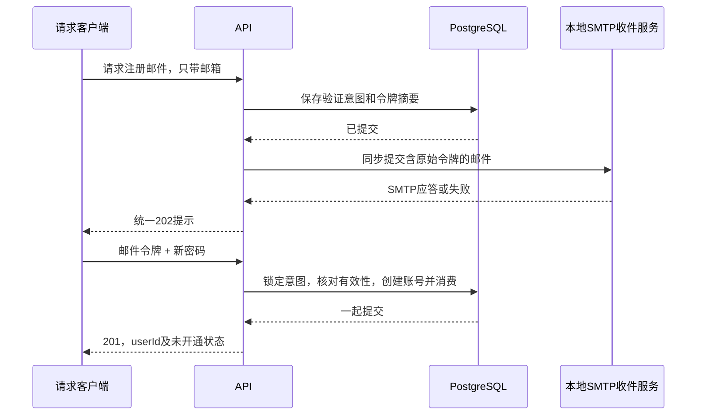
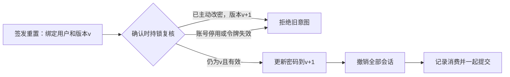
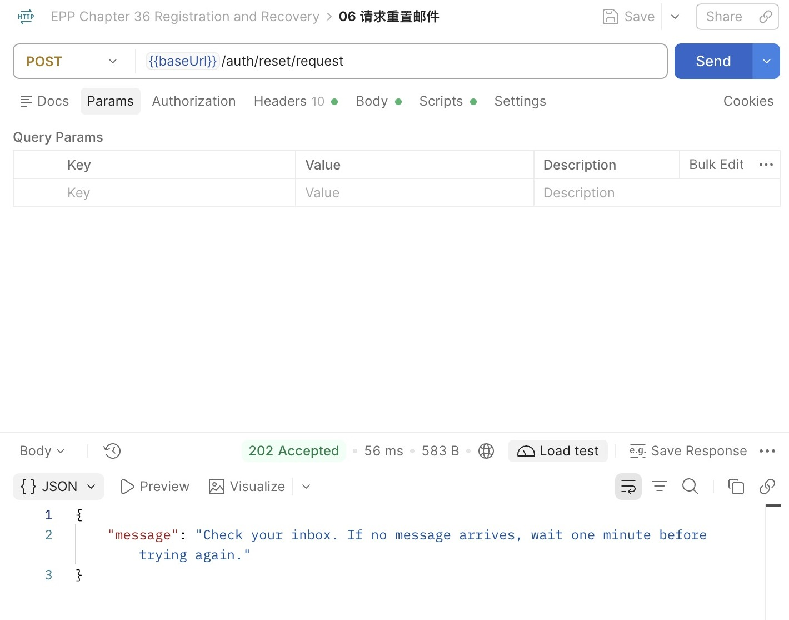
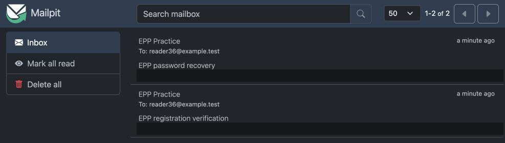
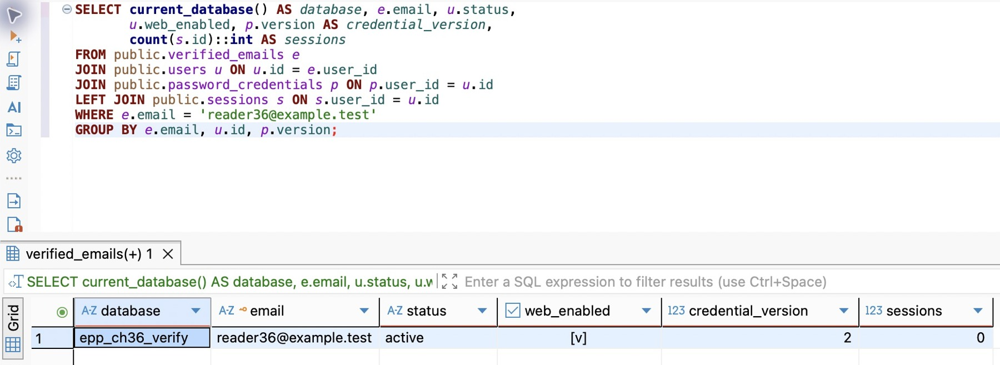
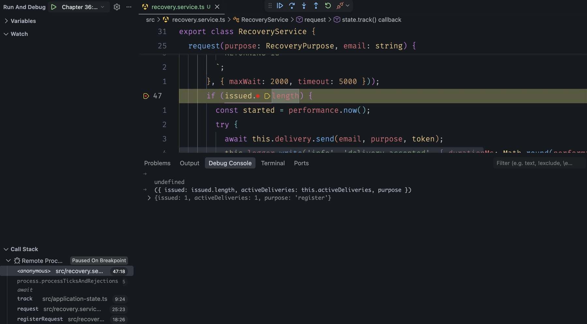
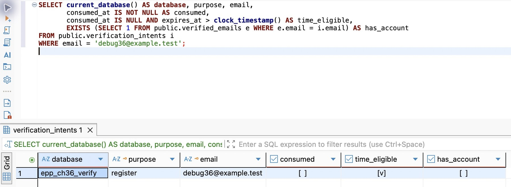

# 第36章 注册、验证与密码重置

第35章已经把浏览器来源、Cookie、CSRF和请求成本接进服务入口。不过，到目前为止，账号仍由维护者准备，忘记密码也只能回到本地工具。现在要把这两件事交还给用户：他提供邮箱，证明自己能收到发往这个地址的消息，再建立账号或更换密码。

**时间参考（估算）**：阅读约150～180分钟；编码、迁移、邮件联调与产物核对另加160～205分钟。依据约1万汉字、近200行代码与命令、两张机制图及迁移／注册／恢复／故障四段实践估算，首次安装Mailpit和依赖下载另计；36A支线单列。

起点是第35章完成代码 `part-05/chapter-35`。原用户ID、密码、会话和记录都继续保留。新增的是已验证邮箱、短期验证意图和四个公开接口；注册与重置之后仍走原来的密码登录，不自动创建会话，也不自动授予Web使用资格。

本章分四个可停下的位置：先升级独立VERIFY，接着建立一次性验证状态，再处理重置与旧凭据的竞争，最后用真实SMTP收件服务走完HTTP流程。前两步可以先运行编译和数据库查询，公开路由等投递与保护同时接好后再启用。短信的机制与接入判断在36.5展开，不需要申请付费服务才能完成邮件主线。

## 36.1 先有注册意图，再有真正的账号

### 不让一份尚未证实的输入占住身份

假设有人先用 `reader36@example.test` 发起注册，却从未收到邮件。此时就插入正式用户、保存他提交的密码，会留下一个尴尬状态：真正的邮箱持有人后来注册，服务却说账号已存在。如果处理不严谨，之前那个密码还可能被保留下来。

因此把注册拆成两个动作。第一次只提交邮箱，保存一个待验证意图；第二次同时提交邮件里的令牌和**此刻选择的密码**，才在同一个事务里创建用户、已验证邮箱和密码凭据。未验证者没有用户身份，也不能为将来的邮箱持有人预设密码。



这里的“验证”只回答请求者是否掌握了这封邮件，不回答此人是否应有Web资格。第34章的新用户默认 `web_enabled=false` 继续成立。注册请求不能接受 `webEnabled`、`status` 或 `userId`；这些字段即使由客户端传来，也不应进入创建数据。

### 三种事实放在各自的位置

正式账号仍在 `users`。增加 `verified_emails`：一行表示一个邮箱已经与一个用户建立联系，`email` 唯一，`user_id` 也唯一。本章每人一个邮箱，既有用户可以没有邮箱，所以无需给旧行编造联系信息，也不需要把邮箱变成用户主键。学习记录等外键仍引用稳定的用户ID。

再增加 `verification_intents`：一行表示某个用途、某个地址的**当前**验证机会。注册和重置用同一套到期、重发与消费机制，但 `purpose` 不同；注册邮件不能拿去重置密码。`UNIQUE(purpose,email)` 意味着同一地址每个用途只保留一个当前令牌；重发会替换它，不无限积累多份仍有效的码。这是产品选择，也意味着后到的重发可能让先收到的邮件失效。

重置意图另存 `user_id` 与 `credential_version`。前者绑定签发当时的用户，后者绑定当时的密码版本。未找到可恢复账号时两者为空；这个意图不会因为同地址后来注册成功，就自动变成可用的重置凭证。注册意图始终不绑定旧用户。

给 `PasswordCredential` 增加 `version Int @default(1)`，旧密码自动成为版本1。它是并发判断用的整数，不是密码强度，也不取代Argon2参数。任何成功换密都把它加1，36.3会用它挡住过时的重置请求。

在 `prisma/schema.prisma` 中追加两个模型，给 `User` 补 `verifiedEmail VerifiedEmail?`、`verificationIntents VerificationIntent[]` 两个反向关系。核心模型如下，已有模型的其余字段保持原样：

```prisma
model VerifiedEmail {
  email String @id(map: "verified_emails_pkey") @db.Text
  userId String @unique(map: "verified_emails_user_id_key") @map("user_id") @db.Uuid
  verifiedAt DateTime @default(now()) @map("verified_at") @db.Timestamptz(3)
  user User @relation(fields: [userId], references: [id], onDelete: Restrict, onUpdate: Restrict, map: "verified_emails_user_id_fkey")
  @@map("verified_emails")
}

model VerificationIntent {
  id String @id(map: "verification_intents_pkey") @db.Uuid
  purpose String @db.Text
  email String @db.Text
  tokenDigest String @unique(map: "verification_intents_token_digest_key") @map("token_digest") @db.Text
  userId String? @map("user_id") @db.Uuid
  credentialVersion Int? @map("credential_version")
  issuedAt DateTime @default(now()) @map("issued_at") @db.Timestamptz(3)
  expiresAt DateTime @map("expires_at") @db.Timestamptz(3)
  consumedAt DateTime? @map("consumed_at") @db.Timestamptz(3)
  user User? @relation(fields: [userId], references: [id], onDelete: Restrict, onUpdate: Restrict, map: "verification_intents_user_id_fkey")
  @@unique([purpose, email], map: "verification_intents_purpose_email_key")
  @@index([expiresAt], map: "verification_intents_expires_at_idx")
  @@map("verification_intents")
}
```

追加迁移 `20261106003600_registration_recovery`，不改前章迁移。SQL除建表、外键和唯一键，还把状态组合限制在数据库中。以下是不能仅靠TypeScript保证的部分：

```sql
ALTER TABLE public.password_credentials ADD COLUMN version integer NOT NULL DEFAULT 1;
ALTER TABLE public.password_credentials ADD CONSTRAINT password_credentials_version_check CHECK (version > 0);
-- verification_intents建表语句中的约束：
CHECK (purpose IN ('register', 'reset')),
CHECK (token_digest ~ '^[0-9a-f]{64}$'),
CHECK (expires_at > issued_at),
CHECK (
  (user_id IS NULL AND credential_version IS NULL) OR
  (purpose = 'reset' AND user_id IS NOT NULL AND credential_version IS NOT NULL AND credential_version > 0)
)
```

最后四项是建表中的约束片段，不是四条可单独执行的SQL。完整迁移还给邮箱加规范化长度约束，给到期时间建索引；它们分别服务于写入一致性和后面的过期清理。Prisma负责映射，迁移SQL负责它无法完整表达的CHECK，沿用第三篇的分工。

### 先升级非空VERIFY，确认旧账号仍是原来的账号

按第22章的备份与独立恢复流程准备一个有旧素材、修订、学习记录和密码的VERIFY。停该库写入，在DBeaver先执行 `SELECT current_database(), current_user;`；保存原账号ID、其素材详情，以及密码凭据是否存在。不要导出密码摘要作截图，也不要把DEV连接改名后当成隔离库。

核对 `.env.database-verify` 指向这份副本，在项目根目录执行：

```bash
nvm use
unset DATABASE_URL SHADOW_DATABASE_URL DB_QUERY_DEBUG
npm run db:verify -- migrate status
npm run db:verify -- migrate deploy
npm run db:verify -- migrate status
npm run prisma:generate
npm run check
```

DBeaver刷新 `public` 的表列表，应多出两个表；原凭据仍在，`version=1`，旧用户没有被补一份虚构邮箱。按素材ID重读同一条旧记录，比较归属、原文、修订与学习来源，不能只看总行数相等。

在 `DatabaseService.onModuleInit` 原来的凭据检查中加入 `version:true`，并检查 `verifiedEmail.findMany({take:1})` 与 `verificationIntent.findMany({take:1})`。这样漏迁移会在启动阶段暴露，避免旧登录碰巧能用、第一次注册才报“关系不存在”。此刻可以暂停，下一次从迁移状态和旧记录开始，不重建数据库、不重置旧密码。

## 36.2 地址、有效期与一次性消费，要落到同一个事实边界

### 先决定什么算同一个邮箱

`Reader.Tag+book@EXAMPLE.test` 有三个需要分别判断的部分：外部空白、大小写、点号和加号。去掉输入两端的空白合理；把点或 `+book` 一律删掉则没有依据，不同邮件系统未必采用同一别名规则。

本章采用一项明确的产品约束：只支持普通ASCII邮箱格式，账号比较和投递都使用全小写，不支持本地部分区分大小写的邮箱体系。它方便同一条规则贯穿注册、登录和重置，但不是SMTP的通用规则。若产品必须接入严格区分本地部分大小写的企业邮箱，应保留原始投递地址、只规范化域名，再设计比较键及冲突迁移；不能在已有账号上偷偷更换规则。[OWASP的邮箱验证说明](https://cheatsheetseries.owasp.org/cheatsheets/Email_Validation_and_Verification_Cheat_Sheet.html)特别区分了域名与本地部分的比较语义。

新建 `src/recovery-contract.ts`，用已有Zod做格式解析，自己只补当前支持范围和长度边界：

```typescript
import { z } from 'zod';
import { tokenDigest } from './token.js';

// Product identity policy: ASCII addresses are case-insensitive; dots and +tags are preserved.
export const EmailSchema = z.string().trim().max(254).regex(/^[\x21-\x7e]+$/)
  .pipe(z.email()).refine(value => value.split('@')[0]!.length <= 64)
  .transform(value => value.toLowerCase());
export const RecoveryRequestSchema = z.object({ email: EmailSchema }).strict();
export const RecoveryConfirmSchema = z.object({
  token: z.string().refine(value => { try { tokenDigest(value); return true; } catch { return false; } }),
  newPassword: z.string().min(1).max(256).refine(value => value.isWellFormed()),
}).strict();
export const RecoveryAcceptedSchema = z.object({ message: z.literal('Check your inbox. If no message arrives, wait one minute before trying again.') });
export const RegistrationSchema = z.object({ userId: z.uuid(), webEnabled: z.literal(false) });
export type RecoveryPurpose = 'register' | 'reset';
export type RecoveryConfirm = z.infer<typeof RecoveryConfirmSchema>;
export const RECOVERY_PATHS = ['/auth/register/request', '/auth/register/confirm', '/auth/reset/request', '/auth/reset/confirm'];
```

格式通过不表示邮箱存在，更不表示属于请求者。真正的证明来自邮件里的随机令牌。复用第32章 `issueToken()` 产生32字节随机数，再用 `tokenDigest()` 保存SHA-256摘要。43字符的Base64URL文本比六位数字不便手输，却让离线枚举不再只有一百万个候选；这里通过复制完成验证，不为了模仿短信而主动缩小秘密空间。

原始令牌只经过内存、邮件和确认请求体，不出现在请求响应、URL、常态日志或数据库查询截图里。它授权的是一次特定动作，不能变成通用登录Cookie。本章用显式POST确认，邮件预览或安全扫描即使读取内容，也不会触发注册、换密或消费。

### 重发频率也需要数据库裁决

先为投递定义 `src/verification-delivery.ts` 中的小接口；SMTP实现在36.4接入。服务只需要知道“给这个地址发送这个用途的令牌”，不需要知道协议握手：

```typescript
import type { RecoveryPurpose } from './recovery-contract.js';
export interface VerificationDelivery {
  send(recipient: string, purpose: RecoveryPurpose, token: string): Promise<void>;
}
```

在 `src/recovery.service.ts` 建立 `RecoveryService`，构造参数依次为 `DatabaseService`、`SessionService`、`ApplicationState`、`VerificationDelivery` 和 `AppLogger`。沿用显式工厂组装，在接好之前不注册新Controller。服务有两个工作：`request(purpose,email)` 签发并投递；`confirm(purpose,input)` 验证并提交业务。

不能先查“距离上次是否超过一分钟”，再无条件更新：两个并发请求都可能通过检查。把每个用途／邮箱的一分钟冷却放进同一条UPSERT，15分钟有效期也由数据库时钟计算。`request` 先产生 `token`、`digest`，再在短事务中执行以下主体：

```typescript
const contact = purpose === 'reset' ? await tx.verifiedEmail.findUnique({
  where: { email }, include: { user: { select: { passwordCredential: { select: { version: true } } } } },
}) : null;
const credential = contact?.user.passwordCredential;
const userId = credential ? contact!.userId : null;
const version = credential?.version ?? null;
return tx.$queryRaw<{ id: string }[]>`
  INSERT INTO public.verification_intents
    (id, purpose, email, token_digest, user_id, credential_version, issued_at, expires_at)
  VALUES (${randomUUID()}::uuid, ${purpose}, ${email}, ${digest}, ${userId}::uuid, ${version},
    clock_timestamp(), clock_timestamp() + interval '15 minutes')
  ON CONFLICT (purpose, email) DO UPDATE SET token_digest = EXCLUDED.token_digest,
    user_id = EXCLUDED.user_id, credential_version = EXCLUDED.credential_version,
    issued_at = clock_timestamp(), expires_at = clock_timestamp() + interval '15 minutes', consumed_at = NULL
  WHERE verification_intents.issued_at <= clock_timestamp() - interval '1 minute'
  RETURNING id
`;
```

`issued` 是事务返回的数组。有一行才投递，零行表示冷却期内保持了原意图，不应再发一封相同邮件。并发重发会在同一唯一键上排序；后来者按当前行重新判断，不会因为自己的旧查询结果而多发。

组装时，把上面的主体放入 `this.database.run('issueVerification', () => this.database.client.$transaction(async tx => { /* 上面的主体 */ }, {maxWait:2000, timeout:5000}))`，将返回值赋给 `issued`。`randomUUID` 从 `node:crypto` 导入；`issueToken`、`tokenDigest` 从已有 `token.ts` 导入。这里事务的返回值是数组，不是发送结果；36.4的投递代码必须放在这个 `await` 之后。

重置不存在的账号时也建立未绑定意图，并发送同样格式的本地邮件。已有和不存在的账号都经过签发、SMTP路径，公开接口使用相同202正文；不通过“是否存在”决定HTTP状态或是否立即返回。这仍不是恒定时间证明，数据库缓存、投递延迟和限流都影响时间。它首先消除直接的状态／正文差异，同时让冷却以地址而不是账号存在性为依据。公网反滥用还需投递预算和共享限流，36.5会继续解释。

### 一次性，不是“先查到没用过”

确认端先对令牌做格式和摘要检查，再读取对应意图，确定用途。然后在已有的密码工作名额中计算新密码摘要。将 `SessionService.passwordWork` 从私有方法改成可复用方法，登录、主动改密和本章两个确认接口共享**同一实例的两个名额**，避免每增加一条路由就把Argon2总并发翻倍。其计数、`ApplicationState.track` 和 `finally` 释放保持原样。

密码计算在事务前完成，减少持锁时间。`hashPassword` 仍执行第32章的NFC规范化、15～128个码点策略；把 `PASSWORD_INPUT_INVALID` 转成400，其余计算故障继续向上报告。不能在邮件令牌检查通过后绕过原来的密码策略。

方法的外层是 `return this.sessions.passwordWork(async () => { ... })`。回调内依次生成摘要，用 `database.run('readVerification', ...)` 按 `tokenDigest` 唯一键读出 `observed`，拒绝不存在或用途不符的记录，再计算 `passwordHash`，最后执行下面的消费事务。事务结果为空时才在事务外抛出 `HttpError(400, 'Verification is invalid or expired; request a new message', 'VERIFICATION_INVALID')`，成功则返回结果。这样名额从读取意图一直覆盖到事务结束，任何失败都经过原有的 `finally` 释放。

业务事务使用 `maxWait:2000, timeout:5000`，开头设置 `SET LOCAL lock_timeout='1s'`。在类中增加 `lockIntent`；其中 `tx` 的类型来自生成客户端的 `Prisma.TransactionClient`：

```typescript
private async lockIntent(tx: Prisma.TransactionClient, purpose: RecoveryPurpose, digest: string) {
  const rows = await tx.$queryRaw<{ id: string }[]>`
    SELECT id FROM public.verification_intents WHERE purpose = ${purpose} AND token_digest = ${digest} FOR UPDATE
  `;
  if (!rows[0]) return null;
  // Recheck the clock after the lock wait, not in the SELECT FOR UPDATE predicate.
  const active = await tx.$queryRaw<{ id: string }[]>`
    SELECT id FROM public.verification_intents WHERE id = ${rows[0].id}::uuid
      AND token_digest = ${digest} AND consumed_at IS NULL AND expires_at > clock_timestamp()
  `;
  return active[0] ? tx.verificationIntent.findUnique({ where: { id: active[0].id } }) : null;
}
```

先拿锁，再单独看时间，复用第33章的认识：一个请求开始时未过期，等到拿锁时可能已经过期。`now()` 是事务起点时间，不能用于这里的“此刻”；使用 `clock_timestamp()`。摘要再次核对则防止等锁期间发生重发替换。

注册分支在同一事务中完成以下动作：

```typescript
if (purpose === 'register') {
  const intent = await this.lockIntent(tx, purpose, digest);
  if (!intent || await tx.verifiedEmail.findUnique({ where: { email: intent.email } })) return null;
  const userId = randomUUID();
  await tx.user.create({ data: { id: userId, passwordCredential: { create: { passwordHash } },
    verifiedEmail: { create: { email: intent.email } } } });
  await tx.verificationIntent.update({ where: { id: intent.id }, data: { consumedAt: new Date() } });
  return { userId };
}
```

两个确认请求即使都在事务外读到了同一码，也只能一个先持锁并提交。第二个拿锁后看到已消费，返回 `null`；数据库唯一键继续兜住邮箱重复。用户、邮箱、密码和消费状态一起提交，任何一步失败都回滚，不能先标记“已消费”再到另一个事务创建账号。

事务外把 `null` 转成400／`VERIFICATION_INVALID`，统一表示过期、已消费、已替换、用途错误或不符合当前恢复条件；不要把业务异常抛进会统一包装数据库错误的 `DatabaseService.run` 里面。`consumed_at` 是用于观察的时间，是否可用始终由“为空”和数据库有效期共同决定，不靠应用时间比较裁决。

此阶段若先实现注册分支，重置分支显式 `return null`，不要临时让它跳过身份判断。`npm run check` 应通过；新Controller还未接到应用，因此目前没有一个公开的“只保存、不发送”的注册接口。下一节补全重置，再一并接入。

## 36.3 重置密码，必须处理旧会话和旧重置意图

### 验证码签发以后，账号可能已经改变

考虑这条时序：上午签发重置邮件，用户随后想起旧密码并主动改密，下午才打开上午的邮件。仅凭“邮件未过期且未使用”就允许重置，会让已经发生的凭据变更失去意义。

本章签发时保存凭据版本，确认时必须仍相等。`SessionService.changePassword` 原来的事务更新改成：

```typescript
await tx.passwordCredential.update({ where: { userId: identity.userId }, data: { passwordHash, version: { increment: 1 } } });
await tx.session.deleteMany({ where: { userId: identity.userId } });
```

这一次更新同时让此前签发的重置码失效。并不需要为了失效去逐行删除所有重置意图，它们仍可供短期诊断；真正的条件是版本不匹配。

重置没有有效登录会话，所以不能借 `requireSession` 取得用户。它从已保存的意图读取绑定用户，再在事务里锁用户、凭据、意图；与登录、主动改密的用户→凭据顺序一致。`observed` 是事务外根据摘要读到的意图，它只用于确定要锁哪一行，最终判断仍来自持锁后的记录：

```typescript
if (!observed.userId) return null;
const [user] = await tx.$queryRaw<{ status: string }[]>`
  SELECT status FROM public.users WHERE id = ${observed.userId}::uuid FOR UPDATE
`;
if (user?.status !== 'active') return null;
const [credential] = await tx.$queryRaw<{ version: number }[]>`
  SELECT version FROM public.password_credentials WHERE user_id = ${observed.userId}::uuid FOR UPDATE
`;
const intent = await this.lockIntent(tx, purpose, digest);
if (!intent || intent.userId !== observed.userId || !credential
  || credential.version !== intent.credentialVersion) return null;
await tx.passwordCredential.update({ where: { userId: observed.userId },
  data: { passwordHash, version: { increment: 1 } } });
await tx.session.deleteMany({ where: { userId: observed.userId } });
await tx.verificationIntent.update({ where: { id: intent.id }, data: { consumedAt: new Date() } });
return { userId: observed.userId };
```

服务返回完成动作的userId。注册Controller在成功结果上明确添加 `webEnabled:false` 后返回201；重置Controller丢弃内部结果，只返回204。重置事务不更新 `users.web_enabled`，不会改变原资格。

停用账号不能借恢复重新启用，因而 `status` 必须仍是active。尚未获得Web资格的active账号可以恢复密码，但恢复后仍不能登录当前入口。资格和身份事实分别维护，否则“忘记密码”会变成意外开通入口。



若登录先持锁并创建会话，重置随后会删除它；若重置先提交，登录会发现凭据摘要已变，不能用先前验证过的旧密码创建新会话。已经在入口认证通过的普通业务仍可能完成，这是第34章说明的在途边界；本次撤销保证后续认证失败，不等于取消所有正在执行的业务。

### 复用原登录，而不是再造一种长期凭证

在 `auth-contract.ts` 把原登录公共字段提成 `LoginFields`，保留密码与label规则，再定义两种互斥输入：

```typescript
export const LoginSchema = z.union([
  z.object({ userId: UserIdSchema, ...LoginFields }).strict(),
  z.object({ email: EmailSchema, ...LoginFields }).strict(),
]);
```

两个分支都 `strict()`，同时带 `userId` 和 `email` 会400，避免服务替调用者猜优先级。原用户继续传ID，不强制补邮箱。在 `SessionService.login` 取得凭据之前，增加解析：

```typescript
const contact = 'email' in input ? await this.database.run('resolveLoginEmail', () => this.database.client.verifiedEmail.findUnique({ where: { email: input.email }, select: { userId: true } })) : null;
const userId = 'userId' in input ? input.userId : contact?.userId;
```

之后把原来的 `input.userId` 都改为解析后的 `userId`。找不到邮箱时仍做dummy密码验证，最终 `!userId || !credential || !verified` 统一401。查凭据需要非空UUID，完成代码在无身份时用全零UUID走同一查询形状，但即便该ID存在，`!userId` 也保证拒绝；它只是查询占位，不是默认用户。

成功后还是原来的Cookie、8小时期限、会话数量约束和资格检查。注册或重置不自动登录，恢复令牌也没有交换成会话的接口。[OWASP恢复指南](https://cheatsheetseries.owasp.org/cheatsheets/Forgot_Password_Cheat_Sheet.html)可用于回查随机、短期、单次使用与恢复后会话处理的原则；当前版本绑定及锁顺序是这里结合已有实现作出的具体设计。

## 36.4 接上本地SMTP，观察请求到底等了什么

### 邮件协议交给现成实现，投递范围明确留在本机

数据库里有了意图，还不等于用户能证明自己。直接把验证码写进日志虽然容易看见，却跳过了邮件编码、连接、服务器接收与失败这些真正要处理的环节；手写SMTP客户端又会把篇幅带向协议细节。这里用Nodemailer处理SMTP，用Mailpit接收邮件并提供网页收件箱。Mailpit默认接收而不外发，实践无需真实邮箱、短信额度或第三方凭据。

在项目根目录固定新增依赖并提交对应锁文件：

```bash
npm install --save-exact nodemailer@10.3.1
npm run check
```

该版本自带类型声明，不另装 `@types/nodemailer`。干净获取本章配套代码时使用 `npm ci`，不要在不同章节随意替换版本。SMTP是新增的外部进程边界，Node、PostgreSQL、开发监听与构建方式仍沿用前章。

macOS可以从[Mailpit官方发行页](https://github.com/axllent/mailpit/releases/tag/v1.33.0)下载1.33.0压缩包：Apple Silicon选择darwin-arm64，Intel选择darwin-amd64；解压到自己的工具目录后执行 `./mailpit version`。官方也提供[Homebrew安装方式](https://mailpit.axllent.org/docs/install/)，这里不要求它作为后台服务随系统启动。第一次先在单独终端前台运行，方便明确停止自己启动的实例：

```bash
./mailpit --smtp 127.0.0.1:1025 --listen 127.0.0.1:8025 \
  --disable-version-check --block-remote-css-and-fonts
```

启动输出应显示SMTP的1025和网页的8025，都绑定 `127.0.0.1`。打开 `http://127.0.0.1:8025`，先确认空收件箱。若端口被占用，换两个空闲端口并同步API配置与浏览器地址，不关闭无法确认归属的进程。此命令没有配置转发服务器，也没有外部收件人；`.test` 地址只用于虚构示例。

在 `AppConfig` 增加 `localSmtpPort:number`，`EnvironmentSchema` 增加 `LOCAL_SMTP_PORT:decimal(65535).default(1025)`，返回配置时取 `value.LOCAL_SMTP_PORT`；`.env.example` 同步说明。连接主机固定为127.0.0.1，所以不会因为一个拼错的SMTP主机配置把验证码发到外部。开发、测试和生产产物使用同一项端口配置；这份适配器的能力就是本地收件服务，接公网供应商需要36.5的另一组条件。

在已有接口文件中补 `LocalMailDelivery`：

```typescript
import nodemailer from 'nodemailer';
import type { AppConfig } from './config.js';

export class LocalMailDelivery implements VerificationDelivery {
  private readonly transport;
  constructor(config: AppConfig) {
    // shortcut: loopback SMTP sink only; configure TLS, authentication and verified sender before external delivery.
    this.transport = nodemailer.createTransport({
      host: '127.0.0.1', port: config.localSmtpPort, secure: false, ignoreTLS: true,
      connectionTimeout: 1500, greetingTimeout: 1500, socketTimeout: 2000,
      disableFileAccess: true, disableUrlAccess: true, logger: false, debug: false,
    });
  }
  async send(recipient: string, purpose: RecoveryPurpose, token: string): Promise<void> {
    const info = await this.transport.sendMail({
      from: 'EPP Practice <no-reply@epp.test>', to: recipient,
      subject: purpose === 'register' ? 'EPP registration verification' : 'EPP password recovery',
      text: `Purpose: ${purpose}\nVerification token: ${token}\nExpires in 15 minutes. Use the latest message.\nIf you did not request this, ignore it. This message does not confirm an account exists.`,
    });
    if (info.accepted.length !== 1) throw new Error('MAIL_NOT_ACCEPTED');
  }
}
```

普通对象而非客户端提供的整封邮件进入 `sendMail`，发件人、主题和模板由服务决定；禁用文件及URL读取，避免未来把附件参数透传成文件读取或任意网络请求。关闭SMTP调试日志，否则可能把收件人、正文和验证码写进诊断输出。

这里禁用TLS仅因为固定连接本机收件进程，不能复制到公网SMTP。`connectionTimeout` 控制连接建立，`greetingTimeout` 控制招呼阶段，`socketTimeout` 控制连接空闲；它们不是“整个业务永远两秒完成”的承诺。服务端不断发送少量数据时，空闲计时会继续刷新。公共网络适配器需要进一步定义总截止时间和底层取消方式，不能只用 `Promise.race` 返回超时而让后台连接无限继续。[Nodemailer SMTP文档](https://nodemailer.com/smtp)是这些选项的具体依据。

### 先提交意图，再等待投递，并接受两者不原子

回到 `RecoveryService.request`。类上增加 `activeDeliveries=0`，每个请求进入时最多允许两个签发／投递操作；超过时429／`DELIVERY_BUSY`，接受的工作交给 `state.track`，结束时在 `finally` 减计数。不能让请求中断就漏掉名额或提前把仍在发送的操作当作结束。

具体把签发事务与下方投递代码一起放进 `this.state.track(async () => { ... })`。调用track之前检查上限并加1；返回它的 `.finally(() => { this.activeDeliveries--; })`。类外的 `accepted` 是固定对象 `{message: 'Check your inbox. If no message arrives, wait one minute before trying again.'} as const`，与请求响应Schema一致。

前面的数据库事务结束后，接这一段：

```typescript
if (issued.length) {
  const started = performance.now();
  try {
    await this.delivery.send(email, purpose, token);
    this.logger.write('info', 'delivery.accepted', { durationMs: Math.round(performance.now() - started) });
  } catch {
    // A failed acknowledgement does not prove non-delivery; keep the intent and hide provider details.
    this.logger.write('warn', 'delivery.failed', { code: 'MAIL_DELIVERY_UNCONFIRMED', durationMs: Math.round(performance.now() - started) });
  }
}
return accepted;
```

`accepted` 对应Schema中的固定提示。给 `AppLogger` 的事件类型增加这两个名字，字段继续使用已有的durationMs与code，不记录邮箱或原始异常。`await` 使HTTP等待本次投递结果，**不会阻塞整个Node事件循环**；占用的是这次请求、连接以及一个业务名额。

失败时不删除意图，也不返回“此邮箱不存在”。SMTP可能已经接收了邮件，只是最后应答没有传回；删除意图会让一封实际上已经到达的邮件立即失效。客户端看到202只表示请求处理完毕，不能据此显示“邮件必定送达”。已有账号、不存在账号、地址冷却、SMTP未确认都使用同一句提示；输入不合法仍400，入口或成本保护仍403／429，数据库故障仍按既有契约返回500／503。

先发邮件再写数据库也不好：一封邮件可能已经到达，却没有可消费的意图。把SMTP放进数据库事务同样不能解决：数据库回滚撤不回邮件，还会在等待网络时持锁。当前选择“先提交意图，再同步发送”，明确留下**提交后进程退出就会漏发**的窗口。第42章将从这里引入Outbox；它是已观察到的问题，不是为了异步而额外增加一层。

### 最后接公开路由，同时接输入和入口保护

新建 `RecoveryController`，四个动作使用下表契约；每个都通过 `SchemaPipe` 读取Body，用 `EmptyObjectSchema` 拒绝查询参数。请求返回使用 `RecoveryAcceptedSchema`，注册成功使用 `RegistrationSchema`，重置成功204不返回Body。

| 路由 | Body | 正常响应 |
| --- | --- | --- |
| POST /auth/register/request | `{email}` | 202，统一提示 |
| POST /auth/register/confirm | `{token,newPassword}` | 201，userId、webEnabled:false |
| POST /auth/reset/request | `{email}` | 202，统一提示 |
| POST /auth/reset/confirm | `{token,newPassword}` | 204，无Body |

例如重置确认方法是：

```typescript
@Post('reset/confirm')
@HttpCode(204)
async resetConfirm(@Body(new SchemaPipe(RecoveryConfirmSchema)) input: RecoveryConfirm,
  @Query(new SchemaPipe(EmptyObjectSchema)) _query: object) {
  await this.recovery.confirm('reset', input);
}
```

不要因为这些路由“公开”就跳过第35章防护。它们不使用Cookie身份，因此 `sessionBoundary` 在原登录例外旁加入 `RECOVERY_PATHS` 后直接继续，不要求当前会话的CSRF令牌；即使浏览器恰好带了某个Cookie，也不能把恢复目标换成该Cookie的用户。前置的 `browserBoundary` 仍检查来源、Fetch Metadata、`X-EPP-Request:1`；后面的Body边界仍要求JSON、16KiB以内和严格Schema。

同步以下已有入口，避免Controller存在却被前面的中间件挡住：`httpBoundary` 把四条路径登记为仅POST；`authRateLimit` 把它们加入已有每IP每分钟10次的共享窗口；`requestObservation` 加固定路由标签；OpenAPI增加四条匿名操作与请求／响应Schema，新路由不宣称需要Cookie或 `X-CSRF-Token`。别把所有 `/auth/*` 都匿名放行，`/auth/password` 仍需要有效会话。

在 `AuthModule` 增加Controller及工厂：

```typescript
{ provide: RecoveryService, useFactory: (db: DatabaseService, sessions: SessionService,
  state: ApplicationState, config: AppConfig, logger: AppLogger) =>
  new RecoveryService(db, sessions, state, new LocalMailDelivery(config), logger),
  inject: [DatabaseService, SessionService, ApplicationState, APP_CONFIG, AppLogger] },
```

`SessionService`沿用原provider，不能在工厂里再 `new` 一份，否则密码并发限制会被分开。现在执行 `npm run check`，再从VERIFY配置启动开发服务。按第33章的方式让 `.env.test` 只保存隔离 `TEST_DATABASE_URL`，下面在同一个子进程显式把它映射成运行连接；CLI配置文件不会自动变成API配置：

```bash
unset DATABASE_URL TEST_DATABASE_URL APP_ORIGIN PORT LOCAL_SMTP_PORT DB_QUERY_DEBUG
NODE_ENV=development node --env-file=.env.test --input-type=module -e '
process.env.DATABASE_URL = process.env.TEST_DATABASE_URL;
process.env.PORT = "3360";
process.env.APP_ORIGIN = "http://127.0.0.1:3360";
process.env.LOCAL_SMTP_PORT = "1025";
process.env.DB_QUERY_DEBUG = "false";
await import("./scripts/dev.mjs");
'
```

这仍使用原来的自动编译／重启和127.0.0.1 Inspector，不把 `npm start` 当成开发入口。另开终端构建不会覆盖 `.dev`。若改了 `.env` 或进程配置，主动重启开发命令，再确认启动日志中的端口；保存源码后的自动重启不等于重新读取父进程的所有配置。

### 在Postman、收件箱和DBeaver之间走完一次

导入配套 `requests/chapter-36.postman_collection.json`，逐项发送，**不要直接用Runner跑整组**：中间要读取邮件、设置密码和核对开通账号。选择一个未同步的本地Environment，填写 `password`、`newPassword`、`registrationToken`、`resetToken`，均不填写共享值、不导出；两份密码都满足第32章策略且不同。集合中的秘密默认是空的，前置脚本用 `JSON.stringify` 组装Body并处理双花括号，不把密码插进手写JSON。

`baseUrl` 默认3360，`email` 默认 `reader36@example.test`。若这个地址已完成过注册，先查询其归属；练习新建账号时换一个虚构地址，并同步SQL筛选值，不删掉原账号再假装首次运行。

1. 发“01 请求注册邮件”，应为202。DBeaver运行 `database/chapter-36/01-observe.sql`，应有注册意图，还没有该邮箱的正式联系记录。浏览器收件箱应出现注册主题，打开邮件，从正文复制令牌到本地 `registrationToken`，不要复制整个邮件正文。
2. 发“02 验证邮箱并设置密码”，201返回userId和 `webEnabled:false`，集合保存返回的userId。DBeaver应多出用户、已验证邮箱和版本1的凭据，注册意图变为consumed。再发“03”，400；没有第二个用户、第二份密码或新会话。
3. 发“04 未开通账号登录”，正确密码仍是403／`WEB_ACCESS_DENIED`。在DBeaver打开 `02-grant-fixture.sql`，用刚返回的UUID替换占位符，先执行BEGIN／UPDATE，确认RETURNING只有该虚构用户，再单独COMMIT；零行、错误或身份不符就ROLLBACK。只在VERIFY做这一操作，不把公开注册改成默认开通。
4. 发“05 开通后登录”，200，Postman Cookie jar得到会话。然后发“06 请求重置邮件”，从**重置主题**里读取最新令牌，填 `resetToken`；注册令牌即使还在邮箱里，也不能拿来替代。
5. 发“07 确认密码重置”，204。此请求不会给浏览器换一份Cookie，也不必取得原会话的CSRF；发“08”仍携带原Cookie，却得到401。DBeaver显示凭据版本变为2、该用户会话行归零，Web资格保持原值。
6. 发“09 旧密码登录”，401；发“10 新密码登录”，200；再次发“11 重复消费”，400。整组有10次POST，重试也计数，若超过窗口会429，按 `Retry-After` 等待后重发当前一步，不重复注册整组。



图中是独立发送的一次重置请求；响应正文没有账号存在性，也没有验证码。56ms是这一次本机请求的时间，不是邮件服务的延迟指标。前后操作不要只凭截图推断成同一轮。



图中两封信来自不同用途的实际SMTP发送；遮盖的是包含秘密的正文预览。收件箱有邮件只能证明Mailpit接收了它，不能证明数据库已消费，也不能证明公网邮箱投递可用。注册与重置的最终事实仍看对应响应和数据库投影。

`01-observe.sql` 不选择密码摘要或令牌摘要，核心查询是：

```sql
SELECT purpose, email, user_id IS NOT NULL AS account_bound,
       credential_version, issued_at, expires_at,
       consumed_at IS NOT NULL AS consumed,
       consumed_at IS NULL AND expires_at > clock_timestamp() AS time_eligible
FROM public.verification_intents WHERE email = 'reader36@example.test'
ORDER BY purpose;
```

`time_eligible` 只是时间与消费状态条件，不是“保证可用”。例如未绑定账号的reset或版本已经变化的reset，即使该列为true也会被拒绝。看到false先判断是过期还是消费，不把所有400都归因于复制错了字符。



这张图观察的是 `reader36@example.test`：账号仍为active，已授予的Web资格保持为true，凭据版本为2。拍摄时也已结束后续新密码登录的验证会话，所以当前会话数为0；这个终态本身不能证明撤销发生在哪一步。要判断重置是否撤销了旧会话，仍应在步骤5紧接204后查询，并用原Cookie请求得到401，不能等后来退出登录后才反推原因。配套SQL把当前数据库名一同显示，避免把另一个连接的结果当成本轮事实。

### 用断点理解失败发生在哪一段

在VS Code连接本轮开发Inspector，给 `RecoveryService.request` 的 `if (issued.length)` 和 `await this.delivery.send(...)` 后面设断点。先发一个新虚构地址的请求：到第一处时数据库事务已提交，DBeaver已经能看到意图，但邮件尚未送出。只观察 `issued.length`、`activeDeliveries` 和用途，不展开token或passwordHash，也不要把Secrets加入Watch。

先收起Variables，在Debug Console输入 `({ issued: issued.length, activeDeliveries: this.activeDeliveries, purpose })`。下图停在发送之前，`issued:1` 表示本次事务签发了一行，`activeDeliveries:1` 表示这份工作仍占用一个名额；此时请求客户端仍在等待，不能因为数据库已经有行就推断HTTP已返回。



保持暂停，在DBeaver新建SQL页，先从工具栏选择自己的VERIFY连接，再执行 `01-observe.sql` 最后的断点观察查询。图中使用另一个虚构地址 `debug36@example.test`，与上面的已注册账号分开。`consumed` 未勾选、`time_eligible` 勾选、`has_account` 未勾选，表示意图已提交、尚未消费，且这个地址还没有正式账号。这个查询来自独立连接，因此读到行也说明它已提交，不是调试事务里尚未提交的内存结果。



继续运行到发送之后，应能在收件箱看到邮件。日志中的 `delivery.accepted.durationMs` 测量本次投递等待，`http.completed.durationMs` 包含数据库和其他请求处理。断点暂停会污染总耗时；关闭断点后，用另一个新地址重发一轮，再比较正常时间。不要拿暂停时的一分钟解释SMTP性能。

这次实拍中，暂停前该地址没有邮件，继续后收件箱增加一封；同一请求的HTTP日志约224秒，而投递耗时25ms。移除断点并换新地址后，另一请求的HTTP日志为24ms、投递5ms。这组数只用于辨认暂停时间被算进了哪里，不是性能基准；复现时看时间关系，不要求得到相同毫秒数。

再停止自己启动的Mailpit进程，API保持运行，使用新的虚构地址发“01”。响应仍为202，安全日志出现 `delivery.failed`／`MAIL_DELIVERY_UNCONFIRMED`，DBeaver仍有意图。连接拒绝往往很快，所以失败不一定比成功慢；若是服务器不应答，才会等到连接或空闲期限。恢复原Mailpit命令后，距离该地址上次签发不足一分钟的请求不再投递；等一分钟再重发，从新邮件取得最新码，旧码应400。若不想等待，另用新虚构地址验证恢复，两者检验的条件不同。

这轮故障说明保存和发送不是一个原子提交：202、意图存在、收到邮件是三份独立证据。进程若在提交意图后、发送前退出，也会留下同样需要用户重发的状态。第六篇要解决的就是不依赖用户再次点击，仍能找出这份未完成投递工作。

需要仔细观察过期与等锁时，使用 `03-expiry-lock.sql` 中的两个独立连接。先为新地址 `expiry36@example.test` 请求注册邮件；A锁住它，B再请求同一行锁，A把这一个虚构意图改为已过期并提交，B取得锁后重新查询应为false，最后ROLLBACK。实验连接的20秒等待用于人工操作，API仍保持1秒锁等待；不要为了拍图把正式接口的保护关掉。用Postman确认这封邮件应400，正式账号不存在。

### 暂停、恢复与交付入口

暂停时结束实验事务、退出自己的会话，关闭调试连接和自己的API／Mailpit。Mailpit上述命令使用临时存储，退出后不应假定邮件还在；数据库已消费的事实不会随网页收件箱清空而撤销。恢复时先核对VERIFY、迁移状态与账号，再登录或请求新邮件，不重做密码初始化。

配套的有限测试示例检查一次消费、重发替换、凭据版本、会话撤销与锁后到期；隔离连接配置正确后可运行 `npm test`。它帮助保护这些边界，不代替亲自查看收件箱和图形请求。

最后按前章生产目录流程，从当前锁文件执行 `npm ci --omit=dev`，复制构建产物及运行所需配置，在未加载开发 `.env` 的环境中显式注入DATABASE_URL、APP_ORIGIN、CURSOR_HMAC_KEY和LOCAL_SMTP_PORT，再运行 `npm start`。核对旧ID登录和邮箱登录、文档默认404、无Inspector、SIGTERM排空后关闭数据库。Mailpit是单独进程，不会因为API退出而自动关闭；本章生产产物的邮件适配范围仍只是本机SMTP收件服务。

VERIFY通过后才按既有备份／恢复流程单独升级DEV。不要把示例账号、虚构邮箱或开通SQL搬进日常库。旧账号仍可用ID登录；给旧账号增加邮箱需要它自己的验证与绑定流程，本章没有把“直接改数据库邮箱”作为用户自助恢复方案。

## 36.5 换成短信以前，先看哪些前提一起改变

### 投递接口能复用，证明强度不能直接照搬

`VerificationDelivery.send(recipient,purpose,token)` 把投递从事务中分开。若业务改用短信，可写一个实现同样接口的供应商适配器，服务仍保留“保存意图→发消息→独立确认”的结构。不过，邮箱Schema、联系表和43字符令牌不是短信方案的现成成品。

手机号必须携带国家／地区信息，不能按整数保存，也不能给所有输入一律补 `+86`。例如同一串国内号码在缺少地区时不足以确定国际地址；前导零可能是国内拨号规则的一部分，不能任意保留或删除。接入时用维护号码元数据的库解析所支持地区，规范化成带国家代码的国际表示；格式合理只说明号码结构符合规则，短信送达与用户证明控制权仍是后面的动作。号码会回收，能收短信也不能永远证明是当年那个人。

六位数字适合输入，但只有一百万种可能。每个意图允许五次猜测时，均匀随机猜中的上界约为 `5 / 1,000,000`；大量意图、很多账号和多次重发会累积机会。限制必须至少包括意图的原子失败次数、用途／目的地址的累计预算和来源频率，重发不能把所有失败预算清零。短码入库宜使用带服务端秘密及用途／意图身份的HMAC，避免数据库泄漏后直接枚举所有六位值；这与高熵随机令牌直接SHA-256的前提不同。错误次数的并发更新也必须由数据库裁决，不能先查再各自加一。

这些变化需要新模型与新验证分支，不能只把 `LocalMailDelivery` 换名字就称为短信登录已完成。主线保持邮箱实现；章后支线进一步用换邮箱、号码回收与恢复渠道失守推导身份生命周期，不要求为理解这些问题现在就增加全部产品功能。

### 供应商调用成功，还不是最终送达

以腾讯云短信为例，官方[使用说明](https://intl.cloud.tencent.com/document/product/382/40653)和[发送流程](https://intl.cloud.tencent.com/document/product/382/35462)要求按业务准备账号、签名及正文模板等条件；地区、账号资格和模板审核条件按实际服务核对。模板变量不能成为任意消息群发入口，API密钥也只留在服务端。

费用按所选地区、计费单位、短信拆分规则、套餐和当前价格核算；“一次send调用”不能自动等同“一条计费短信”。接入前先选定供应商与地区，再核对计费、余额告警、单日上限和费用停发条件，不把一组随时间变化的单价写成接口常量。本章不发真实短信，也不依赖付费额度完成练习。

适配器返回成功只说明供应商接受到哪一步，要保留其安全的消息标识与应答类别；最终送达可能来自回执。超时也可能是已经接收而应答丢失。遇到未知结果不能马上换另一供应商再发，否则用户可能收到两条都有效或相互覆盖的消息，费用也会翻倍。第六篇会把可查询事实、重试和未知结果放进持久化工作模型。

邮件换公网SMTP同样需要服务端秘密、TLS校验、发件身份、投递信誉、退信与预算，不能把本地无认证配置改个host就上线。当前对存在与不存在账号都投递的做法，也必须纳入滥发成本：IP窗口挡不住分布式来源，地址一分钟冷却也挡不住大量不同地址。对公网的下一步是共享限流、总额度和按风险增加验证，而不是因为有一个429就宣称反滥用完成。

### 短期事实也要有退出方式

每个用途／地址只占一行能限制单地址重发增长，但不断出现的新地址仍会增加行数。验证意图不是永久审计记录。本章选择过期超过24小时后分批清理，只删意图，不删用户、已验证联系信息或学习记录。配套 `04-retention.sql` 先预览，再每批最多删除1000行：

```sql
WITH batch AS (
  SELECT id FROM public.verification_intents
  WHERE expires_at < clock_timestamp() - interval '24 hours'
  ORDER BY expires_at, id LIMIT 1000 FOR UPDATE SKIP LOCKED
)
DELETE FROM public.verification_intents i USING batch b WHERE i.id = b.id
RETURNING i.id;
```

在DBeaver确认目标库后按批运行；零行可能是本批没有符合项，也可能是符合项正被其他事务锁住，不据此证明全库永远没有历史意图。先手动维护这份短期数据，第六篇再安排持续工作。若需要长期审计，另外设计最小化的审计事实与保留策略，不能把原始验证码或完整邮件永久留下。

至此，核心密码路线具备注册、验证、登录、资格判断和恢复。选择平台登录时进入第37～40章；走核心路线则在第41章把身份与权限综合起来，再从第42章接着解决已经看见的邮件漏发窗口。

## 知识支线

- [36A：换邮箱、短验证码与恢复渠道，怎样避免把账号交错人](side-01-recovery-identity.md)：把联系地址变化、短码预算与邮箱失守带回当前模型，理解什么可以复用、什么必须重新证明。

## 附录：本章必要技术点速查

| 名称 | 本章用途 | 必要注意点 |
| --- | --- | --- |
| verified_emails | 保存已证明控制权的邮箱与用户关系 | 当前一人一邮箱；旧用户可以没有，不代替稳定userId |
| verification_intents | 保存每个用途／地址的当前验证机会 | 原始令牌不入库；不存在账号的重置不绑定未来用户 |
| EmailSchema | 注册、邮箱登录、重置共用规范化 | ASCII且全小写是本章产品政策；不删除点号或加号 |
| ON CONFLICT … WHERE … RETURNING | 原子重发冷却与替换 | 零行不投递；用途与邮箱共同唯一 |
| FOR UPDATE / clock_timestamp | 消费时排序并检查此刻 | 拿锁后重查；事务开始时有效不够 |
| password_credentials.version | 使旧重置意图随换密失效 | 主动改密和恢复均递增；初始化仍拒绝覆盖 |
| passwordWork / activeDeliveries | 共享密码成本与限制投递并发 | 分别限制两项；IP频率不代替并发，失败也释放名额 |
| 202 / 201 / 204 | 分开请求处理、注册创建与重置完成 | 202不保证邮件送达；确认重放不是幂等成功 |
| Mailpit 1.33.0 | 实际SMTP接收与网页观察 | 两个监听都绑本机，不配置外部转发 |
| Nodemailer 10.3.1 | SMTP连接、编码与发送 | 自带类型；连接／招呼／空闲超时各管一段 |
| LOCAL_SMTP_PORT | 当前本地收件服务的端口 | 默认1025；主机固定127.0.0.1，不接受客户端投递配置 |
| delivery.accepted / delivery.failed | 观察等待和未确认结果 | 只记录安全码、耗时与请求关联，不输出正文或原始异常 |
| SKIP LOCKED / LIMIT | 有界清理过期意图 | 不删除账号；跳过锁不是证明没有待处理行 |

资料回查：[PostgreSQL INSERT／ON CONFLICT](https://www.postgresql.org/docs/18/sql-insert.html)、[PostgreSQL日期时间函数](https://www.postgresql.org/docs/18/functions-datetime.html)、[Nodemailer消息配置](https://nodemailer.com/message)、[Mailpit SMTP与发送](https://mailpit.axllent.org/docs/usage/sending-messages/)。有关短码与渠道恢复的判断还可对照前文链接的OWASP指南；外部资料供核对，不代替本章事务与请求的实际观察。

本章完成代码分支：`part-05/chapter-36`，起点：`part-05/chapter-35`。

[上一章：保护浏览器入口](../chapter-35-browser-boundary/chapter.md) · [第五篇导读](../README.md) · [全书目录](../../README.md)
