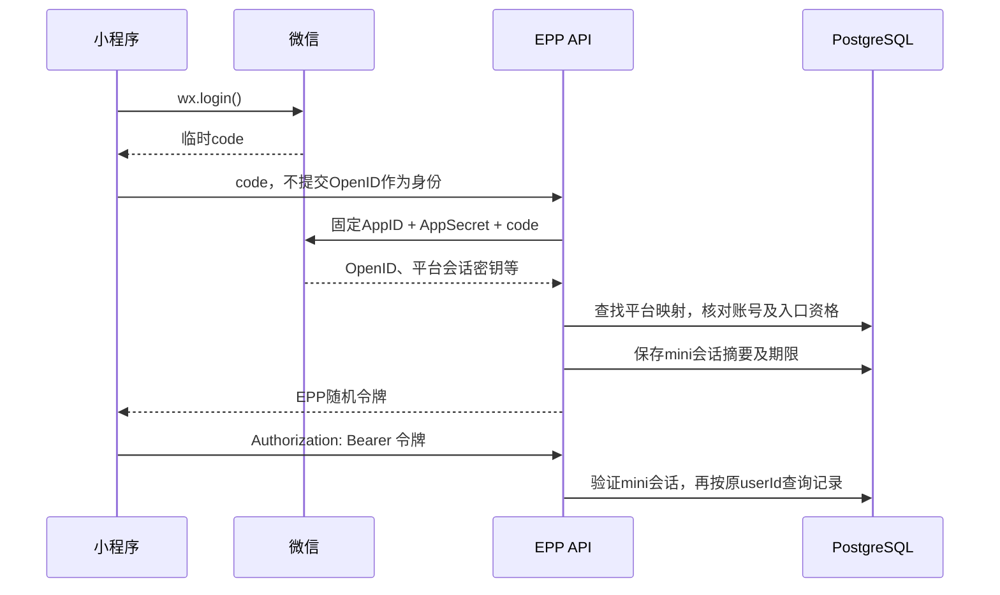
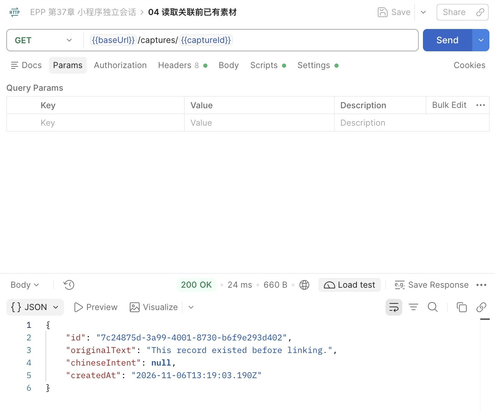
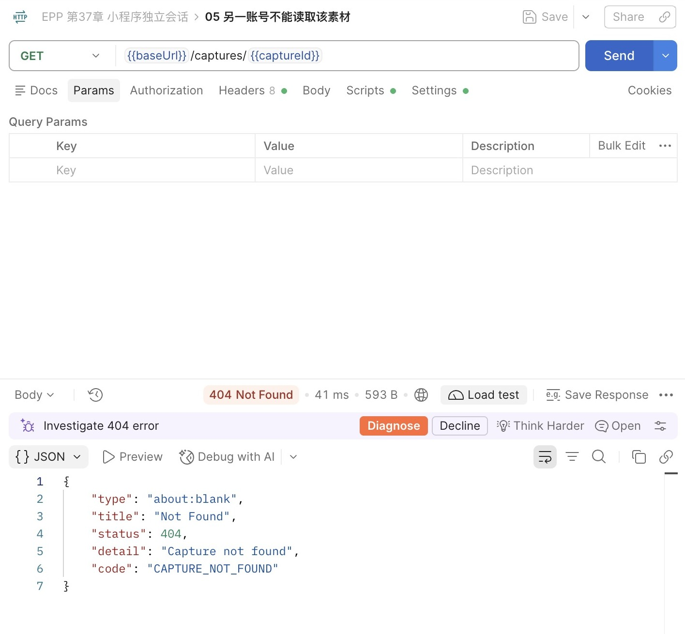
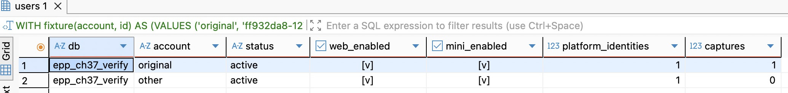
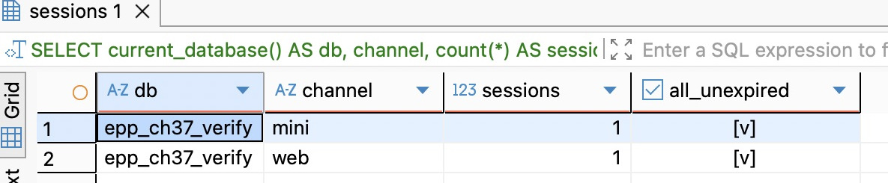
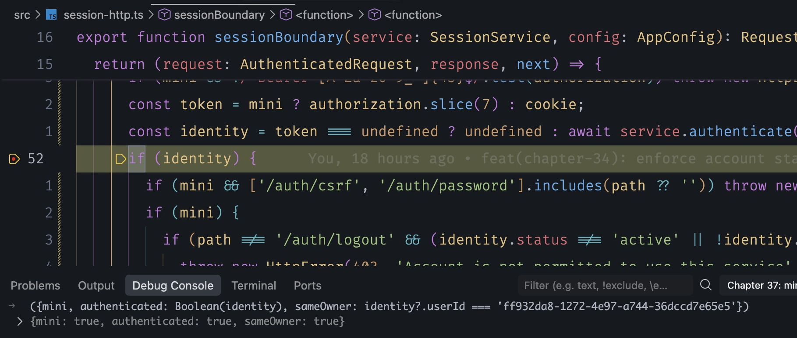

# 第37章 小程序登录与独立会话

第36章让用户通过密码与已验证邮箱管理自己的账号。接入小程序后，素材和学习来源并没有换主人，变化的是服务怎样确认来访者：这一次，用户先让微信出具一份临时凭证，EPP向微信核验，再建立自己的登录状态。

这是第五篇的可选平台分支，起点为第36章完成代码 `part-05/chapter-36`。不做小程序完整产品，只准备足够走通登录、关联、读取和退出的入口。核心路线可以完成第36章后进入第41章；选择本章时，账号映射与会话实践可以先在本机完成，真实平台交换与真机访问分别具备条件后再验证。

**时间参考（估算）**：阅读约130～160分钟；编码、迁移、本地联调与产物核对另加145～190分钟；已有平台账号与HTTPS入口时，真实开发工具及真机联调另加45～70分钟。依据约8000汉字、约200行代码与命令、一张机制图及分段实践估算；账号申请、域名备案和部署等待另计，37A支线单列。

本章有三个可以停下的位置：先追加结构并核对旧数据；再接平台交换与会话入口，完成本地关联和归属观察；最后用实际小程序凭证替换本地实验输入。每段都有独立的结果，不需要先做完小程序页面才发现后端把用户关联错了。

## 37.1 三种凭证，分别证明什么

### 微信确认身份，EPP决定建立哪一个会话

先看已有用户的情形。用户在Web里保存过一条素材，现在从小程序打开它。要保持原记录归属，后端最终仍须得到原来的 `users.id`。微信并不知道这个ID，更不能替EPP判断此用户是否已开通、是否停用、能读哪条素材。

小程序调用 `wx.login()`，获得短期的 `code`。把它交给自己的后端，后端用固定配置的AppID、AppSecret调用 `code2Session`。微信校验成功后返回当前小程序范围内的OpenID。后端用“哪个小程序＋哪个OpenID”查询账号映射，才得到本地userId，随后生成自己的随机会话令牌。



这里有三件不能混用的东西。`code` 是交给微信核验的一次性证明；OpenID是核验之后得到的平台身份标识；EPP令牌是后续访问自己服务时出示的秘密。OpenID即使看起来难猜，也不是密码。允许客户端直接提交 `openid` 并据此登录，相当于把“我是谁”改成了“我说我是谁”。

微信返回的 `session_key` 又是第四种材料：它服务于微信用户数据的加解密，不是EPP会话令牌。当前只需要身份核验，不处理那些加密数据，所以适配器丢弃它，不入库、不回传、不打印。`code2Session` 的名字里虽然也有Session，也不意味着它已经替EPP创建了可撤销的会话。[微信登录官方说明](https://developers.weixin.qq.com/miniprogram/dev/framework/open-ability/login.html)明确区分平台交换与开发者自定义登录状态，并要求会话密钥留在服务端。

### 为什么仍保留自己的随机令牌

如果每次读素材都调用微信，平台波动就会影响全部业务读取，还要反复取得临时code。现在把交换集中在登录时：成功后，后续请求按第33章的数据库会话校验。微信暂时不可用时，已有未过期会话仍能按本地账号状态工作；需要新登录的人收到受控失败。

这个选择也有边界。微信一侧发生变化，不会自动删除EPP数据库里的既有会话。当前由EPP的8小时绝对期限、账号停用与会话撤销控制存续；如果产品要求平台撤权后几秒内停止访问，就必须另设计可靠事件通知或周期核验，不能假定每次本地校验已经问过微信。会话方案本身的取舍可回看第33章支线33A。

临时code只能使用一次。客户端点登录时现取现用，不写到持久存储、不放URL、不让请求库自动重放。尤其要分清“没有拿到EPP响应”与“微信没有消费code”：后端可能已交换成功，甚至已提交会话，只在回包时断线。再次操作应取得新code，登录后检查自己的会话列表，撤销多余项；不要用旧code反复试图取回旧响应。

## 37.2 平台身份映射到用户，关联必须同时证明两边

### 保持用户主键稳定

OpenID的唯一性有范围：它标识的是**这个小程序中的这个微信用户**。同一人在两个AppID下的OpenID不应被假定相同；不同AppID下恰好相同的字符串也不能直接视为同一身份。因此映射表以 `(app_id, open_id)` 为主键，值是既有 `user_id`。AppID来自后端配置，OpenID来自受信任的交换结果，两者都不从登录Body取。

本章每个本地用户在一个AppID下只关联一个微信身份，另加 `UNIQUE(app_id,user_id)`。两条唯一性约束分别挡住“一份平台身份属于两个账号”和“同一账号偷偷换绑成另一个微信”。不是所有产品都需要第二条约束，但删除它意味着产品允许一人挂多个微信，撤销、展示和丢失设备的处理都要一起改变，不能只为消除冲突删索引。

不要直接拿OpenID替换 `users.id`。已有素材、学习来源和回执都引用原ID；平台身份只是另一种进入该账号的方式。原账号可以只有密码，可以同时有邮箱与微信，也可以最初只有微信。允许缺少密码凭据正是第32章把凭据独立成表的价值。

在 `prisma/schema.prisma` 中，给 `User` 新增 `miniEnabled Boolean @default(false) @map("mini_enabled")` 和 `wechatIdentities WechatIdentity[]`；给 `Session` 新增 `channel String @default("web") @db.Text`。追加以下模型，原字段与关系保持：

```prisma
model WechatIdentity {
  appId String @map("app_id") @db.Text
  openId String @map("open_id") @db.Text
  userId String @map("user_id") @db.Uuid
  createdAt DateTime @default(now()) @map("created_at") @db.Timestamptz(3)
  user User @relation(fields: [userId], references: [id], onDelete: Restrict,
    onUpdate: Restrict, map: "wechat_identities_user_id_fkey")
  @@id([appId, openId], map: "wechat_identities_pkey")
  @@unique([appId, userId], map: "wechat_identities_app_user_key")
  @@map("wechat_identities")
}
```

追加迁移 `20261106003700_mini_identity`，不修改前章历史。SQL完整结构为：

```sql
ALTER TABLE public.users ADD COLUMN mini_enabled boolean NOT NULL DEFAULT false;
ALTER TABLE public.sessions ADD COLUMN channel text NOT NULL DEFAULT 'web';
ALTER TABLE public.sessions ADD CONSTRAINT sessions_channel_check
  CHECK (channel IN ('web', 'mini'));
CREATE TABLE public.wechat_identities (
  app_id text NOT NULL,
  open_id text NOT NULL,
  user_id uuid NOT NULL REFERENCES public.users(id)
    ON DELETE RESTRICT ON UPDATE RESTRICT,
  created_at timestamptz(3) NOT NULL DEFAULT CURRENT_TIMESTAMP,
  CONSTRAINT wechat_identities_pkey PRIMARY KEY (app_id, open_id),
  CONSTRAINT wechat_identities_app_user_key UNIQUE (app_id, user_id),
  CONSTRAINT wechat_identities_app_check CHECK (app_id ~ '^wx[0-9a-f]{16}$'),
  CONSTRAINT wechat_identities_open_check CHECK (open_id ~ '^[A-Za-z0-9_-]{1,128}$')
);
```

不转换OpenID大小写，也不套第27章表达内容的规范化。身份标识的等价规则由发行方决定，不能用展示文本的经验自行“清洗”。已有用户的mini资格默认为false；已有会话回填web。没有平台证明，就没有可靠的OpenID可回填，所以新表保持空。

### 先验证非空迁移

沿第18、21章备份／恢复方式，用第36章非空副本准备独立VERIFY。DBeaver新建对应连接，先运行 `SELECT current_database(), current_user`，保存几条旧用户、素材与学习来源的ID及原值。确认 `.env.database-verify` 的目标后，在项目根执行：

```bash
nvm use
npm ci
unset DATABASE_URL SHADOW_DATABASE_URL
verify_db='epp_ch37_verify'  # 改成创建或恢复时选定的实际库名
node --env-file=.env.database-verify scripts/deploy-verify.mjs deploy "$verify_db"
npm run db:verify -- migrate status
npm run check
```

只有空库时，用本章完整分支执行 `node --env-file=.env.database-verify scripts/deploy-verify.mjs bootstrap "$verify_db"` 代替上面的 deploy 行。它先建立第 35 章所需的密码、会话和资格结构，再应用当前分支的剩余迁移；完成后用 status 核对。旧记录逐值对照仍使用非空副本。

DBeaver刷新结构，查看users的新增开关和sessions的channel；按刚才保存的ID再查一次原记录。结果应该是旧值保持、新字段具有上述默认值、映射表为空。`prisma generate`只生成客户端，不执行迁移；切换分支也不会把数据库退回上一章。当前只加了结构，旧密码登录和Cookie仍可工作，这里可以先停下。

准备下一段时，让 `DatabaseService.onModuleInit` 的用户探测包含 `miniEnabled`，并增加 `wechatIdentity.findMany({take:1})`。这样忘记迁移会在监听前失败，而不是首次平台用户到来才暴露缺表。编译不连接数据库，不能拿构建通过证明迁移成功。

### “创建一个用户”与“关联已有用户”不是同一动作

本章公开两条路由：`POST /auth/mini/login` 收 `{code,label}`；`POST /auth/mini/link` 额外收已有 `userId,password`。两者使用严格对象校验，login不接受userId、OpenID或资格开关。link中的userId只是待验证的目标，必须与当前密码一起证明，不能因为它长得像合法UUID就信任。

新平台身份第一次login时，可以创建一个本地用户和映射，但默认不授予mini资格。保存身份事实与允许使用入口是两件事；本次返回200和 `{userId,miniEnabled:false}`，表示平台身份已确认、等待开通；没有token，也没有会话。用户可以把这个本地ID交给管理者核对，开通后再取得新code登录。不能把所有200都当成已登录，客户端必须区分待开通结果与会话结果。和第36章一样，公开注册不自动开通。

已有账号应**先选择关联**。例如原账号A有十条素材，同一微信还没建立映射：验证A的密码和微信code后，映射指向A，十条素材一行都不搬。如果先点普通登录，已经创建并映射到B，之后再提交A的密码，本章返回409。两份已存在的账号不能靠改一条外键合并；这类迁移涉及内容冲突、会话、审计和恢复，37A会展开判断依据。

关联时使用第33章的密码并发名额。给 `SessionService` 增加 `provePassword(userId,password)`：读取凭据，不存在时用已有dummyHash执行相同验证；失败统一401，成功返回此次验证所用的hash供后续比较。它本身不签发会话，调用者必须放在 `passwordWork` 内，防止引入第二套无限并发的密码入口。

`MiniService.link` 的入口如下；`MiniLogin`／`MiniLink` 分别由上述Zod契约推导：

```ts
link(input: MiniLink) {
  return this.sessions.passwordWork(async () => {
    const passwordHash = await this.sessions.provePassword(input.userId, input.password);
    return this.create(input, { userId: input.userId, passwordHash });
  });
}
```

为什么保存hash快照？用户可能在微信交换的几秒内重置密码。先前验证过旧密码，不能成为稍后关联的通行证。拿到用户锁以后重新读取凭据，与刚才的快照比较；不同就拒绝本次关联，要求重新证明。

### 首次登录没有映射行，锁什么

两个请求几乎同时完成微信交换，数据库里还没有映射。先SELECT、没找到就INSERT，即使有唯一键，也会让其中一个事务失败；如果提前独立创建了user，还可能留下孤儿账号。

把“查映射、创建用户或关联、检查资格、签发会话”放进一个事务。尚无行可锁时，先按AppID和OpenID取得一个事务级 advisory lock。它是应用约定的一把锁：同一身份的所有写入者先拿同一把，事务结束自动释放；不会替你禁止绕过约定的SQL，所以唯一键仍是最终约束。将身份字符串散列为64位锁键，即使极少数无关身份碰撞，也只是额外等待，不会因此被当成同一用户，实际查询仍比较完整主键。

在 `MiniService.create` 中，**先完成外部交换，再打开事务**。下面是事务中建立身份的核心顺序；`tx`、`appId`、`openId`来自当前事务和已验证结果，`proof`是可选的本地密码证明：

```ts
await tx.$executeRaw`SET LOCAL lock_timeout = '1s'`;
await tx.$queryRaw`
  SELECT pg_advisory_xact_lock(hashtextextended(${appId + ':' + openId}, 0))::text
`;
const mapping = await tx.wechatIdentity.findUnique({
  where: { appId_openId: { appId, openId } },
});
if (proof && mapping && mapping.userId !== proof.userId) {
  return { error: 'IDENTITY_CONFLICT' };
}
let userId = mapping?.userId ?? proof?.userId;
if (!userId) {
  userId = randomUUID();
  await tx.user.create({ data: { id: userId } });
}
const [account] = await tx.$queryRaw<{ status: string; miniEnabled: boolean }[]>`
  SELECT status, mini_enabled AS "miniEnabled"
  FROM public.users WHERE id = ${userId}::uuid FOR UPDATE
`;
if (!account || account.status !== 'active') return { error: 'ACCOUNT_DISABLED' };
if (proof) {
  const credential = await tx.passwordCredential.findUnique({ where: { userId } });
  if (credential?.passwordHash !== proof.passwordHash) return { error: 'AUTH_REQUIRED' };
  const other = await tx.wechatIdentity.findUnique({
    where: { appId_userId: { appId, userId } },
  });
  if (other && other.openId !== openId) return { error: 'IDENTITY_CONFLICT' };
}
```

锁顺序固定为平台身份锁、用户行；密码变化也先锁用户行，所以重新读取凭据时不能与改密交错。不同微信尝试关联同一账号时，用户锁让第二个请求看到第一个请求已保存的关联，再按“一AppID一个微信”的约束拒绝。

有 mini 资格的原账号把关联和签发当作一次操作。设它已有 20 个未过期的 Web 会话，本次用一个从未映射的微信来关联。如果先写映射，再把配额错误作为正常事务结果返回，Prisma 会提交新映射，读者明明看到 429，却给账号增加了新的登录方式。因此持有用户锁后先清理过期会话、检查两类合计条数；满额直接返回，原先的映射保持，新映射数为零。这时释放一个会话、拿新 code **重新关联**才会建立关系。没有 mini 资格时则无需申请会话名额，保存经过验证的映射、返回待开通 ID。随机令牌和UUID在事务外生成，数据库只接收摘要；期限仍用数据库时钟：

```ts
if (account.miniEnabled) {
  await tx.$executeRaw`
    DELETE FROM public.sessions
    WHERE user_id = ${userId}::uuid AND expires_at <= clock_timestamp()
  `;
  if (await tx.session.count({ where: { userId } }) >= 20) return { error: 'SESSION_LIMIT' };
}
if (!mapping) await tx.wechatIdentity.create({ data: { appId, openId, userId } });
if (!account.miniEnabled) return { userId, pending: true as const };
await tx.$executeRaw`
  INSERT INTO public.sessions(id, user_id, token_digest, label, channel, expires_at)
  VALUES (${sessionId}::uuid, ${userId}::uuid, ${tokenDigest(token)}, ${input.label},
    'mini', clock_timestamp() + interval '8 hours')
`;
return { userId };
```

事务用已有 `maxWait:2000, timeout:5000`；锁等待保持1秒。事务返回业务结果，提交后再区分待开通、拒绝与已签发；业务错误此时才转换成HttpError，避免统一数据库错误包装把它改成500。待开通结果只公开本次已证明身份的本地ID，不给匿名调用者增加查用户接口。这里刻意保存“身份已确认但入口未开通”的状态；数据库故障造成回滚则不同。`create` 在事务之后这样处理：

```ts
if (result.pending) return { userId: result.userId, miniEnabled: false as const };
if (result.error) {
  const status = result.error === 'IDENTITY_CONFLICT' ? 409
    : result.error === 'AUTH_REQUIRED' ? 401
    : result.error === 'SESSION_LIMIT' ? 429 : 403;
  throw new HttpError(status, 'Mini program login or account association was not permitted', result.error);
}
return { userId: result.userId, sessionId, token, expiresIn: SESSION_SECONDS };
```

## 37.3 独立会话不是再造一套用户系统

### 区分传递方式和使用范围

Web由浏览器自动发送HttpOnly Cookie；小程序在请求中显式加 `Authorization: Bearer ...`。Bearer的含义是持有令牌即可出示，不意味着它必须是JWT，也不意味着天然比Cookie安全。本章继续使用随机令牌、摘要、服务端期限和撤销，变化的是传递方式与入口资格。

不另建一套复制的会话表。给原表加channel，既能区分入口，又让原来的“撤销此用户所有会话”继续覆盖两类。密码重置不需要再记得删除第二张表。每个登录有自己独立的会话行，退出小程序只撤销当前行，不顺带退出Web；主动改密或重置则统一撤销。

单有channel字段还不够。如果鉴权只查摘要，不查channel，同一秘密换个头部就可能跨入口使用。修改 `SessionService.authenticate`，增加默认值为web的参数，并让查询同时限定它：

```ts
async authenticate(token: string, channel: 'web' | 'mini' = 'web'): Promise<(SessionIdentity & AccountAccess & { miniEnabled: boolean }) | undefined> {
    let digest: string;
    try { digest = tokenDigest(token); } catch { return undefined; }
    const rows = await this.state.track(() => this.database.run('authenticateSession', () => this.database.client.$queryRaw<(SessionIdentity & AccountAccess & { miniEnabled: boolean })[]>`
      SELECT s.id AS "sessionId", s.user_id AS "userId", u.status, u.web_enabled AS "webEnabled", u.mini_enabled AS "miniEnabled"
      FROM public.sessions s JOIN public.users u ON u.id = s.user_id
      WHERE s.token_digest = ${digest} AND s.channel = ${channel} AND s.expires_at > clock_timestamp()
    `));
    return rows[0];
  }
```

这里保留了摘要校验、数据库错误处理和工作跟踪；返回值来自会话JOIN用户。每次请求读取账号当前状态，不能把签发时的资格永久复制进token。

### 同时带两种凭据时，不猜调用者想用哪一个

在 `src/session-http.ts` 中，公共路径仍明确列举；加入两条mini入口后，其他业务继续经过会话校验。读取当前服务的Cookie与Authorization，规则是：两者同时出现就400，Bearer格式不合法就401；没有“Bearer失败再尝试Cookie”的回退。

```ts
const cookie = readCookie(request.headers.cookie, sessionCookieName(config));
const authorization = request.headers.authorization;
if (cookie !== undefined && authorization !== undefined) {
  throw new HttpError(400, 'Use one session transport', 'AUTH_AMBIGUOUS');
}
const mini = authorization !== undefined;
if (mini && !/^Bearer [A-Za-z0-9_-]{43}$/.test(authorization)) {
  throw new HttpError(401, 'Bearer token is invalid', 'AUTH_REQUIRED');
}
const token = mini ? authorization.slice(7) : cookie;
const identity = token === undefined ? undefined
  : await service.authenticate(token, mini ? 'mini' : 'web');
```

拿到身份后，Web沿用 `requireWebAccess`；mini要求active和miniEnabled。mini不能访问Web专用的 `/auth/csrf`、`/auth/password`，返回SESSION_CHANNEL_DENIED。两者共享 `/auth/me`、会话列表、撤销、退出和业务接口。退出仍允许受限账号执行，但不能借退出放行其他操作。

Cookie写请求继续要求CSRF Token，Bearer写请求不取这个Token：浏览器不会像自动附Cookie那样，凭空知道并附上应用内存中的Bearer秘密。不过这只解释CSRF差异，不能推出“非浏览器入口不需要任何保护”。固定 `X-EPP-Request:1`、来源检查、JSON限制、限流仍在前面执行；原生客户端能够伪造Origin或Referer，二者不能作为身份凭证。

不为支持小程序就关闭第35章的浏览器来源保护，也不把微信Referer加入“免认证白名单”。业务授权仍用已验证的userId查询所属记录。令牌传递解决“当前请求是谁”，资源条件解决“他是否能读这一条”，这两步都保留。

`privateResponses` 增加 `Vary: Authorization`，继续 `private, no-store`；mini退出不设置或清除浏览器Cookie。会话列表新增channel，仍不返回token或摘要。OpenAPI把通用业务声明为Cookie或Bearer二选一，Web专用路由只列Cookie；CSRF头仅对有效Cookie写请求必需。同步 `httpBoundary` 的方法白名单、`requestObservation` 的固定路由标签和共享登录限流路径，不能只增加Controller却漏掉前置边界。

### 重置密码之后，微信还能登录吗

可以，前提是微信身份仍归该用户、账号active且mini资格未被关闭。密码重置撤销的是现有会话，不会删除另一种登录凭据。若怀疑微信也被盗，仅改EPP密码不足以阻止对方重新登录；应停用账号或关闭mini资格，再完成微信侧处理和可信恢复。将两类会话放在同一表，使撤销现有会话容易一致，但不会自动让所有认证方式具有相同的恢复规则。

本章没有刷新令牌；8小时后重新登录。最小客户端只把令牌留在内存，进程被回收后再登录；关闭页面或回到后台不保证进程立即结束，也不等于退出账号。后续若要持久保存，要同时承担设备共享、调试导出、退出清除和令牌盗用的风险；不能把它放进日志或URL来换取开发方便。

## 37.4 平台交换、配置与最小小程序入口

### 后端秘密只交给固定的微信接口

新建 `src/wechat-login.ts`，对外只返回 `{appId,openId}`。默认使用Node已有fetch，无需为了一个请求增加SDK。将请求函数作为构造参数只是为了隔离核验外部边界；正式模块始终装配真实适配器，没有环境变量切换到“信任客户端OpenID”的模式。

`AppConfig` 增加可选wechat配置。`WECHAT_APP_ID`按 `wx` 加16位小写十六进制校验，`WECHAT_APP_SECRET`按32位小写十六进制校验；两者必须同时设置。都不配置时允许核心密码路线运行，只有mini登录返回503／MINI_NOT_CONFIGURED；只填一个或格式不对，启动前失败，错误只报字段名。配置中的secret不加入启动日志。

外呼的关键部分如下，URL固定，code只能进入查询参数值，不能改变主机或协议：

```ts
const url = new URL('https://api.weixin.qq.com/sns/jscode2session');
url.search = new URLSearchParams({
  appid: this.config.appId,
  secret: this.config.secret,
  js_code: code,
  grant_type: 'authorization_code',
}).toString();
const response = await this.request(url, {
  signal: AbortSignal.timeout(4000), redirect: 'error',
});
```

HTTPS保护传输途中内容，但URL里仍有秘密，代理、追踪系统或异常对象可能把它记录下来。因此拒绝重定向，不输出fetch原始cause、完整URL或上游响应。全局入口日志只有固定路由、状态码和请求ID；平台异常转换成自己控制的错误码。

超时约束还要覆盖响应体读取。适配器用流读取，最多8192字节，超过就取消；再严格解码UTF-8、解析JSON、校验返回结构。不能先 `response.text()` 读完无限体积，再说限制为8KiB。并发名额最多2个，`finally`释放；不排无限队列，也不自动重试一次性code。

```ts
const reader = response.body.getReader(), chunks: Uint8Array[] = [];
let size = 0;
try {
  for (;;) {
    const { done, value } = await reader.read();
    if (done) break;
    size += value.byteLength;
    if (size > 8192) { await reader.cancel(); throw unavailable(); }
    chunks.push(value);
  }
} finally { reader.releaseLock(); }
```

HTTP200不等于微信业务成功。返回可能包含 `errcode`，必须先检查错误，再接受非空、符合格式的openid；未知字段不会透传。无效或已使用的code转成401／PLATFORM_CODE_INVALID；上游不可用、配额限制、非JSON或不完整成功结构返回受控503。不要把errmsg直接送给用户。微信具体错误值与调用条件以[code2Session官方文档](https://developers.weixin.qq.com/miniprogram/dev/server/API/user-login/api_code2session.html)为准；上游增加新错误码时默认失败关闭，核实含义后再改善分类。

将MiniService和MiniController注册到AuthModule，构造时注入既有DatabaseService、SessionService、ApplicationState和新的WechatLogin。login用 `state.track` 包住整个交换与事务；link由 `passwordWork` 跟踪，停止服务时不会仅等数据库而漏掉外呼。公开Controller两个方法都要求空query，用SchemaPipe校验Body，再以 `MiniLoginResultSchema` 约束待开通与已登录两种结果；只在已登录的本次响应返回原令牌，不写Cookie。`src/mini-contract.ts` 的关键契约如下，UserIdSchema、SessionIdentitySchema和isPostgresText沿用前章：

```ts
export const MiniLoginSchema = z.object({
  code: z.string().min(1).max(256).regex(/^[A-Za-z0-9_-]+$/),
  label: z.string().min(1).max(60).refine(isPostgresText).regex(/\S/).default('Mini program'),
}).strict();
export const MiniLinkSchema = MiniLoginSchema.extend({
  userId: UserIdSchema,
  password: z.string().min(1).max(256).refine(value => value.isWellFormed()),
});
export const MiniLoginResultSchema = z.union([
  z.object({ userId: UserIdSchema, miniEnabled: z.literal(false) }),
  SessionIdentitySchema.extend({
    token: z.string().regex(/^[A-Za-z0-9_-]{43}$/), expiresIn: z.literal(28800),
  }),
]);
```

到这里再把两条公共路径加入边界并启用。先运行 `npm run check`，沿[第 36 章的开发启动命令](../chapter-36-registration/chapter.md)用 `.env.test` 映射到已迁移的 VERIFY，传入本轮 `"$verify_db"`，令监听端口与 Postman 的 baseUrl 一致，并把 APP_ORIGIN 设为该服务的源。不填微信配置，用本章Postman的01发送格式合法code，应是503／MINI_NOT_CONFIGURED；发送 `openid` 等额外字段应是400。它证明入口和配置边界已接通，不证明平台身份交换成功。

### 工具、AppID和地址分别准备

从[官方下载入口](https://developers.weixin.qq.com/miniprogram/dev/devtools/download.html)安装微信开发者工具，用拥有该小程序开发资格的微信登录。在公众平台准备实际小程序的AppID和AppSecret；后者只放后端`.env`或生产环境注入，不写进小程序目录。公众号、网站扫码应用与小程序不是可以互换的配置，开发工具项目AppID必须与后端相同。

把配套 `mini-program/` 导入为普通小程序项目，不开云开发；将游客占位AppID换成自己的真实AppID。游客模式可以看静态页面，不能拿它证明真实登录。根目录只有app.js、app.json、项目配置与一个登录页；完整操作说明在配套 `mini-program/README.md`。

地址问题分成两个方向。后端向微信发请求，需要能访问固定HTTPS接口。小程序向EPP发请求，需要平台允许的request域名，并且设备实际能到达这个地址。开发工具模拟器与电脑同机时可以用127.0.0.1；在手机上，同一地址指向手机自身。当前API仍只监听电脑loopback，不能因为勾选跳过域名校验就突然从手机连上。

真实入口使用有效HTTPS证书和已配置的request合法域名，普通服务器域名需满足平台备案及协议、端口规则。域名是否写端口要与请求一致；网站已有证书也不代表小程序后台已登记。[网络官方文档](https://developers.weixin.qq.com/miniprogram/dev/framework/ability/network.html)分别说明合法域名、局域网、证书与开发工具的临时放行条件。尚无HTTPS入口时先完成本机实践，在第九篇部署后返回做真机联调；不要把公网暴露一个临时开发端口作为默认捷径。

开发工具本地设置可以临时跳过域名、TLS和证书校验，用于定位本机接口问题。正式对照必须关闭这个选项，在目标手机的开发版或体验版中再次登录、读取和退出。只有开着调试才能请求成功，优先查域名与证书，不要修改后端鉴权来“修复网络”。

### 页面只做足够验证后端的事情

`mini-program/pages/login/index.js` 的登录动作先取得新code，再POST自己的API。已有账号传本地userId与密码给link；密码随该次请求发送，操作结束即从页面状态清空。页面提示先关联已有账号，避免无意创建第二份用户。

```js
function freshCode() {
  return new Promise((resolve, reject) => wx.login({ timeout: 5000,
    success(res) { res.code ? resolve(res.code) : reject(new Error('PLATFORM_CODE_MISSING')); },
    fail() { reject(new Error('PLATFORM_LOGIN_FAILED')); },
  }));
}
// 登录按钮：busy期间不再次提交；result只在成功响应中取得。
const code = await freshCode();
const result = await request('/auth/mini/' + (link ? 'link' : 'login'), 'POST', {
  code, label: 'Mini program',
  ...(link ? { userId: this.data.userId, password: this.data.password } : {}),
});
if (result.miniEnabled === false) {
  this.setData({ message: '身份已确认，待开通小程序入口。账号：' + result.userId });
  return;
}
token = result.token;
```

`request`是本页对wx.request的薄封装：timeout为8000ms，显式JSON和 `X-EPP-Request:1`；只有authenticated参数为true且内存有token时才加Authorization。wx.request的success仅表示拿到HTTP响应，因此继续按statusCode判断2xx或业务错误。401清掉本地令牌；403显示拒绝原因，不无限重新登录；网络失败显示结果未知，不自动重放。

```js
header: {
  'content-type': 'application/json',
  'X-EPP-Request': '1',
  ...(authenticated && token ? { Authorization: 'Bearer ' + token } : {}),
},
success(res) {
  if (res.statusCode >= 200 && res.statusCode < 300) resolve(res.data);
  else {
    if (res.statusCode === 401) token = undefined;
    reject(new Error(res.data?.code || 'HTTP_' + res.statusCode));
  }
}
```

WXML放已有账号ID和密码输入框、关联／登录／读取／退出四个按钮及状态文本，按钮共享busy，防止重复点击制造多余会话。读取调用 `/captures?limit=5`，只显示本页数量，不把它描述为总量；退出等待204才清空内存令牌。退出结果未知时保留令牌用于再次撤销，关闭应用丢弃本地秘密不等于服务端会话已经删除。

开发工具Network可以分辨失败在哪里：根本没有发出wx.request，检查域名、协议和设备地址；API有请求ID和401，检查凭证；403检查账号和资格；409检查已有映射；429看本地预算；503区分未配置与上游不可用。观察请求时不要截图或导出含code、密码、Authorization和响应token的面板。

## 37.5 用旧记录验证映射，用失败路径验证边界

### 先隔离平台，再观察后端的真实行为

平台账号还没准备好，不应阻塞用户映射和业务归属的开发。但替换只发生在独立实验脚本的构造参数中：它返回虚构的AppID／OpenID，不是给正式API加一个 `fake=true`，也没有公开接口接收任意OpenID。

确认 `.env.test` 的 `TEST_DATABASE_URL` 指向本章已迁移VERIFY，运行配套脚本：

```bash
npm run build
unset DATABASE_URL TEST_DATABASE_URL
verify_db='epp_ch37_verify'  # 改成创建或恢复时选定的实际库名
node --env-file=.env.test --inspect=127.0.0.1:9470 examples/mini-login-local.mjs "$verify_db"
```

Node 加载 env 文件时保留 shell 已导出的同名变量。清除覆盖后，实验进程把 TEST_DATABASE_URL 映射成应用实际使用的 DATABASE_URL，连接后查询 current_database()，与命令末尾从建库记录独立填入的预期库名比较；缺少参数或不一致会在创建样本前退出。DBeaver 中显示正确的库只能证明那个窗口的连接。脚本在3370启动原业务应用，为本轮创建两个虚构用户。先经Web登录创建一条素材，再通过MiniService关联同一用户，另为第二账号建立独立mini会话。原用户用Bearer读该素材200，第二账号读同一ID404。测试内容的“旧”是指在关联之前创建，不要求全库只有这一条，也不改变前章已有数据。

终端输出本轮两个userId和captureId，以及200／404对照；不会输出密码或令牌。它把原 Web 和 mini 会话的短期令牌及本轮虚构密码写到已忽略、权限0600的 `.mini-local.postman_environment.json`，随后暂停供界面观察。把本章请求集合与此Environment导入Postman本地、未同步模式，选择该环境，核对baseUrl；不要共享或导出填过的秘密。直接从03开始，01／02是实际wx.login之后的真实交换请求。

在04点击Send，比较返回ID、原文、创建时间与关联前记录。只看到列表有一行不够，必须读同一个ID并对原值。每条mini请求都禁用Cookie jar，避免前章保存在同一主机的Cookie被一起送出；出现AUTH_AMBIGUOUS先检查传输，不要删除账号数据。



图37-1：实际业务API返回原素材200。这里的平台交换来自独立本地实验；截图证明该会话经过Bearer入口读取了原记录，不能证明微信真实凭证已交换。

随后发05，第二账号应收到404／CAPTURE_NOT_FOUND；它自己的会话仍有效。



图37-2：URL中的素材ID相同，更换为第二账号的mini令牌后返回404；不泄露该记录是否属于其他人。

再发06，原账号应同时看到web和mini两类会话，标签只是用户提供的说明，不是经过验证的设备身份。07尝试取得Web CSRF，返回403；不能因为两者归同一用户就放开所有入口。

### 在数据库与断点里核对同一条因果链

保持实验脚本运行。用DBeaver连接VERIFY，打开 `database/chapter-37/01-observe.sql`，先执行第一句，核对当前库和数据库用户。把脚本里的两个占位UUID分别替换为终端的 `userId`（original，关联前就有素材）和 `otherUserId`（other，对照账号）。每次重跑都会生成新ID，不能照抄图里的值。

执行从 `WITH fixture` 开始的查询，先看它是否恰好返回两行，再比较最后两列。如果少了一行，先核对连接和本轮UUID；别把“没查到这个用户”当成“用户没有素材”。



图37-3：两行的 `platform_identities` 都是1，说明两个账号都已关联；`captures` 却是1和0。另一账号的404要结合这张图和请求结果理解：它能登录，但素材仍归原账号。

再执行最后一条查询。这次只用原账号的UUID，按通道数会话：

```sql
SELECT current_database() AS db, channel, count(*) AS sessions,
       bool_and(expires_at > clock_timestamp()) AS all_unexpired
FROM public.sessions WHERE user_id = '本轮原账号UUID'::uuid
GROUP BY channel ORDER BY channel;
```



图37-4：这里的两行是**同一个账号的两种会话**。图37-3按账号数素材，这里按通道数会话；新增mini会话没有复制原素材。`all_unexpired` 打勾只说明查询时尚未到期，不能据此判断某次请求已经通过认证。

要看一次请求实际用了哪个身份，打开配套代码工程，在VS Code“运行和调试”选择 `Chapter 37: mini session (local VERIFY)`，按F5连接刚才的实验进程（9470）。在 `src/session-http.ts` 的 `if (identity)` 行设置断点，重发04，用原账号的Bearer读取原素材。暂停后在Debug Console输入下面的表达式，把字符串替换成本轮原账号的完整UUID，不必展开令牌、Cookie或配置对象：

```js
({ mini, authenticated: Boolean(identity),
   sameOwner: identity?.userId === '本轮userId' })
```



图37-5：`mini: true` 表示这次请求走Bearer入口；`authenticated: true` 表示会话查到了身份；`sameOwner: true` 表示得到的是关联前的原用户。黄箭头还停在身份中间件，素材查询尚未执行。点击Continue后，请求才返回200；把响应ID与本轮 `captureId` 对上，就能把断点里的用户和实际读到的素材连起来。移除断点再重发一次，调试暂停的时间不能算作接口耗时。

接着只对本轮原账号执行 `03-restrict-mini.sql`。BEGIN和UPDATE先执行，确认RETURNING只有目标行，再单独COMMIT；不符合预期就ROLLBACK。旧mini令牌再读身份应403，Web资格没有跟着改变。用 `02-grant-mini.sql` 恢复该开关，旧会话在期限内仍可能恢复可用：关闭资格是授权变化，撤销会话才是删除凭据。本章没有把两者偷换成同一动作。

恢复资格后先重发03，应为200。现在选一种撤销范围，**做改密实验时先别点08**。在选中的本地 Environment 内，`password` 是脚本给本轮用户设置的虚构密码，`webToken` 是创建素材时的原 Web 会话。发07a，单独用原 Cookie 取 CSRF（200），集合把结果存入本地变量；07b 用同一 Cookie、CSRF 和当前密码调用 `POST /auth/password`，应为204。随后07c显式重放原 Web Cookie、07d重放原 mini Bearer 访问 `/auth/me`，两个请求都应为401。显式重放能排除“客户端清掉 Cookie，所以根本没带旧令牌”的另一种解释。重跑 DBeaver 的按通道查询，原用户已无会话。脚本给这两个用户建了密码凭据，没有建立已验证邮箱；走第36章邮件重置须另备已验证邮箱且能取得重置凭据的测试账号。

要对照单会话退出，在全新一轮脚本里重新导入环境并选择本轮变量。跳过07a～07d，直接发08退出（204），09复用旧 mini 令牌（401），再发07a，原 Web 会话仍能取 CSRF（200）。新 code 能否再次登录取决于映射和当前资格。

回到脚本终端按Return，清理本轮两个虚构用户及其素材、映射、凭据和会话，删除临时Environment文件并关闭API。Postman导入的变量是独立副本，随后清空；磁盘文件删除不会替你清掉客户端。DBeaver结束所有事务并断开，VS Code移除断点并断开Attach。若强制终止留下实验数据，按本轮两个UUID核对再处理，不能清空整张users或sessions表。

### 超时后依据事实恢复，不重新发明身份

现在把成功路径改变一次：平台交换已经完成，但数据库暂时不可用。不能回滚微信对code的消费；恢复后取新code，仍按同一AppID／OpenID查映射，已有映射复用原userId，没有映射才创建。再改变一次：数据库已经提交会话，响应丢失。新code可能再签发一条会话，但不会再创建一个本地用户；登录后列出自己的会话并撤销不用的项，20条上限阻止无限积累。

不把外呼放进数据库事务，是为了避免等待平台时长期占锁和连接；不是假设两个系统可以一起原子提交。也不对登录机械套用第26章的完整响应回执，因为成功响应包含只返回一次的原令牌；若要可靠重放它，需要另外决定秘密保存、请求证明、加密与保留期。当前更简单的恢复策略是新凭证重登、稳定映射、可见会话与主动撤销。

关联竞争也可改变：旧密码验证完成后，另一端重置密码。事务拿到用户锁后比较hash快照，发现变化就401，不建立新的关联。这个失败应提示重新证明当前密码，不应捕获异常后改成普通首次登录，否则一次失败关联会悄悄创建另一账号。

### 开发运行与实际交付

日常修改继续 `npm run dev`，源码保存后自动编译重启，9229 Attach沿用前章；9470只属于独立实验脚本。改环境配置后重启开发入口，不能假设watch会重新读取父进程启动时的.env。数据库会话在重启后保留，令牌是否可用仍由channel、期限和账号状态决定。

交付前运行 `npm run check`，在干净运行目录复制dist、config、package.json、package-lock.json，再 `npm ci --omit=dev`。通过进程环境注入DATABASE_URL、APP_ORIGIN、CURSOR_HMAC_KEY及实际选用的微信配置，然后 `npm start`。不复制test、examples、最小小程序或开发.env；生产入口默认无文档、无Inspector、无自动重启。最小小程序由开发者工具单独预览与发布，不随API的dist一起部署。

在该产物上核对旧账号登录、原记录读取、未配置平台时的受控503和正常停止；真实微信配置齐备后，再完成实际code交换与真机完整闭环。测试命令 `npm test` 只是有限回归入口，不能代替设备的域名、证书和账号条件。

本章完成代码分支为 `part-05/chapter-37`。下一章从OAuth与OIDC协议解释另一类外部登录；这里取得的经验继续适用：外部证明、账号关联、本地会话和业务权限各自有边界，不能因最终都叫“登录”就合并成一步。

## 知识支线

[37A：同一个人、两份账号——跨应用身份与账号合并](side-01-account-linking.md)改变AppID、绑定关系和恢复条件，推导什么时候能关联、什么时候需要合并，以及为什么UnionID不能直接代替业务用户主键。

## 附录：本章必要技术点速查

| 名称 | 本章用途 | 必要注意点 |
| --- | --- | --- |
| wx.login | 获取短期平台code | 每次动作新取，不持久保存、不重放旧code |
| code2Session | 服务端核验平台身份 | 固定AppID／秘密／HTTPS端点，不下发session_key |
| `(app_id,open_id)` | 平台身份键 | 范围包含应用；不自行忽略大小写 |
| mini_enabled | 小程序入口资格 | 与账号active、Web资格分别判断 |
| sessions.channel | 限定会话用途 | 查询摘要时同时限定channel，默认旧会话web |
| Authorization Bearer | 显式出示mini会话 | 不与当前服务Cookie混用，不放URL |
| pg_advisory_xact_lock | 锁住尚无映射行的身份 | 所有写入者遵守顺序，唯一约束仍保留 |
| AbortSignal.timeout | 有界外呼 | 配合响应大小、并发限制与失败关闭 |
| request合法域名 | 小程序网络访问前提 | 与API鉴权不同；开发工具跳过不代表真机可用 |

平台API以[微信登录](https://developers.weixin.qq.com/miniprogram/dev/api/open-api/login/wx.login.html)、[服务端交换](https://developers.weixin.qq.com/miniprogram/dev/server/API/user-login/api_code2session.html)、[网络能力](https://developers.weixin.qq.com/miniprogram/dev/framework/ability/network.html)官方说明为准；本章核对日期为2026-11-06。运行时使用Node24.22.1，参见[AbortSignal](https://nodejs.org/docs/latest-v24.x/api/globals.html#static-method-abortsignaltimeoutdelay)；数据库使用PostgreSQL18，参见[advisory locks](https://www.postgresql.org/docs/18/explicit-locking.html#ADVISORY-LOCKS)。

[返回第五篇](../README.md) · [上一章：注册与恢复](../chapter-36-registration/chapter.md) · [下一章：OAuth 与 OIDC 外部登录](../chapter-38-oidc/chapter.md)
