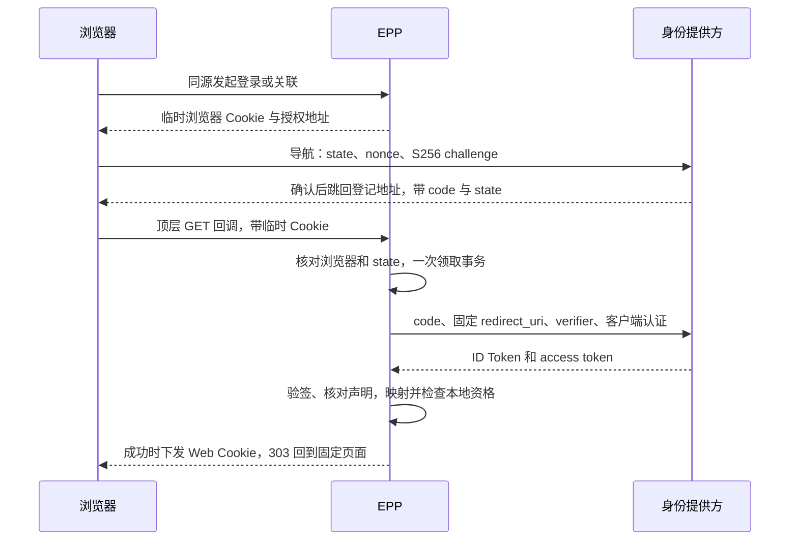
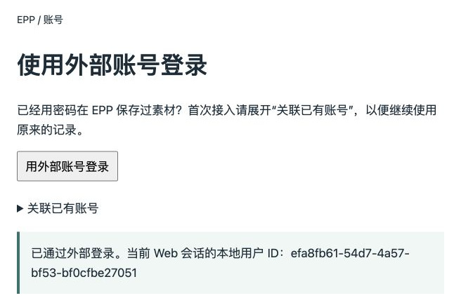
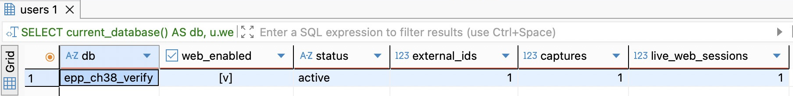
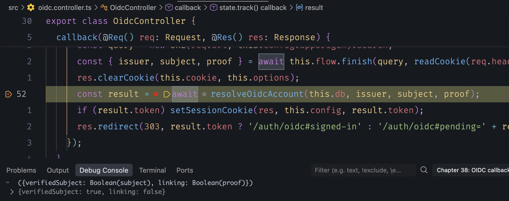
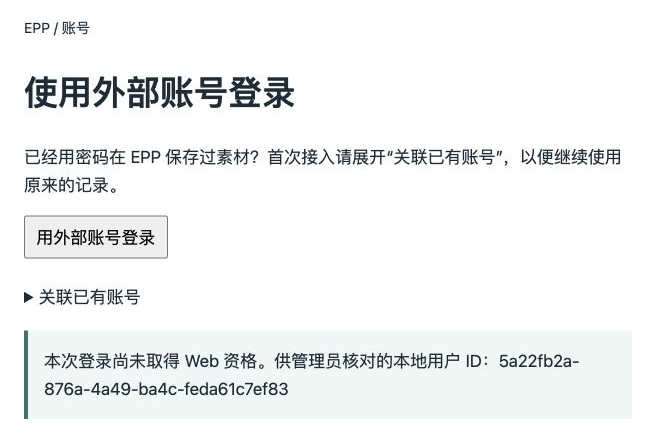

# 第38章 先理解 OAuth，再接入 OIDC 外部登录

一个人昨天用密码在 EPP 保存了一条素材，今天点了“用外部账号登录”。页面顺利跳了回来，右上角甚至显示了熟悉的邮箱。此时该不该让他看昨天的素材？如果答“平台已经让他登录了”，还少了两步：平台究竟向**哪个应用**证明了什么，以及这个证明在 EPP 对应**哪一个本地用户**。最危险的错误往往没有红色报错：两个账号被悄悄当成了同一个。

38.1～38.3 可以单独阅读，不需要外部平台账号，也是以后理解 MCP 授权的起点。后半章给网站增加一种登录方式。代码沿用第37章完成代码 `part-05/chapter-37`，保留已有迁移和账号；不需要微信凭证或运行小程序。走密码主线的读者也可以先读协议部分，等需要开放外部登录时再回来。

**时间参考（估算）**：阅读约75～100分钟；实现、迁移及两站联调另加100～140分钟。估算按六节、一次非空库升级、一条完整浏览器往返及失败对照计算；真实供应商注册、域名与证书准备时间另计，38A单列。

## 38.1 谁授权谁，授权码为什么还要换令牌

先把“登录”放一边。假设 EPP 要从你的云盘导入**一份**笔记。最省事的实现是弹框索要云盘密码：EPP 拿它也许能读文件，可它同时得到了作为你本人登录云盘的能力。你无法只允许读文件，也很难只撤掉 EPP 而保留其他应用。OAuth 要解决的是这里的**委托**：让一个应用获得有限的访问许可，无须把用户的主凭据交给它。

这个故事里有四个角色。你有权决定要不要让出访问权，是资源所有者。EPP 后端替你申请访问，是客户端；这个词说的是它相对云盘的身份，不是指网页。云盘的授权服务器负责确认用户、取得授权并签发令牌；保存笔记、最后实际响应下载请求的 API 是资源服务器。同一家公司甚至同一个进程可以同时承担后两个角色，但“可以发什么许可”和“这份许可足不足以读取文件”仍是两个判断。浏览器把你带到各个站点，不自动成为持有云盘客户端密钥的那一方。

EPP 把浏览器送往云盘授权页。云盘能在自己的页面要求登录或再次确认，EPP 只收到浏览器带回的短期授权码（code）。为什么不直接把长期凭据放在跳转地址里？地址会经过浏览器、历史、代理和诊断工具；而在前端收到一个字符串，也不能证明收到它的服务有权用它。授权服务器要求后端带着这个码、登记过的回调地址，以及客户端和本次请求所需的证明，再来一次直接的 HTTPS 请求。成功后才发访问令牌。资源 API 期待的是给它用的 access token，不接受授权码。

反过来，如果问题只是“那份笔记是不是这位用户允许读的”，读到它也不能证明当前浏览器应该登录哪一个 EPP 账号。OAuth 的 scope（授权范围）限定可能做的动作，资源服务器还要检查受众、作用范围以及文件层面的权限。把下载权限改成只读不会改变这个人的本地 userId；更换用户则可能使同一范围得到完全不同的数据。后面的 MCP 客户端代表用户调用 EPP 时，EPP 可能轮到资源服务器的位置。它该验证给 EPP 的访问许可，不能拿下面的登录结果充当工具权限。

## 38.2 外部登录到底相信哪份证明

现在删掉“下载云盘笔记”的需求，只保留“用已有外部账号进入 EPP”。我们需要提供方明确回答：“在我这里完成认证的主体是某人，这份回答发给 EPP。”OpenID Connect（OIDC）在 OAuth 上约定了这个问题和回答：请求中带 `scope=openid`，在本章选用的授权码流程中，由后端在令牌端点取得 **ID Token**。其中的声明只有验证后才能用。提供方在 OIDC 中也称 OP，接收并依赖证明的应用称 RP；它们在上述流程里分别承担授权服务器与客户端的角色。

| 结果 | 谁拿它做什么 | 本章如何处置 |
| --- | --- | --- |
| 授权码 | EPP 后端向提供方兑换本次结果 | 一次消费，不入日志，不是 API 登录凭据 |
| ID Token | EPP 判断提供方为哪个客户端认证了谁 | 验签、核对声明，只取稳定身份键 |
| Access token | 客户端访问受许可的资源服务 | 本章不读外部业务资源，收到也不存储或转交浏览器 |
| EPP 会话 Cookie | 浏览器以后向 EPP 表明本地会话 | EPP 自己生成，可在本地过期和撤销 |

想象公司里有考勤和报销两个应用。两者都信任公司的身份提供方。攻击者拿一份**真的**、签名也正确的考勤登录结果来报销系统。只验签就通过，会把“公司证明此人登录了考勤”偷换成“报销系统发起的登录已完成”。因此除了签发者 `iss` 还要核对受众 `aud`；出现多个受众时还要知道哪一个客户端是获授权方 `azp`。同理，一段看起来像 JWT 的 access token 不能凭格式变成 ID Token；有些访问令牌本来就是不透明的随机串。

本地账号的键也不从头像或邮箱选。提供方在它的签发者范围内给出主体标识 `sub`。一个租户的 `sub=42` 和另一个租户的 `sub=42` 没有天然关系。我们保存经验证的 **(iss, sub)**，大小写原样保留。邮箱可改、可回收，`email_verified` 即便为真，也只说明该提供方对这个地址的声明，不能证明用户控制着 EPP 里碰巧同邮箱的那份账号。只做身份识别时最少只请求 `openid`，不顺手索取通讯录、离线访问或邮箱。

## 38.3 跟着一次回调看 state、nonce 与 PKCE

让我们把两站间的消息分成两条路。图中浏览器看得见的导航走前一条，兑换授权码和读取公钥走后端通道。最下面的 Cookie 由 EPP 自己设置，提供方不会替 EPP 写它。



**先挡住“别人发起的登录”。** 假设攻击者用自己的平台账号完成授权，设法让你打开他的回调链接。若后端只凭 code 兑换，再往你的浏览器写会话，你会在他的 EPP 账号里记下自己的材料。EPP 生成随机 `state` 标识一次未完成的尝试，并另外把一个随机值写进发起浏览器的 HttpOnly Cookie。回调必须同时匹配服务端记录中的两者。state 本来就经过浏览器地址，若只查“数据库里有这个 state”却不核对发起浏览器，转发整个链接就能把这道检查也转发走。

**再挡住“拿到码的人抢先兑换”。** 每次跳转前，EPP 生成新的随机 `code_verifier`，留在后端。把它做 SHA-256，再用不带填充的 base64url 编码，作为 `code_challenge` 交给提供方，明确方法是 `S256`。提供方发出的码绑定这次 challenge。兑换时 EPP 才交出原 verifier；提供方以相同方式计算比较。只从地址截到码的人缺这份原值。PKCE 的意义是让**同一次开始和兑换**相互对应；client secret 则证明是哪个已注册的机密客户端在调用。所有 EPP 请求共享的长期秘密替代不了每次变化的 verifier，公开客户端也不能靠把一个共享 secret 塞进 JS 变成机密客户端。

**最后核对“被签的身份回答属于哪次”。** EPP 把单独的随机 `nonce` 随授权请求发出，提供方把它写进签名的 ID Token。回来的签名必须对应预先信任的 issuer 公钥，算法符合本客户端约定；`iss`、`aud`、有效期及 nonce 都要通过核验，才读 `sub`。nonce 不要求藏起来；重要的是攻击者无法给另一份旧证明改 nonce 后重新签名。state 出现在回调参数中，nonce 在被签的声明里，verifier 在兑换请求里：诊断时先问缺的是哪一次比对，而不是把三个值都打印出来。

浏览器还有一道容易错的边界：EPP 业务 Cookie 继续用 `SameSite=Strict`，但来自提供方的顶层导航是跨站的，不能假设这次请求会带原业务 Cookie。本章单设一个五分钟、`HttpOnly; SameSite=Lax; Path=/` 的临时 Cookie，服务端登记固定的 GET 回调。HTTPS 时再加 Secure 并用 `__Host-` 前缀，不指定 Domain。允许顶层 GET 带这粒 Cookie，不等于放宽全部业务 Cookie；它单独也读不到素材。换成跨站 POST 的 `form_post` 模式，这个假设就不成立，不能只改提供方控制台而保留原流程。本章固定 query 授权码模式，不支持隐式流程。

**到这里可以停下。** 如果现在的目标是补 MCP 授权基础，可以先回到原阅读路线。要接 EPP 登录，下一步才需要 Node 工程、数据库，以及外部身份到本地账号的对应关系。

## 38.4 用 openid-client 完成兑换，先让旧数据原样留下

代码使用 Node 24.22.1、PostgreSQL 18 和 ESM。先从第37章非空库备份，按第18、21章的步骤恢复到独立 VERIFY；DBeaver 新建对应连接，执行 `SELECT current_database(), current_user`，记下一条旧素材的 ID、user_id、原文和时间。它们是对照物，不能拿新建的空库代替。普通克隆可从前章分支新建本章工作分支；从零跟写则继续自己的工程。

先只加结构。在 `prisma/migrations/20261107003800_oidc_identity/migration.sql` 新增一张表：

```sql
CREATE TABLE public.oidc_identities (
  issuer text COLLATE "C" NOT NULL CHECK (octet_length(issuer) BETWEEN 1 AND 512),
  subject text COLLATE "C" NOT NULL CHECK (octet_length(subject) BETWEEN 1 AND 255),
  user_id uuid NOT NULL REFERENCES public.users(id) ON DELETE RESTRICT ON UPDATE RESTRICT,
  PRIMARY KEY (issuer, subject),
  UNIQUE (issuer, user_id)
);
```

一行是一条已经确认的登录关系，不是访问记录。主键保证一个外部身份只指向一个本地用户；第二条唯一约束表达**本章的产品选择**：一个本地账号在同一 issuer 只绑定一个主体，不声称 OIDC 协议有此限制。外键指向现有 users，素材表不动。不把 `state`、`nonce` 或 token 放进永久映射；这些东西过期的时间和“这个人下次来仍是同一账号”的时间不同。在 Prisma schema 对应新增 OidcIdentity、User 的反向关系，并在 DatabaseService 的启动探针读取映射表的 userId。一旦漏部署迁移，应在启动时发现。

```bash
nvm use
npm install --save-exact openid-client@6.8.9
# 确认 .env.database-verify 指向独立副本
npm run db:verify -- migrate deploy
npm run db:verify -- migrate status
npm run check
```

在 DBeaver 刷新 public 下的表；新表此时应为空，按原 ID 查询的旧素材应逐项一致。只加这张表时，前章代码仍可通过密码读取旧记录。这里是第一个可运行的停点；切换 Git 分支本身不会升级或回退数据库。使用本章完整快照时直接 `npm ci` 安装锁定版本，不再重新选择依赖。

为什么需要库？发一个跳转用拼 URL 就能做到；困难的是得到响应后**哪些情况下必须拒绝**。手写 base64 解码尤其容易把“能看见内容”当成“内容已经可信”。我们让 openid-client 处理发现、兑换、协议声明与签名验证，自己保留三项它不知道的规则：信任哪个 issuer、哪一个浏览器发起了本次事务、哪个本地账号有资格进入。

在 `src/config.ts` 中要求 `OIDC_ISSUER`、`OIDC_CLIENT_ID`、`OIDC_CLIENT_SECRET` 三项同时配置或同时留空；缺省时密码入口正常，尝试外部登录才报告未配置。issuer 由运营方登记，拒绝带账号密码、查询或片段的地址；不能从用户输入、Host 请求头或还没验证的 JWT 拿它去联网。回调取 `APP_ORIGIN + '/auth/oidc/callback'`，不要按传入的转发头临时拼一个。这既关系到回调地址匹配，也关系到客户端密钥最终会送给谁。

`src/oidc-flow.ts` 首次使用时发现元数据，缓存成功的 Configuration；失败不永久缓存。下面是正式 HTTPS 路径的关键选项，完整实现还核对发现文档的 issuer 一致、授权／令牌／JWKS 地址合法，并限制外呼不跟随重定向、每次五秒、响应最多256 KiB：

```ts
const client = await oidc.discovery(new URL(issuer), clientId,
  { id_token_signed_response_alg: 'RS256' },
  oidc.ClientSecretBasic(secret),
  { timeout: 5, execute: [oidc.enableNonRepudiationChecks] });
```

这是对供应商能力的具体约定：授权码、S256、`client_secret_basic` 和 RS256。JWKS 是签发方公开的验签密钥集合。用预期 issuer 发现的地址取公钥，不采信 token 自带的随意密钥地址；显式开启应用层签名核验，错签名即使其余字段正确也不能通过。本机演练仅在 test 模式为回环 issuer 放行 HTTP，并将它的各端点和外呼锁到同一回环来源；开发和生产的外部 issuer 仍须 HTTPS。不要为接通测试服务关闭整个 Node 进程的 TLS 校验。

```ts
// OidcFlow.start：verifier 留在服务端，页面只得到导航地址。
const verifier = oidc.randomPKCECodeVerifier();
const challenge = await oidc.calculatePKCECodeChallenge(verifier);
const state = oidc.randomState(), nonce = oidc.randomNonce(), browser = issueToken();
const url = oidc.buildAuthorizationUrl(client, {
  redirect_uri: this.callback, response_type: 'code', scope: 'openid',
  state, nonce, code_challenge: challenge, code_challenge_method: 'S256',
});
```

服务端 Map 以 state 为键保存 browser、verifier、nonce、到期时刻和可选的关联证明；回调同时检查 Cookie 和期限，**先同步删除已匹配的项，再首次 await**。两个相同回调并发时只有第一个能去兑换；错误浏览器不能借知道 state 抢先删除正确浏览器的事务。最多保留256次未完成尝试，占满拒绝新开始；兑换最多四个并行。这个实现只适合单进程。重启丢掉的是未完成的跳转，不是已经保存的映射或 Web 会话。

```ts
// OidcFlow.finish：url 的来源和路径由配置固定，只取回调的查询串。
const tokens = await oidc.authorizationCodeGrant(client, url, {
  expectedState: a.state, expectedNonce: a.nonce,
  pkceCodeVerifier: a.verifier, idTokenExpected: true,
});
const claims = tokens.claims();
```

本章只接受非空、最多255个可打印非空格 ASCII 字符的 subject；只信任本应用这个受众，即使 azp 正确也拒绝附带其他应用的受众列表；显式提供 azp 时也要求等于本客户端 ID。页面只拿固定落点和本地结果，不收到平台的 token。提供方可返回用户取消；兑换超时也可能发生在对方**已经消费**授权码之后。二者都不能靠刷新回调继续，重新从开始页取得一组证明即可。日志记路由模板、关联号和错误码；还要使反向代理、访问日志与监控不记录回调 query，否则应用没打日志，前置代理却已经保存了 code。

## 38.5 首次登录、关联和冲突，分别提交什么

第一次点“用外部账号登录”，在映射表查不到身份，有两种完全不同的用户意图。新用户需要创建本地账号；昨天已经存过素材的人需要**关联旧账号**。两者若被合成“查不到就按邮箱找一个”，最坏是接管别人的数据；若一律新建，最常见的是“能登录，笔记却空了”。因此页面提供两个明确入口，由用户在离开 EPP **之前**选择。关联发起时提交原账号 ID 和当前 EPP 密码，由服务端校验，不把本地密码带到授权页；提供方认证只证明另一边。

在 `src/oidc.controller.ts` 注册 `POST /auth/oidc/start`，严格接受 `{mode:'login'}` 或 `{mode:'link',userId,password}`。前端同源发 JSON 并带第35章的显式请求头；这是重新提供凭据的公开入口，不依赖已有 Cookie 选择绑定对象。已登录并不意味着可以悄悄绑定一条长期登录途径。关联先在密码工作并发限制内校验，待办只放用户ID和当时的密码散列快照，不保存密码原文；提交前再比一次。两种开始动作均受登录限流保护。要让路由真的可达，还要把两条 GET（页面、回调）与一条 POST 的方法加入 httpBoundary，仅这些入口跳过现有会话前置检查，保留浏览器来源、写请求头和只收 JSON 的规则。

这也是为什么“关联”用 POST 开始，而“回调”允许跨站 GET。前者是 EPP 页面表达用户意图，照常检查来源和自定义头；后者是提供方按协议让浏览器导航回来，不能要求导航替你加自定义头。它的保护来自已登记的地址、临时 Cookie、一次消费以及后续兑换。最小页面只需在同源脚本中取得导航地址，然后让浏览器真正导航：

```js
const response = await fetch('/auth/oidc/start', {
  method: 'POST',
  headers: { 'Content-Type': 'application/json', 'X-EPP-Request': '1' },
  body: JSON.stringify({ mode: 'login' }),
});
if (response.ok) location.assign((await response.json()).authorizationUrl);
```

不能改成 fetch 授权页的 HTML 再塞进自己的页面：用户应能辨认自己正在哪个站点认证，提供方也有自己的 Cookie 和内容安全策略。在 AuthModule 注册 OidcController，声明数据库、会话和应用状态依赖；页面、开始、回调分别记固定日志标签，OpenAPI 同步三条路由。若应用已启动却收到 ROUTE_NOT_FOUND，要先看第35章的路径／方法白名单，而不是先查密钥。

平台验证结束，再在 `src/oidc-accounts.ts` 开一个短数据库事务。不要在持有数据库锁时等用户点同意，也不要等远端 JWKS。以同一个外部键竞争的两个首次登录，可能同时发现“没有这行”；单凭 `SELECT ... FOR UPDATE` 锁不到不存在的映射。先锁这个逻辑键，再查映射。不同外部身份试图绑定同一本地用户时，再由用户行锁串行检查同 issuer 的另一个绑定。表上两条唯一约束仍是最后的保证。

```ts
// resolveOidcAccount 的事务：key 同时含签发者和主体。
const key = JSON.stringify([issuer, subject]);
await tx.$queryRaw`SELECT pg_advisory_xact_lock(hashtextextended(${key}, 38))::text`;
const mapping = await tx.oidcIdentity.findUnique({
  where: { issuer_subject: { issuer, subject } },
});
if (mapping && proof && mapping.userId !== proof.userId)
  return { error: 'IDENTITY_CONFLICT' } as const;
const userId = mapping?.userId ?? proof?.userId ?? randomUUID();
if (!proof && !mapping) await tx.user.create({ data: { id: userId } });
```

在这个 userId 上拿到行锁后，重新读账号状态；关联时还要重新读取 passwordCredential，检查仍与发起时相同，并查该用户是否已绑定其他主体。在用户去提供方期间发生密码重置，旧的关联意图就失去依据，返回401。身份已经属于甲却拿乙的密码来关联，或同一用户想覆盖同一 issuer 下另一条身份，返回409。失败不自动转成普通登录，不改素材 user_id，不提供“按邮箱合并”。若两份既有账号确实都要保留，请按[37A 的双账号推导](../chapter-37-mini-program/side-01-account-linking.md)另外设计合并。

匹配通过后写入缺少的映射。新用户继承 `web_enabled=false`，可以得到供管理员核对的本地 ID，却没有业务 Cookie。EPP 目前不要求姓名、头像或邮箱才能保存素材，因此**没有必须补填的外部资料**。若以后要靠邮箱恢复，另走本地验证和凭据建立流程；外部用户没有密码行，不等于可以用空密码登录。已停用账号直接拒绝。已开通的账号沿用原 userId、八小时 Web 会话、随机令牌摘要及两通道合计20条的上限。满额时不会再发会话；若关联关系此前刚写入，它仍可保留，撤销不用的会话后重新开始登录。

```ts
// 回调在取得数据库结果后才设置 Cookie；303 的目标不接受外部 returnTo。
if (result.token) setSessionCookie(res, this.config, result.token);
res.redirect(303, result.token ? '/auth/oidc#signed-in'
  : '/auth/oidc#pending=' + result.userId);
```

成功页里的 fragment 只是显示提示，能自行改写，不能用作鉴权证据。页面另发 `GET /auth/me`，让刚写入的 HttpOnly Cookie 通过原有会话中间件，读回真正的本地用户。待开通提示也只描述**这一次尝试**没有得到会话；不代表这个浏览器此前一定没有别的会话。此后取素材仍在查询中限定当前 userId，外部认证没有产生越过资源归属的特权，也没有创建一种新的 sessions.channel。

## 38.6 用两个站点走一遍，再决定怎样接真实供应商

先确认 `.env.test` 的 TEST_DATABASE_URL 是刚才已迁移的 VERIFY。配套工程中，`examples/oidc-lab.mjs` 启动业务 API，再单独运行一个只监听回环地址的虚构提供方；提供方有自己的发现文档、公钥、授权页和令牌端点，用临时生成的私钥签名。它只在实验进程里存在。浏览器走的是实际的跳转和 Cookie，Node 库走的是实际的兑换和验签，但没有因此验证任何商业供应商的注册或账号策略。

```bash
npm run build
node --env-file=.env.test --inspect=127.0.0.1:9480 examples/oidc-lab.mjs
```

实验先用虚构原账号通过密码登录，创建一条素材，再退出这个密码会话。保持终端运行，记下本轮的 userId、虚构密码与 captureId。打开 `http://127.0.0.1:3380/auth/oidc`，第一次展开**关联已有账号**，填刚才的本地凭据。浏览器导航到 localhost 上的实验提供方；尽管仍在同一台电脑上，localhost 和 127.0.0.1 在这里是不同站点。不要中途把 EPP 地址换成 localhost，否则起始 Cookie 与登记回调不再对应。


图38-1：现在是提供方在问是否允许 EPP 确认这个虚构身份。这里不需要、也不应该再输入 EPP 的密码。点取消不会创建登录会话；要再试，从 EPP 开始页重新发起。



图38-2：点继续后回到 EPP。结果框里的 userId 来自 `/auth/me`，应当等于本轮终端的原账号。接着在同一浏览器打开 `http://127.0.0.1:3380/captures/本轮captureId`，读到的原文应是 `This record predates external login.`。如果列表里碰巧有一条记录，仍不能代替对原 ID 与原值的核对。以后这个用户只点普通登录，仍通过映射回到同一个本地账号。

在 DBeaver 打开配套的 `database/chapter-38/01-observe.sql`。先单独执行第一条查询，确认当前库是本轮 VERIFY；再把第二条查询的 WHERE 占位值换成终端里的原账号 userId，单独执行。只看这个用户的计数，不必展开外部主体标识、密码散列或会话摘要。



图38-3：从 `external_ids` 向右读：这个账号有一条外部身份映射、一条素材、一个有效 Web 会话。素材数只能说明有几条；要确认还是关联前的那一条，得用新会话读取图38-2 中的原 captureId，核对原文。

保持这一轮实验运行。在 VS Code 选择 `Chapter 38: OIDC callback (local VERIFY)` 附加到端口 9480，在 `src/oidc.controller.ts` 的 `const result = await resolveOidcAccount(...)` 行加断点。回到 EPP 开始页，这次选**普通登录**。暂停在该行后，在 Debug Console 输入 `({ verifiedSubject: Boolean(subject), linking: Boolean(proof) })`。不要展开令牌、授权码、verifier、proof 或配置对象。



图38-4：前面调用的 `flow.finish` 已返回，`verifiedSubject: true` 表示校验结果中有主体；`linking: false` 表示这次没有提交关联原账号的证明。黄箭头所在的语句还没执行，此时还不知道这次能否拿到本地会话。

点击继续。回调返回 303 后，用新会话请求 `/auth/me`，读回的仍是原 userId；读取原 captureId 也返回 200，响应里的素材 ID 与关联前一致。在 DBeaver 重跑同一条查询，映射和素材仍各一条，有效 Web 会话从一条变成两条。移除本轮断点，避免下次登录又停在这里。

若走的是首次普通登录，页面只显示待开通 ID；这时应该看到一条映射、零条 Web 会话。管理员可依[第34章入口资格](../chapter-34-authorization/chapter.md)在独立 VERIFY 对**这个 ID**核对后开通，再重新发起登录。已得到一个新账号后，不能靠再点关联把它直接搬给旧账号；要观察原账号路径，就按 Return 清理这一轮，再从新一轮的“关联已有账号”开始。



图38-5：换一轮新的虚构身份，第一次只选普通登录。提供方已经认证成功，EPP 也有了稳定的本地 ID，但此时映射数为1、素材数为0、有效 Web 会话数为0。不要把这页当作签发了业务会话，也不要照图抄 ID 去开通别人的账号。

Postman 可导入本章集合观察开始入口的契约和无需凭据的失败；不要把一个客户端的回调地址复制到另一浏览器期待登录成功。

**把一个条件改坏再判断。** 两个标签先后开始，临时 Cookie 只保留最新值；回到早发起的标签会因绑定不符得到400，保留最新标签或重新开始。复制已完成回调再次打开也会400；这不是“上次没有成功”，不能因此撤销已经写入的会话。反过来，若浏览器拿到了 code 却最终401，先看预期 issuer、Client ID、系统时钟、注册的认证方法，再核对 S256 和签名密钥轮换；不要把平台原始响应或 secret 发到日志。如果令牌端点超时、返回503或拒绝客户端注册凭据，EPP 将它归为提供方不可用；先查外呼与配置，不要让读者反复输本地密码。用请求关联号对照失败阶段，别对照秘密原值。结果未知时先查本地会话或重新登录，不能因远端和本地无法一起回滚就简单重试授权码。

实验结束，在终端按 Return 清理本轮样本、停止 API 和提供方，然后断开 DBeaver 与 VS Code。回到日常工程仍用 `npm run dev` 和9229调试，源码保存触发编译重启；内存里的半途登录要重开，已提交的会话按数据库规则继续。改了进程环境要重新启动。生产构建用 `npm run check`，将 dist、config、package.json 与 lockfile 放到干净目录，`npm ci --omit=dev` 后注入运行环境再 `npm start`；openid-client 是运行依赖，实验 issuer、私钥、测试与开发 .env 都不进交付目录。

**接真实供应商时，第一步是核对它允许登记什么。** 在其管理界面创建面向服务端的 Web 客户端，选定租户或固定 issuer，核对发现文档是否支持本章的认证、授权和签名方式。逐字符登记 `APP_ORIGIN/auth/oidc/callback`：协议、主机、端口和路径都要相同，localhost 与 127.0.0.1 不是两个可互换的写法。不用通配符，也不从查询参数接受任意登录后跳转地址。供应商不接受本机回调，就先完成第九篇的公网 HTTPS、代理、域名和日志脱敏，再回来；不要为一次联调把 client secret 搬到浏览器。生产 OIDC 配置要求 EPP 本身也是 HTTPS。

用供应商的测试账号依次验证取消、首次待开通、已有账号关联、回到旧素材及停用后的拒绝。用 DBeaver 看账号与映射，用同一浏览器验证会话。EPP 退出只撤销自己的 Web 会话；若下次跳转时提供方仍记得用户，它可能不再要求输密码，这不是 EPP 的旧 Cookie 复活。若产品承诺全站单点退出或组织侧停用后立即收回 EPP 访问，须另外设计通知、会话寿命与撤销，不能从这次成功回调推出。

本章完成代码分支为 `part-05/chapter-38`。下一章换成微信网站扫码登录时，先问它提供的是哪一种身份凭证，再决定哪些回调与账号关联规则可以复用。

## 知识支线

[38A：登录事务遇到多实例和密钥轮换](side-01-trust-and-transactions.md)改变两个常见前提：回调不再回到原进程，可信提供方也不再始终使用同一把签名密钥。用它们区分事务丢失、证明失效和本地撤权。

## 附录：本章必要技术点速查

| 名称 | 找谁核对 | 本章的判断 |
| --- | --- | --- |
| redirect_uri | 注册信息、授权和兑换请求 | 地址精确匹配；正式入口 HTTPS |
| state 与临时 Cookie | 发起浏览器与本次事务 | 两者都匹配，五分钟内只领取一次 |
| nonce／PKCE S256 | 签名的 ID Token／令牌端点 | 分别绑定身份回答和兑换者 |
| discovery／JWKS | 受信 issuer 的元数据与公钥 | 固定算法与权威来源，未知签名不放行 |
| iss、sub、aud、azp | 可验证的声明 | 身份键与客户端受众分开，不拿邮箱作键 |
| 本地资格／会话 | users 与 sessions | 映射存在不保证能登录；认证也不授予别人的素材 |

可按问题回查：[OAuth 安全最佳实践 RFC 9700](https://www.rfc-editor.org/rfc/rfc9700.html)、[PKCE RFC 7636](https://www.rfc-editor.org/rfc/rfc7636.html)、[OIDC Core 的授权码流程和 ID Token 校验](https://openid.net/specs/openid-connect-core-1_0.html#CodeFlowAuth)、[openid-client 项目与 v6 API](https://github.com/panva/openid-client)。本章锁定 openid-client 6.8.9，不混用旧版的 Issuer、Client 或 callback API。

[返回第五篇](../README.md) · [上一章：小程序登录与独立会话](../chapter-37-mini-program/chapter.md) · [下一章：微信网站扫码登录](../chapter-39-wechat-website/chapter.md)
