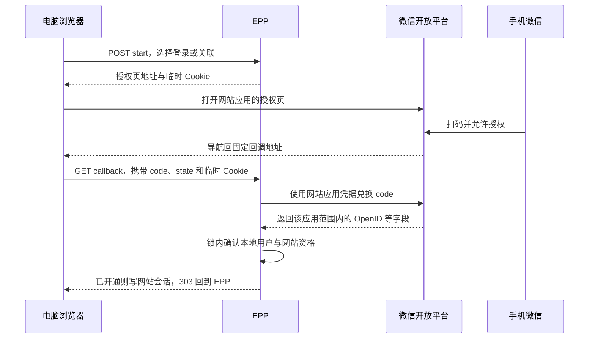
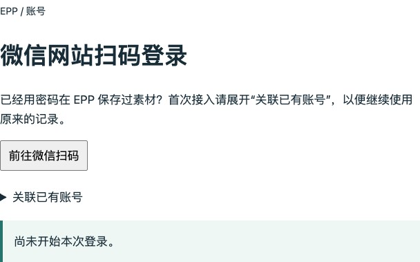
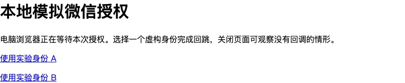
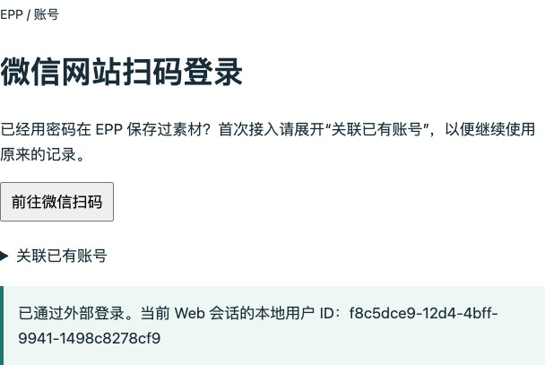

# 第 39 章 微信网站扫码登录

一位读者已经用密码在电脑上存过一条素材。现在他想在同一台电脑上点击“微信登录”，拿手机扫一下，就能继续编辑那条素材。该怎样判断接入成功？手机显示“已确认”只完成了其中一步。回到电脑，EPP 还要认出原来的本地用户，用新的网站会话读回关联前的那条记录。这个结果决定了我们怎样设计按钮、回调和数据库事务。

本章是可选的网站登录分支。协议推理承接[第 38 章的授权码流程](../chapter-38-oidc/chapter.md)，实现从[第 38 章配套代码](https://github.com/SamChowRock/epp-public/tree/part-05/chapter-38)继续。沿用已经迁移好的 VERIFY 库、网站 Cookie 和第 37 章的微信身份表。不需要先注册真实网站应用就能完成本机实验。阅读约 35～50 分钟，实现与本地联调另加约 70～100 分钟，平台申请和部署时间另计。

## 39.1 手机确认以后，哪台设备取得会话

先跟着这位读者走一遍。电脑在 EPP 发起登录，浏览器被带到微信开放平台的授权页。二维码由微信展示；读者在手机微信确认授权后，**电脑上原来那个浏览器**返回 EPP 的回调地址。回调里有短时授权码 `code` 和 EPP 发起时给出的 `state`。EPP 服务端再向微信兑换，得到此次授权对应的网站应用身份。最后，EPP 把自己的会话 Cookie 发给这台电脑。手机在这里承担确认动作，之后读素材的请求来自电脑。



第 37 章里，`wx.login()` 发生在小程序内部，临时码由小程序交给后端，后端调用 `jscode2session`，随后给小程序发自己的 Bearer 会话。把那段代码搬到网页会在第一步就卡住。这里的网页通过顶层导航进入微信，使用另一个注册应用、另一个兑换端点；扫完后要建立的也是 Web 会话。两条路径能共享的是“给定已核实的平台身份，怎样找到本地人”，从取得证明到交付会话的两端各有自己的契约。

第 40 章要解决的又是另一种需求。如果要求“用已经登录 EPP 的小程序批准这台电脑登录”，认可这次批准的主体就是 EPP，后台得自己保存哪台电脑在等、谁可以批准、批准后谁能领走。在本章，EPP 把网站授权委托给微信，无需自己生成二维码、给电脑开放轮询接口，也没有理由要求手机先取得 EPP 小程序会话。遇到产品稿上同样的“扫码登录”四个字，先确认手机要打开什么、由谁展示授权内容、最后给哪个客户端发会话，才能决定实现路线。

## 39.2 用网站 AppID 发起授权，在服务端兑换

网站应用的 AppID 是公开标识，AppSecret 是服务端向平台证明自己有权兑换的秘密。在 `src/config.ts` 为网站独立读取 `WECHAT_WEB_APP_ID` 与 `WECHAT_WEB_APP_SECRET`，两者一起配置或一起省略。已有的 `WECHAT_APP_ID` 属于小程序；若两个入口配成相同 AppID，启动直接报配置错误。网站真实接入使用 HTTPS 的 `APP_ORIGIN`，只有 test 模式的本机实验能在启用这组配置时走回环 HTTP。省略整组配置仍可使用密码和原有接口，发起网站微信登录才返回 503。

可以分两段实现。先只改配置、`src/wechat-login.ts` 和新增的 Flow 类，此时不挂新路由。运行 `npm run check`，沿用第 37 章的 `.env.test`，运行 `node --env-file=.env.test --test --test-name-pattern="provider uses a fixed URL" test/mini.test.mjs`，原有适配器检查会核对小程序仍向原端点发送 `js_code`。停在这里时，现有客户端行为应保持，第 39 章入口仍为 404。第二段再接 39.3 的控制器与事务。

在 `src/wechat-web-flow.ts` 建立网站授权地址。下面是 `start` 中的关键部分；`issueToken()` 每次取 32 个随机字节。用户可以把地址栏的所有参数都看清楚，也不应看到 AppSecret 或本地密码。

```ts
const state = issueToken(), browser = issueToken();
const url = new URL('https://open.weixin.qq.com/connect/qrconnect');
url.search = new URLSearchParams({
  appid: app.appId,
  redirect_uri: this.config.appOrigin + '/auth/wechat-web/callback',
  response_type: 'code', scope: 'snsapi_login', state,
}).toString();
url.hash = 'wechat_redirect';
this.attempts.set(state, { browser, until: now + 300_000, ...(proof ? { proof } : {}) });
return { browser, url: url.href };
```

`APP_ORIGIN` 取自部署配置。如果让请求的 Host、查询中的 `next` 或页面传来的完整 URL 决定回调地址，授权结果可能被送往另一个站点。这里在固定站点后追加固定路径，把原始地址交给 `URLSearchParams` 编码一次。用 `new URL(authorizationUrl).searchParams.get('redirect_uri')` 应读回完整的 HTTPS 地址；若还看到 `%3A%2F%2F`，可先找是否提前调用了 `encodeURIComponent`。授权范围写 `snsapi_login`，公众号网页授权的 scope 对这条路线不适用。

为什么还要单独生成 `browser`？假设攻击者在自己的浏览器发起一次登录，随后把带有自己授权结果的回调链接发给你。只靠 `state` 查表，会找到一笔确实存在的事务，但你的浏览器可能因此登入攻击者的 EPP 账号，把接下来的私人素材存错地方。开始时服务器把独立随机值放入发起浏览器的 HttpOnly 临时 Cookie，只把 `state` 放进授权 URL。回调时既要找到未过期事务，又要看到当初那个浏览器持有的值。临时 Cookie 用 `SameSite=Lax` 以便在微信回到 EPP 的顶层 GET 导航中携带；HTTPS 下使用 `Secure`、`__Host-` 名称和根路径。普通业务会话仍沿用原来的 Strict Cookie。

`WechatWebFlow.finish` 先按原始查询字串读出所有同名参数，要求一份 `code`、一份 `state`，拒绝本章契约外的参数。这样同一个请求不会因某层取第一个值、另一层取最后一个值而被不同解释。代码接着做这一步：

```ts
const attempt = this.attempts.get(states[0]!);
if (!attempt || attempt.until <= performance.now() || attempt.browser !== browser) throw invalid();
this.attempts.delete(states[0]!);
const identity = await this.platform.exchange(codes[0]!);
return { ...identity, proof: attempt.proof };
```

删除发生在第一个等待网络的位置之前。两个回调同时到达一个进程，只有先完成同步领取的一方能出站；浏览器不匹配的一方也不能替原浏览器消耗这次机会。EPP 给等待扫码留五分钟，每次开始时清理过期项，最多保留 256 项。平台授权码另有自己的有效期和一次兑换限制。即使平台码还有效，本地事务过期也要重新发起。网站 Cookie 同名，因此在两个标签页先后点开始，后一次会替换前一次的浏览器证明。回到旧标签扫完可能看到 400，回到网站重新开始即可。

兑换沿用 `src/wechat-login.ts` 的超时、并发和响应大小限制，按服务端选择的入口构造地址。网站分支实际发送下列参数，`secret` 只出现在服务端到微信的 HTTPS 请求中：

```ts
const url = new URL('https://api.weixin.qq.com/sns/oauth2/access_token');
url.search = new URLSearchParams({
  appid: this.config.appId, secret: this.config.secret,
  code, grant_type: 'authorization_code',
}).toString();
```

留意这个兑换请求没有每笔事务自己的 verifier。若甲从同一网站应用的另一笔授权取得乙尚未兑换的 code，并让自己的浏览器回到 EPP 时保留甲的 state、临时 Cookie，只换成乙的 code，本地事务依然匹配。在本章的模拟平台中，兑换会返回乙的身份，原 Cookie 证明不了这个 code 来自甲那笔授权。第 38 章的 S256 则让提供方将 code 与当初的 challenge 绑定，甲的 verifier 无法兑换乙的 code。网站实现按文档给出的参数工作，不能通过自行追加一个参数推定平台已执行绑定。[授权码注入与逐笔绑定](https://www.rfc-editor.org/rfc/rfc9700.html#section-4.5)；[39A 的可复现实验](side-01-qr-consent.md)

收到 HTTP 200 还要检查 JSON。平台可以在正常 HTTP 响应里返回 `errcode`；40029 或 40163 对应这次码无法使用，EPP 返回 401 并要求开新一轮。其余平台故障、超时、格式异常走 503。网站成功路径要求规范的 `openid`、非空 `access_token`，以及包含所申请网站登录权限的 `scope`。响应体累计超过 8192 字节就中止，每个适配器最多同时兑换两次，四秒超时，禁止跟随重定向。外部失败只向上返回本地错误，避免应用错误日志记录带 secret 的 URL；出站代理和监控还要另行设置脱敏。

这里的证据来自固定微信端点对本网站凭据和授权码的直接回答。第 38 章从签名 ID Token 核对 issuer、audience、nonce 的办法依赖供应商提供那种令牌；这个网站接口返回的是开放平台约定的数据。EPP 只取调用时使用的 AppID 和返回的 OpenID，不保存微信 access token、refresh token，不为查昵称再调用用户资料接口。以后若产品要持续代表用户调用微信 API，才需另外处理授权范围、可恢复的令牌存储、刷新竞争和撤权。微信在兑换时给的令牌不能拿来读 EPP 素材。[微信开放平台网站应用登录说明](https://developers.weixin.qq.com/doc/oplatform/Website_App/WeChat_Login/Wechat_Login.html)

## 39.3 把微信身份接回原账号，再签发网站会话

回到开头的素材。假设密码账号 U 已有记录 R，平台刚核实某网站应用下的 OpenID 为 A。数据库此时没有 A 的映射，仅凭“扫了码”推不出 A 应当归 U。甚至在同一台电脑上，上一位使用者留下的网站会话也可能属于另一人。页面因此给出两个入口。已有素材的人第一次应展开“关联已有账号”，在 EPP 同源页面证明本地密码，然后再去微信授权。只想用微信建立新身份的人可直接发起普通登录。

开始接口沿用严格的两种输入，普通登录只有 `{"mode":"login"}`；关联还需 `userId` 和 `password`。在 `src/wechat-web.controller.ts` 的 `start` 中调用 `sessions.provePassword`，暂存通过验证的用户 ID 和当时的密码哈希用于稍后复查。页面脚本发请求前就清空密码框，控制器不把证明写进 URL、Cookie 或前端响应。在 `auth.module.ts` 注册控制器和单例 Flow。把开始页与回调登记为公开 GET，开始动作登记为公开 POST，加入 `http-boundary.ts`、`session-http.ts`、`browser-security.ts` 的对应路径；开始请求仍须同源浏览器保护、固定请求头、JSON、输入验证和登录限流。如果只注册 Nest 控制器，前置路由边界会先返回 404。先只注册页面和 start 方法即可停下来核对这一步，回调方法留到本节末尾接入。运行 `npm run check`、`npm run dev`，从浏览器打开 `/auth/wechat-web`。未配置平台时，页面可打开，点击普通登录应看到配置错误，旧密码登录照常工作。

注册 Flow 时沿用 Nest 的配置注入。下面这个 provider 放在 `AuthModule.providers`，控制器放在同一模块的 `controllers`。若把 Flow 放在 request 作用域，开始与回调会得到不同的 Map，单进程也会每次失败。

```ts
{
  provide: WechatWebFlow,
  useFactory: (config: AppConfig) => new WechatWebFlow(config),
  inject: [APP_CONFIG],
}
```

接下来从 `src/mini.service.ts` 提取共用的 `resolveWechatAccount`，放在 `src/wechat-account.ts`。两个入口只把**服务端已验证**的 AppID、OpenID 和固定 channel 交给它。第 37 章的主键已经是 `(app_id, open_id)`，足以区分两个应用碰巧相同的 OpenID；另一个唯一约束 `(app_id, user_id)` 保证一个本地账号在一个应用下只关联一个身份。由此可沿用旧表，无需搬历史素材、修改所有者或给旧账号批量开资格。平台有时还会返回 UnionID；跨应用匹配还要考虑开放平台账号范围、缺失值和已经存在的两份本地账号，不能把新字段作为静默覆盖映射的理由。[第 37 章支线中的跨应用关联与合并](../chapter-37-mini-program/side-01-account-linking.md)

第一次登录时没有映射行可锁。事务先按 `appId + ':' + openId` 取与小程序相同的事务级 advisory lock，再查映射。两个独立浏览器都用同一微信身份首登时，后取得锁的一方会看到先提交的结果。若是关联，一旦看到 A 已属于别人，直接返回 409。若没有映射，普通登录创建本地用户，关联则选刚证明的 U。接着按本地用户 ID 取行锁，读最新账号状态，同时串行化“同一个 U 想关联两个不同 OpenID”的竞争。把外部网络调用放在锁外，数据库只为本地决定持锁。

```ts
if (proof) {
  const credential = await tx.passwordCredential.findUnique({ where: { userId } });
  if (credential?.passwordHash !== proof.passwordHash) return { error: 'AUTH_REQUIRED' };
  const other = await tx.wechatIdentity.findUnique({ where: { appId_userId: { appId, userId } } });
  if (other && other.openId !== openId) return { error: 'IDENTITY_CONFLICT' };
}
const enabled = channel === 'web' ? account.webEnabled : account.miniEnabled;
let full = false;
if (enabled) {
  await tx.$executeRaw`DELETE FROM public.sessions WHERE user_id = ${userId}::uuid AND expires_at <= clock_timestamp()`;
  full = await tx.session.count({ where: { userId } }) >= 20;
}
if (!mapping && (channel === 'web' || !full)) await tx.wechatIdentity.create({ data: { appId, openId, userId } });
if (!enabled) return { userId, pending: true as const };
if (full) return { error: 'SESSION_LIMIT' };
```

这段位于停用判断之后。比如 U 开始关联后刚重置了密码，锁内比较会拒绝那份旧证明，不能因为在扫码前输对过就让它永久有效。活跃用户的映射可以先于入口资格存在。一个新用户扫完码，数据库可以有用户和映射，但有效 Web 会话数为零。另一个只开通网站的旧用户则可以通过网站进入，即使 `mini_enabled=false`。微信确认的是身份，开通入口的决定仍由第 34 章的 EPP 账号规则作出。

有资格时，清除这个用户的过期会话，检查现存会话上限，再把新随机令牌的摘要、`channel='web'` 和八小时期限写入 `sessions`。达到 20 个会话时返回 429；按当前事务顺序，此前刚建立的关联仍可保留，拒绝的是继续签发。释放旧设备的会话后，普通登录可以复用这条关联。网站沿用第38章“保存关联、独立申请会话”的约定；小程序继续第37章的约定，已有资格又满额时不能新增登录方式。两者都允许尚未开通的账号留下已证明的映射。

回调控制器把数据库处理结果落实到浏览器：

```ts
const result = await resolveWechatAccount(this.db, appId, openId, 'web', 'WeChat website login', proof);
if (result.token) setSessionCookie(res, this.config, result.token);
res.redirect(303, result.token ? '/auth/wechat-web#signed-in' : '/auth/wechat-web#pending=' + result.userId);
```

303 让浏览器离开带临时码的地址，落到固定的 EPP 页面。`#signed-in` 只是显示提示的线索，页面还要向 `/auth/me` 读取真正的本地用户 ID。这样手改地址片段不能伪造登录。待开通分支没有签发新会话；如果浏览器已有别人的有效 Cookie，该 Cookie 仍可能返回旧身份。观察“新账号尚不能进入”时应用独立浏览器会话，不能把旧 Cookie 的 200 错归给刚扫码的人。

## 39.4 在本机走完回跳，再联调真实网站应用

从已经完成第 38 章的独立 VERIFY 接着做。用 DBeaver 在目标连接运行 `SELECT current_database();`，确认有 `wechat_identities`、`sessions.channel` 和 `users.web_enabled`；本章没有新的迁移。若从零恢复练习环境，可按前章恢复非空备份。若另建专用空库，在本章分支运行 `npm ci`，配置 `.env.database-verify`，执行 `unset DATABASE_URL SHADOW_DATABASE_URL`，再运行 `node --env-file=.env.database-verify scripts/deploy-verify.mjs bootstrap epp_ch39_verify`（末尾换成建库时选定的实际库名）和 `npm run db:verify -- migrate status`。它先部署第 35 章基线，再按本章目录升级。非空前章副本要检查待部署项，可将 bootstrap 换成 deploy；对已经报错的实验库应先核对迁移历史，第 20 章讲过失败登记与恢复，不要在日常库重置数据。

在配套代码目录，沿用 Node 24.22.1。让本地忽略的 `.env.test` 里的 `TEST_DATABASE_URL` 指向上述 VERIFY。如果终端里之前导出过同名变量，先清除覆盖。下面启动两个只监听本机的站点，EPP 在 3390，模拟授权页使用另一主机名和临时端口。这个实验替换了微信授权页和兑换应答；其余路由、Cookie、真实 PostgreSQL 事务和读取素材的接口都走本章代码。

```bash
nvm use
npm ci
npm run check
unset DATABASE_URL TEST_DATABASE_URL
verify_db='epp_ch39_verify'  # 改成创建或恢复时选定的实际库名
node --env-file=.env.test --inspect=127.0.0.1:9490 examples/wechat-web-lab.mjs "$verify_db"
```

实验进程把 TEST_DATABASE_URL 映射到实际应用连接，再查 current_database()；缺少独立给定的期望库名或两者不符即在写入前退出。保持终端运行。实验已经通过密码登录为本轮虚构用户写入一条素材并退出，会打印该用户 ID、实验密码和素材 ID。先在浏览器打开 `http://127.0.0.1:3390/auth/wechat-web`，展开“关联已有账号”，填入本轮用户 ID 和密码。



转到另一个站点后选“使用实验身份 A”。这里用一项明确的点击代表手机确认，你看到的是练习用的授权页。



它给这次导航生成一枚可兑换一次的模拟码，再让原浏览器返回 EPP。页面显示的本地用户 ID 应等于终端的原 ID。



在同一个浏览器中新开标签访问 `http://127.0.0.1:3390/captures/本轮素材ID`，用打印的 UUID 替换最后一段。应得到 200，原文为 `A record saved before website login.`。这一步同时检验账号归属、Cookie 传输和原来的读取权限。

若中途关闭网页但终端仍运行，重新打开开始页即可。第一次关联已经成功时，用普通登录选 A；终端已结束则重开实验，并改用新一轮打印的 ID。

在 DBeaver 打开配套的 `database/chapter-39/01-observe.sql`，把全零 UUID 换成本轮用户 ID 后只执行查询。对这次刚建立的样本，第一次关联完可见映射、有效网站会话、素材各一条。回到开始页，这次直接普通登录并再次选 A；再执行同一查询，映射和素材仍各一条，有效网站会话增至两条。这里每个计数都按指定用户单独聚合，避免两张一对多表直接连接后，把两次登录误数成两条素材。

接着在无痕窗口普通登录并选身份 B。记下待开通提示里的另一个本地用户 ID，用它替换查询参数，应见一条映射、零条有效网站会话、零条素材。同一个无痕窗口访问 `/auth/me` 得到 401。如果把普通首登误当成关联，B 已经有自己的本地用户；再输入原账号密码试图把 B 关联给原账号会得到 409。保留两边的事实，按账号关联与恢复流程处理；练习中可正常结束后重开一轮取得干净的虚构样本。

要观察代码停在哪里，在 VS Code 的“运行和调试”选 `Chapter 39: WeChat website callback (local VERIFY)`，在 `wechat-web.controller.ts` 调用 `resolveWechatAccount` 的行上打断点，再发起一轮。只观察 `Boolean(openId)` 和 `Boolean(proof)`，关联成功兑换后两者为 true，普通登录后后者为 false。继续、移除断点，再走一轮核对正常时序。不要展开完整请求、Cookie 或密码证明。用 Postman 导入 `requests/chapter-39.postman_collection.json`，单独发送无事务回调和客户端自报 OpenID 两个请求，两者应为 400。Postman 和浏览器各有自己的 Cookie，不能把其中一端开始的登录搬到另一端完成。实验结束先断开调试器，在终端按 Return 清理本轮样本并退出。

换到微信开放平台，需要开发者账号、通过审核的网站应用，以及该应用已获准使用的微信登录能力。到该网站应用的配置中核对 AppID、微信登录权限与授权回调域，再由服务端管理员注入对应 Secret。让 `APP_ORIGIN` 对应用户实际打开的 HTTPS 网站，例如 `https://epp.example`；授权请求里完整地址则是该站的 `/auth/wechat-web/callback`。先确认外部浏览器能访问开始页，HTTPS 证书可信，代理把同一路径和查询转给 API，出站 HTTPS 能到微信兑换端点。代理和监控应屏蔽回调查询及兑换 URL 中的凭据。需要建立公网入口时，可在第九篇部署完成后回来操作。正式运行沿用独立交付目录、生产依赖与 `npm start`，通过进程环境注入配置；本地实验脚本和 Inspector 只在练习环境运行。

用一个获准的测试账号在电脑开始登录，手机上先核对微信展示的应用，再确认。遇到故障时，看流程最后到达了哪一步：

- **平台页提示链接无法访问。** 从开始响应里的授权地址拆出 AppID、解码一次的回调地址和 scope，与网站应用控制台逐项对照。此时回调处理器还没有机会运行，改数据库映射无助于恢复。
- **扫后一直没回网站。** 官方顶层授权流程在用户禁止授权时不会重定向。用户关闭页面或网络中断也可能没有回调，服务端无法据此认定用户拒绝。回到网站重新发起，让旧事务自然失效。
- **回到 EPP 得到 400。** 此时浏览器已走到回调。对照是否在同一浏览器、同一主机名完成，有没有第二个标签覆盖临时 Cookie，进程是否重启、是否超时。若开始和回调分到两台 API，各自的 Map 不能相认；扩为多实例前需共享有过期时间、能按浏览器证明原子领取的事务存储。[第 38 章支线中的跨实例领取](../chapter-38-oidc/side-01-trust-and-transactions.md)
- **兑换失败或结果未收到。** 在 EPP 日志按请求 ID 核对路由和状态，区分过期／已用码的 401、平台或配置故障的 503，以及本地关联冲突的 409。不要自动重试原兑换，网络超时可能发生在微信已消费码之后。若数据库已提交而浏览器没有收到 Cookie，先在原浏览器查询当前身份，再用全新事务普通登录；已建立的映射仍指向原用户，无须删除映射重来。

对真实接入分别观察同意、拒绝、重复登录与读回旧素材。模拟实验能检验 EPP 怎样处理这些本地事实；权限审核、微信客户端、域名与回调交付必须由真实平台链路验证。[微信开放平台网站应用登录说明](https://developers.weixin.qq.com/doc/oplatform/Website_App/WeChat_Login/Wechat_Login.html)

## 知识支线

[39A 扫了转发来的二维码，会登录哪台电脑](side-01-qr-consent.md)（阅读约 12～17 分钟，可选复现另约 5～10 分钟）。改变扫码的人、回调中的授权码及授权的动作，判断浏览器绑定能证明什么，以及误关联后需要恢复哪些状态。

## 附录：本章必要技术点速查

| 名称 | 本章用途 | 回查时注意 |
| --- | --- | --- |
| qrconnect、snsapi_login | 打开网站应用的微信授权页 | 使用网站 AppID 和编码一次的固定回调地址 |
| state、临时 Cookie | 将回调绑定到发起浏览器和一次事务 | 顶层 GET 回跳，五分钟内领取一次；两个标签会覆盖 Cookie |
| sns/oauth2/access_token | 服务端使用应用秘密兑换 code | 看响应体内的错误；授权码不可盲重试 |
| app_id、open_id | 在应用范围内定位本地用户 | 登录与关联分开；UnionID 不自动覆盖已有归属 |
| web_enabled、channel | 决定 Web 资格与新会话传输方式 | 有映射可以待开通；以新会话读回原 ID 和素材核对 |
| 303、/auth/me | 离开回调地址并核对实际用户 | 页面片段可编辑，真正身份以服务端读取为准 |

平台参数见[微信网站应用登录文档](https://developers.weixin.qq.com/doc/oplatform/Website_App/WeChat_Login/Wechat_Login.html)，Cookie 在跨站导航中的行为见[MDN Set-Cookie](https://developer.mozilla.org/zh-CN/docs/Web/HTTP/Reference/Headers/Set-Cookie)，锁的作用域见[PostgreSQL 18 显式锁](https://www.postgresql.org/docs/18/explicit-locking.html#ADVISORY-LOCKS)。本章配套代码分支为 `part-05/chapter-39`。

[返回第五篇](../README.md) · [上一章：OIDC 外部登录](../chapter-38-oidc/chapter.md) · [下一章：用已登录的小程序扫码确认网站登录](../chapter-40-mini-confirm/chapter.md)
