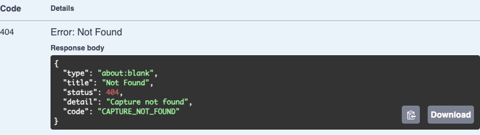
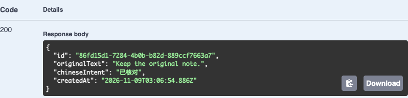

# 第 41 章 第五篇回顾：身份有效之后，操作是否仍被允许

甲把一条素材的详情地址发给乙，请乙帮忙改一句中文意图。乙能登录 EPP，也知道素材 ID，却改不了。甲在另一台电脑上重置密码后，自己原先打开的页面也改不了。两个人看到的都是“保存失败”，需要处理的却是两件完全不同的事。先保留这条素材，跟着同一个请求走一遍，再决定是让人重新登录、恢复入口资格，还是应该保持拒绝。

先完成第 32～36 章。本章使用第 36 章已有的接口、数据结构和工具，不增加迁移。准备一个已完成该章迁移的独立 VERIFY、两个虚构账号和只向本机收信的 Mailpit。第 37～40 章选过哪条路线，就在 41.4 回看哪条；只做过密码登录可以从 41.3 直接进入 41.5。阅读约 42～55 分钟，双账号联调、邮件恢复与故障观察另加约 65～85 分钟（估算，沿用已准备好的环境）。[第 36 章配套代码](https://github.com/SamChowRock/epp-public/tree/part-05/chapter-36) · [第 36 章的环境和启动步骤](../chapter-36-registration/chapter.md#在postman收件箱和dbeaver之间走完一次)

## 41.1 一条修改请求要通过哪些判断

先假定甲在自己电脑上用密码登录。服务端用已保存的 Argon2id 密码哈希验证本次输入，再在事务中复查当前凭据和账号资格，为这次登录生成一份新的随机会话令牌。电脑保存它的 HttpOnly Cookie，数据库只保存令牌摘要、所属用户、设备标签和期限。第二天攻击者即使知道甲的用户 ID 和素材 ID，也缺少证明“这次请求来自有效会话”的秘密。反过来，若有人复制走有效 Cookie，无需知道甲的密码也能冒用会话。此时要处置的是服务端会话，只清掉甲自己浏览器上的 Cookie 无法让副本失效。[第 32 章的秘密保护](../chapter-32-secrets/chapter.md) · [第 33 章的会话撤销](../chapter-33-sessions/chapter.md#333-看见会话再分别撤销和退出)

甲登录后按下“保存”。对于本章普通的 Cookie 写请求，沿 `PATCH /captures/{id}` 的实际处理顺序，有四个地方值得停下来：

| 当请求走到这里 | 服务端此刻要确定的事实 | 这层可以拒绝什么 |
| --- | --- | --- |
| 浏览器边界 | 如果请求给出了 Origin，是否匹配配置；浏览器报告的跨站状态是否允许；是否显式携带了 `X-EPP-Request: 1` | 来自别的网站，或缺少约定请求头的写入 |
| 会话与入口 | Cookie 摘要能否找到未到期的会话；对应用户是否 active、已开通 Web | 丢失、撤销、过期的会话，或已暂停的账号／入口 |
| 会话与写操作 | `X-CSRF-Token` 能否用服务器密钥和**当前会话 ID**验证 | 浏览器虽带上 Cookie，但写入没有这次会话的证明 |
| 业务与存储 | 输入是否合规；以服务端识别的 userId 查找这条素材，能否找到可追加修订的父记录 | 非法意图、他人的记录或不存在的记录 |

例如某个同站但不同源的子域可以用表单向 EPP 发送简单 POST。即使浏览器根据 Cookie 的 SameSite 规则允许带上目标站的 Cookie，表单也不能自行添加约定的请求头，EPP 还能识别与自身不符的 Origin。EPP 对危险方法先做来源和固定头检查；已登录的业务写入还要验证会话专属的 CSRF Token。原生客户端可以自己设请求头，所以单看头的值不能当作用户身份。读请求不要求写入 Token，仍得检查会话、入口和归属。公开的登录、注册、重置确认则有各自的证明，不能因为它们也使用 POST，就一律要求先持有网站会话。[第 35 章的浏览器边界](../chapter-35-browser-boundary/chapter.md#352-让写请求提供会话之外的证明)

真正把素材限定在当前用户范围内的是数据访问条件。第 36 章沿用的 `src/prisma-capture.store.ts` 在读取详情时使用下列条件，`this.userId` 来自服务端请求身份：

```ts
where: { id, userId: this.userId }
```

修改意图时，同样的限制出现在生成下一版的 SQL 里。下列两行分别决定能选中哪条父记录，以及是否存在可用于插入的前一版：

```sql
-- previous 中，c 是 captures；两个参数依次为路径 ID、服务端识别的用户 ID
WHERE c.id = $1::uuid AND c.user_id = $2::uuid
-- inserted 只从 previous 的结果追加新修订
FROM previous WHERE revision_no IS NOT NULL
```

这样，乙修改甲的记录时，负责写入的语句就没有可追加的父记录。只在列表页过滤、只在前端隐藏按钮、或者把正文里的 `userId` 当作用来查询的身份，都会留下绕开列表直接访问详情的路径。将来若产品真的要求“甲允许乙编辑”，需要另外保存谁把哪份资源的什么权限授给了谁、何时撤销，并把它纳入读写查询；直接删除第二个条件会把所有人的素材一起放开。[第 34 章支线的团队授权设计](../chapter-34-authorization/side-01-authorization-models.md)

## 41.2 同一条素材，为什么先是 403 又是 404

**准备一条能回读的基线。** 沿用[第 36 章的 VERIFY 启动步骤](../chapter-36-registration/chapter.md)，先在当前终端清除已有数据库变量，用独立指定的预期库名核验连接，再从 `.env.test` 启动开发 API，以下使用 `http://127.0.0.1:3360`。在 DBeaver 先执行 `SELECT current_database();`，核对与 API 使用同一 VERIFY。若已经完成第 36 章，可以复用自己能控制邮箱和密码的练习账号；否则在本地 Postman 导入 `requests/chapter-36.postman_collection.json`，分别为甲乙使用不同的虚构地址，依次完成 01 请求注册、02 用 Mailpit 中相应邮件确认。每次记下本轮返回的本地 userId。新账号默认未开通 Web，在 `database/chapter-36/02-grant-fixture.sql` **同时换掉 UUID 和邮箱**，逐人观察 RETURNING 的那一行再提交。不要把默认的示例邮箱留在 WHERE 里。

用两个互相隔离的浏览器配置文件分别扮演甲和乙，各打开 `/docs`。同一浏览器的两个普通标签页共享 Cookie，两个 Postman Environment 也不能自动隔离同域的 Cookie jar。每个浏览器在 Swagger 的 `POST /auth/login` 点 **Try it out**，填各自的 email、password 和便于辨认的 label，显式头填 `1`，Execute 后再发 `GET /auth/me`。此时应有两个不同的 userId。设备标签可由客户端任意填写，不能拿它认证设备。后文所有登录、注册、重置和主动改密请求共用来源限流；若得到 429／`AUTH_RATE_LIMIT`，按 Retry-After 等候并重发当前一步，不要从注册重新开始。

两个浏览器分别调用 `GET /auth/csrf`，只在当前练习中暂存各自的 Token。甲在 `POST /captures` 中传 `X-EPP-Request: 1`、自己的 `X-CSRF-Token` 与这份 JSON：

```json
{"originalText":"Keep the original note.","chineseIntent":"初稿"}
```

以这次 201 返回的 ID 作为 **R**。此后所有请求都替换成同一个实际 ID。甲访问 `GET /captures/R`，确认原文和意图，再读 `GET /captures/R/revisions?limit=2`，新建样本只有第 1 版。保存原 userId、R、创建时间和当前修订号即可。Cookie、会话 ID、CSRF Token 和邮件令牌都不放入截图、共享集合或问题报告。

**让拒绝发生在不同位置。** 乙先在自己的浏览器直接打开相同的详情地址，得到 404／`CAPTURE_NOT_FOUND`。单看乙的结果，无法区分 ID 错了还是没有权限；甲刚才用同一个 R 读到了第 1 版，才排除了“记录根本不存在”。如果两个账号都得到 404，先核对端口、数据库和实际 ID。



乙在自己的 `/docs` 打开 `PATCH /captures/{id}`，填 R 和 `{"chineseIntent":"来自乙"}`。以下三次请求都保留正确来源、固定头和合法 JSON，只改所列条件。甲可以在另一个窗口随时读回修订历史。

| 谁发请求、带哪份 Token | 响应 | 甲再查 R |
| --- | --- | --- |
| 乙带甲的 CSRF Token | 403，`CSRF_REJECTED` | 仍为第 1 版、“初稿” |
| 乙换成乙自己的 Token | 404，`CAPTURE_NOT_FOUND` | 仍为第 1 版、“初稿” |
| 甲带甲自己的 Token，将意图写成“已核对” | 200 | 第 2 版为“已核对”，第 1 版仍在 |

第一行还没走到素材查询，不能据此断定资源隔离有效。第二行才是在身份、资格和写入证明都通过后，单独验证归属。第三行给了一个阳性对照：拥有者的请求能写入同一条记录。原 ID 和原文没有变化，变化的是最新版的意图。下图的虚构 ID、创建时间来自一次具体运行，跟做时用自己的值。



要从数据库核对拒绝没有产生隐蔽的新版本，在 DBeaver 的 SQL 编辑器执行下列只读查询。把全零 UUID 换成 R，每轮都运行同一条；`captures` 里的早期兼容列不能代表最新修订内容。

```sql
SELECT c.user_id, c.id, r.revision_no, r.original_text, r.chinese_intent
FROM public.captures AS c
JOIN public.capture_revisions AS r ON r.capture_id = c.id
WHERE c.id = '00000000-0000-0000-0000-000000000000'::uuid
ORDER BY r.revision_no;
```

**保留 Cookie，改变服务端条件。** 保留乙的会话，使用配套的 `database/chapter-34/04-restrict-access.sql`，只选暂停 Web 资格的那段事务，替换为乙的练习 UUID，暂停 `web_enabled` 并提交，再从乙的浏览器访问 `/auth/me`，预期为 403／`WEB_ACCESS_DENIED`。这次服务器已经认出乙，只是入口暂停了。用同目录的 `03-grant-web.sql` 仅恢复乙的资格并提交后，同一份仍有效的 Cookie 又能返回 200。如果处置的是设备遗失，单纯停用再恢复资格会让复制出去的 Cookie 也可能恢复；应撤销那份设备会话。受限但会话有效的用户仍可从 `/auth/csrf` 取 Token，带它向 `/auth/logout` 发 `{}` 主动退出。

最后只令乙这次会话过期。在隔离 VERIFY 复制以下 SQL，把两个占位符换成乙刚从 `/auth/me` 得到的 sessionId 和 userId。先选中 BEGIN 到 RETURNING 执行，确认恰好一行且标签属于本次练习，再单独提交。若不符就回滚。一起前移创建时间是为了保留表上“到期晚于创建”的约束。

```sql
BEGIN;
SET LOCAL lock_timeout = '2s';
SET LOCAL idle_in_transaction_session_timeout = '60s';
UPDATE public.sessions
SET created_at = clock_timestamp() - interval '2 hours',
    expires_at = clock_timestamp() - interval '1 second'
WHERE id = '<乙本次会话ID>'::uuid AND user_id = '<乙的用户ID>'::uuid
RETURNING label, expires_at <= clock_timestamp() AS expired;
-- 确认结果后单独执行 COMMIT；选错对象则执行 ROLLBACK。
```

让乙再次请求同一个 R，这次得到 401／`AUTH_REQUIRED`。SQL 只动了服务器的一行，浏览器可能还会发送 Cookie。查会话时的 `expires_at > clock_timestamp()` 已经把它排除，资源是否属于乙根本还没有被检查。甲仍能读第 2 版。遇到一次失败时，用 Network 的状态、Problem Details 的 code、响应的 X-Request-Id 以及数据库行来交叉判断；不要只按“登录失败”四个字决定让用户改密码。

## 41.3 先退出、再重置，哪些旧证明还可用

保留甲的浏览器 A1，再开一个独立的临时浏览器配置文件 A2，也用甲的当前密码登录。两边 `/auth/me` 应返回同一 userId 和不同的 sessionId。两份会话各自有效，稍后正好用来区分“只让一个设备退出”和“撤销这个账号的所有设备”。

在第 36 章的 Postman 集合把 email 换回甲的练习邮箱，把 newPassword 设为甲的新练习密码，发 **06 请求重置邮件**。到 Mailpit 中打开本次密码恢复邮件，取最新令牌存入本地 resetToken，先不确认。此时库中记录的是签发时的用户 ID、密码凭据版本和令牌摘要，有效期十五分钟。收到邮件没有改密码，也没有注销任何设备。整个实验只使用自己控制的练习地址和密码。

1. **A1 先退出。** 在 A1 取本会话的 CSRF Token，向 `POST /auth/logout` 发送带两个写入头的 `{}`。得到 204 后，A1 再读 `/auth/me` 为 401，A2 同一时刻仍为 200。重置令牌属于一次邮箱恢复意图，退出只撤销 A1 的会话，甲之前收到的邮件仍然可以使用。
2. **再用邮件重置。** 从 Postman 发 **07 确认密码重置**，带上 resetToken 和与旧值不同的新密码。预期为 204。A2 此时再访问 `/auth/me` 也变为 401。原样重发 07（或发送集合的 11 重放请求）返回 400／`VERIFICATION_INVALID`；用旧密码登录返回 401。回到 A1 的 Swagger，用新密码重新登录、取新的 CSRF Token 后，甲仍读到 R 的第 2 版。不要把新密码成功登录后产生的一行会话误判成旧会话逃过了撤销。
3. **让一封尚未用过的邮件失效。** 等同一邮箱、同一用途的一分钟重发冷却结束，重新申请并取出新令牌。保持新令牌未使用，让甲用刚登录的会话调用 `POST /auth/password`，发送 currentPassword、第三个不同的 newPassword 和这次会话的 CSRF Token。主动改密成功为 204，然后尝试用刚收到的邮件再重置。即使邮件未过十五分钟，也会得到 400／`VERIFICATION_INVALID`。改密已经推进了密码版本，这封旧邮件不能撤销用户稍后作出的改密决定。

在两次消费之间，用 DBeaver 查签发版本、当前版本和消费标志。按需把下面的地址换成甲的实际虚构邮箱。只投影需要比较的字段，不选择令牌摘要或密码哈希。

```sql
SELECT i.purpose, i.credential_version AS issued_version, p.version AS current_version,
       i.consumed_at IS NOT NULL AS consumed,
       i.expires_at > clock_timestamp() AS within_time
FROM public.verification_intents i
JOIN public.password_credentials p ON p.user_id = i.user_id
WHERE i.email = 'alpha41@example.test' AND i.purpose = 'reset';
```

如果甲刚注册时凭据版本为 1，第一次成功重置后应看到签发版本 1、当前版本 2、已消费。下一封邮件签发时绑定版本 2。主动改密后再查，签发版本 2、当前版本 3，consumed 仍为 false。**未消费且未过期仍可能不可用**，这是检查凭据版本的理由。已有练习账号可能从更大的版本号开始，只比较增量。查不到行时先核对邮箱与用途；这条内连接只展示已绑定有效本地凭据的恢复意图。

这个结果取决于提交边界。`src/recovery.service.ts` 成功重置时，在同一事务中更新密码并递增版本、删除属于该用户的会话、标记本次意图已消费。确认前会在锁内复查用户状态、凭据版本、摘要和到期时间。把删除会话移到提交后，就会留下一个真实的窗口：新密码已生效，旧设备却还能用旧会话。反过来，甲单纯失去了 Web 资格但账号仍 active 时，邮箱恢复可以成功，登录仍可能因入口未开通返回 403。恢复密码不会给用户开通网站资格。若要观察反过来的顺序，先完成重置再从 A2 退出，已经失效的 Cookie 也可得到退出的 204；只有检查重置后的 `/auth/me` 和会话行，才能判断此前是谁让它失效。[第 36 章的密码重置事务](../chapter-36-registration/chapter.md#363-重置密码必须处理旧会话和旧重置意图)

把现场换成“甲的笔记本丢了，但手机还在”。如果丢失的是已登录设备，甲可以从另一份仍获准使用的会话进入设备列表，核对本地会话 ID、标签与时间，再撤销对应的那一份。若连密码也泄漏，只踢掉一台设备还允许对方重新登录，此时需要改密并撤销旧会话。若连恢复邮箱也失守，邮件已经不能区分甲与攻击者；应先恢复可信渠道，再恢复 EPP 账号。这三种处置的选择取决于对方还掌握哪种证明，而非页面显示了哪种错误。[第 36 章支线的恢复渠道分析](../chapter-36-registration/side-01-recovery-identity.md)

这些检查管的是一个具体时点。旧会话在重置提交后发起的新请求会被拒绝。某个素材请求若已经通过会话检查，在业务 SQL 执行前发生重置，本章的普通素材写入仍可能完成。若新需求要求“冻结提交后，任何已在途的敏感导出都不能再放行”，就要让导出决定与冻结在共同的事务边界排序，并控制数据实际发出的时点。页面禁用按钮或在处理开始时多查一次状态，都不能撤回已经交给客户端的字节。[第 34 章的账号状态与权限竞争](../chapter-34-authorization/chapter.md)

## 41.4 换一种登录方式，回到同一条旧记录

做过可选分支时，回到**那一章自己的代码、VERIFY 和练习账号**。各分支独立练习时，刚创建的 R 和甲的 UUID 未必存在于另一份数据库。先选一条在该分支登录前已存在的素材，记下本地用户 ID、素材 ID 和当前版本，再改变登录入口。只得到“登录成功”的页面，分不出是认回旧用户，还是碰巧新建了另一份空账号。

| 已选择的路线 | 改变一个条件 | 应当观察什么 |
| --- | --- | --- |
| 第 37 章，小程序 | 同一条素材，分别用已关联者和另一账号的 mini Bearer 查询 | 前者读回原文，后者 404；只有 Web 资格也不能代替 mini 资格。[小程序联调](../chapter-37-mini-program/chapter.md#375-用旧记录验证映射用失败路径验证边界) |
| 第 38 章，OIDC | 在独立浏览器比较“关联已有账号”和一个从未关联过的外部身份普通首登 | 核实 issuer 与 subject 后，前者回到原 userId；陌生身份可以形成待开通映射而没有新网站会话。[两站回调实验](../chapter-38-oidc/chapter.md#386-用两个站点走一遍再决定怎样接真实供应商) |
| 第 39 章，微信网站应用 | 已证明原密码，平台身份却已映射给另一个本地用户 | 关联冲突为 409，原映射不被覆盖。按 AppID 和 OpenID 查找，不以显示名认人。[网站扫码实验](../chapter-39-wechat-website/chapter.md#394-在本机走完回跳再联调真实网站应用) |
| 第 40 章，小程序批准电脑 | 手机已经确认，电脑领取前撤销批准用的 mini 会话 | 即使票据仍是 confirmed，也不签发 Web 会话；若领取先提交，之后单独退出手机不能删除已签发的网站会话。[确认与领取的顺序](../chapter-40-mini-confirm/chapter.md#404-用两个客户端验证归属和失败时点) |

若有人报告“小程序里有全部素材，网页却是空的”，先分别用两个入口取本地 userId。ID 不同就查两次登录如何建立映射，避免用复制素材或改所有者掩盖误关联。ID 相同则读同一条已知 ID 的详情，再核对入口资格和列表查询范围。只看某一页列表没有出现 R，无法证明 R 已丢失。多一种登录方法只是多一个取得本地身份的途径，每一条业务查询仍要带上同一个归属条件。

## 41.5 邮件请求返回以后，谁接着做

甲完成重置后，乙说“页面让我查邮箱，可我没收到邮件”。先读 `POST /auth/reset/request` 的 202 能说明什么。为了减少通过接口探测账号是否存在的机会，对可解析的地址，第 36 章保留统一提示。它也允许同一用途、同一地址在冷却期内收到相同提示而不再发一封。看到 202，还无法断定这是一次新的签发，更不能决定应该给用户手工改密码。

打开 `src/recovery.service.ts` 的 request 方法。先看一次新的签发，再看冷却期内的第二次请求：数据库先提交意图和摘要，`issued.length` 非零才开始向 SMTP 服务发送，API 等待这次发送返回或失败，然后结束 HTTP 请求。在本机 Mailpit 成功收到邮件时，能从收件箱核对收件人、主题与本次意图。从生产含义看，SMTP 的最终成功应答代表接收方接受了这次投递；下游送达、落入垃圾箱或用户是否读信，是另外的事实。

| 在哪个位置中断 | 能留下的事实 | 恢复时依据什么 |
| --- | --- | --- |
| 意图事务回滚 | 没有这次新签发，发送分支不会执行 | 查本次用途、地址和签发时间，区别以前的行 |
| 意图已提交，进程在调用 SMTP 前退出 | 有有效意图，但可能一封邮件都没发 | 重启后的 API 没有待投递任务可接续，旧意图里的摘要无法还原原令牌 |
| SMTP 已收到正文，最终应答迟到或丢失 | 接收端可能已有邮件，发送端只看到超时 | 结合投递日志和收件端事实，不因超时就断定应立即重发 |
| SMTP 成功后 HTTP 响应丢失 | 邮件可能已在收件箱，客户端却看见网络失败 | 先看收件箱与有效期，再决定是否等冷却后重发 |

一轮本机故障对照中，隔离 SMTP 接收端读完一封邮件的正文，故意不返回最后的成功应答。约两秒后，API 记录 `MAIL_DELIVERY_UNCONFIRMED` 并返回 202；立即按同一地址、同一用途再请求也返回 202，但接收端的正文计数仍是 1。前一个 202 对应一次结果未知的发送，后一个 202 连发送分支都没有进入。这个计数只能证明字节到达该接收端，收件人是否收到仍需另外核对。

**在本机辨认一次失败。** 在独立 VERIFY 和自己的 Mailpit 上操作。选一个本轮尚未使用的虚构地址，暂时停止这份 Mailpit，向 `/auth/register/request` 发起注册。通过 Network 记下 X-Request-Id，在同一请求日志找 `delivery.failed` 与 `MAIL_DELIVERY_UNCONFIRMED`，再在 DBeaver 用第 36 章 `01-observe.sql` 的意图查询筛选这个地址。应有未消费的意图，接口仍可返回 202。重新启动 Mailpit，先不要发新请求，观察它不会仅因启动就收到刚才漏掉的邮件。冷却满一分钟后重新申请，从最新注册邮件继续；旧令牌即便稍后出现也已被新摘要替换。停收件服务复现的是连接未建立。要解释“超时但对方已有正文”，还须把故障放在接收正文之后，两种现象不能只靠同一个 202 来区分。

若想看清进程退出前的缺口，在 VS Code 沿用第 36 章的本地 Attach，断在 `await this.delivery.send(...)` 执行前，换一个新地址发起请求。此时 HTTP 还在等，DBeaver 的另一个连接却已能读到提交意图，邮箱里还没有这封信。只观察 `issued.length`，不展开原令牌。继续执行后再查收件箱；移除断点再看正常耗时。另一轮在这个位置终止了隔离 API 进程，浏览器未收到成功响应。重启后，数据库仍是同一条意图、同一签发时间，收件箱为零；冷却期内再请求返回 202，收件箱仍为零。重启恢复了 HTTP 服务，却没有恢复上次进程内那次尚未开始的调用。

把 SMTP 挪进数据库事务也不能补上保证：邮件可能先被接受，随后数据库回滚，用户就收到一封服务端无法验证的信。要让工作在进程退出后仍可接续，第 42 章将把“产生业务意图”和“登记一项可执行的投递工作”放入同一事务，再由独立执行者处理。设计这项工作时还要回答两个问题：只存摘要时，发送者从哪里获得构造有效邮件所需的秘密？如果 SMTP 应答丢失，重复执行时怎样避免生成相互冲突的恢复机会？把含原令牌的 JSON 任意写进普通日志，或给每次 HTTP 重试都签发一份独立有效令牌，都会破坏本篇刚建立的边界。

练习结束时，退出各浏览器中仍有效的会话，清除本地 Postman 里的练习令牌和密码，结束 DBeaver 中的事务，停止本轮 API 与 Mailpit。中途恢复时先查库名、实际 userId、R 的当前版本以及意图的用途和时效，再从对应步骤继续。若上次已经消费邮件，就用当时设置的新密码登录；若只走到签发而令牌已过期，则重新申请。

## 附录：本章必要技术点速查

| 名称 | 在本章核对什么 |
| --- | --- |
| `GET /auth/me` | 当前 Cookie 能否被识别且具备 Web 资格；同用户不同设备的 sessionId 应不同 |
| `GET /auth/csrf` | 为当前有效会话取写入 Token；受限会话也能取得它以便退出 |
| `CAPTURE_NOT_FOUND` | 按当前 userId 和记录 ID 查询无匹配；需用拥有者读回同一 ID 才能验证隔离 |
| `expires_at`、`web_enabled` | 时间有效与入口资格分别判断；恢复资格不能复活已撤销或过期的会话 |
| `credential_version`、`consumed_at` | 邮件是否针对当前凭据版本，是否已经用过；还需检查用途、用户状态与时间 |
| `delivery.accepted`、`delivery.failed` | 本进程观察到的 SMTP 应答；都不能单独证明最终送达 |

会话与请求保护可回查[MDN 对 Set-Cookie 的说明](https://developer.mozilla.org/zh-CN/docs/Web/HTTP/Headers/Set-Cookie)，邮件接收责任与最终应答见[SMTP RFC 5321 第 4.2.5 节](https://www.rfc-editor.org/rfc/rfc5321#section-4.2.5)。本章完成状态沿用 `part-05/chapter-36`；可选平台实验沿用对应章的完成分支。

[核心路线前一章：注册、验证与密码重置](../chapter-36-registration/chapter.md) · [可选路线前一章：小程序扫码确认网站登录](../chapter-40-mini-confirm/chapter.md) · [第五篇导读](../README.md)
