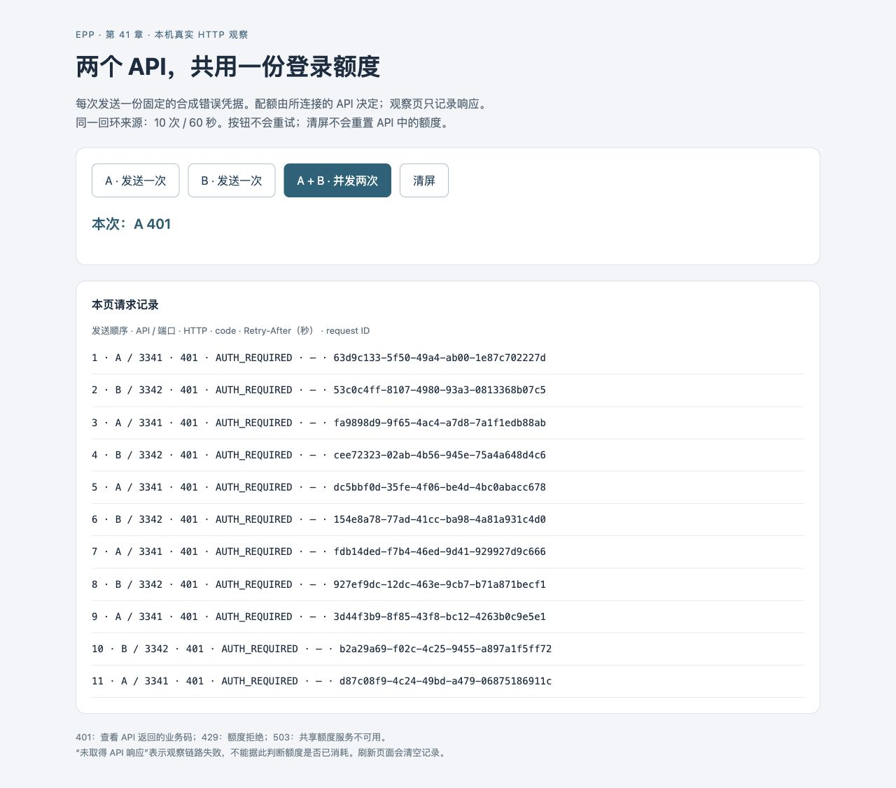
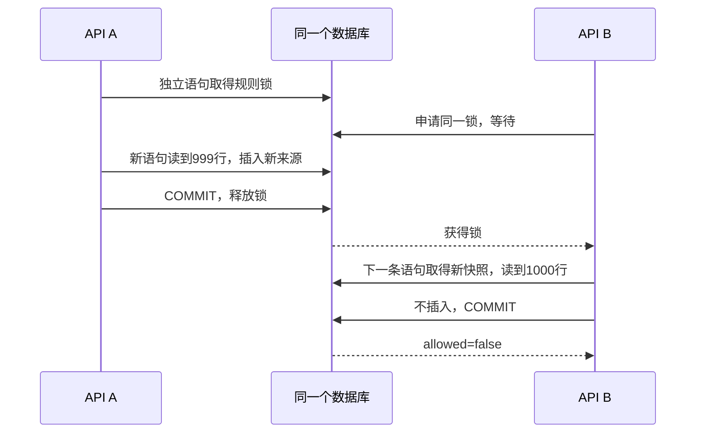
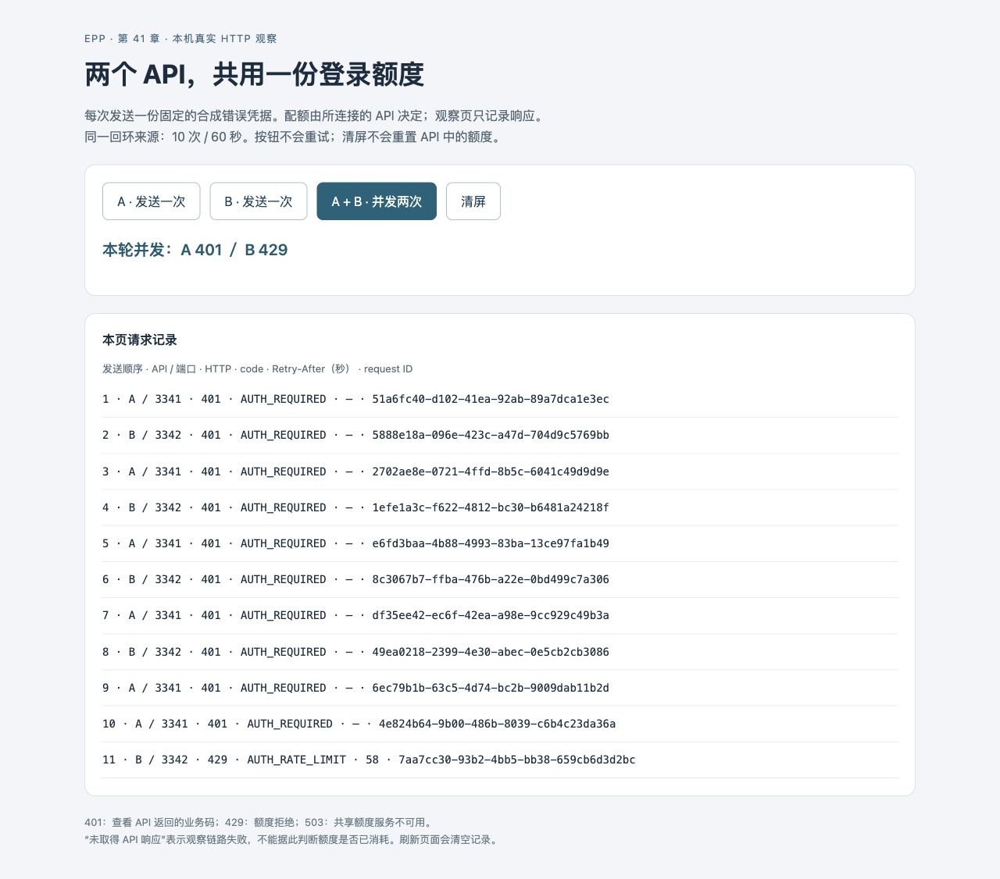
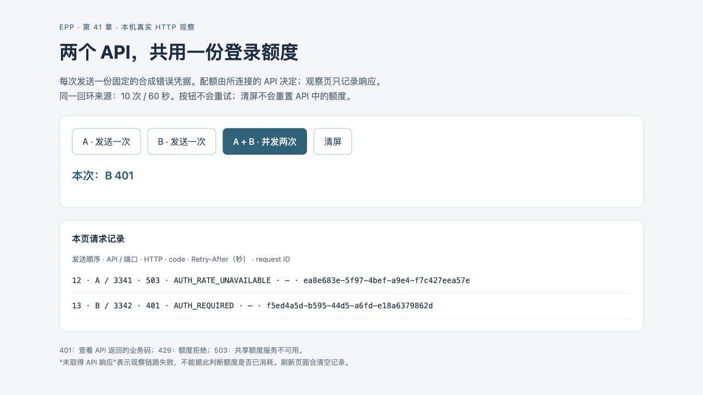

# 第41章 两个 API 实例如何共用登录额度

上一章把密码入口限制为每来源每分钟十次，并让一个进程同时最多承担两份密码工作。前一个约束用Map记次数，后一个约束用进程内变量记正在工作的数量。只有一个API时，两者的存放位置没有冲突；准备多开一个API分担请求以后，次数到底由谁记，就需要重新决定了。

本章从 `part-05/chapter-40` 继续，把次数决定移入已有PostgreSQL，让两个API、进程重启和下一章的公开注册入口遵守同一个窗口。仍保留每进程两个密码占位。我们会故意让两个请求争最后一格，再只撤去计数表的访问权限，观察失败范围。原用户、凭据、会话、素材和操作回执都沿用；新增一张计数表，不重新初始化密码。

阅读约110～135分钟，编码、双实例竞争与故障恢复另加110～150分钟。先完成41.2的迁移和两个API启动，可以停下来；回来核对原库、原配置和原会话，查询窗口是否已自然结束，再继续41.3。窗口结束不需要删除表或重置项目。

## 41.1 交替访问两个独立端口

先把需求说准确：**同一个可信来源，在同一条密码入口规则下，从首次获准请求起的60秒内，最多十次进入后续处理。** 第十一次可以被服务收到，但不能继续查凭据、算密码、发会话。本章计数位置仍在来源和路由检查之后、会话检查与正文读取之前，所以格式错误、后续CSRF失败、密码错误和本机 `AUTH_BUSY` 都可能消耗一格。它不是“连续输错十次”，也不是“十次成功登录”。成功登录不会把来源次数清零。

每分钟十次也不能替代同时最多两份密码工作。两个API各有两份计算资源，合计可能同时处理四份；一个来源还剩六次额度，也可能在某个忙实例遇到 `AUTH_BUSY`。反过来，没有密码工作正在进行，不代表这个来源已经获得新的窗口。这里不新增一个覆盖所有机器的密码信号量；本机占位仍保护本机资源。

沿用[环境指南中的本机双实例准备](../../environment-setup.md#第-41-章让两个-api-共用登录额度)：Node、PostgreSQL、Postman、DBeaver与浏览器均已使用过，不安装Redis或容器。先按[第25章的备份与恢复](../../part-04-consistency/chapter-25-revisions/chapter.md)把第40章已有数据恢复到独立VERIFY副本；保留一个原用户、可登录的凭据、会话、素材ID与操作键。下面的定向撤权只在这个副本进行。

### 先确认两个进程确实各记各的

在第40章目录运行 `npm ci`、`npm run build`。准备一个不提交的 `.env.ch41-pair`，将 `DATABASE_URL` 指向VERIFY，保留原 `CURSOR_HMAC_KEY`，把 `APP_ORIGIN` 设为 `http://127.0.0.1:8341`；不配置 `TRUST_PROXY_IPS`。这一轮只是回环HTTP实验，线上仍需HTTPS。不要在文件中设置PORT，两个终端分别选择它。配置文件内含秘密，使用 `chmod 600 .env.ch41-pair`，不要截图或打印其内容。

在这两个项目终端分别执行 `nvm use`，清掉会盖过文件的同名环境变量，再启动：

```bash
# 终端A，项目根目录；B使用同一配置，只把PORT改成3342
unset DATABASE_URL CURSOR_HMAC_KEY APP_ORIGIN TRUST_PROXY_IPS
NODE_ENV=production PORT=3341 node --env-file=.env.ch41-pair dist/src/server.js
```

看到两个不同PID的 `app.started`，才算两个进程都启动。若第二个报地址被占用，先查端口，不能将对同一个PID的两次请求当成多实例。原配置中的库名还不足以证明同库；在DBeaver执行：

```sql
SELECT current_database(), current_user, inet_server_addr(), inet_server_port(),
       current_setting('server_encoding');
```

主机、端口、库名应与本轮独立副本一致，编码应为UTF8。相同库名可存在于不同实例，不能只核对最后一个字段。两份API连接文件应指向这一个目标。

在Postman建两个相同POST请求，路径为 `/auth/login`，分别指向3341和3342。两份都带 `Origin: http://127.0.0.1:8341`、`X-EPP-Request: 1` 和 `Content-Type: application/json`，正文用下面这个不存在的虚构用户。先查询VERIFY确认该UUID没有用户；如果已被你用过，选择另一个不存在的小写UUID，两个请求保持一致。

```json
{
  "userId": "e4141e41-5a7c-49b1-b741-41e4141e4141",
  "password": "chapter41 synthetic wrong password",
  "label": "Chapter 41 observation"
}
```

连续交替发送十一条，记录序号、端口、HTTP状态与业务码。**401／AUTH_REQUIRED表示请求走到了凭据判定；429／AUTH_RATE_LIMIT才表示来源次数拒绝。** 若是400、403或 `AUTH_BUSY`，先按对应边界排查，不能把它们混成十一条相同密码实验。本轮第40章真实API的十一条均是401：A只看到六条，B只看到五条。停止A再启动，A又从空Map开始；数据库中的原会话仍能在B读到。

配套 `examples/shared-auth-limit/` 提供一个便于并排观察的页面，既可连接旧40，也可连接本章实现。它不计算或重置额度，只把固定错误凭据发到指定的两个回环API。旧40目录还没有这个页面；不要为了开页面而切换正在运行API的源码目录。先在第三个终端进入配套仓库，确认已取得完成分支 `part-05/chapter-41`，再只导出这个无外部依赖的辅助目录。`git archive`读取指定快照，不切换当前40分支，临时目录由系统创建：

```bash
nvm use
observe_dir=$(mktemp -d "${TMPDIR:-/tmp}/epp-ch41-view.XXXXXX")
git archive part-05/chapter-41 examples/shared-auth-limit | tar -x -C "$observe_dir"
node "$observe_dir/examples/shared-auth-limit/server.mjs"
```

浏览器打开 `http://127.0.0.1:8341`。A、B各发一次是串行观察；“并发两次”让两份请求重叠，结果按发送编号展示。清屏只删页面记录，不碰API或数据库。页面失败也不自动重试，因为未取得响应并不代表API没有消耗额度。示例不接收任意目标URL，不转发用户填写的来源头、Cookie或真实密码。读者自己的登录继续用原Postman集合。



图41-1：观察页连的是第40章两个正式进程；十一条跨两个端口的响应均为401。页标题表达本章要解决的问题，具体是否共享以所连接版本和数据库事实判断。图中没有会话或密码，所显示request ID只用于定位这一轮合成请求。

固定把同一IP转到同一台机器，能暂时减少两份Map的分歧，但机器重启、扩缩容和分流规则变化都会重开额度。把Map定期写入数据库也不足够：A、B仍可能各读到九次，各自决定放行，再把十写回去。缺的是**读取、判断、占用作为同一次竞争决定**，不是仅把最终数字存得更久。

## 41.2 在数据库内作出一次配额决定

单行 `UPDATE ... WHERE used < 10 RETURNING ...` 可以让同一个桶的最后一格只有一个赢家。第一次没有行时，还要处理并发插入；到期时，要把时间与次数一起重开。我们还保留上一章“最多记1000个来源”的内存保护意图，变成这条规则最多1000行：两个不同新来源都看到999行时，单独锁各自的行没有用，因为两行还不存在，且竞争的是同一份总容量。

可以为总容量另建一行并锁住它，也可以在Redis中用一个原子脚本完成这些步骤。前者增加容量计数与过期清理的维护关系；后者增加一个需要部署、连接、恢复和验证故障的共享服务。本书已经有PostgreSQL，也已经掌握事务级建议锁，因此本章选择一条规则共用一把短事务锁。它让协议容易验证，代价是不同来源的额度决定也会短暂排队。不能把这套方案称为高吞吐限流服务，更不能据此宣称能抵抗占满网络或数据库连接的攻击。

### 一行表达一个来源的当前窗口

新增 `auth_rate_buckets`，主键是 `(rule_key, source_key)`。`rule_key` 固定为 `password-auth/v1`，用于让登录、改密以及下一章接入的恢复路径指向同一类预算；`source_key` 来自既有Express代理信任配置下的 `request.ip`。API端口、PID、用户ID和签名密钥不进入键。否则换端口、重启、换用户名或轮换游标签名都会得到新额度。

`opened_at` 记录窗口开始，`expires_at` 记录结束，`used` 记录已获准进入后续处理的次数。这里的“来源”不等于人：家庭或公司出口后面的人可能共用一个桶，IPv4与IPv6也可能形成不同来源。若需求变成每账号、每租户或每设备，需要重新定义键和匿名阶段的可信依据，不能把尚未验证的请求正文userId直接当成已经确认的身份。

```sql
CREATE TABLE public.auth_rate_buckets (
  rule_key varchar(64) NOT NULL,
  source_key varchar(128) NOT NULL,
  opened_at timestamptz(3) NOT NULL,
  expires_at timestamptz(3) NOT NULL,
  used integer NOT NULL,
  CONSTRAINT auth_rate_buckets_pkey PRIMARY KEY (rule_key, source_key),
  CONSTRAINT auth_rate_buckets_used_check CHECK (used BETWEEN 1 AND 10),
  CONSTRAINT auth_rate_buckets_window_check CHECK (expires_at = opened_at + interval '60 seconds')
);
```

唯一键与CHECK保护行本身，不能单独保证全表最多1000行，也不能强迫其他写入者遵守建议锁。所有正式消耗、清理入口都必须按同一协议获取锁；管理SQL有能力绕开它，因此本章只在隔离副本人工改实验行。原始IP属于运行数据，不能顺手写进普通应用日志；表的读取权限也限于实际需要的运行者与维护者。

Prisma模型映射这张表，SQL约束保留在新迁移中。从40跟写时，在 `prisma/schema.prisma` 末尾加入：

```prisma
model AuthRateBucket {
  ruleKey String @map("rule_key") @db.VarChar(64)
  sourceKey String @map("source_key") @db.VarChar(128)
  openedAt DateTime @map("opened_at") @db.Timestamptz(3)
  expiresAt DateTime @map("expires_at") @db.Timestamptz(3)
  used Int

  @@id([ruleKey, sourceKey], map: "auth_rate_buckets_pkey")
  @@map("auth_rate_buckets")
}
```

建立目录 `prisma/migrations/20261116170000_shared_auth_rate_limit/`，将上面的完整DDL保存为其中的 `migration.sql`。目录名与完成快照一致；已经执行过的迁移不重命名。迁移后运行 `npm run prisma:generate`，才会有后面使用的 `client.authRateBucket`；生成TypeScript客户端不等于数据库已经有表。

不要改已经部署的旧迁移来“顺便补表”。这里分两条操作路线：从40跟写的读者保留自己的工作分支，不再切换完成分支；直接验收的读者在干净目录切到 `part-05/chapter-41`。两条路线都先停止旧API，再在原VERIFY上追加迁移：

```bash
nvm use
npm ci
npm run db:verify -- migrate status
npm run db:verify -- migrate deploy
npm run db:verify -- migrate status
npm run prisma:generate
```

这几条读取 `.env.database-verify`，不读取刚才API的文件。先解除当前终端已导出的DATABASE_URL覆盖，再核对二者目标相同。新增表初始为空，旧Map没有可追认的全局历史；原表行数、素材ID、会话和成功回执应保持，迁移历史只多本章一条。两台机器混跑旧Map版与新版期间，无法保证总共十次，发布时需要先停旧密码入口或安排一致升级窗口。保留旧会话并不要求继续放行旧计数协议。

### 先拿到锁，再取时间和读取

本章把决定封装为 `SharedAuthRateLimiter.consume(source)`，返回 `{ allowed, retryAfter }`。拒绝也是一个成功完成的决定；只有无法可靠取得决定才抛依赖错误。关键事务如下：

```typescript
import { DatabaseService } from './database.service.js';
import { ApplicationState } from './application-state.js';
import { HttpError } from './http.js';

export const AUTH_RATE_RULE = 'password-auth/v1';
// Two-int advisory lock namespace: ASCII EPP (0x455050), rule 41.
// This is distinct from PostgreSQL's single-bigint advisory lock space.
export const AUTH_RATE_LOCK = [4542544, 41] as const;
export class SharedAuthRateLimiter {
  constructor(private readonly database: DatabaseService, private readonly state: ApplicationState) {}

  // API-only readiness check: workers need neither this table nor its privileges.
  async onModuleInit(): Promise<void> {
    await this.database.run('probeAuthRate', () => this.database.client.authRateBucket.findMany({ take: 1,
      select: { ruleKey: true, sourceKey: true, openedAt: true, expiresAt: true, used: true } }));
  }

  async consume(source: string): Promise<{ allowed: boolean; retryAfter: number }> {
    if (this.state.draining) throw new HttpError(503, 'Service is shutting down', 'SERVICE_DRAINING');
    try {
      return await this.state.track(() => this.database.run('consumeAuthRate', () =>
        this.database.client.$transaction(async tx => {
          await tx.$executeRaw`SET LOCAL lock_timeout = '1s'`;
          // Separate statement: a waiter must get a NEW READ COMMITTED snapshot after the lock.
          await tx.$queryRaw`SELECT pg_advisory_xact_lock(4542544::int, 41::int)::text`;
          const [clock] = await tx.$queryRaw<{ now: Date }[]>`SELECT date_trunc('milliseconds', clock_timestamp()) AS now`;
          const now = clock!.now;
          await tx.$executeRaw`DELETE FROM public.auth_rate_buckets WHERE (rule_key, source_key) IN (
            SELECT rule_key, source_key FROM public.auth_rate_buckets
            WHERE rule_key = ${AUTH_RATE_RULE} AND expires_at <= ${now}
            ORDER BY expires_at, source_key LIMIT 100
          )`;
          const key = { ruleKey: AUTH_RATE_RULE, sourceKey: source };
          const bucket = await tx.authRateBucket.findUnique({ where: { ruleKey_sourceKey: key } });
          if (bucket && bucket.expiresAt > now) {
            if (bucket.used >= 10) return { allowed: false, retryAfter: Math.max(1, Math.ceil((bucket.expiresAt.getTime() - now.getTime()) / 1000)) };
            await tx.authRateBucket.update({ where: { ruleKey_sourceKey: key }, data: { used: { increment: 1 } } });
          } else {
            // An expired current row may survive the bounded batch; reset it without adding a row.
            if (!bucket && await tx.authRateBucket.count({ where: { ruleKey: AUTH_RATE_RULE } }) >= 1000) {
              return { allowed: false, retryAfter: 60 };
            }
            const data = { openedAt: now, expiresAt: new Date(now.getTime() + 60000), used: 1 };
            await tx.authRateBucket.upsert({ where: { ruleKey_sourceKey: key }, create: { ...key, ...data }, update: data });
          }
          return { allowed: true, retryAfter: 0 };
        }, { isolationLevel: 'ReadCommitted', maxWait: 2000, timeout: 5000 })));
    } catch {
      // A failed/unknown commit never permits password work or falls back to process memory.
      throw new HttpError(503, 'Authentication rate service is unavailable', 'AUTH_RATE_UNAVAILABLE');
    }
  }
}
```

这里有三个顺序不能随意合并。

第一，使用事务级而非会话级建议锁。事务提交或回滚就释放，连接回池后不会继续替某个请求占住。双int键使用本章固定命名空间，与原先单bigint建议锁属于不同键空间；锁名不是靠字符串碰运气。建议锁只在同一个数据库内协调：两个API各连一个同名数据库副本，仍然是两把锁、两份额度。[PostgreSQL建议锁说明](https://www.postgresql.org/docs/18/explicit-locking.html#ADVISORY-LOCKS)用于回查其生命周期。

第二，显式使用READ COMMITTED，并把获取锁单独作为一条SQL。假设原有999行，A先取得锁，插入第1000行，B已经开始等待。B拿到锁后，要在下一条语句看到A刚提交的行。如果把等待锁和 `count(*)` 塞进同一条CTE，该语句可能早在等待前就固定了快照；即便写着“先取锁”，仍不能保证后面读到新提交。READ COMMITTED的每条命令重新取得可见数据，锁解决谁先做，快照解决后做者看到哪一刻的数据，两者需要同时成立。[事务隔离说明](https://www.postgresql.org/docs/18/transaction-iso.html#XACT-READ-COMMITTED)



第三，取得锁以后才用 `clock_timestamp()` 取数据库时间，并在这一轮决定里复用它。API机器的时钟不参与过期裁决；`CURRENT_TIMESTAMP` 是事务开始时刻，等待一段时间后仍可能停在过去。本章把时间截到毫秒，与表的 `timestamptz(3)` 一致，让存下的边界和用于判断的边界一致。`expires_at <= now` 就算到期；首次获准时定下60秒，普通访问和被拒请求不延长它。[数据库时间函数](https://www.postgresql.org/docs/18/functions-datetime.html#FUNCTIONS-DATETIME-CURRENT)

每轮最多删100个到期桶，并用稳定排序选择。它限制的是一次删除的行数，不代表清理没有查询成本；当前1000行容量约束扫描范围；主键支持按规则和来源定位。若扩大容量，需要重新观察清理计划并判断是否增加过期索引。之后若当前桶仍在且到期，就就地重开；若是新来源，只有总行数小于1000才插入。容量已满时返回429和60秒重试建议，保留其他尚未到期来源的额度，不为新来源踢掉旧桶。到期行并不保证在时钟跳到边界的那一刻自动消失，它们由后续消耗请求顺带回收。

这套固定窗口仍允许边界附近突发：窗口末尾十次，紧接着下个窗口十次。改成滑动窗口或令牌桶解决的是另外一个限制形状，并不能省去跨实例的原子决定。若以后需要高吞吐，可先测锁等待、数据库耗时和拒绝率，再决定拆规则、维护独立容量行或换专用存储；不要只删掉这把锁，却继续承诺新来源总容量严格受控。

### 配额提交以后才开始密码工作

中间件接线仍在 `browserBoundary`、`httpBoundary` 后，`sessionBoundary`、正文读取前；把原Map替换成共享服务，不移动其他边界。

```typescript
export function authRateLimit(limiter: SharedAuthRateLimiter): RequestHandler {
  return async (request, response, next) => {
    if (request.method !== 'POST' || !['/auth/login', '/auth/password'].includes(request.path)) { next(); return; }
    try {
      const result = await limiter.consume(request.ip ?? request.socket.remoteAddress ?? 'unknown');
      if (!result.allowed) {
        response.setHeader('Retry-After', String(result.retryAfter));
        throw new HttpError(429, 'Try again later', 'AUTH_RATE_LIMIT');
      }
      next(); // consume resolves only after the transaction committed.
    } catch (error) {
      response.setHeader('Connection', 'close');
      next(error);
    }
  };
}
```

`ApplicationState.track`让停机排空看见正在做的计数事务。事务承诺一格后才调用next；数据库锁不会覆盖Argon2计算、会话事务或HTTP响应等待。启动时也检查计数表和关键列，防止缺迁移的API看似就绪。

把计数器保存为 `src/shared-auth-rate-limiter.ts`，在 `src/browser-security.ts` 加入 `import type { SharedAuthRateLimiter } from './shared-auth-rate-limiter.js';`，再替换原authRateLimit函数。接线时不能只改变函数参数：`src/app.module.ts` 的完整登记如下，工厂明确使用原数据库与停机状态，实例会执行自己的onModuleInit：

```typescript
import { SharedAuthRateLimiter } from './shared-auth-rate-limiter.js';
import { DatabaseModule } from './database.module.js';
import { DatabaseService } from './database.service.js';
import { ApplicationState } from './application-state.js';
import { Module } from '@nestjs/common';
import type { DynamicModule } from '@nestjs/common';
import { APP_FILTER } from '@nestjs/core';
import { ProblemFilter } from './problem.filter.js';
import { CapturesModule } from './captures.module.js';
import { RuntimeModule } from './runtime.module.js';
import type { AppConfig } from './config.js';
import { AppLogger } from './app-logger.js';

@Module({})
export class AppModule {
  static register(config: AppConfig, logger: AppLogger): DynamicModule {
    return {
      module: AppModule,
      imports: [RuntimeModule.register(config, logger), CapturesModule, DatabaseModule],
      providers: [{ provide: SharedAuthRateLimiter,
        useFactory: (database: DatabaseService, state: ApplicationState) => new SharedAuthRateLimiter(database, state),
        inject: [DatabaseService, ApplicationState] }, { provide: APP_FILTER, useClass: ProblemFilter }],
    };
  }
}
```

`src/app.ts` 加入 `import { SharedAuthRateLimiter } from './shared-auth-rate-limiter.js';`，将原来无参数的调用改成下面这一段，前面的来源、路由检查与后面的正文边界保持顺序：

```typescript
app.use(httpBoundary);
app.use(authRateLimit(app.get(SharedAuthRateLimiter)));
app.use(sessionBoundary(app.get(SessionService), config));
app.use(captureBody);
```

OpenAPI中为登录与改密补充503/AUTH_RATE_UNAVAILABLE，保留原有429不同业务码。配套请求集合 `requests/chapter-41-shared-auth-limit.postman_collection.json` 只提供A/B错误凭据请求；已有会话读取继续使用第40章集合中的GET。导入后核对两个base URL，不导出Cookie或秘密。这样手写实现与读者验证使用同一份契约。完成计数器、模型、中间件和上述接线后，两条路线都执行 `npm run check`；它会生成客户端、类型检查并构建，确认成功后才按41.1命令重启A/B，避免继续运行旧dist。

后续邮件、通知进程不承接密码入口，不应因为没有这张表的访问权而启动失败。

当连接中断发生在COMMIT附近，客户端可能不知道服务器是否已经提交。本章保守返回503，不重新放行，不退回Map，也不试图凭一次查询猜“刚才一定没扣”。因此一次失败可能消耗了一格，却没有开始密码计算。来源额度是保护预算，不是必须精确计费的用户账本；如果业务改成收费扣款，就要使用前面操作回执那样的业务身份协议，不能原样照搬这里的失败处理。

### 写代码时继续使用开发监听器

前面的双实例反例和后面的最终竞争，都使用构建后固定版本，便于确认两端到底在运行哪份代码。日常跟写仍沿用既有开发循环：在代码目录以本章VERIFY配置启动一个开发API，Inspector只绑定本机9229，输出在 `.dev`，不与生产dist混用。

```bash
unset DATABASE_URL CURSOR_HMAC_KEY APP_ORIGIN TRUST_PROXY_IPS
NODE_ENV=development PORT=3341 node --env-file=.env.ch41-pair scripts/dev.mjs
```

按第40章的编辑器调试配置连接9229，在consume取得桶或返回决定的位置观察。只开一个这类开发进程；脚本固定用9229，不能原样复制到B而争用调试端口。保存 `src/shared-auth-rate-limiter.ts` 后，应先看到Build succeeded、旧PID排空，再看到新PID就绪；重新连接断点，查询原桶仍在。暂停调试会改变锁等待和事务时间，观察完成先解除暂停，再用正常请求复核，不把断点造成的503当成正常负载结果。

本轮实际保存与恢复源码均触发了重编译和重启，重启前后同一窗口used从1到2，生产dist保持不变；这是开发脚本与HTTP验证，没有把它说成编辑器界面实拍。完成修改后停止开发进程，运行 `npm run check`，再按41.1启动两份正式产物。两端都换到新构建以后再做末格竞争，避免A跑新源码、B还用旧dist。

## 41.3 在只余一格时同时发起

用第41章构建产物重新启动A、B和观察页。保留同一个VERIFY、原密钥和来源。确认两个日志都有数据库就绪与应用启动，打开观察SQL；不要先连发十条后再猜当前窗口状态。

```sql
SELECT rule_key, source_key, opened_at, expires_at, used,
       clock_timestamp() AS observed_at,
       expires_at > clock_timestamp() AS still_open
FROM public.auth_rate_buckets
WHERE rule_key = 'password-auth/v1'
ORDER BY opened_at, source_key;
```

默认没有受信代理时，回环连接会呈现实际套接字来源，可能是 `::ffff:127.0.0.1`；照查询结果识别，不预先假定必为 `127.0.0.1`。两端应落到同一行。若一端看到IPv4，另一端看到IPv4映射IPv6的不同字符串，先统一监听与代理来源约定；本章按解析结果原样作键，不会自动把不同表示合成一个身份。观察页没有转发客户端IP；这一轮证明同一回环来源共享，不代表已经实现公网多用户代理分组。[Express代理信任说明](https://expressjs.com/en/guide/behind-proxies/)仍适用于这里。

先在这个来源尚无活动窗口时用原Postman正确登录，保存Cookie并GET `/auth/me` 与旧素材，确认200。正确登录也占额度，因此等该窗口自然结束再开始计数轮；不要把登录前置偷偷排除在计数协议之外。已有会话只用于后面的普通读取，不必重新登录。

清空观察页显示后，A、B交替发九次，SQL应看到 `used=9` 且尚未到期；随即点“并发两次”。应是一条401／AUTH_REQUIRED，一条429／AUTH_RATE_LIMIT，最终 `used=10`。A不保证赢，B也不保证赢；若某次看到两条401，先核对该轮是否跨了窗口、两份连接是否同库、两份代码是否都已升级，再查事务快照和锁协议。单看按钮同时点下，不能证明数据库真的发生过锁等待。



图41-2：本章真实双API的九次之后，并发两条只有一条进入凭据判断。429带有服务器返回的Retry-After；独立SQL同时核对一行 `used=10`。图片是请求结果证据，锁等待需要下面的独立连接观察。

在窗口还开着时，仅重启A。再从A发送应仍429；换一个伪造 `X-Forwarded-For` 再发也应429。Postman可以手动设置这个头，浏览器观察页不提供伪造按钮。默认信任关闭时，应用读真实套接字来源；若未来在明确受信代理后运行，必须由代理覆盖转发头并限制直连，不能把 `TRUST_PROXY_IPS` 当成客户端自由更换来源的许可。

记录 `expires_at`，等数据库时间实际超过它，再发一条，应401、`used=1`，新opened_at从这次决定开始。不要修改数据库时间来假装等过了60秒；为了快速观察可在独立合成桶中安排即将到期的窗口，但它证明的是边界处理，不能替代真实窗口实验。整个过程中，用原Cookie读 `/auth/me`、旧素材仍应200。限登录入口不等于撤销已经存在的会话。

### 把“同时发起”推进到“确实在等锁”

DBeaver用两个独立SQL编辑器连接VERIFY。A执行BEGIN并取得与实现相同的双int锁后，先不要提交。此时从观察页发一个请求，再用B查看 `pg_stat_activity` 的 `wait_event_type`、`wait_event` 与 `pg_locks` 的 `granted`。看到请求对应连接在等advisory，才知道已经走到这把锁。正式API最多等锁1秒，手动观察慢了会得到503。要再次观察，先结束这轮事务，再按原来的 1 秒期限重做。

```sql
-- A：只在本轮VERIFY执行，保持事务未结束
BEGIN;
SELECT pg_advisory_xact_lock(4542544::int, 41::int);
-- 观察完成后单独执行：ROLLBACK;
```

```sql
-- B：查看实际等待，不运行A的BEGIN
SELECT a.pid, a.application_name, a.state, a.wait_event_type, a.wait_event,
       l.classid, l.objid, l.objsubid, l.granted
FROM pg_stat_activity a
JOIN pg_locks l ON l.pid = a.pid
WHERE l.locktype = 'advisory'
  AND l.classid = 4542544 AND l.objid = 41
ORDER BY a.pid;
```

`granted=true`是持有人，`false`是等待者；双int锁的 `objsubid=2` 可以帮助区分单bigint空间。观察者需要有查看目标会话的权限，本轮用隔离库维护连接，不给API增加监控权限。终端API日志按request ID保留503，再在A单独ROLLBACK释放锁。

把SQL锁实验与API末格实验区分开：A持锁超过一秒，观察API拒绝后ROLLBACK，检查桶次数没有增加；随后再发，应该能按原窗口继续。想验证锁后时间，可以用独立自动化测试控制几百毫秒的等待与即将到期的合成桶，释放锁后应按新时间重开。数据库测试还安排999个未过期合成来源与两个不同新来源等待同一锁，最终只插入一个，行数恰为1000；这覆盖单行竞争测试无法证明的总容量条件。

不要在日常库造1000个假来源或清掉真实窗口。独立测试库按场景清理本规则行；两个API处于同一个场景时不会在中间清理。否则测试看似互不影响，实际上又恢复成每实例一份初始额度。

## 41.4 当共享计数不可用时怎样恢复

现在已有会话还能读数据，但所有新的密码请求都多了一个共享依赖。它坏了以后，是返回429、放行还是返回503，需要事先约定。429表示我们取得了可靠的预算决定，当前没有额度；503表示这一次无法取得决定。把权限错误伪装成429，会让客户端等一个并不存在的窗口；临时放开会在保护最弱时接进更多昂贵工作。

### 只拿走计数表的一项能力

表所有者和超级用户能绕过普通授权，不能用它们演示REVOKE。使用配套 `database/chapter-41-shared-auth-limit/` 中的角色准备和观察脚本，在VERIFY建立独立运行角色；它拥有当前API必要的业务权限，但不拥有表、不继承表所有者。角色与主机用户是两件事，本章先验证数据库身份，第 70 章再完整拆分API、邮件和通知进程身份。

在Mac终端用既有psql连接本轮VERIFY，下面的主机、端口、所有者和库名按自己的恢复记录填写，不能从将要测试的API连接串里反推目标。psql的准备入口见[环境指南](../../environment-setup.md#homebrew-与数据库程序)。

```bash
psql -h 127.0.0.1 -p 55432 -U epp_owner -d epp_ch41_verify
```

先在psql执行前面的身份查询；再查 `SELECT rolname FROM pg_roles WHERE rolname='epp41_api';`。若已有同名角色，不擅自覆盖密码或权限；为本轮选择另一个新名字，并同步下面的授权与API连接。新角色这样创建：

```sql
CREATE ROLE epp41_api LOGIN NOSUPERUSER NOCREATEDB NOCREATEROLE NOREPLICATION;
```

接着在psql输入 `\password epp41_api`，按两次隐藏提示设置本轮独立密码；这个反斜线命令由psql处理，不粘到DBeaver SQL编辑器。退出用 `\q`。把密码填入只留本机的运行配置，URL保留字符按第20章编码，文件模式保持0600，不打印连接串。

在DBeaver的VERIFY维护连接打开 `database/chapter-41-shared-auth-limit/00-runtime-grants.sql`，把其中 `epp_ch41_verify` 换成已核对的实际库名，再执行。它逐张列出当前API的SELECT、创建、改密和会话撤销权限；计数表单独授CRUD，没有给整个public中所有对象一次性授权。原登录事务对users使用FOR UPDATE，PostgreSQL因此要求至少一列UPDATE权限；本章临时角色只给id列，外键限制仍生效，但这也意味着该角色并非绝对只读用户表。第 70 章用专门的只读锁定视图进一步缩小这项能力，不能把当前中间阶段称为最终最小权限方案。

把A、B的DATABASE_URL改为这个新角色、同一个VERIFY，停止原API后重启。用原账号登录并读旧素材200，确认角色能真实运行；表owner仍应是迁移身份。然后只选中以下REVOKE执行，GRANT留作独立恢复步骤：

```sql
REVOKE SELECT, INSERT, UPDATE, DELETE
ON public.auth_rate_buckets FROM epp41_api;
```

完成故障观察后，无论观察是否顺利，都由同一维护连接恢复：

```sql
GRANT SELECT, INSERT, UPDATE, DELETE
ON public.auth_rate_buckets TO epp41_api;
```

不要把撤权和恢复整段同时执行后才发请求，那样没有真正观察到缺权窗口。

先用这份受限DATABASE_URL启动两个API，并在撤权前实际验证原账号登录、旧会话读取和额度写入。若启动时已经缺权，日志应是 `database.start_failed` 或本服务的启动失败，不能把尚未就绪误写成“线上请求返回503”。本轮要观察运行中故障，所以服务就绪后才由维护连接定向撤权。

撤权后从观察页发一次，预期503／AUTH_RATE_UNAVAILABLE，响应仍有request ID。按它找到这一条HTTP完成日志，再结合数据库固定操作名及服务端错误判断是否为权限问题。不要把含连接串、密码、Cookie或来源地址的调试日志当成排障前提。用另一个已登录会话继续GET `/auth/me` 与旧素材，应200；查桶应保持撤权前的used与expires_at。



图41-3：运行中的API失去计数表能力后返回503，恢复权限后继续原窗口。页面保留失败与随后响应；同一旧会话普通读取和数据库行值另行核对，没有把页面没有显示的内容说成图中证据。

恢复原授权，不重启、不删桶，再发请求。若原窗口未满且未到期，继续在原used基础上加一；若原窗口已满，仍429；若已经自然到期，按正常规则新开。恢复后立刻得到401不自动等于故障期间被清零，应同时对照expires_at。这里特意保留旧窗口，就是为了让恢复有可核对的连续事实。

如果是整个数据库不可连接，GET会话身份也可能无法判断，普通业务读取同样会失败；那不是计数表单项权限故障。若仅某个API错误，先比较它的运行身份、库目标、迁移和版本，再决定修哪一个。双实例不是两个独立故障域：共用数据库让额度一致，也让这份依赖的故障同时影响两端。

### 交付时保留的是协议和数据

新增表迁移由迁移身份执行，运行API需要SELECT、INSERT、UPDATE、DELETE，最后一项用于有界过期清理。只有SELECT并不足以通过真实消耗；能启动也不等于能完成写入。后续拆分权限时只给API相应能力，邮件和通知进程不需要它，新的运行登录可以继承同一API权限角色。

第42章增加注册申请与确认，第43章增加重置入口时，它们继续加入同一个 `password-auth/v1` 来源桶；邮箱签发冷却、一次性验证令牌与本机密码占位仍各管自己的约束。不要给每条新路由复制一张Map，也不要把单一来源预算当作某邮箱、账号或全站的完整防滥用方案。外部平台登录是否进入该规则需要独立判断，不因为路径以 `/auth/` 开头就自动纳入。

独立生产目录仍按第40章只交付dist、依赖安装文件和必要配置。两个API使用同一个目标库、同一个计数协议；凭据或游标签名轮换不重置窗口。以后放进两个容器，协议也不变，容器本地文件和内存不保存全局次数。本轮先在本机真实进程与PostgreSQL验证，容器构建和Compose运行在后续正文完成。

停止时先结束本轮API与观察页；先前临时导出的观察目录可在确认进程停止后移除，确认 `app.stopped` 与连接释放，保留VERIFY及本章记录供下一章继续。把本轮受限连接另存为只供41章故障复验的配置；第42章回到原开发运行身份并明确指向这个VERIFY，因为临时epp41_api没有下一章新表与新列的权限。新增迁移仍由迁移身份执行，不能期待角色自动得到新对象权限。不要删除旧会话或成功回执来“清理实验”。如果要撤销本次专用运行角色，先停妥其连接、收回本轮授权再处理角色；不要用清空整个库代替定向收尾。

## 附录：本章必要技术点速查

| 名称 | 本章用途 | 回查时注意 |
| --- | --- | --- |
| `(rule_key, source_key)` | 标识一类规则下的同一来源 | 端口、PID、用户和签名密钥不参与 |
| `pg_advisory_xact_lock(int,int)` | 串行化次数与新来源容量决定 | 同库同键、事务释放；所有写入者需遵守 |
| READ COMMITTED | 等锁后用下一条语句读取新提交 | 锁与读取不能塞进同条CTE |
| `clock_timestamp()` | 锁后取得数据库当前时间 | 不用事务开始时刻或API墙上时钟 |
| `Retry-After` | 429后的重试建议秒数 | 上取整，不是预约成功或自动重试许可 |
| `AUTH_RATE_LIMIT` | 已取得共享决定但无额度 | 区别本机 `AUTH_BUSY` 与会话数上限 |
| `AUTH_RATE_UNAVAILABLE` | 无法可靠取得共享决定 | 503、保守拒绝、不退回Map |
| `lock_timeout` | 限制等锁时间 | 与整条语句、事务和停机期限分别判断 |
| `request.ip` | 沿既有代理信任得到来源 | IP不等于用户；默认不信任自填XFF |
| 有界清理与容量 | 每轮至多删除100行、每规则最多1000行 | 不驱逐未到期桶；管理员旁路写入不受应用协议保证 |

版本沿用Node24.22.1、Prisma7.10.1与PostgreSQL18。官方入口：[建议锁函数及双键空间](https://www.postgresql.org/docs/18/functions-admin.html#FUNCTIONS-ADVISORY-LOCKS)、[锁等待配置](https://www.postgresql.org/docs/18/runtime-config-client.html#GUC-LOCK-TIMEOUT)、[Express代理信任](https://expressjs.com/en/guide/behind-proxies/)。正式实现和实验文件位于完成分支 `part-05/chapter-41`；起点为 `part-05/chapter-40`。

[上一章：保护基于浏览器的服务入口](../chapter-40-browser-boundary/chapter.md) · [下一章：从一封验证邮件建立账号](../chapter-42-verified-signup/chapter.md) · [第五篇导读](../README.md) · [全书目录](../../README.md)
