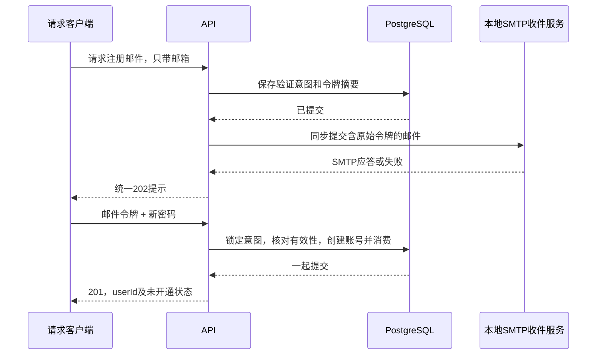
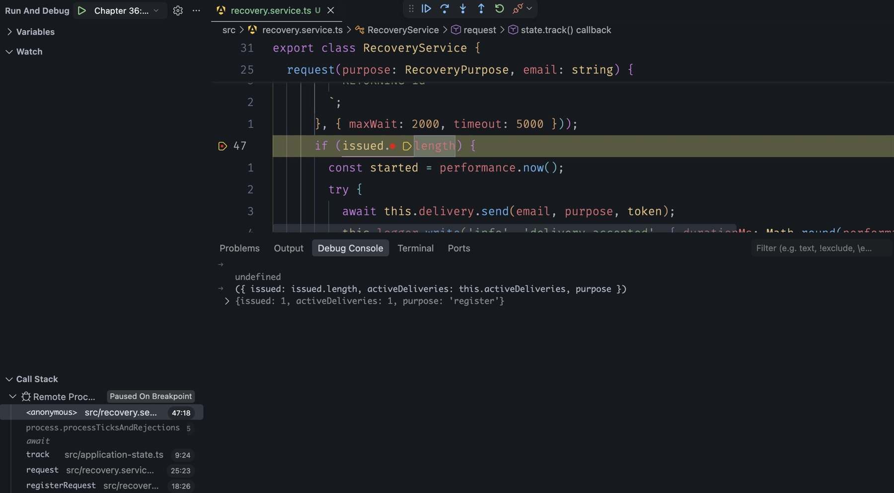
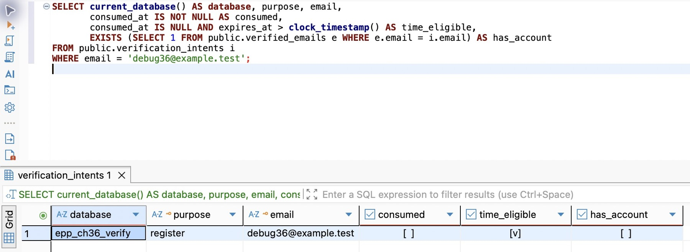

# 第 42 章 从一封验证邮件建立账号

前章保护了浏览器入口。过去只能由维护者创建账号，现在让用户自己提交邮箱，证明能收到一封特定的邮件，然后选择密码。本章的交付结果是一个经过邮箱验证、默认尚未开通 Web 使用资格的账号。保留它的 ID，下一章将用它测试丢失密码以后怎样找回同一账号。

本章的完成快照只公开注册请求与确认，已有登录入口继续可用。下一章沿用同一套数据库结构和底层验证服务，再接上两条密码重置路由。两章只应用一次共同迁移。阅读约 95～115 分钟，迁移、接线、收信与注册验证另加约 95～125 分钟。

## 42.1 先有注册意图，再有真正的账号

### 不让一份尚未证实的输入占住身份

假设有人先用 `reader36@example.test` 发起注册，却从未收到邮件。此时就插入正式用户、保存他提交的密码，会留下一个尴尬状态：真正的邮箱持有人后来注册，服务却说账号已存在。如果处理不严谨，之前那个密码还可能被保留下来。

因此把注册拆成两个动作。第一次只提交邮箱，保存一个待验证意图；第二次同时提交邮件里的令牌和**此刻选择的密码**，才在同一个事务里创建用户、已验证邮箱和密码凭据。未验证者没有用户身份，也不能为将来的邮箱持有人预设密码。



这里的“验证”只回答请求者是否掌握了这封邮件，不回答此人是否应有Web资格。第39章的新用户默认 `web_enabled=false` 继续成立。注册请求不能接受 `webEnabled`、`status` 或 `userId`；这些字段即使由客户端传来，也不应进入创建数据。

### 三种事实放在各自的位置

正式账号仍在 `users`。增加 `verified_emails`：一行表示一个邮箱已经与一个用户建立联系，`email` 唯一，`user_id` 也唯一。本章每人一个邮箱，既有用户可以没有邮箱，所以无需给旧行编造联系信息，也不需要把邮箱变成用户主键。学习记录等外键仍引用稳定的用户ID。

再增加 `verification_intents`：一行表示某个用途、某个地址的**当前**验证机会。注册和重置用同一套到期、重发与消费机制，但 `purpose` 不同；注册邮件不能拿去重置密码。`UNIQUE(purpose,email)` 意味着同一地址每个用途只保留一个当前令牌；重发会替换它，不无限积累多份仍有效的码。这是产品选择，也意味着后到的重发可能让先收到的邮件失效。

重置意图另存 `user_id` 与 `credential_version`。前者绑定签发当时的用户，后者绑定当时的密码版本。未找到可恢复账号时两者为空；这个意图不会因为同地址后来注册成功，就自动变成可用的重置凭证。注册意图始终不绑定旧用户。

给 `PasswordCredential` 增加 `version Int @default(1)`，旧密码自动成为版本1。它是并发判断用的整数，不是密码强度，也不取代Argon2参数。任何成功换密都把它加1，下一章会用它挡住过时的重置请求。

在 `prisma/schema.prisma` 中追加两个模型，给 `User` 补 `verifiedEmail VerifiedEmail?`、`verificationIntents VerificationIntent[]` 两个反向关系。核心模型如下，已有模型的其余字段保持原样：

```prisma
model VerifiedEmail {
  email String @id(map: "verified_emails_pkey") @db.Text
  userId String @unique(map: "verified_emails_user_id_key") @map("user_id") @db.Uuid
  verifiedAt DateTime @default(now()) @map("verified_at") @db.Timestamptz(3)
  user User @relation(fields: [userId], references: [id], onDelete: Restrict, onUpdate: Restrict, map: "verified_emails_user_id_fkey")
  @@map("verified_emails")
}

model VerificationIntent {
  id String @id(map: "verification_intents_pkey") @db.Uuid
  purpose String @db.Text
  email String @db.Text
  tokenDigest String @unique(map: "verification_intents_token_digest_key") @map("token_digest") @db.Text
  userId String? @map("user_id") @db.Uuid
  credentialVersion Int? @map("credential_version")
  issuedAt DateTime @default(now()) @map("issued_at") @db.Timestamptz(3)
  expiresAt DateTime @map("expires_at") @db.Timestamptz(3)
  consumedAt DateTime? @map("consumed_at") @db.Timestamptz(3)
  user User? @relation(fields: [userId], references: [id], onDelete: Restrict, onUpdate: Restrict, map: "verification_intents_user_id_fkey")
  @@unique([purpose, email], map: "verification_intents_purpose_email_key")
  @@index([expiresAt], map: "verification_intents_expires_at_idx")
  @@map("verification_intents")
}
```

追加迁移 `20261106003600_registration_recovery`，不改前章迁移。SQL除建表、外键和唯一键，还把状态组合限制在数据库中。以下是不能仅靠TypeScript保证的部分：

```sql
ALTER TABLE public.password_credentials ADD COLUMN version integer NOT NULL DEFAULT 1;
ALTER TABLE public.password_credentials ADD CONSTRAINT password_credentials_version_check CHECK (version > 0);
-- verification_intents建表语句中的约束：
CHECK (purpose IN ('register', 'reset')),
CHECK (token_digest ~ '^[0-9a-f]{64}$'),
CHECK (expires_at > issued_at),
CHECK (
  (user_id IS NULL AND credential_version IS NULL) OR
  (purpose = 'reset' AND user_id IS NOT NULL AND credential_version IS NOT NULL AND credential_version > 0)
)
```

最后四项是建表中的约束片段，不是四条可单独执行的SQL。完整迁移还给邮箱加规范化长度约束，给到期时间建索引；它们分别服务于写入一致性和后面的过期清理。Prisma负责映射，迁移SQL负责它无法完整表达的CHECK，沿用第三篇的分工。

### 先升级非空VERIFY，确认旧账号仍是原来的账号

按第25章的备份与独立恢复流程准备一个有旧素材、修订、学习记录和密码的VERIFY。停该库写入，在DBeaver先执行 `SELECT current_database(), current_user;`；保存原账号ID、其素材详情，以及密码凭据是否存在。不要导出密码摘要作截图，也不要把DEV连接改名后当成隔离库。

核对 `.env.database-verify` 指向这份副本，并从创建或恢复记录独立取出预期库名。从本章配套分支的 `scripts/` 复制 `deploy-verify.mjs` 和 `verify-database.mjs` 到跟写工程的同一目录。在项目根目录执行：

```bash
nvm use
unset DATABASE_URL SHADOW_DATABASE_URL DB_QUERY_DEBUG
npm run db:verify -- migrate status
verify_db='epp_ch36_verify'  # 改成创建或恢复时选定的实际库名
node --env-file=.env.database-verify scripts/deploy-verify.mjs deploy "$verify_db"
npm run db:verify -- migrate status
npm run prisma:generate
npm run check
```

DBeaver刷新 `public` 的表列表，应多出两个表；原凭据仍在，`version=1`，旧用户没有被补一份虚构邮箱。按素材ID重读同一条旧记录，比较归属、原文、修订与学习来源，不能只看总行数相等。

#### 从当前分支初始化一份全新的库

在 DBeaver 连接维护库，用“创建数据库”新建一份本章专用、由项目角色拥有的库，把库名记下来。若验收的是旧数据升级，保留上面恢复的非空副本，另建这份空库。在项目根按第 20 章的格式准备本地忽略的 `.env.database-verify`，让其中的 `DATABASE_URL` 使用新库、相应角色及 `public` schema。安装本章锁定依赖后运行：

```bash
nvm use
npm ci
unset DATABASE_URL SHADOW_DATABASE_URL
verify_db='epp_ch36_fresh'  # 改成刚命名的新库
node --env-file=.env.database-verify scripts/deploy-verify.mjs bootstrap "$verify_db"
npm run db:verify -- migrate status
```

为什么有两次 deploy 的输出？Prisma 按目录名排序，`20261106003600_registration_recovery` 要修改的密码表却到 `20261106090000_password_credentials` 才创建。已应用的目录名和 SQL 校验和保存在历史表里，直接重命名会让既有库的历史断开。脚本先用实际迁移连接执行 `SELECT current_database()`，与末尾独立给出的库名逐字比对，不一致即退出。给隔离副本起区别于日常库的名字；当两个实例里有同名库时，还要独立核对目标主机、端口和角色。空库模式还检查 public 中是否已有关系、类型或函数，然后把截至第 40 章的 13 项迁移原名、原字节复制到临时目录，在同一目标部署。第二次使用当前分支完整目录，Prisma 跳过历史中已完成的项，按序应用注册及本分支后续迁移。最后应看到迁移状态已是最新。无需切换分支，分段初始化适用于后续各登录分支。

非空副本使用上面的 `deploy` 模式。它检查第 40 章基线历史，再执行普通 `prisma migrate deploy`；明确选定的日常库或交付库也用同一脚本，改用该目标的配置文件（或已注入的进程环境）和独立记录的库名。shell 已导出的变量优先于 Node 加载的 env 文件，库名参数应取自建库或恢复计划，不能从 URL 截取。若部署曾失败，先查 `migrate status`、实际表和历史，再按第 23 章恢复；不要改写旧 SQL、清空历史或在半成品库上重跑空库引导。空库没有旧用户，检验旧凭据或素材仍需恢复非空副本。继续下面的练习前，将配置和预期库名切回该副本。

在 `DatabaseService.onModuleInit` 原来的凭据检查中加入 `version:true`，并检查 `verifiedEmail.findMany({take:1})` 与 `verificationIntent.findMany({take:1})`。这样漏迁移会在启动阶段暴露，避免旧登录碰巧能用、第一次注册才报“关系不存在”。此刻可以暂停，下一次从迁移状态和旧记录开始，不重建数据库、不重置旧密码。

## 42.2 地址、有效期与一次性消费，要落到同一个事实边界

### 先决定什么算同一个邮箱

`Reader.Tag+book@EXAMPLE.test` 有三个需要分别判断的部分：外部空白、大小写、点号和加号。去掉输入两端的空白合理；把点或 `+book` 一律删掉则没有依据，不同邮件系统未必采用同一别名规则。

本章采用一项明确的产品约束：只支持普通ASCII邮箱格式，账号比较和投递都使用全小写，不支持本地部分区分大小写的邮箱体系。它方便同一条规则贯穿注册、登录和重置，但不是SMTP的通用规则。若产品必须接入严格区分本地部分大小写的企业邮箱，应保留原始投递地址、只规范化域名，再设计比较键及冲突迁移；不能在已有账号上偷偷更换规则。[OWASP的邮箱验证说明](https://cheatsheetseries.owasp.org/cheatsheets/Email_Validation_and_Verification_Cheat_Sheet.html)特别区分了域名与本地部分的比较语义。

新建 `src/recovery-contract.ts`，用已有Zod做格式解析，自己只补当前支持范围和长度边界：

```typescript
import { z } from 'zod';
import { tokenDigest } from './token.js';

// Product identity policy: ASCII addresses are case-insensitive; dots and +tags are preserved.
export const EmailSchema = z.string().trim().max(254).regex(/^[\x21-\x7e]+$/)
  .pipe(z.email()).refine(value => value.split('@')[0]!.length <= 64)
  .transform(value => value.toLowerCase());
export const RecoveryRequestSchema = z.object({ email: EmailSchema }).strict();
export const RecoveryConfirmSchema = z.object({
  token: z.string().refine(value => { try { tokenDigest(value); return true; } catch { return false; } }),
  newPassword: z.string().min(1).max(256).refine(value => value.isWellFormed()),
}).strict();
export const RecoveryAcceptedSchema = z.object({ message: z.literal('Check your inbox. If no message arrives, wait one minute before trying again.') });
export const RegistrationSchema = z.object({ userId: z.uuid(), webEnabled: z.literal(false) });
export type RecoveryPurpose = 'register' | 'reset';
export type RecoveryConfirm = z.infer<typeof RecoveryConfirmSchema>;
export const RECOVERY_PATHS = ['/auth/register/request', '/auth/register/confirm', '/auth/reset/request', '/auth/reset/confirm'];
```

格式通过不表示邮箱存在，更不表示属于请求者。真正的证明来自邮件里的随机令牌。复用第37章 `issueToken()` 产生32字节随机数，再用 `tokenDigest()` 保存SHA-256摘要。43字符的Base64URL文本比六位数字不便手输，却让离线枚举不再只有一百万个候选；这里通过复制完成验证，不为了模仿短信而主动缩小秘密空间。

原始令牌只经过内存、邮件和确认请求体，不出现在请求响应、URL、常态日志或数据库查询截图里。它授权的是一次特定动作，不能变成通用登录Cookie。本章用显式POST确认，邮件预览或安全扫描即使读取内容，也不会触发注册、换密或消费。

### 重发频率也需要数据库裁决

先为投递定义 `src/verification-delivery.ts` 中的小接口；SMTP实现在42.3接入。服务只需要知道“给这个地址发送这个用途的令牌”，不需要知道协议握手：

```typescript
import type { RecoveryPurpose } from './recovery-contract.js';
export interface VerificationDelivery {
  send(recipient: string, purpose: RecoveryPurpose, token: string): Promise<void>;
}
```

在 `src/recovery.service.ts` 建立 `RecoveryService`，构造参数依次为 `DatabaseService`、`SessionService`、`ApplicationState`、`VerificationDelivery` 和 `AppLogger`。沿用显式工厂组装，在接好之前不注册新Controller。服务有两个工作：`request(purpose,email)` 签发并投递；`confirm(purpose,input)` 验证并提交业务。

不能先查“距离上次是否超过一分钟”，再无条件更新：两个并发请求都可能通过检查。把每个用途／邮箱的一分钟冷却放进同一条UPSERT，15分钟有效期也由数据库时钟计算。`request` 先产生 `token`、`digest`，再在短事务中执行以下主体：

```typescript
const contact = purpose === 'reset' ? await tx.verifiedEmail.findUnique({
  where: { email }, include: { user: { select: { passwordCredential: { select: { version: true } } } } },
}) : null;
const credential = contact?.user.passwordCredential;
const userId = credential ? contact!.userId : null;
const version = credential?.version ?? null;
return tx.$queryRaw<{ id: string }[]>`
  INSERT INTO public.verification_intents
    (id, purpose, email, token_digest, user_id, credential_version, issued_at, expires_at)
  VALUES (${randomUUID()}::uuid, ${purpose}, ${email}, ${digest}, ${userId}::uuid, ${version},
    clock_timestamp(), clock_timestamp() + interval '15 minutes')
  ON CONFLICT (purpose, email) DO UPDATE SET token_digest = EXCLUDED.token_digest,
    user_id = EXCLUDED.user_id, credential_version = EXCLUDED.credential_version,
    issued_at = clock_timestamp(), expires_at = clock_timestamp() + interval '15 minutes', consumed_at = NULL
  WHERE verification_intents.issued_at <= clock_timestamp() - interval '1 minute'
  RETURNING id
`;
```

`issued` 是事务返回的数组。有一行才投递，零行表示冷却期内保持了原意图，不应再发一封相同邮件。并发重发会在同一唯一键上排序；后来者按当前行重新判断，不会因为自己的旧查询结果而多发。

组装时，把上面的主体放入 `this.database.run('issueVerification', () => this.database.client.$transaction(async tx => { /* 上面的主体 */ }, {maxWait:2000, timeout:5000}))`，将返回值赋给 `issued`。`randomUUID` 从 `node:crypto` 导入；`issueToken`、`tokenDigest` 从已有 `token.ts` 导入。这里事务的返回值是数组，不是发送结果；42.3的投递代码必须放在这个 `await` 之后。

重置不存在的账号时也建立未绑定意图，并发送同样格式的本地邮件。已有和不存在的账号都经过签发、SMTP路径，公开接口使用相同202正文；不通过“是否存在”决定HTTP状态或是否立即返回。这仍不是恒定时间证明，数据库缓存、投递延迟和限流都影响时间。它首先消除直接的状态／正文差异，同时让冷却以地址而不是账号存在性为依据。公网反滥用还需投递预算和共享限流，下一章会继续解释。

### 一次性，不是“先查到没用过”

确认端先对令牌做格式和摘要检查，再读取对应意图，确定用途。然后在已有的密码工作名额中计算新密码摘要。将 `SessionService.passwordWork` 从私有方法改成可复用方法，登录、主动改密和两个用途的确认处理共享**同一实例的两个名额**，避免每增加一条路由就把Argon2总并发翻倍。其计数、`ApplicationState.track` 和 `finally` 释放保持原样。

确认注册时可以用邮箱证明收件能力，却不宜把这个公开地址再选作密码。确认重置时原密码已丢失，也要用同一套新密码规则。两个入口都从上一行查询出的意图取得账号上下文：

```ts
passwordHash = await hashPassword(input.newPassword, { userId: observed.userId, email: observed.email });
```

调用保留第37章的 NFC 和长度要求，并复用第38章的本地常见密码表、重复字符和完整账号标识比对。注册时用户 ID 尚未分配，已知邮箱和 @ 前的部分可以参与比对。主动改密也要接入新出现的邮箱：在 `SessionService.changePassword` 读取凭据的 `select` 中加入 `user: { select: { verifiedEmail: { select: { email: true } } } }`，调用时传入 `{ userId: identity.userId, email: credential.user.verifiedEmail?.email }`。只有 UUID 的旧用户仍能改密。

三个入口都将 `PASSWORD_INPUT_INVALID` 和 `PASSWORD_BLOCKLISTED` 分别映射为同名错误码及 HTTP 400，后者提示更换容易猜中的密码；计算故障继续向上报告。可以向注册或重置确认提交一个仍有效的令牌，把至少15字符的本次邮箱作为新密码：应收到 `PASSWORD_BLOCKLISTED`。换一个独立长密码，原令牌在过期前仍可确认，因为拒绝发生在消费事务之前。密码计算也在事务前完成，减少持锁时间。

方法的外层是 `return this.sessions.passwordWork(async () => { ... })`。回调内依次生成摘要，用 `database.run('readVerification', ...)` 按 `tokenDigest` 唯一键读出 `observed`，拒绝不存在或用途不符的记录，再计算 `passwordHash`，最后执行下面的消费事务。事务结果为空时才在事务外抛出 `HttpError(400, 'Verification is invalid or expired; request a new message', 'VERIFICATION_INVALID')`，成功则返回结果。这样名额从读取意图一直覆盖到事务结束，任何失败都经过原有的 `finally` 释放。

业务事务使用 `maxWait:2000, timeout:5000`，开头设置 `SET LOCAL lock_timeout='1s'`。在类中增加 `lockIntent`；其中 `tx` 的类型来自生成客户端的 `Prisma.TransactionClient`：

```typescript
private async lockIntent(tx: Prisma.TransactionClient, purpose: RecoveryPurpose, digest: string) {
  const rows = await tx.$queryRaw<{ id: string }[]>`
    SELECT id FROM public.verification_intents WHERE purpose = ${purpose} AND token_digest = ${digest} FOR UPDATE
  `;
  if (!rows[0]) return null;
  // Recheck the clock after the lock wait, not in the SELECT FOR UPDATE predicate.
  const active = await tx.$queryRaw<{ id: string }[]>`
    SELECT id FROM public.verification_intents WHERE id = ${rows[0].id}::uuid
      AND token_digest = ${digest} AND consumed_at IS NULL AND expires_at > clock_timestamp()
  `;
  return active[0] ? tx.verificationIntent.findUnique({ where: { id: active[0].id } }) : null;
}
```

先拿锁，再单独看时间，复用第38章的认识：一个请求开始时未过期，等到拿锁时可能已经过期。`now()` 是事务起点时间，不能用于这里的“此刻”；使用 `clock_timestamp()`。摘要再次核对则防止等锁期间发生重发替换。

注册分支在同一事务中完成以下动作：

```typescript
if (purpose === 'register') {
  const intent = await this.lockIntent(tx, purpose, digest);
  if (!intent || await tx.verifiedEmail.findUnique({ where: { email: intent.email } })) return null;
  const userId = randomUUID();
  await tx.user.create({ data: { id: userId, passwordCredential: { create: { passwordHash } },
    verifiedEmail: { create: { email: intent.email } } } });
  await tx.verificationIntent.update({ where: { id: intent.id }, data: { consumedAt: new Date() } });
  return { userId };
}
```

两个确认请求即使都在事务外读到了同一码，也只能一个先持锁并提交。第二个拿锁后看到已消费，返回 `null`；数据库唯一键继续兜住邮箱重复。用户、邮箱、密码和消费状态一起提交，任何一步失败都回滚，不能先标记“已消费”再到另一个事务创建账号。

事务外把 `null` 转成400／`VERIFICATION_INVALID`，统一表示过期、已消费、已替换、用途错误或不符合当前恢复条件；不要把业务异常抛进会统一包装数据库错误的 `DatabaseService.run` 里面。`consumed_at` 是用于观察的时间，是否可用始终由“为空”和数据库有效期共同决定，不靠应用时间比较裁决。

从旧代码跟写时，消费事务中暂用 `return null` 结束尚未实现的 reset 分支。配套快照则已含供下一章使用的底层重置事务；控制器、HTTP 白名单和公开文档都只登记两条注册路由。启动后可向 `/auth/reset/request` 发带正常 JSON 请求头和固定头的 POST，预期为 404／`ROUTE_NOT_FOUND`。

### 复用原登录，而不是再造一种长期凭证

在 `auth-contract.ts` 把原登录公共字段提成 `LoginFields`，保留密码与label规则，再定义两种互斥输入：

```typescript
export const LoginSchema = z.union([
  z.object({ userId: UserIdSchema, ...LoginFields }).strict(),
  z.object({ email: EmailSchema, ...LoginFields }).strict(),
]);
```

两个分支都 `strict()`，同时带 `userId` 和 `email` 会400，避免服务替调用者猜优先级。原用户继续传ID，不强制补邮箱。在 `SessionService.login` 取得凭据之前，增加解析：

```typescript
const contact = 'email' in input ? await this.database.run('resolveLoginEmail', () => this.database.client.verifiedEmail.findUnique({ where: { email: input.email }, select: { userId: true } })) : null;
const userId = 'userId' in input ? input.userId : contact?.userId;
```

之后把原来的 `input.userId` 都改为解析后的 `userId`。找不到邮箱时仍做dummy密码验证，最终 `!userId || !credential || !verified` 统一401。查凭据需要非空UUID，完成代码在无身份时用全零UUID走同一查询形状，但即便该ID存在，`!userId` 也保证拒绝；它只是查询占位，不是默认用户。

成功后还是原来的Cookie、8小时期限、会话数量约束和资格检查。注册或重置不自动登录，恢复令牌也没有交换成会话的接口。[OWASP恢复指南](https://cheatsheetseries.owasp.org/cheatsheets/Forgot_Password_Cheat_Sheet.html)可用于回查随机、短期、单次使用与恢复后会话处理的原则；当前版本绑定及锁顺序是这里结合已有实现作出的具体设计。

## 42.3 接上本地SMTP，观察请求到底等了什么

### 邮件协议交给现成实现，投递范围明确留在本机

数据库里有了意图，还不等于用户能证明自己。直接把验证码写进日志虽然容易看见，却跳过了邮件编码、连接、服务器接收与失败这些真正要处理的环节；手写SMTP客户端又会把篇幅带向协议细节。这里用Nodemailer处理SMTP，用Mailpit接收邮件并提供网页收件箱。Mailpit默认接收而不外发，实践无需真实邮箱、短信额度或第三方凭据。

在项目根目录固定新增依赖并提交对应锁文件：

```bash
npm install --save-exact nodemailer@10.3.1
npm run check
```

该版本自带类型声明，不另装 `@types/nodemailer`。干净获取本章配套代码时使用 `npm ci`，不要在不同章节随意替换版本。SMTP是新增的外部进程边界，Node、PostgreSQL、开发监听与构建方式仍沿用前章。

macOS可以从[Mailpit官方发行页](https://github.com/axllent/mailpit/releases/tag/v1.33.0)下载1.33.0压缩包：Apple Silicon选择darwin-arm64，Intel选择darwin-amd64；解压到自己的工具目录后执行 `./mailpit version`。官方也提供[Homebrew安装方式](https://mailpit.axllent.org/docs/install/)，这里不要求它作为后台服务随系统启动。第一次先在单独终端前台运行，方便明确停止自己启动的实例：

```bash
./mailpit --smtp 127.0.0.1:1025 --listen 127.0.0.1:8025 \
  --disable-version-check --block-remote-css-and-fonts
```

启动输出应显示SMTP的1025和网页的8025，都绑定 `127.0.0.1`。打开 `http://127.0.0.1:8025`，先确认空收件箱。若端口被占用，换两个空闲端口并同步API配置与浏览器地址，不关闭无法确认归属的进程。此命令没有配置转发服务器，也没有外部收件人；`.test` 地址只用于虚构示例。

在 `AppConfig` 增加 `localSmtpPort:number`，`EnvironmentSchema` 增加 `LOCAL_SMTP_PORT:decimal(65535).default(1025)`，返回配置时取 `value.LOCAL_SMTP_PORT`；`.env.example` 同步说明。连接主机固定为127.0.0.1，所以不会因为一个拼错的SMTP主机配置把验证码发到外部。开发、测试和生产产物使用同一项端口配置；这份适配器的能力就是本地收件服务，接公网供应商需要下一章说明的另一组条件。

在已有接口文件中补 `LocalMailDelivery`：

```typescript
import nodemailer from 'nodemailer';
import type { AppConfig } from './config.js';

export class LocalMailDelivery implements VerificationDelivery {
  private readonly transport;
  constructor(config: AppConfig) {
    // shortcut: loopback SMTP sink only; configure TLS, authentication and verified sender before external delivery.
    this.transport = nodemailer.createTransport({
      host: '127.0.0.1', port: config.localSmtpPort, secure: false, ignoreTLS: true,
      connectionTimeout: 1500, greetingTimeout: 1500, socketTimeout: 2000,
      disableFileAccess: true, disableUrlAccess: true, logger: false, debug: false,
    });
  }
  async send(recipient: string, purpose: RecoveryPurpose, token: string): Promise<void> {
    const info = await this.transport.sendMail({
      from: 'EPP Practice <no-reply@epp.test>', to: recipient,
      subject: purpose === 'register' ? 'EPP registration verification' : 'EPP password recovery',
      text: `Purpose: ${purpose}\nVerification token: ${token}\nExpires in 15 minutes. Use the latest message.\nIf you did not request this, ignore it. This message does not confirm an account exists.`,
    });
    if (info.accepted.length !== 1) throw new Error('MAIL_NOT_ACCEPTED');
  }
}
```

普通对象而非客户端提供的整封邮件进入 `sendMail`，发件人、主题和模板由服务决定；禁用文件及URL读取，避免未来把附件参数透传成文件读取或任意网络请求。关闭SMTP调试日志，否则可能把收件人、正文和验证码写进诊断输出。

这里禁用TLS仅因为固定连接本机收件进程，不能复制到公网SMTP。`connectionTimeout` 控制连接建立，`greetingTimeout` 控制招呼阶段，`socketTimeout` 控制连接空闲；它们不是“整个业务永远两秒完成”的承诺。服务端不断发送少量数据时，空闲计时会继续刷新。公共网络适配器需要进一步定义总截止时间和底层取消方式，不能只用 `Promise.race` 返回超时而让后台连接无限继续。[Nodemailer SMTP文档](https://nodemailer.com/smtp)是这些选项的具体依据。

### 先提交意图，再等待投递，并接受两者不原子

回到 `RecoveryService.request`。类上增加 `activeDeliveries=0`，每个请求进入时最多允许两个签发／投递操作；超过时429／`DELIVERY_BUSY`，接受的工作交给 `state.track`，结束时在 `finally` 减计数。不能让请求中断就漏掉名额或提前把仍在发送的操作当作结束。

具体把签发事务与下方投递代码一起放进 `this.state.track(async () => { ... })`。调用track之前检查上限并加1；返回它的 `.finally(() => { this.activeDeliveries--; })`。类外的 `accepted` 是固定对象 `{message: 'Check your inbox. If no message arrives, wait one minute before trying again.'} as const`，与请求响应Schema一致。

前面的数据库事务结束后，接这一段：

```typescript
if (issued.length) {
  const started = performance.now();
  try {
    await this.delivery.send(email, purpose, token);
    this.logger.write('info', 'delivery.accepted', { durationMs: Math.round(performance.now() - started) });
  } catch {
    // A failed acknowledgement does not prove non-delivery; keep the intent and hide provider details.
    this.logger.write('warn', 'delivery.failed', { code: 'MAIL_DELIVERY_UNCONFIRMED', durationMs: Math.round(performance.now() - started) });
  }
}
return accepted;
```

`accepted` 对应Schema中的固定提示。给 `AppLogger` 的事件类型增加这两个名字，字段继续使用已有的durationMs与code，不记录邮箱或原始异常。`await` 使HTTP等待本次投递结果，**不会阻塞整个Node事件循环**；占用的是这次请求、连接以及一个业务名额。

失败时不删除意图，也不返回“此邮箱不存在”。SMTP可能已经接收了邮件，只是最后应答没有传回；删除意图会让一封实际上已经到达的邮件立即失效。客户端看到202只表示请求处理完毕，不能据此显示“邮件必定送达”。已有账号、不存在账号、地址冷却、SMTP未确认都使用同一句提示；输入不合法仍400，入口或成本保护仍403／429，数据库故障仍按既有契约返回500／503。

先发邮件再写数据库也不好：一封邮件可能已经到达，却没有可消费的意图。把SMTP放进数据库事务同样不能解决：数据库回滚撤不回邮件，还会在等待网络时持锁。当前选择“先提交意图，再同步发送”，明确留下**提交后进程退出就会漏发**的窗口。第49章将从这里引入Outbox；它是已观察到的问题，不是为了异步而额外增加一层。

### 最后接公开路由，同时接输入和入口保护

新建 `RecoveryController`，本章两个注册动作使用下表契约；每个都通过 `SchemaPipe` 读取Body，用 `EmptyObjectSchema` 拒绝查询参数。请求返回使用 `RecoveryAcceptedSchema`，注册成功使用 `RegistrationSchema`。

| 路由 | Body | 正常响应 |
| --- | --- | --- |
| POST /auth/register/request | `{email}` | 202，统一提示 |
| POST /auth/register/confirm | `{token,newPassword}` | 201，userId、webEnabled:false |

确认方法用 `@Post('register/confirm')`、`@HttpCode(201)` 和 `ResponseSchemaInterceptor(RegistrationSchema)`；通过 `SchemaPipe(RecoveryConfirmSchema)` 接收输入，等待 `this.recovery.confirm('register', input)` 后返回 `{ ...result, webEnabled: false as const }`。请求邮件的方法以同样的管线接收 `RecoveryRequestSchema` 并返回 `this.recovery.request('register', input.email)`。完整装饰器和导入见配套 `src/recovery.controller.ts`。

不要因为这些路由“公开”就跳过第40章防护。它们不使用Cookie身份，因此 `sessionBoundary` 在原登录例外旁加入 `RECOVERY_PATHS`（跟写到此时只含两个注册路径） 后直接继续，不要求当前会话的CSRF令牌；即使浏览器恰好带了某个Cookie，也不能把恢复目标换成该Cookie的用户。前置的 `browserBoundary` 仍检查来源、Fetch Metadata、`X-EPP-Request:1`；后面的Body边界仍要求JSON、16KiB以内和严格Schema。

同步以下已有入口，避免Controller存在却被前面的中间件挡住：`httpBoundary` 把本章的两条注册路径登记为仅POST；`authRateLimit` 把它们加入已有每IP每分钟10次的共享窗口；`requestObservation` 加固定路由标签；OpenAPI增加本章的两条注册匿名操作与请求／响应Schema，新路由不宣称需要Cookie或 `X-CSRF-Token`。别把所有 `/auth/*` 都匿名放行，`/auth/password` 仍需要有效会话。

在 `AuthModule` 增加Controller及工厂：

```typescript
{ provide: RecoveryService, useFactory: (db: DatabaseService, sessions: SessionService,
  state: ApplicationState, config: AppConfig, logger: AppLogger) =>
  new RecoveryService(db, sessions, state, new LocalMailDelivery(config), logger),
  inject: [DatabaseService, SessionService, ApplicationState, APP_CONFIG, AppLogger] },
```

`SessionService`沿用原provider，不能在工厂里再 `new` 一份，否则密码并发限制会被分开。现在执行 `npm run check`，再从VERIFY配置启动开发服务。按第38章的方式让 `.env.test` 只保存隔离 `TEST_DATABASE_URL`，下面在同一个子进程显式把它映射成运行连接；CLI配置文件不会自动变成API配置：

```bash
unset DATABASE_URL TEST_DATABASE_URL APP_ORIGIN PORT LOCAL_SMTP_PORT DB_QUERY_DEBUG
verify_db='epp_ch36_verify'  # 换成恢复了旧数据的 VERIFY 名称，与 DBeaver 核对
NODE_ENV=development node --env-file=.env.test --input-type=module -e '
process.env.DATABASE_URL = process.env.TEST_DATABASE_URL;
const { withVerifiedDatabase } = await import("./scripts/verify-database.mjs");
await withVerifiedDatabase(process.argv[1]);
process.env.PORT = "3360";
process.env.APP_ORIGIN = "http://127.0.0.1:3360";
process.env.LOCAL_SMTP_PORT = "1025";
process.env.DB_QUERY_DEBUG = "false";
await import("./scripts/dev.mjs");
' "$verify_db"
```

这仍使用原来的自动编译／重启和127.0.0.1 Inspector，不把 `npm start` 当成开发入口。另开终端构建不会覆盖 `.dev`。若改了 `.env` 或进程配置，主动重启开发命令，再确认启动日志中的端口；保存源码后的自动重启不等于重新读取父进程的所有配置。

## 42.4 用收件箱和数据库核对新账号

导入配套 `requests/chapter-36.postman_collection.json`，先发 01～04，授权后再发 05，**不要直接用Runner跑整组**：中间要读取邮件、设置密码和核对开通账号。选择一个未同步的本地Environment，填写 `password`、`registrationToken`，均不填写共享值、不导出；密码要满足第37章策略。集合中的秘密默认是空的，前置脚本用 `JSON.stringify` 组装Body并处理双花括号，不把密码插进手写JSON。

`baseUrl` 默认3360，`email` 默认 `reader36@example.test`。若这个地址已完成过注册，先查询其归属；练习新建账号时换一个虚构地址，并同步SQL筛选值，不删掉原账号再假装首次运行。

1. 发“01 请求注册邮件”，应为202。DBeaver运行 `database/chapter-36/01-observe.sql`，应有注册意图，还没有该邮箱的正式联系记录。浏览器收件箱应出现注册主题，打开邮件，从正文复制令牌到本地 `registrationToken`，不要复制整个邮件正文。
2. 发“02 验证邮箱并设置密码”，201返回userId和 `webEnabled:false`，集合保存返回的userId。DBeaver应多出用户、已验证邮箱和版本1的凭据，注册意图变为consumed。再发“03”，400；没有第二个用户、第二份密码或新会话。
3. 发“04 未开通账号登录”，正确密码仍是403／`WEB_ACCESS_DENIED`。在DBeaver打开 `02-grant-fixture.sql`，用刚返回的UUID替换占位符，先执行BEGIN／UPDATE，确认RETURNING只有该虚构用户，再单独COMMIT；零行、错误或身份不符就ROLLBACK。只在VERIFY做这一操作，不把公开注册改成默认开通。

接着发“05 开通后登录”。200 和 Cookie 表示这个已获准的用户通过了原来的登录检查。保留返回的用户 ID、练习邮箱、本地密码与 VERIFY 数据库，以便下一章继续；只保存最新收到的注册邮件，无法找回已消费令牌的使用机会。

### 用断点理解失败发生在哪一段

在VS Code连接本轮开发Inspector，给 `RecoveryService.request` 的 `if (issued.length)` 和 `await this.delivery.send(...)` 后面设断点。先发一个新虚构地址的请求：到第一处时数据库事务已提交，DBeaver已经能看到意图，但邮件尚未送出。只观察 `issued.length`、`activeDeliveries` 和用途，不展开token或passwordHash，也不要把Secrets加入Watch。

先收起Variables，在Debug Console输入 `({ issued: issued.length, activeDeliveries: this.activeDeliveries, purpose })`。下图停在发送之前，`issued:1` 表示本次事务签发了一行，`activeDeliveries:1` 表示这份工作仍占用一个名额；此时请求客户端仍在等待，不能因为数据库已经有行就推断HTTP已返回。



保持暂停，在DBeaver新建SQL页，先从工具栏选择自己的VERIFY连接，再执行 `01-observe.sql` 最后的断点观察查询。图中使用另一个虚构地址 `debug36@example.test`，与上面的已注册账号分开。`consumed` 未勾选、`time_eligible` 勾选、`has_account` 未勾选，表示意图已提交、尚未消费，且这个地址还没有正式账号。这个查询来自独立连接，因此读到行也说明它已提交，不是调试事务里尚未提交的内存结果。



继续运行到发送之后，应能在收件箱看到邮件。日志中的 `delivery.accepted.durationMs` 测量本次投递等待，`http.completed.durationMs` 包含数据库和其他请求处理。断点暂停会污染总耗时；关闭断点后，用另一个新地址重发一轮，再比较正常时间。不要拿暂停时的一分钟解释SMTP性能。

这次实拍中，暂停前该地址没有邮件，继续后收件箱增加一封；同一请求的HTTP日志约224秒，而投递耗时25ms。移除断点并换新地址后，另一请求的HTTP日志为24ms、投递5ms。这组数只用于辨认暂停时间被算进了哪里，不是性能基准；复现时看时间关系，不要求得到相同毫秒数。

再停止自己启动的Mailpit进程，API保持运行，使用新的虚构地址发“01”。响应仍为202，安全日志出现 `delivery.failed`／`MAIL_DELIVERY_UNCONFIRMED`，DBeaver仍有意图。连接拒绝往往很快，所以失败不一定比成功慢；若是服务器不应答，才会等到连接或空闲期限。恢复原Mailpit命令后，距离该地址上次签发不足一分钟的请求不再投递；等一分钟再重发，从新邮件取得最新码，旧码应400。若不想等待，另用新虚构地址验证恢复，两者检验的条件不同。

这轮故障说明保存和发送不是一个原子提交：202、意图存在、收到邮件是三份独立证据。进程若在提交意图后、发送前退出，也会留下同样需要用户重发的状态。第六篇要解决的就是不依赖用户再次点击，仍能找出这份未完成投递工作。

需要仔细观察过期与等锁时，使用 `03-expiry-lock.sql` 中的两个独立连接。先为新地址 `expiry36@example.test` 请求注册邮件；A锁住它，B再请求同一行锁，A把这一个虚构意图改为已过期并提交，B取得锁后重新查询应为false，最后ROLLBACK。实验连接的20秒等待用于人工操作，API仍保持1秒锁等待；不要为了拍图把正式接口的保护关掉。用Postman确认这封邮件应400，正式账号不存在。

暂停时结束自己的调试连接并停止 API 与 Mailpit。恢复实践时，在同一 VERIFY 查到已验证邮箱和用户 ID，再用当前密码登录一次；此时即可直接进入已有账号恢复。

[上一章：两个 API 实例如何共用登录额度](../chapter-41-shared-limit/outline.md) · [下一章：恢复已有账号并撤销旧会话](../chapter-43-registration/chapter.md) · [第五篇导读](../README.md) · [全书目录](../../README.md)

[本章配套代码](https://github.com/SamChowRock/epp-public/tree/part-05/chapter-42)
