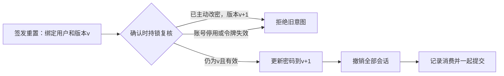
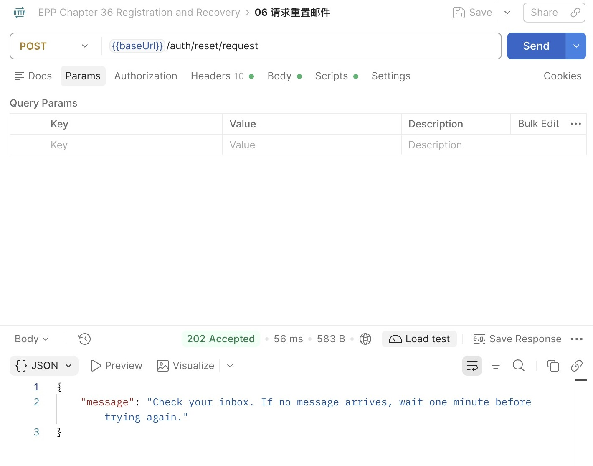
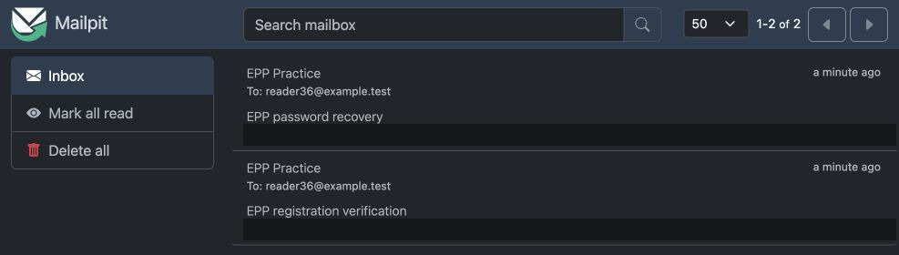
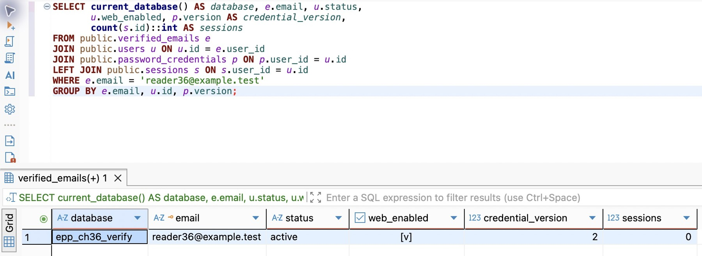

# 第 43 章 恢复已有账号并撤销旧会话

恢复密码必须交回原来的账号。注册完成时，这个账号已经有一个稳定的用户 ID、一份密码凭据和一个经过验证的邮箱。接下来从一次成功登录留下的 Cookie 出发，换掉密码，再用同一 Cookie 请求一次。要解释它为什么失效，还需核对签发时的账号、凭据版本及重置事务的锁。

从[注册验证](../chapter-42-verified-signup/chapter.md)的快照继续。完成版 `part-05/chapter-43` 重新接上两个重置端点，沿用原来的迁移、VERIFY、凭据与签发服务。阅读约 60～75 分钟，重置、会话撤销与产物核对另加约 70～90 分钟。

## 43.1 找到可恢复的原账号

恢复前请先在 DBeaver 的 VERIFY 执行 `SELECT current_database(), current_user;`，然后用上章练习邮箱核对账号和当前凭据版本。配套 `database/chapter-36/01-observe.sql` 已给出账号、资格、版本和会话数的联合观察入口。使用自己的虚构邮箱替换其中的示例地址；核对完整用户 ID 与上章一致，记下当前版本 V。若只有旧 UUID 账号且没有已验证邮箱，先保留旧账号，按[注册验证](../chapter-42-verified-signup/chapter.md)另建邮件练习账号并开通。本例不为缺少验证依据的旧用户直接指定邮箱。

启动步骤沿用[上章的 Mailpit 和 VERIFY 开发服务](../chapter-42-verified-signup/chapter.md)。导入配套 `requests/chapter-36.postman_collection.json`，选上章的私有本地 Environment，把 `baseUrl`、`email`、`password` 指向本轮账号。发送“05 开通后登录”，确认 200 和 Cookie；先保留这份会话。原来只含 01～05 的注册集合中没有重置请求，本章导入的集合应有 01～11。

## 43.2 把重置机会绑定到签发时的身份

回看上章已经建立的 `verification_intents`。一行表示某个用途、某个地址的**当前**验证机会。注册和重置用同一套到期、重发与消费机制，但 `purpose` 不同；注册邮件不能拿去重置密码。`UNIQUE(purpose,email)` 意味着同一地址每个用途只保留一个当前令牌；重发会替换它，不无限积累多份仍有效的码。这是产品选择，也意味着后到的重发可能让先收到的邮件失效。

重置意图另存 `user_id` 与 `credential_version`。前者绑定签发当时的用户，后者绑定当时的密码版本。未找到可恢复账号时两者为空；这个意图不会因为同地址后来注册成功，就自动变成可用的重置凭证。注册意图始终不绑定旧用户。

在上章已部署的模型中找到 `PasswordCredential.version`。迁移给原有凭据的初始版本是 1。它是并发判断用的整数，不是密码强度，也不取代Argon2参数。任何成功换密都把它加1，43.3会用它挡住过时的重置请求。

回到 `RecoveryService.request` 的签发事务。上章处理注册时无需查既有账号；当 `purpose === 'reset'` 时，在同一事务里按已验证邮箱读取当前用户 ID 与凭据版本，并将这两个值写入意图。写法见[签发与重发的 UPSERT](../chapter-42-verified-signup/chapter.md)。如果没有相应密码凭据，两列都写 NULL。同一邮箱日后拥有账号时，这次签发的未绑定意图仍不能改动它。

重置不存在的账号时也建立未绑定意图，并发送同样格式的本地邮件。已有和不存在的账号都经过签发、SMTP路径，公开接口使用相同202正文；不通过“是否存在”决定HTTP状态或是否立即返回。这仍不是恒定时间证明，数据库缓存、投递延迟和限流都影响时间。它首先消除直接的状态／正文差异，同时让冷却以地址而不是账号存在性为依据。公网反滥用还需投递预算和共享限流，43.5会继续解释。

## 43.3 重置密码，必须处理旧会话和旧重置意图

### 验证码签发以后，账号可能已经改变

考虑这条时序：上午签发重置邮件，用户随后想起旧密码并主动改密，下午才打开上午的邮件。仅凭“邮件未过期且未使用”就允许重置，会让已经发生的凭据变更失去意义。

本章签发时保存凭据版本，确认时必须仍相等。`SessionService.changePassword` 原来的事务更新改成：

```typescript
await tx.passwordCredential.update({ where: { userId: identity.userId }, data: { passwordHash, version: { increment: 1 } } });
await tx.session.deleteMany({ where: { userId: identity.userId } });
```

这一次更新同时让此前签发的重置码失效。并不需要为了失效去逐行删除所有重置意图，它们仍可供短期诊断；真正的条件是版本不匹配。

重置没有有效登录会话，所以不能借 `requireSession` 取得用户。它从已保存的意图读取绑定用户，再在事务里锁用户、凭据、意图；与登录、主动改密的用户→凭据顺序一致。`observed` 是事务外根据摘要读到的意图，它只用于确定要锁哪一行，最终判断仍来自持锁后的记录：

```typescript
if (!observed.userId) return null;
const [user] = await tx.$queryRaw<{ status: string }[]>`
  SELECT status FROM public.users WHERE id = ${observed.userId}::uuid FOR UPDATE
`;
if (user?.status !== 'active') return null;
const [credential] = await tx.$queryRaw<{ version: number }[]>`
  SELECT version FROM public.password_credentials WHERE user_id = ${observed.userId}::uuid FOR UPDATE
`;
const intent = await this.lockIntent(tx, purpose, digest);
if (!intent || intent.userId !== observed.userId || !credential
  || credential.version !== intent.credentialVersion) return null;
await tx.passwordCredential.update({ where: { userId: observed.userId },
  data: { passwordHash, version: { increment: 1 } } });
await tx.session.deleteMany({ where: { userId: observed.userId } });
await tx.verificationIntent.update({ where: { id: intent.id }, data: { consumedAt: new Date() } });
return { userId: observed.userId };
```

服务返回完成动作的userId。注册Controller在成功结果上明确添加 `webEnabled:false` 后返回201；重置Controller丢弃内部结果，只返回204。重置事务不更新 `users.web_enabled`，不会改变原资格。

停用账号不能借恢复重新启用，因而 `status` 必须仍是active。尚未获得Web资格的active账号可以恢复密码，但恢复后仍不能登录当前入口。资格和身份事实分别维护，否则“忘记密码”会变成意外开通入口。



若登录先持锁并创建会话，重置随后会删除它；若重置先提交，登录会发现凭据摘要已变，不能用先前验证过的旧密码创建新会话。已经在入口认证通过的普通业务仍可能完成，这是第39章说明的在途边界；本次撤销保证后续认证失败，不等于取消所有正在执行的业务。

## 43.4 用原会话验证重置的结果

从上章逐步跟写的项目此时可以开放重置路径。在已有 `RecoveryController`、`RECOVERY_PATHS`、方法白名单、限流、日志标签和 OpenAPI 中只增加下列两个端点，保持上章的输入检查、共享限流和来源保护。配套完成代码已接好两对端点。

| 路由 | Body | 正常响应 |
| --- | --- | --- |

| POST /auth/reset/request | `{email}` | 202，统一提示 |
| POST /auth/reset/confirm | `{token,newPassword}` | 204，无Body |

例如重置确认方法是：

```typescript
@Post('reset/confirm')
@HttpCode(204)
async resetConfirm(@Body(new SchemaPipe(RecoveryConfirmSchema)) input: RecoveryConfirm,
  @Query(new SchemaPipe(EmptyObjectSchema)) _query: object) {
  await this.recovery.confirm('reset', input);
}
```

不要因为这些路由“公开”就跳过第40章防护。它们不使用Cookie身份，因此 `sessionBoundary` 在原登录例外旁加入 `RECOVERY_PATHS` 后直接继续，不要求当前会话的CSRF令牌；即使浏览器恰好带了某个Cookie，也不能把恢复目标换成该Cookie的用户。前置的 `browserBoundary` 仍检查来源、Fetch Metadata、`X-EPP-Request:1`；后面的Body边界仍要求JSON、16KiB以内和严格Schema。

核对以下已有入口，避免Controller存在却被前面的中间件挡住：`httpBoundary` 把四条路径登记为仅POST；`authRateLimit` 把它们加入已有每IP每分钟10次的共享窗口；`requestObservation` 加固定路由标签；OpenAPI增加四条匿名操作与请求／响应Schema，新路由不宣称需要Cookie或 `X-CSRF-Token`。别把所有 `/auth/*` 都匿名放行，`/auth/password` 仍需要有效会话。

更新跟写代码后运行 `npm run check`，等开发服务重新就绪。在本地 Environment 增加 `newPassword` 和 `resetToken`，前者满足策略且与原密码不同，后者留待从收件箱填入；都不保存到共享值。

### 在Postman、收件箱和DBeaver之间走完一次

1. 发“06 请求重置邮件”，从重置主题中读取最新令牌并填入 `resetToken`。注册主题里的令牌不适用。

2. 发“07 确认密码重置”，204。此请求不会给浏览器换一份Cookie，也不必取得原会话的CSRF；发“08”仍携带原Cookie，却得到401。DBeaver显示凭据版本从 V 增为 V+1、该用户会话行归零，Web资格保持原值。
3. 发“09 旧密码登录”，401；发“10 新密码登录”，200；再次发“11 重复消费”，400。整组有10次POST，重试也计数，若超过窗口会429，按 `Retry-After` 等待后重发当前一步，不重复注册整组。



图中是独立发送的一次重置请求；响应正文没有账号存在性，也没有验证码。56ms是这一次本机请求的时间，不是邮件服务的延迟指标。前后操作不要只凭截图推断成同一轮。



图中两封信来自不同用途的实际SMTP发送；遮盖的是包含秘密的正文预览。收件箱有邮件只能证明Mailpit接收了它，不能证明数据库已消费，也不能证明公网邮箱投递可用。注册与重置的最终事实仍看对应响应和数据库投影。

`01-observe.sql` 不选择密码摘要或令牌摘要，核心查询是：

```sql
SELECT purpose, email, user_id IS NOT NULL AS account_bound,
       credential_version, issued_at, expires_at,
       consumed_at IS NOT NULL AS consumed,
       consumed_at IS NULL AND expires_at > clock_timestamp() AS time_eligible
FROM public.verification_intents WHERE email = 'reader36@example.test'
ORDER BY purpose;
```

`time_eligible` 只是时间与消费状态条件，不是“保证可用”。例如未绑定账号的reset或版本已经变化的reset，即使该列为true也会被拒绝。看到false先判断是过期还是消费，不把所有400都归因于复制错了字符。



这张图观察的是 `reader36@example.test`：账号仍为active，已授予的Web资格保持为true，凭据版本为2。拍摄时也已结束后续新密码登录的验证会话，所以当前会话数为0；这个终态本身不能证明撤销发生在哪一步。要判断重置是否撤销了旧会话，仍应在步骤2紧接204后查询，并用原Cookie请求得到401，不能等后来退出登录后才反推原因。配套SQL把当前数据库名一同显示，避免把另一个连接的结果当成本轮事实。

### 暂停、恢复与交付入口

暂停时结束实验事务、退出自己的会话，关闭调试连接和自己的API／Mailpit。Mailpit上述命令使用临时存储，退出后不应假定邮件还在；数据库已消费的事实不会随网页收件箱清空而撤销。恢复时先核对VERIFY、迁移状态与账号，再登录或请求新邮件，不重做密码初始化。

配套的有限测试示例检查一次消费、重发替换、凭据版本、会话撤销与锁后到期；隔离连接配置正确后可运行 `npm test`。它帮助保护这些边界，不代替亲自查看收件箱和图形请求。

最后按前章生产目录流程，从当前锁文件执行 `npm ci --omit=dev`，复制构建产物及运行所需配置，在未加载开发 `.env` 的环境中显式注入DATABASE_URL、APP_ORIGIN、CURSOR_HMAC_KEY和LOCAL_SMTP_PORT，再运行 `npm start`。核对旧ID登录和邮箱登录、文档默认404、无Inspector、SIGTERM排空后关闭数据库。Mailpit是单独进程，不会因为API退出而自动关闭；本章生产产物的邮件适配范围仍只是本机SMTP收件服务。

VERIFY通过后才按既有备份／恢复流程单独升级DEV。不要把示例账号、虚构邮箱或开通SQL搬进日常库。旧账号仍可用ID登录；给旧账号增加邮箱需要它自己的验证与绑定流程，本章没有把“直接改数据库邮箱”作为用户自助恢复方案。

## 43.5 换成短信以前，先看哪些前提一起改变

### 投递接口能复用，证明强度不能直接照搬

`VerificationDelivery.send(recipient,purpose,token)` 把投递从事务中分开。若业务改用短信，可写一个实现同样接口的供应商适配器，服务仍保留“保存意图→发消息→独立确认”的结构。不过，邮箱Schema、联系表和43字符令牌不是短信方案的现成成品。

手机号必须携带国家／地区信息，不能按整数保存，也不能给所有输入一律补 `+86`。例如同一串国内号码在缺少地区时不足以确定国际地址；前导零可能是国内拨号规则的一部分，不能任意保留或删除。接入时用维护号码元数据的库解析所支持地区，规范化成带国家代码的国际表示；格式合理只说明号码结构符合规则，短信送达与用户证明控制权仍是后面的动作。号码会回收，能收短信也不能永远证明是当年那个人。

六位数字适合输入，但只有一百万种可能。每个意图允许五次猜测时，均匀随机猜中的上界约为 `5 / 1,000,000`；大量意图、很多账号和多次重发会累积机会。限制必须至少包括意图的原子失败次数、用途／目的地址的累计预算和来源频率，重发不能把所有失败预算清零。短码入库宜使用带服务端秘密及用途／意图身份的HMAC，避免数据库泄漏后直接枚举所有六位值；这与高熵随机令牌直接SHA-256的前提不同。错误次数的并发更新也必须由数据库裁决，不能先查再各自加一。

这些变化需要新模型与新验证分支，不能只把 `LocalMailDelivery` 换名字就称为短信登录已完成。主线保持邮箱实现；章后支线进一步用换邮箱、号码回收与恢复渠道失守推导身份生命周期，不要求为理解这些问题现在就增加全部产品功能。

### 供应商调用成功，还不是最终送达

以腾讯云短信为例，官方[使用说明](https://intl.cloud.tencent.com/document/product/382/40653)和[发送流程](https://intl.cloud.tencent.com/document/product/382/35462)要求按业务准备账号、签名及正文模板等条件；地区、账号资格和模板审核条件按实际服务核对。模板变量不能成为任意消息群发入口，API密钥也只留在服务端。

费用按所选地区、计费单位、短信拆分规则、套餐和当前价格核算；“一次send调用”不能自动等同“一条计费短信”。接入前先选定供应商与地区，再核对计费、余额告警、单日上限和费用停发条件，不把一组随时间变化的单价写成接口常量。本章不发真实短信，也不依赖付费额度完成练习。

适配器返回成功只说明供应商接受到哪一步，要保留其安全的消息标识与应答类别；最终送达可能来自回执。超时也可能是已经接收而应答丢失。遇到未知结果不能马上换另一供应商再发，否则用户可能收到两条都有效或相互覆盖的消息，费用也会翻倍。第六篇会把可查询事实、重试和未知结果放进持久化工作模型。

邮件换公网SMTP同样需要服务端秘密、TLS校验、发件身份、投递信誉、退信与预算，不能把本地无认证配置改个host就上线。当前对存在与不存在账号都投递的做法，也必须纳入滥发成本：IP窗口挡不住分布式来源，地址一分钟冷却也挡不住大量不同地址。对公网的下一步是共享限流、总额度和按风险增加验证，而不是因为有一个429就宣称反滥用完成。

### 短期事实也要有退出方式

每个用途／地址只占一行能限制单地址重发增长，但不断出现的新地址仍会增加行数。验证意图不是永久审计记录。本章选择过期超过24小时后分批清理，只删意图，不删用户、已验证联系信息或学习记录。配套 `04-retention.sql` 先预览，再每批最多删除1000行：

```sql
WITH batch AS (
  SELECT id FROM public.verification_intents
  WHERE expires_at < clock_timestamp() - interval '24 hours'
  ORDER BY expires_at, id LIMIT 1000 FOR UPDATE SKIP LOCKED
)
DELETE FROM public.verification_intents i USING batch b WHERE i.id = b.id
RETURNING i.id;
```

在DBeaver确认目标库后按批运行；零行可能是本批没有符合项，也可能是符合项正被其他事务锁住，不据此证明全库永远没有历史意图。先手动维护这份短期数据，第六篇再安排持续工作。若需要长期审计，另外设计最小化的审计事实与保留策略，不能把原始验证码或完整邮件永久留下。

至此，核心密码路线具备注册、验证、登录、资格判断和恢复。选择平台登录时进入第44～47章；走核心路线则在第48章把身份与权限综合起来，再从第49章接着解决已经看见的邮件漏发窗口。

## 知识支线

- [43A：换邮箱、短验证码与恢复渠道，怎样避免把账号交错人](side-01-recovery-identity.md)：把联系地址变化、短码预算与邮箱失守带回当前模型，理解什么可以复用、什么必须重新证明。

## 附录：本章必要技术点速查

| 名称 | 本章用途 | 必要注意点 |
| --- | --- | --- |
| verified_emails | 保存已证明控制权的邮箱与用户关系 | 当前一人一邮箱；旧用户可以没有，不代替稳定userId |
| verification_intents | 保存每个用途／地址的当前验证机会 | 原始令牌不入库；不存在账号的重置不绑定未来用户 |
| EmailSchema | 注册、邮箱登录、重置共用规范化 | ASCII且全小写是本章产品政策；不删除点号或加号 |
| ON CONFLICT … WHERE … RETURNING | 原子重发冷却与替换 | 零行不投递；用途与邮箱共同唯一 |
| FOR UPDATE / clock_timestamp | 消费时排序并检查此刻 | 拿锁后重查；事务开始时有效不够 |
| password_credentials.version | 使旧重置意图随换密失效 | 主动改密和恢复均递增；初始化仍拒绝覆盖 |
| passwordWork / activeDeliveries | 共享密码成本与限制投递并发 | 分别限制两项；IP频率不代替并发，失败也释放名额 |
| 202 / 201 / 204 | 分开请求处理、注册创建与重置完成 | 202不保证邮件送达；确认重放不是幂等成功 |
| Mailpit 1.33.0 | 实际SMTP接收与网页观察 | 两个监听都绑本机，不配置外部转发 |
| Nodemailer 10.3.1 | SMTP连接、编码与发送 | 自带类型；连接／招呼／空闲超时各管一段 |
| LOCAL_SMTP_PORT | 当前本地收件服务的端口 | 默认1025；主机固定127.0.0.1，不接受客户端投递配置 |
| delivery.accepted / delivery.failed | 观察等待和未确认结果 | 只记录安全码、耗时与请求关联，不输出正文或原始异常 |
| SKIP LOCKED / LIMIT | 有界清理过期意图 | 不删除账号；跳过锁不是证明没有待处理行 |

资料回查：[PostgreSQL INSERT／ON CONFLICT](https://www.postgresql.org/docs/18/sql-insert.html)、[PostgreSQL日期时间函数](https://www.postgresql.org/docs/18/functions-datetime.html)、[Nodemailer消息配置](https://nodemailer.com/message)、[Mailpit SMTP与发送](https://mailpit.axllent.org/docs/usage/sending-messages/)。有关短码与渠道恢复的判断还可对照前文链接的OWASP指南；外部资料供核对，不代替本章事务与请求的实际观察。

本章完成代码分支：`part-05/chapter-43`，沿用上章已验证的账号。

[上一章：从一封验证邮件建立账号](../chapter-42-verified-signup/chapter.md) · [第五篇导读](../README.md) · [全书目录](../../README.md)

[下一章：小程序登录与独立会话](../chapter-44-mini-program/chapter.md) · [核心路线直接进入第 48 章回顾](../chapter-48-review/chapter.md)
