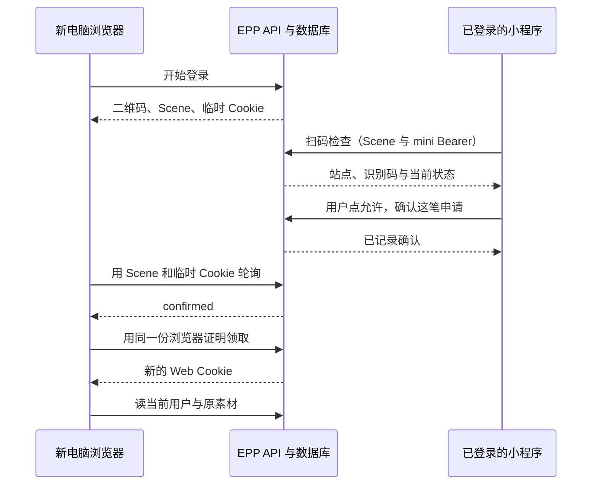
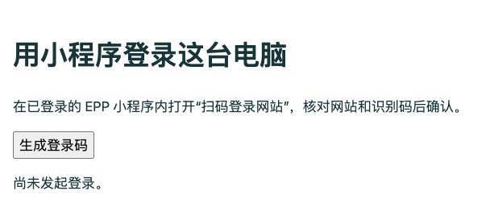
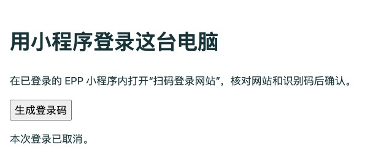
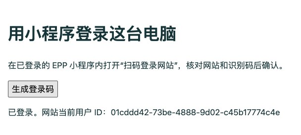

# 第 47 章 用已登录的小程序扫码确认网站登录

小程序里已经有一条自己的素材。坐到一台新电脑前，你希望打开 EPP，用小程序扫一下，在手机上点“允许登录”，然后在电脑上接着处理那条素材。手机已经能读到它，电脑却是一个全新的客户端。只要新浏览器能以同一个本地用户读回原素材，就有了检验这次登录的办法。正文阅读约 45～60 分钟，编码、迁移与本地联调另加约 90～125 分钟，真机接入另计。

从[第 44 章的完成代码](https://github.com/SamChowRock/epp-public/tree/part-05/chapter-44)和该章已迁移的数据库出发。需要的是第 38～40 章的网站 Cookie、入口资格与请求保护，以及第 44 章能识别用户的小程序 Bearer 会话。选择过第 45、46 章的读者可以在独立练习目录和 VERIFY 副本中跟做这条分支。网站微信登录的 AppID、AppSecret、OIDC 发行方都不是本章的启动参数。

## 47.1 谁发起、谁同意、谁领走会话

先看一个容易做出来的版本。电脑显示一段随机字符串，手机扫到就把自己的用户 ID 和字符串一起发给服务器，电脑再凭字符串取会话。它有两个问题。第一，用户 ID 能从请求正文里随意改，服务端必须沿用已有的小程序会话来识别人。第二，任何能看见二维码的人都能获得同一个字符串。如果拿它既能定位待确认的请求，又能领取最后的会话，手机、截图的接收人和原电脑就拥有相同的领取能力。

把两份东西分开。**Scene** 是本章二维码里用于找到一次登录申请的随机标识；**Ticket（登录票据）** 是服务器为这次申请保存的那一行状态。电脑还持有独立的随机秘密，放在 EPP 的临时 HttpOnly Cookie 中。扫码的人能告诉服务端“我正在看这笔申请”。只有同时持有 Scene 和对应 Cookie 的客户端才能说“把这笔申请批准的新会话交给我”。二维码中编码的是类似 `epp:login:v1:<UUID>` 的普通文本，要从已登录的 EPP 小程序里打开扫码功能。它没有调用平台生成小程序码的接口，也不依靠系统相机自动拉起小程序。



这和上一章由微信开放平台向网站返回授权码的过程有个决定性的差异：现在 EPP 自己就能验证手机上的人，平台不向电脑发送登录回调。手机授权的内容是“让展示这个码的电脑用我当前的 EPP 账号登录”。EPP 自己保存申请、显示确认内容、记录决定，再把一份可以独立撤销的网站会话交给电脑。小程序的 Bearer 始终留在手机端。扫码、看见详情或关闭确认框都不会在电脑上登录。

两端显示 Scene 末六位作为识别码，帮助人核对自己面前的电脑。短码不用于查库、确认或领票。设有人把自己电脑上的整张码发给你，临时 Cookie 仍属于那个人，完整的 Scene 也仍然有效。如果你同意，正是他的电脑会得到你的身份。因此确认框必须写清动作、目标网站和当前账号。短码相符可以帮助发现扫错码，但末六位可能重复，转发整张码也会带走正确的短码。请只批准自己正在操作的电脑。

## 47.2 一次登录申请，单独占一行

前一章可以把等一次回调的状态放在单进程内存。这次有两端交替请求，中间允许短暂断网或 API 重启。把确认只留在收到手机请求的那个进程，另一个进程接到轮询时就可能找不到申请，或仍然读到旧的等待状态。沿用已有 PostgreSQL，以一次电脑发起为一行，两端对同一个事实作决定。把票据当成用户表字段会丢失这个粒度：同一个人可能在两台电脑前先后扫码，而生成二维码时连这个人是谁都还不知道。

在 `prisma/schema.prisma` 增加 `BrowserLoginTicket` 和 User 的反向关系，在新迁移 `20261109004000_browser_login_tickets/migration.sql` 建表。核心结构如下。

```sql
CREATE TABLE public.browser_login_tickets (
  scene uuid PRIMARY KEY,
  browser_digest text NOT NULL CHECK (browser_digest ~ '^[0-9a-f]{64}$'),
  status text NOT NULL DEFAULT 'pending',
  user_id uuid REFERENCES public.users(id) ON DELETE CASCADE ON UPDATE RESTRICT,
  mini_session_id uuid,
  expires_at timestamptz(3) NOT NULL,
  CHECK ((status IN ('pending', 'cancelled') AND user_id IS NULL AND mini_session_id IS NULL)
      OR (status IN ('confirmed', 'consumed') AND user_id IS NOT NULL AND mini_session_id IS NOT NULL))
);
CREATE INDEX browser_login_tickets_expiry ON public.browser_login_tickets(expires_at);
```

Scene 用随机 UUID，临时 Cookie 用 `issueToken()` 单独生成，表里只放这个秘密的 SHA-256 摘要。待确认时两列身份都是 NULL。确认时把服务端认证出的 `user_id` 和**发起批准的那一个 mini 会话 ID**一起写进去。如果只记用户 ID，手机先确认随后退出，电脑仍可能用退出前的批准领取。本章要求领取时原手机会话依然有效，所以保留其 ID，按 ID 复查。它在这里是一份批准的来源记录，不设指向 sessions 的强制外键：设备退出可以正常删除会话，留下的批准因查不到来源会话而失效。有用户删除需求时，短期票据则随用户清理。

`pending → confirmed → consumed` 是成功路径。浏览器在待确认或已确认阶段均可取消，状态变为 `cancelled` 并清掉批准者。过期是独立的时间条件，各接口使用数据库时间检查 `expires_at`。不需要一项定时任务准点把 pending 改成 expired，才能拒绝第 121 秒的确认。创建新票据会按到期索引分批清除最多 32 条旧行，跳过正被其他事务锁住的行。低流量或停服时过期行可能暂时仍在表里，可用性已经截止。大规模或有固定删除时限时，应另设清理任务并度量积压。

先让这一步独立运行。按[第 25 章的备份与恢复步骤](../../part-04-consistency/chapter-25-revisions/chapter.md#先备份再在另一个库恢复一次)用第 44 章非空库的备份恢复出独立 VERIFY，保留一个旧用户 ID 和一条已有素材 ID，核对原文、归属和小程序映射。在代码项目根目录，配置 `.env.database-verify` 指向此副本，`.env.test` 中的 `TEST_DATABASE_URL` 也指向同一 VERIFY。先只加模型和迁移，再执行：

```bash
nvm use
unset DATABASE_URL SHADOW_DATABASE_URL TEST_DATABASE_URL
npm ci
verify_db='epp_ch40_verify'  # 改成创建或恢复时选定的实际库名
node --env-file=.env.database-verify scripts/deploy-verify.mjs deploy "$verify_db"
npm run db:verify -- migrate status
npm run check
```

应只多出空的票据表和索引。没有旧请求需要补造票据，也不更新旧素材、微信映射或会话。按原来的 ID 再查一次。此处可以停下来，服务仍可使用旧入口。若另建空库并将上述变量指向它，使用本章分支的 `node --env-file=.env.database-verify scripts/deploy-verify.mjs bootstrap "$verify_db"` 代替 deploy 行。它先建立第 40 章基线，再部署本分支的注册、小程序身份和票据迁移，最后运行 status；若手头只有其他可选分支的库，优先恢复第 44 章备份，在独立库练习，不把切换 Git 分支等同于回滚数据库。

## 47.3 两端如何走到同一次消费

**电脑先发起。** 在 `src/scan.service.ts` 的 `start` 中创建 Scene 和浏览器秘密。插入使用数据库自己的时钟：

```ts
const scene = randomUUID(), browser = issueToken();
// 同一事务先分批清理过期票据，再执行：
await tx.$executeRaw`INSERT INTO public.browser_login_tickets(scene,browser_digest,expires_at)
  VALUES (${scene}::uuid,${tokenDigest(browser)},clock_timestamp()+interval '2 minutes')`;
```

二维码只负责把一小段文本无损带到手机。使用运行依赖 `qrcode@1.5.4` 在 API 本地编码成 PNG，可以直接显示，无需将有效 Scene 交给第三方制图服务。从第 44 章手工跟写时运行 `npm install --save-exact qrcode@1.5.4` 并保存锁文件。配套完成分支已经包含这项依赖。`src/types/qrcode.d.ts` 只声明 Node 端用到的 `toDataURL` 签名，保持后端 TypeScript 环境的类型范围。在 `src/scan.controller.ts` 的 start 方法中执行：

```ts
const { scene, browser } = await this.scan.start();
const image = await QRCode.toDataURL('epp:login:v1:' + scene, { width: 240, margin: 4 });
res.cookie(this.cookieName, browser, { secure:this.secure, path:'/', sameSite:'strict',
  httpOnly:true, maxAge:120000 });
return { scene, image };
```

浏览器打开 `GET /auth/scan`，点击按钮同源发送 `POST /auth/scan/start`，正文是 `{}`，包含 JSON 类型和 `X-EPP-Request: 1`。成功为 201。服务器按 HTTPS 条件使用 `__Host-epp_scan`，本机 HTTP 练习用 `epp_scan`。整个过程在同一网站轮询，可使用 Strict。页面凭返回的 image 展示二维码，JavaScript 不需要读取临时 Cookie。真实网站已有有效 Web 会话时开始或领取都会返回 409，先核对当前用户，想切换账号时先退出。用第二个标签页重新生成二维码会替换同名临时 Cookie；旧标签即使知道旧 Scene 也领不到结果。

**手机先看，再决定。** 在已有的 `mini-program/pages/login/index.js` 增加 `scanWebsite` 操作，复用原来的 request 方法和内存中的 mini Bearer。使用 `wx.scanCode({ onlyFromCamera: true, scanType: ['qrCode'], ... })` 读取文字，严格检查 `epp:login:v1:` 前缀和 UUID v4 格式。扫码内容不决定 API 地址。否则恶意二维码只要换个网址，就可能诱使小程序把 Authorization 发给别的站点。真正的目标始终是已配置的 baseUrl。

```js
const view = await request('/auth/scan/inspect', 'POST', { scene }, true);
if (view.status !== 'pending') throw new Error('此码已处理，请从电脑重新发起');
const me = await request('/auth/me', 'GET', undefined, true);
const answer = await new Promise((resolve, reject) => wx.showModal({
  title: '允许这台电脑登录？',
  content: '网站：' + view.origin + '，识别码：' + view.displayCode
    + '。将使用当前账号 ' + me.userId + '。只确认自己正在操作的电脑。',
  confirmText: '允许登录', success: resolve, fail: () => reject(new Error('确认框未完成')),
}));
if (!answer.confirm) { this.setData({ message: '未授权这台电脑。' }); return; }
await request('/auth/scan/confirm', 'POST', { scene }, true);
```

这里的 `answer` 是等待 `wx.showModal` 的用户选择后得到的结果。inspect 只是读；手机上的“取消”退出确认框，服务器仍是 pending。电脑上的“取消本次登录”则持浏览器证明向 `/cancel` 发请求，真正终结票据。这两种取消特意分开，否则旁边的人先扫一下就能关掉你的登录页。收到手机 confirm 时，Schema 只接受 `{scene}`，用户 ID 与会话 ID 均取自 `requireSession(req)`。已登录人发生变化，应重新显示确认内容，禁止把旧确认框保存下来当作另一个账号的批准。

两个账号先后扫码时，怎样保证后来的请求不能覆盖先前的决定？在 `ScanService.confirm` 内先调用 `lockTicket`，按 Scene 查行并执行 `FOR UPDATE`。拿到锁以后再检查状态和来源会话：

```ts
const ticket = await this.lockTicket(tx, scene);
if (!ticket) return missing();
if (ticket.status !== 'pending' &&
    !(ticket.status === 'confirmed' && ticket.miniSessionId === identity.sessionId)) return conflict();
if (!await this.eligible(tx, identity.userId, identity.sessionId)) return denied();
```

然后在同一事务里写入 confirmed、用户 ID 和 mini 会话 ID，UPDATE 的 WHERE 再要求票据和原会话都未过期。去掉行锁会怎样？若两个请求都先读到 pending，两位用户都具备资格，后写入者就可能改掉批准人。另一种做法是让 UPDATE 本身只匹配 pending，再按影响行数重读并区分“同一批准重复”与“另一份批准冲突”。本章还要把账号资格和来源会话的撤销一起排出顺序，所以沿用票据、用户、来源会话的加锁顺序。检查动作保持只读，任何人单纯扫到这张码都不能抢先占住它。

**电脑看见确认，再领取。** `src/scan-page.ts` 在上一个 status 完成后等两秒才发下一次，避免慢请求重叠。所有动作放在 `/auth/scan/`，POST 正文传 Scene，服务端只记录固定路由，不记录码、Cookie 或 Bearer。浏览器的 status、cancel、consume 每次都要用自己的 Cookie 摘要和 Scene 同时匹配。扫描端的 inspect、confirm 则必须走已认证的小程序通道。将这些路径接入 `http-boundary.ts`、`session-http.ts` 和请求日志白名单，在 `AuthModule` 注册 `ScanController`、`ScanService`，在启动数据库检查中加入新表。保留第 40 章来源、显式头和 JSON 检查，匿名 start 也进入登录限流。页面允许自己的脚本、同源请求和 data 图片，私有响应不缓存。

确认成功只意味着一份决定已写入数据库。status 永远只能返回状态，页面看到 confirmed 才调用 consume。在 `src/scan.service.ts` 先按 Scene 和浏览器证明锁住票据，再按原用户锁账户并核对 `active`、`mini_enabled`、`web_enabled`，接着锁住仍有效的原 mini 会话。清掉该用户过期会话并核对 20 个会话的既有限额后，进入决定胜负的两次写入：

```ts
const changed = await tx.$executeRaw`UPDATE public.browser_login_tickets SET status='consumed'
  WHERE scene=${scene}::uuid AND expires_at > clock_timestamp() AND EXISTS
    (SELECT 1 FROM public.sessions WHERE id=${ticket.miniSessionId}::uuid AND expires_at > clock_timestamp())`;
if (!changed) return missing();
const token = issueToken();
await tx.$executeRaw`INSERT INTO public.sessions(id,user_id,token_digest,label,channel,expires_at)
  VALUES (${randomUUID()}::uuid,${userId}::uuid,${tokenDigest(token)},'Mini confirmed browser','web',clock_timestamp()+interval '8 hours')`;
```

这两句在同一个数据库事务中。前面的行锁已限定 ticket 为 confirmed；最后的条件是在等锁结束后重新问一次“还来得及吗”。如果插入会话失败，消费更新随事务回滚。如果插入成功，第二个领取者拿到锁后只能看到 consumed。控制器在提交后才用 `setSessionCookie` 给浏览器发新会话，响应体只有本地 userId。页面接着用 `GET /auth/me` 把实际 Cookie 识别出的 ID 与响应中的 ID 比对。手机和网站现在各有自己的会话，以后单独退出或撤销其中之一，按各自会话生效。

## 47.4 用两个客户端验证归属和失败时点

本机先用浏览器做电脑端，用 Postman 发出与小程序相同的 HTTP 请求。沿用第 44 章实验，它只替换最早取得微信身份的过程，会在独立 VERIFY 中创建两个虚构用户、两份有效 mini 会话，以及第一个用户早就保存的素材。API 走本章的实际控制器与数据库。停止占用 3370 或 9470 的其他练习，在配套代码根目录运行：

```bash
unset PORT DATABASE_URL TEST_DATABASE_URL
npm run check
verify_db='epp_ch40_verify'  # 改成创建或恢复时选定的实际库名
node --env-file=.env.test --inspect=127.0.0.1:9470 examples/mini-login-local.mjs "$verify_db"
```

实验进程把 TEST_DATABASE_URL 映射到实际应用连接，再查 current_database()；缺少独立给定的期望库名或两者不符即在写入前退出。这个脚本会打印本轮 userId、otherUserId 和 captureId，生成仅用于本机的 Postman 环境文件。保持终端运行。在浏览器打开 `http://127.0.0.1:3370/auth/scan`。在 Postman 的本地非同步工作区导入 `.mini-local.postman_environment.json` 并选中，同时导入 `requests/chapter-40.postman_collection.json`。环境里已有两份 mini 令牌，勿复制到浏览器、截图或共享工作区。



先做一次可以取消的登录。在浏览器开发者工具打开 Network，点击“生成登录码”，找到 start 的 201 响应，只将 `scene` 放入 Postman 集合变量 scene，保存当前值。手机实际是从图片中取得同一个值；本机跟做使用响应字段，避免要求电脑自扫屏幕。Postman 发送 inspect，应见 pending、站点和与页面一致的六位识别码。只要还没点确认，浏览器的 status 就应继续返回 pending。点击浏览器的“取消本次登录”，用同一 Scene 发 confirm 会得到 409。若已经超过两分钟则返回 404，重新开始一次，不能把自然过期误认为取消成功。



现在重新生成一张码，更新 Postman 中的 Scene。先发送集合里的 status 或 consume，这次 Postman 没有浏览器的临时 Cookie，得到 404；原浏览器仍能轮询。再用第一个用户的 miniToken 发送 inspect、confirm，确认响应为 200。回到浏览器等下一次轮询，页面应显示终端中的第一个 userId。用同一浏览器的新标签访问 `http://127.0.0.1:3370/captures/本轮captureId`，换入终端的实际 UUID，读回 200 和原文 `This record existed before linking.`。用 otherMiniToken 从另一账号读同一 ID 应为 404；扫码得到的是原用户的另一个登录入口，素材无需迁移。



需要看清成功前后的差值，可以在第一轮取消后先执行一次查询，成功领取后再执行同一条。在 DBeaver 打开 `database/chapter-40/observe.sql`。先确认库名，用两轮的末六位找对应票据，可见 cancelled 没有 user_id，consumed 指向第一个用户。第二条查询换入该用户 ID。这个实验在造旧素材时已用密码创建过一份 Web 会话，所以应比较**扫码前后的增量**：成功领取增加一份 Web 会话，素材数保持。短码可能碰撞，细查时使用完整 Scene 在隔离库定位，不据末六位做身份判断。VS Code 可使用练习的 9470 Attach 配置，断在 `scan.service.ts` 的 `consume` 中拿到 ticket 后，只看 `ticket.status`、`Boolean(ticket.userId)`。断点会延长持锁时间，事务本身有超时；先继续并移除断点，再用新票据观察正常结果。

**换人和抢领。** 两位已经登录的人扫到同一张码，服务器可能先后或同时收到两个确认请求。先锁到 pending 行且具备双入口资格的一方写入自己的会话 ID。另一方锁后重读，同一来源会话重复确认可以在 confirmed 状态下得到 200；另一个会话即使属于同一人，也不能取代第一次批准，返回 409。若电脑已经领完，后来的任何确认均返回 409。要拆开这两个时点，使用没有 Web 会话的无痕窗口或独立浏览器配置文件，访问实验开始页，保持“生成登录码”按钮未点击。以下代码在该页开发者工具的 Console 中逐段执行，浏览器会自动收发临时 Cookie，页面没有启动轮询。先手动开始：

```js
const sendScan = async (action, body) => {
  const r = await fetch('/auth/scan/' + action, {
    method: 'POST', headers: {'Content-Type': 'application/json', 'X-EPP-Request': '1'},
    body: JSON.stringify(body),
  });
  return { status: r.status, data: await r.json() };
};
const attempt = await sendScan('start', {});
const scene = attempt.data.scene;
```

只将本轮 scene 填入本地 Postman 变量。用 miniToken 确认，立即原样重发应仍是 200，改用 otherMiniToken 确认应为 409。电脑运行 `await sendScan('status', {scene})`，此时仍是 confirmed。若要观察两个领取者，同时执行 `await Promise.all([sendScan('consume', {scene}), sendScan('consume', {scene})])`。一个响应成功后用 /auth/me 核对用户，再用数据库确认只新增一行 Web 会话。在独立且已迁移的 VERIFY 上，还可执行 `node --env-file=.env.test --test test/scan.test.mjs` 复现并发。该对照同时发送两份确认，只接受一份，再对胜者的票据同时领取也只创建一份会话。

**确认后资格变化。** 重开一轮上述手动实验，在甲确认之后、运行 consume 之前，用已认证的甲从 Postman 调用第 44 章的退出接口，或在专用 VERIFY 按第 39 章暂停甲的 Web 资格。此时票据可以仍显示 confirmed，领取仍会被拒绝。撤销先提交与领票事务先取得相应锁，会产生不同的结果：若新 Web 会话已经提交，之后单独撤销 mini 会话不会顺带删除既有 Web 会话；要终止网站访问应撤销相应网站会话，或由账号规则限制入口。若仅暂停资格后又恢复，在来源会话仍有效、票据也未到期时，原批准按当前资格仍可领取。若要求每次撤权永久作废所有旧批准，就要记录资格版本或在撤权事务中作废票据。若用户要求“手机退出，所有由它批准的电脑立即掉线”，就需要额外持久化会话间的来源关系，并在撤销或每次认证时真正使用它。不能靠短期票据到期来满足长期联动撤销。

**在有效期内发出，却返回 404。** 例如票据还剩半秒，另一个数据库会话正在修改甲的资格并持有用户行锁。领取事务已经读到了 confirmed，却需要等到对方提交才能决定能否签发。在锁等待上限内解除阻塞，如果此时已过期，最后的条件更新影响零行，返回 404，网站会话数不变。等锁超过服务自己的超时还可能先得到 503。排查时可在独立 VERIFY 用 DBeaver 的第三个会话查 `SELECT pid, wait_event_type, pg_blocking_pids(pid) FROM pg_stat_activity WHERE application_name='epp-api';`。在释放前看到非空阻塞 PID 才是等待证据；断点暂停或两个 200／409 结果都无法单独证明等了哪把锁。

**收不到最后的响应。** 网络在 consume 提交后断开，数据库可以已有新会话，而电脑可能拿到、也可能没拿到 Cookie。先在同一浏览器访问 `/auth/me` 并核对实际 ID。若是预期用户，再读原素材；若 401，重新发起，不重放已经 consumed 的票据。需要清理那份客户端没拿到的会话时，可用已有受信入口查看设备会话并撤销。若遇到 429，区分 start 的频率限制与账号的有效会话数上限；前者按 Retry-After 等待，后者释放不用的设备会话，票据已过期就重开。按 Return 正常结束实验，脚本会撤销本轮会话、清理虚构账号和素材，并删除本地环境文件。Postman 内已导入的环境可单独移除。未绑定用户的待确认、已取消票据按原期限失效，后续发起请求时再清理。

最后把 Postman 换成真机。按[第 44 章小程序接入](../chapter-44-mini-program/chapter.md)准备开发版或体验版、授权的 AppID、实际 HTTPS 请求域名与有效的 mini 会话。电脑打开可达的 EPP 网站，小程序的 baseUrl 固定到相应 API，`APP_ORIGIN` 设为用户看到的网站来源。真机的 127.0.0.1 指手机；只关闭开发工具的域名校验无法让它连到电脑的回环服务。需公网入口时先完成第九篇部署。分别在真机完成拒绝确认、重新扫码同意、电脑读取原素材，最后在该电脑退出并核对手机仍可使用。开发入口仍是 `npm run dev`，持久票据在 API 重启后保留到期限。交付目录复制 dist、config 和两份 npm 清单，执行 `npm ci --omit=dev` 并通过进程环境配置数据库、来源和已有秘密，再 `npm start`。二维码编码库随生产依赖安装。

## 知识支线

[47A 从两秒轮询到一万个等待中的页面](side-01-polling.md)改变在线规模和掉线条件，比较轮询、长轮询与推送，阅读约 10～15 分钟。

## 附录：本章必要技术点速查

| 名称 | 本章用途 | 核对点 |
| --- | --- | --- |
| Scene、浏览器随机秘密 | 定位申请，证明领取端 | 二维码只携带 Scene，数据库只留秘密摘要 |
| wx.scanCode、wx.showModal | 取扫码文字，等待明确同意 | 严格检查内容格式，API 来源来自配置 |
| SELECT FOR UPDATE / FOR SHARE | 串行化票据决定，保护来源会话 | 拿锁后重读状态、资格与时效 |
| clock_timestamp() | 按判断当时的数据库时间检查期限 | 事务开始时间可能早于等待结束时间 |
| inspect、status、consume | 手机检查、电脑轮询、一次性签发 | 前两项没有签发副作用，最后一项和 Web 会话同事务 |
| qrcode.toDataURL | 服务端编码普通二维码图片 | 运行依赖 qrcode 1.5.4，保持四个模块的留白 |

可回查[小程序扫码 API](https://developers.weixin.qq.com/miniprogram/dev/api/device/scan/wx.scanCode.html)、[小程序确认框](https://developers.weixin.qq.com/miniprogram/dev/api/ui/interaction/wx.showModal.html)、[二维码编码库 1.5.4](https://github.com/soldair/node-qrcode/tree/v1.5.4)和[PostgreSQL 18 行锁](https://www.postgresql.org/docs/18/explicit-locking.html#LOCKING-ROWS)。配套完成分支为 `part-05/chapter-47`。

[返回第五篇](../README.md) · [前一章：微信网站扫码登录](../chapter-46-wechat-website/chapter.md) · [下一章：第五篇回顾：身份有效之后，操作是否仍被允许](../chapter-48-review/chapter.md)
