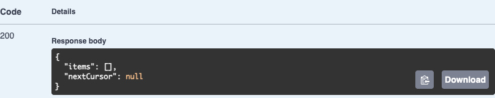
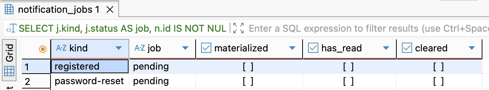
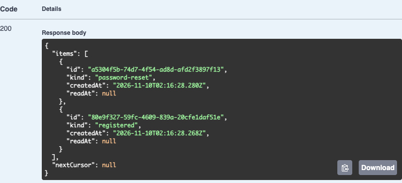
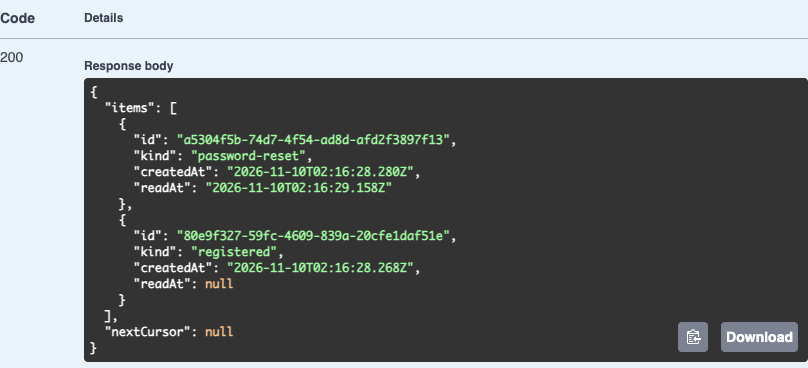
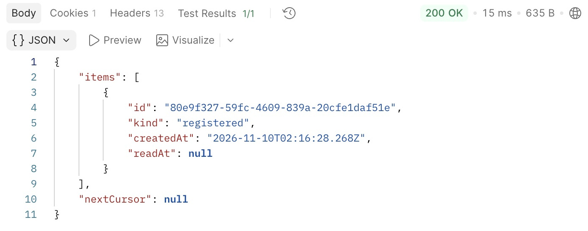
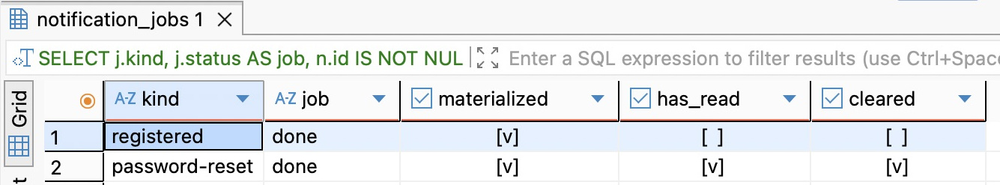

# 第 46 章　先让通知成为可查询的数据

用户用验证邮件完成了密码重置。原来的浏览器会话随即失效。等他用新密码重新登录，我们想在站内收件箱里留一条“密码已重置”。重置成功时旧页面很可能已经关了，即使开着，向刚刚撤销的会话发一次提示也帮不了下一次登录。打开收件箱时，服务端得能回答三个问题：这条通知属于谁，用户读过没有，用户是否已经把它清掉。

从[第45章](../chapter-45-retries/chapter.md)的 `part-06/chapter-45` 继续。同一个项目已经能投递验证邮件，识别可以重试的失败，并在 SMTP 应答不明时停发。现在保留这条通道，增加一个目的地：EPP 自己的数据库。先升级一个非空库，把通知的读写接口接通，再让两个已有的业务事务产生通知。读者可以在每一步停下来核对结果。

阅读约 50～65 分钟；实现、升级、双角色联调和重放实验另加 75～100 分钟。

## 46.1 收件箱的一行代表什么

先把“注册完成”和“发出注册验证邮件”放回时间线上。有人在表单里填了邮箱，只能说明收到了一次申请，连账号 ID 都可能还没有。SMTP 返回成功，只能说明收信端接受了这封邮件。直到注册确认事务提交，才有一个已验证的用户。密码重置同理，收到申请时不能生成“密码已重置”，那样攻击者只要知道别人的邮箱，就能让对方看到一条根本没发生的安全事件。要产生通知的是**成功确认**，收件人从刚提交的业务事实取得。

一条通知代表“一次已发生的事件给一个账号的一份站内记录”。同一账号连续两次成功重置密码，应该有两份；同一次重置任务交给两个执行者，应该只有一份。用 `(user_id, kind)` 去重会吞掉第二次真正的重置；用 Worker 本次启动生成的 UUID 做通知 ID 又会把同一件事寄两遍。因此在确认事务里给**这次事件**生成 ID，以后整条投递链沿用它。接口返回两种固定的 kind，前端可以把 registered 和 password-reset 分别显示成“注册完成”和“密码已重置”。行里用不到地址、密码摘要、邮件令牌或原请求体。

再想想列表如何使用。用户拉取列表，页面可能只渲染首屏，所以 GET 保留所有条目的阅读状态。用户打开某一条，客户端发显式操作，服务端只记**第一次**标记已读的时间。用户也可能直接划走一条未读通知；清除只设置 cleared_at，此后列表排除它，read_at 可以一直为空。两台设备共用这一账号的收件箱。业务操作本身、设备曾收到一次响应、用户实际看懂了消息，这些事情都不能从 read_at 推出。

如果当前要求只是在注册后立即查询到一条欢迎通知，最短路径是在注册事务里直接插入 notifications。这样接口成功后便能读到它，也省掉队列延迟。本章允许通知稍后出现，也要能单独暂停投递、检查积压、让过期工作作废。因此确认事务只留下“应该创建通知”，由通知 Worker 在另一个短事务中生成通知并完成任务。两种写法都能在通知提交后提醒在线页面；选择队列的理由是这里对投递时机的要求。这一选择付出的成本是**确认成功到收件箱可见之间有空窗**。要求立即可见的业务，应重新比较直接写入的方案。

在 Prisma 追加迁移 `20261110020000_notifications/migration.sql`。notification_jobs 的一行属于生产者和执行者，notifications 的一行属于收件人。两者以同一个 UUID 对照，但分别保存任务结果与阅读状态。保留通知不会阻止以后归档已完成任务；删除账号时，两表的用户外键都会随之清理。

```sql
BEGIN;
SET LOCAL lock_timeout = '2s';
CREATE TABLE public.notification_jobs (
  id uuid PRIMARY KEY,
  action text NOT NULL DEFAULT 'notification.create' CHECK (action='notification.create'),
  user_id uuid NOT NULL REFERENCES public.users(id) ON DELETE CASCADE ON UPDATE CASCADE,
  kind text NOT NULL CHECK (kind IN ('registered','password-reset')),
  created_at timestamptz(3) NOT NULL DEFAULT CURRENT_TIMESTAMP,
  expires_at timestamptz(3) NOT NULL DEFAULT (CURRENT_TIMESTAMP + interval '1 day'),
  status text NOT NULL DEFAULT 'pending' CHECK (status IN ('pending','done','obsolete')),
  CHECK (expires_at > created_at)
);
CREATE INDEX notification_jobs_pick_idx ON public.notification_jobs(created_at,id) WHERE status='pending';
CREATE INDEX notification_jobs_owner_idx ON public.notification_jobs(user_id);
CREATE TABLE public.notifications (
  id uuid PRIMARY KEY,
  user_id uuid NOT NULL REFERENCES public.users(id) ON DELETE CASCADE ON UPDATE CASCADE,
  kind text NOT NULL CHECK (kind IN ('registered','password-reset')),
  created_at timestamptz(3) NOT NULL DEFAULT CURRENT_TIMESTAMP,
  read_at timestamptz(3),
  cleared_at timestamptz(3)
);
CREATE INDEX notifications_owner_page_idx ON public.notifications(user_id,created_at DESC,id DESC);
COMMIT;
```

expires_at 给**尚未生成的提醒**一天投递窗口。队列停了两天，一条迟到的欢迎提醒可以舍弃；已经在收件箱里显示过的提醒，第二天仍然能查。两张表的 created_at 也有各自的用处：任务按入队顺序找工作；列表按通知产生时间倒序排列。要展示精确的业务发生时间，可另存事件时间，不能把因停机而迟到的投递时间冒充重置时刻。这里的安全提醒也不能独自承担审计或强制告警的职责。

在 `prisma/schema.prisma` 的 User 增加反向集合，再追加下面两个模型。外键字段对应数据库真实的 UUID；部分领取索引和 CHECK 仍由上面的 SQL 管理。

```prisma
// 加入已有 User 模型
  notificationJobs NotificationJob[]
  notifications Notification[]

// 在模型外追加
model NotificationJob {
  id String @id @db.Uuid
  action String @default("notification.create")
  userId String @map("user_id") @db.Uuid
  user User @relation(fields: [userId], references: [id], onDelete: Cascade)
  kind String
  createdAt DateTime @default(now()) @map("created_at") @db.Timestamptz(3)
  expiresAt DateTime @default(dbgenerated("(CURRENT_TIMESTAMP + '1 day'::interval)")) @map("expires_at") @db.Timestamptz(3)
  status String @default("pending")
  // Partial pickup index is managed in migration SQL.
  @@index([userId], map: "notification_jobs_owner_idx")
  @@map("notification_jobs")
}

model Notification {
  id String @id @db.Uuid
  userId String @map("user_id") @db.Uuid
  user User @relation(fields: [userId], references: [id], onDelete: Cascade)
  kind String
  createdAt DateTime @default(now()) @map("created_at") @db.Timestamptz(3)
  readAt DateTime? @map("read_at") @db.Timestamptz(3)
  clearedAt DateTime? @map("cleared_at") @db.Timestamptz(3)
  @@index([userId,createdAt(sort: Desc),id(sort: Desc)], map: "notifications_owner_page_idx")
  @@map("notifications")
}
```

从旧库升级前，先停止旧 API 写入、Worker 和 watcher，按[第44章的恢复步骤](../chapter-44-claims/chapter.md#446-在旧库上完成交接)把第45章非空验证库的备份恢复到独立的 epp_ch46_verify。旧代码做的注册不会入新队列，不能让它继续承接升级后的业务。DBeaver 接到这个副本，执行本章配套 `database/chapter-46/01-observe.sql` 的前四条，记下实际库名、旧用户 ID、邮件 ID、尝试次数和通道占用。第一条中两个新表名升级前应为空。

在项目根目录用 Node 24.22.1；.env.database-verify、.env.test、.env.worker 中的数据库地址须分别核实。API 测试配置使用 TEST_DATABASE_URL，另两处使用 DATABASE_URL。数据库名参数来自你恢复备份时定下的名字。首次从全空 VERIFY 开始，把下面的 deploy 换成 bootstrap；已有迁移历史的副本走 deploy。

```bash
unset DATABASE_URL TEST_DATABASE_URL SHADOW_DATABASE_URL DB_QUERY_DEBUG
npm ci
node --env-file=.env.database-verify scripts/deploy-verify.mjs deploy epp_ch46_verify
npm run db:verify -- migrate status
npm run check
```

重跑四条查询：表名出现了，旧行和旧通道占用应与升级前一致。第一次升级后，执行观察文件最后的 LEFT JOIN，应为零行。历史用户拥有可使用的收件箱；系统从本次升级起记录新通知，所以不会替旧账号虚构“刚刚注册”的消息。这里已经可以编译并暂停，不必先接 Worker。

## 46.2 让当前账号能翻页、标记和清除

先交付一个即使没有任何通知也能使用的接口。GET /notifications 的空结果为 `{"items":[],"nextCursor":null}`。一页取满还不能断言有下一页：多读一行才知道后面还有数据，签出的边界取**最后一条返回给客户端的记录**。同一毫秒写入的两条记录按 UUID 固定先后，清除上一页的最后一条也不妨碍用它的时间和 ID 继续。这延续了学习记录的游标机制。

在 `src/notification-contract.ts` 定义查询和返回契约。limit 复用前章的十进制字符串规则，默认20、最多100；重复参数、额外的 userId、无效游标均会被拒绝。

```ts
import { z } from 'zod';
import { LearningQuerySchema } from './learning-contract.js';

export const NotificationQuery = z.object({
  limit: LearningQuerySchema.shape.limit, cursor: LearningQuerySchema.shape.cursor,
}).strict();
export const NotificationPage = z.object({
  items: z.array(z.object({
    id: z.uuid(), kind: z.enum(['registered','password-reset']),
    createdAt: z.iso.datetime(), readAt: z.iso.datetime().nullable(),
  })).max(100),
  nextCursor: z.string().nullable(),
});
export type InboxQuery = z.infer<typeof NotificationQuery>;
```

在 `src/notifications.controller.ts` 新建请求控制器，注入前章的 CURRENT_USER_ID。这个值由已认证请求建立。把它和 clearedAt 条件一起放进 WHERE，数据库才能在**这个人的可见集合**里排序取一页。如果先从全站取前20条、再由 JavaScript 过滤，既读了别人的数据，一个只有老通知的用户还可能一直读到空首页。表上的 (user_id, created_at DESC, id DESC) 与这一访问顺序配合；以后清除行占多数时，可再用真实数据比较只收可见行的部分索引。

```ts
import { Body, Controller, Delete, Get, HttpCode, Inject, Param, Post, Query, UseInterceptors } from '@nestjs/common';
import { z } from 'zod';
import { ApplicationState } from './application-state.js';
import { CURRENT_USER_ID } from './auth-context.js';
import { APP_CONFIG, type AppConfig } from './config.js';
import { DatabaseService } from './database.service.js';
import { EmptyObjectSchema } from './candidate-contract.js';
import { NotificationPage, NotificationQuery, type InboxQuery } from './notification-contract.js';
import { pageRequest, pageResult } from './pagination.js';
import { ResponseSchemaInterceptor } from './response-schema.interceptor.js';
import { SchemaPipe } from './schema.pipe.js';

@Controller('notifications')
export class NotificationsController {
  constructor(private readonly database: DatabaseService, private readonly state: ApplicationState,
    @Inject(CURRENT_USER_ID) private readonly userId: string, @Inject(APP_CONFIG) private readonly config: AppConfig) {}

  @Get()
  @UseInterceptors(new ResponseSchemaInterceptor(NotificationPage))
  list(@Query(new SchemaPipe(NotificationQuery)) query: InboxQuery) {
    const page = pageRequest({ ...query, mode: 'cursor' }, 'notifications', this.userId, this.config.cursorKey);
    return this.state.track(() => this.database.run('listNotifications', async () => {
      const rows = await this.database.client.notification.findMany({
        where: { userId: this.userId, clearedAt: null, ...page.where },
        orderBy: [{ createdAt: 'desc' }, { id: 'desc' }], take: page.limit + 1,
        select: { id: true, kind: true, createdAt: true, readAt: true },
      });
      const items = rows.slice(0, page.limit).map(row => ({
        ...row, createdAt: row.createdAt.toISOString(), readAt: row.readAt?.toISOString() ?? null,
      }));
      return { items, ...pageResult(page, rows, this.config.cursorKey) };
    }));
  }

  @Post(':id/read')
  @HttpCode(204)
  async read(@Param('id', new SchemaPipe(z.uuid())) id: string,
    @Body(new SchemaPipe(EmptyObjectSchema)) _body: object,
    @Query(new SchemaPipe(EmptyObjectSchema)) _query: object) {
    await this.state.track(() => this.database.run('readNotification', () => this.database.client.$executeRaw`
      UPDATE public.notifications SET read_at=clock_timestamp()
      WHERE user_id=${this.userId}::uuid AND id=${id}::uuid AND read_at IS NULL AND cleared_at IS NULL`));
  }

  @Delete(':id')
  @HttpCode(204)
  async clear(@Param('id', new SchemaPipe(z.uuid())) id: string,
    @Query(new SchemaPipe(EmptyObjectSchema)) _query: object) {
    await this.state.track(() => this.database.run('clearNotification', () => this.database.client.$executeRaw`
      UPDATE public.notifications SET cleared_at=clock_timestamp()
      WHERE user_id=${this.userId}::uuid AND id=${id}::uuid AND cleared_at IS NULL`));
  }
}
```

同一个写请求超时，客户端可按相同 ID 再做一次。read_at IS NULL 使第二次已读保留第一次的时间；cleared_at IS NULL 使读和清除交错时，晚到的 read 无法让一条隐藏通知重新出现。两个写接口对合法但不存在、已清除或属于他人的 UUID 都返回无正文的 204。由此，响应只表明这次操作已经处理；要判断自己的展示状态应重查列表。格式不对的 ID 仍为 400。写操作沿用 Cookie、X-EPP-Request、Origin 检查与当前会话的 CSRF 令牌，DELETE 不带请求体；POST /read 发 JSON 空对象。

把 NotificationsController 加入 `src/captures.module.ts` 的 controllers，继续复用该模块已有的 DatabaseModule、AuthModule 和运行配置。在 Nest 匹配路由前，`src/http-boundary.ts` 还有一层精确路径和方法白名单；漏改那里，新控制器会一直得到 404。为 /notifications、/notifications/:id/read、/notifications/:id 分别登记 GET、POST、DELETE，路径参数含百分号时沿用已有详情路由的拒绝规则。关键匹配如下：

```ts
    const notificationRead = /^\/notifications\/([^/]+)\/read$/.exec(url.pathname);
    const notificationDetail = /^\/notifications\/([^/]+)$/.exec(url.pathname);
```

在 allowed 的条件链中加上下面一行，放在原有 captures 分支前；保留其余分支和统一的 Allow 响应。

```ts
      : url.pathname === '/notifications' ? ['GET'] : notificationRead ? ['POST'] : notificationDetail ? ['DELETE']
```

在 `src/request-observation.ts` 为这三种路径增加固定日志标签，仅记录 /notifications、/notifications/:id/read、/notifications/:id。在 `src/openapi.ts` 给三条路径补上响应和参数，NotificationPage 从同一 Zod 输出契约生成。沿用全局 sessionCookie 安全定义与已有的写请求头生成逻辑。完整变更在本章配套代码；这三个入口缺了任何一处，都可能出现“文档说可以，真实请求被拒绝”或日志无法按操作定位的问题。

按[第43章 API 终端配置](../chapter-43-worker/chapter.md)启动 API，末尾的预期库名改为 epp_ch46_verify。日常开发仍是 API 9229；导入 `requests/chapter-46.postman_collection.json`，baseUrl 指向本轮 API（示例为 http://127.0.0.1:3360）。如果有升级前已经开通的练习账号，用其旧凭据登录后单发 13，应该得到空列表；未登录应为 401。若从空库开始，可以先确认 401，等46.4开通本轮注册用户后看同样的空列表。此阶段的代码可以单独构建、启动与查询。



图 46-1　Swagger UI 实际执行 GET /notifications 的结果。图中是后面实验的新账号，登录成功、通知尚未投递。只看这一个空数组，无法区分从未发生过事件和事件已经入队，还要查左连接的两侧。

## 46.3 在一次业务提交后，由另一个事务生成通知

现在接生产者。修改 `src/recovery.service.ts` 的 confirm。注册分支把用户、凭据、已验证邮箱写好并登记意图已消费后，在**原事务的 return 之前**追加第一段。重置分支在改密、撤销会话和消费意图之后追加第二段。注册取刚创建的用户 ID，重置取事务内复核过的账号 ID：

```ts
// 注册分支
await tx.notificationJob.create({ data: { id: randomUUID(), userId, kind: 'registered' } });

// 重置分支
await tx.notificationJob.create({ data: { id: randomUUID(), userId: observed.userId, kind: 'password-reset' } });
```

第二段用 observed.userId 的前提，是事务内已经锁定账号和凭据，再锁并复核了当前意图归属与凭据版本。相同 token 再来一次，消费条件失败，不会执行第二次入队。同一个邮箱很久以后再成功重置，则是另一件事，要发新的事件 ID。若创建任务抛错，事务回滚，刚才的注册或改密也不应留下；放在响应返回后的回调里，就失去了这个保证。

消费者的工作都能在 PostgreSQL 中完成。若通知 INSERT 与任务改成 done 分两个事务，进程可能在两次提交之间退出，得到“收件箱已经有一条、任务仍待办”的裂缝。合并成一个事务，就可以让后继在进程掉线后重新领取；若实际已经提交，后继只看到 done。与发送邮件时不同，这里不必跨网络调用维持一个三十秒租约。一个事务持有的任务行锁已能覆盖全部效果。

在 `src/notification-job.ts` 增加一次处理函数。先锁住一条 pending，随后看同 ID 的通知是否已经产生。即使运维从旧任务记录重放，已经清除的那行仍可用来识别历史效果，只更新任务的确认状态。相同事件 ID 却指向不同用户或不同种类，说明输入已经不一致，应让事务失败并查来源。仅在第一次生成时才判断时限与收件人资格。

```ts
import type { DatabaseService } from './database.service.js';

export function createOneNotification(database: DatabaseService) {
  return database.client.$transaction(async tx => {
    const [job] = await tx.$queryRaw<{ id: string; user_id: string; kind: string }[]>`SELECT id,user_id,kind
      FROM public.notification_jobs WHERE status='pending' AND action='notification.create'
      ORDER BY created_at,id LIMIT 1 FOR UPDATE SKIP LOCKED`;
    if (!job) return 'empty';
    const existing = await tx.notification.findUnique({ where: { id: job.id }, select: { userId: true, kind: true } });
    if (existing && (existing.userId !== job.user_id || existing.kind !== job.kind)) {
      throw new Error('NOTIFICATION_EVENT_MISMATCH');
    }
    if (!existing) {
      // A non-key change such as disabling an account must conflict with this lock.
      const [user] = await tx.$queryRaw<{ status: string }[]>`SELECT status FROM public.users
        WHERE id=${job.user_id}::uuid FOR SHARE`;
      const [fresh] = await tx.$queryRaw<{ valid: boolean }[]>`SELECT expires_at > clock_timestamp() AS valid
        FROM public.notification_jobs WHERE id=${job.id}::uuid`;
      if (user?.status !== 'active' || !fresh?.valid) {
        await tx.notificationJob.update({ where: { id: job.id }, data: { status: 'obsolete' } });
        return 'notification-obsolete';
      }
      await tx.$executeRaw`INSERT INTO public.notifications(id,user_id,kind,created_at)
        SELECT id,user_id,kind,clock_timestamp() FROM public.notification_jobs WHERE id=${job.id}::uuid`;
    }
    await tx.notificationJob.update({ where: { id: job.id }, data: { status: 'done' } });
    return 'notification-done';
  }, { maxWait: 2000, timeout: 5000 });
}
```

为什么连用户行也要锁？如果只是先读 active，另一个事务可能在检查和 INSERT 之间停用该用户。FOR SHARE 可以和其他读取兼容，但会与修改账号状态的写入冲突。等锁后读取当前状态，再按数据库此刻的时钟检查任务期限；这里的期限是**允许决定开始生成的最后时刻**。暂停过久还会触发短事务超时。遇到数据库报错先查事务结果，重新启动后只领取 pending。如果删除账号的事务与领取任务恰好反向等锁，数据库也可能中止其中一方；先查实际提交状态再接续，避免在失败事务里继续写。账号停用若发生在投递提交之后，已生成的通知仍在；访问接口时会再次执行已有的账号准入检查。

这里刻意只要求 status=active。刚注册的账号默认 web_enabled=false，若把“现在能登录 Web”当成收件条件，欢迎通知会在正常的开通流程中丢掉。当前策略是先为活跃账号保存通知，开通后才能读取。若处理时已经停用或过期，任务记为 obsolete，以后重新启用也不自动补寄。若账号已实际删除，两个外键随账号清理行。这里的取舍适合站内提醒，涉及不可漏达的告警应另定确认与补偿要求。

复用 `src/mail-worker.ts` 已有的 Nest 上下文、轮询、停止信号和排空逻辑。保留旧命令只处理邮件；预期库名后显式加 notifications 则只处理站内任务。两种用途可以在两个进程独立运行。角色选择和每轮调用的改动是：

```ts
  const expected = process.argv[2];
  const notifications = process.argv[3] === 'notifications';
  if (!expected || process.argv.length !== (notifications ? 4 : 3)) throw new ConfigError('expected_database_argument');
```

创建上下文时调用 `MailWorkerModule.register(process.env, notifications)`。取出 database 后选择处理函数：

```ts
    const delivery = notifications ? undefined : context.get(LocalMailDelivery);
    const nextJob = delivery ? () => sendOne(database, delivery) : () => createOneNotification(database);
```

循环体把原来的 `await sendOne(...)` 换为 `const status = await nextJob()`，保留 empty、busy 的休眠和原有停发、排空分支。

在 `src/mail-worker.module.ts` 将 notifications 标志传给工厂。邮件角色仍解析 SMTP 端口、提供 LocalMailDelivery；站内通知角色只创建日志和数据库连接。给 `src/database.service.ts` 的连接标识联合类型增加 epp-notifications，启动时分别探测本角色需要的表：API 与通知角色读取 Notification 和 NotificationJob，通知角色随即结束启动探测；邮件角色沿用原探测。保留执行者在开始取任务前以实际连接核对 current_database() 的步骤。这样 SMTP 已经停发时，邮件进程仍按第45章退出2，通知进程照常处理；它没有权替邮件释放事故占用。

把只供执行者导入的 `src/notification-job.ts` 加入 `tsconfig.dev.json` 的 exclude，通知 Worker 仍从自己的入口导入它。重新 `npm run check`。在项目根打开两份不同角色的运行终端时，先确认各自库名和连接池上限。整个应用的连接预算要把 API、邮件和通知三份池相加。

## 46.4 用两次确认走完收件箱

**先把任务留在队里。** 如果沿用第 45 章的恢复副本，先在 DBeaver 执行 `SELECT paused_by FROM public.verification_mail_control WHERE id=1`。结果应有一行且为 NULL。若仍指向旧事故，01 可能照样返回 202，邮件角色却不会寄出这封信。按[第 45.5 节](../chapter-45-retries/chapter.md#455-对端读完正文以后如何放行和清理)核对旧事故；无法裁定时保留该库，按 46.1 另建空 VERIFY 并把三个环境文件指向新库，再开始本轮注册。

继续运行本章 API；启动回环 Mailpit，.env.worker 的 LOCAL_SMTP_PORT 对准本机 SMTP。在 Worker 终端从项目根运行下列命令，先仅寄邮件：

```bash
unset DATABASE_URL DB_POOL_MAX DB_QUERY_DEBUG LOCAL_SMTP_PORT LOG_LEVEL
npm run dev:worker -- epp_ch46_verify
```

Postman 用本地未同步环境，设置本轮新 email、不同且符合原策略的 password 与 newPassword。集合保存的 userId、notificationId、notificationCursor 不要被同名环境变量覆盖。依次单发：

1. 01 申请注册。到本轮 Mailpit 找注册信，填 registrationToken，发 02 得到 201 和本轮 userId。03 再用同一令牌应为400，04 未开通登录应为403。DBeaver 运行观察文件末条，按刚才的 userId 筛选；应有一条 registered/pending，还没有对应通知。
2. 按第36章开通脚本，在 VERIFY 用**刚取得的 UUID 和本轮邮箱**更新一行并提交。05 登录后发 13。此时已有会话也已有任务，列表仍是空的。若会话来自另一个账号，先用 12 对照当前身份。
3. 06 申请重置。取新信里的 resetToken，07 确认后为204；08 带旧 Cookie 读取身份应为401。用 10 和新密码登录。此时 DBeaver 应能看到同一用户的 registered 和 password-reset 两个任务。新旧两次登录不改变通知收件人。若遇到429，按 Retry-After 等待，不要为排错连续单击整组请求。

观察文件的 LEFT JOIN 可以单独执行。将下面的占位值换成 02 返回的 userId，选中整条查询，在 DBeaver 的 SQL Editor 菜单选择 Execute SQL query。materialized 表示同一事件 ID 已有一行可查询的通知；has_read 与 cleared 分别检查两个时间是否已经设置。后面刷新同一条查询即可。

```sql
SELECT j.kind,j.status AS job,n.id IS NOT NULL AS materialized,
       n.read_at IS NOT NULL AS has_read,n.cleared_at IS NOT NULL AS cleared,
       j.id AS event_id
FROM public.notification_jobs j LEFT JOIN public.notifications n ON n.id=j.id
WHERE j.user_id='REPLACE_WITH_REGISTERED_UUID'::uuid
ORDER BY j.created_at,j.id;
```



图 46-2　DBeaver 中两行 job 都是 pending，materialized 均未勾选。查询从任务向通知做 LEFT JOIN；如果从空的 notifications 开始查，两项待办都看不见。图中只投影状态，自己的实验用完整查询保留 event_id 以便前后对照。

**再投递并翻页。** 在邮件 Worker 终端按 Ctrl-C，等 watcher 和子进程退出，然后切换角色。这样两个阶段看到的都是同一个 API、同一个数据库。要长期同时收邮件，可让邮件角色用已构建的 dist 单独运行，不要让两份开发 watcher 共用输出目录和 Inspector 端口。

```bash
npm run dev:worker -- epp_ch46_verify notifications
```

看到 worker.ready 后等两次 notification-done，刷新 DBeaver。发 13，limit=1 时首页最多一条，集合把该 ID 和 nextCursor 保存为操作目标。首页确有下一页才发 14；尾页应为另一个 ID，nextCursor 为 null。两个请求带同一会话、同一 limit。一次能定位游标错误的对照是复制14，保留已保存的游标，只将 limit 从1改为2。应得到 400 INVALID_CURSOR；改回1且游标仍有效，才应返回尾页。换账号或超过三十分钟寿命也要从首页重来。若恢复的是有历史通知的库，继续按返回游标遍历，或用观察 SQL 核对本轮 ID，不能断言整个账号永远只有两条。



图 46-3　同一账号在 Swagger UI 中使用默认页长，一次读到两个 ID，两个 readAt 均为空。Postman 的 13、14 故意每页只读一条，用来观察续页。列表按通知生成时间和 ID 排序；多个执行者竞争时，不能靠位置认定哪一个业务先提交。

**改变阅读状态。** 在当前本地环境发 15，保存这次会话的 csrfToken。16 只标记 13 选中的通知；用 18 独立回查，不会改变所选 ID。再次发送 16，readAt 应保持第一次的值。若重新登录，Cookie 变了就重发 15；若误发 13，它会覆盖目标。17 清除同一 ID，再发 18，只剩其他可见通知。此时重复 17 仍返回204。下面两图可以用通知 ID 连起来看。



图 46-4　标记后再查，password-reset 多出一个 readAt。registered 的 readAt 仍为空，查询本身没有把另一条也标成已读。



图 46-5　Postman 桌面在同一实验库以该账号重新登录，再发与 18 相同的 GET。响应为200，返回的 registered ID 和图 46-4 的第二条一致。新会话仍看到清除后的列表。

若要核对属主条件，可在另一份独立 Cookie 环境以另一个已开通的虚构用户登录，保存它自己的 CSRF。用该环境向第一个账号仍可见的通知 ID 发 16 或 17：预期均是204，再以原账号发18，阅读时间与可见性应保持。用错 CSRF 得到的403只能验证会话写入保护，不能证明属主条件生效。

分页读的是活列表。假设读完首页后，刚好又到了一条更新的通知。继续旧游标只会取边界以下的行，看不到刚插到顶部的那一条。回首页刷新才能补到它。清除尚未翻到的行会让尾页变短。这正是下一章接实时提示时仍需保留查询入口的原因；把“用于向过去翻页的 nextCursor”直接当实时重放位置，会把方向用反。

## 46.5 重放一次已清除事件，再改变收件条件

现在改变故障条件：原投递其实已经提交，用户甚至已经读过并清掉了它，但后来一份恢复的任务记录再次要求处理相同事件。暂停通知 Worker，在 DBeaver 手动提交模式下打开配套 `database/chapter-46/02-replay-cleared.sql`，替换**已清除那条通知的 ID**和独立预期库名。下面这句只用于本章隔离库制造重复，正常运行无需回拨状态：

```sql
UPDATE public.notification_jobs j SET status='pending'
FROM public.notifications n
WHERE current_database()='epp_ch46_verify' AND j.id='REPLACE_WITH_CLEARED_NOTIFICATION_UUID'::uuid
  AND n.id=j.id AND n.user_id=j.user_id AND n.kind=j.kind
  AND n.cleared_at IS NOT NULL AND j.status='done'
RETURNING j.id,j.status,n.read_at,n.cleared_at;
```

只在返回恰好一条已清除的目标时提交；零行先重查 ID、库名和前一步。记下 read_at 与 cleared_at，重启通知 Worker。原任务回到 done，同 ID 仍只有一份通知，两处时间和原来相同，18 的结果仍然隐藏它。如果把消费者改成冲突时重新初始化整行，操作会把 cleared_at 刷回 NULL，用户已清理的提醒又会出现在首页。这也是保留清除记录的理由。生产归档若要物理删通知，先确定旧事件最晚可重放多久；存在更长的重放窗口时，另留去重记录或同时收紧可重放范围。



图 46-6　与图 46-2 同一对任务。两行都生成过通知，注册通知未读，重置提醒上的 has_read 和 cleared 均已勾选。与图 46-5 合看，能区分“曾经写入过”与“现在仍向用户展示”。

再停通知 Worker，执行本章 `03-late-jobs.sql`，提交并记下返回的两个 event_id（结果列 id）。它只在预期 VERIFY 中增加两个虚构账号及其任务：活跃账号的投递期限已过；停用账号的期限尚在。重启后按 ID 查，两条应变成 obsolete，右侧均无通知。若混在旧数据里，查自己的两个 ID，不按全库 obsolete 总数断言。若暂停的是邮件进程，通知还会继续；若两个工作角色都关闭，API 仍可确认业务、队列增长。中断后从当前库、角色、任务 ID、job 与 materialized 开始检查，不必重新注册或再次重置密码。

需要观察取锁时机时，VS Code 选择既有的 **EPP: attach to mail worker**（9230，同一执行入口也承载 notifications）。在 `src/notification-job.ts` 查询 existing 前设断点，投递一条新任务。暂停时 DBeaver 从另一连接读取仍只能看见已提交的 pending，不能由此推断没有执行者。事务超时为五秒；停下查看会改变实验。短暂停顿后继续并检查结果，若已超时应让失败事务回滚，移除断点再重启，按同一 ID 确认终态。清空队列和停止正在处理的短事务也是两件事：Ctrl-C 会阻止新一轮领取，在途工作按既有排空流程收尾。

交付目录沿用 dist、package.json、package-lock.json、.npmrc，安装 `npm ci --omit=dev`。API 用 `npm start`。邮件与通知分别注入各自的数据库配置并传入独立核对过的预期库名；生产命令使用相同的构建产物：

```bash
# 邮件终端
npm run start:worker -- epp_ch46_verify
# 通知终端
npm run start:worker -- epp_ch46_verify notifications
```

练习结束时分别关闭本轮进程，清理 Postman 本地令牌和密码。本章配套分支为 `part-06/chapter-46`。现在客户端可以仅凭当前会话查回通知，[下一章](../chapter-47-sse/chapter.md)把这个接口接到已经打开的页面，让它在有变化时及时刷新。

[支线 46A　一条公告发给十万个人，要写多少行？](side-01-broadcast.md)

## 附录：本章必要技术点速查

| 名称 | 本章用途 | 注意点与回查 |
| --- | --- | --- |
| notification.create 与事件 ID | 把业务结果交给通知角色 | 在成功确认的同一事务里产生一次；同一事件重放沿用 ID |
| FOR UPDATE SKIP LOCKED、FOR SHARE | 竞争取一项工作，稳定收件人状态 | 跳过行锁不能保证严格先进先出，期限在等待后再检查。[PostgreSQL 18 行锁](https://www.postgresql.org/docs/18/explicit-locking.html#LOCKING-ROWS) |
| Prisma 交互式事务 | 同时提交通知和任务确认 | 断点、阻塞和超时会影响事务，外部邮件仍走独立通道。[Prisma 事务](https://www.prisma.io/docs/orm/prisma-client/queries/transactions) |
| GET /notifications、nextCursor | 属主范围内的活列表 | limit 1～100；游标绑定账号、资源、页长、期限，清除的行永远排除 |
| POST /notifications/:id/read、DELETE /notifications/:id | 登记首次已读、隐藏一条通知 | 前者 JSON 空对象，后者无正文，均须当前会话的 CSRF 与显式请求头 |
| DBeaver SQL 编辑器、Postman 本地环境 | 对照队列表、投递结果和会话响应 | 观察查询重执行才会刷新；切账号后重新取 CSRF。[DBeaver SQL 编辑器](https://dbeaver.com/docs/dbeaver/SQL-Editor/) |

[第六篇导读](../README.md) · [全书目录](../../README.md)
