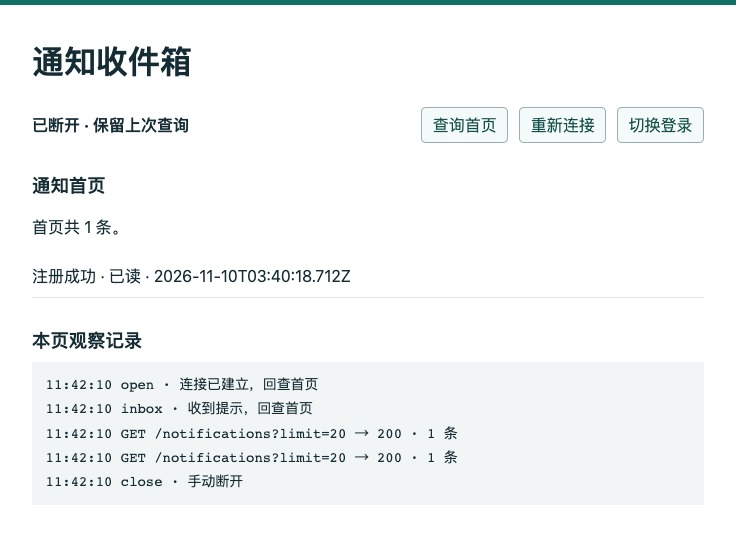
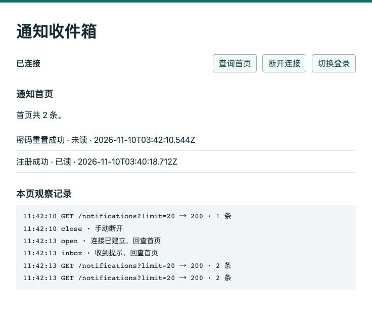
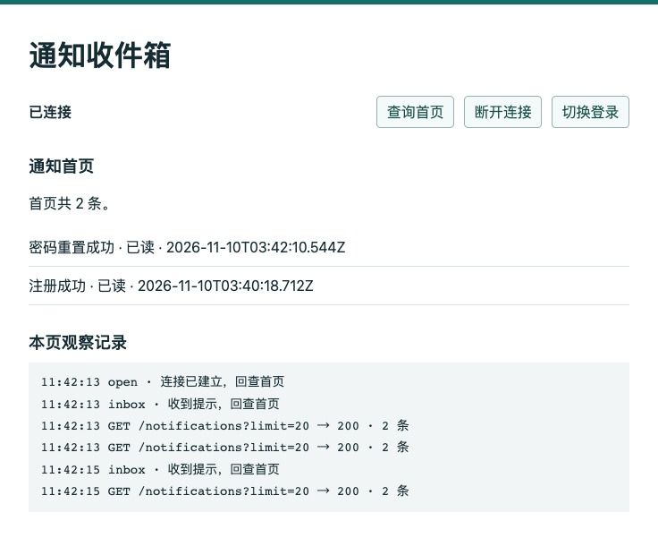
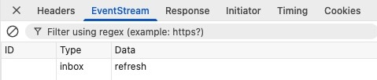
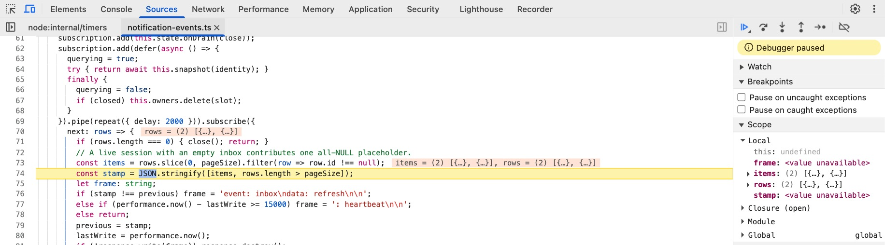

# 第 47 章　用 SSE 传递实时更新

重置密码成功后，用户用新密码登录，打开站内收件箱，只看见原来那条注册通知。过了一会儿，通知 Worker 把“密码已重置”写进数据库。另开一个窗口查询，已经有两条；原来的页面还停在一条。现在拔掉网络，再插回来。谁来告诉这个页面应该重新查一次？如果那句提醒恰好也丢了呢？

从[第 46 章](../chapter-46-notifications/chapter.md)配套分支 `part-06/chapter-46` 继续。上章把确认事务、后台任务和收件箱分开，提供了可以反复读取的首页。本章给打开的页面增加单向更新提示，并用断线、重连和撤销会话检验它。阅读约 45～60 分钟，搭建、双进程联调和故障实验另加 65～90 分钟。

## 47.1 从一张停在旧数据的页面开始

先给自己定一个能观察的目标。页面展示当前账号收件箱最新的二十条。收到新通知时，希望打开的页面在几秒内更新。离开半小时再回来，只要求它和此时查询到的首页一致。期间如果一个条目已经被另一台设备清除，就不应该重新弹出来。这个要求决定了我们丢得起哪一种信息：少听到一次“请刷新”，只要随后再查就能恢复；漏存一条本该属于用户的通知，刷多少次页面都补不回来。

最省事的做法是页面每隔几秒 GET 一次。只有少数读者、允许较长延迟时，停在这里完全合理。我们现在想让空闲页面保留一条下行连接，只在打开、重新连上或观察到变化时取完整列表。浏览器已有 EventSource，可以在普通 HTTP 响应里逐段接收服务器发送事件（Server-Sent Events，SSE）。标记已读和清除仍走第 46 章已有的写接口，沿用它们的会话和 CSRF 检查。以后若双方都要在同一连接上高频发送消息，再比较 WebSocket。本章的代价是占用较长时间的连接，服务端也要想办法知道 Worker 写了什么。

**先在已有系统里留下可对照的现场。** 使用第 46 章的独立 VERIFY 或它的恢复副本，下文以 `epp_ch47_verify` 为例。先确认 DBeaver 的 `SELECT current_database()`、API 实际生效的 DATABASE_URL 和两个 Worker 的 DATABASE_URL 指向同一个练习库。保留已有记录，分支切换不需要迁移、回填或换密码。从空库起步，按[第 46 章的准备步骤](../chapter-46-notifications/chapter.md#461-收件箱的一行代表什么)在独立库引导到该章结构。不要重新引导非空库。下面的“一条”和“两条”用本轮新建的虚构账号复现。

1. 按[第 46.4 节](../chapter-46-notifications/chapter.md#464-用两次确认走完收件箱)使用 Mailpit、Postman 和两个角色。先做注册 01、02，按本轮 UUID 与邮箱开通 Web，05 登录。让通知 Worker 处理 registered，发 13 选中它，15 取当前会话的 CSRF，16 标记已读。用 18 回查，记下该条目的 ID 和首次阅读时间。
2. **停通知 Worker，保留寄信能力。** 用 06 申请重置，从本轮信里取令牌发 07，用 08 确认旧会话已撤销，再用 10 和新密码登录。两种角色如果轮用同一个开发终端，先退出通知 watcher，再按前章方法启动邮件角色；无需同时占用两个 9230。此时用 18 查到的仍是已读的 registered。在第 46.4 节的 DBeaver 查询里按本轮 userId 筛选，password-reset 是 pending，还没有对应通知。在这个位置停下，后文要让它恰好在浏览器离线期间被消费。
3. 停掉旧 API 和旧 watcher，在配套项目根使用 Node 24.22.1，切到本章分支 `part-06/chapter-47` 后运行 `npm ci` 与 `npm run check`。跟写者可以保留自己的第 46 章练习副本。保留 password-reset 为 pending，直到 47.4 节明确断开浏览器连接才启动通知 Worker。重做实验请使用新的虚构账号；对真实的历史通知继续用原 ID 核对。

即使到这里完全不用 SSE，发 18 也能交代账号当前看得见什么。接下来增加的每个推送都可以用它独立核对。

## 47.2 一个响应怎样传来多次提示

普通 GET 返回一个 JSON 后结束。事件流的响应头只发送一次，状态为 200，Content-Type 是 text/event-stream。接下来写 UTF-8 文本。以下是一个完整的命名事件，最后还有一行空行：

```text
event: inbox
data: refresh

```

浏览器读到空行，才把已经收齐的字段分派给 `addEventListener('inbox', ...)`。一个 TCP 包可以装两条事件，一条事件也可以隔几次读取才到齐，按网络包或按每一段字符串直接 JSON.parse 都会出错。以冒号开头的是注释，发送 `: heartbeat\n\n` 能让链路在没有业务变化时也流过字节；它不会触发 inbox 回调。写出或刷新响应头，只能说明开始了这个响应，不能据此把通知标为已读。

原生 EventSource 会对可恢复的断线重新连接。协议还允许服务端在事件中设置 `id:`，浏览器在适用的自动重连请求中回送 Last-Event-ID。要靠它补发，服务端还得保存与该位置对应的事件、知道哪些对当前账号可见。本章只有当前收件箱首页可查，于是用一个很小的契约：每次建立流都提醒回查，后续提醒可以合并，每条都只携带 refresh。列表里的 UUID 标识通知，第 46 章的 nextCursor 用来向更旧的行翻页；两者都无法说明浏览器已经处理到了哪一步。协议允许省略 id，本章就省略。[HTML 标准的事件流与重连规则](https://html.spec.whatwg.org/multipage/server-sent-events.html)

一条流还占着 HTTP 响应、订阅和定时工作。先想好三个收回它的时机：页面离开、账号或会话失去资格、API 开始关闭。第 43 章的关机顺序会等待 HTTP 服务停止；如果必须等到关闭数据库时才结束长连接，两边就会相互等待。

先改两个文件，给后续订阅一个能赶在 HTTP 服务关闭前执行的清理入口。在 `src/application-state.ts` 的 ApplicationState 中用下面几行替换原有的 `draining = false`，保留下面已有的 track 和 whenIdle。每条流登记自己的关闭函数，主动断开时可以提前移除。

```ts
  private stopping = false;
  private readonly drainListeners = new Set<() => void>();
  get draining(): boolean { return this.stopping; }
  beginDrain(): void {
    this.stopping = true;
    for (const close of this.drainListeners) close();
    this.drainListeners.clear();
  }
  onDrain(close: () => void): () => void {
    this.drainListeners.add(close);
    return () => { this.drainListeners.delete(close); };
  }
```

在 `src/serve.ts` 收到关闭信号的两处，把 `app.get(ApplicationState).draining = true` 改为 `app.get(ApplicationState).beginDrain()`，把 `state.draining = true` 改为 `state.beginDrain()`。两处分别覆盖运行中和启动尚未结束的关机。到这里先运行 `npm run check`，旧的查询与 Worker 仍能独立构建；事件流路由在下一节接入。

## 47.3 从另一个进程发现已提交的通知

通知由另一个 Node 进程写入。即使 Worker 在自己的内存中发布了“刚写完”事件，处理浏览器连接的 API 也看不到那块内存。如果部署两台 API，两个进程内的订阅者列表也各自独立。这里直接使用已经共享的数据库。让 API 定期读取这个账号的一个小范围，范围怎么选？先试一个诱人的捷径：只记住最新通知的 ID 和阅读状态。Worker A 写入通知甲后暂停在提交之前。Worker B 稍后写入乙并先提交，页面查到乙。等 A 提交，甲排在乙下面，第一行一点没变。此时即使连接一直畅通，页面也可能永远少一条。换成给第二条标记已读，同样看不出首行变化。

浏览器展示二十条，并告诉用户还有没有下一页，因此服务端沿第 46 章现有的账号索引与排序，最多取二十一条。用前二十条的 ID、顺序和 readAt 判断显示内容，用是否存在第二十一条判断还有没有下一页。kind 和 createdAt 在本章通知写入后不再修改。若以后允许编辑标题或内容，应把影响显示的版本也纳入比较。两次采样之间连来五条，发一次提醒就够页面拉回当前结果。若某条在两次采样之间先出现又被清除，页面可能从来没看见过它；更深的尾页也超出这一订阅的范围。如果产品要求每次变动都可追溯，要保存不同的数据，见章末支线。

在 `src/notification-events.ts` 新建下面的服务。先看 snapshot 中的两种空。有效会话通过左连接保留至少一行，即使当前账号收件箱为空，右侧各列也只是 NULL；会话已过期、已被撤销、账号停用或失去 Web 资格时，外层查询没有行。前者要发初始提示，让浏览器能画出空页，后者要结束流。如果仅在握手时校验 Cookie，八小时会话到期之后，原连接还可能继续观察此账号何时出现变化。


```ts
import { Injectable } from '@nestjs/common';
import type { Response } from 'express';
import { defer, repeat, Subscription } from 'rxjs';
import { ApplicationState } from './application-state.js';
import type { SessionIdentity } from './auth-context.js';
import { DatabaseService } from './database.service.js';
import { HttpError } from './http.js';

const pageSize = 20;

@Injectable()
export class NotificationEvents {
  private readonly owners = new Map<symbol, string>();

  constructor(private readonly database: DatabaseService, private readonly state: ApplicationState) {}

  private snapshot({ sessionId, userId }: SessionIdentity) {
    return this.state.track(() => this.database.run('notificationPageSnapshot', () =>
      this.database.client.$queryRaw<{ id: string | null; readAt: Date | null }[]>`
        SELECT page.id, page.read_at AS "readAt"
        FROM public.sessions s JOIN public.users u ON u.id=s.user_id
        LEFT JOIN LATERAL (
          SELECT n.id, n.read_at, n.created_at FROM public.notifications n
          WHERE n.user_id=s.user_id AND n.cleared_at IS NULL
          ORDER BY n.created_at DESC, n.id DESC LIMIT ${pageSize + 1}
        ) page ON true
        WHERE s.id=${sessionId}::uuid AND s.user_id=${userId}::uuid
          AND s.expires_at > clock_timestamp() AND u.status='active' AND u.web_enabled
        ORDER BY page.created_at DESC, page.id DESC
      `));
  }

  open(identity: SessionIdentity, response: Response): void {
    if (this.state.draining) throw new HttpError(503, 'Service is shutting down', 'SERVICE_DRAINING');
    const count = [...this.owners.values()].filter(owner => owner === identity.userId).length;
    if (this.owners.size >= 64 || count >= 4) throw new HttpError(429, 'Too many open streams', 'STREAM_LIMIT');
    if (response.destroyed) return;
    const slot = Symbol();
    this.owners.set(slot, identity.userId);
    response.set({
      'Content-Type': 'text/event-stream; charset=utf-8',
      'Cache-Control': 'private, no-store, no-transform',
      'X-Accel-Buffering': 'no',
    });
    response.flushHeaders();

    let closed = false;
    let querying = false;
    let previous: string | undefined;
    let lastWrite = performance.now();
    const subscription = new Subscription();
    const close = () => {
      if (closed) return;
      closed = true;
      subscription.unsubscribe();
      if (!querying) this.owners.delete(slot);
      if (!response.destroyed && !response.writableEnded) response.end();
    };
    response.once('close', close);
    subscription.add(() => { response.off('close', close); });
    subscription.add(this.state.onDrain(close));
    subscription.add(defer(async () => {
      querying = true;
      try { return await this.snapshot(identity); }
      finally {
        querying = false;
        if (closed) this.owners.delete(slot);
      }
    }).pipe(repeat({ delay: 2000 })).subscribe({
      next: rows => {
        if (rows.length === 0) { close(); return; }
        // A live session with an empty inbox contributes one all-NULL placeholder.
        const items = rows.slice(0, pageSize).filter(row => row.id !== null);
        const stamp = JSON.stringify([items, rows.length > pageSize]);
        let frame: string;
        if (stamp !== previous) frame = 'event: inbox\ndata: refresh\n\n';
        else if (performance.now() - lastWrite >= 15000) frame = ': heartbeat\n\n';
        else return;
        previous = stamp;
        lastWrite = performance.now();
        if (!response.write(frame)) response.destroy();
      },
      error: () => close(),
    }));
  }
}
```

defer 把一次异步查询变成一个 Observable：订阅时才发查询，成功后产生一次结果并完成。repeat 等本轮完成、再等两秒，才订阅下一轮。对照一个容易写出的错误版本：setInterval 每两秒发一次查询，数据库却要三秒才返回；新查询会和上一轮重叠。耗时有波动时先发的请求可能后返回；若到达速度超过池的处理能力，还会持续排队。这里同一条流同时最多查一次。取消订阅能取消后续定时唤醒，已经交给数据库的 Promise 仍需结束。查询计入 state.track，断开的流在途时仍占一个名额，避免反复连接、立刻关闭绕开上限。

第一次检查时 previous 尚未设置，有效会话即使读到空首页也会发 inbox。之后即使数据库换了连接，也只与本条订阅保存的上次页面结果比较。这个比较不含带期限和签名的 nextCursor 字符串；相同页面不应只因重新签发游标而触发刷新。没有变化时，距上次输出满十五秒后，在下一轮检查成功时写一次心跳。慢查询也会推迟心跳。response.write 返回 false 表示写缓冲已满；本章允许提示合并并能重新查询，直接断开让慢客户端重新建立连接，避免为它无限排队。新订阅先检查每进程 64 条、每账号在本进程 4 条的上限；这两个数是本例的容量选择，多实例的总连接数要另算。

Nest 提供了 `@Sse()` 将 Observable 映射为事件流。这里需要直接写注释心跳、处理 write 返回的背压信号，并在关机时结束响应，所以在普通 GET 上取 Express Response，由这一处统一编码帧。控制器不再返回待序列化的对象；流开始后发生数据库错误，只能结束已经是 200 的响应，再连接时重新鉴权。[Nest 的 SSE 与取消订阅](https://docs.nestjs.com/techniques/server-sent-events)

将 `NotificationEvents` 导入 `src/captures.module.ts` 并放进该模块的 providers。保持服务为单例，配额才覆盖本进程的所有请求。在 `src/notifications.controller.ts` 的 Nest 导入里加 Req、Res，引入下面的类型和服务，原有的 CURRENT_USER_ID 单独导入用下方含 requireSession 的一行替换，在现有构造函数里添加 `private readonly streams: NotificationEvents`。把 events 放在已有 list 前面：

```ts
import type { Response } from 'express';
import { NotificationEvents } from './notification-events.js';
import { HttpError } from './http.js';
import { CURRENT_USER_ID, requireSession, type AuthenticatedRequest } from './auth-context.js';

  @Get('events')
  events(@Req() request: AuthenticatedRequest, @Res() response: Response,
    @Query(new SchemaPipe(EmptyObjectSchema)) _query: object): void {
    const origin = request.headers.origin;
    const site = request.headers['sec-fetch-site'];
    if ((origin !== undefined && origin !== this.config.appOrigin)
      || (site !== undefined && site !== 'same-origin' && site !== 'none')) {
      throw new HttpError(403, 'Request origin is not allowed', 'ORIGIN_REJECTED');
    }
    this.streams.open(requireSession(request), response);
  }

```

原来 `src/http-boundary.ts` 将 /notifications/ 后的一段当作删除目标。把允许方法判断中 `url.pathname === '/notifications'` 改成 `['/notifications', '/notifications/events'].includes(url.pathname)`，放在 notificationDetail 判断之前。在 `src/request-observation.ts` 给固定路径数组增加 /notifications/events，这样日志能区分长连接的总持续时间和普通详情请求。在 `src/openapi.ts` 的 paths 中增加 GET /notifications/events，operationId 为 streamInboxHints，200 的 content 写成 `{ 'text/event-stream': { schema: { type: 'string' } } }`；列出 400、401、403 和 429 的 Problem 响应。重新运行 `npm run check`。

单独开一条读取流无需 CSRF 写令牌，仍须有效的登录 Cookie。浏览器如果传了 Origin，必须匹配配置的页面来源；Fetch Metadata 若表明其他站点或同站不同源，也拒绝建立。Postman 可以没有这些浏览器头，仍须登录。EventSource 构造函数不能附任意 Authorization 请求头。这里页面和 API 对浏览器同源，浏览器自己带 HttpOnly Cookie；把凭据拼在 URL 中会使它出现在更多访问记录里。

查询期间占用数据库连接，等待下一次观察时把连接还给池；不能给每个浏览器标签页长期开一个数据库事务。反过来，SSE 也没有消除服务端轮询的开销。假设一台 API 上有 40 条空闲流，每两秒各查一次，短查询足够快时约为每秒 20 次探测，每次最多返回二十一行。原索引按属主和时间排序，已清除的行也在索引里，连续跳过许多已清除记录会增加实际扫描量。此外还有真正读取列表和核对会话的请求。它节省的是反复传输首页的成本。若这一项本身就压满池，继续缩短周期只会加剧争用。可以把同一账号的变更检测共享给多个订阅者，或用数据库提交通知唤醒 API；初次连接和重新订阅仍须对账，进程退出期间的内存提醒无法找回。

想复现前面那次晚提交，可以用本章 `test/notification-events.test.mjs` 里名为 a late commit in second place 的实验。另备一份已迁移的独立自动回归库，把其 TEST_DATABASE_URL 放进本地 `.env.test-regression`，和联调库分开。先 `npm run build`，再从项目根执行：

```bash
unset DATABASE_URL TEST_DATABASE_URL
NODE_ENV=test node --env-file=.env.test-regression --test --test-name-pattern='a late commit in second place' test/notification-events.test.mjs
```

沿代码看两个暂停位置：第一条连接完成 INSERT 后保留事务，另一条连接提交时间靠后的记录，事件流先看到一条；等初始帧到达才 COMMIT 第一条。两个位置中的首页第一行 ID 相同，第二次却多了一行，应再收到 inbox。该用例随后让可见行数从 21 降到 20：二十条本身完全相同，“另有下一页”消失，也应刷新。实验仅使用临时创建的账号，结束时清理其记录。

## 47.4 断线期间新增的通知去哪里找

**先把页面和 API 接成同一个来源。** 在项目根目录准备 `.env.test`，其中 TEST_DATABASE_URL 指向本轮联调库。下面的启动入口把它赋给 API 的 DATABASE_URL，并在同一配置下实际连库核对名称；独立自动回归使用另一份测试库配置。端口 3360 接请求，3100 提供实验页，APP_ORIGIN 必须写浏览器地址栏里的来源。

```bash
unset DATABASE_URL TEST_DATABASE_URL APP_ORIGIN PORT DB_QUERY_DEBUG
NODE_ENV=development node --env-file=.env.test --input-type=module -e '
process.env.DATABASE_URL = process.env.TEST_DATABASE_URL;
const { withVerifiedDatabase } = await import("./scripts/verify-database.mjs");
await withVerifiedDatabase(process.argv[1]);
process.env.PORT = "3360";
process.env.APP_ORIGIN = "http://127.0.0.1:3100";
process.env.DB_QUERY_DEBUG = "false";
await import("./scripts/dev.mjs");' epp_ch47_verify
```

在第二个终端进入同一项目根目录，运行 `API_PORT=3360 node examples/inbox-stream/server.mjs`，打开 `http://127.0.0.1:3100/`。这个本机 Node 入口提供页面，对登录、身份、收件箱和事件流把原请求转给 3360，再把收到的字节逐段传回来。页面没有跨源 fetch，也没有开放生产 API 的静态实验路由。不要把地址栏里的 127.0.0.1 换成 localhost 后继续使用原 APP_ORIGIN。跟写的读者可从本章配套分支取 `examples/inbox-stream/` 和 `requests/chapter-47.postman_collection.json` 作为实验材料。配套目录 `examples/inbox-stream/` 含入口和页面。Postman 选择 Import，导入 `requests/chapter-47.postman_collection.json`；选回本地未同步环境，将 baseUrl 指向 `http://127.0.0.1:3360`。01～18 沿用前章编号，19 专门打开事件流。18 取本页用的二十条，13 的页长为一，用来选定随后要操作的首条。

页面登录表单用已开通的本轮邮箱和**重置后的密码**调用原来的 /auth/login。Postman 的 Cookie 与浏览器的 Cookie 分属两个客户端，即使登录同一个账号，两边会话也不同。在 `examples/inbox-stream/app.js` 中建立连接时有两个值得一起看的回调（省去界面文字）：


```js
const stream = new EventSource('/notifications/events');
source = stream;
stream.onopen = () => {
  if (stream !== source) return;
  void firstPage();
};
stream.addEventListener('inbox', () => {
  if (stream !== source) return;
  void firstPage();
});
```

open 每次连接成功都查首页，自动重连也走这里；命名事件同样从最新处重新查。服务端初始提示与 open 可能接连抵达。若直接并行发两次 GET，较慢的旧响应可能把新画面盖回去。firstPage 内用 active 记录正在进行的查询，期间再来提示只设 rerun；当前查询结束后最多立刻再查一轮。取回的 items 整页替换。这样重复提示不会重复追加行。断开时 close 事件源并 abort 在途查询，旧连接即使还有排队的回调，也不能再改这张页面。查询前后检查 /auth/me 的会话身份，401、403 或账号切换时清空原列表并要求重新登录。整个过程中页面不需要读取 Cookie 值。

看一下处理速度不同时的顺序。在 `app.js` 的 firstPage 开头，如果已有查询在途，只登记一次“还得再查”。下面两段分别位于函数开头和 finally 块中：

```js
if (active) { rerun = true; return; }
const controller = new AbortController();
active = controller;
```

```js
if (active === controller) {
  active = undefined;
  if (rerun) { rerun = false; void firstPage(); }
}
```

设请求 A 发出后页面又收到两次 inbox。A 返回时页面先应用它的结果，然后只启动一个请求 B，来取 A 在途期间可能提交的变化。反过来，若 A 返回前用户断开并改用另一个账号，disconnect 已取消请求并清空相应引用；A 的回调检查 active 已经换了，也就不会把上一个账号的结果画回来。点击“切换登录”只让实验页放下当前连接并回到表单；需要撤销服务器会话时仍要调用原有的退出或会话撤销接口。

**让一条真实通知错过连接。** 保持通知 Worker 停止。登录后先等页面显示一条“注册成功 · 已读”，再点“断开连接”。此按钮会调用 close，刻意保留上次结果。如果邮件角色仍在开发终端运行，先按 Ctrl-C，等 watcher 释放 9230 和输出目录。现在才启动通知角色：


```bash
unset DATABASE_URL DB_QUERY_DEBUG DB_POOL_MAX LOCAL_SMTP_PORT LOG_LEVEL
npm run dev:worker -- epp_ch47_verify notifications
```

先等本轮 password-reset 的任务变为 done。保持浏览器断开，在 Postman 发 18，检查新增的 ID 和 kind。用这个独立查询判定消息已经入箱；页面上的旧结果本身无法告诉你 Worker 是否成功。



图 47-1　页面停在上次查询的一条记录。断开只改变这张页面的连接，Worker 仍可提交，另一个已登录客户端仍可查到新增通知。

点击“重新连接”。这次是代码显式创建**新的** EventSource。首次 inbox 提示依然只有 refresh，页面却能显示两条，因为它另发了一次 GET。点“查询首页”重复读取，两条通知各出现一次；如果旧库有更多数据，页面只展示最新二十条。对照 ID 时打开 Network，点普通的 /notifications?limit=20 请求看 Response，与 Postman 18 的 items 对照；实验页只渲染种类、状态和时间。



图 47-2　较新的“密码重置成功”处于未读，旧注册通知仍是已读。页面观察记录把流上的 open、inbox 与实际读取的行数分开显示。

现在让页面保持连接。在 Postman 依次单发 13 选中最新 password-reset、15 取 **Postman 当前会话**的 CSRF、16 标记已读。等首行变化触发提示，再用 18 核对 readAt。要重做这一轮需另一条未读首行，对同一行再发一次 16 会保留首次时间。



图 47-3　首行仍是同一条通知，阅读状态已变化。下方记录先出现 inbox，再出现 GET 的结果。只收到提示不会自动标记任何通知已读。

再试一次**浏览器自动重连**：保留页面、API 和账号，只在运行 3100 实验入口的终端按 Ctrl-C，然后用相同命令启动它。页面脚本已经加载，原响应随入口退出而断开。观察原 EventSource 先报 error，入口恢复后出现新的 open 和首页查询；这次没有点击“重新连接”。短暂中断时，页面对 /auth/me 或 /notifications 的查询本身也可能失败，等重新连接后用 18 核对最终内容。接着只撤销浏览器这一处登录。在 Network 的 /auth/me 响应中找到浏览器自己的 sessionId；保留同账号 Postman 登录，发 15 更新它自己的 CSRF。在 Postman 新建 DELETE /auth/sessions/{浏览器的 sessionId}，带 X-EPP-Request: 1 与 X-CSRF-Token（使用 15 保存的 csrfToken），Body 选 none。204 后保持页面不动，下一次服务端复核会结束流，浏览器回查得到 401，清空内容并回到登录。Postman 发 18 应仍是 200。不要把会话标识放进截图。

## 47.5 定位成批到达的提示与迟迟不关的连接

完成撤销实验后，先在实验页用新密码重新登录。在浏览器开发者工具里打开 Network，再点一次“断开连接／重新连接”。找到 events 请求。一个一直保持打开的 200 是这里的正常形态。看事件详情里的 inbox 与 refresh，再看另一个普通 /notifications?limit=20 请求和返回的 items。注释心跳可以维持连接，事件视图通常只列能分派的事件；心跳不会让观察记录无休止地新增 inbox。



图 47-4　另一次连接的 Chrome DevTools 实拍。类型是 inbox，数据是 refresh，事件 ID 为空。列表内容来自另一个 GET，可以在 Network 中单独点开它。

若登录就得到 403，先查 API 配置的 APP_ORIGIN 与地址栏中的协议、主机和端口。握手就返回 401，先单独用同一客户端读 /auth/me。握手成功却迟迟没有变化，则按同一个账号依次比对：18 是否已经返回目标通知；它是否改变了二十条首页或下一页的有无；Postman 里用同一账号单发 19，直连 API 是否持续收到命名事件。19 是流式请求，需要手动取消，整套集合不适合按顺序自动跑到底。原生 EventSource 的 error 回调不能读到 HTTP 状态码，可从 Network 或单独的受保护查询定位。复现连接上限时先关闭实验页，在 Postman 用同一有效 Cookie 分四个请求标签分别打开 19，保留四个响应，再单发第五个，预期 429。取消一个已建立的请求后重试；实验结束把所有 19 都取消，再为下一组对照各开一条流。实验页之间会广播切换登录，依次登录五个页面无法稳定留下五条流。

一个有辨识度的现象是，Postman 直连 3360 时状态很快更新，经代理却常常一批一批到达。两条流的两秒采样各自计时，一次相差一两秒不足以定位缓冲。等两侧都收到初始事件后，改一条首页记录，等两侧都看到再做下一次；若代理端始终沉默，可让直连端确认下一次变化，观察代理端最终是否一次释放多帧。若直连也没有 inbox，先查数据库与首页内容；如果直连立即收到而只有代理延后，检查转发程序是否在读完整个 body 才发送、是否启用了缓冲或会攒块的压缩。配套本机入口把上游 readable 直接 pipe 到浏览器响应。API 发送 X-Accel-Buffering: no；Nginx 配置可以决定是否采纳该头，也可在这个 location 显式设置 proxy_buffering off。proxy_read_timeout 限制的是相邻两次读取之间的等待时间。有多级代理时要比较各跳的空闲超时，给实际心跳间隔、慢查询与调度延迟留余量。在公网部署后从浏览器到入口重走同一实验。[Nginx 代理缓冲与读取超时](https://nginx.org/en/docs/http/ngx_http_proxy_module.html#proxy_buffering)

最后在 VS Code 的 API 附加配置（9229）给 `src/notification-events.ts` 计算 stamp 的位置打断点，再打开实验页建立一条连接，观察 items.length、目标条目的 id 与 readAt，以及 rows 中是否多出下一页的探测行。立即继续并移除断点，再改变一次首行状态核对正常时序。暂停的是处理连接的 API，期间其他查询也会等；Worker 的 9230 仍属于另一个进程。关闭页面后，此流的订阅不再启动下一轮。另开一次页面，保持连接时停止本轮 API，应该看到 app.draining、app.stopped；若直到 app.stop_timeout 才退出，核对 beginDrain 是否先于 server.close、在途数据库查询是否仍未结束。长请求日志的 durationMs 是连接存活时间，用它估算单次查询耗时会得出错误结论。

也可以在 Chrome 地址栏打开 `chrome://inspect/#devices`，用 Configure 把 localhost:9229 加进发现目标，点 API 旁边的 inspect。Sources 中按 Cmd+P（其他平台 Ctrl+P）找到 notification-events.ts，点计算 stamp 那行的行号，建立连接后在 Scope → Local 看 items。看完取消断点，按 F8 继续。



图 47-5　另一次独立调试，两条虚构通知均落在首页。右侧 items 和 rows 都有两项，黄色行即将计算 stamp，此刻该变量还没有值。若出现第二十一行，items 仍只保留二十项。

到这里，API、Worker 和浏览器都可以各自在不同时间退出。面对“我没有看到结果”，现在可以分别查验申请时留下的工作、确认后生成的收件箱，以及当前页面最后一次查询。下一章将沿同一位用户的这三处现场判断该从哪里接续。

[支线 47A　如果离线期间的每一步都要重放](side-01-replay.md)（阅读另加 12～16 分钟，双会话实验另加 8～12 分钟）

## 附录：本章必要技术点速查

| 名称 | 本章用途 | 回查时注意 |
| --- | --- | --- |
| EventSource、open、error、close | 建立单向流、观察重连、主动断开 | 主动 close 后需要新建对象；错误详情用普通查询或 Network 核对 |
| event、data、id、Last-Event-ID | 编码命名事件与可选的恢复位置 | 空行分派一个事件；本章省略 id，重连取当前首页 |
| Observable、defer、repeat、Subscription | 延后发起查询，完成后安排下一轮，断开时取消订阅 | 取消订阅后在途 Promise 仍需收尾。[RxJS defer](https://rxjs.dev/api/index/function/defer) |
| write、flushHeaders、close | 按帧输出，释放响应及订阅 | write 的返回值反映缓冲状态，成功写出仍无法证明浏览器已消费。[Node.js 24 HTTP](https://nodejs.org/docs/latest-v24.x/api/http.html#responsewritechunk-encoding-callback) |
| LEFT JOIN LATERAL、有界排序 | 在一次查询中核对活会话、首页与有无下一页 | 区分没有资格与空收件箱，按用户过滤并沿现有排序读取 |
| API_PORT、LAB_PORT | 指定本机实验入口的转发目标和监听端口 | 默认 3000／3100，正文使用 3360／3100；实验入口单独运行 |

本章完成代码对应 `part-06/chapter-47`。[上一章](../chapter-46-notifications/chapter.md) · [第六篇导读](../README.md) · [全书目录](../../README.md)
