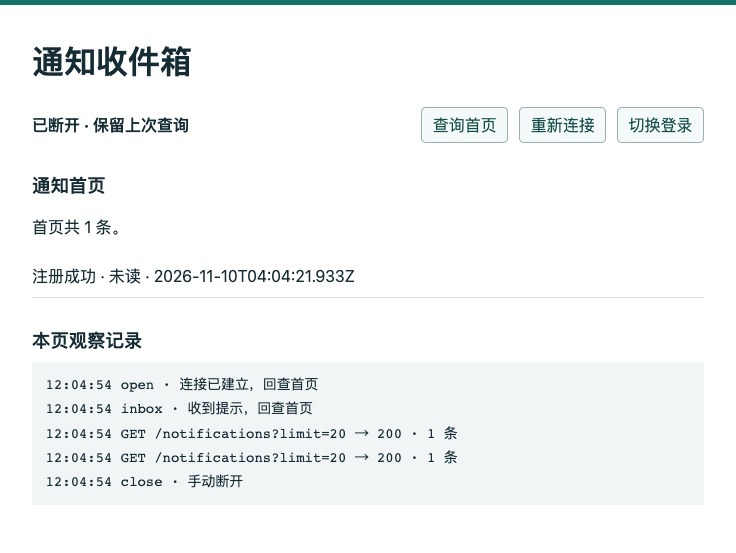
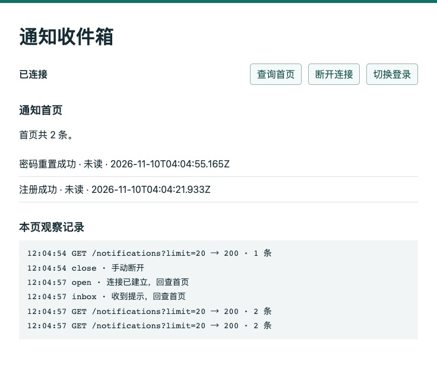

# 第 48 章　第六篇回顾：从一封验证邮件追到站内收件箱

一位用户说：“我收到了重置邮件，改了密码，也重新登录了。收件箱里怎么还只有注册成功那一条？”运维同事查到另一件奇怪的事：寄出重置邮件的进程已经退出，数据库里那封信还停在 attempting。现在有三件事可做：重启寄信进程、恢复站内通知投递、让页面再查一次。只听用户这句话，还不足以决定应该先做哪件。

先完成第 42～47 章。本章沿用配套分支 `part-06/chapter-47` 的数据库结构、请求集合和浏览器实验页。我们要在同一账号上制造这个现场，保留寄信事故，用已经寄出的信完成一次重置，再观察通知什么时候可见。阅读约 25～35 分钟，本机操作另加 40～60 分钟，按已有环境、两次实际租约等待和双客户端查验估算。

## 48.1 从一个邮箱找到两次不同的提交

在独立练习库和回环 Mailpit 上操作。可以继续使用第 47 章的专用库，只要其中所有到期工作都属于允许处理的练习账号。已有未处理的邮件事故时，保留现场，另用独立库。若新建库名 `epp_ch48_verify`，按[第 46.1 节](../chapter-46-notifications/chapter.md#461-收件箱的一行代表什么)在空库执行 bootstrap，已有完整迁移历史的恢复副本沿用原结构。下文命令的预期库名取自你的建库记录。把 API 与 Worker 所用的本地环境文件指向它，在 DBeaver 用 `SELECT current_database()` 核对；Web 入口按[第 47.4 节](../chapter-47-sse/chapter.md#474-断线期间新增的通知去哪里找)启动，末尾预期库名也要替换。构建产物供后面的单次程序使用，项目根先执行 `npm run check`。邮件和站内通知的常驻 Worker 都先停止。

Postman 导入 `requests/chapter-47.postman_collection.json`，baseUrl 指向本轮 API。主角和稍后排在它后面的收件人，都选这个库里从未注册过的新虚构邮箱。给主角设置两个不同的练习密码，把地址保存在本地环境。打开 Mailpit 按该地址筛选。先发 01 注册申请，看到 202 后，在 DBeaver 运行下面的查询。下文 SQL 的邮箱和 UUID 占位值都换成你这轮实际使用的值。

```sql
SELECT o.id AS message_id, o.purpose, o.status, o.attempts,
       o.claim_id IS NOT NULL AS reserved, o.lease_until,
       c.paused_by = o.id AS owns_channel
FROM public.verification_outbox o
CROSS JOIN public.verification_mail_control c
WHERE c.id = 1 AND o.recipient = 'reader48@example.test'
ORDER BY o.available_at, o.id;
```

此时应有 register/pending。控制行 paused_by 为空时，最后一列是 SQL 的 NULL。记下注册邮件的 message_id。这个 ID 能一路跟到外部发送的写回；以后用户成功确认时创建的通知任务有另一个 ID。用户名下既可能有注册通知，也可能有多次改密产生的通知，不能按“最近一条时间差不多”把两张表拼成一次业务。

这次实践要追两次提交。第一次是申请：服务端把这一轮验证意图与寄信指令一起保存，请求结束后 Worker 还有事可做。第二次是用户带着证明回来确认：账号才发生变化，同时留下创建站内通知的任务。在这两处之间，用户完全可能收到信却什么也没做。接下来先让一封信在真正发送前中断，再让另一封在对端接受以后中断。

## 48.2 两次进程退出，各能接手什么

先做注册信。准备 A、B 两个终端，在配套项目根分别定义下面的函数。清掉可能覆盖 `.env.worker` 的外层变量，把 SMTP 端口配置到这次运行的 Mailpit。在 A、B 各自给 verify_db 赋实际库名。沿用第 47 章库时，把示例值换成该库的名字，后面启动站内角色也用同一个变量。每次调用都显式传消息 ID，避免换信后手里还握着上一次的 ID。

```bash
unset DATABASE_URL DB_POOL_MAX DB_QUERY_DEBUG LOCAL_SMTP_PORT LOG_LEVEL
verify_db=epp_ch48_verify
race() {
  sh -c 'echo "本次 race 的 Node PID: $$"; exec node --env-file=.env.worker database/chapter-44/race.mjs "$@"' race "$verify_db" "$1" "$2"
}
```

A 运行 `race '注册邮件UUID' before`。见到 claimed, before preparation 时，它刚领到工作，数据库中仍是 pending，reserved 为真，attempts 为 0。让 A 保持等待，在 **B** 中执行 `kill -INT 本次A显示的数字PID`，看到 A 回到 shell 后再继续。函数用 exec 将子 shell 原位替换成 Node，打印的是本次程序自己的 PID。两轮都从 B 给这个确切的进程发信号；在 A 的 readline 提问处按 Ctrl-C 可能会中断提问并抛出异常。特别是在 after 的回调中，这个异常会进入发送错误处理：只要租约仍有效，数据库可以成功记下 unknown，这和进程直接退出留下 attempting 是两个现场。数据库里的租约有自己的期限；退出终端不会把它擦掉。在期限内 B 用相同 ID 执行 `race '注册邮件UUID' now` 会得到 empty，即“这次没有符合领取条件的行”。在 DBeaver 用 `SELECT clock_timestamp()` 与这一行完整的 lease_until 比较；越过期限，再用 B 执行一次。在新申请仍有效的前提下，B 可以取得新的 claim_id，完成发送并写回 accepted。Mailpit 收到一封注册信。

从 Mailpit 取本轮注册令牌，用 Postman 02 完成注册并记下 userId。按[第 46.4 节](../chapter-46-notifications/chapter.md#464-用两次确认走完收件箱)用刚取得的 UUID 和邮箱开通账号并提交；05 登录，启动一次站内角色（命令见下节），等 registered 投递成功，18 查到一条后停掉该角色。再用 06 申请重置。用 12 检查原会话仍为 200，重新执行 48.1 的查询，记下新行 purpose=reset 的 message_id。

现在交换退出的位置。A 用**重置邮件**的 ID 运行 `race '重置邮件UUID' after`。等待 SMTP accepted, before database writeback 提示，先确认本机 Mailpit 已出现本轮重置信，回到 B，用本轮 A 重新打印的 PID 执行 `kill -INT 数字PID`，确认 A 已退出。在数据库中，预备发送的事务已经把消息置为 attempting，增加 attempts，并让控制行占用者指向这条消息。进程退出使后续的成功写回失去了机会。B 在租约内运行 `race '重置邮件UUID' now` 会读到 busy；过期后再运行会读到 paused。若操作较慢，第一次就可能是 paused，核对完整的 lease_until 即可解释这个差异。

为什么同样等待三十秒，第一封信能接手，第二封信还得停下来？在第一处退出时，原执行者尚未取得能够寄出的令牌，后继有条件重新准备。在第二处退出时，数据库只知道它已获准发信。远端可能连正文都没收到，也可能已收下正文而本地还未来得及记账。过了三十秒只会改变领取和写回的资格，无法改变已经抵达对端的字节。这个实验因为能看见 Mailpit 和暂停位置，我们知道实际是哪一种；脱离这两个证据，单看 attempting 推不出来。


图 48-1　按本轮地址和重置主题筛选后，Mailpit 显示一封重置信。这个本地收件端能提供正面证据；在生产系统中，仅凭用户“还没看见”或应用这边超时，无法断定对端没有接受。SMTP 接受的是递送责任，用户是否已使用证明另有记录。[RFC 5321 §4.2.5](https://datatracker.ietf.org/doc/html/rfc5321#section-4.2.5)

若本机连接明确返回 ECONNREFUSED，或唯一收件人在 RCPT TO 阶段收到本例覆盖的 450、451、452，才按第 45 章相应分支使用有限的重试次数和下次可执行时间。不能识别故障位置的网络异常进入 unknown，留待核对。可以比较当时的[退避与通道对照](../chapter-45-retries/chapter.md#455-对端读完正文以后如何放行和清理)。这里把原事故留着，暂时只停邮件通道。在 Postman 中用**另一个全新的虚构邮箱**单发 01 排一封后继信，随即把 Postman 本地环境的 email 恢复为原账号。在 DBeaver 将 48.1 查询中的邮箱改为后继地址，记下它自己的消息 ID。B 对后继 ID 执行 now，结果仍为 paused；后继保持 pending。不要用后继的令牌或密码替换原来要做的重置。

## 48.3 有一封信停在 attempting，用户还能改密吗

在有效期内取原邮箱的重置信令牌，填入本地 resetToken，发 07。服务端核对令牌用途、当前意图、到期时间以及账号凭据版本，这一路无需打开邮件通道。确认成功返回 204。紧接着用原 Cookie 发 08，应为 401；用新密码发 10 再发 12，得到当前账号。若有一步失败，先分别检查当前账号、令牌与意图是否仍有效，不要用一条通知反推密码一定改过。短暂中断时，仍在十五分钟有效期内且未被替换、未被消费的令牌，可以直接继续确认。若已经到期或换代，先按本节末尾的步骤核对并放行旧事故；再申请时一分钟冷却内的重复请求仍可能返回 202 而没有新消息。查到新消息 ID、投递并取得新信以后再继续。

在 DBeaver 中，继续用注册时记下的 userId 检查同一账号的两种工作：

```sql
SELECT j.id AS event_id, j.kind, j.status AS job,
       n.id IS NOT NULL AS in_inbox, n.read_at, n.cleared_at
FROM public.notification_jobs j
LEFT JOIN public.notifications n ON n.id = j.id
WHERE j.user_id = '替换为注册响应的UUID'::uuid
ORDER BY j.created_at, j.id;
```

registered 应为 done，并有同 ID 的通知。password-reset 已经 pending，右侧仍没有行。这里可以按事件 ID 连接，因为第 46 章明确以任务 ID 作为通知 ID。确认事务已经提交了这项工作，站内通知 Worker 却还没有运行；等待 SSE 或反复刷新首页都不会替它执行。反过来，如果任务已是 done 且 cleared_at 有值，重复投递会认出既有通知，用户清除过的条目应当继续隐藏。

按第 47 章方法打开同源实验页，用原邮箱和新密码登录。页面出现 registered 后点击“断开连接”，让它保留这次首页。在已设置 verify_db 的 A 终端启动站内角色：

```bash
unset DATABASE_URL DB_POOL_MAX DB_QUERY_DEBUG LOCAL_SMTP_PORT LOG_LEVEL
npm run dev:worker -- "$verify_db" notifications
```

重新执行同一条 SQL。password-reset 应在同一事务中变成 done 并得到一行通知；原邮件仍是 attempting，邮件通道的占用仍指向原消息。用Postman 中刚用 10 登录的会话发 18，核对本轮事件 ID 已在首页。断开的页面依旧只显示注册通知。



图 48-2　同一轮中，Postman 的 18 对应的查询已经读到两条，浏览器最后一条观察记录仍是手动 close。此时再启动一份通知 Worker，无法改变这个页面。

点“重新连接”，取回的首页才增加“密码重置成功”。即便多个 inbox 提示挤在一起，读取列表也不会把事件变成两个业务结果。对原有账号，应按本轮通知 ID 对照而非假定全账号永远只有两行；若后来的通知已把它挤出首页，则按返回的游标与原页长向后找。



图 48-3　open 与 inbox 触发回查。两次 GET 都返回两条，两项仍是未读。若只拿“页面收到推送”登记已读，会把这两种事实混在一起。

此时再看章首的故障。先以当前身份发 18：如果已能查到那条通知，恢复页面查询就够了。首页没有时，先按 ID 检查该账号可见列表的后续页，再查事件。任务尚在 pending，就看通知角色和积压；任务已是 obsolete，就查消费时的账号状态与任务有效期；通知的 cleared_at 已有值，则应保留用户的清除操作。只有当问题是“下一封验证邮件寄不出去”时，才需要沿邮件通道继续查。这样即使两项故障同时出现，也有办法分别处理。

最后处置邮件通道。确认所有邮件发送者已停止，核对 Mailpit 中这次收件、消息用途、时间与操作者记录，再用[按具体事故放行的步骤](../chapter-45-retries/chapter.md#455-对端读完正文以后如何放行和清理)。在 `database/chapter-45/03-review.sql` 中同时替换预期库名与**原重置信的 message_id**。先用后继 ID 执行应返回零行；换正确 ID 执行一次应返回一行，并在手动提交模式下提交。B 现在才可对后继 ID 执行 now。本轮后继申请仍在有效期内时，邮件被接受；若中途离开过久，可能得到 obsolete。两种结果中原消息都仍保留 attempting，原邮箱不会因此多一封重置信。停止本轮实验页、API、Mailpit 和 Worker。下一位维护者应能从处置记录知道谁核对了哪封信、为何放行，以及为什么那条历史状态仍在那里。

## 48.4 把目的地换成头像文件

换一个需求：用户上传新头像，旧页面仍要能读取之前已经发布的头像。上传过程刚把文件送到对象存储，API 就退出了，数据库里的头像引用还是旧值。你手里有“用户点过上传”和“一次上传超时”两条信息。直接再传同名文件会怎样？若对象名固定为用户 ID，第二次上传可能已经替换了第一次的内容。此时一个迟到的清理程序按这个名字删除“失败文件”，会把用户正在使用的新头像删掉。

沿前面判断寄信和通知的方法倒推需要的数据。每次上传尝试需要能重新定位的独立身份；已发布头像需要一个由数据库决定的当前引用；尚未确定归属的文件需要留下稍后核对的依据。上传超时时，能按本次写入的独有对象键检查目标端，是文件场景比普通 SMTP 多出来的能力。对象存在只能证明相应键下已有内容，不能单独证明这个用户仍有资格发布、这次上传仍是最新选择，或数据库引用已经切换。还得核对对象身份、账号和当前引用的版本，再决定接续登记或安排清理。

再把先后顺序换一次。A 先开始上传，B 后开始却先发布成功。A 迟到时即使文件完整，也不能仅凭“我刚完成”覆盖 B；A 的清理任务同样只能处置自己的候选对象。独有的键还少一项保证：若清理者查到“暂时没被引用”后放下锁，发布者仍有机会在删除前把 A 设为当前头像。清理前要在库中有条件地取得这个候选对象的处置权，使它此后无法再发布。对曾经公开的旧版本，还须明确旧页面可读多久，待受保护的引用和保留时限都结束后才按精确的键删除。这个问题会把第七篇的知识自然分开：谁能看到哪些资料，怎样安全地接收和解码字节，什么时候可以发布文件引用，以及失败后如何识别可以清掉的对象。至于第六篇这次重置，数据库已经能回答每个岗位各自的问题：寄信进程从消息和通道判断能否继续，通知进程从事件判断是否已落库，浏览器从当前账号的收件箱重建页面。

## 附录：本章必要技术点速查

| 现场 | 回查位置 | 能据此采取的动作 |
| --- | --- | --- |
| 申请返回 202 | 当轮邮箱、用途、意图及消息 ID | 先区分新入队和冷却中的重复申请 |
| pending 有预订 | claim_id、lease_until、数据库时钟 | 等待有效执行者；到期后重新领取并检查业务代次 |
| attempting 与通道占用 | paused_by、消息 ID、接收端可核实的结果 | 保留原事故；核对后仅放行后继工作 |
| 确认后旧页面失效 | 08 的旧 Cookie、10 的新登录与 12 的身份 | 按会话验证撤销，不用寄信状态推断改密 |
| 站内任务与可见页面不一致 | 同一 event_id 的任务和通知、cleared_at、当前账号的列表 | 恢复站内投递或重新查询；已清除的事件保持隐藏 |
| 文件已写而引用未发布 | 尝试身份、对象键、当前引用版本 | 判定本次写入是否还能发布，清理前核对归属 |

[上一章](../chapter-47-sse/chapter.md) · [第六篇导读](../README.md) · [全书目录](../../README.md)
