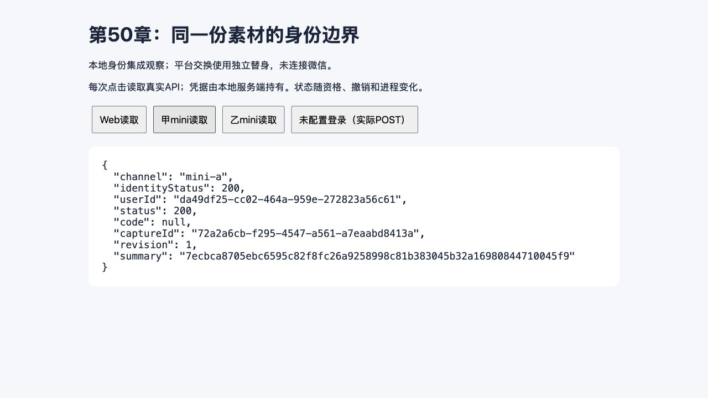
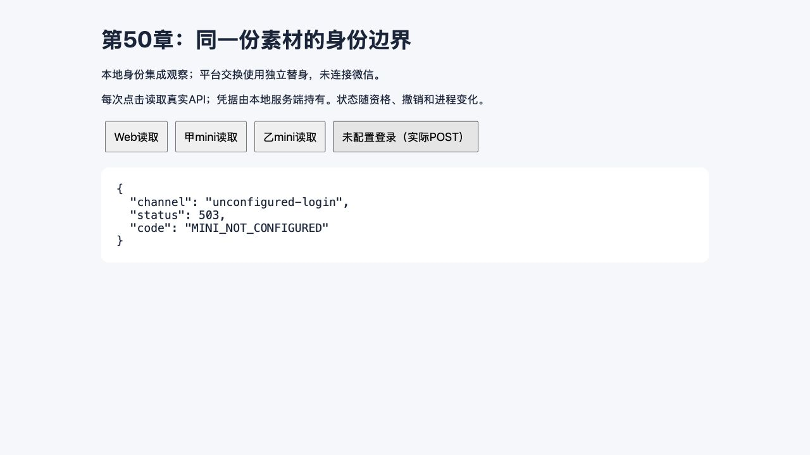
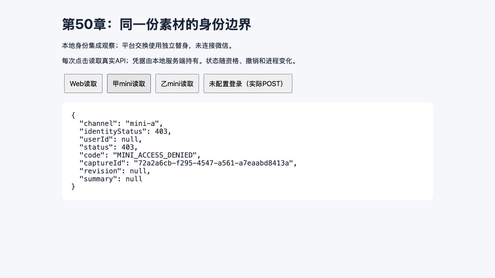

# 第 50 章　选读：让小程序登录与事务发件箱在同一服务工作

第 49 章把寄信工作留在了数据库里。第 44 章的另一份服务也已经有人使用：同一个账号可以带 Web Cookie 或小程序 Bearer 读取自己的素材。现在要交付一份同时包含两项能力的程序。把小程序文件复制过去，编译成功，是否就能继续使用两边原来的数据？

先把目标说清：**合并代码，让两种数据库历史分别升级到相同结构。两个库中的账号、素材和消息仍各自留在原来的库。** 本章不做业务数据库合库；同一个 UUID 出现在两个库，也不能据此认定是同一个业务事实。

本章代码从[第 49 章完成状态](https://github.com/SamChowRock/epp-public/tree/part-06/chapter-49)开始，接入[第 44 章的小程序会话](https://github.com/SamChowRock/epp-public/tree/part-05/chapter-44)，不接入其他平台登录或扫码确认网站登录。真实平台操作仍选做。只走密码路线的读者可以先完成下面的“进入下一章”，再读第 51 章；以后取得的统一代码包含小程序模块，但不要求微信凭据。

## 50.1 先保存两个历史，再决定合并什么

在第 44 章的小程序库里，`wechat_identities` 保存应用范围内的身份映射，`sessions.channel` 区分两种会话。第 49 章的库没有这两项，却有 `verification_outbox`。两边都包含密码登录、共享来源额度、素材和操作收据。要保留的并非“查询出来还有几行”，而是原来那个人仍能凭原会话找到原来的行，原寄信任务仍能按原 ID 追查。

先在旧程序仍运行时，各选一位虚构练习账号。另选一条已成功的带键创建请求，在未同步的本地工作区保留原 `Idempotency-Key`、完整请求正文、Location 和响应；没有保存过的可回放请求时，就在旧代码上先创建一次并留下这份基线，不能升级后用新键冒充原收据。在 Postman 的本地环境中保留原 `baseUrl`、用户 ID、素材 ID，以及未过期的 Cookie；小程序路线再保留甲、乙两份 Bearer 和甲的小程序会话 ID。秘密只放本机未同步环境，不复制到 SQL、截图或 Git。分别发送 `GET /auth/me` 与 `GET /captures/:id`，保存响应里的用户、素材 ID 和内容，再发送 `GET /captures/:id/revisions?limit=1` 保存最新修订号。乙读取甲的素材应为 404。这里使用第 44 章已有的会话，不在升级后临时造一份“旧会话”。

会话只有八小时。若中断过夜后返回 401，先在旧代码和原库重新登录，建立新的升级前基线，再停旧程序和复制数据；不要把过期误判成迁移丢失，也不要改数据库到期时间让旧令牌复活。没有真实平台账号时，可沿第 44 章的独立本地替身实验理解身份映射；替身只替换外部交换，不能据此宣称微信接入已经通过。

在第 49 章另选一笔已有申请，记下它的意图 ID、消息 ID、收件人、代次和状态。pending、accepted、unknown 各有自己的含义，升级不会把 accepted 改回 pending，也不应替 unknown 自动重发。DBeaver 连接各自的旧库，先执行：

```sql
SELECT current_database(), current_user;
SELECT migration_name, checksum, finished_at, rolled_back_at
FROM public._prisma_migrations ORDER BY migration_name;
SELECT id, status, web_enabled FROM public.users WHERE id = '你的练习用户UUID';
SELECT id, user_id, original_text, chinese_intent
FROM public.captures WHERE id = '你的旧素材UUID';
SELECT id, capture_id, revision_no, original_text, chinese_intent
FROM public.capture_revisions WHERE capture_id = '你的旧素材UUID'
ORDER BY revision_no;
```

小程序库再查 `users.mini_enabled`、`sessions.channel` 和 `wechat_identities` 的 app_id、open_id、user_id；发件箱库再按选定 ID 查 `verification_intents` 与 `verification_outbox`。不要在尚无这些对象的另一条历史执行相同查询。把查询结果保存到本机私有目录，迁移摘要与业务字段分开保留。

### 为各条历史建立独立副本

按[本章环境准备](../../environment-setup.md#第-50-章分别升级两种历史)，本章仍在操作 Mac 上使用 Node 24.22.1、PostgreSQL 18 客户端、DBeaver、Postman 和 Mailpit。备份工具的安装、版本及连接核对见[用备份建立练习副本](../../environment-setup.md#用备份建立练习副本)，收件端见[在本机收取注册邮件](../../environment-setup.md#在本机收取注册邮件)。先停止这两个旧 API 和所有可能寄信的进程，让基线之后不再有新写入。`pg_dump` 可以取得一致的库内快照，但不能同时冻结已发出去的邮件。

在终端选择实际主机、端口和数据库拥有者。下面把私有材料放在主目录中新建的独立目录，必须位于所有 Git 工作树之外；若该位置已存在，另选新名字，不覆盖旧证据。新终端需要重新设置相同的 `lab_dir`。下面的三个目标名必须是尚不存在的新练习库。不要把真实连接串写进可共享的脚本。

```bash
umask 077
lab_dir="$HOME/epp-ch50-private"
mkdir -m 700 "$lab_dir"
pg_host=127.0.0.1
pg_port=5432
pg_owner=你的练习数据库拥有者
mini_source=你的第44章库名
outbox_source=你的第49章库名

pg_dump -h "$pg_host" -p "$pg_port" -U "$pg_owner" -W \
  -d "$mini_source" -Fc -f "$lab_dir/mini-before.dump"
createdb -h "$pg_host" -p "$pg_port" -U "$pg_owner" -W epp_ch50_mini
pg_restore -h "$pg_host" -p "$pg_port" -U "$pg_owner" -W \
  -d epp_ch50_mini --no-owner --no-acl --exit-on-error "$lab_dir/mini-before.dump"

pg_dump -h "$pg_host" -p "$pg_port" -U "$pg_owner" -W \
  -d "$outbox_source" -Fc -f "$lab_dir/outbox-before.dump"
createdb -h "$pg_host" -p "$pg_port" -U "$pg_owner" -W epp_ch50_outbox
pg_restore -h "$pg_host" -p "$pg_port" -U "$pg_owner" -W \
  -d epp_ch50_outbox --no-owner --no-acl --exit-on-error "$lab_dir/outbox-before.dump"
createdb -h "$pg_host" -p "$pg_port" -U "$pg_owner" -W epp_ch50_fresh
```

`-Fc` 产生供 `pg_restore` 读取的归档。这里不恢复原所有者和 ACL，是因为三个副本由本次练习身份拥有；这不等于验证了生产角色授权。`--exit-on-error` 避免恢复出错后仍继续把不完整副本当成功。任一步非零就停下看错误，不在已有库上反复恢复。DBeaver 为两个副本分别建立连接，再执行基线查询，应能按原 ID 查到相同值。原库保持不动。

只有第 49 章历史的读者不必制造另一个“真实旧平台库”。先完成自己这一条升级；要练两路对照时，再独立完成第 44 章实验并留下它自己的基线。

## 50.2 合并装配，而不是只消除冲突标记

Git 知道两条分支在哪里修改了同一段文字，不知道密码恢复应该在哪个进程寄信。共同祖先已经具备恢复服务：第 44 章增加小程序装配，第 49 章删除了恢复服务中的同步投递依赖。若直接保留小程序分支整个 `AuthModule`，即使类型问题被修好，也可能把请求路径重新接到 SMTP。

在用于跟写的新代码目录保存当前工作，再取两条完成分支。以下操作合并的是源码，不连接数据库：

```bash
git fetch origin \
  part-05/chapter-44:refs/remotes/origin/part-05/chapter-44 \
  part-06/chapter-49:refs/remotes/origin/part-06/chapter-49
git switch -c practice/ch50 origin/part-06/chapter-49
git merge --no-commit --no-ff origin/part-05/chapter-44
git status --short
```

出现冲突时，先读共同祖先和双方文件，再编辑结果；`git show :1:路径`、`:2:路径`、`:3:路径` 分别查看冲突文件的基线、本侧、合入侧。没有冲突的文件也要按职责核对。`--no-commit` 让我们在形成合并提交前检查装配；处理完的文件用 `git add` 标记已解决，测试通过后再提交。只想验证完成代码时，另建干净目录检出本章完成分支，不要在仍有未提交合并工作的目录里切换。

在 `src/auth.module.ts` 保留原会话、限额等提供者，小程序和恢复服务的关键装配应分别是：

```ts
// 文件顶部同时保留这些配置和小程序类型的 import。
import { APP_CONFIG } from './config.js';
import type { AppConfig } from './config.js';
import { MiniController } from './mini.controller.js';
import { MiniService } from './mini.service.js';
import { WechatLogin } from './wechat-login.js';

// controllers 在 AuthController、RecoveryController 之外加入 MiniController。
// providers 中保留第49章的队列式恢复服务：
{
  provide: RecoveryService,
  inject: [DatabaseService, SessionService, ApplicationState],
  useFactory: (db: DatabaseService, sessions: SessionService, state: ApplicationState) =>
    new RecoveryService(db, sessions, state),
},
// 小程序仍经独立的真实平台适配器取得 appId/openId。
{
  provide: MiniService,
  inject: [DatabaseService, SessionService, ApplicationState, APP_CONFIG],
  useFactory: (db: DatabaseService, sessions: SessionService,
    state: ApplicationState, config: AppConfig) =>
    new MiniService(db, sessions, state, new WechatLogin(config.wechat)),
},
```

第一项没有 `LocalMailDelivery`，因此 HTTP 申请仍在同一事务中更新意图、插入待发消息，再返回 202。第二项使用小程序配置，但没有把“是否配置微信”变成全服务的启动前提。没有配置时，真实适配器拒绝新的平台交换；它不凭空生成 OpenID。类型检查能找出合并后漏掉的 `APP_CONFIG` 或类型 import，却不能证明第一项仍然把消息写入事务，所以后面还要停 SMTP 发真实请求。

模型也必须保留两边新增的内容：`User.miniEnabled`、`Session.channel`、`WechatIdentity` 及其关系来自第 44 章；`VerificationOutbox` 来自第 49 章。数据库启动检查同时读取这些字段与对象，避免漏迁移却先对外接请求。HTTP 边界沿用第 44 章的选择：Cookie 对应 web，Bearer 对应 mini；同时带两者拒绝，不能任选一个身份；Cookie 写入仍验 CSRF，mini 不能访问 `/auth/csrf`、`/auth/password`。共享登录额度、原收据和 `X-Expected-Session` 检查继续保留。尤其检查新增入口是否会证明密码：`/auth/mini/link` 调用 `provePassword`，必须与 Web 登录共用来源桶；`passwordWork` 的本机两个占位只限制并发计算，不能替代次数限制。`/auth/mini/login` 不校验密码，仍按原平台交换预算执行，不把观察页的该按钮计入密码桶。

在 `src/browser-security.ts` 的共享额度匹配中明确包含关联入口，随后才进入 Controller 和密码证明：

```ts
if (request.method !== 'POST' || ![
  '/auth/login', '/auth/password', '/auth/mini/link', ...RECOVERY_PATHS,
].includes(request.path)) { next(); return; }
```

同来源先做 Web 密码尝试，再做 mini 关联错误密码，两者累计十次后的下一次都应是 429；计数表不可用时关联入口先返回 503，不继续尝试密码。本轮正式生产产物的两个 API 实际累计九次 Web 错误密码和一次 mini 关联错误密码，下一次两入口均 429；未配置的 mini/login 仍返回自身的 503。临时使计数表不可用时，即便关联请求带坏 JSON 也先得到 AUTH_RATE_UNAVAILABLE，原 Cookie 读素材仍为 200。合并时仅保留原中间件文件，却忘记新路径，也会让保护缺一块。

这些决定分别落在 `prisma/schema.prisma`、`src/database.service.ts`、`src/session-http.ts`、`src/session.service.ts`、`src/config.ts` 与 `src/openapi.ts`。完整文件见[本章配套](https://github.com/SamChowRock/epp-public/tree/part-06/chapter-50)。核对它们时，问题不是“两个版本选哪边”，而是“每个原有承诺现在由哪段代码兑现”。

### 让两种迁移历史走到同一结构

保留两边的迁移目录及文件字节。本章不重命名 `20261106003700_mini_identity`，也不改写 `20261109010000_verification_outbox`。Prisma 在库内记录已经执行的迁移及摘要；把旧文件重命名成“合并后的顺序”会让旧库失去可核对的来路。两个目录并存并不要求重做共同迁移，缺哪一项就应用哪一项。

还有一个容易被排序掩盖的依赖：历史注册、小程序迁移的名字排在部分基础表迁移前面。因此独立空库继续使用已经提供的 `scripts/deploy-verify.mjs bootstrap`：先按原文件执行十三项基础迁移，再执行完整目录。两份非空副本已有这些基础表，使用 `deploy` 追加缺项。不能因为空库直接 `prisma migrate deploy` 出错，就重命名所有已执行文件，或给未执行成功的迁移标记“已完成”。

为三个副本各建一个不提交的 env 文件，只填写该副本的显式 `DATABASE_URL`。在代码根目录、新终端执行，参数里的预期库名来自刚创建的目标，而不是从连接串自动抄出来：

```bash
npm ci
unset DATABASE_URL SHADOW_DATABASE_URL TEST_DATABASE_URL DB_QUERY_DEBUG
node --env-file=.env.ch50-mini scripts/deploy-verify.mjs deploy epp_ch50_mini
node --env-file=.env.ch50-outbox scripts/deploy-verify.mjs deploy epp_ch50_outbox
node --env-file=.env.ch50-fresh scripts/deploy-verify.mjs bootstrap epp_ch50_fresh
npm run check
```

脚本会连接实际目标查询 `current_database()`；Shell 外层同名变量会覆盖 env 文件，所以先清除覆盖值。DBeaver 重新查询两条基线：旧迁移记录的名称、摘要和完成时间保持，44 副本只增加发件箱迁移，49 副本只增加小程序迁移。后者旧 users 新增 `mini_enabled=false`，旧 sessions 新增 `channel='web'`，这两个默认值是在给历史事实补上明确含义；其他旧字段逐值保持，不能因多了列就把整行差异都当成合理。

再分别运行一次 `deploy`，应报告没有待应用迁移。它说明迁移入口可以重复执行，不代表每份业务数据都已验证。用同一版本的 PostgreSQL 客户端导出结构，不带数据、所有者和授权：

```bash
for name in mini outbox fresh; do
  pg_dump -h "$pg_host" -p "$pg_port" -U "$pg_owner" -W \
    -d "epp_ch50_$name" --schema-only --no-owner --no-acl \
    > "$lab_dir/$name-schema.sql"
done
```

比较三份文件时，略过 `pg_dump` 自动生成、每次不同的 `\restrict`／`\unrestrict` 标记，其余表、列、类型、约束、索引和默认值应对应相同定义；文本仍有差异时按下一段逐项定位。结构相同只说明对象对齐；迁移记录、旧行和旧凭据仍须分别验证。若已经出现同名表、缺依赖或摘要不符，回到具体失败语句与旧历史定位，不在副本里删表后宣称升级成功，更不对原库 `reset`。

本轮实际对照就遇到过两种“看上去变了”：观察连接使用本地时区，应用连接使用 UTC，同一时间显示为两种偏移；恢复出的旧约束把连续 AND 的括号展开，空库直接执行原 SQL 则保留了另一种括号层次。前者把观察连接设为 `SET TIME ZONE 'UTC'` 后逐值相同；后者把空库结果也恢复到一个新的比较库后，三份完整结构文本一致。应先定位差异是否改变类型、默认值或允许的数据集合，不能为了得到“无差异”而删除所有括号或忽略约束。

## 50.3 原凭据、原素材与原消息一起验收

现在才启动新 API。两份副本分别验证，不把小程序库的 Cookie 拿到发件箱库解释失败。API 的 `DATABASE_URL` 指向正在核对的副本，保留该旧入口的 `APP_ORIGIN`、签名密钥及端口；停止旧 API 后再启动新版本，避免请求其实仍由旧进程回答。新开终端清掉外层覆盖值，确认正式配置来自这次选择的文件。

为每条历史从**该旧入口自己的私有运行配置**复制一份到 `"$lab_dir/mini-runtime.env"` 或 `"$lab_dir/outbox-runtime.env"`，只把 DATABASE_URL 改成对应副本连接，保留原 CURSOR_HMAC_KEY、APP_ORIGIN、PORT，核对本轮 LOCAL_SMTP_PORT，并将 DB_QUERY_DEBUG 设为 false，避免把旧调试输出开关带进生产入口。不要生成新签名密钥来代替旧值，否则原 CSRF 和游标也会改变。运行文件需要以下字段，下面只是字段示意，右侧均替换为该入口的实际值：

```dotenv
DATABASE_URL="postgresql://练习拥有者:密码@127.0.0.1:5432/epp_ch50_outbox?schema=public"
CURSOR_HMAC_KEY=原入口的64位十六进制签名密钥
APP_ORIGIN=http://127.0.0.1:3000
PORT=3000
LOCAL_SMTP_PORT=1025
DB_QUERY_DEBUG=false
```

mini 运行文件改为 mini 副本。两份文件保持 0600，不提交；若两个旧入口原来都用 3000，就分轮启动，不能同时监听该端口。不配置微信时，两份运行文件都不要包含 WECHAT_APP_ID 和 WECHAT_APP_SECRET；也清掉 Shell 的外层值，不能留一个空字段表示缺省。迁移文件只有 DATABASE_URL，不能拿它直接当完整生产配置。

从代码根目录运行。默认开发仍使用原 `scripts/dev.mjs` 编译并重启；这里显式加载私有运行文件，避免改动日常 `.env`。在这一终端选择当前要验证的历史：

```bash
runtime_env="$lab_dir/outbox-runtime.env" # mini 轮换成 mini-runtime.env
unset DATABASE_URL SHADOW_DATABASE_URL TEST_DATABASE_URL DB_QUERY_DEBUG
unset NODE_ENV PORT APP_ORIGIN CURSOR_HMAC_KEY LOCAL_SMTP_PORT WECHAT_APP_ID WECHAT_APP_SECRET
npm run prisma:generate
NODE_ENV=development node --env-file="$runtime_env" scripts/dev.mjs
```

VS Code 用 `EPP: attach to npm run dev` 连接同一个 9229 Inspector；命令直接启动的仍是同一开发脚本。配置文件改动不由 TypeScript watcher 自动接管，应停进程后重新启动。结束开发核对，用 Ctrl+C 停妥，再运行生产核对：

```bash
npm run check
NODE_ENV=production node --env-file="$runtime_env" --enable-source-maps dist/src/server.js
```

生产入口不会自动读取开发 `.env`，这里用 `--env-file` 指定全部运行值，也没有 `--inspect`。这两种方式不能同时占同一端口。退出本轮时停进程、清除临时导出变量，回到日常配置再继续开发；若自行改过 `.env`，先恢复自己保存的原文件并再次核对实际库名。

跟写合并完成后，取得本章新增的观察、SQL 和请求材料，不用切换工作分支：

```bash
git fetch origin part-06/chapter-50:refs/remotes/origin/part-06/chapter-50
git restore --source=origin/part-06/chapter-50 -- \
  examples/login-outbox database/chapter-50-login-outbox \
  requests/chapter-50-login-outbox.postman_collection.json test/login-outbox.test.mjs
```

导入[本章 Postman 集合](https://github.com/SamChowRock/epp-public/blob/part-06/chapter-50/requests/chapter-50-login-outbox.postman_collection.json)，保留旧环境中的实际值。集合禁用自动 Cookie jar：Web 请求显式使用 `webCookie`，mini 请求只带对应 Bearer。这样不会因 Postman 顺手附上浏览器 Cookie 而得到 `AUTH_AMBIGUOUS`。按集合说明填写 `captureId`、`userId`、`miniSessionId` 等对象标识；不是把书中的演示 UUID 当作自己的记录。

先发 Web 的 `/auth/me` 和旧素材 GET，再切甲的 Bearer 发送同样请求。用户 ID 应等于升级前的用户，素材正文和 `/revisions?limit=1` 的修订号也应保持。然后用乙的 Bearer 读同一素材，预期 404。这一步同时检验身份映射、会话渠道和对象归属：仅测试“能登录”无法发现请求进入了新账号；仅比较素材文字，又可能把另一条相同文字的记录当作原记录。

还要原样重放一次升级前保存的创建请求，使用原 `Idempotency-Key` 和原正文；应返回原素材及 Location。换了正文却沿用键，应按原收据规则拒绝。合并身份模块不能把已建立的写入身份丢掉。最后把甲的 mini token 放进 Cookie，或把 Web token 放进 Bearer，均不应认证；同时带两种有效凭据则为 400。服务不会因为 token 的字面格式相同就互换渠道。

### 在浏览器直接观察响应

若想并排核对操作前后的读数，可用随书的本机观察页。它从一个权限为 0600 的私有文件取得已有凭据，只连接启动时固定的回环 API；浏览器收到状态和素材摘要，收不到 Cookie、Bearer 或会话 ID。准备方法和完整配置见[观察页说明](https://github.com/SamChowRock/epp-public/blob/part-06/chapter-50/examples/login-outbox/README.md)。先 `umask 077` 再建立配置，将实际原凭据写在项目之外；只走 Web 路线时省略 mini 字段。

```bash
node examples/login-outbox/server.mjs /绝对路径/ch50-private/observe.json
```

浏览器打开 `http://127.0.0.1:8350`，依次点 Web、甲 mini、乙 mini。每个按钮都实时发送请求，不自动刷新。页面的 channel 是选定的传输方式，数据库中的渠道以 `/auth/sessions` 和 SQL 为准；身份和素材是两次请求，期间发生撤销时可能一项成功、一项失败，不能把它们看成一次数据库快照。



图 50-1 中甲 mini 返回 200，用户、素材 ID、修订 1 和响应摘要与本轮 Web 读取相同；乙读同一 ID 为 404。图中身份来自旧第 44 章的独立本地平台替身，升级及读取使用正式 API 和真实 PostgreSQL；没有连接微信。摘要用于比较这两次收到的素材 JSON，不证明数据库的所有行都相同。

### 不让邮件路径悄悄退回同步

切到第 49 章历史副本，先按原 message_id、intent_id 查回旧任务。不要拿 `count(*)` 代替原对象：增加一条新消息、丢掉一条旧消息，总数也可能不变。

现在停止本机 Mailpit，API 保持运行；先用原 Cookie 读旧素材，仍应 200。用一个新的虚构收件地址发送 `POST /auth/register/request`，仍应 202。在 DBeaver 按该收件人找到本次意图与消息，记下新 ID，状态应是 pending。此时**不要启动发送命令**，让它保持“没有尝试”。若申请直接报 SMTP 连接失败，回到 `AuthModule` 和 RecoveryService 的实际调用链检查，不能只看迁移成功。

恢复 Mailpit 后，在另一个终端从同一代码根目录运行原单笔入口。运行配置指向该副本及本次 Mailpit 端口，预期库名与刚才 DBeaver 读到的名字一致：

```bash
lab_dir="$HOME/epp-ch50-private" # 新终端恢复自己选定的实际路径
unset DATABASE_URL SHADOW_DATABASE_URL DB_QUERY_DEBUG LOCAL_SMTP_PORT PORT APP_ORIGIN CURSOR_HMAC_KEY
unset NODE_ENV WECHAT_APP_ID WECHAT_APP_SECRET
NODE_ENV=production node --env-file="$lab_dir/outbox-runtime.env" dist/src/send-one.js \
  epp_ch50_outbox 本次新消息UUID
```

返回 accepted 后，打开 Mailpit 网页，按该虚构地址和本次时间找到邮件。消息 ID 对应数据库中的这次工作，SMTP 接收并不等于用户已完成验证。仅在本机读取邮件里的令牌，填入原注册确认请求；预期 201，新用户仍待开通 Web 资格。然后再读旧账号原素材，应继续成功。小程序历史副本也做一次新的注册申请、单笔投递和确认，证明补上的发件箱确实接入了这份服务。

另开一个新收件地址，在 SMTP 停机时先入队，再**主动运行一次发送者**。此时它已尝试外部操作，当前第 49 章算法保守地留下 unknown，命令退出 2。按相同 ID 再运行，只会返回 empty，不会把 unknown 当 pending 重发。不要为了看到 accepted 就改旧行的 status。把这笔失败样本保留，再用另一笔新工作做成功对照；第 53 章会继续细分可重试失败和未知结果。

本轮两份升级副本都在 SMTP 停机时保持旧素材 200、申请 202；恢复后按各自新消息 ID 投递，Mailpit 各收到一封，实际令牌确认均为 201。第 49 章原有 accepted 和 pending 两笔及对应意图逐值保持。另一个失败消息为 unknown，退出 2，同 ID 重跑为 empty。这里证明的是本机接收与应用确认，没有做外部邮箱送达验证。

## 50.4 关闭入口、关闭资格与撤销会话是三件事

假设下周暂时不提供小程序登录。直接删掉 `WECHAT_APP_ID` 和 `WECHAT_APP_SECRET`，重启 API，是否意味着已经登录的小程序用户都退出了？

平台配置只用于拿临时 code 换外部身份。已有 Bearer 的验证查的是本地会话、到期时间和账号资格，无需再次访问微信。因此两项配置都不提供时，`POST /auth/mini/login` 返回 503 `MINI_NOT_CONFIGURED`，原 Bearer 仍可读素材。只填其中一项会在启动配置校验时失败，不能用一半配置表达“关闭”。`mini/link` 还先证明原密码：错密码先得 401，证明成功后才可能到达未配置的 503。这个顺序不因合并而改变。



图 50-2 是对同一 API 发出的实际新登录请求；图 50-1 的旧会话读取也发生在该 API 未配置微信时。两个结果并不矛盾。先区分请求要完成的是“新签发”还是“验证已有会话”，才能判断该改配置、资格还是会话状态。

若产品决定暂时禁止某账号使用 mini，用维护身份在本轮副本只改这个用户。`database/chapter-50-login-outbox/02-eligibility.sql` 给出事务内的定向 UPDATE 和 RETURNING；UPDATE 会锁住命中的行，脚本默认未提交。先替换目标 UUID、核对 `current_database()`、原用户和布尔值，确认只命中一行后单独 COMMIT；选错对象或读数不符就 ROLLBACK，不能让事务一直挂着。核心变化是：

```sql
UPDATE public.users SET mini_enabled = false
WHERE id = '本轮甲用户UUID'::uuid
RETURNING id, status, web_enabled, mini_enabled;
```

此时原 mini 访问为 403 `MINI_ACCESS_DENIED`，原 Web Cookie 仍为 200。保持 Web 原来的资格，不要为了操作方便同时改 `web_enabled`。把 mini_enabled 恢复 true，尚未过期、未撤销的旧 Bearer 又可用：关闭资格是暂停准入，没有删除会话证明。



图 50-3 中素材 ID 没变，但状态已是 403，页面没有把上次成功的摘要当成本次结果。找不到身份信息时，不应继续用旧 UI 数据推断当前还有权限。恢复资格后应重新请求，而不是仅修改前端按钮状态。

如果需求是让已经发出的那一份证明立即失效，使用原 Web 会话取得 CSRF，先 `GET /auth/sessions`，按 channel、标签与已保存 ID 找到甲的 mini 会话，再发：

```http
DELETE /auth/sessions/那一份mini会话UUID
Cookie: epp_session=原Web令牌
X-EPP-Request: 1
X-CSRF-Token: 本次Web会话的CSRF令牌
```

请求不带正文，成功为 204；原 Bearer 此后为 401。即使再次关闭、恢复 mini 资格，它也不会复活。原 Web 会话和平台映射保留，另一个用户的会话也不应受影响。若是密码已泄露，定向撤一个 mini 会话不够；沿第 43 章的密码恢复流程撤销该用户全部渠道会话，不能把本章的局部处置当作泄露后的完整处置。

| 改变的条件 | 新平台交换 | 已签发、未过期的 mini 会话 | 原 Web 会话 |
| --- | --- | --- | --- |
| 两项微信配置都不提供 | login 返回 503 | 按本地资格和会话继续验证 | 保持原规则 |
| 指定用户 mini_enabled=false | 不能取得已开通 mini 会话 | 403；恢复资格后可再用 | 保持原规则 |
| 定向撤销该 mini session_id | 配置正常时仍可重新登录 | 原证明 401，不会复活 | 保持原规则 |

表中的结果还以账号处于 active、Web 原资格有效为前提。暂停整个账号、密码变更或自然到期，会叠加各自的规则。排错时按请求渠道、会话存在与到期、账号状态、渠道资格的顺序查证，不用“登录坏了”概括所有 401 和 403。

### 进入下一章

只走第 49 章密码主线时，按以下短路径接续：

1. 在旧 API 上保存原 Cookie、素材、可回放请求和消息 ID，以及旧运行配置；然后停 API 与发送者。
2. 按 50.1 的 outbox 三条备份／建库／恢复命令，只建立 `epp_ch50_outbox`。不需要 mini 或 fresh 库，也不做双线源码合并。
3. 在新的干净代码目录取得本章完成状态，避免覆盖原跟写目录：

   ```bash
   git clone --single-branch --branch part-06/chapter-50 \
     https://github.com/SamChowRock/epp-public.git epp-ch50-ready
   cd epp-ch50-ready
   npm ci
   ```

4. 新建本地忽略的 `.env.ch50-outbox`，只填写该副本的 DATABASE_URL；清除外层覆盖后，只执行这一条非空升级，再构建：

   ```bash
   unset DATABASE_URL SHADOW_DATABASE_URL TEST_DATABASE_URL DB_QUERY_DEBUG
   node --env-file=.env.ch50-outbox scripts/deploy-verify.mjs deploy epp_ch50_outbox
   npm run check
   ```

5. 按 50.3 从原配置准备项目之外的 `outbox-runtime.env`，显式启动生产 API。用原 Web Cookie 读原素材、按原 ID 查询意图和消息；核对新增 mini_enabled=false、channel=web。停止本轮 API后保留这份副本用于下一章。无需 mini 按钮或平台凭据。

新增 mini 字段默认关闭，不需要申请微信 AppID、Secret 或制造平台映射。下一章从[本章完成代码](https://github.com/SamChowRock/epp-public/tree/part-06/chapter-50)继续，把单笔投递变成常驻 Worker；数据库选择自己已经核过的那份副本，不能把两份业务行混装。

统一身份入口也不意味着后续每个功能都自动支持两种渠道。素材、修订和通用通知 HTTP 读取沿同一 userId 授权；后续网页 SSE、资料和头像仍有 Web 专用的资格复核，会在入口显式拒绝 mini。要支持小程序版资料，必须同时调整入口、事务内授权及持续连接复核，并验证渠道撤权，而不是只让 Bearer 通过第一道中间件。部署篇拆分角色时，也只给 API 所需映射表权限，邮件和通知进程不因此取得平台身份读取能力。

最后分别停止、重启两份新 API，用原配置再读旧素材与消息；开发模式保存一处无行为变化的源码，观察编译成功、旧 PID 退出、新 PID 接手，再重复原凭据读取。构建检查不应删除正在调试的 `.dev`，开发重启不应改生产 `dist`。本轮实际完成了三个开发进程的接续，原 Cookie、Bearer 和素材保持；另用独立目录中的生产产物、按锁安装的生产依赖完成了上述 HTTP 与 SMTP 操作。生产入口没有启用 Inspector，开发 Inspector 可连通；没有把这些运行结果冒称为 VS Code 图形断点实拍。

在单独的测试库执行完整回归，不把清理型测试指向这两份升级证据库。空测试库先按配套说明准备原固定虚构用户，`.env.test` 的 `TEST_DATABASE_URL` 明确指向它，然后 `npm test`。类型、构建和本章集成通过后提交跟写分支的合并。停止观察页并删除本轮私有观察配置，按需要撤销练习会话；停止 API 和 Mailpit。保留两个旧库的备份及对象核对记录，下一次从选定副本、实际迁移状态与已保存 ID 接起。代码回退不会自动回滚已经应用的数据库迁移。

阅读约 45～60 分钟；已有两条历史时，合并、非空升级、身份和本机邮件对照另加 70～100 分钟。只有密码路线、按短路径进入下一章时，操作约 15～25 分钟。按正文代码、两条升级与故障步骤估算，不包含重新完成第 44 章平台实践。

## 附录：本章必要技术点速查

| 名称 | 本章用途 | 必要注意点 |
| --- | --- | --- |
| `git merge --no-commit --no-ff` | 保留双方祖先，提交前检查装配 | 文本无冲突不代表业务语义正确；先保护未提交工作。[Git merge](https://git-scm.com/docs/git-merge) |
| Prisma 7 迁移历史 | 按各库已执行记录补缺项 | 不改已执行文件或清历史；现有项目的空库使用分阶段 bootstrap。[迁移历史](https://www.prisma.io/docs/orm/v7/prisma-migrate/understanding-prisma-migrate/migration-histories) |
| `pg_dump -Fc`、`pg_restore` | 让两条历史分别恢复到新副本 | 备份不冻结外部邮件；`--exit-on-error` 遇恢复错误停止。[PostgreSQL 18 pg_dump](https://www.postgresql.org/docs/18/app-pgdump.html) |
| `--schema-only` | 比较对象、约束和默认值 | 不检查业务数据；先定位生成标记、时区和表达式表示差异，再判断是否漂移。 |
| `sessions.channel` | 将 Cookie/Web 和 Bearer/mini 的证明分开 | 同时提供两种证明拒绝，不能择一认证。 |
| `mini_enabled` 与定向撤销 | 分别暂停资格、使某份证明失效 | 恢复资格能恢复未撤销会话，不能复活已撤销会话。 |
| outbox 状态与消息 ID | 按原任务追踪提交和外部结果 | 202 只表示受理；accepted 是 SMTP 接收；unknown 不自动重发。 |

[上一章 · Transactional Outbox：业务和消息如何一起提交](../chapter-49-outbox/chapter.md) · [下一章 · 为什么需要独立 Worker](../chapter-51-worker/chapter.md) · [本篇导读](../README.md) · [全书目录](../../README.md)
