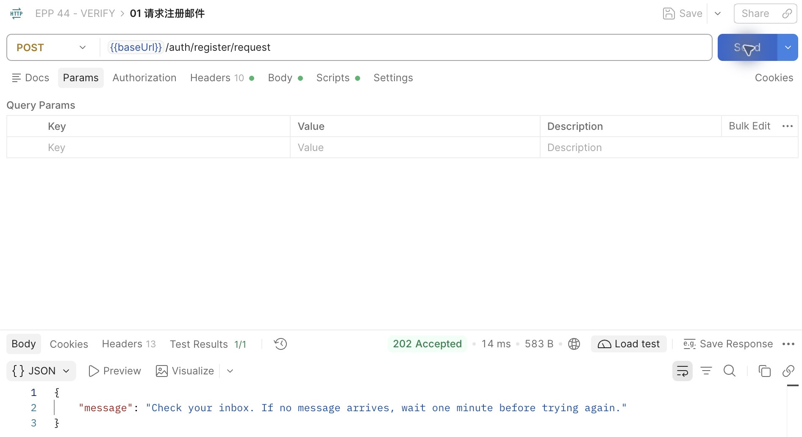
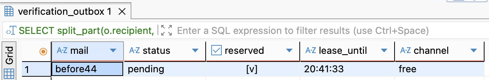
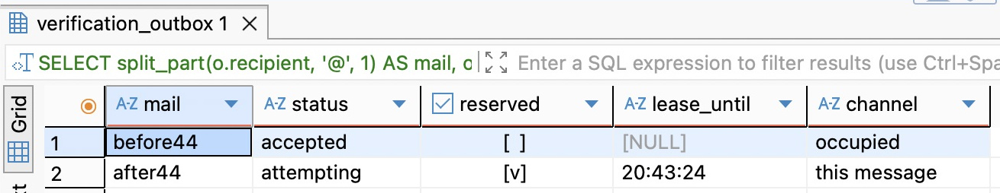
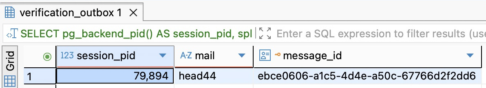
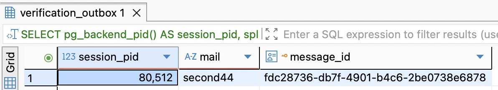
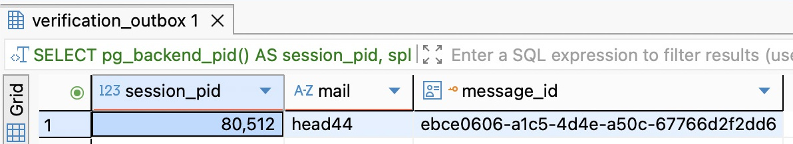

# 第 52 章　安全领取任务与识别过期执行者

启动两个寄信进程。A 领到消息 M，笔记本随即合盖；B 在另一台机器上继续工作。三十秒后，B 还没看见结果。它应不应该接手？还少一个事实：A 合盖前，最后一次数据库提交允许它做什么？如果只是预订了一项工作，B 可以替它做；如果 A 已经拿到了能寄出去的信，B 就不能凭着一只走过三十秒的钟断言收件箱还是空的。

从[第 51 章的程序](https://github.com/SamChowRock/epp-public/tree/part-06/chapter-51)继续。保留同一张发件箱、同一个邮件通道和原来的注册／重置接口。本章让不同进程能分别领取工作，失去资格的进程不能覆盖新结果；真正越过 SMTP 边界时，仍沿用前章“一次最多一封结果待定”的约束。跟做需要 PostgreSQL 18、用于 API 的终端、两个执行者终端、DBeaver、Postman 和只接练习信的本机 Mailpit。

阅读约 55～70 分钟；实现、迁移与双执行者实验另加 80～105 分钟（按代码、查询和两次现场暂停估算）。

## 52.1 增加一个执行者以前先算哪笔账

沿前章的 Worker 循环走一轮：有工作就立刻处理下一条，空队列才睡一秒。若一封信从准备到回写用 200 毫秒，持续有积压时，单个进程每秒大约处理五封，而不是一封。反过来，十个空闲进程即使一封也没寄，每秒仍约有十次巡视，每轮还有连接、事务和查询成本。轮询间隔主要影响从空闲到发现工作的等待，缩短它不会让 SMTP 的应答变快。这是算例，不是邮件系统的测速结果。若请求在下一次巡视前均匀到达，一秒间隔的平均额外等待才接近半秒；停发、慢查询或排队时不适用。

一次取十条和同时寄十封也不同。如果每封花四秒，串行处理第十封前已经过了三十六秒。给整批从领取时算起的三十秒资格，第十封还没动就到期了。改成十个并发 Promise，又得回答供应商允许几个并行连接、第一封应答不明时还有几封已发出，以及后面的信能不能先于前面的到。批量领取可以省往返，大批次也会把本可让别人做的工作藏在本进程手里。先量**最老的可领工作已等多久**、外部调用耗时和空查比例，再决定加并发、调间隔还是改索引。连接池上限是另一个数：每个进程的池分别计数；加进程时要把 API 和 Worker 的预算加在一起。

所以这次把两个数都定为一：每轮只预订一行，每个进程一次只处理一个领取。允许两个进程争用队列，不承诺寄信吞吐翻倍。前章的通道在“准许触碰邮件服务器”这一刻仍只放过一封；若确定瓶颈在 SMTP，要增加同时在途的封数，就得重新设计如何保存多封未知结果，不能直接删掉那一行通道控制。

## 52.2 让一次领取有独立的身份和期限

消息 M 的 ID 从入队起就不变。A 第一次领 M、A 重启后再领 M、B 替 A 领 M，却是三次不同的授权。给每次领取生成一个新的随机 UUID，叫作 claim_id；同时用数据库的钟写下它到什么时候有效，叫作 lease_until。这一对就是**租约**。它不像数据库行锁那样随事务提交自动消失；进程断电后，其他人仍能看见它。反过来，时间到了也不会有人自动执行一条 UPDATE。下一次巡视会用时间条件判断能不能领取，并用新身份替换旧身份。

第一步只改结构，不开任何发送者。停掉旧 Worker、开发 watcher 和手动寄信程序，暂停对练习库的写入；按[第 25.3 节的归档和独立恢复步骤](../../part-04-consistency/chapter-25-revisions/chapter.md#先备份再在另一个库恢复一次)建一个**非空第 51 章 VERIFY 副本**，下文以建库时取的名字 epp_ch44_verify 为例。要看到升级的意义，可以先在原练习环境里用两个虚构地址留下一个已接受和一个待发消息，再做备份。第 51 章已有故障现场也可以原样带来，不要为了迁移先清故障。若从前章逐文件跟写，先从本章配套取 `database/chapter-44/` 下的观察 SQL、计划 SQL 和互动脚本，按原相对路径保存；这些实验文件不改变应用。DBeaver 连副本，运行配套 `database/chapter-44/01-observe.sql` 最前面三条 SELECT，保存库名、按 ID 排序的旧行和 paused_by；余下查询用到新列，现在还不能执行。

在配套项目根目录沿用 Node 24.22.1 和原锁文件，运行 `npm ci`。新建 `prisma/migrations/20261109030000_verification_claim/migration.sql`（下方为全文）。旧列 status 的词汇没有增加：pending 可以没人领，也可以正由某人准备；attempting 则已取得进行外部发送的许可。两个新列须同空同有，终态不能带一份可用租约。允许 attempting 的两列为空，是为了保留旧分支留下的事实。

```sql
BEGIN;
SET LOCAL lock_timeout = '2s';
ALTER TABLE public.verification_outbox
  ADD COLUMN claim_id uuid,
  ADD COLUMN lease_until timestamptz(3),
  ADD CONSTRAINT verification_outbox_claim_pair CHECK (
    (claim_id IS NULL AND lease_until IS NULL) OR
    (claim_id IS NOT NULL AND lease_until IS NOT NULL AND status IN ('pending','attempting'))
  );
CREATE INDEX verification_outbox_pick_idx ON public.verification_outbox
  (COALESCE(lease_until, available_at), id) WHERE status = 'pending';
COMMIT;
```

新索引里时间和身份的顺序会在 52.5 拆开看。跟写时在 `prisma/schema.prisma` 的 VerificationOutbox 模型追加两项，原有普通索引保留。带表达式的部分索引与 CHECK 由刚才的 SQL 维护；不要仅靠模型外观判断数据库已有它们。

```prisma
claimId    String?   @map("claim_id") @db.Uuid
leaseUntil DateTime? @map("lease_until") @db.Timestamptz(3)
```

将 `.env.database-verify` 的 DATABASE_URL、`.env.test` 的 TEST_DATABASE_URL、`.env.worker` 的 DATABASE_URL 分别设到本轮副本（Worker 样例沿用第 51 章，改库名和凭据）。在项目根目录运行：

```bash
unset DATABASE_URL SHADOW_DATABASE_URL TEST_DATABASE_URL DB_QUERY_DEBUG
verify_db=epp_ch44_verify
node --env-file=.env.database-verify scripts/deploy-verify.mjs deploy "$verify_db"
npm run db:verify -- migrate status
npm run check
```

脚本先在实际连接上查库名，与独立传入的名字比较。若不一致，先改配置，不要把参数改成错误连接报出来的库名。新建且 public 为空的专用库可把 deploy 换成 bootstrap，脚本会先用旧迁移建基线，再部署全目录。空库第一次练习没有旧邮件可比较；不要在非空库使用 bootstrap。这里可以停下：核对升级前查询的结果逐行未变，升级后的所有旧行 reserved 为 false、lease_until 为空，原通道若被占用还指向原消息。此时还不启旧程序；它写回时只认消息 ID，不会尊重新租约。

## 52.3 把准许发送和准许写回分开检查

先看两个相邻的瞬间。A 在事务里锁住 M，还没提交；此时 B 也来挑第一行。如果 B 等 A，队头一条慢工作就可能让后面的空闲执行者都干等。指定 `FOR UPDATE SKIP LOCKED` 后，B 会跳过此刻被别的事务锁定的候选，从其余可见行里挑一条；若只指定 M 这个 ID，就会挑不到。A 提交后行锁释放。此时拦住 B 的**已经不是行锁**，而是已经提交到 M 上、尚未到期的 lease_until。也可以用带旧状态条件的 UPDATE 竞争同一条消息，检查受影响行数决定赢家；只知道具体 ID 时这很直接。这里还要求避开正在被锁的队头并挑下一项，才用跳锁选行。若先普通 SELECT 再无条件 UPDATE，两个进程可能先后覆盖同一份预订；若只上行锁，事务结束后则没人知道谁拿走了工作。

新增 `src/verification-claim.ts`。先把通道状态读成一个一致的结果：空闲为 open；被有未到期租约的 attempting 占用为 busy；其他占用均为 paused。busy 的意思只是“仍在允许执行的时间内”，不能证明持有者真的活着。下面是这个文件的完整实现：

```ts
import { randomUUID } from 'node:crypto';
import type { DatabaseService } from './database.service.js';
import type { Prisma } from './generated/prisma/client.js';

export type Claim = { id: string; claim_id: string };
type Tx = Prisma.TransactionClient;

// The first read avoids claiming work behind a stopped channel. Preparation checks
// again under the singleton lock. A busy live sender is not a persistent incident.
export async function channelState(tx: Tx, lock: boolean) {
  if (lock) await tx.$queryRaw`SELECT id FROM public.verification_mail_control WHERE id=1 FOR UPDATE`;
  const [row] = await tx.$queryRaw<{ state: 'open' | 'busy' | 'paused' }[]>`
    SELECT CASE WHEN c.paused_by IS NULL THEN 'open'
      WHEN o.status='attempting' AND o.lease_until > clock_timestamp() THEN 'busy'
      ELSE 'paused' END AS state
    FROM public.verification_mail_control c
    LEFT JOIN public.verification_outbox o ON o.id=c.paused_by WHERE c.id=1
  `;
  if (!row) throw Error('MAIL_CONTROL_MISSING');
  return row.state;
}

export async function claimOne(database: DatabaseService, messageId?: string) {
  return database.client.$transaction(async tx => {
    const state = await channelState(tx, false);
    if (state !== 'open') return state;
    const token = randomUUID();
    const [job] = await tx.$queryRaw<Claim[]>`
      WITH pick AS (
        SELECT id FROM public.verification_outbox
        WHERE status='pending' AND COALESCE(lease_until, available_at) <= statement_timestamp()
          AND (${messageId ?? null}::uuid IS NULL OR id=${messageId ?? null}::uuid)
        ORDER BY COALESCE(lease_until, available_at), id LIMIT 1 FOR UPDATE SKIP LOCKED
      )
      UPDATE public.verification_outbox o SET claim_id=${token}::uuid,
        lease_until=clock_timestamp()+interval '30 seconds'
      FROM pick WHERE o.id=pick.id RETURNING o.id, o.claim_id
    `;
    return job ?? 'empty';
  });
}
```

pick 在库内按“下次可领的时刻、消息 ID”排列。尚未领取用 available_at，已领取用 lease_until。新领取只会发生在已经到期可做的任务上，所以后者可以作为下一次可领时刻。固定的 statement_timestamp() 给本条扫描一条界线；拿到行后用 clock_timestamp() 从当时起算三十秒。两个 Worker 的笔记本不用校对各自的 Date.now()。数据库使用的仍是墙上时钟；若系统时钟大幅向前或向后调整，接手可能过早或延后。身份检查与外部停发边界仍不能省。稳定的排序让没有竞争时的挑选可预测，跳锁意味着队头仍可能被越过；这里没有承诺严格先入先出。最后的 UPDATE 与选行同一条语句，返回的新 claim_id 才是调用者之后要带回的身份。空结果只说明这次没领到；可能队列空，也可能任务未到期、正在被锁，或指定的 ID 已经处理过。

此时单独运行 `npm run check` 可以编译新的领取模块，但旧发送入口还没有切换。接着替换 `src/verification-outbox.ts` 中原来包含整段逻辑的 sendOne。先看 prepare：它在一个短事务里重查通道并锁住控制行，接着锁消息和业务意图。首次巡视与这里的最终授权之间，别的进程完全可能已经开始寄信。若通道忙，归还自己的预订；若 B 已接手，A 不能替 B 归还。以下代码直到返回之前均未调用 SMTP。

```ts
import type { DatabaseService } from './database.service.js';
import type { RecoveryPurpose } from './recovery-contract.js';
import type { VerificationDelivery } from './verification-delivery.js';
import { issueToken, tokenDigest } from './token.js';
import { channelState, claimOne, type Claim } from './verification-claim.js';

type Job = { id: string; intent_id: string; generation: string; recipient: string; purpose: RecoveryPurpose };

async function prepare(database: DatabaseService, claim: Claim) {
  return database.client.$transaction(async tx => {
    const state = await channelState(tx, true);
    if (state !== 'open') {
      // Return only our own reservation; a successor may already hold this row.
      const held = await tx.$queryRaw<{ id: string }[]>`SELECT id FROM public.verification_outbox
        WHERE id=${claim.id}::uuid AND status='pending' AND claim_id=${claim.claim_id}::uuid
        FOR UPDATE SKIP LOCKED`;
      if (!held.length) return state;
      await tx.$executeRaw`UPDATE public.verification_outbox SET claim_id=NULL, lease_until=NULL
        WHERE id=${claim.id}::uuid AND status='pending' AND claim_id=${claim.claim_id}::uuid AND lease_until > clock_timestamp()`;
      return state;
    }
    const [job] = await tx.$queryRaw<Job[]>`SELECT id,intent_id,generation,recipient,purpose
      FROM public.verification_outbox WHERE id=${claim.id}::uuid AND status='pending'
        AND claim_id=${claim.claim_id}::uuid FOR UPDATE`;
    if (!job) return 'stale';
    await tx.$queryRaw`SELECT id FROM public.verification_intents WHERE id=${job.intent_id}::uuid FOR UPDATE`;
    // Recheck the database clock AFTER any wait for the intent row.
    const marked = await tx.$executeRaw`UPDATE public.verification_outbox SET status='attempting'
      WHERE id=${job.id}::uuid AND status='pending' AND claim_id=${claim.claim_id}::uuid
        AND lease_until > clock_timestamp()`;
    if (!marked) return 'stale';
    const token = issueToken();
    const [window] = await tx.$queryRaw<{ issued_at: Date; expires_at: Date }[]>`
      UPDATE public.verification_intents SET token_digest=${tokenDigest(token)}
      WHERE id=${job.intent_id}::uuid AND token_digest=${job.generation}
        AND email=${job.recipient} AND purpose=${job.purpose}
        AND consumed_at IS NULL AND expires_at > clock_timestamp() RETURNING issued_at, expires_at
    `;
    if (!window) {
      await tx.verificationOutbox.update({ where: { id: job.id },
        data: { status: 'obsolete', claimId: null, leaseUntil: null } });
      return 'obsolete';
    }
    await tx.verificationMailControl.update({ where: { id: 1 }, data: { pausedBy: job.id } });
    return { job, token, window };
  }, { maxWait: 2000, timeout: 5000 });
}
```

看 marked 的位置：A 可能在意图行上等过锁。即使进事务时还剩 100 毫秒，轮到它也可能已过期。因此在等待结束后，数据库同时检查消息、当前身份、pending 和数据库时钟。更新零行就返回 stale，不生成新令牌、不动收件人。如果业务意图本身已被替换或过期，即便 A 有效也不能寄旧信；事务把消息记作 obsolete。只有意图仍匹配，才把令牌摘要、attempting 和全通道占用一起提交。邮件明文令牌只交给本次发送，不写进领取字段。

接下来才在事务外寄信。finish 取得通道锁和消息锁后，再检查一次资格；检查时刻是取得锁之后、决定写入之时，不是说事务必须在截止时刻前完成刷盘。把这段紧接在 prepare 后面：

```ts
async function finish(database: DatabaseService, claim: Claim, result: 'accepted' | 'unknown') {
  return database.client.$transaction(async tx => {
    const [channel] = await tx.$queryRaw<{ paused_by: string | null }[]>`
      SELECT paused_by FROM public.verification_mail_control WHERE id=1 FOR UPDATE`;
    if (channel?.paused_by !== claim.id) return 'lost-after-send';
    // Lock first: a wall-clock predicate evaluated before a lock wait is insufficient.
    await tx.$queryRaw`SELECT id FROM public.verification_outbox WHERE id=${claim.id}::uuid FOR UPDATE`;
    const count = await tx.$executeRaw`UPDATE public.verification_outbox
      SET status=${result}, claim_id=NULL, lease_until=NULL
      WHERE id=${claim.id}::uuid AND status='attempting'
        AND claim_id=${claim.claim_id}::uuid AND lease_until > clock_timestamp()`;
    if (count !== 1) return 'lost-after-send';
    if (result === 'accepted') {
      await tx.verificationMailControl.update({ where: { id: 1 }, data: { pausedBy: null } });
    }
    return result;
  });
}

export async function deliverClaim(database: DatabaseService, delivery: VerificationDelivery, claim: Claim) {
  const prepared = await prepare(database, claim);
  if (typeof prepared === 'string') return prepared;
  const { job, token, window } = prepared;
  let outcome: 'accepted' | 'unknown' = 'accepted';
  try { await delivery.send(job.recipient, job.purpose, token, window.issued_at, window.expires_at); }
  catch { outcome = 'unknown'; }
  return finish(database, claim, outcome);
}

export async function sendOne(database: DatabaseService, delivery: VerificationDelivery, messageId?: string) {
  const claim = await claimOne(database, messageId);
  return typeof claim === 'string' ? claim : deliverClaim(database, delivery, claim);
}
```

在 `src/database.service.ts` 的 Worker 启动探测中，把 outbox 的 `SELECT … LIMIT 0` 列表加上 claim_id、lease_until，避免连到旧结构后才在第一封上报错。改 `src/mail-worker.ts` 的循环：empty 或 busy 均可中断地睡一秒再查；stale 表示尚未发送即失权，结束这次处理；unknown、paused、lost-after-send 都记警告并退出 2。`src/send-one.ts` 仍只做一次，后三种同样退出 2。重新 `npm run check`，后面的实验用这次生成的 dist；改过 TypeScript 后不要继续用旧产物。

为什么一封已经被 SMTP 接受的邮件还可能让 Worker 退出 2？finish 更新零行，意思是“我无权登记这个结果”，不是“邮件已撤回”。盲目再写一次 accepted 会掩盖接管或人工处置，盲目重新寄信可能让收件人收到两封。数据库能拒绝写回，不能让一个已拿到明文令牌、正暂停在网络调用前的旧进程失去发包能力；因此从 attempting 起就不按超时自动重新投递。

## 52.4 让 A 在两处停下来

先在 DBeaver 单独执行 `SELECT paused_by FROM public.verification_mail_control WHERE id=1`。以下两轮以**有一行且值为 NULL**为起点。若从第 51 章带来非空占用，先保留现场：在所有发送者确实停止、核对旧信和目标库后，用前章 02-resume.sql 按旧事故 ID 放行；若尚不能确认，就保留这个副本，另建本章空 VERIFY 做实验。查不到控制行则查迁移，不要手工补一行。让 Mailpit 在本机 1025 接收、8025 显示邮件；停止所有持续巡视本库的 Worker，否则我们还没按下 Enter，它就可能替 B 做了工作。数据库保持运行。若还有指向前章的练习 API，先退出；在 API 终端的项目根目录启动本章版本：

```bash
unset DATABASE_URL TEST_DATABASE_URL APP_ORIGIN PORT DB_QUERY_DEBUG
NODE_ENV=development node --env-file=.env.test --input-type=module -e '
process.env.DATABASE_URL = process.env.TEST_DATABASE_URL;
const { withVerifiedDatabase } = await import("./scripts/verify-database.mjs");
await withVerifiedDatabase(process.argv[1]);
process.env.PORT = "3360";
process.env.APP_ORIGIN = "http://127.0.0.1:3360";
process.env.DB_QUERY_DEBUG = "false";
await import("./scripts/dev.mjs");' epp_ch44_verify
```

在 Postman 导入沿用的 `requests/chapter-43.postman_collection.json`，baseUrl 指向上述 API，在本地把 email 改成一个没用过的虚构地址，例如 before44@example.test。只单发「01 请求注册邮件」，先看 Postman 的响应。



图 52-1　上方确认路径是 /auth/register/request，下方的 202 Accepted 表示接口已受理申请。它和发件箱的 accepted 不是一回事：截图这次请求之后，数据库里是 register、pending，还没有租约。判断有没有入队要查数据库，判断本地 SMTP 有没有收到则要看 Mailpit。

在 DBeaver 打开 01-observe.sql 的状态明细，按收件人、用途和本轮时间找到 pending 行，复制其 **id**。不要取业务意图 ID，也不要把邮箱本身当作消息身份。若重复使用地址，冷却期内 202 不一定新增一行；旧版本的业务意图也可能很快失效。每轮换新地址更容易分清。

race.mjs 的核心是下面这段（省略参数检查、核库与关闭连接）。before 暂停时数据库已经提交领取；after 暂停时底层 smtp.send 已经返回，外层 deliverClaim 却还没得到返回值。这就是为什么两处按 Enter 会有不同后果。

```js
const claim = await claimOne(db, id);
if (typeof claim === 'string') console.log(claim);
else {
  console.log('reserved', claim.id);
  if (mode === 'before') await pause('claimed, before preparation');
  const result = await deliverClaim(db, { async send(...args) {
    await smtp.send(...args);
    if (mode === 'after') await pause('SMTP accepted, before database writeback');
  } }, claim);
  console.log(result);
}
```

在另外两个终端 A、B **分别**切到项目根目录，各执行一次下面的准备；两个 message_id 填同一个真实值。配套 `database/chapter-44/race.mjs` 用刚构建的 claimOne 和 deliverClaim，只把等待放进这个实验入口。它不会加载 HTTP，也不向队列写虚构的完成结果。

```bash
unset DATABASE_URL DB_POOL_MAX DB_QUERY_DEBUG LOCAL_SMTP_PORT LOG_LEVEL
verify_db=epp_ch44_verify
message_id='替换成本轮消息的 UUID'
race() {
  node --env-file=.env.worker database/chapter-44/race.mjs "$verify_db" "$message_id" "$1"
}
```

**先在发信前暂停。** A 执行 `race before`，看到 `claimed, before preparation` 就停手。DBeaver 刷新查询，仍是 pending，但 reserved 为 true、有截止时间，控制行的 paused_by 为 NULL（图 52-2）。趁未到期，B 执行 `race now`，得到 empty。现在不动 A，也不改任何数据库时间；等到新的查询显示 observed_at 超过 lease_until，再让 B 执行同一个命令。B 打印 accepted；此时才回到 A 按 Enter。A 得到 stale。刷新同一消息：accepted、无租约、通道空闲。在 Mailpit 搜索 `to:before44@example.test`，应只见这一轮的一封信。若首次在 B 查询时已经超过截止时刻，它会直接处理；要观察前半步，用新地址再来一轮即可。若 A 在这个暂停点直接退出，数据库不再等它发“归还”通知；只要仍是 pending，也按同一截止时间接续。



图 52-2　A 刚暂停时，before44 的 reserved 已勾选，channel 却是 free：A 已领到任务，还没占用发送通道。要复现图中的列，执行 01-observe.sql 最后一条查询；换过地址就替换查询中的收件人。图中截止时间只显示时分秒，判断是否过期要用明细里的完整 lease_until 和 observed_at。

**让接受邮件发生在暂停之前。** 再用 01 和新地址 after44@example.test 入队，把 A、B 两个终端的 message_id 都换成新 ID。A 执行 `race after`，看到 `SMTP accepted, before database writeback` 后暂不按 Enter。与上一轮相比只有暂停位置变了，此时 Mailpit 已有信，库中却是 attempting，paused_by 指向它。再用新的 tail44@example.test 入队一条（只发 01）；它将成为后面判断有无误伤的参照。B 用当前 after44 的 ID 在有效期内运行 `race now` 得到 busy。过期后再运行则为 paused；在 B 中把 message_id 改为 tail44 那条，再执行 `race now` 应仍为 paused；保留这个值供放行后使用。现在 A 按 Enter，返回 lost-after-send。数据库保持 attempting 和原占用，后来那条仍是 pending。这里用两个前台进程就能改变时序，不需要在代码里插一段每次都会执行的 sleep。



图 52-3　A 停在 SMTP 接受之后。对照两行的 channel：after44 的 this message 表示通道指向这一行；before44 的 occupied 表示通道被另一封信占用。两行读的是同一个通道，先前已 accepted 的 before44 没有重新发送。


图 52-4　Mailpit 搜索栏按收件人筛选，右上角是匹配数。这张图取自另一次相同实验。自己跟做时，在 A 仍暂停时核对本轮信箱和图 52-3 所示的数据库行：**一封已收、数据库仍是 attempting** 是可以同时成立的。本机收件器看到这封信，不能推出真实用户已读、令牌已消费，或其他消息都只发了一次。

```text
                        A 停在领取之后                 A 停在 SMTP 接受之后
数据库留给 B 的事实      pending + 有期限的预订          attempting + 通道占用
到期后 B 的动作         换领取身份，可以准备发送         保持停发，不再寄这封
A 恢复时                准备被拒，未碰 SMTP             回写被拒，无法撤销已寄邮件
```

若中途离开，先查 id、status、截止时间、paused_by 和 Mailpit，再决定从哪一步恢复。尤其不能把“时间已过”当作旧进程已终止：一个暂停的 A 仍可能继续执行。先让 A 完成或停止，停掉所有本库的发送入口并确认不会被 watcher 再拉起；查清本地 SMTP 可用、核对故障消息后，才允许**后来**的工作继续。用 `database/chapter-43/02-resume.sql` 的 SELECT 核对现场，把 UPDATE 中的库名改为建库时的 epp_ch44_verify、占位 UUID 改为刚核对的故障消息 ID。UPDATE RETURNING 一行并已提交才是放行；零行不放宽 WHERE，回去查哪项变了。用 B 对 tail44 的 ID 执行 `race now` 应得到 accepted；after44 仍为 attempting，不能将它改回 pending。第一次实验里 B 已正常寄完并释放通道，无须人工放行。

这次人工决定有两个对象。after44 的租期只能判定谁有资格回写；保留它的 attempting 能阻止重寄。tail44 能否寄取决于这次事故是否仍影响同一通道。前面用 Mailpit 查到了 after44，受控地结束了旧执行者，才单独尝试 tail44。如果换成中继刚刚掉线、其他收件人也在等同一中继，就应先查共享服务。在这两种现场中，after44 都可以保持原样，后来工作的处置却不同。

**换成一次 AI 调用，证据还够吗？** 假设将来队列里有“为修订 R 生成候选”。如果耗时都在本地纯计算，A、B 可能各算一次，但可令“仍持有领取资格”和“写入候选”在同一个数据库事务中成立；A 的迟到结果不会污染 R。如果计算改为由外部模型提供，B 抢回本地行不等于取消 A 已经提交的推理。即使候选表最终只有一行，账单仍可能有两笔。要知道能否补调用，应查供应商有没有**按同一个业务请求身份**去重或查询已受理结果的契约、涵盖多久、哪一步计费。用每次都变的 claim_id 当跨次去重键，恰好会把同一业务需求说成两笔新请求。没有这样的外部证据，只能记录“已准许调用、结果待核”，不能把邮件练习的 accepted 搬来当作候选已保存或只扣过一次费。本章没有接入模型供应商。

## 52.5 看懂领取索引和被锁的队头

打开 `database/chapter-44/02-plan.sql`，在 VERIFY 的**同一个** DBeaver 编辑器按顺序执行全部语句。脚本把二万条已处理和十条到期待办放进事务内的临时表；不会给发件箱塞二万封信。三次查询都取最早能领的一条，分别在无索引、只有前章形状的索引、再加上本章部分表达式索引后执行。若中途出错，先在同一连接执行 ROLLBACK，再从 BEGIN 开始。不要把 EXPLAIN ANALYZE 随手加在正式领取 UPDATE 前，它会实际执行更新。

查询里真正要排序的是 `COALESCE(lease_until, available_at), id`。假如最旧邮件被领到明天，它原来的 available_at 仍比其他工作早，用旧字段排队就不能直接得到此刻最适合处理的那条。新索引只收 pending，索引里的第一列保存与查询相同的表达式；未来时刻仍在索引里，查询用当前时刻作范围上界。不要用“现在是否已到期”作建索引时的固定条件，即使没有人更新行，这个答案也会随时间改变。

```sql
EXPLAIN (ANALYZE, BUFFERS)
SELECT id FROM claim_plan
WHERE status='pending'
  AND COALESCE(lease_until, available_at) <= statement_timestamp()
ORDER BY COALESCE(lease_until, available_at), id
LIMIT 1 FOR UPDATE SKIP LOCKED;
```

从结果树底部往上看。上述分布在一次 PostgreSQL 18 运行中，无索引的 Seq Scan 丢掉了 20000 行；旧形状的 plan_ready 用 status 找出 10 行，但上方还有 Sort；加 plan_pick 后，Index Cond 已带上截止时刻，扫描实际给上层一行，上面是 LockRows 和 Limit，没有 Sort。这里演示的是常驻 Worker 不指定 ID 的查找；用主键指定一封时，计划可能直接用主键索引。对很小的真表，顺序扫几页完全合理。观察节点、实际行数和缓冲页比抄某台机器的毫秒数有用。代价也真实存在：领取会改变索引键，完成会把行移出部分索引；建索引时还要考虑锁和写入流量。本章在停发送者和写入的副本上建普通索引，不把这一步当作大队列不停机上线方案。

**让两个事务同时挑队头。** 停 Worker，确认通道空闲，借 01 创建两个全新地址的 pending。在 DBeaver 给 VERIFY 开两个独立连接，在各自编辑器选手动提交（各查一次 `SELECT pg_backend_pid()`，PID 必须不同）；用观察查询确认这两行的 ID 和排序。下面的示例在各自会话中把两个占位值换成实际 UUID。A 单独执行 BEGIN，再执行第一段 SELECT，记住返回的 ID，保持事务打开。B 在自己的事务中执行同一段 SELECT。这里显式限定两行，避免队列里其他合法旧样本干扰判断。

```sql
BEGIN;
SELECT pg_backend_pid() AS session_pid, split_part(recipient, '@', 1) AS mail, id AS message_id
FROM public.verification_outbox
WHERE id IN ('第一条的UUID'::uuid, '第二条的UUID'::uuid)
  AND status='pending' AND COALESCE(lease_until,available_at) <= statement_timestamp()
ORDER BY COALESCE(lease_until,available_at),id LIMIT 1 FOR UPDATE SKIP LOCKED;
-- A、B 都执行到这里，先不要提交。
```



图 52-5　A（PID 79894）取到 head44。保持事务打开；现在切到 B，在它自己的编辑器里运行同一查询。



图 52-6　B（PID 80512）取到 second44。两张图的 PID 不同，返回的 message_id 也不同。你本机的 PID 和 UUID 会不同，核对它们之间的关系即可。

B 应立即拿到另一行。若两边都拿到第一行，检查 A 是否已经自动提交或两个 PID 是否相同。先在 B 的编辑器执行 ROLLBACK，再切到 A。确认活动连接名确实是 A，再执行 ROLLBACK。回到 B，用新的事务重新执行同一查询；若仍取到第二行，先确认 A 的事务确实已结束，不要把结果网格里的旧行当作新查询。最后在 B 执行 ROLLBACK。



图 52-7　B 仍是 PID 80512，返回的 message_id 却与图 52-5 中 A 的相同。回滚释放了队头的行锁，原有的排序没有改变。

这次实验看见的是两段事务真实重叠时的**跳过**，不是有人在等锁；SELECT 并没有写 claim_id，回滚后两个任务仍可处理。若 B 查的是 `count(*)`，它仍可能看到两条到期待办，因为普通计数不探测别人的行锁。因而积压图里的 due 是“时间和状态符合”的数量，不是保证下一次能成功领取的数量。长时间积压还要同时查通道占用、Worker 日志以及最老的 available_at；旧行一直被跳过时，先定位持锁事务，盲增执行者可能只会多几次空查。

## 52.6 在旧库上完成交接

回到升级前保存的结果。数据库增加的是两列可空字段和一个新索引，并没有把历史状态重命名为“新”。逐个旧消息 ID 比较：尚待发送的 pending 初始无租约，只有实际运行新 Worker 才会取得领取资格；accepted、obsolete、unknown 与 attempting 都不在领取查询中。旧的 attempting 即使没有 claim_id，也不应该为了“填齐新列”生成一份身份；那会冒称我们知道先前由谁执行。旧 paused_by 非空时，先按 52.4 核对原事故，不能只因为升级完成就放行。旧业务意图、账户、已签发令牌的有效期和 API 响应契约均不因迁移改变。

恢复日常跟做前，在 DBeaver 刷新 01-observe.sql，确保**所有**到期待办都属于这次本机实验。无 ID 的 Worker 会继续处理整个 VERIFY。若一条 pending 在获准发送前等得太久，业务意图过期，下一次准备应当得到 obsolete；租约过期而意图仍有效，才可能接手并寄出。已是 attempting 的消息不会走这条作废路径。这是两只含义不同的钟。已被替换的旧意图同样不能再发。只要通道仍处于正常工作状态，启动开发入口即可：

```bash
unset DATABASE_URL DB_POOL_MAX DB_QUERY_DEBUG LOCAL_SMTP_PORT LOG_LEVEL
npm run dev:worker -- epp_ch44_verify
```

API 的 Inspector 是 9229，Worker 的是 9230。先等前面的练习信处理完、通道空闲。在 VS Code 的“运行和调试”选择 `EPP: attach to mail worker`，在 deliverClaim 的 `await prepare(...)` 和 `return finish(...)` 两行加断点，再用新地址发 01。第一次暂停时刷新 DBeaver，按新地址查到 pending 且 reserved；继续到第二处，同一行应为 attempting。三十秒从领取时就开始算，不会因第一次按了继续而重置；若想看到两处，应在未到期时继续。若已超时导致 stale，移除第一个断点，让进程接手后再观察第二处。移除断点、继续并断开；若留下占用，先按 52.4 查清并放行，再重启 Worker。最后用全新地址正常寄一封作为对照。想在同机再开一个长期执行者，用已构建的入口；两份 dev watcher 共用输出目录和 9230，并不是两个彼此独立的调试环境。用完先关本轮进程，再关闭 Mailpit。

正式产物仍是在干净目录放 dist、package.json、package-lock.json 和 .npmrc 后 `npm ci --omit=dev`。分别注入 API 和 Worker 原有配置；Worker 用 `NODE_ENV=production node --enable-source-maps dist/src/mail-worker.js 预期库名`，不运行 race.mjs，不启 Inspector。应用升级要先演练非空副本，协调停旧发送者、备份、迁移、核对旧行和通道、再启动新版本；同时运行只认消息 ID 的旧执行器和校验领取身份的新执行器，无法兑现本章保证。若需退回旧版，先停止所有新执行者并查清在途与故障消息；仅切 Git 分支不会让数据库和外部邮件倒回去。

本章代码分支为 `part-06/chapter-52`。现在能识别两种看起来同样“没有完成”的现场：一种可由 B 接手，另一种连 A 自己也不能再写回。第 53 章继续处理后一类问题：哪些失败可以重试，哪些必须先查对方的记录。

## 本章支线

[支线 52A　工作超过租期：续租和围栏各自保护什么？](side-01-fencing.md)

## 附录：本章必要技术点速查

| 名称 | 本章用法 | 容易误判的地方 |
| --- | --- | --- |
| FOR UPDATE SKIP LOCKED | 在一个短事务里锁住可领的一行，跳过已被行锁挡住的候选 | 查询不是完整队列视图，不保证公平；提交后靠租约而非旧行锁 |
| claim_id / lease_until | 每次领取换 UUID、用数据库时刻判断当前资格 | 不等于消息 ID、账号、认证令牌，也不等于收件端去重键 |
| statement_timestamp / clock_timestamp | 本次查询的扫描边界／等锁后执行条件更新时的钟 | 事务起始时间不能替代等锁后的判断 |
| busy / paused | 通道占用仍在有效窗口／占用需要核查 | 观察到 busy 不能证明进程活着；paused 不能证明没有寄到 |
| stale / lost-after-send | 准备前失权／外部动作后不再有资格记账 | 都不能用强制 UPDATE 修补 |
| EXPLAIN (ANALYZE, BUFFERS) | 对照扫描方式、排序、锁行和实际行数 | ANALYZE 真执行；临时样本的耗时不能当生产容量 |

PostgreSQL 18：[SELECT 的行锁与 SKIP LOCKED](https://www.postgresql.org/docs/18/sql-select.html#SQL-FOR-UPDATE-SHARE)、[数据库的几种当前时刻](https://www.postgresql.org/docs/18/functions-datetime.html#FUNCTIONS-DATETIME-CURRENT)、[部分索引](https://www.postgresql.org/docs/18/indexes-partial.html)、[读执行计划](https://www.postgresql.org/docs/18/using-explain.html)。

[返回第六篇](../README.md) · [全书目录](../../README.md)

[上一章：为什么需要独立 Worker](../chapter-51-worker/chapter.md)

[下一章：失败、重试与未知结果](../chapter-53-retries/chapter.md)
