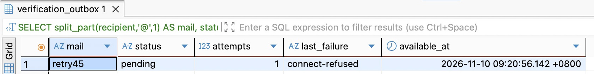
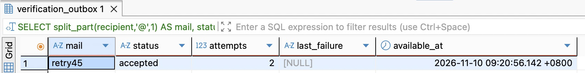
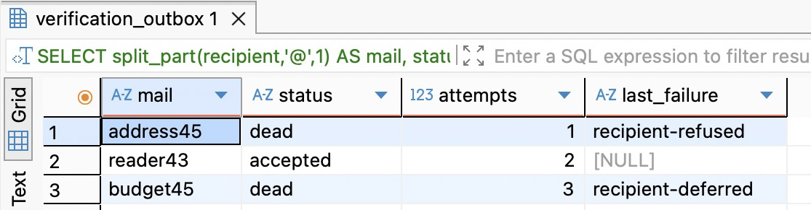
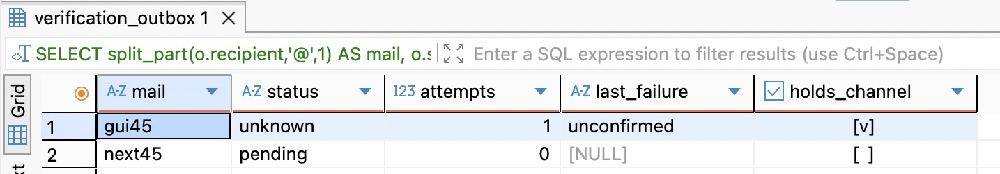
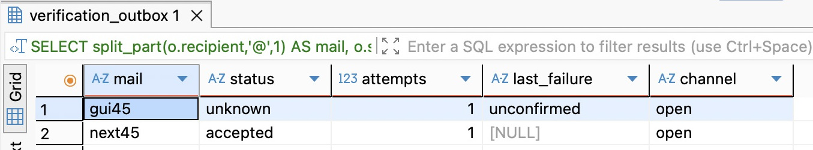

# 第 53 章　失败、重试与未知结果

[第52章](../chapter-52-claims/chapter.md)让两个进程交接同一封信。只要 A 可能已经调用过 SMTP，B 就保留现场。现在把 Mailpit 晚启动六秒。第52章的 Worker 会因第一封信停发，即使几秒后邮箱恢复，第二封仍要等人放行。换一个故障，让 Mailpit 收下第一封信，再切断返回给 A 的连接。此时若一律重寄，用户可能收到两封内容不同的验证邮件。两次实验在应用里都走进同一个 catch，恢复动作却要做出不同选择。

从第52章配套分支 `part-06/chapter-52` 起步，沿用原有注册／重置请求、单收件人和单 SMTP 通道。本章改变 Worker 在失败后允许做的事。先让一条确定可以重做的工作跨重启继续，再让同一个判断经受地址拒收、业务换代和应答丢失。阅读约 45～60 分钟；动手实现、升级和故障实验另加 75～105 分钟。

## 53.1 在哪一步失败才足以决定再寄

想象在 SMTP 服务的另一端看这次会话。客户端先建立 TCP 连接，交代发件人，用 `RCPT TO` 提交收件人；对端允许 `DATA` 后才接收正文，读到单独的一行句点后给最终应答。中间几次 250 各自只回答上一个命令。只有正文结束后的成功应答才表示这台 SMTP 服务器接受了递送责任。邮件是否到了用户收件箱、用户是否用过令牌，还各有自己的证据。

先看三个具体位置：

- 本机目标端口没有监听，系统调用 connect 得到 ECONNREFUSED。连这一次连接都没建成，可以保留这封信，稍后再寄。
- 唯一收件人在 RCPT TO 得到 450，服务端还没有接受这个收件人，可能稍后恢复。若同一步得到 550，原地址或策略被拒绝。继续以相同参数密集尝试没有依据，应结束这条任务，保留供排查的原因。修好地址后由用户重新申请。
- 对端已读到正文结尾，恰好断线。发送方手里既没有肯定应答，也没有明确拒绝；远端可能已保存。看到连接错误、两秒超时或本地日志中缺少 accepted，都不能授权第二次投递。

在 `src/mail-failure.ts` 增加下面的分类函数。项目固定 Nodemailer 10.3.1，只识别本地单收件人 SMTP 实际使用的几种错误形状。查看错误时可看这些字段，避免把原始 response、邮箱和正文写进日志。

```ts
export function classifyMailFailure(error: unknown) {
  if (!(error instanceof Error)) return 'unconfirmed';
  const smtp = error as Error & {
    command?: string; code?: string; originalCode?: string; syscall?: string; responseCode?: number;
  };
  if (smtp.command === 'CONN' && smtp.code === 'ESOCKET' &&
      smtp.originalCode === 'ECONNREFUSED' && smtp.syscall === 'connect') return 'connect-refused';
  // The delivery adapter sends to exactly one envelope recipient.
  const reply = smtp.responseCode;
  if (smtp.code === 'EENVELOPE' && smtp.command === 'RCPT TO' &&
      typeof reply === 'number' && Number.isInteger(reply)) {
    if (reply >= 400 && reply < 500) return 'recipient-deferred';
    if (reply >= 500 && reply < 600) return 'recipient-refused';
  }
  return 'unconfirmed';
}
```

特别留意 `CONN`。库也可能用它描述已经建立的连接意外关闭，单独判断这个字符串会把第三种故障送去重试。这里还要求底层系统码和失败的系统调用相符。在当前发送器中，一封信只有一个信封收件人。Nodemailer 把这次收件人命令的明确负应答包装为 EENVELOPE，command 为 RCPT TO，responseCode 是数值。即使换了某个少见的 4xx 或 5xx，唯一收件人仍被拒，邮件正文没有交付。启用 SMTP 命令流水线的中继可能已收到 DATA **命令**，这与客户端送出邮件**正文**是两步。对于其他 SMTP 错误，如果这些字段不足以判断对端是否接受过正文，就保留现场。

接下来才决定是否值得按原参数再试。4xx 表示暂缓，本章允许有限次退避；5xx 表示此次请求被明确拒绝，结束本条。比如 552 5.2.2 指邮箱超限，终结本轮自动寄送并不等于认定地址不存在。recipient-refused 记录的是收件人命令遭拒；应答原因也可能来自共享中继的策略或配置。单个地址失败时允许后继前进；如果不同地址接连在同一阶段以相同原因失败，或供应商明确通告共享服务故障，应暂停发送者并核对通道。若接入了认证而共享凭据被拒，应先修凭据。

若以后一次发送给三个收件人，第一个被拒、另外两个被接受，按整封信重试会重复投给后两人。那时要按收件人保存成功与拒绝：旧中继还可能用 552 表示一笔接受的收件人太多，按临时失败拆分余下的地址重试。本章每笔只发往一个地址；把这一分支用于群发前，必须重新判断 552 的含义。[RFC 5321 §4.5.3.1.10](https://www.rfc-editor.org/rfc/rfc5321#section-4.5.3.1.10)

此处可在旧工程加入独立分类函数，运行 `npm run typecheck`，旧发送流程尚未接入。

## 53.2 让重试预算和下次执行时间跨过重启

只在内存里数三次，再由进程 sleep 五秒，服务一重启，次数和等待都会归零。这种把相邻尝试逐轮拉开的安排叫退避。第52章已经按数据库的 `available_at` 领取到期工作，也会跳过未到期的租约。复用那条查询，把下一次可领取的时刻写回原消息。等待时间按倍数增长叫指数退避，分散同批任务的随机偏移叫抖动。第1次明确暂时失败，等5秒再加不足2秒的随机量；第2次等10秒再加同样范围的随机量；第3次用尽预算，转 `dead`。这三次包括第一次发送。随机量让一批同时失败的行不必在同一瞬间重新到期。这里的秒数用于短效验证邮件和本机实验，生产通道还要结合供应商节流、用户剩余等待时间与允许的总流量取值。

死信在这里就是停止自动领取、仍能按 ID 查原因的一行。它和 unknown 都不会被领取。dead 有明确的未交付依据，可以让后继通过。新发生的 unknown 会占着前章那条通道，直到有人核对并处置。把二者都转进一个可批量“重跑”的列表，会丢掉最重要的恢复条件。

停止旧 API 写入和所有发送者，包括 dev:worker 的 watcher。将已有验证库备份、恢复到独立的 epp_ch45_verify，方法沿用[第52章的非空升级](../chapter-52-claims/chapter.md#526-在旧库上完成交接)。在 DBeaver 运行配套 `database/chapter-45/01-observe.sql` 的前三条，记下若干不同状态的旧 ID、时间、租约及 paused_by。新建迁移 `prisma/migrations/20261110010000_mail_retries/migration.sql`：

```sql
BEGIN;
SET LOCAL lock_timeout = '2s';
ALTER TABLE public.verification_outbox
  DROP CONSTRAINT verification_outbox_status_check,
  ADD CONSTRAINT verification_outbox_status_check CHECK
    (status IN ('pending','attempting','accepted','unknown','obsolete','dead')),
  ADD COLUMN attempts integer NOT NULL DEFAULT 0 CHECK (attempts BETWEEN 0 AND 3),
  ADD COLUMN retry_digest text CHECK (retry_digest ~ '^[0-9a-f]{64}$'),
  ADD COLUMN last_failure text CHECK (last_failure IN
    ('connect-refused','recipient-deferred','recipient-refused','unconfirmed')),
  ADD COLUMN retain_from timestamptz(3);
-- The exact completion time of a historical row is unknown.
UPDATE public.verification_outbox SET retain_from=statement_timestamp()
WHERE status IN ('accepted','obsolete');
CREATE INDEX verification_outbox_retention_idx ON public.verification_outbox(retain_from,id)
  WHERE retain_from IS NOT NULL;
COMMIT;
```

旧 accepted 和 obsolete 从迁移时刻开始保留；不能从 available_at 倒推准确完成时间。旧 unknown、attempting 继续保留，仍被占用的通道保持原样。旧行上的零表示新预算启用后还没准备过发送，不能拿来证明它历史上没寄过。大库先评估这次 UPDATE、索引构建和 ALTER 共用一个事务的锁与日志成本，需在线升级时拆成渐进部署；练习在停写副本上完成。

在 `prisma/schema.prisma` 的 VerificationOutbox 中追加四个映射字段。CHECK 和部分索引由迁移 SQL 维护。

```prisma
  attempts Int @default(0)
  retryDigest String? @map("retry_digest") @db.Text
  lastFailure String? @map("last_failure") @db.Text
  retainFrom DateTime? @map("retain_from") @db.Timestamptz(3)
```

迁移连接文件 .env.database-verify、API 测试配置 .env.test 和 Worker 的 .env.worker 分别指向同一实验库；API 用 TEST_DATABASE_URL，其余两个用 DATABASE_URL。暂时把 .env.worker 的 LOCAL_SMTP_PORT 设为 1045。独立空库首次运行将下方 deploy 换成 bootstrap。非空库必须保留真实迁移历史，不能用空库引导覆盖。

```bash
unset DATABASE_URL TEST_DATABASE_URL SHADOW_DATABASE_URL DB_QUERY_DEBUG
npm ci
node --env-file=.env.database-verify scripts/deploy-verify.mjs deploy epp_ch45_verify
npm run db:verify -- migrate status
npm run check
```

重查前三条，旧 ID、状态、租约和控制行应与刚才相同。执行后两条观察新字段。若发现旧占用，先按53.5核对；尚不能确认现场时先保存副本，另用独立空 VERIFY 跟做。到这里可以中断，恢复时先看迁移状态和控制行。

## 53.3 第二次执行凭什么还能使用这次申请

第52章在发送前把意图的初始摘要 G 换成刚生成的邮件令牌摘要 T1。假定第一次遇到 450。仅把消息改回 pending，下一轮会拿 G 去和 T1 比较，结果是 obsolete。如果省掉摘要比较，又会闯入另一种错误：退避期间用户已经发起新一轮，旧任务会换掉新一轮的令牌。应当保存的是“上次为这条消息准备的、现在仍预期在意图里的摘要”。下次原子地比较 T1，只有仍是这一代才能换成 T2。重试不延长业务有效期，也不在发件箱里存可使用的明文令牌。

修改 `src/verification-outbox.ts`。在文件顶部加入下面的 import，并更新查询结果的类型。

```ts
import { classifyMailFailure } from './mail-failure.js';

type Job = { id: string; intent_id: string; expected_digest: string; attempts: number; recipient: string; purpose: RecoveryPurpose };
```

在 prepare 里保持第52章的取锁顺序，用下面的投影读取原消息：

```ts
    const [job] = await tx.$queryRaw<Job[]>`SELECT id,intent_id,COALESCE(retry_digest,generation) AS expected_digest,attempts,recipient,purpose
      FROM public.verification_outbox WHERE id=${claim.id}::uuid AND status='pending'
        AND claim_id=${claim.claim_id}::uuid FOR UPDATE`;
```

保留锁意图、检查租约、标记 attempting 的代码。接着在同一事务中匹配当前摘要；过期、已消费或被新申请取代都结束为 obsolete。只有本轮真正获准向外发送，才增加一次预算。即使进程恰在准备提交后退出，这次授权也已计入。仅取得短租约、等锁后失效都不会消耗预算。

```ts
    const token = issueToken();
    const [window] = await tx.$queryRaw<{ issued_at: Date; expires_at: Date }[]>`
      UPDATE public.verification_intents SET token_digest=${tokenDigest(token)}
      WHERE id=${job.intent_id}::uuid AND token_digest=${job.expected_digest}
        AND email=${job.recipient} AND purpose=${job.purpose}
        AND consumed_at IS NULL AND expires_at > clock_timestamp() RETURNING issued_at, expires_at
    `;
    if (!window) {
      await tx.$executeRaw`UPDATE public.verification_outbox SET status='obsolete',
        retain_from=clock_timestamp(), retry_digest=NULL, claim_id=NULL, lease_until=NULL WHERE id=${job.id}::uuid`;
      return 'obsolete';
    }
    await tx.$executeRaw`UPDATE public.verification_outbox SET attempts=attempts+1, retry_digest=NULL WHERE id=${job.id}::uuid`;
    await tx.verificationMailControl.update({ where: { id: 1 }, data: { pausedBy: job.id } });
    return { job, token, window };
```

现在替换 finish 和 deliverClaim，sendOne 与第52章相同。数据库内的“写回并释放”仍需对上本轮的通道、消息、身份和有效期限。即使对端明确返回 450，拿着过期身份的进程也不能自行打开闸门。

```ts
type Outcome = 'accepted' | ReturnType<typeof classifyMailFailure>;

async function finish(database: DatabaseService, claim: Claim, outcome: Outcome, attempt: number, digest: string) {
  return database.client.$transaction(async tx => {
    const [channel] = await tx.$queryRaw<{ paused_by: string | null }[]>`
      SELECT paused_by FROM public.verification_mail_control WHERE id=1 FOR UPDATE`;
    if (channel?.paused_by !== claim.id) return 'lost-after-send';
    // Lock first: a wall-clock predicate evaluated before a lock wait is insufficient.
    await tx.$queryRaw`SELECT id FROM public.verification_outbox WHERE id=${claim.id}::uuid FOR UPDATE`;
    let status: 'accepted' | 'unknown' | 'pending' | 'dead';
    if (outcome === 'accepted') status = 'accepted';
    else if (outcome === 'unconfirmed') status = 'unknown';
    else if (outcome === 'recipient-refused' || attempt >= 3) status = 'dead';
    else status = 'pending';
    const retry = status === 'pending';
    const delaySeconds = retry ? 5 * 2 ** (attempt - 1) + Math.random() * 2 : 0;
    const count = await tx.$executeRaw`UPDATE public.verification_outbox
      SET status=${status}, claim_id=NULL, lease_until=NULL,
        available_at=CASE WHEN ${retry} THEN clock_timestamp() + ${delaySeconds} * interval '1 second' ELSE available_at END,
        retry_digest=${retry ? digest : null}, last_failure=${outcome === 'accepted' ? null : outcome},
        retain_from=CASE WHEN ${status} IN ('accepted','dead') THEN clock_timestamp() ELSE NULL END
      WHERE id=${claim.id}::uuid AND status='attempting'
        AND claim_id=${claim.claim_id}::uuid AND lease_until > clock_timestamp()`;
    if (count !== 1) return 'lost-after-send';
    if (status !== 'unknown') {
      await tx.verificationMailControl.update({ where: { id: 1 }, data: { pausedBy: null } });
    }
    return retry ? 'retry-scheduled' : status;
  });
}

export async function deliverClaim(database: DatabaseService, delivery: VerificationDelivery, claim: Claim) {
  const prepared = await prepare(database, claim);
  if (typeof prepared === 'string') return prepared;
  const { job, token, window } = prepared;
  let outcome: Outcome = 'accepted';
  try { await delivery.send(job.recipient, job.purpose, token, window.issued_at, window.expires_at); }
  catch (error) { outcome = classifyMailFailure(error); }
  return finish(database, claim, outcome, job.attempts + 1, tokenDigest(token));
}
```

这里有两个事务和一次外部调用。若最后一次 UPDATE 或 COMMIT 出错，Worker 按数据库故障退出，不能在 catch 里再寄。重启后先看消息与控制行：数据库可能已经一起保存退避与释放，也可能仍停在 attempting。只把发送本身放进 SMTP 分类的 try，才能让两类故障各自留下可解释的现场。

至少一次执行允许处理函数再次进入。同一库里的效果可以用业务键唯一约束和事务抵住重复；这里意图表里只留一份当前验证证明，也能使旧证明失效。但远端邮箱可以已经保存两封信，替换摘要无法抹掉其中一封。本章只在掌握未投递证据时再次调用 SMTP。单靠租约、消息 ID、邮件 Message-ID 或一次性令牌，都无法保证一个外部邮箱只接收一次。

## 53.4 在本机分别制造暂时拒绝、死信和积压

从项目根运行 `npm run check`，确保一次性入口加载的是刚构建的 dist。按[第51章的 API 与集合](../chapter-51-worker/chapter.md)启动 API，启动命令末尾的预期库名换成 epp_ch45_verify。只启动 API，先让回环端口 1045 空着。Postman 导入配套的 `requests/chapter-43.postman_collection.json`，baseUrl 对准 API，email 用本轮虚构新地址，单发 01 注册申请。请求与响应窗口可对照[第52章图 52-1](../chapter-52-claims/chapter.md#524-让-a-在两处停下来)。202 后在 DBeaver 用观察文件第四条查询，按收件人查到这行的 id 和 attempts=0。重复发同一地址可能命中申请冷却；那会复用意图，无法制造新的故障样本。

在第二个终端定义按指定 ID 投递一次的命令。这里沿用前章互动程序的 now 模式，正常 Worker 会自动巡视全库。

```bash
unset DATABASE_URL DB_POOL_MAX DB_QUERY_DEBUG LOCAL_SMTP_PORT LOG_LEVEL
once() {
  node --env-file=.env.worker database/chapter-44/race.mjs epp_ch45_verify "$1" now
}
message_id='把第四条查询里的本轮 UUID 放在这里'
once "$message_id"
```

第一次应为 retry-scheduled。DBeaver 重新执行查询（旧结果网格不会自行刷新），同一行 pending、attempts=1、last_failure=connect-refused、holds_channel 为假。若赶在 available_at 之前再执行一次会是 empty；比较完整时间再判断，慢一步就可能真的执行第二次。



图 53-1　DBeaver 中的 retry45 已经尝试一次，仍保留为 pending。available_at 是允许下次领取的完整时刻。即使这个时刻已过，只要还没有人领取，行也会停在这里。

启动练习 Mailpit：

```bash
mailpit --smtp 127.0.0.1:1045 --listen 127.0.0.1:8045
```

到期后再对同一 ID 执行 once。现在应为 accepted，计数加一，last_failure 随本次成功清空；在浏览器打开 `http://127.0.0.1:8045` 按本轮收件人筛选，查到一封注册邮件。用该邮件的令牌单发集合 02，还能核对数据库保存的是重试那次准备的摘要。若本轮申请已经过了十五分钟，看到 obsolete 正合预期，要观察成功路径须换新地址重做。



图 53-2　同一轮的 retry45 恢复后变成 accepted，attempts 从1变成2。保留的 available_at 是之前约定的领取时刻；成功后它不再参与领取查询。

关掉这个 Mailpit。配套 `database/chapter-45/smtp-lab.mjs` 是仅绑定回环地址的故障端，它可以精确决定在哪条 SMTP 命令返回错误。新终端先运行下面第一行，看到 ready 后，用另一个新地址发 01。在 Worker 终端检查库里其他到期工作都允许实际处理，再运行第二行（两条命令分属两个终端）。

```bash
node database/chapter-45/smtp-lab.mjs defer 1045
# Worker 终端，环境文件仍是本章的 .env.worker
npm run dev:worker -- epp_ch45_verify
```

看到第一个 retry-scheduled，Ctrl-C 停止 Worker 和 watcher。故障端继续开着。查 attempts 与 available_at，重启同一 Worker，第二次暂缓，第三次 dead，last_failure 为 recipient-deferred。若重启时已经超过约定时间，会直接领取。停机延长的是等待，预算仍由原行决定。切换实验前先 Ctrl-C 停两边，等端口释放。把第一行的 defer 换成 reject，用第三个地址发 01 并单发 once。每换一个地址都要用观察查询取新 UUID，重新设置 message_id；沿用上一条死信的 ID 只会得到 empty。同是失败，这行 attempts=1 就 dead，原因是 recipient-refused。



图 53-3　同一实验库的三个收件人。address45 第一次就被明确拒收；从第52章库升级来的 reader43 在第二次成功；budget45 连续三次暂缓后耗尽预算。在 DBeaver 只选这三个地址，按 attempts 排序。reader43 和图 53-1 的 retry45 来自不同轮次。

接着只换收件人，看看一个邮箱超限会不会拖住另一个人。关掉 reject 故障端，运行 `node database/chapter-45/smtp-lab.mjs quota 1045`。等 ready 后，先用 `a@quota.example.test`、再用 `b@example.test` 各发一次 01。两次都应返回 202；若遇到 AUTH_RATE_LIMIT 的 429，等响应头 Retry-After 指定的秒数，只补发未成功的那一笔。重做实验时换两个地址的 @ 前缀，保留各自域名。用 DBeaver 的第四条观察查询按 mailbox 列的 a、b（重做时用本轮前缀）分别记下 A、B 的消息 UUID。让 API 和故障端保持运行，持续 Worker 保持停止。

先运行 `once "A的消息UUID"`（替换引号内文字）。故障端应打印 `RCPT 552 for quota.example.test`，到这里没有收到正文结束符；库中 A 为 dead、attempts=1、recipient-refused，B 仍 pending。用第三条查询检查控制行，paused_by 为空。保持进程和端口原样，再运行 `once "B的消息UUID"`。故障端这次收到正文结束符并回复 250，B 成为 accepted、attempts=1；A 保持 dead、一次。这个故障端只应答并丢弃正文，结果到 SMTP 接受为止。若 B 也被拒，先查两个域名和故障端模式；两次都指向 quota 域或仍运行 reject 模式，改变的条件就不对。Ctrl-C 结束 quota 端。

当一百条邮件同时遇到通道故障，每条三次仍可能产生三百次尝试。关掉发送者，API 仍可返回 202，新增的工作会继续排队。在 DBeaver 执行观察文件最后一条：ready 统计已经到期的 pending，waiting 包含尚在退避或租约仍有效的 pending，oldest_ready 是最早的可取时刻。这个快照不判断控制行是否开放，应该连同 paused_by 和两次采样的变化一起读。ready 持续增长而通道空闲，去看 Worker 是否运行、实际库名及单位时间完成量；通道被占用则先查事故。共享服务长时间故障时先人工停掉这条通道的全部执行者，在恢复前让待办留在库里；规模再大时还需要跨消息的总速率预算和探测恢复。只缩短轮询或增加 Worker 无法消除远端拒收。

## 53.5 对端读完正文以后如何放行和清理

将故障端改为 `node database/chapter-45/smtp-lab.mjs drop 1045`。用另一个虚构地址发 01，再按实际 ID 执行 once。这次服务端会读到正文结束符并打印一行提示，随后主动断开，不打印正文，也不给最终应答。再换地址发 01，留下另一行 pending。运行持续 Worker，观察 worker.result 的 paused 以及退出；开发 watcher 即使仍在等待源码变化也要停止。DBeaver 中第一行 unknown、attempts=1、holds_channel 为真，后继 pending、attempts=0。隔一分钟再开 Worker 仍会停在同一个 ID。真实 SMTP 若已收下信却没能回写数据库，也可能留下 attempting；超过租期后同样不能直接重寄。



图 53-4　应答丢失后、人工放行前的 DBeaver 实拍。gui45 的 holds_channel 被勾选，next45 的没有勾选，尝试次数仍为零。两行共享同一通道，第二行的勾选框只描述这一行与控制记录的关系。

暂停所有发送者，核实实际库、消息 ID、收件人、申请用途与起止时间。在独立 Mailpit 可按本轮唯一收件人查看邮件；在真实通道需要查供应商接受记录、投递事件或工单。本章消息 UUID 存在本地库；当前邮件发送器没有把它写进远端可搜索的自定义头，不能假定供应商能按这个 UUID 查信。同地址有多次申请时，还要结合用途、邮件中的申请时刻和接收记录缩小范围。无法唯一对应就继续记为未知。仅凭“没有搜到邮件”尤其危险，可能查错环境、时间段或事件尚未入库。这个 drop 实验中可以证实接收端读完字节，无法从发送方推出远端持久保存的结论。记录查询范围、事故 ID、处置人、依据和决定；含令牌的正文无需复制到事故记录里。对尚在运行的 attempting，先确定原发送端已退出，否则释放后它仍可能完成对外发送。

关故障端、按前节命令恢复 Mailpit。若已查到远端接受，保留证据，放行后继；若证据不足又必须恢复服务，明确记录放弃对这**一封**的自动投递，用户可重新申请当前有效的信。这两个决定都没有给旧消息再执行的授权。DBeaver 手动提交模式下先运行观察查询确认当前库和阻塞 ID，再把配套 `03-review.sql` 中的库名和占位 UUID 改为核对值，执行：

```sql
UPDATE public.verification_mail_control c SET paused_by=NULL
FROM public.verification_outbox o
WHERE current_database()='epp_ch45_verify' AND c.id=1 AND c.paused_by=o.id
  AND o.id='REPLACE_WITH_REVIEWED_MESSAGE_UUID'::uuid
  AND o.status IN ('unknown','attempting')
RETURNING o.id,o.status;
```

核对 RETURNING 恰好一行后提交。零行表示条件已变化，重查控制行，不要去掉条件再试。这次只批准用一条后继核对恢复，保持 Worker 和 watcher 已停。控制行放开后，任何运行中的发送者都能取到期工作，SQL 本身不限定放行一条。仅对后继的 UUID 运行 once，复查两个 ID。后继应为 accepted、一次，原 unknown 仍为一次；若后继申请在停发中已到期，它会安全地变成 obsolete。恢复后的 Mailpit 按两个本轮地址分别筛选，只有有效后继应新增一封；这项核对只覆盖恢复后的投递。对原事故 ID 再执行 once 应返回 empty。到此才决定是否恢复持续 Worker。若共享中继故障仍在、无法界定波及哪些地址，继续保持发送者停止；不要为了逐封试探而批量清空占用。此前使用的 claim 有自己的身份，即使原执行者迟到，也不能替下一条释放通道。中途离开时先记录故障 ID 与端口状态，回来从查询开始，不从重新发信开始。



图 53-5　图 53-4 中的两条消息放行后再查。控制行已开放，gui45 仍为 unknown、尝试一次；next45 已从 pending 变为 accepted、尝试一次。

发件箱含收件人，永久堆放有隐私和检索成本。练习采用“已知终态自记录完成起保留30天”的示例策略，dead 留出排查窗口；保留周期实际还要覆盖申诉、排错和备份恢复需求。只按 available_at 删除会误删已等待很久、尚未处理的工作，也可能抹掉故障线索。将下面的 `database/chapter-45/02-clean.sql` 在 DBeaver 手动事务中执行一次，检查返回 ID 后先回滚；空库或本轮刚结束的消息应为零行。实际清理时逐批提交，观察扫描量、锁等待和待清规模，下一批重新选行。某批零行还可能因为候选正被别人锁着。unknown 与遗留 attempting 在事故记录、人工审批的留存期限和单独处置流程中处理；本脚本不会因为它们“很老”就删除。验证意图另有自己的到期清理，两张表的时钟和用途不同。

```sql
WITH batch AS (
  SELECT id FROM public.verification_outbox
  WHERE current_database()='epp_ch45_verify' AND status IN ('accepted','obsolete','dead')
    AND retain_from < statement_timestamp() - interval '30 days'
    AND NOT EXISTS (SELECT FROM public.verification_mail_control WHERE paused_by=verification_outbox.id)
  ORDER BY retain_from,id LIMIT 100 FOR UPDATE SKIP LOCKED
)
DELETE FROM public.verification_outbox o USING batch WHERE o.id=batch.id
RETURNING o.id,o.status;
```

要验证确实会删除符合条件的行，先在隔离库的 DBeaver 编辑器切到手动提交，记下**本轮自造的一条 dead** 的原时间。在下面的语句填入该行 ID，确认只返回一行；保持这个事务打开，再在同一编辑器执行上面的清理语句。

```sql
UPDATE public.verification_outbox
SET retain_from = statement_timestamp() - interval '31 days'
WHERE current_database() = 'epp_ch45_verify' AND status = 'dead'
  AND id = 'REPLACE_WITH_THIS_LAB_DEAD_UUID'::uuid
RETURNING id, status, retain_from;
```

应只返回满足策略的行；回滚后用 ID 重新查，应恢复原状态和原时间。不要在两个自动提交窗口间拆开这个实验。

日常开发仍分别启动 API 与 Worker。要在 VS Code 看分类分支，可附加前章的 Worker 9230，在 classifyMailFailure 中看 command、originalCode、responseCode，勿展开邮件正文。暂停超过30秒会改变租约，导致 lost-after-send，排错后应移除断点，用新申请跑一次正常时序。交付目录复制 dist、package.json、package-lock.json 与 .npmrc，执行 `npm ci --omit=dev`，API 用 `npm start`，Worker 在独立注入角色配置后用 `npm run start:worker -- epp_ch45_verify`；故障端留在练习目录。结束后关闭本轮进程，清除 Postman 本地验证令牌。

本章完整代码在配套分支 `part-06/chapter-53`。邮件通道能追到收信端是否接受。用户稍后用信里的证明完成注册或重置，[第 55 章](../chapter-55-notifications/chapter.md)从这次成功确认产生站内通知。

[支线 53A　接收方提供幂等键以后，超时能重试多久？](side-01-idempotency-window.md)

## 附录：本章必要技术点速查

| 名称 | 本章用途 | 回查时注意 |
| --- | --- | --- |
| SMTP RCPT TO、DATA 最终应答 | 定位一次单收件人投递停在哪里 | 收件人命令成功后还要传正文。见 [RFC 5321 §4.1.1.4](https://datatracker.ietf.org/doc/html/rfc5321#section-4.1.1.4) |
| Nodemailer 10.3.1 错误对象 | 合并 command、code、originalCode、syscall 和 responseCode 判断 | CONN 单独不足以识别建连失败。[Nodemailer 错误字段](https://nodemailer.com/errors) |
| attempts、available_at、retry_digest | 保存已授权次数、下一次最早可执行时刻及预期意图摘要 | 重启继续同一预算，过了业务期限仍须作废 |
| dead、unknown、paused_by | 区分停止一条工作与暂停通道 | 手工放行条件必须绑定库和事故 ID |
| PostgreSQL 18 DELETE USING、RETURNING、SKIP LOCKED | 挑一批可清终态，观察实际删除的 ID | 结果行仍受当前事务提交或回滚控制。[PostgreSQL 18 DELETE](https://www.postgresql.org/docs/18/sql-delete.html) |

[第六篇导读](../README.md) · [全书目录](../../README.md)

[上一章：安全领取任务与识别过期执行者](../chapter-52-claims/chapter.md)

[下一章：选读：追踪一封事务邮件的实际送达与异步退信](../chapter-54-mail-delivery/outline.md)

[核心路线继续第 55 章](../chapter-55-notifications/chapter.md)
