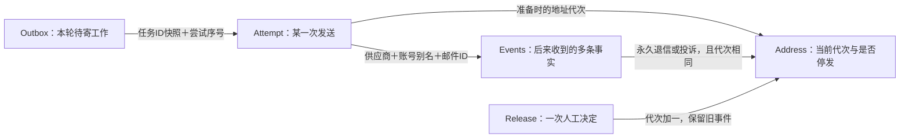
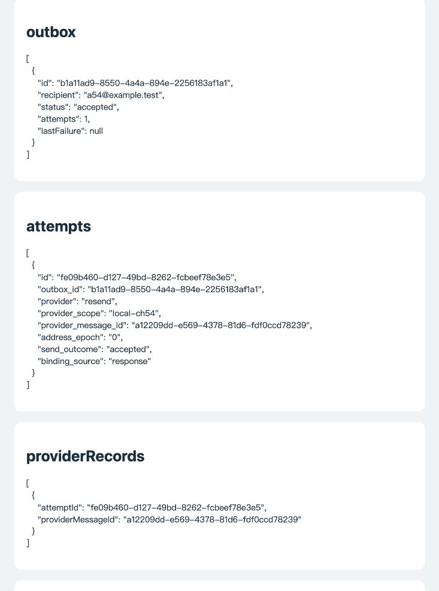
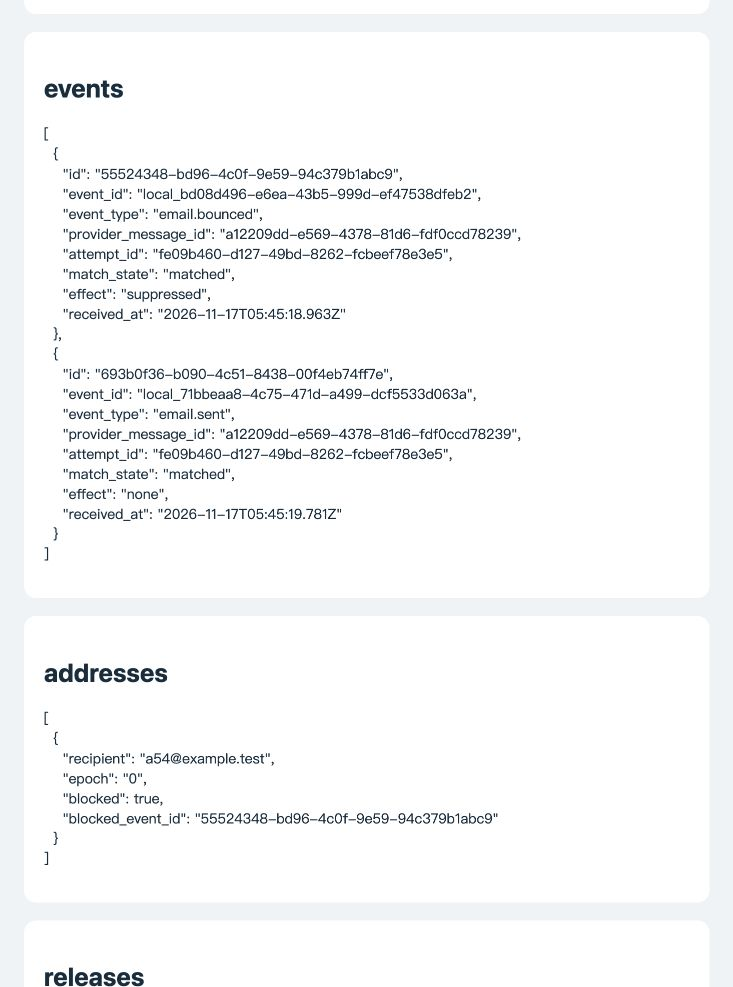
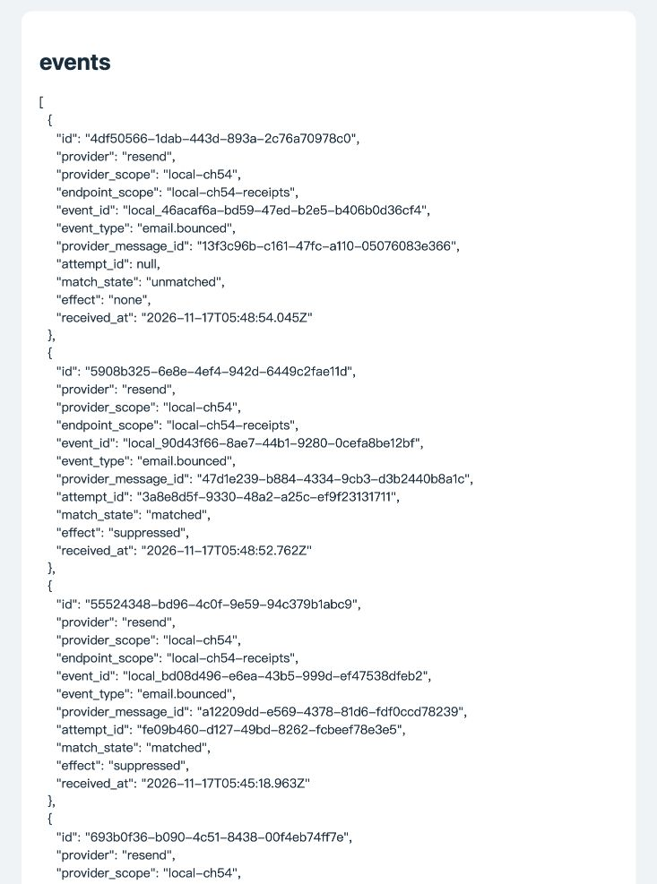

# 第 54 章　选读：追踪一封事务邮件的实际送达与异步退信

[第53章](../chapter-53-retries/chapter.md)已经能判断一次寄信是否可以重试。但现在 Worker 写下 accepted，用户仍说没有收到邮件。过一会儿，供应商又通知这个地址不存在。如果把原 accepted 改成 failed，排障时便看不出供应商曾接受过哪次发送；如果保留 accepted 就什么也不做，同一地址下一次申请又会耗掉一次投递。

需要保存的是几个不同主体的观察：发送者交付了什么，供应商后来报告了什么，收件端实际看到了什么，以及用户有没有完成原来的验证。它们可以互相对应，却不能互相替代。本章从[第53章完整代码](https://github.com/SamChowRock/epp-public/tree/part-06/chapter-53)建立独立练习副本，保留原账号、会话、素材与邮件记录；增加逐次发送记录、签名回执和按地址恢复。第55章仍从第53章继续，做完要回到原主线目录与数据库，不能只切源码却继续连接本章已升级的副本。

阅读约 90～115 分钟，实现、非空升级与本地回执演练另加 130～170 分钟；真实域名、供应商与受控邮箱联调另加 45～75 分钟。等待域名验证的时间另计。

## 54.1 从本地接收跨到受控邮箱

### 先明确这次要证明哪一步

Mailpit 能证明应用把一封邮件交给了本机 SMTP 接收者。它没有经过公共邮件网络，没有替你验证域名信誉，也不能证明某个真实邮箱会把邮件放进主收件箱。继续用它检查模板、令牌与确认请求很有价值；当需求变成“使用者从自己的邮箱取得验证令牌”，才需要外部邮件服务、获准使用的发信身份和受控收件箱。

我们仍是一封验证邮件、一个收件人。现有 SMTP 适配器可以配置外部服务器，但异步回执还需要一个明确对应：回执中的供应商邮件 ID 究竟等于发送结果的哪个字段？邮件原始头的 `Message-ID` 是邮件标识，供应商 `email_id` 是其系统中的投递标识，不能因为都叫 ID 就当成同一个值。解析一段成功应答里的任意字符串也不足以建立这个约定。

本章用 Resend 的 HTTP 发送接口作为一个具体接入例子。完整成功响应返回邮件 ID，后续事件在 `data.email_id` 带回这个 ID；本地 SMTP 继续保留。直接使用 Node 自带 fetch 发送请求，签名验证交给官方 Svix 库，不增加一套供应商框架。换服务时，应重新核对成功响应、消息关联、签名协议与重放规则，不能只换主机名。[发送接口](https://resend.com/docs/api-reference/emails/send-email)

先完成[本章依赖与邮件服务准备](../../environment-setup.md#第-54-章准备发送记录与签名回执)。本机路线只需要已有 PostgreSQL、Mailpit、Node 和随锁文件安装的 Svix。真实邮箱路线再准备自己管理的发信域或子域、限定发信权限的 API key，以及自己控制并允许本次试发的收件箱。把域名验证完成与“收到了一封邮件”分开验收：前者建立发信身份，后者才是这次交付的实际证据。

发信 key 用于应用访问供应商；Webhook signing secret 用于应用核验供应商回调，二者不是同一份密钥。分别放在本机私有配置。API 处理注册申请时不需要这两份配置；邮件 Worker 只拿发信配置；回执进程只拿验签配置。稳定的 `provider_scope` 是自选的账号别名，比如本次练习账号的名称，不是 key 的一部分。轮换 key 时不改这个别名，否则同一封旧邮件的回执会落到另一个命名空间，失去关联。

### 一条任务还不够表示三次发送

第53章的 `verification_outbox` 一行表示本轮验证需要寄出的工作，attempts 只是已经尝试几次。假设第一次收件人暂缓，第二次成功，后来通知针对第二次退信。若只在任务上放一个 provider ID，下一次改写会抹掉前一次；若按邮箱查最近一条任务，用户又申请了一次，退信就可能挂到新令牌上。

因此每次真正准备发送时新增一行 `verification_mail_attempts`。它保存自己的 ID、原任务与意图的 ID 快照、尝试序号、claim_id、收件地址、用途、供应商与账号别名、当时的地址代次，以及发送者后来观察到的结果。`UNIQUE(outbox_id, attempt_no)` 防止同一次准备重复留下记录。`UNIQUE(provider, provider_scope, provider_message_id)` 保证一个供应商邮件只对应一个发送尝试；尚未获得 ID 的尝试允许这一列为 NULL。

任务、尝试和事件分别回答三个问题：还有什么工作待做，这次究竟有没有调用发送端，后来收到哪些报告。后两者是历史。沿用第53章到期清理 accepted／dead／obsolete 的任务时，不应把历史回执一并删掉，也不能因为新表的外键挡住原任务清理。所以 attempt 上的 outbox_id、intent_id 是无外键的历史快照；attempt 到 event 的关系则保留外键，不能让事件指向不存在的尝试。删除任务后，观察查询从 attempts 出发，再 LEFT JOIN 原任务；NULL 表示任务已按规则清理，不等于尝试未发生。

下面的箭头表示查证路径。任务与尝试之间刻意不用外键；事件和尝试的关系才由数据库约束保护。



另外三张表各自只承担一个用途：`verification_mail_events` 追加供应商事实；`verification_mail_addresses` 保存当前地址是否允许发信及恢复代次；`verification_mail_releases` 保存是谁基于哪次事故放行了哪一代地址。恢复原因和证据引用要足以供人复查，不把完整邮件、令牌和原始回调正文塞进去。

### 先停写，再在副本追加结构

在Mac保留原第53章目录。跟写本章时，另开目录取得53起点并建立自己的练习分支；它与原目录共用一个远程仓库，但工作文件和私有配置各自独立。

```bash
git clone --branch part-06/chapter-53 \
  https://github.com/SamChowRock/epp-public.git epp-mail54
cd epp-mail54
git switch -c practice/chapter-54
nvm use
npm ci
```

只核对完成效果时，另行克隆 `part-06/chapter-54` 到新目录，直接使用其完整文件；不要在已经跟写的未提交目录切分支覆盖文件。下面逐段解释需要接入的位置，完整新增文件集中在本章配套。

先停止原API写入及所有邮件发送者，包括开发watcher，按[第25章的非空恢复](../../environment-setup.md#用备份建立练习副本)把原53库恢复到新建的 `epp_ch54_verify`。保留原库与备份，不要重建原数据。DBeaver另建连接，执行 `SELECT current_database(), current_user, inet_server_port();`，核对是这个副本。在SQL编辑器保存以下观察，记下实际ID；不要期待你的数据总量与示例相同。

```sql
SELECT id, recipient, status, attempts, claim_id, lease_until, last_failure
FROM public.verification_outbox ORDER BY id;
SELECT id, paused_by FROM public.verification_mail_control;
SELECT migration_name, checksum, finished_at
FROM public._prisma_migrations WHERE rolled_back_at IS NULL
ORDER BY migration_name;
```

再通过原会话按ID读一条素材，保留其内容和原创建操作键；选做小程序路线时同样保留原Bearer对应的本人素材。后面用这些已存在的身份与记录检查升级，而非只注册一个新账号证明新代码能工作。若paused_by已有unknown，先保留；迁移不负责放行它。

把新迁移放到 `prisma/migrations/20261117010000_mail_delivery_events/migration.sql`，新增四个Prisma模型与字段映射。迁移只建新表、约束和索引，并扩展原last_failure约束以允许address-suppressed，不改旧迁移文件。

四张表的唯一约束要先写在数据库里。下面是迁移中决定关联与恢复的部分；列出的约束分别落在对应CREATE TABLE内，完整列定义与索引见[本章迁移](https://github.com/SamChowRock/epp-public/blob/part-06/chapter-54/prisma/migrations/20261117010000_mail_delivery_events/migration.sql)。不要把这段约束节选单独作为迁移执行。

```sql
-- verification_mail_attempts：一次任务的第几次发送，和供应商的唯一邮件身份。
UNIQUE(outbox_id, attempt_no),
UNIQUE(provider, provider_scope, provider_message_id)

-- verification_mail_events：同一个入口收到的同一事件只记录一次。
attempt_id uuid REFERENCES verification_mail_attempts(id) ON DELETE RESTRICT,
UNIQUE(provider, provider_scope, endpoint_scope, event_id)

-- verification_mail_addresses：当前停发指向一条仍能查询的事故。
blocked_event_id uuid REFERENCES verification_mail_events(id) ON DELETE RESTRICT,
CHECK(blocked OR blocked_event_id IS NULL)

-- verification_mail_releases：一个地址的每一新代次对应一份恢复记录。
new_epoch bigint NOT NULL CHECK(new_epoch = old_epoch + 1),
previous_blocked_event_id uuid REFERENCES verification_mail_events(id) ON DELETE RESTRICT,
UNIQUE(recipient, new_epoch)
```

NULL的供应商ID允许存在多次尚未取得应答的尝试，一旦绑定非NULL值，唯一约束就防止两次发送共用它。地址表只保存当前投影：解除blocked会清掉当前引用，旧事件与release里的previous_blocked_event_id继续保留。event另外保存received_at与provider_occurred_at，方便区分本机接到回调和供应商报告事件的时间；恢复顺序不依赖这两个时钟。

Prisma需要同时认识新表。[schema.prisma](https://github.com/SamChowRock/epp-public/blob/part-06/chapter-54/prisma/schema.prisma)中的四个新模型保留数据库的snake_case字段，BigInt承载epoch，UUID字段标 `@db.Uuid`，可空供应商ID使用 `String?`，两组唯一键映射同一组列。比如attempt模型的身份部分如下，其余快照、观察与审计列按迁移补齐；CHECK继续由SQL维护，不从客户端代码推测约束存在。

```prisma
model verification_mail_attempts {
  id                  String @id @db.Uuid
  outbox_id           String @db.Uuid
  intent_id           String @db.Uuid
  attempt_no          Int    @db.SmallInt
  claim_id            String @db.Uuid
  recipient           String
  provider            String
  provider_scope      String @db.VarChar(100)
  address_epoch       BigInt
  provider_message_id String? @db.VarChar(200)
  // 其余字段与事件关系见完整模型；这里仅展示身份与唯一键。
  @@unique([outbox_id, attempt_no])
  @@unique([provider, provider_scope, provider_message_id])
}
```


等54.2与54.3的全部接线完成并重新构建后再启动新进程。此时可以先部署结构：`.env.database-verify`填写副本的DATABASE_URL，`.env`及`.env.worker`也指向同一副本。单独运行迁移的终端先清外层同名变量，避免Node的env-file被已导出的另一库URL覆盖；不在命令行明文填写密码。

```bash
unset DATABASE_URL TEST_DATABASE_URL SHADOW_DATABASE_URL DB_QUERY_DEBUG
node --env-file=.env.database-verify scripts/deploy-verify.mjs deploy epp_ch54_verify
npm run db:verify -- migrate status
npm run check
```

若只是从完全空的验证库检查安装，把deploy换成bootstrap；不要在非空库做bootstrap。前者先建立历史基线再应用后续迁移，普通migrate deploy不能替代这条空库入口。再运行一次deploy，应没有待应用迁移。回DBeaver比较旧行的ID、状态、次数和通道占用，以及旧迁移checksum、finished_at，新增四表暂时为空。任何不符先停在这里核对连接与迁移，不用重建旧库抹掉差异。


旧53任务没有逐次发送历史，迁移不能根据 attempts=2 造出两条看似真实的明细。升级后旧任务保持原状态，新表初始没有替旧发送补写记录。需要核对一封升级前的邮件时，沿原任务与供应商记录人工调查；不能用新表里查不到来证明没有寄过。

## 54.2 把接收应答与收件箱证据配成一组

### 在网络调用之前留下本次身份

先回看原来的顺序：取得通道行锁，锁住任务和验证意图，检查租约与令牌代次，旋转本次令牌，再占用通道。现在在同一事务里加入 attempt。只有这次准备真正成功，才增加 attempts 并写入明细。地址未被抑制时，过时意图仍返回obsolete，不产生一条假发送。新prepare先检查地址blocked，再检查意图是否过时：两者同时成立时，结果是suppressed，任务为dead/address-suppressed；两种退出都不会真正发信。网络请求在事务提交之后执行，不能一边等供应商一边占着数据库锁。

在 `src/verification-delivery.ts` 把原来的void返回改成明确的收据，并传入已经保存的attempt ID。两个正式发送器都声明自己的provider与scope；本地适配器在 `info.accepted.length` 核对通过后，返回 `{ providerMessageId: info.messageId }`，保存的就是这次SMTP邮件的Message-ID。

```ts
export type DeliveryContext = { attemptId: string };
export type DeliveryReceipt = { providerMessageId: string };
export interface VerificationDelivery {
  readonly provider?: 'local' | 'resend';
  readonly providerScope?: string;
  send(recipient: string, purpose: RecoveryPurpose, token: string,
    issuedAt: Date, expiresAt: Date,
    context: DeliveryContext): Promise<DeliveryReceipt>;
}
```

在 `src/verification-outbox.ts` 的prepare原事务里，读出地址代次后，仍先完成原来的意图与租约检查。成功旋转令牌，增加次数并占用通道，才插入本次明细；下面的job、claim与window来自原流程，address来自本章地址表。

```ts
const attemptId = randomUUID();
await tx.$executeRaw`
  INSERT INTO verification_mail_attempts
    (id,outbox_id,intent_id,attempt_no,claim_id,recipient,purpose,
     provider,provider_scope,address_epoch)
  VALUES (${attemptId}::uuid,${job.id}::uuid,${job.intent_id}::uuid,
    ${job.attempts + 1},${claim.claim_id}::uuid,${job.recipient},${job.purpose},
    ${delivery.provider ?? 'local'},${delivery.providerScope ?? 'practice'},
    ${address.epoch})`;
return { job, token, window, attemptId };
```

如果这个INSERT或唯一约束失败，整个准备事务回滚，令牌与次数不会单独前进。`deliverClaim`接收返回的attemptId，调用 `delivery.send(..., { attemptId })`。缺失、空值或超长收据都视为未确认；Resend结果还要通过UUID验证，不能为了兼容旧的void测试替身而在正式路径默许缺少ID。

新增 `src/resend-delivery.ts` 中的ResendDelivery实现同一接口。请求的核心接线如下；完整实现继续有界读取应答并校验ID，接口没有接收任意上游URL的配置项。

```ts
const mailText = `Purpose: ${purpose}\nVerification token: ${token}\n` +
  `Requested (UTC): ${issuedAt.toISOString()}\n` +
  `Expires (UTC): ${expiresAt.toISOString()} Use the token for your latest request.\n` +
  'If you did not request this, ignore it. This message does not confirm an account exists.';
const response = await this.request('https://api.resend.com/emails', {
  method: 'POST',
  redirect: 'error',
  signal: AbortSignal.timeout(5000),
  headers: {
    Authorization: 'Bearer ' + this.config.apiKey,
    'Content-Type': 'application/json',
  },
  body: JSON.stringify({
    from: this.config.from,
    to: [recipient],
    subject: purpose === 'register'
      ? 'EPP registration verification' : 'EPP password recovery',
    // text沿用本地邮件的用途、令牌和时间说明，不记录到日志。
    text: mailText,
    headers: { 'X-EPP-Attempt-ID': context.attemptId },
    tags: [{ name: 'attempt_id', value: context.attemptId }],
  }),
});
```

上段mailText代表与原适配器相同的邮件文本，完整文件内直接构造它。响应流累计到64 KiB即拒绝；通过完整JSON和UUID检查才返回providerMessageId。新增 `src/mail-send-config.ts` 的createDelivery按MAIL_PROVIDER选择local或resend；本地只需LOCAL_SMTP_PORT，外部需RESEND_API_KEY、RESEND_FROM与MAIL_PROVIDER_SCOPE。在 `MailWorkerModule.register` 把原LocalMailDelivery提供者的工厂换成 `() => createDelivery(env)`，单笔 `send-one.ts` 同样使用该工厂。容器仍沿用原LocalMailDelivery注入标识，实际实例由工厂决定，Worker的领取循环无需知道供应商API。

完整接线：[发送器](https://github.com/SamChowRock/epp-public/blob/part-06/chapter-54/src/resend-delivery.ts)、[准备与写回](https://github.com/SamChowRock/epp-public/blob/part-06/chapter-54/src/verification-outbox.ts)、[配置工厂](https://github.com/SamChowRock/epp-public/blob/part-06/chapter-54/src/mail-send-config.ts)。

HTTP 成功应答必须读完，状态在2xx范围且正文含合法供应商 ID，才能保存 accepted。设置固定官方地址、五秒超时、拒绝重定向、64 KiB 应答上限和单一收件人，避免配置失误让凭据跟随重定向或让发送者无限等待。邮件增加 `X-EPP-Attempt-ID` 头和同值标签，供人工在供应商详情、收件原始头与本地记录间交叉核对；这个头不包含令牌，也不能单凭它授权陌生回执修改数据库。

完整应答读不到、2xx 缺少 ID、超时或5xx，都不能写 accepted。本章的外部适配器保守地把所有不符合上述成功条件的结果归为 unconfirmed，沿第53章进入 unknown 并停住通道。这样连明确的4xx配置错误也需要人工核对，代价是少了自动恢复；收益是没有把 HTTP 错误硬套成 SMTP 的 RCPT TO 拒收。现有本地 SMTP 的精确分类仍保留。若以后细分 HTTP 拒绝，应以供应商明确语义和完整响应为依据，逐类证明“没有被接受”，而不是看到可重试状态码就重发验证邮件。

### 过期执行者也可能带回有用证据

还有一个容易漏掉的时间窗口：A 发出请求，租约到期，通道已经进入需人工核对的状态；此时 A 才拿到供应商 ID。第53章的 finish 先检查占用者，不符合就返回 lost-after-send。若把新增 ID 的保存放在这条 return 后面，这条最需要调查的记录反而没有 ID。

要分开两种资格。A 有资格报告“我这次请求收到了什么”，不等于它仍有资格推进任务。finish 先核对不可变的 attempt 与 claim，对原尝试保存观察结果和一次性绑定，再检查原任务的 claim、租约和通道占用。资格已失效，仍返回 lost-after-send，保留原 unknown／占用，不能用一条迟到成功擅自放行。后来回执仍可用刚保存的 ID 找到这次尝试。如果数据库在那一刻也不可用，应用无法保证保存外部应答，仍须按 unknown 对账。

finish现在把“保存观察”放在“当前是否仍有权完成任务”之前。以下为 `src/verification-outbox.ts` 中事务开头的关键顺序；后面接回原来的任务行锁、租约检查和状态转换。

```ts
const [channel] = await tx.$queryRaw<{ paused_by: string | null }[]>`
  SELECT paused_by FROM public.verification_mail_control WHERE id=1 FOR UPDATE`;
if (!channel) throw Error('MAIL_CONTROL_MISSING');
const [fact] = await tx.$queryRaw<{ id: string }[]>`
  SELECT id FROM verification_mail_attempts
  WHERE id=${attemptId}::uuid AND outbox_id=${claim.id}::uuid
    AND claim_id=${claim.claim_id}::uuid`;
if (!fact) throw Error('ATTEMPT_MISSING');
await tx.$executeRaw`
  UPDATE verification_mail_attempts
  SET observed_at=clock_timestamp(),send_outcome=${outcome}
  WHERE id=${attemptId}::uuid AND observed_at IS NULL`;
if (messageId) await bindAttemptTx(tx, attemptId, messageId, 'response');
if (channel.paused_by !== claim.id) return 'lost-after-send';
```

bindAttemptTx在已有通道锁下绑定一次身份，并关联早到事件；对同一供应商邮件的第二个attempt，数据库唯一约束会使整笔事务回滚，通道仍保留供核对。Resend UUID在发送响应、验签解析和共享持久化入口统一转成小写；仅在HTTP层转换不够，因为人工CLI和直接调用的关联函数也会写入。SMTP Message-ID是另一种身份，保留原始拼写。

发送端的改动到这里已经能保存每次观察。接下来先完成独立回执入口与关联事务，再一起构建并沿同一封信操作；否则本地演练会调用尚未生成的回执文件。

## 54.3 把重复、迟到和伪造回执送入入口

### 先验证这些字节是谁发来的

供应商主动访问我们的 HTTP 接口，这就是本章的 Webhook。它没有浏览器 Cookie，也不应使用用户登录去认证。把回执路由塞进现有先 JSON.parse 的 API 中间件链，再把对象 stringify 回去验签，会改变空格或字段顺序。签名保护的是发送时的原始字节，语义相同的两个 JSON 并不一定有相同签名。

因此增加独立回执进程，只接收 `POST /webhooks/resend`。先限制请求头、内容类型与正文长度，收集最多64 KiB原始 Buffer，检查 `svix-id`、`svix-timestamp`、`svix-signature` 各出现一次，再交 Svix 验签；通过后才严格解码 UTF-8 和解析 JSON。签名头中可以合法包含多个签名值，不能误把正常轮换时的多值格式当成重复请求头。[原始正文验签](https://resend.com/docs/webhooks/verify-webhooks-requests)

在 `src/mail-receipt-server.ts` 分开rawBody、verifyMailEvent和HTTP处理器。rawBody只负责有界收集字节；验签函数先逐项遍历req.rawHeaders，要求三个签名头各出现一次，长度分别不超过200、12、2048。时间戳只允许十进制数字，再让库核验时间窗。关键调用顺序如下；shape是本章邮件事件的有界Zod结构。

```ts
new Webhook(secret).verify(body, headers);
const data = shape.parse(
  JSON.parse(new TextDecoder('utf-8', { fatal: true }).decode(body)),
);
const digest = createHash('sha256').update(body).digest('hex');
```

shape要求顶层created_at、事件type及data.email_id；只选取to、Message-ID和bounce类型等需要的字段。五类订阅之外，仍符合此邮件结构的签名事件可记为unsupported；没有email_id的域名或联系人事件不属于这个接收模型，会返回400，别把平台全部事件无区别订阅到这里。摘要始终来自收到的原始body，即使解析后的UUID已经转成规范写法，也不能拿改写后的JSON计算摘要。

HTTP处理器在验签与解析完成后等待数据库提交，才返回204：

```ts
const body = await rawBody(req);
const event = verifyMailEvent(body, req.rawHeaders, config.secret);
await recordMailEvent(
  database, config.providerScope, config.endpointScope, event,
);
res.writeHead(204);
res.end();
```

只允许application/json、UTF-8及未压缩正文；过大413、类型不支持415、验签或字段无效400、同身份异正文409，数据库不可用503。入口的头部、正文和连接也有限时，不能让半截上传永久占用连接。完整的[接收处理器](https://github.com/SamChowRock/epp-public/blob/part-06/chapter-54/src/mail-receipt-server.ts)包括这些边界与固定路由。

`src/mail-receipts.ts`先读取独立配置，连接数据库并核对命令行给出的预期库名，然后执行 `epp-mail-receipts` 角色探针，最后才监听回环3354。这里的epp-mail-receipts是连接的application_name与启动探针分支，数据库登录仍来自DATABASE_URL；标签本身不会分配数据库权限。本机副本沿用开发登录。`DatabaseService.onModuleInit`为这个进程单独检查新表与通道行，不去读取用户凭据或会话；邮件Worker也补查attempts、events与addresses，单笔工具先执行对应初始化。SIGTERM先停止接新请求，等在途短事务后关闭数据库，超过十秒退出1。生产入口没有Inspector；开发入口另用9231及.receipts-dev，不与API、邮件角色抢调试端口。

这里固定 Svix 2.10.0，调用成功表示验证通过，不依赖 verify 返回一个解析好的对象。官方时间窗用于拒绝旧签名；数据库事件身份用于处理平台重试。两者解决不同问题：平台重新发送旧事件时可以签上新时间，而业务仍只应记一次。不能把超过签名时窗的去重记录全部删掉，然后认为旧事件不会再来。

独立入口还把公开范围收窄了。API、Mailpit和只读观察页继续只在本机使用；真实回调必须能从供应商访问 HTTPS 接收地址。已有合适入口可直接挂接；只在 Mac 临时联调时，按[回调连接器准备](../../environment-setup.md#第-54-章临时接收公网回执选做)启动指向回执端口的隧道，不能把 API 或观察页端口一起公开。公网入口能访问，不代表请求可信，签名验证始终保留。

### 返回成功之前，先把事实存下来

事件唯一键是 `(provider, provider_scope, endpoint_scope, event_id)`，event_id 来自签名头中的 svix-id。endpoint_scope 为本次回执入口的稳定别名，换密钥不换别名。原始正文只保存 SHA-256 摘要与需要的有界字段：事件种类、供应商邮件 ID、单收件地址、供应商事件时间、本地接收时间，以及必要的退信类型。邮箱确认令牌、邮件正文和整份回调 JSON 均不入这张表。

同一身份和相同摘要再来，返回成功而不重复处置；同一身份却换了正文，返回409，保留第一次事实。数据库失败返回503，让供应商保留重试机会；不能先回200，再把数据库写入放到一个无人等待的 Promise 里。签名失败、格式不符或超界，也不会写入事件表。

在 `src/mail-delivery-facts.ts` 给这些操作共用一个短事务入口。每个调用都先锁同一控制行，缺行就失败；原claimOne只做预约，不在它持有任务行锁时再反向取这把锁。

```ts
export async function mailTransaction<T>(
  db: DatabaseService,
  work: (tx: MailTx) => Promise<T>,
): Promise<T> {
  return db.client.$transaction(async (tx) => {
    await lockMailChannel(tx);
    return work(tx);
  }, { maxWait: 2000, timeout: 5000 });
}
```

recordMailEvent在这个事务里先按完整事件身份查询旧摘要，再决定是否插入。必须把“查旧事件”和“判断容量”按这个次序放在锁内，否则满额后的合法重送也会被拒，或者并发请求各自看到尚未满额却一起越界。

```ts
if (old) {
  if (old.body_sha256 !== event.bodySha256)
    throw new ReceiptError(409, 'EVENT_CONFLICT');
  return 'duplicate';
}
if (Number(count?.n) >= 100)
  throw new ReceiptError(503, 'EVENT_CAPACITY');
// 插入有界事实；按provider/scope/message ID寻找唯一attempt。
// 已有attempt时同事务associate，否则保留unmatched。
```

old来自 `(provider,scope,endpoint,eventId)` 查询，count来自 `(provider,scope,providerMessageId)` 查询；两者不是同一个统计范围。收到第二个入口转发的同一邮件事件，也占这封邮件的容量；稳定的endpoint别名避免正常换钥制造新的去重空间。[完整事实与关联事务](https://github.com/SamChowRock/epp-public/blob/part-06/chapter-54/src/mail-delivery-facts.ts)将这些查询、INSERT与associate保持在同一事务内。

现在把顺序反过来：供应商先回调，发送请求的应答还在路上。本地尚无 provider_message_id 时，回执应保存为 unmatched 并返回成功，而非丢弃。finish 绑定 ID 时，在同一个短事务里找到该邮件的已保存事件并关联。事件先持锁，先留 unmatched，finish 随后关联；finish 先持锁，事件随后直接命中。两条路径共用通道控制行作为第一把锁，让这个检查与写入之间没有第三种竞态。

这把锁只是所有本章写入的串行化位置，不代表“通道开放才能记回执”。unknown 时尤其需要继续接收证据。回执、人工绑定与地址恢复都不改 paused_by，也不改 outbox.status。网络读写、正文读取和验签均在锁外；锁内只做有界数据库工作。

同一供应商邮件最多保存100个不同事件身份，重复检查先于容量检查，满额后原事件仍能幂等重放；第101个新身份返回503，旧记录仍然保留。这个界限让发送应答绑定时最多处理100条早到事件，短事务不会随着回调数量无限增长。接近上限应按该消息调查事件来源与订阅配置，再调整接收预算；供应商可能最终停止重试，不能把503解释为“以后必然补齐”。对持续高事件量的业务，应另设计分批归并与积压告警。[重试与重播](https://resend.com/docs/webhooks/retries-and-replays)

### 把各个入口接成可编译的阶段

跟写53源码时，先把上面讨论的新增文件建立完整，再开始下面的实验。`mail-delivery-facts.ts`统一导出mailTransaction、recordMailEvent、bindAttemptTx、bindAttempt、releaseAddress；ID规范化函数canonicalResendMessageId由resend-delivery.ts导出并供事实模块复用；54.4继续解释其中的恢复规则，函数本身此时就要接好。需要补齐这些函数时，可直接从[本章 src 目录](https://github.com/SamChowRock/epp-public/tree/part-06/chapter-54/src)复制完整文件。

按依赖顺序核对这几组接线：

- 迁移与schema先建立四张表。`verification-delivery.ts`让本地SMTP返回真实Message-ID；`resend-delivery.ts`实现外部HTTP适配器，`mail-send-config.ts`选择它们。
- `mail-delivery-facts.ts`集中事实、关联、抑制与恢复事务；`verification-outbox.ts`在prepare写尝试，finish先保存观察再判断完成资格。地址blocked的提前分支也属于这次prepare改动。
- `mail-worker.module.ts`及`send-one.ts`使用createDelivery。原worker配置中LOCAL_SMTP_PORT改为可选，真正选中local时再由createDelivery要求它；否则只配Resend的进程会在尚未选供应商时被SMTP配置挡住。
- `mail-receipt-config.ts`解析独立密钥、两个scope和端口，`mail-receipt-server.ts`负责原始字节与HTTP，`mail-receipts.ts`负责预期库名、初始化、监听与退出。`database.service.ts`为epp-worker及epp-mail-receipts补齐attempts、events、addresses与通道行探针，回执／管理入口另外检查releases。`mail-admin.ts`作为独立私有文件入口，调用同一组事务函数，不从公开HTTP暴露恢复操作。

开发脚本也要显式分离。新增下面的tsconfig.receipts-dev.json，只从回执入口追踪依赖；API的tsconfig.dev.json用include限定为src/server.ts及src/labs/**/*.ts，避免把回执入口作为独立根文件编译。

```json
{
  "extends": "./tsconfig.json",
  "compilerOptions": { "outDir": "./.receipts-dev" },
  "include": ["src/mail-receipts.ts"]
}
```

在package.json的scripts增加以下两项，保留原API与邮件脚本：

```json
{
  "dev:receipts": "NODE_ENV=development node --env-file=.env.receipts scripts/dev.mjs .receipts-dev/src/mail-receipts.js tsconfig.receipts-dev.json",
  "start:receipts": "NODE_ENV=production node --enable-source-maps dist/src/mail-receipts.js"
}
```

scripts/dev.mjs依据configFile识别receipts，Inspector选9231；worker仍9230，API9229。只有API复制并监听config/service.json，worker和receipts都不监听它。启动参数继续把预期库名传给子进程，停止时沿原串行重启逻辑先等待旧子进程退出，不能并行抢监听端口。新增的.receipts-dev、.mail54-private与.env.receipts继续放进忽略规则。

所有源文件接好后，在本章目录执行下面的构建。它重新生成Prisma客户端、检查类型并生成dist；54.1只核对结构时运行过一次check，不能代替这里的最终构建。若缺导出、遗漏模型或入口文件，先根据编译报错补齐，尚未构建成功就不要启动演练。

```bash
npm run check
```

### 沿同一封信向外核对

先让整个对应关系在本机可控。独立的 `examples/mail-delivery` 用真实HTTP接收适配器请求，再交给真实Mailpit，并生成合成供应商ID。它只在脚本构造ResendDelivery时显式替换请求函数，正式Worker仍只有local与固定官方Resend地址两种配置。这样能主动安排“SMTP已经收到，应答却丢了”，同时保留真实网络与数据库的边界。

如果你正接着第 53 章写代码，可以单独取这几个观察工具，继续用手头的源码。如果用的是本章完成快照，工具已经在里面。新建的三个辅助目录／集合未自行修改时，在本章目录执行：

```bash
git fetch origin part-06/chapter-54:refs/remotes/origin/part-06/chapter-54
git restore --source=origin/part-06/chapter-54 -- \
  examples/mail-delivery database/chapter-54-mail-delivery \
  requests/chapter-54-mail-delivery.postman_collection.json
```

按照[环境准备](../../environment-setup.md#第-54-章准备发送记录与签名回执)启动Mailpit的1054／8054两个回环入口。停止旧邮件Worker和单笔工具，避免它们抢走准备观察的任务。API继续使用自己的.env，保留53的APP_ORIGIN与CURSOR_HMAC_KEY，只把DATABASE_URL改为本章副本；在编辑器从原私有配置复制，不假定Git克隆会带来秘密文件。

在本章项目根目录的Mac终端建立私有目录。用编辑器创建database.env，填入本次副本的DATABASE_URL及 `DB_QUERY_DEBUG=false`；真实密码不放到请求集合或命令参数。这个文件与API配置指向同一库。

```bash
mkdir -p .mail54-private
chmod 700 .mail54-private
umask 077
# 在编辑器建立 .mail54-private/database.env 后继续。
chmod 600 .mail54-private/database.env
unset DATABASE_URL TEST_DATABASE_URL SHADOW_DATABASE_URL DB_QUERY_DEBUG
lab54() {
  local action="$1"
  shift
  node --env-file=.mail54-private/database.env \
    examples/mail-delivery/lab.mjs "$action" \
    .mail54-private/lab.json epp_ch54_verify "$@"
}
lab54 init
lab54 receipts-env .mail54-private/receipts.env
```

函数只省去重复的文件与预期库名，不绕过CLI检查。**每个新终端都进入同一项目、执行nvm use、清掉上述外层变量并重新定义lab54函数。** init核对实际库和新表后才独占创建0600配置，已有文件就拒绝覆盖。lab.json保存本地随机密钥、固定scope、两个合成地址及数字端口，不含数据库密码。默认供应商3454、观察3554、回执3354、SMTP1054；有冲突时在启动前改私有JSON的数字，并重建匹配的回执配置，四个端口必须不同。不可把真实供应商key填进本地配置。

在三个终端分别启动API、正式回执进程和本地供应商，先启动前两者，等选好任务再开第三个：

```bash
# API终端：沿用本章副本的私有.env。
npm run dev
# 回执终端：生产入口直接读取专用配置，不读取API.env。
node --env-file=.mail54-private/receipts.env \
  dist/src/mail-receipts.js epp_ch54_verify
```

回执启动应出现receipts.ready。需要边改边调时，把同样配置放在.env.receipts，运行 `npm run dev:receipts -- epp_ch54_verify`；它编译到.receipts-dev并使用9231，API仍在9229。邮件Worker沿原dev:worker使用9230；本次本地供应商实验不用它，避免与指定单笔发送竞争。完成代码后可分别运行三个开发入口，保存回执专用文件，观察只出现回执的新PID，API仍能响应，再恢复原文件。不要只以三份脚本名字证明三个进程隔离。

导入配套[第54章Postman集合](https://github.com/SamChowRock/epp-public/blob/part-06/chapter-54/requests/chapter-54-mail-delivery.postman_collection.json)，baseUrl只填本机API地址。发一笔甲地址 `a54@example.test` 注册申请，预期202。202本来就不泄露outbox ID，在DBeaver按本次收件人和申请时间取真实ID：

```sql
SELECT id, intent_id, recipient, status, available_at
FROM verification_outbox
WHERE current_database()='epp_ch54_verify' AND recipient='a54@example.test'
ORDER BY available_at DESC, id DESC LIMIT 5;
```

不要拿上次的ID冒充新申请；冷却期内仍可能返回202而没有新行。FIRST_OUTBOX_ID专门保留第一笔甲任务，后面的抑制任务、乙任务和新代次任务分别使用新的变量，不覆盖它；换终端时从这条任务记录恢复该值。把本轮ID放进自己的终端变量，然后限定观察范围。下面的占位符必须换成查询得到的UUID。

```bash
OUTBOX_ID=REPLACE_WITH_ACTUAL_OUTBOX_UUID
FIRST_OUTBOX_ID="$OUTBOX_ID"
lab54 track "$OUTBOX_ID"
# 第三个终端，先恢复lab54函数，再执行；保持前台运行。
lab54 serve
# 另一个已恢复函数的操作终端：
lab54 send "$OUTBOX_ID" accepted
lab54 inspect
```

浏览器输入 `http://127.0.0.1:3554`，页面标题持续标注“本地模拟供应商”，点击读取当前事实，找本轮outbox和attempt。观察页只读私有配置中固定的ID，不接受SQL或任意上游地址。track新ID后需先停止serve再重启，页面才能看见新范围。

如果单笔返回paused，先查verification_mail_control.paused_by。第53章副本可能本来就保留unknown；迁移不能替你解除事故。停止所有旧发送者，按第53章的原ID处置流程核对证据，仅在本章隔离副本中明确决定放行该占用；保留原unknown和attempts，不能把它重新排队。然后用同一待寄ID重做本章单笔操作。配套review-channel.sql提供带预期库名及事故ID的psql版本，不能把清占用当成启动脚本。

单笔结果应为accepted，attempt保存小写供应商UUID。到 `http://127.0.0.1:8054` 的Mailpit页面选中对应收件人和主题，查看原始邮件头，核对 `X-EPP-Attempt-ID` 与 `X-EPP-Local-Provider-ID`。前者对应本地attempt，后者来自本地HTTP替身；这封邮件没有经过外部Resend。查看令牌时保持私有窗口，截图只保留不含正文与凭据的关联信息。

将邮件令牌填入集合里的注册确认请求，使用一个符合既有密码规则的新密码；确认成功后，在DBeaver按本轮intent_id核对consumed_at，再重复提交观察拒绝。邮件到达、确认成功和Web资格开通仍是三步；本章不自动开通新账号。之后回执即使到了，也不会重复执行注册。



图54-1　只读观察页的同一次发送。outbox的ID与attempt.outbox_id相同，供应商记录再用attemptId指回这次尝试；provider_message_id是另一个ID。这里的provider为resend表示使用该协议适配器，scope为local-ch54且邮件只进入本地Mailpit，不表示经过真实Resend。

<details>
<summary>完成54.4本机流程后，再连接真实供应商与受控邮箱</summary>

本机练习现在先继续下一小节，仍使用原练习密钥和local-ch54范围。只有完成后面的恢复与unknown对照，明确核对并处置本章副本的通道占用后，才回到这里切换外部路线；不能带着unknown直接启动另一个发送者。

停止本地serve与本地回执进程。API继续指向本章副本。在编辑器分别建立0600的 `.mail54-private/external-worker.env` 与 `.mail54-private/external-receipts.env`，共同填写本章DATABASE_URL、DB_QUERY_DEBUG=false以及一个新的稳定MAIL_PROVIDER_SCOPE，例如epp-ch54-account。以下是各自额外需要的字段，值按自己的已验证资源填写：

```dotenv
# external-worker.env
MAIL_PROVIDER=resend
RESEND_API_KEY=REPLACE_WITH_PRIVATE_SENDING_KEY
RESEND_FROM=noreply@REPLACE_WITH_VERIFIED_SUBDOMAIN
LOG_LEVEL=info
# external-receipts.env
RESEND_WEBHOOK_SECRET=REPLACE_WITH_THIS_WEBHOOK_SIGNING_SECRET
MAIL_ENDPOINT_SCOPE=epp-ch54-receipts
MAIL_RECEIPT_PORT=3354
```

两个文件各自带上共同字段；上面的注释划分文件，不是让它们共享两份密钥。RESEND_FROM填单个邮箱地址，不写展示名。先按环境指南接通回执入口并替换该入口实际签名密钥，重启后再运行发送者。新终端执行nvm use，并清外层同名变量，防止旧local配置覆盖文件：

```bash
unset DATABASE_URL TEST_DATABASE_URL SHADOW_DATABASE_URL DB_QUERY_DEBUG
unset MAIL_PROVIDER MAIL_PROVIDER_SCOPE MAIL_ENDPOINT_SCOPE MAIL_RECEIPT_PORT
unset RESEND_API_KEY RESEND_FROM RESEND_WEBHOOK_SECRET LOCAL_SMTP_PORT
# 接收终端，先运行：
node --env-file=.mail54-private/external-receipts.env \
  dist/src/mail-receipts.js epp_ch54_verify
# 另一发送终端，入口已验证后运行：
node --env-file=.mail54-private/external-worker.env \
  dist/src/mail-worker.js epp_ch54_verify
```

外部路线启动时，把本地替身换成正式邮件 Worker，使用已经验证的发信身份，只向受控地址申请一次新的验证。在 Postman 保存的注册申请里填写该地址，读到202后，在数据库按本轮 outbox ID 查 attempt，再到供应商控制台按 provider_message_id 找同一封信。收件邮箱找到该邮件，查看原始邮件头中的 `X-EPP-Attempt-ID`；不能只按主题或“刚收到”猜测它是哪次申请。

本项目当前邮件包含验证令牌，确认步骤仍使用原有 `/auth/register/confirm` 或 `/auth/reset/confirm` 请求，没有另建公共确认网页。将本次令牌填到 Postman 私有请求中，完成一次确认并核对 consumed_at。注册确认不自动赋予 Web 使用资格，沿第42章的开通规则继续；改密确认会撤销旧会话。再次提交同一令牌应按已有契约拒绝。不能因为收到 delivered 回执就替用户消费令牌。

证据应并排看：申请202说明接口已受理；outbox accepted 和 attempt ID 表示发送端取得供应商接受证据；email.delivered 表示供应商报告收件服务器接收；收件箱实际找到并核对原始头说明本次邮件在你观察的邮箱可见；确认事务提交说明持有有效令牌的人完成了原业务。delivered 不承诺主收件箱、阅读或点击。[delivered 事件](https://resend.com/docs/webhooks/emails/delivered)

需要稳定触发退信时，可向供应商明确提供的测试地址发送，例如 Resend 的 `bounced@resend.dev`，并用其支持的标签区分本轮。它触发的是供应商模拟行为，不能作为真实收件箱送达证明；不要随便编造一个外部地址充当不存在的邮箱。`delivered@resend.dev`、`complained@resend.dev` 同理，仍可能计入配额。[供应商测试地址](https://resend.com/docs/dashboard/emails/send-test-emails)

</details>

### 用同一组 ID 看重复与乱序

先在accepted后生成一份sent事件保存起来，暂时不发送。再生成并发送永久退信，最后重播前一份sent，这才真正改变了事件的到达顺序。

```bash
lab54 event "$FIRST_OUTBOX_ID" email.sent .mail54-private/sent.json
lab54 event "$FIRST_OUTBOX_ID" email.bounced .mail54-private/bounce.json
lab54 replay .mail54-private/bounce.json
lab54 replay .mail54-private/bounce.json
lab54 replay .mail54-private/sent.json
lab54 replay .mail54-private/bounce.json wrong
```

前面三次有效接收分别返回204、204、204，最后错签返回400。第二次bounce只返回已有结果。每次点击观察页的读取按钮，核对事件ID、match_state和effect；lastHttp显示实际最近一次回执响应。私有事件文件保存原始正文、事件身份及最初签名，replay保留身份和字节，只用本机练习密钥重签当前发送时间，不会关闭正式时间窗。它能演示晚重放；测试过期签名时则要保留原始签名头，不能用自动重签的replay。

也可在DBeaver执行配套 `database/chapter-54-mail-delivery/observe.sql`，先填本轮outbox ID，并从attempt查关联事件。只数表里有几行不足以说明去重，重点是同一个event_id只有一条、它的attempt_id等于本次尝试，原任务仍accepted。永久退信对应的地址变为blocked；旧sent到达后这个值不应回false。



图54-2　同一provider_message_id下分别保留email.bounced与email.sent。退信effect为suppressed，迟到sent为none；重复退信未多一行。截图展示事件事实，地址投影和最后一次HTTP结果继续在页面下方查看。

第一次永久退信到达，原 outbox 仍为 accepted，attempt 仍保留供应商接受的观察，events 新增 bounced；相同事件再次送入，只有一条事实。再把早先的 email.sent 放到退信之后，它只增加一条发送报告，不把当前地址改回可用。最后的wrong用另一把随机错误密钥签名，因此得到400，事件表无新增。若要检验正文篡改，必须保留原签名头，仅改正文一个字节；编辑私有文件后再执行replay会重新签名，不能拿它当作这项对照。先观察这些 ID 与响应，再看地址状态，避免只盯着“最后一个状态”的颜色。

已签名并不等于任何字段都可直接影响业务。回执的供应商／账号别名／邮件 ID 必须关联到唯一 attempt；to 必须只有一个地址，按项目已有规范化后与 attempt.recipient 精确相同。邮箱不符或多收件人进入待核对，不能按“看起来很像”推断归属。`email.bounced` 还要有 Permanent 类型才阻止后续发送；Temporary、缺失类型、未知事件种类先保留事实。email.delivery_delayed 只是供应商仍在处理的报告，本地不因此再寄已经接受的同一封信。[退信字段](https://resend.com/docs/webhooks/emails/bounced)

## 54.4 恢复一个地址并保留事故线索

### 地址停发与通道停发各自挡住什么

永久退信或投诉，经上述关联核对后，把该地址标为 blocked。该地址下一笔待寄任务到 prepare 时转 dead，last_failure 为 address-suppressed，保留清理起算时间；不旋转令牌、不增加 attempts、不写新 attempt，也不调用发送端。另一地址仍能寄。如果全通道有 unknown，两个地址都仍停住。这两个条件不能合并成一个“可重试”按钮。

被阻止的任务不会在地址恢复后自动复活。用户确认地址正确并重新申请，才产生一轮新的验证；仍须遵守原冷却时间。若原来地址写错，在申请中填写正确地址并完成它自己的验证，不能直接把旧 attempt.recipient 改成新邮箱。历史退信继续指向当时的收件人，账号邮箱归属仍由原验证流程决定。

prepare在原意图行已锁住、原租约仍有效后，建立或读取地址投影。下面的分支放在issueToken与令牌UPDATE之前：

```ts
if (address.blocked) {
  await tx.$executeRaw`
    UPDATE verification_outbox
    SET status='dead',last_failure='address-suppressed',
      retain_from=clock_timestamp(),retry_digest=NULL,
      claim_id=NULL,lease_until=NULL
    WHERE id=${job.id}::uuid`;
  return 'suppressed';
}
```

因通道锁已经持有，回执不能恰好在这个检查和本次attempt写入之间改变地址代次。它要么先提交，让本次准备看到blocked；要么等准备提交后再处理，这时刚准备的尝试属于恢复前还是恢复后的哪一代已经固定。

### 为什么恢复要有代次

假设地址 A 在退信后已经人工放行，稍后旧退信的另一份通知才到。只按到达时间处理，会立刻撤销刚才的恢复；按供应商时间和本机恢复时间比较，则依赖两个时钟及事件时间字段的含义。这里把人工决定直接编码：地址有 epoch，初始为0；发送准备时把当前 epoch 固定在 attempt；人工恢复把地址 epoch 加1。事件关联到旧 attempt 时，只能说明旧代次的事故，记录 historical，不阻止新代次。

这不是推测外部事故究竟何时发生。即使旧邮件的退信在人工恢复之后才真正发生，也仍属于旧代次；人工放行承担了这项明确取舍。放行后新准备的 attempt 带新 epoch，新的永久退信仍会重新阻止该地址。不能把“旧事件不再影响”误解为忽略未来事故。

`releaseAddress`也进入同一mailTransaction。先按操作ID查询旧release；若已存在，核对地址、expectedEpoch、actor和reason全部相同才返回原结果。没有旧操作，再核对当前地址代次，在同一事务记录恢复决定并推进投影。以下是已完成这些检查后的两条写入，a来自当前地址行：

```ts
await tx.$executeRaw`
  INSERT INTO verification_mail_releases
    (id,recipient,old_epoch,new_epoch,previous_blocked_event_id,actor,reason)
  VALUES (${input.id}::uuid,${input.recipient},${a.epoch},${a.epoch + 1n},
    ${a.blocked_event_id}::uuid,${input.actor},${input.reason})`;
await tx.$executeRaw`
  UPDATE verification_mail_addresses
  SET epoch=epoch+1,blocked=false,blocked_event_id=NULL,updated_at=clock_timestamp()
  WHERE recipient=${input.recipient}`;
```

先在地址仍blocked时检验54.4开头的拦截：等待原邮箱冷却期结束，甲已经注册成功，因此用Postman向 `/auth/reset/request` 发送同样的email对象。按收件人与时间找到**新**outbox ID，track后重启serve。在DBeaver先记下该行intent_id对应的token_digest与issued_at，再执行本地send accepted。这里accepted参数只安排供应商正常应答；如果准备阶段已拦截，供应商根本收不到请求，命令结果应为suppressed。新任务为dead、last_failure为address-suppressed、attempts仍0，attempt表没有它的行，令牌摘要和时间也未改变。摘要只在自己的数据库界面核对，不导出。

再给乙 `b54@example.test` 发一笔注册申请，取得乙的新ID、track并重启serve后发送，预期accepted。乙成功而甲被阻止，说明地址停发没有变成全通道停发。202仍有防枚举与冷却语义，每次都查新ID，不按响应码猜测已经创建新任务。

先用本地辅助命令生成本轮私有请求文件，编辑器核对recipient、expectedEpoch、操作UUID与原因，再交正式CLI执行。生成文件本身不修改地址。

```bash
lab54 admin-release a54@example.test .mail54-private/release.json
node --env-file=.mail54-private/database.env dist/src/mail-admin.js \
  epp_ch54_verify release .mail54-private/release.json
# 原文件再执行一次，返回原epoch与duplicate，不再前进。
node --env-file=.mail54-private/database.env dist/src/mail-admin.js \
  epp_ch54_verify release .mail54-private/release.json
```

mail-admin要求普通文件、当前用户所有、0600、最多4 KiB且无符号链接，再核对目标数据库。epoch用十进制字符串传入，避免JSON数值在大整数上丢精度。失败时先检查文件权限和字段，再查询当前地址epoch、绑定ID及连接库名；不要通过删除审计行或换操作ID反复盲试来消除报错。

恢复命令需要独立操作 UUID、当前 expected_epoch、操作者和具体原因。同一操作 ID、同样输入重放，返回第一次结果，不再加1；操作 ID 相同而输入变了，或者旧 epoch 已落后，直接拒绝。操作者先查当前 blocked_event_id 和历史原因，再决定是否承担放行，不能用脚本反复执行“清所有 blocked”。本地放行也不等于供应商已解除它自己的抑制名单，真实服务需同时核对供应商状态。[供应商抑制管理](https://resend.com/docs/knowledge-base/why-are-my-emails-landing-on-the-suppression-list)

### unknown 对账不因回执变简单

发送方丢了成功应答，供应商却已经收到，回执可能以 unmatched 留在库里。先到供应商详情或收件原始头核对本次 attempt ID、收件人、发起时间和内容用途，再取得对应 provider ID。人工 bind 只允许 NULL 绑定成一个值，拒绝覆盖已有值或把同一供应商邮件绑定到第二个 attempt；同时记录操作者、原因和证据引用。按邮箱和最近时间自动选一个候选会把不同申请混在一起，因此工具要求明确两个 ID。

绑定完成后，已有早到事件可以关联并施加本章地址规则；原发送结果仍是 unknown，paused_by 仍保留。接下来回到[第53章的事故处置](../chapter-53-retries/chapter.md#535-对端读完正文以后如何放行和清理)，停止旧发送者，核查原任务与外部证据，只按那一笔占用决定是否放行。绑定和恢复地址的工具均不代办这个决定。

### 按原ID完成一次恢复，再制造下一次事故

把恢复前后的结果留在同一观察范围，避免每一步换一组无关数据。下列操作仍在本章独立库中进行，旧Worker保持停止。

前面的admin-release已将甲从epoch0推进到1。重播原bounce.json应仍为204而没有新增事件；再为甲**第一笔**attempt生成一个新事件ID的永久退信，表示同一旧邮件后来又报告了一条事故：

```bash
# FIRST_OUTBOX_ID始终保留第一笔accepted的甲任务ID。
lab54 replay .mail54-private/bounce.json
lab54 event "$FIRST_OUTBOX_ID" email.bounced .mail54-private/late-old.json
lab54 replay .mail54-private/late-old.json
lab54 inspect
```

新行的effect应为historical，地址仍epoch1、blocked=false。这个对照比只重放同一个事件更强：重复事件本来就会被去重，只有新的旧代次事件才能检验恢复规则。等甲的下一次冷却期结束，再向reset/request申请，选新ID发送，attempt.address_epoch应为1。对它生成并重播新的bounce文件，甲再次blocked。恢复只覆盖已经核对的旧代次，没有为未来邮件免除事故处理。

### 让回执早于丢失的发送应答

乙尚未完成注册，可以在冷却结束后重新申请注册。取得新的乙任务ID并track、重启serve，改用early：

```bash
UNKNOWN_ID=REPLACE_WITH_NEW_B_OUTBOX_UUID
lab54 send "$UNKNOWN_ID" early
lab54 inspect
```

本地供应商先交给Mailpit，保存对应ID，再向正式入口发一条签名退信，最后断开HTTP发送应答。发送命令退出2并报告unknown；观察页lastHttp应为204，那是**回执接收**的结果，不是发送接口的成功应答。attempt.provider_message_id仍为空，供应商私有记录里已有ID，事件为unmatched，全通道pausedBy指向这一笔乙任务。Mailpit里的两项原始头可再次核对它们确实属于同一次尝试。

核对这些证据后，只生成并提交这一笔人工绑定：

```bash
lab54 admin-bind "$UNKNOWN_ID" .mail54-private/bind.json
# 编辑器核对attemptId、providerMessageId、scope和事故原因。
node --env-file=.mail54-private/database.env dist/src/mail-admin.js   epp_ch54_verify bind .mail54-private/bind.json
lab54 inspect
```

已有退信现在匹配到attempt，乙地址也会被阻止；原outbox依旧unknown、attempts仍1、pausedBy没有清空。此时即使执行乙的admin-release，只解除乙的地址限制，再对已跟踪任务调用send仍得到paused。只有停止旧发送者、完成原通道事故核对并明确放行后，新的发送才能继续。不要为了拍一个绿色状态而把unknown改成accepted，更不能用重发去试探对端究竟有没有收到。



图54-3　本地供应商故意丢掉发送应答前，退信已由正式入口接受。event中attempt_id为空且match_state为unmatched；它没有因此丢失。后续人工绑定补上对应关系，仍不擅自解除原通道停发。

需要核对保留期限时，用DBeaver查询原任务retain_from与当前数据库时间。只在独立演练库，选择FIRST_OUTBOX_ID所指的第一笔accepted甲任务，为它设置超过30天的练习时间；不能改真实任务的时间来强行满足清理条件。运行正式目标校验入口：

```bash
node --env-file=.mail54-private/database.env   database/chapter-54-mail-delivery/cleanup.mjs epp_ch54_verify
```

输出列出实际删除的ID，先确认其中包含FIRST_OUTBOX_ID；若没有，先核对目标库、任务终态与retain_from，不继续把回执成功当成清理后的证据。按原attempt ID重查，发送快照和事件还在。lab event接收的参数仍是**原outbox ID**，不是attempt ID；即使任务行已删除，也用保留的FIRST_OUTBOX_ID生成新delivered：

```bash
lab54 event "$FIRST_OUTBOX_ID" email.delivered .mail54-private/after-cleanup.json
lab54 replay .mail54-private/after-cleanup.json
```

它从attempt表按outbox_id快照查事实，不依赖已删除的outbox行；回执仍能关联原attempt。当前unknown与pausedBy应仍保留，不能把清理成功理解为事故已解决。

清理旧任务时沿用 accepted／dead／obsolete 的保留期限与不删除当前占用任务的条件，明确核对本章库名。清理后仍从 attempts 按原 ID 读取事件与恢复记录。此独立练习把新增事实保留到整套实验结束；真实服务应结合事件重放窗口、排障与隐私要求制定保留期限。直接删除去重身份或地址 epoch，会让旧回执在下次到来时看似一件新事故，不能把删表当作常规恢复。

回到第55章时，停止本章 API、邮件、回执开发 watcher 与生产进程，关闭观察页和临时公网连接器。保留本章副本用于回查，再进入原第53章目录，重新确认其 API、邮件与迁移配置都指向原主线库。第55章增加的是站内通知，接续第53章；本章外部供应商配置与新增表不作为它的隐含前置。

## 附录：本章必要技术点速查

| 名称 | 本章用途 | 必须保留的边界 |
| --- | --- | --- |
| attempt／event／address／release | 分开发送观察、外部事实、当前决策和恢复审计 | 旧任务删除不级联删除证据；不从旧计数虚构历史 |
| MAIL_PROVIDER | local或resend，选择发送器 | local继续回环SMTP；resend只有固定官方HTTPS地址 |
| MAIL_PROVIDER_SCOPE／MAIL_ENDPOINT_SCOPE | 稳定账号、回执入口别名 | 同一账号两端一致；换钥不换历史命名空间 |
| RESEND_API_KEY／RESEND_FROM | 发信凭据与已验证域名下的邮箱 | 仅邮件进程需要；本地替身不能配置真实key |
| RESEND_WEBHOOK_SECRET／MAIL_RECEIPT_PORT | 独立验签与回环监听，端口默认3354 | 回执进程不需要发信key；公网只接这一个窄入口 |
| Webhook.verify | 校验原始Buffer、签名头和时间窗 | Svix2.10.0；成功后自行严格UTF-8与JSON解析 |
| svix-id＋正文摘要 | 重送去重与同身份冲突检查 | 验签在前；相同摘要幂等，异摘要409 |
| provider_message_id | 唯一关联本次发送与后续事件 | Resend UUID规范化为小写；SMTP Message-ID保留原拼写 |
| mailTransaction／channel行锁 | 串行化准备、事实、绑定和恢复 | 网络在锁外；回执和恢复不修改原paused_by |
| expectedEpoch＋操作UUID | 防止恢复重复推进或覆盖新事故 | 旧attempt代次只记历史；新事故仍可再次阻止 |
| dev:receipts／start:receipts | 回执开发与生产入口 | .receipts-dev／9231与dist分离；均显式核对目标库 |
| mail-admin bind／release | 人工绑定身份或恢复单个地址 | 私有0600请求文件；不等于解除全通道停发 |

原理与协议：[SMTP递送责任](https://www.rfc-editor.org/rfc/rfc5321#section-6.1)、[Resend发送接口](https://resend.com/docs/api-reference/emails/send-email)、[事件类型](https://resend.com/docs/webhooks/event-types)、[签名验证](https://resend.com/docs/webhooks/verify-webhooks-requests)、[重试与重播](https://resend.com/docs/webhooks/retries-and-replays)。本机脚本的作用和每条命令见[本地模拟供应商说明](https://github.com/SamChowRock/epp-public/tree/part-06/chapter-54/examples/mail-delivery)。

[本章完成代码](https://github.com/SamChowRock/epp-public/tree/part-06/chapter-54)

[上一章 · 失败、重试与未知结果](../chapter-53-retries/chapter.md) · [下一章 · 先让通知成为可查询的数据](../chapter-55-notifications/chapter.md) · [本篇导读](../README.md) · [全书目录](../../README.md)
