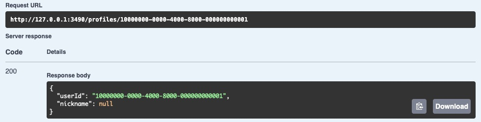
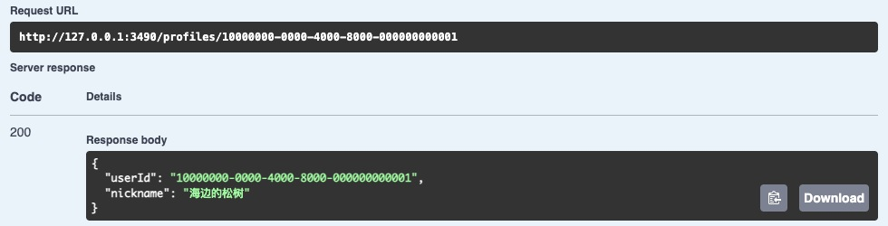
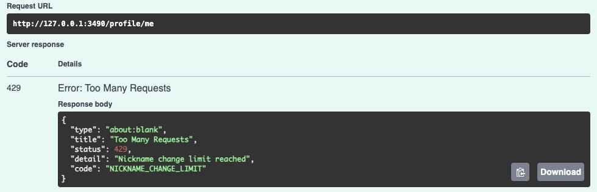

# 第 49 章　用户资料的业务约束与隐私

阿岚把昵称填成了「山雀」，还没打开「向其他用户展示」。她退出编辑页再回来，希望输入框里仍然有「山雀」。另一位用户此刻点开她的资料卡，应该看到什么？如果两张页面都调用一个返回完整账号的接口，只在卡片里用 CSS 隐藏昵称，打开 Network 就能读到它。

从[第 47 章配套代码](https://github.com/SamChowRock/epp-public/tree/part-06/chapter-47)继续；第 48 章沿用这套代码。保留账号、登录和通知，在原账号上增加昵称和可见性。先在旧库的独立副本上建立结构，再把读写接口接到已有 API。照片的字节和对象键要到后两章才出现。

阅读约 50～65 分钟；已有两个练习账号时，编码、迁移与联调另加 70～95 分钟，需准备新账号另加 10～20 分钟。

## 49.1 一张资料卡有两种读法

先把自己当成调用者，写下三个请求。把哪个账号写进 URL，取决于这一步究竟由谁作主。

| 想做的事 | 请求 | 服务端从哪里拿账号 |
| --- | --- | --- |
| 打开自己的设置页 | `GET /profile/me` | 已验证会话决定本人 |
| 在设置页保存 | `PATCH /profile/me` | 已验证会话决定被修改者，只接收允许修改的字段 |
| 打开一个已知用户的资料卡 | `GET /profiles/:userId` | 会话决定谁来读，路径决定看谁 |

本篇里「公开」指**具有 Web 访问资格的已登录用户**可以读取。公开卡面向已知用户 ID，没有搜索或枚举账号的需求。它返回固定的两个键：`userId`、`nickname`。资料目标有资格展示时，无论从未命名还是关闭展示，第二个键都是 `null`；页面可显示「未展示昵称」。目标账号不存在、已停用或未开通 Web，都按找不到资料卡处理。这个设计允许已登录的人证实一个已知 ID 对应可访问的账号。如果连账号是否存在都要保密，单纯把昵称遮掉还不够，得先判断双方的关系是否允许发现对方。

设置页多读一个 `nicknameVisible`，也能看到自己保存的昵称。即使本人访问自己的**卡片**地址，也应和别人看到相同的投影，这样「预览资料卡」才有意义。`GET /auth/me` 继续只回答当前会话身份。账号 ID 可以进入资料响应，邮箱曾经用于注册，密码凭据用于认证，会话 ID 用于设备管理；这些字段各有读者。下次账号表增列，公开卡的响应键仍应只有原来的两个。

再考虑保存。单发 `{"nicknameVisible":false}` 就能撤下展示，保留已取好的名字。单发昵称时保留原公开设置；若已经公开，成功改名后别人下一次读取就看到新名字。两者一起提交时，要么一起生效，要么一起保持原值。额度用尽的用户仍然能随时关闭展示。公开后别人已经保存的截图和响应无法靠这次修改收回，服务端承诺的是随后重新读取的结果。沿用第五篇的 `private, no-store` 与 `Vary: Cookie`，也要在前端切换账号时清掉前一个人的资料状态。

## 49.2 把旧账号接到资料上

账号和当前昵称是一对零或一，读取设置时要取当前值。把 `nickname` 放在 `users`，用 NULL 表示尚未取名。用单独的布尔列保存展示意愿：用户已经取了名字又关掉展示，与从未取名是两种本人可以区分的状态。给旧账号的默认值是 NULL、false。旧邮箱前缀可能含真名或工号，没有理由在升级时自动拿它作昵称。

另一个事实是「这个账号何时实际改过一次名字」。一个账号可以有多笔，只记用户和时刻即可数窗口内的次数。只存最后一次修改时间，无法区分最近改了一次还是三次；把所有旧昵称存成历史又扩大了隐私数据的范围。每个事件有独立主键，同一毫秒的两个成功操作仍可各占一行。按用户、时间建索引，某个账号改名时只查自己的窗口。不要求两个用户的名字不同，素材的归属和会话的身份都继续认原来的 UUID。

在 `prisma/migrations/20261110030000_profiles/migration.sql` 追加这一个事务。数据库的 CHECK 对非空昵称守住字节范围，NULL 仍然合法。

```sql
BEGIN;
SET LOCAL lock_timeout = '2s';

ALTER TABLE public.users ADD COLUMN nickname text,
  ADD COLUMN nickname_visible boolean NOT NULL DEFAULT false,
  ADD CONSTRAINT users_nickname_size CHECK (octet_length(nickname) BETWEEN 1 AND 192);

CREATE TABLE public.nickname_changes (
  id bigint GENERATED BY DEFAULT AS IDENTITY PRIMARY KEY,
  user_id uuid NOT NULL REFERENCES public.users(id) ON DELETE CASCADE ON UPDATE CASCADE,
  changed_at timestamptz(3) NOT NULL
);
CREATE INDEX nickname_changes_owner_time_idx ON public.nickname_changes(user_id, changed_at);
COMMIT;
```

在 `prisma/schema.prisma` 把以下三个字段加进原 User 模型。再在模型外加入 NicknameChange。外键使账号删除时连带移除计数行；这一步只处理同一个数据库内的依赖。

```prisma
  nickname String? @db.Text
  nicknameVisible Boolean @default(false) @map("nickname_visible")
  nicknameChanges NicknameChange[]

model NicknameChange {
  id BigInt @id @default(autoincrement())
  userId String @map("user_id") @db.Uuid
  changedAt DateTime @map("changed_at") @db.Timestamptz(3)
  user User @relation(fields: [userId], references: [id], onDelete: Cascade, onUpdate: Cascade)
  @@index([userId, changedAt], map: "nickname_changes_owner_time_idx")
  @@map("nickname_changes")
}
```

建模后先演练**非空升级**。停下练习用的 API 与 Worker，按[第 44.6 节](../../part-06-background/chapter-44-claims/chapter.md#446-在旧库上完成交接)把已完成第 47 章的库恢复到独立副本，例如 `epp_ch49_verify`。在 DBeaver 新建到副本的连接，确认数据库名。选一位你能登录的练习账号，记录它的 ID 和资格；如果它已有素材或通知，再记一条属于它的记录 ID。把下面的示例 UUID 换成该账号；用验证过的邮箱回查 ID 的方法见[第 47.4 节](../../part-06-background/chapter-47-sse/chapter.md#474-断线期间新增的通知去哪里找)。

```sql
SELECT current_database(), id, status, web_enabled, created_at
FROM public.users WHERE id = '10000000-0000-4000-8000-000000000001';
```

项目根的 `.env.database-verify` 中把 DATABASE_URL 指向这个副本。库名参数按刚才**恢复时指定的名字**填写。沿用 Node 24.22.1 和前章锁文件，若刚取得代码先运行 `npm ci`。这里即可独立完成第一阶段。

```bash
unset DATABASE_URL TEST_DATABASE_URL SHADOW_DATABASE_URL
node --env-file=.env.database-verify scripts/deploy-verify.mjs deploy epp_ch49_verify
npm run db:verify -- migrate status
npm run check
```

取同一行的 `id,status,web_enabled,created_at,nickname,nickname_visible`；前四列与升级前一致，后两列为 NULL、false。用上面的账号 ID 查询 `nickname_changes`，应当没有为旧用户编造的改名事件。已有账号稍后仍可用原凭据登录；原来的素材和收件箱可以按先前记录的 ID 核对。若没有旧库，另建独立空库，配置和命令相同，第一条 Node 命令把 `deploy` 换成 `bootstrap`。它会先重放早期基线再追加迁移。空库不会凭空出现可登录的用户，49.5 说明如何准备两个。

## 49.3 一个昵称究竟有多长

给输入框加上 `maxlength="24"`，再对服务端字符串做一次 `.length <= 24`，看起来前后端一致了。试填一串「👩🏽‍💻」：每个图案由女人、肤色、连接符和电脑四个码点组成，在 JS 中用了七个 UTF-16 代码单元。用户在屏幕上看到几个图案，就是这条产品规则想数的东西。下面的代码可直接贴进项目所用版本的 Node REPL。

```js
const segmenter = new Intl.Segmenter('und', { granularity: 'grapheme' });
for (const value of ['山', 'é', 'e\u0301', '👩🏽‍💻']) {
  console.log(value, value.length, [...value].length,
    [...segmenter.segment(value)].length, Buffer.byteLength(value, 'utf8'));
}
```

四列数字依次是代码单元、码点、扩展字素簇和 UTF-8 字节数。「山」得到 1、1、1、3；预组的 é 是 1、1、1、2，分开的 e 与组合重音是 2、2、1、3；最后一行是 7、4、1、15。扩展字素簇给出一套可以实现和复测的边界；具体字体如何排版、两个名字肉眼是否容易混淆，仍是另外的问题。升级运行时可用这几组输入回归，客户端预估长度，服务端按约定版本裁决。[Unicode 文本分段](https://www.unicode.org/reports/tr29/)

本章约定保存去首尾空白、经 NFC 规范化的文本。两种 é 规范化后完全相同，下次再提交不会多占一次改名。NFC 不会把所有看起来相像的字都合并，昵称也没有作为登录标识或唯一键。长度一端限制在 1～24 个字素簇，另一端限制规范值不超过 192 个 UTF-8 字节。原因可以实测：`'A' + '\u0301'.repeat(100)` 只有一个字素簇，规范化后仍有 200 字节。两个限制都满足才能保存，24 个山字能通过，13 个上面的 emoji 就会碰到字节限制。整个 HTTP 请求体仍有前面建立的 16 KiB 接收上限，JSON 解析之后再检查字段。

新增 `src/profile-contract.ts`。先查原字符串能否安全保存，并拒绝控制字符，例如夹在名字里的换行；然后规范化并裁掉首尾空白。字节上限约束最终可保存的数据量，HTTP 正文上限另行约束进入解析器的原始输入。

```ts
import { z } from 'zod';
import { UserIdSchema } from './auth-contract.js';
import { isPostgresText } from './postgres-text.js';

const graphemes = new Intl.Segmenter('und', { granularity: 'grapheme' });
const Nickname = z.string()
  .refine(value => isPostgresText(value) && !/\p{Cc}/u.test(value), 'Invalid nickname text')
  .transform(value => value.normalize('NFC').trim())
  .refine(value => Buffer.byteLength(value, 'utf8') <= 192, 'Nickname exceeds 192 UTF-8 bytes')
  .refine(value => {
    const count = Array.from(graphemes.segment(value)).length;
    return count >= 1 && count <= 24;
  }, 'Nickname must contain 1 to 24 graphemes');

export const ProfilePatch = z.strictObject({
  nickname: Nickname.optional(),
  nicknameVisible: z.boolean().optional(),
}).refine(input => input.nickname !== undefined || input.nicknameVisible !== undefined, 'Provide a profile field');

export const PublicProfile = z.strictObject({ userId: UserIdSchema, nickname: z.string().nullable() });
export const OwnProfile = PublicProfile.extend({ nicknameVisible: z.boolean() });
export type ProfileInput = z.infer<typeof ProfilePatch>;
export type Profile = z.infer<typeof OwnProfile>;
```

先只完成这个文件，运行 `npm run check`。在项目根检查解析后的值，再看一个仅关闭展示的补丁：

```bash
node --input-type=module -e '
import { ProfilePatch } from "./dist/src/profile-contract.js";
console.log(ProfilePatch.parse({ nickname: " e\u0301 " }));
console.log(ProfilePatch.parse({ nicknameVisible: false }));
console.log(ProfilePatch.safeParse({ userId: "x" }).success);'
```

你会依次得到只含 é 的昵称对象、仍保留 false 的开关对象，以及 false。

输入中缺少 nickname 代表「这次不改它」。空串、全空白或显式 null 都无法改名；想暂时不让别人看，用可见性开关。不能把字段的缺席误写成 `visible || 原值`：传来的 false 正是这一笔要保存的值。再看输出方向：响应只组装契约规定的键，拒绝额外的写入参数，两个方向各自守住自己的边界。

## 49.4 两个改名请求争最后一次机会

在周一晚上、周三上午各改一次。周五两台设备同时提交不同的名字，窗口里只剩一个名额。给两条请求各包一层事务但都「先数两条，再写一条」，两个事务就可能各看到两条已提交的旧记录，最后得到四次。去锁已存在的两条历史也不够：新账号首次取名时，一条可锁的历史都没有。两个请求都能定位、且自始存在的那一行是 **users 中同一个账号**。

把它当作所有资料修改共同经过的地方。先锁账号再看当前昵称和资格，确认真的要改，再向数据库取本次判断的时间 t。统计刚过去的 720 小时，左端点开，恰在 t−720 小时的那笔已归还名额。使用小时明确经过的时长，不依赖某地每个月有多少天或换夏令时的那一天过了多少小时。事务在锁上等待过的话，事务开始时间可能早了好几秒。检查窗口和写新事件用同一时刻，才能讲清这笔属于哪一侧。[PostgreSQL 时间函数](https://www.postgresql.org/docs/18/functions-datetime.html)

新增 `src/profile.service.ts`。下面先看两个读方法及外壳，接着把 patch 放进同一个类。公开查询用一个 SQL 快照读展示意愿和昵称，即便用户同时切换开关，这次响应仍对应一个完整的已提交状态。资格判断中的 status、web_enabled 都属于被查看者；来访者已经经过第五篇会话边界。

```ts
import { Injectable } from '@nestjs/common';
import { webAccessFailure, type AccountAccess } from './account-access.js';
import { ApplicationState } from './application-state.js';
import type { SessionIdentity } from './auth-context.js';
import { DatabaseService } from './database.service.js';
import { HttpError } from './http.js';
import type { Profile, ProfileInput } from './profile-contract.js';

@Injectable()
export class ProfileService {
  constructor(private readonly database: DatabaseService, private readonly state: ApplicationState) {}

  async own(userId: string) {
    const [row] = await this.state.track(() => this.database.run('readOwnProfile', () => this.database.client.$queryRaw<Profile[]>`
      SELECT id AS "userId", nickname, nickname_visible AS "nicknameVisible"
      FROM public.users WHERE id=${userId}::uuid AND status='active' AND web_enabled`));
    if (!row) throw new HttpError(404, 'Profile not found', 'PROFILE_NOT_FOUND');
    return row;
  }

  async published(userId: string) {
    const [row] = await this.state.track(() => this.database.run('readPublicProfile', () => this.database.client.$queryRaw<Pick<Profile,'userId'|'nickname'>[]>`
      SELECT id AS "userId", CASE WHEN nickname_visible THEN nickname END AS nickname
      FROM public.users WHERE id=${userId}::uuid AND status='active' AND web_enabled`));
    if (!row) throw new HttpError(404, 'Profile not found', 'PROFILE_NOT_FOUND');
    return row;
  }
  // 下方的 patch 方法放在这里
}
```

写路径会在账号锁内检查当前资格，并锁住这次请求使用的会话，按数据库时刻检查它是否已撤销或到期。因此等待期间先完成的改密或停用也会约束这次写入。两把锁均在短事务里，不占着锁等待用户、SMTP 或对象存储。锁等待过久进入已有的临时存储失败处理；配额耗尽则有自己的错误码。

```ts
  async patch(identity: SessionIdentity, input: ProfileInput): Promise<Profile> {
    const { userId, sessionId } = identity;
    const result = await this.state.track(() => this.database.run('patchOwnProfile', () => this.database.client.$transaction(async tx => {
      await tx.$executeRaw`SET LOCAL lock_timeout = '1s'`;
      const [account] = await tx.$queryRaw<(AccountAccess & Pick<Profile,'nickname'|'nicknameVisible'>)[]>`
        SELECT status, web_enabled AS "webEnabled", nickname, nickname_visible AS "nicknameVisible"
        FROM public.users WHERE id=${userId}::uuid FOR UPDATE`;
      if (!account) return 'AUTH_REQUIRED' as const;
      const denied = webAccessFailure(account);
      if (denied) return denied;

      const [session] = await tx.$queryRaw<{ expiresAt: Date }[]>`
        SELECT expires_at AS "expiresAt" FROM public.sessions
        WHERE id=${sessionId}::uuid AND user_id=${userId}::uuid FOR UPDATE`;
      const [clock] = await tx.$queryRaw<{ now: Date }[]>`SELECT clock_timestamp()::timestamptz(3) AS now`;
      if (!clock) throw new Error('Missing database time');
      if (!session || session.expiresAt <= clock.now) return 'AUTH_REQUIRED' as const;

      const nickname = input.nickname ?? account.nickname;
      const nicknameVisible = input.nicknameVisible ?? account.nicknameVisible;
      if (nickname !== account.nickname) {
        await tx.$executeRaw`DELETE FROM public.nickname_changes
          WHERE user_id=${userId}::uuid AND changed_at <= ${clock.now}::timestamptz - interval '720 hours'`;
        const used = await tx.nicknameChange.count({ where: { userId } });
        if (used >= 3) return 'NICKNAME_CHANGE_LIMIT' as const;
        await tx.nicknameChange.create({ data: { userId, changedAt: clock.now } });
      }
      if (nickname !== account.nickname || nicknameVisible !== account.nicknameVisible) {
        await tx.user.update({ where: { id: userId }, data: { nickname, nicknameVisible } });
      }
      return { userId, nickname, nicknameVisible };
    }, { maxWait: 2000, timeout: 5000 })));
    if (result === 'AUTH_REQUIRED') throw new HttpError(401, 'Authentication required', result);
    if (result === 'NICKNAME_CHANGE_LIMIT') throw new HttpError(429, 'Nickname change limit reached', result);
    if (typeof result === 'string') throw new HttpError(403, 'Account is not permitted to use this service', result);
    return result;
  }
```

顺着第一笔拿到锁的请求往下走。如果它提交，等候者随后读到最新名字，在默认 Read Committed 下，持锁后的下一条语句能看到先行事务刚提交的计费行；即便换一个 API 进程，还是同一把数据库行锁。如果第一笔回滚，名字、可见性和计费行也一起回滚。两笔要求同一个规范名时，等候者读到目标已经达到，直接成功；两笔要求不同名字时，只有余额允许的那笔能改。被拒的一方必须重新读本人资料才能知道谁赢了。数据库行锁在这里同时为多个字段排序，后来的单字段 PATCH 不应用页面加载时的整份旧表单覆盖未提交的字段。[PostgreSQL Read Committed](https://www.postgresql.org/docs/18/transaction-iso.html#XACT-READ-COMMITTED)

<details>
<summary>亲眼区分「请求有先后」与「数据库真的在等锁」</summary>

在独立 VERIFY 用一位专用于实验、当前 nickname_visible 为 false 的账号。若 49.2 从空库起步，此时还没有账号，先到 49.5 准备练习用户，再回到这里。这里直接检查 PostgreSQL 的行锁，暂时只改它的展示开关。打开三个独立数据库连接 A、B、C，各执行 `SELECT current_database(), pg_backend_pid();`。三个库名要对，三个 PID 要不同。在 DBeaver 打开三个共用同一连接的标签页达不到这个条件；可以另建独立连接，或用三个 psql 会话。C 用自动提交模式。每段逐条执行，A 和 B 的事务要由你决定何时结束。

A 执行下段，替换成这个练习账号的 UUID，看到恰好一行 true 后停住：

```sql
BEGIN;
UPDATE public.users SET nickname_visible = true
WHERE id = '替换为本轮专用账号UUID'::uuid
RETURNING id, nickname_visible;
```

B 再执行下面两句，填同一 ID。此处没有 API 事务的一秒锁等待限制。第二句应当仍在执行：

```sql
BEGIN ISOLATION LEVEL READ COMMITTED;
SELECT nickname_visible FROM public.users
WHERE id = '替换为本轮专用账号UUID'::uuid FOR UPDATE;
```

在 C 把下面的 11111 和 22222 分别换成 A 和 B 刚才查出的 PID。执行时 A 仍未结束、B 也仍在等。结果中 B 的 wait_event_type 应为 Lock，blockers 包含 A。零行时先检查是否填反、B 是否已经开始或已超时，以及 A 是否被自动提交。直接用普通 SELECT 读账号通常能读到旧值，它没有尝试取得 B 所请求的写锁。

```sql
SELECT pid, wait_event_type, pg_blocking_pids(pid) AS blockers
FROM pg_stat_activity
WHERE pid = 22222 AND 11111 = ANY(pg_blocking_pids(pid));
```

第一轮在 A 单独执行 `ROLLBACK;`。B 的那条 SELECT 现在返回 false，在 **B 也执行 COMMIT** 释放它刚取得的锁。重复 A 的 BEGIN、UPDATE 与 B 的 BEGIN、SELECT，再让 C 确认一次等待。这回 A 执行 `COMMIT;`，B 原先停住的查询会返回 true；B 再 COMMIT。最后由 C 按同一 ID 将 nickname_visible 设回 false，用 RETURNING 核对一行。若中途离开，先取消仍在等的查询，在 A、B 分别 ROLLBACK，再查开关是否需要恢复。这个实验改变了一次竞争的提交结果，49.5 再去看同一机制对两个 HTTP 写请求的影响。

</details>

这个顺序允许安全地重送**当前值**。若 A 成功改成山雀，应答丢失，B 又改成白鹭，A 迟到的相同请求此时会被当作一次新的改名，可能扣额或被拒。要让重试取得首次结果，需要第四篇的稳定命令身份和仍在保留期内的回执。若只要求旧表单不能覆盖较新的选择，可以让客户端带上读取时的资料版本，版本已变就拒绝写入、重新查询。版本冲突本身无法告诉 A 是自己的首次提交成功，还是另一台设备先写了。行锁能保证次数和字段一致，无法代用户判断两台设备中哪台代表最后意愿。

在 `src/profile.controller.ts` 接上三个入口。路径参数复用第五篇的 UserIdSchema，读得回前章合法的旧 UUID；设置页的读写入口都没有接收 owner 参数。

```ts
import { Body, Controller, Get, Param, Patch, Query, Req, UseInterceptors } from '@nestjs/common';
import { UserIdSchema } from './auth-contract.js';
import { requireSession, type AuthenticatedRequest } from './auth-context.js';
import { EmptyObjectSchema } from './candidate-contract.js';
import { OwnProfile, ProfilePatch, PublicProfile, type ProfileInput } from './profile-contract.js';
import { ProfileService } from './profile.service.js';
import { ResponseSchemaInterceptor } from './response-schema.interceptor.js';
import { SchemaPipe } from './schema.pipe.js';

@Controller()
export class ProfileController {
  constructor(private readonly profiles: ProfileService) {}

  @Get('profile/me')
  @UseInterceptors(new ResponseSchemaInterceptor(OwnProfile))
  own(@Req() request: AuthenticatedRequest, @Query(new SchemaPipe(EmptyObjectSchema)) _query: object) {
    return this.profiles.own(requireSession(request).userId);
  }

  @Patch('profile/me')
  @UseInterceptors(new ResponseSchemaInterceptor(OwnProfile))
  patch(@Req() request: AuthenticatedRequest, @Body(new SchemaPipe(ProfilePatch)) input: ProfileInput,
    @Query(new SchemaPipe(EmptyObjectSchema)) _query: object) {
    return this.profiles.patch(requireSession(request), input);
  }

  @Get('profiles/:userId')
  @UseInterceptors(new ResponseSchemaInterceptor(PublicProfile))
  published(@Param('userId', new SchemaPipe(UserIdSchema)) userId: string,
    @Query(new SchemaPipe(EmptyObjectSchema)) _query: object) {
    return this.profiles.published(userId);
  }
}
```

在 `src/auth.module.ts` 导入这两个新类，将 ProfileController 加到 controllers，ProfileService 加到 providers。已有的 DatabaseModule 和全局运行时提供数据库与排空跟踪。在 `src/http-boundary.ts` 中，找到定义 notificationRead、notificationDetail 后的百分号检查，将它换成下面这段。再在 allowed 中加入分支，公开卡只放行 GET：

```ts
const publicProfile = /^\/profiles\/([^/]+)$/.exec(url.pathname);
// 替换原通知路径的百分号检查
if ((publicProfile?.[1] ?? notificationRead?.[1] ?? notificationDetail?.[1])?.includes('%')) {
  throw new HttpError(404, 'Route not found', 'ROUTE_NOT_FOUND');
}
```

在已有 `allowed` 表达式的通知分支之前插入这两个条件：

```ts
: url.pathname === '/profile/me' ? ['GET', 'PATCH'] : publicProfile ? ['GET']
```

在 `src/request-observation.ts` 把 `/profile/me` 加进固定路径，将匹配到的他人卡片记成 `/profiles/:userId`，从而既能按路由查错误，又不把访问过谁写进日志标签。在 `src/database.service.ts` 的 API 启动探测中让 user.findMany 也 select nickname、nicknameVisible，再取一行 nicknameChange；若误连未迁移的库，启动就会发现。保留此前两种 Worker 的独立探测。

最后让 Swagger 能实际发请求。在 `src/openapi.ts` 导入 ProfilePatch、OwnProfile、PublicProfile 和 UserIdSchema。三个 components.schemas 使用以下条目；在 paths 中按 49.1 的路径和方法分别加入 readOwnProfile、patchOwnProfile、readPublicProfile。PATCH 使用 ProfilePatch 请求体、两个本人方法的成功响应均引用 OwnProfile。公开 GET 的必填路径参数 userId 使用 UserIdSchema，200 引用 PublicProfile。沿用文件末尾统一补安全请求头与错误格式的循环。

```ts
OwnProfile: schema(OwnProfile, 'output'), PublicProfile: schema(PublicProfile, 'output'),
ProfilePatch: { ...schema(ProfilePatch, 'input'), minProperties: 1 },
```

可直接对照[本章的 OpenAPI 三个操作](https://github.com/SamChowRock/epp-public/blob/part-07/chapter-49/src/openapi.ts)检查参数、200／400／404／429 与响应 Schema。

到这里重新运行 `npm run check`。这一阶段可以直接使用 API，第 47 章的实验页和邮件／站内 Worker 都不参与资料读写。需要从空库注册新账号时，才会用到寄验证邮件的角色。

## 49.5 用两个账号检查可见性和配额

从前章跟写时，先从本章配套取[第 49 章集合](https://github.com/SamChowRock/epp-public/blob/part-07/chapter-49/requests/chapter-49.postman_collection.json)和[资料测试](https://github.com/SamChowRock/epp-public/blob/part-07/chapter-49/test/profile.test.mjs)，分别保存到项目的 `requests/chapter-49.postman_collection.json` 与 `test/profile.test.mjs`。保留前章已有的文件。

实验需要两个能登录且已开通 Web 的虚构账号 A、B。若要新注册，先按下方命令启动 API，再回来发注册请求。可以沿用第 48 章账号作 A；若缺 B，在本轮独立库按[第 46 章注册与开通](../../part-06-background/chapter-46-notifications/chapter.md#464-用两次确认走完收件箱)运行 Mailpit 和邮件 Worker，发集合的 01、02，再用 `database/chapter-36/02-grant-fixture.sql` 同时替换本次邮箱与返回的用户 ID，核对 RETURNING 恰有一行再提交开通。A、B 各用自己的地址。先把没填过的虚构邮箱、当前练习密码写入集合使用的本地环境；每个账号在 02 返回后才有可用于开通的 userId。若库里保留着第 48 章尚待核对的 SMTP 事故，现有账号仍能做本章实验；如需寄新信，按第 45 章核对处置后在同库准备 B，或者在新 VERIFY 中重新准备 A、B 两人，并把 API、Worker 和 DBeaver 一起切到该库。只有旧 ID 与密码的账号也能登录，见[本章配套运行步骤](https://github.com/SamChowRock/epp-public/blob/part-07/chapter-49/database/chapter-49/README.md)。

先启动本章 API。项目根 `.env.test` 的 TEST_DATABASE_URL 指向联调副本；以下库名须和 49.2 创建的名称一致。前章实验页使用了不同的 Origin，这次直接在 API 的 3360 端口打开 Swagger。已有同端口的旧实验服务先结束。

```bash
unset DATABASE_URL TEST_DATABASE_URL APP_ORIGIN PORT DB_QUERY_DEBUG
NODE_ENV=development node --env-file=.env.test --input-type=module -e '
process.env.DATABASE_URL = process.env.TEST_DATABASE_URL;
const { withVerifiedDatabase } = await import("./scripts/verify-database.mjs");
await withVerifiedDatabase(process.argv[1]);
process.env.PORT = "3360";
process.env.APP_ORIGIN = "http://127.0.0.1:3360";
process.env.DB_QUERY_DEBUG = "false";
await import("./scripts/dev.mjs");' epp_ch49_verify
```

**先留下一个看得出差别的值。** 在 Postman 导入 `requests/chapter-49.postman_collection.json`。baseUrl 指向该 API，沿用一个未同步的本地环境存 email、password 和 csrfToken。用 A 当前的邮箱和密码发 05，再发 20，从 20 返回值取 A 的 userId，把它手工保存到集合变量 profileTargetId 的本地值。把环境里覆盖 profileTargetId、nickname、nicknameVisible 或 expectedRenameStatus 的同名变量清走。01～19 延续前章编号，19 会保持打开，本次按需单发。先保留 20 的当前昵称和展示状态，暂时停在读取阶段。

在 DBeaver 的本轮连接里，用 A 的真实 ID 替换占位符，运行下列查询。读出当前名字和已用次数，特别留意还剩几次；反复跟做时，上一次取的名字和计费行仍可能有效。

```sql
SELECT u.id, u.nickname, u.nickname_visible,
       count(c.id) FILTER (
         WHERE c.changed_at > statement_timestamp() - interval '720 hours'
       ) AS used_in_window
FROM public.users u
LEFT JOIN public.nickname_changes c ON c.user_id = u.id
WHERE u.id = '替换为A的UUID'::uuid
GROUP BY u.id;
```

发 15 取得 A 对应的 CSRF Token。先将 nicknameVisible 设为 false 发 22，收到 200 再准备昵称。若 20 已有昵称，保留它作两人对照，无需为换成书里的例子消耗名额。若是首次命名，设 nickname 为「山雀」、expectedRenameStatus 为 200，发 21。再发 20，看见保存的名字和 false。重新执行查询，首次取名增加一笔，仅关闭展示保持原次数。

**换读者，固定目标。** 将 05 的登录信息切成 B，发 05、20。确认这个 userId 已经是 B，保留 profileTargetId 为 A，再发 23。你会读到 A 的 ID 和 null。开另一个 Postman 标签页仍会共享 Cookie；每次换人先读 20。也可以让 B 留在独立浏览器：打开 `http://127.0.0.1:3360/docs`，在 POST /auth/login 选 Try it out，X-EPP-Request 填 1，以 B 登录后点 Execute；浏览器自动保存 HttpOnly Cookie。在 GET /profiles/{userId} 填入 A 的 ID 并执行，两种客户端此时看到的是同一份资料卡。



图 49-1　已登录的来访者能读到目标账号的卡片。200 和 null 一起出现；仅从来访者这一侧看不出对方是否曾取过名。

用 A 再登录 Postman，先发 20 确认 A，再发 15 更新写入令牌。把 nicknameVisible 设为 true 发 22。用 B 再发同一个卡片 GET。B 若留在独立浏览器里，只需在原来的请求点 Execute；若切回 Postman 的 B，先重新登录。两次请求目标相同，这次多看到的是昵称，电子邮箱和可见性设置都没有进入响应。再查数据库，本次切换没有增加改名次数。



图 49-2　这次实拍使用昵称「海边的松树」，目标 UUID 与上图相同。读者从两次响应就能判断，隐藏策略究竟执行在服务端还是只执行在页面上。

**只留一个名额，再让两条请求一起进来。** 在独立的本机练习账号上，先查 SQL，目标是窗口内恰有两次实际命名。Postman 若已换人，先以目标账号登录，发 20、15。按查询结果决定要发几次 21：已用零次，取两个不同于当前且彼此不同的新名；一次，只改一次；两次，直接停在这里；三次，等最老一笔满 720 小时，或另取专用账号从它自己的基线开始。每次 21 的 expectedRenameStatus 设为 200。用量达到二时，再提交一次当前规范值，查 20 和 SQL，计数应保持为二。不要直接删除事件来模拟额度归还。

在一个独立的浏览器上下文打开同源 Swagger，用这个**只剩一次机会的账号**登录，先执行 GET /profile/me 看清返回的 userId，核对它正是 SQL 使用的账号。打开该页面的开发者工具 Console，执行下段本机实验代码。先把 `expectedUserId` 换成刚核对的 UUID。代码在本页向同源 API 取登录态绑定的 CSRF Token，然后发出两个不同的 PATCH；两个候选名字都要与此时的昵称不同。令牌仅用于本次写入，不要输出或保存。

```js
await (async () => {
  const expectedUserId = '替换为只剩一次机会的账号UUID';
  const me = await fetch('/profile/me');
  if (!me.ok) throw Error('请先登录实验账号');
  const current = await me.json();
  const names = ['海燕', '翠鸟'];
  if (current.userId !== expectedUserId || names.includes(current.nickname)) {
    throw Error('请核对账号与两个候选昵称');
  }
  const token = await fetch('/auth/csrf');
  if (!token.ok) throw Error('请重新登录并取本会话的令牌');
  const { csrfToken } = await token.json();
  const results = await Promise.all(names.map(async nickname => {
    const response = await fetch('/profile/me', {
      method: 'PATCH',
      headers: { 'Content-Type': 'application/json', 'X-EPP-Request': '1',
                 'X-CSRF-Token': csrfToken },
      body: JSON.stringify({ nickname }),
    });
    const body = await response.json();
    return { requested: nickname, status: response.status, result: body.code ?? body.nickname };
  }));
  console.table(results);
})();
```

Network 里可以按 profile/me 筛选。通常应有一个 200、一个 429（NICKNAME_CHANGE_LIMIT）；控制台的行按候选名字排列，哪一行先赢由实际执行决定。200 的名字与 GET /profile/me 及 SQL 返回的当前名字要一致，计数恰为三。若发生连接中断或 503，先查数据再判断，这种结果没有证明配额耗尽。两笔 HTTP 同时发出足以检查最终行为；响应先后本身无法测量数据库等锁多久。若想沿代码看计费位置，在 `ProfileService.patch` 的事务开始**之前**设断点，观察会话所属 userId、请求字段和规范值，继续后再查 SQL；暂停在持锁事务内会改变后继请求的超时结果，须另用有余额的样本观察正常竞争。



图 49-3　在图 49-1、49-2 的实验账号上用完配额，再用 Swagger 单发另一个新名字。响应中的 NICKNAME_CHANGE_LIMIT 把这次拒绝与登录尝试过多区分开。


图 49-4　这一轮另用一个只剩一次机会的练习账号执行上面的控制台代码。「海燕」返回 200，「翠鸟」返回 429。用同一账号的 ID 重新执行本节 SQL，DBeaver 显示胜出的名字和三次用量。nickname_visible 仍未勾选，两笔请求都只修改昵称。

现在额度用尽。回到 Postman，用刚才争名额的账号登录并发 20、15，更新身份和写令牌。若它与先前的 A 不同，把 profileTargetId 改为这位账号的 ID。把集合变量 nicknameVisible 明确设回 false，单独发 22 关闭展示仍返回 200，B 再读卡片时应为 null。若刚切到 B，再登录刚才满额的账号，发 20、15 核对身份并获取写入令牌。复制 21 作为临时请求，保留请求头，将 Body 的 raw 内容改成 `{"nickname":"本轮另一个新名字","nicknameVisible":true}`，其中名字与满额账号的当前值不同。把两项修改放进**同一份** PATCH，则整个保存应得到 429，20 仍显示原名和 false。想验证写入属主，在 Postman 复制 21，将副本的 raw body 改为 `{"userId":"另一个账号的实际UUID","nickname":"越界尝试"}`，保留当前会话和写请求头；服务端返回 400，两位用户的设置均应保持。复制的请求可能沿用原成功断言，判断这次负例要读实际 HTTP 状态和响应。

中途离开回来，先确认三个值：20 返回的本人 ID、23 使用的目标 ID、数据库里该账号仍在窗口内的次数。会话失效就用当前密码重新登录、重取 15，已经用掉的名额不随会话或 API 重启归零。要运行本章自动回归，另备新测试库，按 49.2 在该空库 bootstrap **本章**结构，再按[第 42.4 节末尾的固定用户 SQL](../../part-06-background/chapter-42-outbox/chapter.md#424-让另一个进程寄出一封仍然有效的信)准备旧素材用例所需的样本，将单独的配置文件 `.env.test-regression` 的 TEST_DATABASE_URL 指向它，清除外层同名变量后运行：

```bash
unset TEST_DATABASE_URL DATABASE_URL
npm run build
NODE_ENV=test node --env-file=.env.test-regression --test --test-concurrency=1 test/*.test.mjs
```

在测试输出中找到本章三项：私有与公开投影及 Unicode、两笔不同改名争最后名额及组合修改的原子性、等候账号锁时 720 小时窗口跨过边界。单看总数，容易漏掉没有复制进来的新用例。

结束后关掉这次的 API、练习用 Worker 和 Mailpit。在 Postman 本地环境中清掉本轮的密码、邮件证明和 CSRF Token。

把现场换成一条客服反馈：「我能看到自己填的名字，朋友只看到空白」。先问对方是在哪个接口看到空白，由朋友在自己的会话里对目标 UUID 发卡片 GET，再让本人读设置页。本人没有取名与关掉可见性会给朋友相同结果；只有本人端可进一步区分。如果返回 401，先查朋友的登录；返回 404，再核对目标 UUID、账号状态与 Web 资格。若接口已经返回 null 而页面仍出现旧名字，继续查前端状态是否按账号切换和重新读取。昵称超额的 429 只管实际改名，单独关闭展示仍应成功。这样可以把「账号能否被发现」「这个字段可否给对方」「本次写入是否被接受」三件事分别查清。

下一章沿用这个账号，把输入换成一张图片。对一个已经被识别的用户，服务端仍然要决定接收多少字节、允许解码几幅图、请求中断后释放哪些资源。上传者有资格操作自己的账号，只回答了其中一个问题。

[支线 49A　换成自然月或改名审计，还要留哪些记录？](side-01-quota-history.md)

## 附录：本章必要技术点速查

| 遇到的现象 | 回到哪一层查 |
| --- | --- |
| 他人能从响应读到隐藏昵称 | 资料卡的查询投影、响应字段与实际调用路径 |
| 用户贴入组合字符后计数不一致 | 用相同输入分别比较 UTF-16、码点、字素簇和规范值字节数 |
| 名额用尽却还能保存 | 检查是否仅切换展示或重送了当前规范名 |
| 两台设备都拿到了最后一次改名机会 | 查两个写入口是否先锁同一用户、等锁后再统计和入账 |
| 迁移后所有人突然有了昵称 | 查旧数据默认值、回填来源以及读接口是否从邮箱推导 |

时间窗口的两条 SQL 可对照 [PostgreSQL 18 的时钟函数](https://www.postgresql.org/docs/18/functions-datetime.html#FUNCTIONS-DATETIME-CURRENT)和[行锁行为](https://www.postgresql.org/docs/18/explicit-locking.html#LOCKING-ROWS)；输入分段规则见 [Unicode UAX #29](https://www.unicode.org/reports/tr29/)。

[第 49 章完成代码](https://github.com/SamChowRock/epp-public/tree/part-07/chapter-49) · [第七篇导读](../README.md) · [全书目录](../../README.md)
