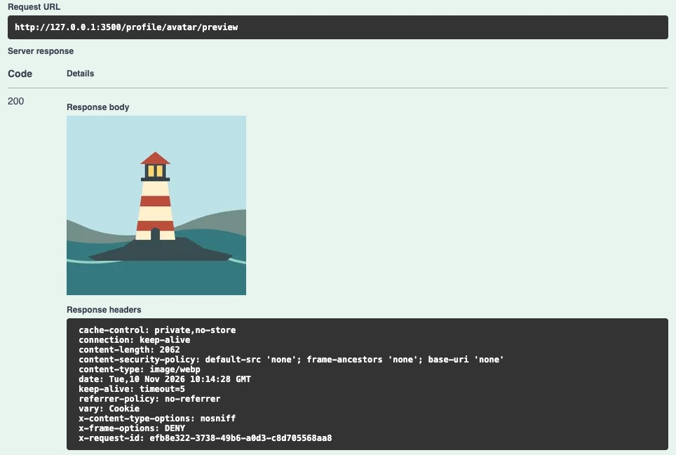
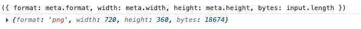
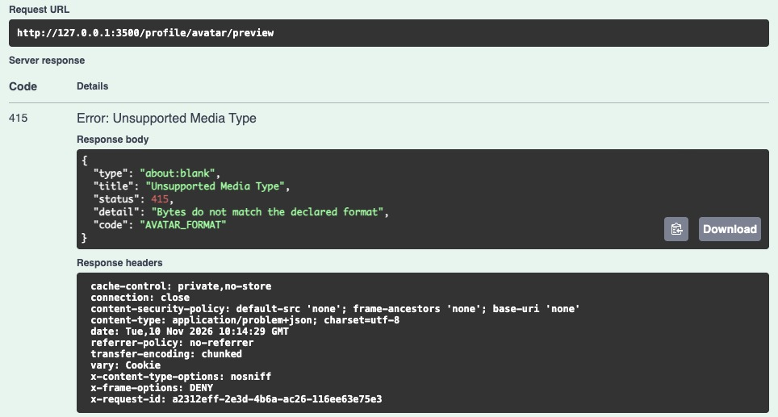

# 第 50 章　安全地接收和处理头像

把一张横向灯塔照片放进资料编辑页。用户点「预览」，希望知道圆形头像框里会留下灯塔，还是只剩旁边的一片海。如果浏览器只缩小原图，服务端最后采用了不同的旋转或裁切规则，用户确认的就是另一张图。本章让 EPP 生成将来准备发布的那份像素：先摆正，再从中心裁成正方形，返回一张 256×256 的 WebP。客户端可以在上面叠圆形遮罩。

从[第 49 章完成代码](https://github.com/SamChowRock/epp-public/tree/part-07/chapter-49)继续。沿用已开通的练习账号，以及保存着昵称、可见性和改名历史的 VERIFY。这个版本增加一个 API 入口和图像依赖；资料表、公开卡和改名额度都不增加字段。用户可以反复预览，关闭编辑页后，其他人查询他的资料仍会得到原来的结果。

阅读约 55～75 分钟；已有第 49 章练习账号时，编码、图片联调与退出实验另加 75～105 分钟。

## 50.1 给已登录用户返回一次预览

先用现有代码记一份基线。在独立练习库启动第 49 章 API，以 Postman 的 05 登录，20 读取本人资料。记下 userId、nickname、nicknameVisible。用上章的 SQL 查同一账号，记下窗口内计数；若有计费行恰好要到期，再按用户查 `nickname_changes` 的 id、changed_at，便于之后核对究竟有没有新建事件。第 48 章留下的邮件或站内通知无需处理。若从空库起步，按[第 49.2 节](../chapter-49-profile/chapter.md#492-把旧账号接到资料上)引导结构，再按[第 49.5 节](../chapter-49-profile/chapter.md#495-用两个账号检查可见性和配额)注册并开通一个练习账号。本章只需其中一人。

| 这次请求 | 双方约定 |
| --- | --- |
| 地址与身份 | `POST /profile/avatar/preview`，无查询参数。使用当前 Web 会话、已有的 `X-EPP-Request: 1` 和本次登录对应的 CSRF Token |
| 请求正文 | 一张 JPEG 或静态 PNG 的原始字节，Content-Type 分别为 image/jpeg 或 image/png；不再套 HTTP 压缩 |
| 成功响应 | 200，Content-Type 为 image/webp，正文是可显示的图像。沿用 private, no-store |
| 可见范围 | 只有这次请求的客户端得到处理结果。暂存文件没有 HTTP 地址，响应中也没有可供他人回查的头像键 |

这里一笔请求只传一张图，昵称和可见性已经有自己的 PATCH。因此浏览器可以直接把 `File` 作为 body，Postman 可以直接选择 binary。multipart/form-data 把边界、各个部分的头和文件内容共同封装在一个请求里；把整个 multipart 正文递给图片解码器，开头当然不是图片签名。另一种常见写法是把文件 Base64 化塞进 JSON：每 3 字节约需 4 个编码字符，解析时还要持有字符串和还原后的字节。上章的 JSON 请求限 16 KiB，为了接收头像抬高所有 JSON 上限，会顺带改变登录和创建素材的负担。

安全边界也要接续。知道某个 userId 无法授权使用处理时间；发送图片前先按第五篇验证会话、账号资格、来源和写请求头。即使没有改数据库，恶意网页也不应借受害者的 Cookie 免费触发图片处理。入场后账号可能被撤销，本章已经获准的短任务可能完成；下一次请求重新鉴权。第 51 章发布持久引用时，还须在发布的位置再检查账号和本次写入的身份。

把输入约束写成可观察的决定。以 2 MiB（2,097,152 字节）为一笔上传的传输上限；接收阶段给十秒；每个 API 进程同时接纳两笔。图片最多 1200 万像素，任意一边最多 8192 像素，只处理单幅。成功输出最多 512 KiB。它们回答的是不同的问题。一张 600 KiB 的细长全景图可能超过边长；两张合规的照片也可能让第三个请求暂时拿不到名额。下面分别把这些决定放到最早有证据的位置。

跟写从前章的目录进行。先停掉上面的开发 API，保留数据库。在项目根切到 Node 24.22.1，若是刚克隆的第 49 章，先用该章锁文件 `npm ci`。有完整章节代码副本时，从 `part-07/chapter-50` 的 `examples/avatar-preview/` 复制实验文件到跟写项目的同一相对路径。也可从[本章实验目录](https://github.com/SamChowRock/epp-public/tree/part-07/chapter-50/examples/avatar-preview)取得相同的样本和脚本。后面用到的集合和测试也在该版本的 `requests/`、`test/` 内。图片是同一幅 720×360 的灯塔画，左有太阳，右有帆船，中央是塔身；拿它们可以直观看出裁掉了哪部分。使用第 50 章完整代码时，样本已在项目中。

## 50.2 接收端怎样跟上慢速写入

先只做接收，不开放新路由。第 2 章用 `data` 收集小块，等 `end` 再合成 Buffer。假设换成收到一块就调用一次异步写文件，网络每隔一毫秒给一块，磁盘每四毫秒才消化一块。若监听器每次立即返回、继续取下一块，换成异步 API 也会积压一列未完成写入。客户端主动放慢叫慢传；下游忙时上游跟着减速才叫背压。它们可以用两个不同的实验观察。

先运行 `node examples/avatar-preview/backpressure.mjs`。这个实验反复写入 32 块 16 KiB 数据，写入端每块有意等四毫秒才调用完成回调。下面是负责提交数据的循环：

```js
  let peakQueued = 0;
  for (let i = 0; i < 32; i++) {
    const ready = sink.write(Buffer.alloc(blockBytes));
    peakQueued = Math.max(peakQueued, sink.writableLength);
    if (!ready && waitForDrain) await once(sink, 'drain');
  }
```

`sink.write()` 返回 false 时，这一块已经交给 sink。再提交一遍会重复数据；正确的动作是等 drain 再送下一块。实验把高水位设为两块（32 KiB）。在 Node 24.22.1，两次都消费 524,288 字节；等待 drain 的一轮，writableLength 最高 32,768，持续写入的一轮达到 524,288。这是这个 Writable 已接下而尚未处理完的字节数，**高水位是一条反馈线**，调用方能选择继续往里塞。这里没有测整个进程、内核或对端的内存上限。[Node.js 24 流的缓冲与背压](https://nodejs.org/download/release/v24.22.1/docs/api/stream.html#buffering)

实际接收有三站：请求的可读流 → 统计字节的 Transform → 临时文件的可写流。Transform 每来一块先计量，合规才把同一块转发给文件；当文件写入变慢，它的背压会沿管道传回请求流。可以把第一笔实际文件写入暂时扣住来区分这两件事。一轮 2 MiB 的回环上传里，读取量先到 327,459 字节，在磁盘写入未放行的随后 250 毫秒没有再增长；放行后才收齐 2,097,152 字节。分块大小会随平台和当次调度变化，应观察的是停住和恢复。操作系统仍有网络缓冲，客户端的下一次 write 也可能立即成功，这与 API 停止继续从请求取块并不矛盾。若请求提供 Content-Length，可以在写盘前立即拒绝超大声明。分块传输常常没有长度，故还要对**实际收到的每一块**计数。超限时连越界那一块也不应写进文件。

新增 `src/avatar-upload.ts`。下方各段按顺序组成这个文件。先建一个 API 专用的暂存根目录；本地开发时位于配套项目的工作目录，生产时以 API 实际工作目录为准。把 `.avatar-tmp/` 加入 `.gitignore`。用户给的文件名不参与路径，操作系统为每次尝试分配独立子目录；其中的文件统一叫 input。

```ts
import { createWriteStream } from 'node:fs';
import { lstat, mkdir, mkdtemp, rm } from 'node:fs/promises';
import type { IncomingMessage } from 'node:http';
import { join, resolve } from 'node:path';
import { Transform } from 'node:stream';
import { pipeline } from 'node:stream/promises';
import { HttpError } from './http.js';

const maxBytes = 2 * 1024 * 1024;
let activeUploads = 0;
const tooLarge = () => new HttpError(413, 'Avatar exceeds 2 MiB', 'AVATAR_TOO_LARGE');
const interrupted = () => new HttpError(400, 'Upload interrupted', 'UPLOAD_INTERRUPTED');

async function privateDirectory(): Promise<string> {
  const root = resolve('.avatar-tmp');
  await mkdir(root, { recursive: true, mode: 0o700 });
  const stat = await lstat(root);
  if (!stat.isDirectory() || (process.getuid &&
    (stat.uid !== process.getuid() || (stat.mode & 0o077) !== 0))) {
    throw new Error('Avatar temp root must be a private directory owned by the API');
  }
  return mkdtemp(join(root, 'upload-'));
}
```

运行目录由服务账号控制，其他本机用户不能改写它。根目录可复用，lstat 用于识别目录项本身，遇到符号链接拒绝继续。在本章 macOS 主线上，父目录和子目录限制为当前服务用户，文件以 0600 独占创建。若启动环境把目录建在不安全位置或放成公共可写，修正部署位置及属主；不能只把现有路径的权限一律改宽。跨平台部署还要检查实际的访问控制规则。

```ts
async function receive(request: IncomingMessage, filename: string, drain?: AbortSignal): Promise<void> {
  let count = 0;
  const meter = new Transform({
    transform(chunk: Buffer, _encoding, callback) {
      count += chunk.length;
      if (count > maxBytes) callback(tooLarge());
      else callback(null, chunk);
    },
  });
  const onInterrupted = () => { meter.destroy(interrupted()); };
  const onClose = () => { if (!request.readableEnded) onInterrupted(); };
  const onDrain = () => { meter.destroy(new HttpError(503, 'Service is shutting down', 'SERVICE_DRAINING')); };
  const timer = setTimeout(() => {
    meter.destroy(new HttpError(408, 'Upload deadline exceeded', 'UPLOAD_TIMEOUT'));
  }, 10_000);
  drain?.addEventListener('abort', onDrain, { once: true });
  request.once('error', onInterrupted);
  request.once('close', onClose);
  try {
    // Keep the socket outside pipeline: an over-limit chunk must still get its Problem response.
    const complete = pipeline(meter, createWriteStream(filename, { flags: 'wx', mode: 0o600 }));
    if (drain?.aborted) onDrain();
    else if (request.destroyed) onInterrupted();
    else request.pipe(meter);
    await complete;
  } finally {
    clearTimeout(timer);
    drain?.removeEventListener('abort', onDrain);
    request.unpipe(meter);
    request.off('close', onClose);
    request.off('error', onInterrupted);
  }
}
```

这里拆开了两段连接。直接 `pipeline(request, meter, file)` 在超限时会连上游 HTTP 请求一起销毁，浏览器有可能只看见连接重置。现在让 `pipeline` 管理 meter 和文件，request 单独 `pipe` 到 meter；解开后由控制器把可发送的错误作为 Problem 返回并要求关闭连接。十秒从进入接收函数起算，计时器没有因为收到一块就重置，一个持续滴送少量字节的客户端也会到期。在 Node 24，正常读完也能收到 close，因此只在可读端还没有 end 时把它当中断。客户端已经拔线时，服务端仍有责任清理，客户端这时候通常读不到错误 JSON。[Node 24 的 IncomingMessage 生命周期](https://nodejs.org/download/release/v24.22.1/docs/api/http.html#class-httpincomingmessage)

```ts
export async function withAvatarUpload<T>(
  request: IncomingMessage,
  processFile: (filename: string, format: 'png' | 'jpeg') => Promise<T>,
  sendResult: (result: T) => Promise<void>,
  drain?: AbortSignal,
): Promise<void> {
  const type = request.headers['content-type']?.toLowerCase();
  if ((type !== 'image/jpeg' && type !== 'image/png')
    || (request.headers['content-encoding'] ?? 'identity').toLowerCase() !== 'identity') {
    throw new HttpError(415, 'Send an uncompressed JPEG or PNG body', 'AVATAR_MEDIA_TYPE');
  }
  if (Number(request.headers['content-length']) > maxBytes) throw tooLarge();
  if (activeUploads >= 2) throw new HttpError(429, 'Avatar processor is busy', 'AVATAR_BUSY');
  activeUploads++;
  try {
    let result: T;
    const directory = await privateDirectory();
    try {
      const filename = join(directory, 'input');
      await receive(request, filename, drain);
      result = await processFile(filename, type === 'image/png' ? 'png' : 'jpeg');
    } finally {
      await rm(directory, { recursive: true, force: true });
    }
    await sendResult(result);
  } finally {
    activeUploads--;
  }
}
```

名额在同步检查后立即加一，再开始第一次异步操作。否则两个回调都可以在「看见还有名额」与「占用名额」之间让出执行。内层 finally 只清理**这次申请到的目录**；处理函数必须等到读完临时文件再返回。即使解码失败也会经过这里。外层 finally 守住名额，所以建目录失败也能归还。两项工作的边界故意不同：删完临时文件才发送成功，下面的 sendResult 完成后才归还名额。这个计数器位于单个 Node 进程，开四个实例便有四份计数器。它挡不住一个用户反复占满两席，也不限制鉴权前的全部 TCP 连接。

先运行 `npm run check`。在项目根运行下面的小实验，给内部函数喂两块原始数据。这一步只检查接收、分工和清理，回调以文件长度代替解码结果：

```bash
node --input-type=module <<'JS'
import { Readable } from 'node:stream';
import { stat, readdir } from 'node:fs/promises';
import { withAvatarUpload } from './dist/src/avatar-upload.js';
const request = Readable.from([Buffer.from([1, 2]), Buffer.from([3])], { objectMode: false });
request.headers = { 'content-type': 'image/png' };
await withAvatarUpload(request, async file => (await stat(file)).size,
  async size => console.log('bytes received', size));
console.log('temp entries', await readdir('.avatar-tmp'));
JS
```

在干净、独占的练习目录，结果应是 3 和空列表。三字节当然构不成 PNG；现在能收下它，说明接收阶段知道的是字节预算。下一阶段才判断这些字节能否构成一张图。若列表原先就非空，先记录基线，按 50.4 辨认残留。

## 50.3 一张小文件会解码出多少像素

一幅 4000×3000 的纯色 PNG 压缩后可能比手机拍的一张小图还小。若把它展开为 8 位 RGBA 平面，12,000,000 × 4 就是 48,000,000 字节，约 45.8 MiB；两笔并发光是这样两个平面就约 91.6 MiB。这是对**一类像素表示**的换算。libvips 可以按需、分块计算，另一方面颜色通道、位深、编解码器内部缓冲和缓存也有开销，不能拿这串乘法当 RSS 上限。把输出固定为 256×256 只控制交给客户端的成品，输入的解码成本仍须单独约束。

给正式项目安装精确版本。已经使用第 50 章锁文件的读者执行 `npm ci`；从第 49 章跟写则执行下面第一行，让 package.json 与锁文件一起记录变更：

```bash
npm install --save-exact sharp@0.35.5
node --input-type=module -e "import sharp from 'sharp'; console.log(sharp.versions.sharp, sharp.versions.vips)"
```

sharp 带有原生组件。安装要保留适配当前操作系统与 CPU 架构的可选依赖；生产目录须在目标平台用锁文件安装，不能搬另一平台的 node_modules。第二行同时测试模块加载和 libvips 版本，遇到启动即报原生模块缺失时可以先在**实际的运行目录**重跑这一行。本机验证用 sharp 0.35.5 与 libvips 8.18.7。[Sharp 安装说明](https://sharp.pixelplumbing.com/install/)

把检查分成三步，观察每一步还缺什么证据。客户端填的 Content-Type 表示它打算送哪种图；PNG 的八字节签名、JPEG 开头的 SOI 标记能排除明显的冒名。有人可以给任意垃圾加同样的前缀，签名只能用来筛选。第二步是检查容器结构和尺寸。PNG 是按长度排列的一串块，动画 PNG 甚至和静态 PNG 共用相同签名；忽略动画块的读取器可以成功返回静态画面。若业务只接受单幅，取「第 1 页」这个解码参数本身就不能证明输入只有一幅。[PNG 第三版的动画结构](https://www.w3.org/TR/png-3/)

新增 `src/avatar-image.ts`。此时文件已经收完且通过 2 MiB 限制，可以有意把这份**有界的压缩数据**读成 Buffer，复用同一份输入做结构检查和解码。先看 PNG，按块长度向前走，越界、动画控制块或 IEND 后又有内容都拒绝。在压缩数据中搜索字母 acTL 可能刚好撞到普通像素数据，因此比较的是块名所在的位置。

```ts
import { readFile } from 'node:fs/promises';
import sharp from 'sharp';
import { HttpError } from './http.js';

const pngSignature = Buffer.from([137, 80, 78, 71, 13, 10, 26, 10]);
const jpegSignature = Buffer.from([0xff, 0xd8, 0xff]);
const invalid = () => new HttpError(422, 'Image cannot be processed within the avatar limits', 'AVATAR_UNPROCESSABLE');

// Some PNG decoders expose only the first APNG frame. Walk chunks by their declared
// lengths, never search compressed pixels for the letters in a chunk name.
function checkPng(input: Buffer): void {
  let offset = pngSignature.length;
  while (offset + 12 <= input.length) {
    const length = input.readUInt32BE(offset);
    const type = input.toString('latin1', offset + 4, offset + 8);
    offset += 12 + length;
    if (offset > input.length || ['acTL', 'fcTL', 'fdAT'].includes(type)) throw invalid();
    if (type === 'IEND') {
      if (length !== 0 || offset !== input.length) throw invalid();
      return;
    }
  }
  throw invalid();
}
```

JPEG 用另一种组织方式。APP 段可以带含缩略图的 EXIF；直接找整个文件里的第一对 FF D9 当作图片结尾，会把缩略图的结束误认成主图结束。代码先按段长度跳过这些内容，再扫描压缩数据里有特殊含义的 FF 字节。遇到渐进式照片下一段扫描时继续；遇到多图的 MPF 标记、在主图结束后又拖着第二张图等情况就拒绝。这里刻意收窄可接受的照片表示；详细解码、压缩数据是否可读，仍由库核验。[JPEG T.81 附录 B](https://www.w3.org/Graphics/JPEG/itu-t81.pdf)

```ts
// Skip length-delimited marker payloads (including embedded EXIF thumbnails).
// Inside a scan, FF00 encodes a data byte and FFD0–FFD7 are restart markers.
function checkJpeg(input: Buffer): void {
  let offset = 2;
  let inScan = false;
  while (offset < input.length) {
    if (inScan) offset = input.indexOf(0xff, offset);
    if (offset < 0 || input[offset] !== 0xff) throw invalid();
    while (input[offset] === 0xff) offset++;
    const marker = input[offset++];
    if (inScan && (marker === 0 || (marker !== undefined && marker >= 0xd0 && marker <= 0xd7))) continue;
    if (marker === 0xd9 && offset === input.length) return;
    if (marker === undefined || marker === 0 || (marker >= 0xd0 && marker <= 0xd9)
      || offset + 2 > input.length) throw invalid();
    const length = input.readUInt16BE(offset);
    if (length < 2 || offset + length > input.length) throw invalid();
    if (marker === 0xe2 && input.toString('latin1', offset + 2, offset + 6) === 'MPF\0') throw invalid();
    offset += length;
    inScan = marker === 0xda;
  }
  throw invalid();
}
```

最后进行解码和重编码。metadata 能快速读尺寸，尚未走完整张图。可先单独观察这个差别：把 harbor.png 读进 Node，只保留最前面 64 字节，用 `await sharp(prefix).metadata()` 在本章样本上仍能读到 720×360，而 `await sharp(prefix, { failOn: 'warning' }).webp().toBuffer()` 会拒绝。预览必须等库真正产出完整输出后才能发 200。

```ts
export async function renderAvatar(filename: string, format: 'jpeg' | 'png'): Promise<Buffer> {
  const input = await readFile(filename);
  const signature = format === 'jpeg' ? jpegSignature : pngSignature;
  if (!input.subarray(0, signature.length).equals(signature)) {
    throw new HttpError(415, 'Bytes do not match the declared format', 'AVATAR_FORMAT');
  }
  if (format === 'png') checkPng(input);
  else checkJpeg(input);
  try {
    const image = sharp(input, { limitInputPixels: 12_000_000, failOn: 'warning', pages: 1 });
    const meta = await image.metadata();
    if (meta.format !== format || (meta.pages ?? 1) !== 1 || meta.width > 8192 || meta.height > 8192) throw invalid();
    const output = await image.autoOrient().resize(256, 256, { fit: 'cover', position: 'centre' })
      .webp({ quality: 80 }).timeout({ seconds: 5 }).toBuffer();
    if (output.length > 512 * 1024) throw invalid();
    return output;
  } catch {
    throw invalid();
  }
}
```

先应用 EXIF 方向，再按 cover 居中裁成正方形；不做方向校正，部分手机照片即使宽高合法也会侧着显示。cover 对横图会裁去左右两端，换成 contain 则需决定空出的边缘填什么。现在服务端重新编码 WebP，并沿用库默认不复制源 EXIF 等元数据的行为，原始相机信息不会随原文件透传。图中本来就拍到了某人的脸或门牌，这些像素依然会保留。字节上限在得到编码结果后再次核对，它约束允许发出的成品，编码中间资源靠输入规模和并发另外控制。[Sharp 裁切选项](https://sharp.pixelplumbing.com/api-resize/#resize) · [输出与元数据](https://sharp.pixelplumbing.com/api-output/)

接收的十秒和编码的五秒分别计时。Sharp 的 timeout 从 libvips 打开输入进行处理时起算，等待可用的 libuv 线程不在这个时钟内。文件系统阻塞或解码器故障也不能靠 JS Promise 的超时就收回原生任务；若服务必须在硬时限内杀掉解码并隔离内存故障，需要独立进程和操作系统资源限额。本章先用固定规模与两席并发在当前 API 内处理。[Sharp 的处理超时](https://sharp.pixelplumbing.com/api-output/#timeout)

跑一次 `npm run check`，再用刚构建的函数直接处理样本。这个暂停点尚未增加 HTTP 入口：

```bash
node --input-type=module <<'JS'
import sharp from 'sharp';
import { renderAvatar } from './dist/src/avatar-image.js';
for (const [name, type] of [['harbor.png', 'png'], ['harbor.jpg', 'jpeg']]) {
  const output = await renderAvatar('examples/avatar-preview/' + name, type);
  const { format, width, height } = await sharp(output).metadata();
  console.log(name, format, width, height, output.length);
}
JS
```

两个结果都应为 webp、256、256。一次在两个新的 Node 进程中对纯色 PNG 单独跑相同尺寸的裁切和 WebP 编码，480×320 与 4000×3000 的输入分别只有 2,975 和 168,338 字节，成品都只有 192 字节。两次编码约 8 与 21 毫秒，进程高峰 RSS 约 73 与 102 MiB，已包含 Node 和库本身。这仅是一组单次本机样本；用成品大小来估算输入成本，在这组样本里就已经无法区分两份工作。若要决定生产并发量，应在目标机器用真实尺寸分布、不同内容及并发请求，分别看延迟、原生内存和排队。

现在将 `src/avatar.controller.ts` 接到已有 API。接收信号由关停管理器分发，发送结束由本地响应流报告。遇到正文仍未读完的错误，在响应头仍可设置时要求关闭连接，复用原有 ProblemFilter；失败日志用稳定错误码和请求 ID 关联。

```ts
import { Controller, Post, Query, Req, Res } from '@nestjs/common';
import { finished } from 'node:stream/promises';
import type { Request, Response } from 'express';
import { renderAvatar } from './avatar-image.js';
import { withAvatarUpload } from './avatar-upload.js';
import { ApplicationState } from './application-state.js';
import { EmptyObjectSchema } from './candidate-contract.js';
import { parseInput } from './input-validation.js';

async function sendPreview(response: Response, result: Buffer): Promise<void> {
  if (response.destroyed) return;
  const timer = setTimeout(() => response.destroy(), 3_000);
  try {
    response.status(200).type('image/webp').set('Content-Length', String(result.length)).end(result);
    await finished(response, { cleanup: true });
  } finally {
    clearTimeout(timer);
  }
}

@Controller('profile/avatar')
export class AvatarController {
  constructor(private readonly state: ApplicationState) {}

  @Post('preview')
  async preview(@Req() request: Request, @Res() response: Response, @Query() query: unknown): Promise<void> {
    const drain = new AbortController();
    const unsubscribe = this.state.onDrain(() => drain.abort());
    if (this.state.draining) drain.abort();
    try {
      parseInput(EmptyObjectSchema, query);
      await this.state.track(() => withAvatarUpload(
        request, renderAvatar, result => sendPreview(response, result), drain.signal,
      ));
    } catch (error) {
      if (!response.destroyed && !response.headersSent) response.setHeader('Connection', 'close');
      throw error;
    } finally {
      unsubscribe();
    }
  }
}
```

sendPreview 给本地响应流三秒完成写出的时间，超时会关闭连接。finished 完成只代表本地流已交出数据，内核可能还在发送，对端也可能尚未解码。若对方在正文收完后才取消，接收阶段的监听器已经解除，已经开始的 Sharp 工作可能继续；函数要等它实际结束才删暂存、归还名额。这样不会因客户离开就把仍在运行的解码当成空闲。

在 `src/auth.module.ts` 导入 AvatarController 并放入已有 controllers 数组；它依赖的 ApplicationState 已由全局运行时模块提供。路由、读体和日志还有三处必须同步，否则可能出现「控制器在，入口却一直 404／415」：

- `src/http-boundary.ts` 的 allowed 表，把 `'/profile/avatar/preview'` 加进只接受 POST 的列表。
- `src/capture-body.ts` 的首个分支改成下面这段，仅让该路径越过 JSON 解析。请求已经经过方法白名单、会话和 CSRF。别在 `app.ts` 里提前消费全站的原始正文；同一个请求流通常只能按顺序读一遍。
- `src/request-observation.ts` 把该常量路径加入固定 route 标签，排查时按 `X-Request-Id` 连接开始与结束的日志，不记录文件或 Cookie。

```ts
  if (request.path === '/profile/avatar/preview' || (request.method !== 'POST' && request.method !== 'PATCH')) {
    next();
    return;
  }
```

在 `src/openapi.ts` 的 paths 追加以下条目，把文档版本更新为 0.19.0。现有文档生成循环会给写请求补上安全头、401、403 等公共约定。请求和 200 响应都要写出媒体类型和 binary，Swagger 才能让人选文件、辨认预览。

```ts
      '/profile/avatar/preview': { post: {
        operationId: 'previewAvatar', summary: 'Create a private, temporary 256×256 WebP preview',
        description: 'No query. Send a single raw JPEG or PNG, up to 2 MiB, 12 million pixels and 8192 pixels per edge. No content encoding. This operation does not save an avatar.',
        requestBody: { required: true, content: {
          'image/jpeg': { schema: { type: 'string', format: 'binary' } },
          'image/png': { schema: { type: 'string', format: 'binary' } },
        } },
        responses: {
          '200': { description: 'Metadata-stripped WebP', content: { 'image/webp': { schema: { type: 'string', format: 'binary' } } } },
          '400': problem('Unexpected query or interrupted upload'), '408': problem('UPLOAD_TIMEOUT'),
          '413': problem('AVATAR_TOO_LARGE'), '415': problem('AVATAR_MEDIA_TYPE or AVATAR_FORMAT'),
          '422': problem('AVATAR_UNPROCESSABLE'), '429': problem('AVATAR_BUSY'),
          '500': problem('Internal failure'),
        },
      } },
```

重新 `npm run check`。启动路径沿用[第 49.5 节的 VERIFY 核名命令](../chapter-49-profile/chapter.md#495-用两个账号检查可见性和配额)：当前终端清理外层数据库、端口与 Origin 变量，.env.test 的 TEST_DATABASE_URL 指向实验库，独立预期库名替换为建库时记下的那个，示例端口 3360。本章没有迁移。跟写者从本章配套取得[请求集合](https://github.com/SamChowRock/epp-public/blob/part-07/chapter-50/requests/chapter-50.postman_collection.json)，将它单独导入 Postman；前 23 项保留。选本地环境、核对 baseUrl，05 登录、20 核对本人、15 获取这次会话的 CSRF Token，再单发 24。在 Body → binary 选择本机 `harbor.png`，Content-Type 用 image/png，响应区打开 Preview。随集合导入的文件路径可能要重新选择，换成 JPEG 时要同时改请求头。

在 Swagger 查看同一结果可以另开 `http://127.0.0.1:3360/docs`。浏览器和 Postman 持有各自的 Cookie：先在浏览器的 POST /auth/login 用本轮练习账号登录，X-EPP-Request 选 1，再 GET /auth/csrf。展开 previewAvatar、Try it out，选择 image/png、本地文件与本会话的写入头后执行。裁切后的灯塔应当仍在中间，画面不再有两端完整的太阳与帆船。回到集合 20 和第 49 章的 SQL 比较原值，这个 200 没有向任何账号发布对象。



图 50-1　成功响应直接包含中心裁切后的灯塔。换相同画面的 JPEG 时，也会得到新编码的 WebP，成品字节数可以不同。

如果图像尺寸与预期不同，可用上章开发入口的 9229 调试端口附加 VS Code 或 Node 调试器，在 `src/avatar-image.ts` 的 `const output = await image.autoOrient()…` 行暂停。此处已读到 meta、尚未开始本行的变换。仅观察 `({ format: meta.format, width: meta.width, height: meta.height, bytes: input.length })`。不要展开整份请求。恢复执行，移除断点，再正常提交同一样本，比较两次响应的结果；暂停时间不属于正常转码耗时。



图 50-2　用本章的 harbor.png 暂停时，解码前可见 PNG、720×360、18,674 字节。256×256 是下面这行变换要求的输出尺寸。

## 50.4 在中断与重启后找回资源

同事说「选了照片就失败」时，先保留一个能成功的 PNG、同一登录会话和请求 ID，每次只换一个条件。得到 403 时核对来源、X-EPP-Request 和本次 Cookie 的 CSRF；把同一组凭据和头发给原来的资料入口仍然失败，就先处理账号问题。若正确登录后所有合法小图都返回 500，先核对 API 运行目录的可写性、.avatar-tmp 的属主和权限以及卷的剩余空间；磁盘写入或清理失败同样可能让本次请求无法成功，不能让客户端看到服务器文件路径。得到 415 时再分两种：把外层声明换成 multipart 会在媒体类型关口被拒；把一份 PNG 字节谎报为 JPEG，外层已获准、签名检查才失败。后者可以在 Postman 复制 24，保持 Body 中的 PNG，只改 Content-Type 为 image/jpeg；副本沿用的成功断言会失败，此时看实际响应的 code。



图 50-3　同一输入仍是 PNG，客户端将其作为 JPEG 发送。响应给出 AVATAR_FORMAT，可以和「不接受这种媒体类型」的 AVATAR_MEDIA_TYPE 区分。

| 现场 | 它能说明什么 | 下一步查哪里 |
| --- | --- | --- |
| 413 AVATAR_TOO_LARGE | 声明或来自连接的实际字节越界 | 对照请求头与实际文件大小；没有 Content-Length 时也计量 |
| 422 AVATAR_UNPROCESSABLE | 签名通过，结构、尺寸、帧、解码或输出限制未通过 | 查原图尺寸与格式，用可信小样本复测；不要让客户端依赖底层库报错文本 |
| 408 UPLOAD_TIMEOUT | 准入后正文接收在十秒内未完成 | 核对发出最后一块的时刻与写盘是否阻塞 |
| 429 AVATAR_BUSY | 这一个 API 进程的两份处理名额都在用 | 查慢传与耗时；一次请求结束后再提交 |
| 用户主动取消 | 对端可能没有可读响应 | 看新请求能否进入，并检查该次暂存目录是否已消失 |
| 已经发出成功头才断线 | 对端可能只收到 WebP 的一部分 | 客户端需等完整响应并能解码；可以重新请求预览 |

不要把一张图拷贝得很大，期待它能同时验证这张表的所有情况：超字节的请求到不了解码器，损坏图片也不能证明限流生效。用配套的小客户端控制每块的发送时间。它向本机 API 独立登录、取 CSRF，使用同一会话在实验前后读本人资料。在**另一个终端**进入项目根，再输入 `bash` 开一个交互式 Bash。用下面的函数隐藏读取练习密码，只通过标准输入交给小客户端。先把邮箱换成和 20 对应的练习账号。只有 ID 和密码时，将下面的 `export AVATAR_EMAIL=…` 一行换成 `unset AVATAR_EMAIL`，随后 `export AVATAR_USER_ID=你的练习UUID`；两种登录身份选其一。

```bash
set +x
set +a
export AVATAR_BASE_URL=http://127.0.0.1:3360
export AVATAR_EMAIL=替换为本轮练习邮箱
unset avatar_password
IFS= read -rs -p '输入本轮练习密码：' avatar_password
echo
avatar_upload() { printf '%s' "$avatar_password" | node examples/avatar-preview/upload.mjs "$1"; }
avatar_upload normal
avatar_upload slow
avatar_upload abort
avatar_upload timeout
avatar_upload race
```

每条命令分别运行，若登录未成功先停下检查输入，保留这个终端供后面的 hold 使用。

slow 将一张合规的 PNG 分段发完，总接收时间在十秒内，应有 200。abort 发出前 32 字节后主动关闭，随后独立发出一份完整图片，应能得到 200。timeout 发出开头后不补余下字节，等待服务端明确的 408。race 的三个请求各写开头就停，用最先到达的 429 确认有一个未获准；才让另外两个继续，都应成功，然后再送一份应也能成功。这比「把三份小图一起发，碰巧某次得了 429」更能说明名额何时取得、何时归还。不同模式各登录一次，若报 AUTH_RATE_LIMIT，按登录接口的 Retry-After 再试，它与 AVATAR_BUSY 有不同的恢复条件。

**突然退出留下的是哪一份？** 在独占的练习运行目录操作，先记录 `.avatar-tmp` 里原来有哪些目录，检查本次生成者的工作目录。为排除 watcher 重启干扰，停下前面的开发 API，使用刚构建的 server，由同一个 Node 进程先核对数据库、打印自己的 PID，再监听请求。在第一个终端从配套项目根执行：

```bash
unset DATABASE_URL TEST_DATABASE_URL APP_ORIGIN PORT DB_QUERY_DEBUG
NODE_ENV=development node --env-file=.env.test --input-type=module -e '
process.env.DATABASE_URL = process.env.TEST_DATABASE_URL;
const { withVerifiedDatabase } = await import("./scripts/verify-database.mjs");
await withVerifiedDatabase(process.argv[1]);
process.env.PORT = "3360";
process.env.APP_ORIGIN = "http://127.0.0.1:3360";
process.env.DB_QUERY_DEBUG = "false";
console.log("本轮预览 API 的 Node PID", process.pid);
await import("./dist/src/server.js");' epp_ch49_verify
```

库名换成你的练习库。先打开第三个终端，进入 API 工作目录，备好打印出的 PID 和查看目录的命令。第二个终端运行 `avatar_upload hold` 并记下它打印的本次会话标签，在等待的十秒内，第三个终端运行 `ls -la .avatar-tmp` 与 `ls -l .avatar-tmp/upload-实际后缀/input`，核对与基线相比多出的目录及 32 字节输入。先确认临时文件出现，再对第一终端刚打印的 **Node PID** 发 `kill -TERM 实际PID`。排空会取消仍在等正文的接收。本轮 32 字节慢传实验得到 503 SERVICE_DRAINING，进程正常退出，这次目录消失；若得到 408，说明接收时钟先到，应重开一轮观察。注销请求也可能因服务已停而失败。如果在信号到达时磁盘已卡死，或原生处理迟迟不结束，第 13 章的全服务硬期限（默认五秒）仍可强行终止进程。此时即使发的是 TERM，也要核对实际退出日志和目录。不要在拿着旧 PID 的情况下继续下一轮。

重启同一前台命令，记录**新的 Node PID**。再次执行 `avatar_upload hold`，记下这一次的标签，看到本轮新建的 input 有 32 字节后，在十秒内只对这个隔离进程发 `kill -KILL 新的实际PID`。这次没有 JS finally 的执行机会。操作系统收回了进程内计数、内存和文件描述符，目录项和已写字节仍在磁盘。若没有残留，先核对是否已超时清理、是否真的停止了写入的 API，以及两个终端的工作目录是否相同。不能从「旧 PID 不存在」推断同一目录已无其他写入者。

把残留名字记下来，重新启动 API 并在第二终端用 `avatar_upload normal` 发一次完整预览。新进程可以接纳新请求，它的独立子目录在成功时清掉了，旧目录仍在。按修改时间超过十秒就扫全目录并不可靠：一笔已经收完的请求可能正排队解码，另一进程也可能在用同一根目录。当前规模用停机确定排他条件：正常停掉**所有**使用这个目录的 API（包括 watcher 启动的子进程），核对路径与本轮记录，确认该目录只含预期的普通 input 文件。再按精确的名字清理：

```bash
# 位于本轮专用运行目录；把下行改为刚刚核对的那个名字
preview_dir='.avatar-tmp/upload-实际后缀'
ls -ld "$preview_dir"
ls -la "$preview_dir"
# 核实目录、所有者和内容后，逐条执行
rm -i "$preview_dir/input"
rmdir "$preview_dir"
```

若强退发生在创建文件之前，只留下空目录，核实后只做 rmdir。若意外出现别的内容，保留现场重新确认来源。根目录可以留给下次启动使用。这种停机维护只适用于可独占的本地暂存区；要在线回收多个实例的长期对象，第 51 章会给写入尝试独有身份，并判断何时已失去发布资格。

重启一次，在 Postman 先发 20 确认身份，若 Cookie 失效就先登录。再发 15、24、20，核对预览和原资料。开发启动若未配置固定 HMAC 密钥，重启后可能出现原 Cookie 仍能读、旧的写入令牌却被拒的情况；15 会为当前会话取得这次有效的令牌。换到浏览器发写请求时，在那里重新取令牌。用仍有效的本人会话 GET /auth/sessions，按两次 hold 打印的不同标签及创建时刻找到本轮仍未注销的会话，核对 current 为 false，再以每一行自己的 id 单独撤销，重新查列表。参见[第 33.3 节](../../part-05-identity/chapter-33-sessions/chapter.md#333-看见会话再分别撤销和退出)；DELETE 仍需本次操作者的 CSRF 与显式请求头。清除 Postman 的本地密码和令牌，在第二终端执行 `unset avatar_password AVATAR_EMAIL AVATAR_USER_ID AVATAR_BASE_URL` 和 `unset -f avatar_upload`。结束本轮 API。

运行完整回归时，跟写者还需从本章配套取[头像用例](https://github.com/SamChowRock/epp-public/blob/part-07/chapter-50/test/avatar-preview.test.mjs)，存为 `test/avatar-preview.test.mjs`，两张灯塔样本保持原相对路径。在第 49 章单独准备的回归数据库运行；空测试库先 bootstrap 本章沿用的结构，再补前章固定用户。不要把联调库覆盖成回归库。仍从项目根执行：

```bash
unset DATABASE_URL TEST_DATABASE_URL
npm run build
NODE_ENV=test node --env-file=.env.test-regression --test --test-concurrency=1 test/*.test.mjs
```

核对输出里包含头像的六项用例，特别看无 Content-Length 时实际超限、持续滴送时总期限仍然生效，以及占满两个名额后断开一条、给后继腾出位置。这些路径有各自的失败条件，单发一次成功的预览无法覆盖。交付运行目录只需构建产物、运行配置及 `npm ci --omit=dev` 安装的依赖，Sharp 必须在这份依赖里。到这里我们可以丢掉原图，随时重新生成临时预览。要让用户下次登录仍能看见选定的头像，第 51 章再持久保存产物并发布账号引用。

[支线 50A　如果上传变成 200 MiB，还要让 API 接文件吗？](side-01-upload-paths.md)

## 附录：本章必要技术点速查

| 回查项 | 在本章回答的问题 |
| --- | --- |
| write 返回 false、drain、highWaterMark | 哪一步该暂缓继续提交，队列按什么单位观察 |
| Content-Length 与 Transform | 哪些请求可以按声明早拒，怎样覆盖无长度和分块上传 |
| 私有暂存目录、mkdtemp、wx | 谁拥有输入，文件名来自哪一侧，退出后怎样定位残留 |
| limitInputPixels、metadata、完整解码 | 头部声称的尺寸、单幅策略与可成功转码分别如何验证 |
| autoOrient、cover、webp | 用户看到的方向、中心裁切、编码输出由哪里决定 |
| ApplicationState、finally、SIGKILL | 正常排空能做哪些清理，哪类现场需要重启后核对 |

源码中的流语义可回查 [Node 24.22.1 Stream](https://nodejs.org/download/release/v24.22.1/docs/api/stream.html)。图像参数可回查 [Sharp 输入限制](https://sharp.pixelplumbing.com/api-constructor/)与[输出选项](https://sharp.pixelplumbing.com/api-output/)。

[本章完成代码](https://github.com/SamChowRock/epp-public/tree/part-07/chapter-50) · [上一章](../chapter-49-profile/chapter.md) · [第七篇导读](../README.md) · [下一章：对象存储与数据库如何协作](../chapter-51-avatar-storage/chapter.md) · [全书目录](../../README.md)
