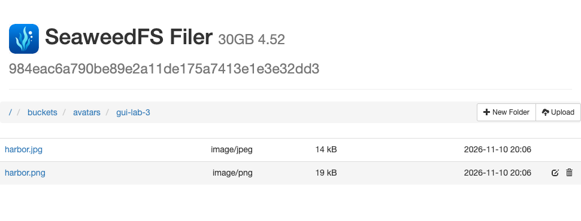
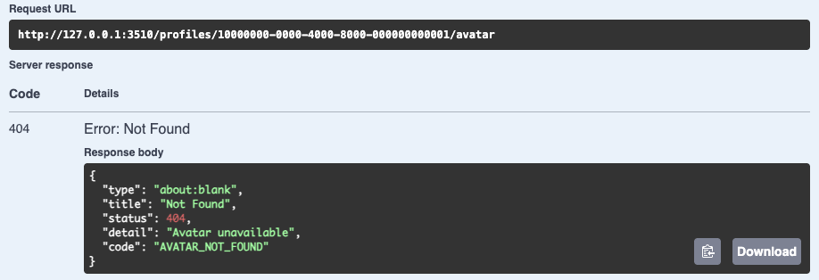
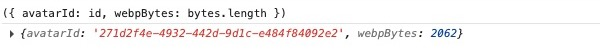
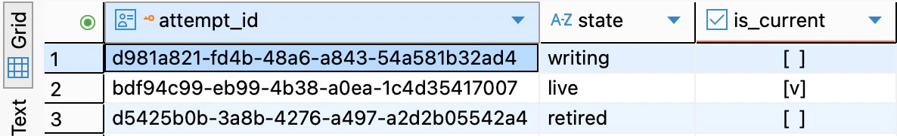

# 第 51 章　对象存储与数据库如何协作

用户昨天预览了灯塔，把编辑页关了。今天重新登录，昵称还在，头像在哪里？按第 50 章的实现，这是可以预言的结果：预览已经返回过一张完整的 WebP，那次请求的临时文件也已经回收，账号从未指向这张图。现在给编辑页加「使用这张头像」。按下去之后，换个设备仍能看到选中的版本；新图上传失败时，旧头像还要能用。

从[第 50 章完成代码](https://github.com/SamChowRock/epp-public/tree/part-07/chapter-50)继续。先在本机独立跑通一个私有桶，再把原账号接入。可以在 51.3 停下，此时能自行验明权限，也能通过重启检查对象是否还在。后一段用两个已开通的练习账号、同一数据库和同一桶完成发布、访问和故障处置。

阅读约 75～95 分钟；沿用两个练习账号时，本机安装、编码、发布与故障实验另加 110～155 分钟。首次下载发行包的网络等待因环境而异。

若要验证旧会话兼容，先在尚未修改的第 50 章项目（或单独的第 50 章副本）按原配置启动旧 API，05 登录、20 记下当前身份与昵称设置，保留 Cookie，然后停掉旧 API 和对原库写入的 Worker。这样后面备份时会包含刚才建立的会话。已有保存的样本可以直接继续；空库读者从 51.4 的 bootstrap 入口准备两个账号。

## 51.1 一张头像需要保存哪些事实

先算一笔小账。上一章灯塔 PNG 生成的 WebP 只有 2,062 字节。一万个相同大小的头像，成品总量约 20 MiB。若产品规模就是如此，直接在 PostgreSQL 的独立表里用 bytea 保存图片很有吸引力：写字节、换引用能在一次事务里提交，备份也能覆盖二者。代价是文件进入数据库备份和写入日志，通过 API 发图也要占用相应的读带宽。在我们的下一段实践里，要求应用授权之后能让客户端直接向文件服务取图，并能单独运维文件和数据库，因此选用对象存储。所省下的是 API 转发字节的工作，同时要接手两个系统之间的不一致。

要交接三件东西。第一件是**内容**，沿用第 50 章处理出的 WebP。第二件是**一次替换**，哪怕两次选了完全相同的灯塔图，也各有一个 UUID。存储端按桶名和对象键找到内容，例如 `avatars` 桶内的 `avatars/<这次尝试的UUID>.webp`。斜杠是键名的一部分，按相同前缀列举对象也不会给某个用户自动授权。第三件是**当前选择**，数据库里这个账号的 avatar_id。只保存键的稳定身份，读取时需要的临时 URL 随用随签。

假设总是写 `avatars/<userId>.webp`。A 上传得慢，B 后发先到，两笔分别 PUT 同一个键。即使数据库只接受 B，A 迟到的 PUT 仍会改掉 B 所指的字节；旧清理按相同的键 DELETE，还可能删掉 B。换成每次尝试一个键，A 和 B 最多留下两份对象，哪份允许用户看到可以由数据库独立裁决。这里的「版本」是应用生成的尝试 UUID，当前桶不依赖 S3 的对象版本化功能。

**先约定用户究竟能做什么。**

| 用户动作 | 入口 | 可核对的结果 |
| --- | --- | --- |
| 在编辑页试裁切 | POST /profile/avatar/preview | 沿用 24；返回图片，关闭页面不留下可发布版本 |
| 确认替换 | POST /profile/avatar | 重新发送所选原文件，服务端重新按同一规则转码。成功后 200 和 avatarId |
| 本人重新打开头像 | GET /profile/avatar | 账号尚无当前版本时返回 404；已有引用时返回版本 ID 和 30 秒短期 GET 地址 |
| 保存或读回头像展示意愿 | PATCH／GET /profile/avatar/visibility | `{"visible":false}` 或 `{"visible":true}`；尚无头像也能读回设置 |
| 另一个已登录用户看卡片 | GET /profiles/:userId/avatar | 目标可用、有当前引用且允许展示时签发；目标不可用、隐藏或当前引用为空时返回 404 |

读头像需要两次请求。即使当前键在桶里意外丢失，以上两个读接口仍可能签发地址并返回 200；在本章私有桶中，紧接着向存储发 GET 才能看到缺件的 404。排障先记清是哪一次请求返回了这个状态。

默认隐藏。第 49 章的 nicknameVisible 只管昵称；关昵称不会关头像，发布新图也不会擅自打开头像展示。即使本人访问卡片地址，也遵从卡片的可见规则。「公开」沿用第 49 章的含义：有 Web 资格的会话可以向 API 申请链接。拿到链接之后，存储服务识别的是签名；持有人在到期前可能把链接转交给别人。这一点直接决定后面的保留时间和产品界面上能承诺的撤回速度。

## 51.2 在本机启动一个私有桶

SeaweedFS 是本章运行在 Mac 上的文件存储软件，发行包里的程序叫 `weed`。启动后，你用浏览器里的 Filer 查看文件，EPP 通过同一服务的 S3 接口读写。先单独启动存储，等 51.3 建桶后再打开网页。下面的命令在配套代码项目根运行。若从前章跟写，先把[本章操作文件](https://github.com/SamChowRock/epp-public/tree/part-07/chapter-51/database/chapter-51)取到 `database/chapter-51/`；用完整的章节副本时文件已经在位。将 `.chapter51-tools/`、`.chapter51-store/` 加入项目的 .gitignore。前者放本机程序，后者放本轮数据和私有凭据，两者都在你控制的本机目录。

```bash
nvm use
sh database/chapter-51/install-weed.sh
node database/chapter-51/init-store.mjs
sh database/chapter-51/start-store.sh
```

固定 SeaweedFS 4.52。安装脚本按原生 macOS 终端的 `uname -m` 选择 darwin_arm64 或 darwin_amd64 发行包，用固定 SHA-256 核对下载内容，然后只取 `weed`，输出版本应为 4.52。若已经有 `.chapter51-tools/weed`，脚本会停下；用 `.chapter51-tools/weed version` 核对后继续即可。不要用另一个全局安装的不同版本去解释本章监听结果。[SeaweedFS 4.52 发行物](https://github.com/seaweedfs/seaweedfs/releases/tag/4.52)

初始化要在首次启动服务**之前**进行。它创建权限 0700 的目录，分别生成管理身份和应用身份，各有自己的随机 access key 和 secret key。服务读取 `s3.json` 以便识别两者；建桶程序读 `admin.env`，EPP 只加载 `app.env`。以下是 `init-store.mjs` 中真正划分权限的两行。这里的 Write 涵盖本桶写入与删除，应用无需列举桶中所有人的对象。

```js
const admin = identity('chapter51-admin', ['Admin', 'List', 'Read', 'Write']);
const app = identity('chapter51-api', ['Read:avatars', 'Write:avatars']);
```

凭据文件不需要打印。初始化拒绝覆盖已有目录，重启只重用现有文件。若换一套身份而服务仍在读原配置，SDK 报的 403 可能是用于签名的密钥不一致；把桶改成公共可读会掩盖这个问题。[SeaweedFS 的 S3 身份与操作权限](https://github.com/seaweedfs/seaweedfs/wiki/S3-Credentials)

启动脚本先核对专用端口，进入本轮目录后以前台进程运行 `weed mini`。下面是 start-store.sh 内部的启动片段，weed 和 store 已由脚本设为绝对路径。固定版本还会按组件搜索配置文件，只设 -dir 不能保证 Filer 元数据随卷搬走。init-store 为这套实验生成优先读取的 config，其中 filer.toml 指定 leveldb2 和相对于服务工作目录的 ./data/filerldb2，其余相关组件采用本地默认。这样即便机器有另一份配置，本章也能把名字与内容的映射保存在同一个实验目录下。

```sh
exec env -i PATH="$PATH" "$weed" -config_dir="$store/config" mini -dir="$store/data" -admin.dataDir="$store/data/admin" \
  -ip=127.0.0.1 -ip.bind=127.0.0.1 -s3.config="$store/s3.json" \
  -master.port=18630 -volume.port=18631 -filer.port=18632 -s3.port=18633 -admin.port=18634 \
  -master.port.grpc=28630 -volume.port.grpc=28631 -filer.port.grpc=28632 \
  -s3.port.grpc=28633 -admin.port.grpc=28634 -s3.autoCreateBucket=false -s3.iam=false \
  -webdav=false -s3.port.iceberg=0 -s3.port.lance=0 -debug.port=0 -admin.port.legacy=0 \
  -admin.ui=false -master.telemetry=false >>"$store/weed.log" 2>&1
```

**为什么只跑了一个进程，却要查十个监听？** Master 知道卷在哪里；Volume 保存数据块；Filer 把对象名和内容位置联系起来；S3 网关接 SDK 请求；Admin 还有内部接口。一个进程打包了这些角色，每个角色各有 HTTP 和 gRPC 监听。18630～18634 依次属于这五个角色，对应 gRPC 是 28630～28634。关掉 Admin UI 仍有内部端口。S3 拒绝匿名访问也不代表直连 Filer 或 gRPC 的人经过了同样的检查。在本章的单用户 Mac 上只允许回环监听；共享主机和公网部署还要隔离内部服务、配置其身份和传输保护。[固定版本的 mini 实现](https://github.com/seaweedfs/seaweedfs/blob/4.52/weed/command/mini.go)

服务终端留在前台。另开同一项目根的终端，用启动行打印的实际 PID 替换示例值，执行：

```bash
sh database/chapter-51/listeners.sh 12345
```

结果应只有上述十个 `127.0.0.1:端口`。脚本按这个 PID 枚举全部 TCP 监听，允许启动过程逐步就绪。若某端口已被其他程序使用，先辨认该程序，别对不明 PID 发信号。本章后续的签名会包含实际 S3 主机和端口，随意只改一个终端里的端口会影响校验。若结果正确但首次建桶连接暂不可用，看私有日志 `.chapter51-store/weed.log` 的就绪状态后重试。

## 51.3 用两个身份验证读写和到期

跟写时安装固定的 AWS SDK v3 包，已有本章锁文件则执行 `npm ci`。本地 Mac 直接运行服务，不需要云账户或容器。

```bash
npm install --save-exact @aws-sdk/client-s3@3.1163.0 @aws-sdk/s3-request-presigner@3.1163.0
node database/chapter-51/store-probe.mjs buckets
```

建桶命令用管理身份创建两个私有桶。先看看文件存在哪里，再验证谁可以读写。

**用浏览器操作 SeaweedFS。** 保持存储服务运行，把 `http://127.0.0.1:18632/` 复制到 Chrome 访客窗口的地址栏并打开。页面标题是 SeaweedFS Filer。这个入口能直接改动底层文件，只供本章的单用户本机实验使用。访客窗口避免把日常浏览器中的 EPP 登录 Cookie 带到同一主机的另一个端口。

1. 点 `buckets`。应能看见业务桶 `avatars` 和对照桶 `chapter51-private-control`。进入 `avatars`，点右上角 **New Folder**，输入 `gui-lab`。若已有同名目录，换一个新名字，再点进刚建的目录。
2. 点 **Upload**，从配套项目的 `examples/avatar-preview/` 选 `harbor.png`。再点一次，选 `harbor.jpg`。表中应出现两行，可以比较类型与大小。点 PNG 文件名能打开灯塔原图，再用浏览器后退回到列表。
3. 把鼠标移到 **harbor.png 那一行**，点行末垃圾桶。在确认框里核对完整路径以本次练习目录和 `/harbor.png` 结尾，再确认。刷新列表，点剩下的 `harbor.jpg`，应仍能打开。目录上的垃圾桶会连同目录内容一起删除，这次只点文件行。



图 51-1　两次上传后的文件列表。本轮新建的目录叫 gui-lab-3，顶部路径显示当前操作范围。两张原图是手工上传的练习样本，此时还没有账号发布头像。

Filer 直接读取底层文件。要知道应用能否列出桶、陌生人能否读图，还要从 S3 入口发请求。在同一操作终端运行：

```bash
node database/chapter-51/store-probe.mjs write
```

这条命令用应用身份在业务桶的 `probe/` 下写两份不同键名的虚构内容。对照桶用来检查这组身份能否越界。HEAD 检查长度与类型，GET 必须收到原来的字节；同一对象匿名 GET、用应用凭据列举 avatars、向对照桶 PUT 都应返回 403。这样还可以区分「整个端点有故障」与「同一组应用凭据恰好没有那项权限」。

S3 是客户端用 HTTP 按桶和键操作对象的一组接口。PUT 提交一份内容及其元数据，HEAD 只查看响应头，GET 取回内容，DELETE 指定一个键。本机由 SeaweedFS 实现这些接口；应用说 S3 的协议，数据仍在本机磁盘。

SDK 如何知道找谁？配置 `endpoint=http://127.0.0.1:18633`、`region=us-east-1` 和 `forcePathStyle: true`，由路径表达桶名，避免依赖本机的桶子域名解析。在本章的 `/avatars/avatars/<id>.webp` 路径里，第一个 avatars 是桶，余下的才是键。SigV4 根据日期、区域和服务从秘密密钥派生签名密钥，把 HTTP 方法、规范化路径、查询和选定请求头等绑定到签名。接收端用 access key 标识找到对应身份，验签后再判断这项操作是否获准。预签名把认证信息放在查询串，因此把签好的 GET 改成 DELETE、换一个 host 或另一个键都不会取得那项权限。[AWS SigV4 请求签名](https://docs.aws.amazon.com/IAM/latest/UserGuide/reference_sigv.html)

用 `maxAttempts: 1` 让本次调用只发一轮，便于判断一次请求的结果；网络超时仍可能发生在对端写好之后。向存储端发送 PUT 时只存重编码的 WebP，声明 Content-Type，并用 private, no-store 控制常规缓存。

在 `src/avatar-objects.ts` 加入存储适配器。四个变量全部缺席时，前章的资料和临时预览可以照常使用；只填了一部分则属于配置错误。端点中不接受附带路径、账号密码或查询串。本机练习以回环 HTTP 连接。对象 ID 由服务器生成，桶名和端点均来自配置，不接收客户传入的任意删除地址。

```ts
import { Injectable, type OnModuleDestroy } from '@nestjs/common';
import {
  DeleteObjectCommand, GetObjectCommand, PutObjectCommand, S3Client,
} from '@aws-sdk/client-s3';
import { getSignedUrl } from '@aws-sdk/s3-request-presigner';
import { HttpError } from './http.js';

@Injectable()
export class AvatarObjects implements OnModuleDestroy {
  private readonly store?: { client: S3Client; bucket: string };

  constructor() {
    const {
      AVATAR_S3_ENDPOINT: endpoint, AVATAR_S3_BUCKET: bucket,
      AVATAR_S3_ACCESS_KEY: accessKeyId, AVATAR_S3_SECRET_KEY: secretAccessKey,
    } = process.env;
    if ([endpoint, bucket, accessKeyId, secretAccessKey].every(value => value === undefined)) return;
    if (!endpoint || !bucket || !accessKeyId || !secretAccessKey) {
      throw new Error('Incomplete avatar storage configuration');
    }
    const url = URL.parse(endpoint);
    if (!url) throw new Error('Invalid avatar storage endpoint');
    const localHttp = url.protocol === 'http:' && ['localhost', '127.0.0.1', '[::1]'].includes(url.hostname);
    if (endpoint !== url.origin || (!localHttp && url.protocol !== 'https:')) {
      throw new Error('Invalid avatar storage endpoint');
    }
    const client = new S3Client({
      endpoint, region: 'us-east-1', forcePathStyle: true, maxAttempts: 1,
      credentials: { accessKeyId, secretAccessKey },
    });
    this.store = { client, bucket };
  }

  ready() {
    if (!this.store) throw new HttpError(503, 'Avatar storage unavailable', 'AVATAR_STORAGE_UNAVAILABLE');
    return this.store;
  }
```

```ts
  private object(bucket: string, id: string) {
    return { Bucket: bucket, Key: 'avatars/' + id + '.webp' };
  }

  async put(id: string, bytes: Buffer) {
    const { client, bucket } = this.ready();
    await client.send(new PutObjectCommand({
      ...this.object(bucket, id), Body: bytes, ContentType: 'image/webp', CacheControl: 'private, no-store',
    }), { abortSignal: AbortSignal.timeout(15_000) });
  }

  async url(id: string, signingDate: Date) {
    const { client, bucket } = this.ready();
    return getSignedUrl(client, new GetObjectCommand(this.object(bucket, id)), { expiresIn: 30, signingDate });
  }

  async remove(id: string) {
    const { client, bucket } = this.ready();
    await client.send(new DeleteObjectCommand(this.object(bucket, id)), { abortSignal: AbortSignal.timeout(15_000) });
  }

  onModuleDestroy() {
    this.store?.client.destroy();
  }
}
```

写和删给本次 SDK 请求 15 秒时间。取消客户端等待以后，远端是否已经提交，仍需要另找证据。签发读链接则是用凭据、方法、桶、键和时间在本地计算签名，**签名成功不能证明对象此刻存在**。这就是探测还要实际 GET 的原因。应用的 30 秒链接和现在的两秒实验链接用途相同，时长不同。[AWS SDK v3 S3 示例](https://docs.aws.amazon.com/sdk-for-javascript/v3/developer-guide/javascript_s3_code_examples.html) · [预签名 URL 的有效期限](https://docs.aws.amazon.com/AmazonS3/latest/userguide/using-presigned-url.html)

`store-probe.mjs write` 在内存里保留同一个两秒 GET 链接。签出后立刻使用应为 200，等待 3.5 秒再发同一请求应为 403；如果每次都生成新链接，永远检验不到旧授权是否过期。完整签名 URL 是短期凭证，观察状态和字节就够了。程序把本轮随机对象 ID 保存在 probe.json 供下一步使用。

回到运行 weed 的终端按 Ctrl-C，等待退出，沿用相同的 .chapter51-store 再运行 `sh database/chapter-51/start-store.sh`。在操作终端用**新 PID**重验监听，然后运行：

```bash
node database/chapter-51/store-probe.mjs resume
npm run check
```

同一对象仍能读取，匿名与越权请求仍被拒绝。程序删去第一笔，要求以本次应用身份再 GET 恰是 404 NoSuchKey，而相邻键仍然可读，最后再清相邻键。如果 write 或 resume 半路停下，先恢复服务与原配置，停掉仍在运行的探测，按运行说明用 `reset-probe` 核对并回收本轮键再重做。连接拒绝没有 HTTP 状态，403 说明这次操作遭拒，两者都不足以断定对象不存在。本章的重启验了同一目录可继续工作；备份恢复还要在独立空环境恢复 Filer 元数据、对象字节或等效的导出，以及身份配置和数据库引用，第九篇会专门做。

## 51.4 把一次写入预订在旧账号上

现在才碰用户数据。考虑同一个瞬间：旧头像正在展示，新图只上传了一半。如果把「正在写的那一次」直接放进 users.avatar_id，卡片 GET 就可能读到尚无内容的键。我们需要两种事实。users 中的指针只表示**现在发布哪一版**；avatar_writes 的一行表示**这个账号有过哪一次写入尝试**，记录它还能否发布、下一次何时可以处置。

| state | 可从这行推断什么 | check_after 的含义 |
| --- | --- | --- |
| writing | 预订已提交，仍可能发布；对象可以尚不存在，也可能已经写好 | 在这个时刻及以后不能再发布，可以接手处置 |
| live | 正常业务已把它设为该账号当前版本 | NULL；读取依 users 的当前指针 |
| retired | 已失去发布资格，可能有尚待清理的字节 | 至少等到这个时刻才能再尝试按键回收 |

一张表无法同时表达所有远端事实。比如「本地 SDK 没拿到成功应答」并不推出「远端没有对象」，所以没有把这个猜测写成 failed-and-empty。普通外键也无法跨到 S3 检查字节；本库能保证的是指针存在、属主相同、两笔预订不会都保有同一账号的 writing 资格。

在 `prisma/migrations/20261110140000_avatar_writes/migration.sql` 追加下列迁移。users 原有账号不更换 ID；新增空指针表示还没有发布头像，false 表示未授权他人看头像。复合外键同时引用版本 ID 和属主，否则只核对一个合法头像 ID，无意中也可以指向别人的图。avatar_id 为 NULL 时允许从旧库升级。保留写入跟踪的外键将使后续账号处置显式处理这些对象。

```sql
BEGIN;
CREATE TABLE public.avatar_writes (
  id uuid PRIMARY KEY,
  user_id uuid NOT NULL REFERENCES public.users(id) ON DELETE RESTRICT ON UPDATE CASCADE,
  state text NOT NULL CHECK (state IN ('writing','live','retired')),
  created_at timestamptz(3) NOT NULL DEFAULT now(),
  check_after timestamptz(3) DEFAULT (CURRENT_TIMESTAMP + interval '5 minutes'),
  UNIQUE (id, user_id),
  CHECK ((state='live') = (check_after IS NULL))
);
CREATE UNIQUE INDEX avatar_writes_one_writing ON public.avatar_writes(user_id) WHERE state='writing';
CREATE INDEX avatar_writes_due ON public.avatar_writes(check_after,id) WHERE check_after IS NOT NULL;
ALTER TABLE public.users ADD COLUMN avatar_id uuid,
  ADD COLUMN avatar_visible boolean NOT NULL DEFAULT false;
ALTER TABLE public.users ADD CONSTRAINT users_current_avatar_fkey
  FOREIGN KEY (avatar_id,id) REFERENCES public.avatar_writes(id,user_id)
  ON DELETE RESTRICT ON UPDATE NO ACTION;
COMMIT;
```

在 `prisma/schema.prisma` 的 User 插入下列四个字段，文件末追加 AvatarWrite。覆盖一名用户至多一个 writing 的部分唯一索引和到期索引由迁移 SQL 维护。布尔值只代表展示意愿；用户先打开展示、后上传第一张成功时，那张图即可被其他已登录用户申请读取。

```prisma
  avatarId String? @map("avatar_id") @db.Uuid
  currentAvatar AvatarWrite? @relation("CurrentAvatar", fields: [avatarId, id], references: [id, userId], onDelete: Restrict, onUpdate: NoAction, map: "users_current_avatar_fkey")
  avatarWrites AvatarWrite[] @relation("AvatarOwner")
  avatarVisible Boolean @default(false) @map("avatar_visible")

model AvatarWrite {
  id String @id @db.Uuid
  userId String @map("user_id") @db.Uuid
  state String
  createdAt DateTime @default(now()) @map("created_at") @db.Timestamptz(3)
  checkAfter DateTime? @default(dbgenerated("(CURRENT_TIMESTAMP + '00:05:00'::interval)")) @map("check_after") @db.Timestamptz(3)
  owner User @relation("AvatarOwner", fields: [userId], references: [id], onDelete: Restrict, onUpdate: Cascade)
  references User[] @relation("CurrentAvatar")
  @@unique([id, userId])
  @@map("avatar_writes")
}
```

在上章已迁移的**非空**练习库上，使用章首留下的账号与会话基线。有昵称历史时，从数据库记下该用户原有事件。确认旧 API 和 Worker 已停写，再按[独立恢复的步骤](../../part-06-background/chapter-44-claims/chapter.md#446-在旧库上完成交接)把它恢复到专用副本，例如 epp_ch51_verify。副本配独立的本机存储目录和桶；尤其不要拿复制出来的数据库跑清理，却还让它指向另一个环境正在使用的对象。新建的 .env.database-verify 的 DATABASE_URL 和 .env.test 的 TEST_DATABASE_URL 都指向这个副本，真实的预期库名从建库记录另取。

在 DBeaver 的副本连接打开 `database/chapter-51/observe.sql`，先执行前两条，替换为刚记下的 UUID。应查到同一账号及旧字段、还没有 avatar_writes 表。再从项目根运行：

```bash
unset DATABASE_URL TEST_DATABASE_URL SHADOW_DATABASE_URL DB_QUERY_DEBUG
node --env-file=.env.database-verify scripts/deploy-verify.mjs deploy epp_ch51_verify
npm run db:verify -- migrate status
npm run check
```

重查前两条和文件中最后的 LEFT JOIN：初次升级时仍有旧用户，current_id 和 attempt_id 都是 NULL，avatar_visible 为 false。原有昵称、开关、计费历史应该和备份时一致。只有在确实是新建的空库时才把 deploy 换成 bootstrap。没有旧账号的读者按[第 49.5 节](../chapter-49-profile/chapter.md#495-用两个账号检查可见性和配额)在**同一库**准备两个已开通练习用户，邮件 Worker 的库也要对准这里。重复本章时保留先前已经发布的版本并记下基线，不能再断言每个人都是空指针。

在 `src/database.service.ts` 的 API 启动探测中，为原 user.findMany 的 select 补 `avatarId: true, avatarVisible: true`，再执行 `await this.client.avatarWrite.findMany({ take: 1 });`，保留邮件与通知角色原先的独立探测。现在资料读取仍是第 49 章的三个字段。新的 API 契约放到 `src/avatar-contract.ts`：

```ts
import { z } from 'zod';

export const PublishedAvatar = z.strictObject({ avatarId: z.uuid() });
export const AvatarLink = PublishedAvatar.extend({ url: z.url(), expiresIn: z.literal(30) });
export const AvatarVisibility = z.strictObject({ visible: z.boolean() });
```

到这里可以再次 `npm run check`。下一节的工作是把短事务和文件请求按正确的先后次序接起来；这个暂停点还不能用 GET /profile/avatar 验收发布。

## 51.5 先预订，写完对象再争发布资格

两台设备同时改头像。A 先在服务端取得预订，开始慢慢传 PNG。B 后取得预订，很快交齐 JPEG。产品在这两次操作之间选择的是**最后一次成功预订**，时间顺序由数据库锁和提交确定。客户端的点按时间、HTTP 连接建立时间、对象最后写入的时间都不能代替这个顺序。即使 B 的文件最终坏了，A 也不能自行接班；用户看到的仍是上一个已经发布的版本。若产品要「凡是成功的，谁最后加工完就用谁」，那是另一项业务规则。

把一次发布拆成三个动作。① 在账号锁下复核本人身份及当前会话，取消前一笔 writing，插入本次 writing 并提交。② 离开数据库事务，接收、解码，再把成品 PUT 到本次独有的键。③ 重开短事务，锁住账号、会话和本次尝试，以锁后取得的数据库时刻检查状态与期限，最后一并切换当前指针和两行版本状态。第②步可能花十几秒；若在这段时间一直锁着用户行，另一设备改资料、改密甚至撤销许可都可能被慢上传拖住。即使一直持锁，S3 也不参加 PostgreSQL 的回滚。

新增 `src/avatar-publication.ts`。下面按文件顺序拼成服务。先复用已有的会话身份和 Web 资格规则。lockOwner 对用户行加写锁，lockSession 返回此次会话的截止时间。currentTime 留到必要的锁都拿到之后调用，否则一个原本有效的会话可能在锁外等到过期，仍带着过期判断通过。transaction 封装本章一秒锁等待上限，保留 401／403／409 等业务拒绝，连接和锁失败继续交由已有存储错误边界处理。

```ts
import { randomUUID } from 'node:crypto';
import { Injectable } from '@nestjs/common';
import { requireWebAccess, type AccountAccess } from './account-access.js';
import type { SessionIdentity } from './auth-context.js';
import { AvatarObjects } from './avatar-objects.js';
import { DatabaseService } from './database.service.js';
import type { Prisma } from './generated/prisma/client.js';
import { HttpError } from './http.js';

type Tx = Prisma.TransactionClient;
type Account = AccountAccess & { id: string; avatarId: string | null; visible: boolean };
const unauthenticated = () => new HttpError(401, 'Authentication required', 'AUTH_REQUIRED');
const unavailable = () => new HttpError(503, 'Avatar storage unavailable', 'AVATAR_STORAGE_UNAVAILABLE');

async function lockSession(tx: Tx, identity: SessionIdentity, account: Account | undefined) {
  if (!account) throw unauthenticated();
  requireWebAccess(account);
  const [session] = await tx.$queryRaw<{ expiresAt: Date }[]>`SELECT expires_at AS "expiresAt"
    FROM public.sessions WHERE id=${identity.sessionId}::uuid AND user_id=${identity.userId}::uuid FOR SHARE`;
  if (!session) throw unauthenticated();
  return session.expiresAt;
}

async function currentTime(tx: Tx, expiresAt: Date) {
  const [clock] = await tx.$queryRaw<{ now: Date }[]>`SELECT clock_timestamp()::timestamptz(3) AS now`;
  if (!clock || expiresAt <= clock.now) throw unauthenticated();
  return clock.now;
}

async function lockOwner(tx: Tx, identity: SessionIdentity) {
  const [owner] = await tx.$queryRaw<Account[]>`SELECT id, status, web_enabled AS "webEnabled",
    avatar_id AS "avatarId", avatar_visible AS visible FROM public.users WHERE id=${identity.userId}::uuid FOR UPDATE`;
  if (!owner) throw unauthenticated();
  return { owner, expiresAt: await lockSession(tx, identity, owner) };
}

@Injectable()
export class AvatarPublication {
  constructor(private readonly database: DatabaseService, private readonly objects: AvatarObjects) {}

  private async transaction<T>(operation: string, work: (tx: Tx) => Promise<T>): Promise<T> {
    const result = await this.database.run(operation, () => this.database.client.$transaction(async tx => {
      await tx.$executeRaw`SET LOCAL lock_timeout = '1s'`;
      return work(tx);
    }).catch((error: unknown) => {
      // Business rejections have already rolled back the transaction.
      if (error instanceof HttpError) return error;
      throw error;
    }));
    if (result instanceof HttpError) throw result;
    return result;
  }
```

**预订时还没看到图。** 这一步放在第 50 章的请求头检查和两席并发准入之后、开始读正文之前。若先把 PNG 解完才算「开始」，A 在图片处理上耽搁一会，B 就可能先被当成上一次，最后又被 A 替换。先入场不意味着必能发布：内容检查失败、用户取消以及服务退出都可能让 writing 一直等到期限届满。之前的 live 继续提供读取。

```ts
  async reserve(identity: SessionIdentity) {
    this.objects.ready();
    return this.transaction('reserveAvatar', async tx => {
      const { expiresAt } = await lockOwner(tx, identity);
      await tx.$executeRaw`UPDATE public.avatar_writes SET state='retired', check_after=clock_timestamp()
        WHERE user_id=${identity.userId}::uuid AND state='writing'`;
      const now = await currentTime(tx, expiresAt);
      const id = randomUUID();
      await tx.$executeRaw`INSERT INTO public.avatar_writes(id,user_id,state,check_after)
        VALUES (${id}::uuid,${identity.userId}::uuid,'writing',${now}::timestamptz + interval '5 minutes')`;
      return id;
    });
  }
```

回到第 50 章看过的两个 415。已有一个发布版本 P，设备 A 传一份合法 PNG，已经取得预订但还没发完。设备 B 此时也调用 **发布** 接口。两轮都保持 P 和一个有效慢传作为起点，只换 B 的请求头：

| B 发送相同的 PNG 字节 | B 的回执 | 让 A 传完，再查本人头像 |
| --- | --- | --- |
| 声明 application/octet-stream | 415 AVATAR_MEDIA_TYPE，在预订前被挡住 | A 的预订仍有效，A 得到 200，当前版本换成 A |
| 声明 image/jpeg | 415 AVATAR_FORMAT，先取得预订，随后发现字节不符 | A 已被 B 淘汰，得到 409。B 也没发布，当前版本仍是 P |

在 DBeaver 里，第一轮只会为这两笔请求新增 A 的尝试行，第二轮会新增两行。当前头像由最近一次成功发布决定，谁还能争取下一次发布由预订决定。只看 B 的 HTTP 状态码会漏掉这次变化。

**外部应答与数据库提交分别处理。** PUT 报错时保留预订，返回存储暂不可用；远端可能已经写成，API 不在异常处理里按当前账号的头像键删除。成功应答后，也还要再查本人会话、资格和同一个 id 的状态。A 耗时太长，或 B 已使 A 的预订退休，A 都会得到 409。此时它的对象可以存在，却不会成为当前头像。若第三步在提交前因 SQL 错误或业务条件被拒而回滚，库内的版本状态与指针一起保持原值。若数据库已经提交、提交应答却在返回 API 前丢失，事务调用也可能报错，实际 current 却已经换了；这时先查当前引用，再对照已知的尝试 ID。业务失败与连接超时都不应驱动客户端无条件重发一个新的「替换」。

```ts
  async publish(identity: SessionIdentity, id: string, bytes: Buffer) {
    try { await this.objects.put(id, bytes); }
    catch { throw unavailable(); }
    return this.transaction('publishAvatar', async tx => {
      const { owner, expiresAt } = await lockOwner(tx, identity);
      const [write] = await tx.$queryRaw<{ state: string; deadline: Date | null }[]>`SELECT state, check_after AS deadline
        FROM public.avatar_writes WHERE id=${id}::uuid AND user_id=${identity.userId}::uuid FOR UPDATE`;
      const now = await currentTime(tx, expiresAt);
      if (write?.state !== 'writing' || !write.deadline || write.deadline <= now) {
        throw new HttpError(409, 'Avatar upload expired or was superseded', 'AVATAR_SUPERSEDED');
      }
      await tx.avatarWrite.update({ where: { id }, data: { state: 'live', checkAfter: null } });
      await tx.user.update({ where: { id: owner.id }, data: { avatarId: id } });
      if (owner.avatarId) {
        await tx.$executeRaw`UPDATE public.avatar_writes SET state='retired',
          check_after=${now}::timestamptz + interval '30 seconds' WHERE id=${owner.avatarId}::uuid`;
      }
      return { avatarId: id };
    });
  }
```

新版本 live、users 指针变更和旧版本 retired 一起提交；把旧版本的 check_after 安排在发布事务刚取得的数据库时刻之后 30 秒，为仍有效的旧链接留出使用窗口。这个保证依赖读路径：签名必须从**指针仍受锁保护时的数据库时刻**起算。如果读方先拿到旧指针，卡在别处一分钟后才按签名机当前时刻发出一个全新的 30 秒 URL，那么对象可能刚好已经被删。这里把时刻和版本一起带出读事务，SDK 的 signingDate 使用该时刻。数据库、签名机和存储端在本机使用一致时钟；本章实验也以期间时钟没有明显回拨为前提。若刚签完旧链接就把库时拨回，单靠「现在加 30 秒」可能过早删除；发生校时异常时应暂停清理。要求承受大幅回拨的系统可以逐版本单调记录已签链接最晚到期时刻，退休时取两种期限的较晚者，代价是每次授权也会增加写入。

```ts
  async visibility(identity: SessionIdentity, visible: boolean) {
    return this.transaction('setAvatarVisibility', async tx => {
      const { owner, expiresAt } = await lockOwner(tx, identity);
      await currentTime(tx, expiresAt);
      await tx.user.update({ where: { id: owner.id }, data: { avatarVisible: visible } });
      return { visible };
    });
  }

  private async readAccount(identity: SessionIdentity, targetId: string) {
    return this.transaction('readAvatarAccount', async tx => {
      const accounts = await tx.$queryRaw<Account[]>`SELECT id, status, web_enabled AS "webEnabled",
        avatar_id AS "avatarId", avatar_visible AS visible FROM public.users
        WHERE id IN (${identity.userId}::uuid, ${targetId}::uuid) ORDER BY id FOR SHARE`;
      const expiresAt = await lockSession(tx, identity, accounts.find(row => row.id === identity.userId));
      const now = await currentTime(tx, expiresAt);
      const target = accounts.find(row => row.id === targetId);
      if (!target || target.status !== 'active' || !target.webEnabled) {
        throw new HttpError(404, 'Avatar unavailable', 'AVATAR_NOT_FOUND');
      }
      return { target, now };
    });
  }

  async getVisibility(identity: SessionIdentity) {
    const { target } = await this.readAccount(identity, identity.userId);
    return { visible: target.visible };
  }

  async read(identity: SessionIdentity, publicUserId?: string) {
    const { target, now } = await this.readAccount(identity, publicUserId ?? identity.userId);
    const avatarId = target.avatarId;
    if (!avatarId || (publicUserId !== undefined && !target.visible)) {
      throw new HttpError(404, 'Avatar unavailable', 'AVATAR_NOT_FOUND');
    }
    // The signature clock is fixed while the current pointer is still locked.
    try { return { avatarId, url: await this.objects.url(avatarId, now), expiresIn: 30 as const }; }
    catch { throw unavailable(); }
  }
}
```

公开读取在同一短事务里按 ID 顺序给调用者和目标账号加共享锁，检查调用者会话、目标资格和目标的展示意愿。自己从「编辑」入口读取可以看自己的图；跳到「卡片」入口仍要应用目标的 avatar_visible。签名响应中的 expiresIn 是从授权时刻计算的标称寿命，网络中花掉的时间不会在客户端重新补齐。只看到 API 返回 200 时，尚不知道目标端能否交出字节；排查应继续看对象 GET 的状态。

**接回第 50 章的上传路径。** 目前预览的名额由 withAvatarUpload 管着。发布同样要占这两个位置。给两个控制器各设上限二会变成整机可同时处理四张；在名额外先预订，甚至会让本应 429 的请求盖掉别人的 writing。现在保留同一处准入，取得位置后才决定要不要预订，并把按需调用一次的 receiveFile 交给对应业务。下面是 `src/avatar.controller.ts` 的两个分支。receiveFile(renderAvatar) 完成时，留下的是有界的 WebP Buffer，原始输入目录已经清理。预览仍把字节发给用户，发布则把字节交给 S3。

```ts
  @Post('profile/avatar/preview')
  async preview(@Req() request: Request, @Res() response: Response, @Query() query: unknown) {
    return this.upload(request, response, query, async receiveFile => {
      await sendPreview(response, await receiveFile(renderAvatar));
    });
  }

  @Post('profile/avatar')
  @HttpCode(200)
  @UseInterceptors(new ResponseSchemaInterceptor(PublishedAvatar))
  async publish(@Req() request: AuthenticatedRequest, @Res({ passthrough: true }) response: Response,
    @Query() query: unknown) {
    const identity = requireSession(request);
    return this.upload(request, response, query, async receiveFile => {
      const id = await this.avatars.reserve(identity);
      const bytes = await receiveFile(renderAvatar);
      return this.avatars.publish(identity, id, bytes);
    });
  }
```

跟写时这七个第 50 章已有文件要一起调整：共享准入、控制器、AuthModule、HTTP 方法白名单、JSON 读体例外、日志路由名和 OpenAPI。读体例外只放行预览和发布的二进制 POST；可见性 PATCH 继续解析 JSON。新增契约与存储服务已在前面写完。正文随附[基于第 50 章原文件的接线补丁](avatar-routes.patch)，它不包含迁移、三个新服务文件或脚本。在配套代码项目根将下方路径改为补丁的实际位置。已经使用完整第 51 章代码时直接运行 check。

```bash
git apply --check /实际位置/avatar-routes.patch
git apply /实际位置/avatar-routes.patch
npm run check
```

如果跟写文件与第 50 章快照有差异，先按补丁里的路径逐处对照，保留自己的修改；两次执行 apply 会得到上下文不匹配。对照发布控制器可见，持有 Cookie 的账号由会话决定，文件名和请求体里都没有可由客户端改写的属主。能访问自己的临时预览仍不能绕过数据库里的发布资格。

**把账号接到桶上。** 保持 weed 前台运行。在 API 终端清除可能盖住环境文件的外层变量；.env.test 中的 TEST_DATABASE_URL 已指向本轮验证副本。密码等旧配置可沿用，S3 凭据只从 app.env 读取。库名用你在 51.4 实际恢复的名字。

```bash
unset DATABASE_URL TEST_DATABASE_URL PORT APP_ORIGIN DB_QUERY_DEBUG
unset AVATAR_S3_ENDPOINT AVATAR_S3_BUCKET AVATAR_S3_ACCESS_KEY AVATAR_S3_SECRET_KEY
NODE_ENV=development node --env-file=.env.test --env-file=.chapter51-store/app.env --input-type=module -e '
process.env.DATABASE_URL = process.env.TEST_DATABASE_URL;
const { withVerifiedDatabase } = await import("./scripts/verify-database.mjs");
await withVerifiedDatabase(process.argv[1]);
process.env.PORT = "3360";
process.env.APP_ORIGIN = "http://127.0.0.1:3360";
process.env.DB_QUERY_DEBUG = "false";
await import("./scripts/dev.mjs");' epp_ch51_verify
```

取[第 51 章请求集合](https://github.com/SamChowRock/epp-public/blob/part-07/chapter-51/requests/chapter-51.postman_collection.json)单独导入 Postman；本地章节副本中为 `requests/chapter-51.postman_collection.json`。01～24 原样保留，本章按编号单发。保持一个练习账号 A 作为头像主人，另准备同库的 B 作为来看卡片的人。baseUrl 指向本机 API；只用旧账号 ID 登录时沿用[第 49 章运行说明](https://github.com/SamChowRock/epp-public/blob/part-07/chapter-49/database/chapter-49/README.md)里的 05 本地副本。新导入集合有独立变量，profileTargetId **手工保存 A 的 ID**，不要在 B 登录时覆盖。以下会改 A 的头像和展示意愿，使用专用练习用户。

1. A 的旧 Cookie 仍有效时先发 20 核对本人，失效则用 05 重新登录。发 15 获取当前写入令牌，发 29 查头像开关。在 27 使用集合变量 avatarVisible=false，并发 29 确认。首次迁移、没有头像时将 expectedAvatarStatus 设为 404，发 26 应得到 AVATAR_NOT_FOUND；重复实践的账号先看 SQL 的 current_id 再选 200 或 404。不要用同名环境变量盖住这几个集合变量。
2. 在 24 选取上章 harbor.png，仍能得到方形灯塔。25 的 Body 也要**独立选择本机文件**，发送相同 PNG 和 image/png。200 返回本次 avatarId。把 expectedAvatarStatus 改成 200，再发 26。数据库当前指针、25 返回的 ID、26 返回的 ID 应相同，观察 SQL 中这行是 live。26 的 URL 是拿图凭证，在独立、不含 API Cookie 的客户端立即 GET 它，才拿到 image/webp 字节。可用从未登录 API、Cookie 为空的独立浏览器配置读取这个地址，或用不带 Cookie 与写请求头的独立 HTTP 客户端；用完关闭。本机 3360 与 18633 虽是两个端口，Cookie 却按主机和路径匹配，普通新标签页仍可能把 EPP Cookie 发给存储端。签名 URL 不要复制到共享记录。
3. 用 B 的信息发 05、20，确认 B 和固定目标 A 不同。保持 profileTargetId 为 A，expectedAvatarStatus=404，发 28。A 自己有图，B 仍读不到。切回 A 发 05、20、15，设 avatarVisible=true，发 27、29。切回 B 发 05、20，expectedAvatarStatus=200，再发 28。这次 B 获得的 avatarId 应是 A 当前的版本。在 Postman 中另开请求标签页仍会共享 Cookie，换标签之前先弄清是哪位用户。
4. 看一次时间边界。让 B 留在 Postman，让 A 在独立浏览器的同源 Swagger 登录，准备把展示改为 `{"visible":false}`；在 A 的浏览器用 GET /auth/csrf 取令牌，PATCH 时带本次令牌及 X-EPP-Request: 1。准备好关闭请求，B 先发 28 并记下链接，A 再点 Execute。B 把 expectedAvatarStatus 改成 404，再发 28 应被拒，刚签出的那一个却可能仍能读图。等该链接过期后再次使用**原地址**，在本机的 30 秒签名实验里应见 403。若操作太慢，先恢复展示再取新地址重做；不要用新签的链接验证旧签名。关闭开关本身既不删图，也不撤销已经取回的副本。

发布后，回到 Filer 的访客窗口，从顶部路径点回业务桶 `avatars`，刷新，再进入其中的 `avatars` 目录。找到第 25 号请求返回的 `avatarId` 加上 `.webp` 的文件，点开能看到裁成方形的成品。在 DBeaver 打开 `observe.sql`，把末条查询的占位符换成发布者 A 的用户 ID，再执行这条查询。找到 `attempt_id` 等于刚才 `avatarId` 的那行，此时应显示 `state = live`、`is_current = true`，且 `current_id` 与文件名里的 ID 相同。这里仅查看业务文件；直接在 Filer 改名、上传或删除会绕过发布事务。

再把同一条旧链接带过一次真正的替换。此时 Postman 留在 B。将本地登录信息换回 A，发 05、20、15，确认是 A 本人，expectedAvatarStatus 改为 200。A 先发 26，记下旧版 ID，在空 Cookie 的读取端准备这个地址 L1。A 将 25 的 binary 换成 harbor.jpg，Content-Type 也改成 image/jpeg，立刻发布并发 26，得到新 ID 和 L2。若 L1 仍在有效期内，L1、L2 都能返回 200，键名末尾却是不同版本。等到 L1 过期，再以原地址访问应被拒；若此时没有运行回收命令，51.6 的 HEAD 仍可能查到旧键。链接失效与字节已删除有不同的观察点。保留两个 ID 供后面的精确检查。


图 51-2　在有会话的 API 请求中取得短期地址，再用没有 API Cookie 的独立浏览器从私有桶读取。对象 GET 没有附带 Cookie 或 Authorization 头，返回 200，解码为 256×256 的灯塔。单看图与第 50 章的预览相同；区别在于这里先重新查询了账号当前引用，再从文件服务发起 GET。


图 51-3　A 收紧展示后，B 用自己的会话向 API 申请读取，服务返回 AVATAR_NOT_FOUND。这个结果和已经签出的 URL 是否过期由两个不同入口决定。

**让两笔替换真正重叠。** 普通的“两次点击发送”可能碰巧都串行成功。配套的 `database/chapter-51/race.mjs` 先发送 A 请求的前 32 字节，只有从另一条 SQL 连接看到这份账号的 writing 才送完整 B 请求；收到 B 成功后才补完 A。这里 A、B 表示**同一账号的两笔替换**，与上一段的两个用户区分。选一个只供自己使用、当前没有其他 writing 的账号。它会真的把该账号的头像替换为 B。若刚调试过留下 writing，先等到期按 51.6 清理，或正常发布一次把它取代。检查同一账号原本的 current_id 便于比较。

在第三个终端从同一项目根进入交互式 Bash，设为实际 ID 和库名。命令读取密码时不回显，仅通过 stdin 送给本机脚本；脚本以新会话 ID 在指定数据库回查，确认 API 和 SQL 同库才开始发送这两张图。停止其他占这两席的实验。

```bash
set +x
set +a
unset DATABASE_URL avatar_password
owner_id='换为本轮练习账号的UUID'
IFS= read -rs -p '本轮练习密码：' avatar_password
echo
printf '%s' "$avatar_password" | node --env-file=.env.database-verify \
  database/chapter-51/race.mjs epp_ch51_verify "$owner_id" http://127.0.0.1:3360
unset avatar_password
```

输出中 A 是 409 AVATAR_SUPERSEDED，B 是 200。记录这两个 ID 再跑观察 SQL，应看到 B 是 current，A 是 retired；若之前有头像，原来那行也已 retired，但与 A 失去资格的原因不同。A 在这个实现里仍可能完成 PUT，然后才在数据库中被拒；如果只查询桶中有没有 A 那次尝试的文件，就会把它误判为「发布过」。

## 51.6 在删除以前先取得处置权

接到报障：「上传断了，不知道这张图有没有换成功。」先以同一账号看 26 当前返回谁；若已知尝试 ID，在本轮库查询它的状态，并用同一套桶配置 HEAD 这个确切的键。当前版本一致而页面仍显示旧图，先重新申请链接；writing 且 HEAD 找到图，只能证明字节到了，不能据此把数据库指针直接切过去。用户可能已经选了下一张，也可能在上传后被停用。若连接断开而用户没有收到尝试 ID，两个设备又同时操作，账号和大致时间只能缩小范围。retired 既可能从 writing 转来，也可能是曾经发布的旧版本；现表无法独自证明哪一次点击对应哪一行、某个 retired 是否曾经发布。没有这个证据时只报告能确认的当前状态。若客服必须逐请求还原，可在预订提交时另记不含签名或凭据的 requestId 与 attemptId 对照。

现在亲手制造第二种现场。先要有**一个已经发布的旧版本**（无头像就先发一次 25），记下它的 ID。给本轮独立 API 用可辨认的单进程启动方式，避免 watcher 先替你重启而看不清结果。停前面的开发 API；在同一工作目录，沿用 51.5 的库名核验与两份 env 文件，把启动命令换成下面这条。Inspector 只监听本机：

```bash
unset DATABASE_URL TEST_DATABASE_URL PORT APP_ORIGIN DB_QUERY_DEBUG
unset AVATAR_S3_ENDPOINT AVATAR_S3_BUCKET AVATAR_S3_ACCESS_KEY AVATAR_S3_SECRET_KEY
NODE_ENV=development node --inspect=127.0.0.1:9229 --env-file=.env.test --env-file=.chapter51-store/app.env --input-type=module -e '
process.env.DATABASE_URL = process.env.TEST_DATABASE_URL;
const { withVerifiedDatabase } = await import("./scripts/verify-database.mjs");
await withVerifiedDatabase(process.argv[1]);
process.env.PORT = "3360";
process.env.APP_ORIGIN = "http://127.0.0.1:3360";
process.env.DB_QUERY_DEBUG = "false";
console.log("本轮 API 的 Node PID", process.pid);
await import("./dist/src/server.js");' epp_ch51_verify
```

用 VS Code 的 Node attach 或 Chrome 的 `chrome://inspect` 连接这个 Node，选择编译产物映射到的 `src/avatar-publication.ts`。在 publish 方法中，给 `return this.transaction('publishAvatar', …)` 这行设断点，位置在 `await this.objects.put(id, bytes)` 返回之后、启动发布事务之前。发 25 前先发 20 和 15：即使旧 Cookie 仍有效，开发模式重启后，原密钥若未固定，写令牌也可能需要重新取。命中后只观察 `({ avatarId: id, webpBytes: bytes.length })`，不展开请求头、SDK 命令和签名地址。



图 51-4　PUT 已返回，这次尝试的成品是 2,062 字节。把调试器里看到的尝试 ID 与数据库行、精确对象键对齐，别拿用户 ID 去查 S3。

暂停的是 API 的 JavaScript 执行，另一个 Postman 请求若还指向它，也会一起等。让 DBeaver 独立执行 observe.sql 的末条，用同一个账号查看：新 ID 是 writing，旧行仍是 live 且勾选 is_current。在另一终端清掉外层的 AVATAR_S3_* 四个变量，运行下面的只读探测，把占位符换成刚观察到的 UUID。它只发送 HEAD，不会签出地址或打印凭据。

```bash
unset AVATAR_S3_ENDPOINT AVATAR_S3_BUCKET AVATAR_S3_ACCESS_KEY AVATAR_S3_SECRET_KEY
node --env-file=.chapter51-store/app.env database/chapter-51/head-avatar.mjs 本次尝试的UUID
```

这次应当读到 image/webp 和与断点一致的字节数。先比对好两端证据，再只对刚才打印的**本轮 API 的 Node PID** 发 `kill -KILL 实际PID`。25 失去响应，原子发布尚未开始；数据库仍指向旧头像。以 51.5 的正常方式重启 API，重新读本人头像应仍是原 ID。不要把同一笔 25 自动重试成一笔新发布。这里我们有意作出新的选择：重取 15 再发一笔新的 25，让新版本成为 current，原来那笔 writing 随新预订变成 retired。另一个可选处置是保持旧头像、等本次五分钟预订自然到期后清理。



图 51-5　另一次故障实验里，PUT 成功后数据库在更新指针时抛错。d981a821 开头的尝试保留 writing；bdf94c99 开头的 live 行仍被引用；更早的 retired 行也还在。可沿用本节的 SQL 与 HEAD 读这种现场。图 51-4 是进程中断的一轮，图 51-5 是事务写回失败的一轮，各自用自己的 UUID 核对。

**为什么有时删了还要再查？** 想象 A 的 PUT 已经离开 API，客户端先等到超时。清理方稍后访问存储端，那里暂时找不到 A，于是决定“事情结束了”。若原 PUT 比这个 DELETE 更晚在目标端完成，A 的键又出现了。不存在的那一刻是个真观察，却不足以证明以后不会出现。反过来，清理方只查了一次「还没有任何人引用」就去删文件，原来的发布者可能恰在它查完后把这张图设为 current。两种竞态需要分别解决。

新增 `src/avatar-cleanup.ts`。先在**自动提交连接**用一条 SQL 选最多 20 个到期、非当前的键，跳过别的执行者锁住的行，把状态改成 retired，并推迟它们的下一次检查。只有这条语句提交以后才发送外部 DELETE。这样原发布者即使醒来，也过不了第三步的 writing 条件。对已退休键重复删除是安全的，因为这些键从来不复用，以后也不能重新发布；这与删除固定的 userId.webp 有本质区别。

```ts
import type pg from 'pg';
import type { AvatarObjects } from './avatar-objects.js';

// Use an autocommit connection. Eligibility must be revoked durably before DELETE.
export async function cleanAvatarBatch(client: pg.Client | pg.PoolClient, objects: AvatarObjects, attemptId?: string) {
  const due = await client.query<{ id: string }>(`WITH due AS (
    SELECT w.id FROM public.avatar_writes w WHERE w.state IN ('writing','retired')
      AND ($1::uuid IS NULL OR w.id=$1::uuid)
      AND w.check_after<=clock_timestamp()
      AND NOT EXISTS (SELECT FROM public.users u WHERE u.id=w.user_id AND u.avatar_id=w.id)
    ORDER BY w.check_after,w.id LIMIT 20 FOR UPDATE OF w SKIP LOCKED
  ) UPDATE public.avatar_writes w SET state='retired',check_after=clock_timestamp()+interval '5 minutes'
    FROM due WHERE w.id=due.id RETURNING w.id`, [attemptId ?? null]);
  let deleted = 0;
  let failed = 0;
  for (const { id } of due.rows) {
    try { await objects.remove(id); }
    catch { failed++; continue; }
    // A lost PUT may arrive after DELETE, even after a previous successful pass.
    await client.query(`UPDATE public.avatar_writes SET check_after=clock_timestamp()+interval '1 day'
      WHERE id=$1 AND state='retired'`, [id]);
    deleted++;
  }
  return { deleted, failed };
}
```

单笔删除失败不拦住这批的其他对象；失败行五分钟后又可选。DELETE 成功或对象原已不存在时，保留这条记录，一天后允许再查再删，覆盖迟到的 PUT。check_after 是**最早可检查时间**，不会自行启动执行者。本章交付一次性维护命令；没有人再次运行它，遗留对象便可能继续占盘。若单日换图量很高，这份永久保留的退役记录及每日重复删除也有成本。想安全缩短保留，须先证明旧写入已经不可能到达，例如存储侧有不可绕过的代次校验，或有覆盖所有写入者、所有在途操作的停写对账窗口。只以「超过一天」代替这个证明，老问题会重现。第十四篇还需要把这些记录纳入账号处置范围。

先运行 `npm run check`，因为命令会导入 dist 中的两个模块。从**创建本轮数据库、启动端点、建桶时的记录**分别填写三个目标参数。这些参数要与实际生效的配置互相核对。下面再用第四个参数限定到刚核实的那笔退出事故；从 observe.sql 的 attempt_id 复制，不要填 owner_id。只在本轮独立 VERIFY 和私有桶操作，不能只凭库名相似就对一个共享桶运行。

```bash
unset DATABASE_URL TEST_DATABASE_URL SHADOW_DATABASE_URL
unset AVATAR_S3_ENDPOINT AVATAR_S3_BUCKET AVATAR_S3_ACCESS_KEY AVATAR_S3_SECRET_KEY
node --env-file=.env.database-verify --env-file=.chapter51-store/app.env \
  database/chapter-51/clean.mjs epp_ch51_verify http://127.0.0.1:18633 avatars 本轮事故的attempt_id
```

跟写时取 `database/chapter-51/clean.mjs`。程序比较独立给定的端点、桶与实际 S3 配置，再在同一实际数据库连接上验证 current_database()，才把该连接交给清理函数。先把参数的桶名故意改成练习中**不存在**的名字，命令应在处置前退出；恢复正确参数再执行。不给第四个参数时是限量批处理，不能把 Deleted or already absent 的总数当成特定对象已被删除的证据。核对一笔具体事故时，在三个参数后追加观察到的 attempt_id（小写 UUID），只选这行，仍然要满足到期、非当前且可取得锁，找不到或不合条件时返回零项，不会用别的旧行补位。按前面记录的 A、B、原来版本分别查 HEAD：已被本批取得且 DELETE 成功的 retired 键应消失，当前 B（或你之后手工发布的新 current）仍可读。旧 current 的保护期限从切换事务取到数据库时刻起算 30 秒；提交完成或客户端收到 200 时，剩余时间可能已经短于 30 秒。在 check_after 之前运行命令应跳过它；到期后按该 ID 再运行，核对成功计数为一，再用 HEAD 检查。若跑普通批次，还有 20 条更早的到期行、目标正在被锁或这笔 DELETE 失败，它都可能仍在；结合 check_after、实际返回行数和 Failed 判断下一步。库里保留 retired 行，表示还可以定位旧写入，不表示文件仍占着字节。回到 Filer 的业务头像目录并刷新，按完整 ID 对照两处：已回收的那一笔应从文件列表消失，当前版本应还能点开。在 DBeaver 重新执行观察查询，两笔应各自保留 retired 与 live 的记录。

若上一次恰在 DELETE 成功后、登记下一次复查前退出，五分钟后会重删同一个键。若所有对象都报告删除失败，先查端点、身份所属桶与应用写权限。只有周期检查继续运行、身份有权限且目标可用，补偿才会收敛；这里没有让两套独立系统神奇地拥有一个共同事务。

完整回归另用专用测试库。由第 50 章跟写的读者把本章配套的 `test/avatar-publication.test.mjs` 放入 test，并保留前章头像两份样本。按第 49 章的[独立回归配置与固定样本步骤](https://github.com/SamChowRock/epp-public/blob/part-07/chapter-49/database/chapter-49/README.md)引导本章结构。将 .env.test-regression 的 DATABASE_URL 与 TEST_DATABASE_URL 都指向这个独立回归库。第一次在空库用本章迁移 bootstrap；若沿用已完成第 50 章回归的非空测试库，使用同一文件和原测试库名执行 deploy，补上头像迁移。核对固定样本后，清除外层变量并执行：

```bash
unset DATABASE_URL TEST_DATABASE_URL
unset AVATAR_S3_ENDPOINT AVATAR_S3_BUCKET AVATAR_S3_ACCESS_KEY AVATAR_S3_SECRET_KEY
npm run build
NODE_ENV=test node --env-file=.env.test-regression --test --test-concurrency=1 test/*.test.mjs
```

本章新增四项回归：访问资格与私有默认值、迟到写入与复扫、PUT 后会话撤销、清理的独立提交与指定行重试。最后一项在删除开始时从第二条数据库连接读取目标行：即使删除失败，也必须已经看到 retired。用事务包住整次操作、最后一律回滚的测试会漏掉这个边界。库内的回归可以控制外部应答时点；本章 51.3 的私有桶实验、真实 HTTP 发布、故障现场与按键核对还要分别走过。收工时先停 API，再退出本轮 weed；保留 VERIFY、存储数据和配置供第 52 章接班。复工先验证监听和账号，再按 ID 回查当前所处的阶段，勿重新初始化一套凭据去接旧数据。

[支线 51A　如果隐藏后必须立即拒绝读图](side-01-revoking-access.md)

## 附录：本章必要技术点速查

| 回查项 | 用途与边界 |
| --- | --- |
| Bucket、Key、应用生成的 UUID | 定位一次不可复用的写入，属主和发布事实另从数据库判断 |
| HEAD／GET／DELETE | 分别验证本轮凭据下的元数据、可读字节、按确切键删除；403 无法证明缺失 |
| SigV4／signingDate | 把短期权限绑定到方法、键与时间，退出应用会话不会自动收回已经发出的地址 |
| 行锁与唯一的 writing | 给替换预订排序，在发布时重验资格，保护新版本免于被迟到操作覆盖 |
| 到期的 retired | 允许继续处置且此后不可发布，数据库状态单独不能回答远端还有没有对象 |
| 回环端口、Filer 元数据和 Volume | 区分应用入口与内部服务，准备持久化与恢复时要保护能重新连接名字和字节的全部事实 |

[第 51 章完成代码](https://github.com/SamChowRock/epp-public/tree/part-07/chapter-51) · [上一章](../chapter-50-avatar/chapter.md) · [下一章：接手头像报障](../chapter-52-review/chapter.md) · [第七篇导读](../README.md) · [全书目录](../../README.md)
