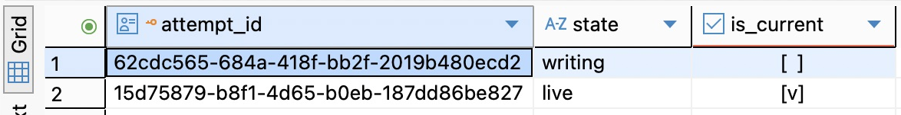
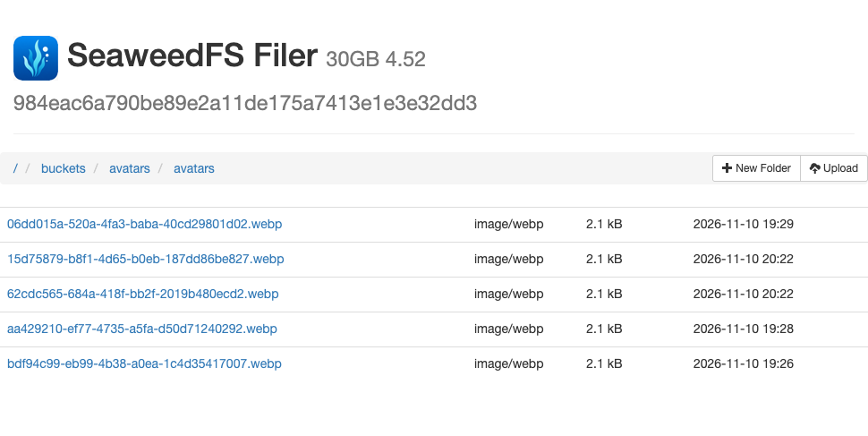
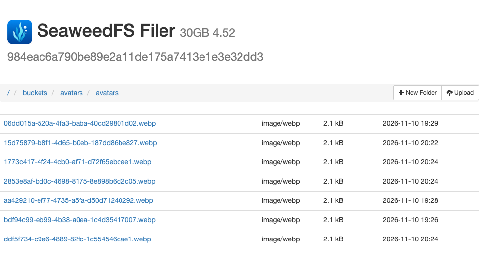
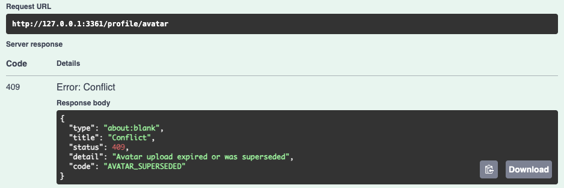
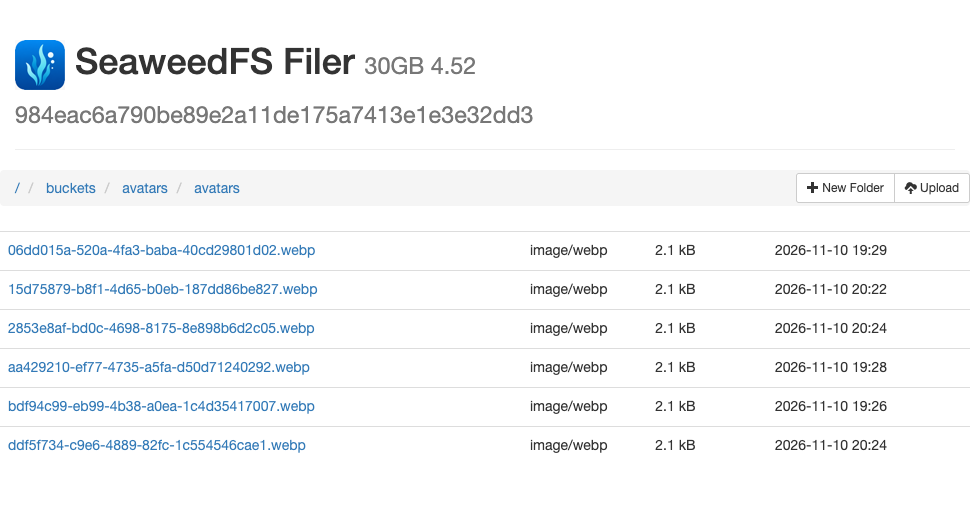

# 第 52 章　第七篇回顾：文件与数据库没有一起成功时怎么办

“我选了新头像，页面还显示原来那座灯塔。同事打开我的资料卡，连灯塔都看不到。”值班同事补充：“桶里的 WebP 越来越多，我可以把今天多出来的几张删了吗？”

先完成第 49～51 章。本章沿用[第 51 章完成代码](https://github.com/SamChowRock/epp-public/tree/part-07/chapter-51)、同一套数据库结构、请求集合和本机私有桶。先用交接材料作决定，再用自己的两个练习账号复现。阅读约 30～40 分钟。已有第 51 章环境时，联调与故障复现另加 40～60 分钟。复查可以次日接着做，中间等待不计入操作时间。

## 52.1 接手这张报障单

你可以让同事再查一件事。是问用户究竟点了预览还是发布，请另一个账号重新查，还是去看那些多出来的文件？先写下你要拿到的一个值，以及哪种结果会让你改变处置。下面三份交接材料可以按自己的顺序展开。UUID 是这次练习的现场值，自己跟做时会换一套。

<details>
<summary>请客户端重新取一次头像</summary>

本人重新发起第 26 号请求（读取本人头像），返回 200，avatarId 为 <code>15d75879-b8f1-4d65-b0eb-187dd86be827</code>。独立浏览器用它刚签出的地址取得下图。另一位已登录用户在同一 API 查询这位主人，对外读取返回 404、AVATAR_NOT_FOUND。主人自己的头像展示开关为 false。


图 52-1　浏览器解码出 256×256 的灯塔。练习的两份源图拍的是同一场景，你能从画面认出灯塔，却很难从画面认出这次写入。

</details>

<details>
<summary>请数据库值班同事核对同一位主人</summary>

同事在 DBeaver 按发布者的用户 ID 查写入记录，用账号的 avatar_id 与每一行的尝试 ID 比较。图里只保留这次交接的两行。第一行创建得更晚，第二行的 is_current 被勾选。此前没有保存客户端这次失败请求与尝试 ID 的对应关系。



图 52-2　这是查询时刻的状态。把第二行的完整 ID 与本人读取响应核对，再决定第一行能说明什么。

</details>

<details>
<summary>请存储值班同事看这两个文件</summary>

在本机 Filer 打开业务桶里的 avatars 目录。图中有两张文件名分别以 15d75879、62cdc565 开头的 WebP，还有上章实验留下的文件。两张都显示 2.1 kB，修改时间只显示到分钟。交接时只有这份目录快照。



图 52-3　沿顶部 buckets → avatars → avatars 到达这里。第一个 avatars 是桶名，第二个是对象键的目录前缀。图 52-2 和这张图来自同一笔写入暂停期间。

</details>

先给报障人写两句话：现在本人能读哪一版，另一位用户读不到还需要修什么？再回复存储同事：哪一个具体文件可以立刻处置，依据够不够？允许回答“还要再查”，但要说出缺哪项事实。单张列表也无法量出“持续增长”，先保留这次观察的时间、目录和范围供下次比较。

## 52.2 在三个窗口里核对同一笔写入

先核对环境。沿用上章的读者可直接重启原来的存储、数据库副本和 API，打开[第 51 章运行说明](https://github.com/SamChowRock/epp-public/blob/part-07/chapter-51/database/chapter-51/README.md)。只有代码的人先走该说明的空库入口，准备两个已开通的练习账号、迁移、私有桶和第 51 章 Postman 集合，用 25 成功发布一张头像，再做本节。要从 50 升级则走上章的非空副本入口。实验会改变练习账号的头像与展示设置，已有的其他记录均作为历史保留。

**Postman 看谁能拿到哪个版本。** 先只读，保留接班时的现场。同一个 Postman 会话中按以下顺序操作：

1. 以主人身份发 20，核对 userId。401 或身份不符就用 05 登录主人再查；只有用户 ID 和密码的旧账号沿用[第 49 章的登录请求副本](https://github.com/SamChowRock/epp-public/blob/part-07/chapter-49/database/chapter-49/README.md)。把 profileTargetId 固定为主人 ID。发 29 读头像展示开关。26 和 28 共用集合变量 `expectedAvatarStatus`，它只供 Postman 对照响应，不会改变 API 的行为。报障样本有当前头像，先填 200，再发 26；若自己的账号已知没有当前头像，则填 404。第一次接手、拿不准时，先记下实际状态和响应体，即使断言变红也保留这次结果。若 26 返回地址，在未登录 API 的 Chrome 访客窗口立即打开，分别记下 avatarId 和图能否打开；签名地址留在本机。
2. 以**来访者**身份发 05、20，确认已经换人，profileTargetId 仍为主人。若主人有当前引用且展示开关为 true，28 预期 200；隐藏或没有当前引用时预期 404。先按上一步基线设置 expectedAvatarStatus，再发 28 并看真实响应。401 则须先恢复来访者会话。

**DBeaver 看账号选中了哪笔写入。** 打开独立 VERIFY 的 SQL 编辑器。执行下列查询，把占位符换成主人从 20 读出的用户 ID。用数据库自己的时钟看期限，避免拿本机桌面时钟作决定。没有头像的新用户因 LEFT JOIN 仍会出现一行，尝试字段为空。

```sql
SELECT statement_timestamp() AS observed_at, current_database() AS db, u.id AS owner_id, u.avatar_id AS current_id,
       w.id AS attempt_id, w.state, w.check_after,
       (w.id IS NOT NULL AND w.id = u.avatar_id) IS TRUE AS is_current,
       w.check_after <= statement_timestamp() AS due
FROM public.users u LEFT JOIN public.avatar_writes w ON w.user_id = u.id
WHERE u.id = '替换为主人用户ID'::uuid
ORDER BY w.created_at DESC, w.id DESC;
```

先核对 db 与你建的副本同名。图 52-2 中 15d75879 开头的行既是 live 又是 current，和 26 返回的值相符。62cdc565 开头的行仍为 writing。它可能有一个正在运行的发布者；即使负责它的进程已经退出，未到期时，维护命令仍须尊重预订。再过几秒查询可能已变，所以把这次查询的 observed_at 一起记下；due 也按同一个查询起点计算。报障人没有拿到成功回执，两台设备又都可能发过上传，单靠“最近一行”无法把某一次点击指认为这笔 writing。即使后来变成 retired，也可能是从未发布的候选，或是曾经发布过的旧版。

**Filer 看精确键是否存在。** 存储运行时，用独立的 Chrome 访客窗口打开本机业务头像目录（`http://127.0.0.1:18632/buckets/avatars/avatars/`），刷新，按完整 attempt_id 加 `.webp` 找文件。Filer 列的是整个桶的这一前缀，其他账号也能留下文件。界面上能点开哪张图，与来访者能否通过 API 取得新地址，是两套权限。只在这里看；对业务文件点垃圾桶会绕过数据库里的预订、指针和保护期限。实际 S3 身份能否取到某个键，可用上章的 head-avatar.mjs 指定同一 ID 核对。403、连不上和确认这个键已不存在，需要分别记录。

到这里可以回单了。本人可重新取得 15d75879 这一版，另一用户的 404 符合当前展示意愿。62cdc565 这份字节已到存储，当前引用仍指向旧版。保留旧版，不替用户发布候选，也不凭目录删文件。若要定位原来那次点击，向客户端取请求路径、回执和时间，若曾记录 requestId 与 attemptId 的对应关系，再查那笔写入。反过来，如果 26 能给出当前版本的地址，实际 GET 却取不到图，重新签一次、立即 GET，再用同一套已验证的桶配置 HEAD 这个精确键。若确认当前键缺失，就要调查误删、库与桶恢复点不一致等原因。保住指针和现场，按能核实来源的原版本恢复，或由主人重新发布并验证。在单独的故障副本里，我们只移除了刚发布的练习键：26 仍返回原 avatarId 和地址，立即 GET 与同键 HEAD 都是 404；主人重新发 25 后再次取图才恢复 200。找一张长得像的候选接到指针上，会把一次存储事故变成一次未经确认的资料修改。

若要解释增长，用同一桶和前缀分时计数，再与新增、退役、待复查的行对照。截图里的文件数也不能直接换算成磁盘可释放的空间。

**现场记完后，再用练习账号重现可见性。** 若自己的设置与报障样本不同，想看到“本人能看、访客看不到”，在 Postman 切回主人，发 05、20、15 确认身份并取写令牌。没有当前头像时，先在 25 选择 harbor.png，以 image/png 发布。设 `avatarVisible=false` 发 27，再用 29 读回 false。把 `expectedAvatarStatus` 改为 200，发 26 读本人。换回来访者，发 05、20 确认身份；保持 `profileTargetId` 为主人，把 `expectedAvatarStatus` 改为 404，再发 28。27 改的是当前登录者自己的开关，不看目标 ID。

## 52.3 让三种中断留下不同的证据

先停止前面为这个 VERIFY 启动的 API，存储和数据库继续运行。普通终端和调试终端都从同一份第 51 章项目根启动，使用相同的构建、VERIFY 和桶。先跑一次 `npm run check`。以下 Bash 函数在两个终端各定义一次；把预期库名换成自己的建库记录。先检查 3360、3361、9229 空闲，遇到已有监听先辨认归属。

```bash
start_avatar_api() {
  local port="$1"
  shift
  unset DATABASE_URL TEST_DATABASE_URL PORT APP_ORIGIN DB_QUERY_DEBUG
  unset AVATAR_S3_ENDPOINT AVATAR_S3_BUCKET AVATAR_S3_ACCESS_KEY AVATAR_S3_SECRET_KEY
  NODE_ENV=development node "$@" --env-file=.env.test --env-file=.chapter51-store/app.env --input-type=module -e '
    process.env.DATABASE_URL = process.env.TEST_DATABASE_URL;
    const { withVerifiedDatabase } = await import("./scripts/verify-database.mjs");
    await withVerifiedDatabase(process.argv[1]);
    process.env.PORT = process.argv[2];
    process.env.APP_ORIGIN = "http://127.0.0.1:" + process.env.PORT;
    process.env.DB_QUERY_DEBUG = "false";
    console.log("本次 API 的端口和 Node PID", process.env.PORT, process.pid);
    await import("./dist/src/server.js");' epp_ch51_verify "$port"
}
```

终端一运行 `start_avatar_api 3360`，Postman 的 baseUrl 指向它。让主人重新 05、20、15，25 选 `examples/avatar-preview/harbor.png` 并设 Content-Type 为 image/png，把集合变量 expectedAvatarStatus 从上一节来访者用的值改为 200，再发 26，核对同一 avatarId。把这个已发布的 ID 记作 P。如果之前已有头像，发布这次基线也会留下旧行，后面都按自己的完整 ID 比较。

**第一次，只中断预览。** 在第三个终端按[第 50.4 节](../chapter-50-avatar/chapter.md#504-在中断与重启后找回资源)准备指向 3360 的 `avatar_upload` 函数和主人账号，运行 `avatar_upload abort`。该客户端给 24 对应的预览接口先送 32 字节，主动断开，再以完整文件重新预览。观察终端中先出现“客户端主动断开”，随后能收到 200 WebP。在 Finder 从项目根用“前往文件夹”打开 `.avatar-tmp`，比较本轮前后目录；32 字节只停留很短时间，错过这个画面可以用上章 hold 模式单独观察。实测断开后本次临时输入已清除，下一份预览成功，DBeaver 中该账号的尝试行数与实验前相同，26 仍指向 P。若报障里断掉的是发布请求 25，顺序就不同：发布会先预订，再收完文件，不能用预览的结果推断库里一定没有 writing。

**第二次，让字节到达后，发布进程退出。** 终端二运行 `start_avatar_api 3361 --inspect=127.0.0.1:9229`，记下它打印的 Node PID。普通浏览器打开 `http://127.0.0.1:3361/docs`，在这个 Swagger 会话用主人身份登录，查 `GET /profile/me`，再取 `GET /auth/csrf`。在写接口展开 **Try it out**，X-EPP-Request 下拉选 1，在 X-CSRF-Token 输入框填这个会话刚取到的值。上传时在 Request body 选 image/png，再用文件选择器打开 harbor.png。Postman 保持连接 3360，两边各自登录；Filer 继续用独立访客窗口。

1. 用 VS Code attach 或 Chrome 的 `chrome://inspect` 连上 9229。在 `src/avatar-publication.ts` 的 publish 方法，给 `return this.transaction('publishAvatar', …)` 设断点，位置见[第 51.6 节的实拍](../chapter-51-avatar-storage/chapter.md#516-在删除以前先取得处置权)。从 3361 的 Swagger 对 `POST /profile/avatar` 选 PNG 并 Execute。命中时只看变量 `id`，记为 Q。
2. 让进程停在这里。Filer 刷新应能找到 Q；DBeaver 重跑查询应见 Q 是 writing，P 是 current。3360 的 Postman 再发 26，应该还能取得 P。图 52-2、52-3 就是在这个窗口取的。此处先保留 Q。即使网格里的 due 显示 false，去另一个终端输入清理命令时也可能已过五分钟；届时它能撤回预订并删除 Q，下一步便观察不到原先的现场。
3. 从第三个终端只向刚打印的 **3361 那个 Node PID** 执行 `kill -KILL 实际PID`。Swagger 失去应答。3360 继续运行，此时再发 26、再查库：旧引用仍在，Q 的字节也还在。一般网络断线可能发生在提交之后；这次能定位到提交前，是因为我们看见了断点在哪里。
4. 现在代表主人明确选一次新图：在 3360 的 Postman 发 20、15，25 换成 harbor.jpg 并把 Content-Type 改为 image/jpeg。记新返回的版本 R。数据库应显示 R 是 current，Q 已 retired。用下一节的单笔命令只处理 Q，然后回 Filer 刷新，确认 Q 消失、R 仍在。P 刚从 current 退役时还有旧签名的保护时间，别拿它代替 Q 试删。

**第三次，换一个断点，让处置跑在 PUT 前面。** 这次不需要碰巧遇上慢网络。重启终端二的同一条命令，重新附加 9229，取消上一次的断点。把新断点设在 publish 中的 `await this.objects.put(id, bytes)` **执行之前**。在 3361 重新核对会话并取有效写令牌，准备好 3360 的 JPEG 发布请求。下面 A、B 是同一位主人的两次尝试。

| 操作 | 停下来核对的结果 |
| --- | --- |
| 在 3361 发 PNG，停在新断点，抄下 id 为 A | DBeaver 看到 A 是 writing，Filer 里还没有 A。若已经有 A，检查断点是否设晚了。 |
| 保持 3361 暂停，在 3360 发 JPEG，记成功回执的 ID 为 B | B 成为 current；再次查库，A 已 retired 且可以到期处置。R 成为受短期保护的旧版本。 |
| 在处置终端按 A 的完整 ID 运行单笔命令，再刷新 Filer | 命令报告已删或原本不存在 1 项，A 仍不在桶里。行保留下来，check_after 已移到下一次复查。 |
| 恢复 3361，让它发出真正的 PUT 并尝试发布 | 3361 收到 409 AVATAR_SUPERSEDED。Filer 再刷新，A 出现了；3360 发 26 仍返回 B。 |



图 52-4　本轮 A 以 1773c417 开头，B 以 ddf5f734 开头。A 确实写进了桶，但是它的数据库资格已被撤回。用 Filer 的修改时间或图片大小选“最后一张”会给用户错误的结果。



图 52-5　用另一轮独立练习验证相同顺序：3361 的 Swagger 恢复后返回 409 和 AVATAR_SUPERSEDED；在 3360 重新查询，当前版本仍是后一次发布的 ID。两轮的 UUID 各自核对。

这里的 409 有一个具体好处：迟到的请求可以留下字节，却不能让旧选择重新变成当前头像。相应的代价是清理不能做完一次就忘掉这个键。如果此刻接班，只拿到图 52-4 而没有之前的观察，仍应回到 52.2 查账号和行；一张快照还原不了上表的先后顺序。

## 52.4 决定这一笔能否清理

第 51 章的清理命令先让数据库授予处置资格并提交，再去删指定对象。候选必须属于 writing 或 retired、达到 check_after、未被账号当前引用，而且本轮能取到行锁。已过期的 writing 会在同一步变成 retired，后续发布因此不能再选中它。你在 DBeaver 看到的 due 只能用于选调查对象；真正取得资格要等命令执行时重新判断。

在项目根的处置终端运行。三个目标分别从**建库、启动存储、建桶时的记录**填写。先确认这个 VERIFY 使用自己的业务桶或独立存储副本，再做单笔或批量维护。如果只还原了数据库，却连接另一环境正在使用的桶，同一个 UUID 可能在副本里已经退役、在另一库却仍是当前头像；指定精确 ID 也保护不了另一库的引用。我们用两套一次性数据库和一个练习桶核对过：副本换图，等满 30 秒后按旧 ID 清理，命令报告处置 1 项。原库仍能为旧 ID 签出地址，但立即 GET 已是 404；副本的新图仍是 200。

下面把这次 Q 的完整小写 UUID 填到变量里；做到第三次实验时改填 A。两份 env 的用途与第 51 章相同。

```bash
unset DATABASE_URL TEST_DATABASE_URL SHADOW_DATABASE_URL
unset AVATAR_S3_ENDPOINT AVATAR_S3_BUCKET AVATAR_S3_ACCESS_KEY AVATAR_S3_SECRET_KEY
attempt_id='替换为本轮待处置的完整UUID'
node --env-file=.env.database-verify --env-file=.chapter51-store/app.env \
  database/chapter-51/clean.mjs epp_ch51_verify http://127.0.0.1:18633 avatars "$attempt_id"
node --env-file=.chapter51-store/app.env database/chapter-51/head-avatar.mjs "$attempt_id"
```

在第二次实验中，Q 未到期且仍为 writing 时没有处置资格。新预订将它淘汰，因此这一次不必等到原期限。即使没有新预订，writing 自然到期后也可能被清理命令接手。在第三次实验中指定当前的 B 也应是 0 项。若处置返回 0，重跑查询，核对 ID、引用、期限，必要时检查正在持锁的执行者。返回 `Deleted or already absent: 1  Failed: 0` 表示这行已取得资格，且对象删除调用成功；原本就没有字节的 A 也能得到 1。在 Filer 刷新，对照两个完整文件名：第二次实验清的是 Q，保留的是 R；第三次实验先按 A 处置，保留的是 B。HEAD 查的是被处置的键，在这两次删除刚完成且还没有迟到 PUT 时，应显示 `Not found for this target`。在 3360 的 Postman 用主人身份发 26，核对返回的是本轮应保留的 R 或 B，再用访客窗口打开刚签出的地址，确认图仍可读。若 Failed 大于零，用同一端点和身份排查，等该行新的 check_after 再试。

刚被替换的 R 要多看一眼。它曾经是 current，API 先前签出的 GET 可能还在有效期。上章实现按切换时的数据库时钟留 30 秒，查看行上的期限；在期限前按 R 处置会跳过，过期后按 R 再运行才会处理。本次实测过期后 R 消失，B 保持可读。若 R 已经过期，第一次便可能处理成功。不要为演示而延长或缩短实际用户的保护期。

**文件又出现了，何时复查？** 图 52-4 的 A 已经经历过一次成功的 DELETE，程序将下次可检查时间放到一天后。现在立即再跑应是 0 项，A 仍可见。保存 A 和 B 两个 ID 以及 A 的 check_after。程序不会自行启动复扫；次日到记录的具体时刻后重启同一套环境，按 A 再跑命令。重新查询当前引用，若期间有人发布了新版，就用新 ID 核对仍在服务的头像；再刷新目录，检查 A 已消失。



图 52-6　对照图 52-4，同一目录里的文件从七个变为六个。按完整键逐项比较，消失的是 1773c417 开头的 A，当前的 ddf5f734 和其他五个键仍在。单看“少一个”无法核对删对了谁。为了在一次实验中观察第二次删除，拍图时仅在一次性副本里把 A 这条已退役记录的复查时间提前到当时，然后执行原清理命令。这张图验证再次处置的结果；实际调度仍以行上的 check_after 为准。日常库照原时间复查即可。

**能扩大到一批吗？** 如果报障只锁定 Q，先按 Q 处置。若交接任务明确是维护整个练习桶、确认这一套数据库独占它的业务键，并允许处理所有符合条件的旧行，省略 clean.mjs 的最后一个 UUID，程序每次最多取 20 行。总数不能告诉你其中一定有 A。按 check_after、attempt_id 复核样本并记录 Failed，本轮没取得的留到下次。Filer 中一个找不到对应行的键不会被这个命令选中；先查库与桶是否配对、有无其他写入者、恢复副本是否缺历史。现有信息不足时保留键，不能从目录减去一次数据库查询结果就批删。

这就是给下一班的交接：写明哪个账号、哪个版本仍可读，哪笔在什么时刻取到了处置权，哪个键要在什么时间复查。只记必要 ID、结果和时刻，签名 URL、Cookie、密码都不进事故单。结束调试时移除断点，先结束这一轮的两个 API，再停止存储。保留 VERIFY、存储数据、练习身份及复查时间。第八篇从这些反复要做的操作出发，讲怎样把维护范围、结果与失败写进管理命令。

## 附录：本章必要技术点速查

| 手中只有这份证据 | 接下来怎样确认 |
| --- | --- |
| 用户说“头像没变” | 核对本人、目标和请求路径。24 返回预览字节；25 发布成功返回版本 ID；26 读当前引用。 |
| 来访者取不到链接 | 先核对其会话与目标 ID，再看主人的头像展示设置。已签链接的剩余寿命另查。 |
| 桶里有一个 WebP | 用完整键查对应行，再看当前指针。文件可读、曾经发布过、现在仍获准发布是不同事实。 |
| 指定 ID 已处理 1 项 | 区分删除时是否本来就不存在、稍后是否有 PUT，保留退役记录和下一次复查时间。 |
| 对象数增长而本轮批处理 0 项 | 检查可处置行的期限、锁与所属数据库。未知来源的对象需要独立对账。 |

[本章沿用的第 51 章代码](https://github.com/SamChowRock/epp-public/tree/part-07/chapter-51) · [上一章](../chapter-51-avatar-storage/chapter.md) · [第七篇导读](../README.md) · [全书目录](../../README.md)
