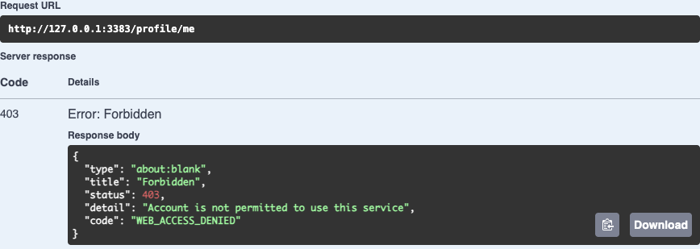
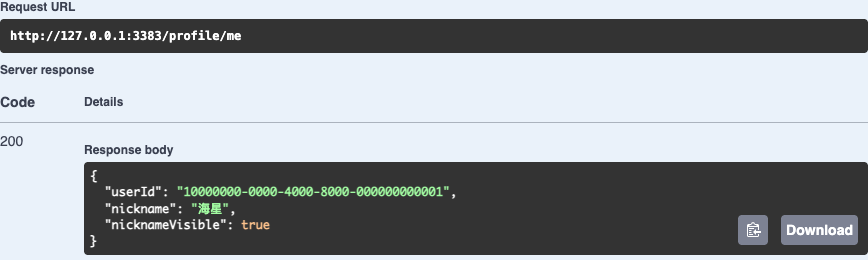

# 第 53 章　为后台操作提供可靠的管理命令

第 34 章里，我们在 DBeaver 里找到第二个练习账号，把 Web 资格改成已开通，回到 Postman 重试登录。这项工作做到第三次，就会遇到一个 SQL 编辑器解决不了的交接问题。上午有人请你暂停甲的使用资格，下午又有人核实原因、恢复了资格。下班时，上午那位同事说自己的终端断过线，问能不能把暂停命令再跑一遍。你有甲的 ID，也能看到甲现在已开通。仅凭这两项，你能回答他吗？

本章沿用[第 51 章配套代码](https://github.com/SamChowRock/epp-public/tree/part-07/chapter-51)。第 52 章用同一版程序交付了头像故障处置。现在给维护者交付一个同样能按身份核对的账号命令。读完后，你可以用一个保留着旧会话的账号亲自回答上面的问题，还能说清楚换成另一台同名数据库时自己要核对什么。

## 53.1 给一次暂停分配身份

先写出交班时真正想找的两件事。一件是“甲现在能否用原会话读资料”，这是此刻的账号、会话与接口共同决定的。另一件是“上午那一次暂停有没有执行成功”，即使甲下午已经恢复，上午的答案也应该查得到。前一件可以发第 51 章集合中的 20，后一件需要为一次维护决定留下记录。

旧的 SQL 已经能准确地更新一行。把它包进一个接受账号 ID 的脚本，还能省去每次编辑 WHERE 的步骤。但即使写成 `SET web_enabled = false`，下午再执行仍会暂停甲。设置一个确定值可以让紧挨着的两次执行得到相同结果，中间插入一次合法恢复就改变了结论。我们要让维护者在**第一次执行之前**生成一个操作 ID。稍后带同一个账号和操作 ID 来的是同一项决定。恢复属于一个新决定，哪怕是同一个人操作，也要另取 ID。工单留这两个 ID 和库的身份，无须留 Cookie 或密码。

把命令限制为单个已知用户的 Web 资格。用户表上的 status 管整个账号，web_enabled 管 Web 准入，session 记录凭证的有效期。命令只写第二项。在账号已停用时开通 Web，将来恢复账号状态可能立即产生访问能力，预览要把这两项都列出来。实际请求还要经过身份认证。若事故要求让泄露的旧 Cookie 永久失效，恢复 Web 资格就能暴露错误的处理方案，应按[第 41 章的会话处置](../../part-05-identity/chapter-41-review/chapter.md)定位需撤销的凭证。

**先备好观察对象。** 在第 51 章 API 上用自己的已开通练习账号发 05 登录、20 读本人资料，记下返回的 userId 和昵称。保留当前 Cookie。停止写入原库的服务，按[备份与独立恢复](https://github.com/SamChowRock/epp-public/blob/part-07/chapter-51/database/chapter-22/backup-restore.md)恢复到新建的练习库，以下称 epp_ch53_verify。在 DBeaver 选择新连接，执行下列查询，把最后的占位文字换成刚才的 ID。

```sql
SELECT current_database(), id, status, web_enabled, nickname, avatar_id
FROM public.users WHERE id = '替换为本次账号ID'::uuid;
```

核对库名、单行 ID、active、true 和原昵称，若已有头像也记下原指针。练习要写的是这个副本。数据库名只在当前集群内标识数据库，生产和练习集群都叫 epp 时，须另外核对连接的主机、端口、角色和环境配置。不要把从当前连接串解析出来的名字又交给程序当独立确认。若从空库开始，先完成下节的 bootstrap，再按[第 49 章账号准备](https://github.com/SamChowRock/epp-public/blob/part-07/chapter-49/database/chapter-49/README.md)在本轮库注册、开通、登录并记录同样的基线。

## 53.2 把命令接进一次性应用上下文

先只建设能保存决定的结构。旧的 command_receipts 服务于候选采纳，有自己的业务外键和应答。把新的操作塞进那张表，账号开通就得虚构一个候选。追加迁移 `prisma/migrations/20261111010000_web_access_receipts/migration.sql`，让每行对应某个账号的一次已提交操作。库替我们记下连接角色和记录时间，维护者传入原账号 ID 和操作 ID。

```sql
CREATE TABLE public.web_access_receipts (
  user_id uuid NOT NULL REFERENCES public.users(id) ON DELETE RESTRICT ON UPDATE RESTRICT,
  operation_id uuid NOT NULL,
  before_enabled boolean NOT NULL,
  requested_enabled boolean NOT NULL,
  account_status text NOT NULL CHECK (account_status IN ('active', 'disabled')),
  db_actor text NOT NULL DEFAULT session_user,
  recorded_at timestamptz(3) NOT NULL DEFAULT clock_timestamp(),
  PRIMARY KEY (user_id, operation_id)
);
```

已有用户无需回填。迁移之前改过的资格可以读到，改动的人和当时的值无从还原，收据从部署以后开始积累。关联用户的外键使保留收据期间无法直接删掉对应账号，将来设计账号删除和保留期限时两者要一起考虑。在 Prisma schema 的 User 增加 `webAccessReceipts WebAccessReceipt[]`，加入[与表对应的 WebAccessReceipt 模型](https://github.com/SamChowRock/epp-public/blob/part-08/chapter-53/prisma/schema.prisma)。主键用两个字段的 `@@id([userId, operationId])`。这样同一个操作 ID 的含义以账号为范围，手抄错账号后只给原操作 ID 无法保护你。命令和交班记录都要携带这一对值。

从前章跟写可以另开本章配套副本，按上面的路径取迁移、新模型和 User 的这一行，再继续添加后面的文件。项目根的 .env.database-verify 用 DATABASE_URL 连接新库，.env.test 用 TEST_DATABASE_URL 连接同一练习库。终端运行：

```bash
nvm use
npm ci
unset DATABASE_URL TEST_DATABASE_URL SHADOW_DATABASE_URL DB_QUERY_DEBUG
node --env-file=.env.database-verify scripts/deploy-verify.mjs deploy epp_ch53_verify
npm run db:verify -- migrate status
npm run check
```

空库将 deploy 改为 bootstrap，脚本先应用历史基线。已有库保留原顺序并追加新迁移。回到 DBeaver 重跑刚才那条查询，原账号各列应与迁移前相同。首次升级的新表应为空。到这里可以停下，再继续时从 `migrate status` 和这个账号的读数接起。

接下来决定程序怎么启动。写一个 pg 脚本也能开事务，但已有 API 用 `webAccessFailure` 判断账号停用和 Web 资格的先后，已有 DatabaseService 负责 Prisma、池的超时和关闭。另写一份容易让预览把 disabled 的账号显示为允许。只为这一项工作启动整个 AppModule 又会带入 HTTP 边界、对象客户端和业务就绪检查。第 43 章的 Worker 已经展示过另一种入口：由 Nest 创建依赖，直接取得服务调用，最后关闭上下文。这次调用完成就退出。命令中没有登录会话，持有并能使用数据库身份的人才有操作权限；HTTP 路由上的身份检查不会自动保护它。

在 `src/manage-web-access.ts` 新建 ManageWebAccess，职责是给定目标库、用户、动作，返回预览或已提交收据。事务在下节展开。入口 `src/account-admin.ts` 先解析参数，再用下面的部分组装服务。两个完整文件与[数据库连接服务](https://github.com/SamChowRock/epp-public/blob/part-08/chapter-53/src/database.service.ts)组成同一个可构建阶段。DatabaseService 的 applicationName 增加 epp-admin，onModuleInit 连接后遇到该角色就返回。命令在自己的事务里查所需表。原 API 和两个 Worker 仍走各自的就绪检查。

```ts
const context = await NestFactory.createApplicationContext({
  module: AccountAdminModule,
  providers: [
    { provide: DatabaseService, useFactory: () => new DatabaseService(config, new AppLogger('error'), 'epp-admin') },
    { provide: ManageWebAccess, inject: [DatabaseService],
      useFactory: (db: DatabaseService) => new ManageWebAccess(db) },
  ],
}, { logger: false, abortOnError: false });
try {
  const response = await context.get(ManageWebAccess).run(expected, userId, action);
  console.log(JSON.stringify(response));
} finally {
  await context.close();
}
```

`preview USER off` 有账号和目标值；`apply USER off OP` 必须再给出操作 UUID；`receipt USER OP` 按两项身份查询。三种格式前面都要有独立填写的库名。`parse` 对每种格式精确数参数、用 z.uuid() 检查 UUID，只接受 on 与 off，少一个或多一个参数都在建连接之前拒绝。若把字符串 off 交给 Boolean，结果会是 true，入口必须显式比较 `value === 'on'`。成功时标准输出写一条 JSON，随后 finally 关闭上下文，DatabaseService 的销毁钩子断开 Prisma 并结束连接池。参数、目标或业务拒绝返回退出码 2，配置、连接或事务异常返回 1。用 `process.exitCode` 让输出和关闭有机会完成。实际部署时给维护进程单独注入数据库凭证，按所需的用户列、资格更新和收据读写授予权限。把迁移所有者的凭证交给每个值班人，会让他们也能绕开命令直接改表。若维护系统需要区分“没有收据”和“目标错误”，还须读拒绝原因，单看 2 不够。

## 53.3 让事实与收据一起提交

命令要回答“上午那一次”时，决定能否重试的地方在数据库。每次操作在同一个事务里用 `SELECT current_database() AS name` 对照预期库名。这里的库名检查和随后的用户操作共用事务连接，连接池换一条物理连接也要在本次事务内重新核对。按配对的 userId、operationId 读收据只需查询。预览读取当前账号，取目标值替换 webEnabled，把投影交给 API 已经使用的 webAccessFailure。apply 需要改写账号，在读取账号时就要取得这行的写锁。同一个账号上的两个命令由此排队。

```ts
const lock = action.kind === 'apply' ? Prisma.sql`FOR UPDATE` : Prisma.empty;
const [account] = await tx.$queryRaw<{ status: string; webEnabled: boolean }[]>`
  SELECT status, web_enabled AS "webEnabled" FROM public.users
  WHERE id = ${userId}::uuid ${lock}`;
if (!account) throw new CommandRefused('User not found');
if (action.kind === 'preview') {
  const after = { status: account.status, webEnabled: action.enabled };
  return { database: expected, result: 'preview', userId, before: account, after,
    accessAfter: webAccessFailure(after) ?? 'allowed' };
}
```

为什么不能先查收据、看见没有、再去等用户锁？设两个终端同时提交同一键。两边都可能读到空，随后只有一个先拿到用户锁。排在后面的即使靠唯一键最后回滚，也会给同一项成功的决定报错。这里显式使用 Read Committed 隔离级别。第二个事务拿到用户锁以后，**下一条语句**才查收据，能看见前一个事务刚提交的记录。按账号加锁的代价是甲的两项不同决定也要排队，但更改同一个资格本来就需要明确先后，乙仍可独立办理。

```ts
const key = { userId, operationId: action.operationId };
const prior = await tx.webAccessReceipt.findUnique({ where: { userId_operationId: key } });
if (prior) {
  if (prior.requestedEnabled !== action.enabled) throw new CommandRefused('Operation ID conflict');
  return { database: expected, result: 'replayed', receipt: prior };
}
if (account.webEnabled !== action.enabled) {
  await tx.user.update({ where: { id: userId }, data: { webEnabled: action.enabled }, select: { id: true } });
}
const receipt = await tx.webAccessReceipt.create({ data: { ...key,
  beforeEnabled: account.webEnabled, requestedEnabled: action.enabled, accountStatus: account.status } });
return { database: expected, result: 'applied', receipt };
```

已有收据且参数匹配，就返回保存的事实，连一次用户 UPDATE 都不用发。有人拿同一对 ID 把 off 改为 on，应报告冲突，不能当成“修改历史命令”。首次办理时，若资格已是目标值，也插入一张前后相同的收据。这让接班人分得清“办理过，当时无须改”和“尚无办理记录”。`db_actor` 取 session_user，表示连接用的数据库身份。若两人共享一个账号，就不能凭这列认定是哪一位同事操作；要做到个人归责，需独立凭证或可信身份入口。数据库所有者仍有能力直接编辑表，这套记录适用于可信维护环境。数据库管理权限、备份和审计保留应随环境配置。

如果更新资格成功，插收据时却因权限或约束失败，事务回滚，两处都恢复原状。如果数据库已经提交，但终端来不及显示 JSON，实际资格与收据都已落库。仅凭一次退出码 1 或空白终端，看不出走到哪一步。先查原库原键；查到就读当时事实。在确认目标正确、存储可用而且这项决定仍有效时，才用同样参数重试。另一事务可能还没提交，刚查不到收据也有这种可能；同键重跑会经过同一把锁。换一个 ID 就把一次重试变成了新决定。

**在两个窗口跟一轮。** 现在取齐[业务服务](https://github.com/SamChowRock/epp-public/blob/part-08/chapter-53/src/manage-web-access.ts)、[命令入口](https://github.com/SamChowRock/epp-public/blob/part-08/chapter-53/src/account-admin.ts)和上节的数据库角色修改，执行 `npm run check`。从前章跟写时一并加入[并发重放回归](https://github.com/SamChowRock/epp-public/blob/part-08/chapter-53/test/manage-web-access.test.mjs)。先用第 51 章的[开发 API 启动命令](https://github.com/SamChowRock/epp-public/blob/part-07/chapter-51/database/chapter-51/README.md)启用本章构建对应的源码，把命令末尾预期库名换为 epp_ch53_verify。保留原本地应用配置。如果使用新代码副本，把本地连接和存储应用配置带到这个副本。此轮只读本人资料，整个练习无需向桶写入。

Postman 单发 20，基线应为 200 且 userId 正确。如果会话已过期，在新 API 上用 05 重新登录再发 20。想跟下面的浏览器图对照，在开发 API 的 /docs 展开 POST /auth/login，点 Try it out，按表单选 X-EPP-Request 为 1，在 JSON 填入自己的 email（或 userId）和 password，Execute 后执行 GET /profile/me，应为同一个 userId。从这一刻起保留该 Cookie。只有旧用户 ID 的账号可用[第 49 章的登录副本](https://github.com/SamChowRock/epp-public/blob/part-07/chapter-49/database/chapter-49/README.md)。另一终端也进入本章项目根，执行下面几行，把 account 改为刚才响应中的 ID。

```bash
db=epp_ch53_verify
account='填入本轮20返回的userId'
suspend_id=$(node -p 'crypto.randomUUID()')
restore_id=$(node -p 'crypto.randomUUID()')
printf '%s\n' "$db" "$account" "$suspend_id" "$restore_id"
admin() {
  env -u DATABASE_URL -u DB_QUERY_DEBUG NODE_ENV=production node \
    --env-file=.env.database-verify dist/src/account-admin.js "$db" "$@"
}
admin preview "$account" off
```

先把打印的四项按顺序记在练习单里。终端重开时用原值重新赋值，不要再运行生成 UUID 的两行。preview 应列出 before 中 active、true，after 中 active、false，accessAfter 为 WEB_ACCESS_DENIED。检查本人身份，再发一次 20，应仍是 200。预览没有持有后续执行权；有人在两次调用之间改过资格，执行时的真实前值以收据为准。

```bash
admin apply "$account" off "$suspend_id"
admin receipt "$account" "$suspend_id"
```

第一次结果为 applied，收据的 beforeEnabled 为 true、requestedEnabled 为 false，再次查询能找到同一 recordedAt。在 Postman 原样单发 20，观察 403 与响应体的 WEB_ACCESS_DENIED。集合的 20 本为成功读本人资料而写，暂停时它的 200 断言会变红；这里要保留这条响应。若得到 401，先核对会话寿命与 Cookie 所属主机。若得到 ACCOUNT_DISABLED，检查 status，这指向另一个账号状态。浏览器和 Postman 各用自己的会话。下图来自 Swagger 的 GET /profile/me，点 Try it out 与 Execute 可以重复同一次读取。



图 53-1　浏览器原先已登录。同一会话在暂停后再次读本人资料，认证之后的资格检查拒绝了请求。

```bash
admin apply "$account" on "$restore_id"
admin apply "$account" off "$suspend_id"
```

第二行特意再发上午的暂停。看两个不同位置：终端显示 replayed，内层 requestedEnabled 仍是 false，recordedAt 仍是上午的值；此刻原会话发 20 却应读到 200 和原用户 ID。这两份结果完全相容。接着把最后一行的 off 换成 on，仍给原 suspend_id，应看到 Operation ID conflict。紧接着执行 `echo $?` 得到 2。再发 20 仍应成功。

这是图中这轮操作的终端结果。为方便对照，展开了 JSON 的换行。外层 result 描述这次调用，内层 recordedAt 属于第一次成功办理。

```json
{
  "database": "epp_ch53_verify",
  "result": "replayed",
  "receipt": {
    "userId": "10000000-0000-4000-8000-000000000001",
    "operationId": "02300a0a-58c3-4aa4-95ac-81a66ce92e63",
    "beforeEnabled": true,
    "requestedEnabled": false,
    "accountStatus": "active",
    "dbActor": "ch49",
    "recordedAt": "2026-11-11T02:43:54.965Z"
  }
}
```



图 53-2　与图 53-1 同一轮、同一浏览器 Cookie，恢复以后重放原暂停，读回的仍是原用户。

在 DBeaver 对本章库新开 SQL 编辑器，复制[单笔观察查询](https://github.com/SamChowRock/epp-public/blob/part-08/chapter-53/database/chapter-53/observe.sql)。用本轮 account 与 suspend_id 替换占位文字，执行整条 SELECT。web_now 是 true，而 requested_enabled 是 false。只把操作 ID 换成 restore_id 再执行，两列现在都是 true。若拿一个全新 ID 查询，用户行仍在，右侧收据列为空；若连左侧一行都没有，先查账号、连接与库。保留时间与成对的 ID 就可以交班。终端输出消失也能照此追查。

## 53.4 把入口复用到下一项维护工作

假设值班单只说“重跑失败的暂停”，你查到上午的收据，下午的恢复也已提交。交接应写明上午操作已经完成、下午哪项决定恢复了资格，并附上原会话读回结果。若现在确有一项**新的**暂停要求，才分配新的 ID。若最早那项申请从未执行，它就没有可供识别的旧收据；即使带着当初生成的 ID，今天第一次执行依然会改变今天的账号。执行前还得核实这项申请仍获授权。这个例子正好划出“防重复”与“防过期指令”的边界。

同样的程序入口也适合一次性的 AI 对账或向量重建：参数校验、独立确认目标、只装入本次需要的依赖、返回可查询身份和退出码、用 finally 归还资源。事务的完成条件要重新推导。如果一次调用把请求发给外部供应商，本地事务回滚并不能收回已发请求。再查不到本地完成行，也得用供应商接受的幂等键或外部账单核对。如果要重建十万条向量，可以先生成独立版本，逐批记进度，检查完整后切换读指针；一张“任务已受理”的收据只能说明接手了工作。这些操作留给相应专题。眼前这个命令能一次做完，是因为资格和收据都由同一个 PostgreSQL 事务提交。

收工时停止练习 API。CLI 正常返回终端就已经关闭连接，保留练习库、配置和操作 ID，下一章可以从干净目录验证交付产物。开发中每次修改命令源码后先构建；需要断点时，对 preview 的 node 加 `--inspect-brk=127.0.0.1:9231 --enable-source-maps`，编辑器从 9231 附加，在事务外的 context.get 处看本轮参数。暂停时事务内的时间仍在走，解除断点后按同一个 ID 查证，再正常重发。给运行环境的入口只需 dist、config、package.json、锁文件和生产依赖，注入 DATABASE_URL，直接执行 `NODE_ENV=production node dist/src/account-admin.js` 并追加库名与动作。

[支线 53A　如果审批只对预览时的状态有效](side-01-preview-revision.md)

## 附录：本章必要技术点速查

| 名称 | 回到本章哪里用 |
| --- | --- |
| createApplicationContext / close | 启动一次性 Nest 依赖容器，执行后触发数据库服务的关闭钩子。 |
| current_database() / session_user | 用连接实际所在库对照预期名，收据记下建立数据库会话的身份。 |
| SELECT … FOR UPDATE | 执行命令时先锁账号行，再查历史收据；预览只读取。 |
| Read Committed | 拿锁后的下一次查询可读到前一笔已提交的收据。 |
| (user_id, operation_id) | 共同标识这次决定；参数冲突拒绝，相同参数重放返回原收据。 |
| process.exitCode | 0 成功，2 明确拒绝，1 配置或运行异常；失败后的事实按原键查询。 |

[Nest 独立应用上下文](https://docs.nestjs.com/standalone-applications) · [PostgreSQL 18 行锁](https://www.postgresql.org/docs/18/explicit-locking.html#LOCKING-ROWS) · [PostgreSQL 18 事务隔离](https://www.postgresql.org/docs/18/transaction-iso.html) · [Node 24 进程退出](https://nodejs.org/docs/latest-v24.x/api/process.html#processexitcode)

阅读约 32～43 分钟，已有练习账号时，编码、迁移与两窗口操作另加 48～70 分钟。按事务代码、两幅响应图和两次资格变化估算，首次准备账号另计。

[本章完成代码](https://github.com/SamChowRock/epp-public/tree/part-08/chapter-53) · [上一章](../../part-07-profiles/chapter-52-review/chapter.md) · [第八篇导读](../README.md) · [全书目录](../../README.md) · [下一章：构建与持续集成](../chapter-54-build-ci/chapter.md)
