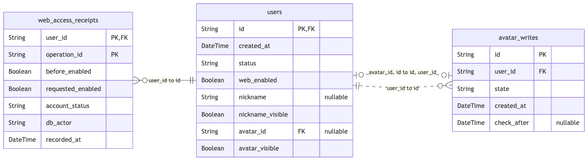

# 第 54 章　构建与持续集成

第 53 章末尾，你可以带着库名、用户 ID 和操作 ID 找回一次暂停的收据。现在换一位接班人。他拿到了同一份 Git 提交，在一个新目录里按说明安装运行。你机器上的 CLI 能查到收据，他的 API 却在监听端口之前就退出了。最值得先交换的证据是什么？一份完整数据库备份帮不上多少忙，他可能只漏拿了一个 19 字节的配置文件。

这次从[第 53 章完成代码](https://github.com/SamChowRock/epp-public/tree/part-08/chapter-53)出发，不增加业务表或接口。我们给同一份提交安排三个可以独立观察的结果：开发依赖下能检查源码，生产依赖下能运行交付物，从源码生成的图与接口文件能和随提交交付的版本对上。最后让一台新的机器重复这些步骤。读者可以从头跟写，也可以在[第 54 章配套目录](https://github.com/SamChowRock/epp-public/tree/part-08/chapter-54)直接做故障实验。

## 54.1 从一份干净的工作目录开始

先把上一章的工作目录放在一边，尤其不要把正在运行 API 的 dist 当成这次的输出。构建脚本的第一步就是清理 dist。日常开发的 .dev 和 .worker-dev 各有自己的编译目录，正在运行的生产命令则会从 dist 加载模块。对干净目录的要求很具体：源码、迁移、锁文件及随仓库交付的配置在，旧 dist、node_modules 和开发者的 .env 不在。这样我们才能知道新出现的文件来自哪一步。普通克隆可以检出本章分支；单分支克隆或手工跟写的项目可以另取[本章配套](https://github.com/SamChowRock/epp-public/tree/part-08/chapter-54)，保留上一章项目和本机账号配置。

```bash
nvm use
node --version
npm --version
npm ci
```

这里使用 Node 24.22.1 和随附的 npm。package.json 表达项目要什么，package-lock.json 记录 npm 应安装哪棵依赖树、从哪里取得包及怎样核对内容。npm ci 会先核对两份文件；成功安装会清理目标目录原有的 node_modules。它不会替你改锁来满足新的清单。第一次有意加入依赖时正需要另一个动作。从第 53 章跟写的人在新目录运行下面两行，并保留清单与锁文件的改动；拿本章完整代码的人已经拥有这两份文件。

```bash
npm install --save-dev --save-exact @biomejs/biome@2.6.6 @prisma/generator-helper@7.10.1
npm ci
```

Biome 是格式检查和静态分析工具。如果要演练锁不匹配，只在练习副本把清单中 Biome 改为 2.6.5，保留锁不动再执行 npm ci。诊断会指出锁中的 2.6.6 无法满足新要求；把清单改回 2.6.6 后再安装。第二个包供 54.3 节的 Prisma 图生成器使用。两者只在开发和构建时加载。安装时保留可选依赖：上一章的 sharp 以及 Biome 都按系统和 CPU 选择本机包。在 arm64 Mac 安装成功，不能据此把整份 node_modules 打包搬给 Linux。锁文件可以包含两端的候选项，在目标环境各自按锁安装。

**让一次失败落到一个具体问题上。** 从上章跟写时先加入项目根的 [biome.json](https://github.com/SamChowRock/epp-public/blob/part-08/chapter-54/biome.json)。下面是生效的规则部分。src/generated 是 Prisma 生成目录，产物目录也从扫描范围排除；Nest 参数装饰器需要打开配置里的 TypeScript 装饰器解析支持。

```json
{
  "linter": {
    "rules": {
      "preset": "none",
      "correctness": { "noUnreachable": "error" },
      "suspicious": {
        "noAsyncPromiseExecutor": "error",
        "noDebugger": "error",
        "noDuplicateObjectKeys": "error"
      }
    }
  }
}
```

举个与维护命令有关的例子。在 `new Promise(async (resolve, reject) => { … })` 中，外层 Promise 不会自动接管这个 async 回调返回的 Promise。回调在 await 后抛错，等待外层的关闭流程可能一直挂着。Lint 能从写法识别这种风险。把端口类型标成 number 却赋给它一个字符串，则交给 TypeScript 判断。至于账号恢复以后重放旧暂停是否又改了资格，要真的执行服务和数据库才能知道。这些失败靠不同的证据定位。

本章先统一项目清单、默认配置、上章 CLI 的两个源文件和新构建脚本的排版。旧章节有大量可逐段对照的源码，在碰到相应模块时再扩大格式覆盖。Lint 已扫描 src、scripts、test 中支持的源码文件。跟写时先执行下面的格式化和检查，此时前章 API 与 CLI 仍可构建。后面两个小节补齐脚本后，再使用完整清单里的 format:check、lint 和 ci:check。

```bash
npm exec -- biome format --write src/account-admin.ts src/manage-web-access.ts
npm exec -- biome lint src scripts test
npm run check
```

现在在独立练习副本把 config/service.json 改成一行 `{"port":3000}`，执行 `npm exec -- biome format config/service.json`。它会给出排版差异，退出码为非零，端口仍然是数字 3000。按 `npm exec -- biome format --write config/service.json` 写回并重查。再在已有的 scripts/export-openapi.mjs 末尾单独加 `debugger;`，重新执行 `npm exec -- biome lint src scripts test`。这次诊断会指向具体规则，格式化无法消掉它。删除这行。若把 `const invalidPort: number = '3354';` 临时放进 src/config.ts，运行 `npm run typecheck` 会报告 TS2322，删除这行再继续。三个动作逐个做，一个失败尚未解决时不要批量改后面的代码。

## 54.2 交付目录里究竟要有什么

先看 API 真正从哪里取端口默认值。src/config.ts 相对它自己的模块地址读 `../config/service.json`。编译后的模块在 dist/src，运行时会读 dist/config/service.json。第 5 章起的构建链已经把非 TS 资产复制到 dist。如果只把 dist/src 给接班人，所有 TypeScript 都编译成功，他仍会得到配置不可读的错误。账号 CLI 有机会正常完成预览，因为它只需要数据库配置。从某个入口成功推断另两个入口也完整，正是这次要复现的误判。

在项目根运行下面的命令。release 是新建的临时运行目录，记下它，后面的终端命令继续在项目根执行。跟写者沿用第 53 章的 build 即可。

```bash
npm run build
release=$(mktemp -d)
cp -R dist package.json package-lock.json .npmrc "$release/"
(cd "$release" && npm ci --omit=dev)
ls "$release/dist/config" "$release/dist/src/server.js" \
  "$release/dist/src/mail-worker.js" "$release/dist/src/account-admin.js"
```

留意两次安装各自发生在哪里。第一轮在源码目录，Prisma CLI 负责生成客户端，tsc 负责编译，copy-assets 负责复制配置。第二轮仅安装生产依赖，交付目录内已有编译后的 Prisma 客户端，不需要再带 schema 或运行 generate。可以检查 `test ! -d "$release/node_modules/typescript"` 的退出码。现在只在这个临时目录内模拟漏件：

```bash
mv "$release/dist/config/service.json" "$release/dist/config/service.saved"
(cd "$release" && NODE_ENV=production node dist/src/server.js)
echo $?
mv "$release/dist/config/service.saved" "$release/dist/config/service.json"
```

第二行应以 1 退出，日志里 field 为 `config/service.json: unreadable`。这是读取文件时的失败，检测发生在校验生产密钥、连接数据库和监听 HTTP 之前。文件恢复后，下一次启动会推进到下一层检查。上文的手工目录可以先留着；它只包含构建产物和生产包，之后对照结束时按自己记下的准确目录清理。

**让交付检查自己跑完。** 要观察正常路径，先准备本机 PostgreSQL 18。用 DBeaver 连到已有学习实例，在数据库导航里为本轮创建独立空库，例如 epp_ch54_delivery，所有者选拥有 public 建表权限的练习角色，刷新连接确认库名。也可以按[第 15 章](../../part-03-postgresql/chapter-15-postgresql-environment/chapter.md)的建库步骤在 psql 中完成。仍保有第 53 章 VERIFY 的读者请留好那份库和旧收据。这里会引导空库、插入固定用户并启动能领取任务的 Worker，必须用本轮专用的空库。

在项目根创建被 Git 忽略的 .env.delivery，按自己的主机、端口、角色和刚创建的库设置 DATABASE_URL。若沿用前章 .env.database-verify 的连接写法，要核对路径中的库名。库名参数另取自建库记录。从前章跟写时，此时加入[交付脚本](https://github.com/SamChowRock/epp-public/blob/part-08/chapter-54/scripts/check-delivery.sh)和[运行检查](https://github.com/SamChowRock/epp-public/blob/part-08/chapter-54/scripts/check-runtime.mjs)。交付脚本重复刚才的临时安装，在同一库引导旧迁移，最后从生产目录启动程序；退出时只清理自己创建的临时目录。它对数据库保留现场。

```bash
unset DATABASE_URL TEST_DATABASE_URL SHADOW_DATABASE_URL
node --env-file=.env.delivery --input-type=module -e '
  const { spawnSync } = await import("node:child_process");
  const run = spawnSync("sh", ["scripts/check-delivery.sh", process.argv[1]], {stdio:"inherit"});
  if (run.error) throw run.error;
  process.exitCode = run.status ?? 1;
' epp_ch54_delivery
```

Node 先加载本次配置并让子进程继承它，脚本会把另行输入的库名与实际连接上的读数比较。先清除终端已有的同名变量，因为它们可覆盖 env 文件。预期库名相同也可能是两台机器，所以主机和端口仍要对照建库时的连接。默认演练端口为 3354，已被占用时先在这个终端设置 `export EPP_CHECK_PORT=3355` 或其他空闲端口。脚本先核对自己启动的子进程报告 app.ready，再请求该端口，这样另一个进程的响应无法替一个启动失败的子进程交卷。

交付脚本里最关键的是工作目录的切换。下面几行运行在项目根，release 在此前已由 mktemp 创建。若省掉小括号里的 cd，即使第二次安装成功，得到生产依赖的也会是错误的目录。

```sh
npm run build
cp -R dist package.json package-lock.json .npmrc "$release/"
(cd "$release" && npm ci --omit=dev --no-audit)
node scripts/deploy-verify.mjs bootstrap "$1"
node scripts/check-runtime.mjs "$release" "$1"
```

最后这个检查程序仍在构建端运行，能使用原项目的观察工具。它通过 spawn(process.execPath, args, …) 指定 cwd 为 release，给各子进程一小组明确的环境变量。子进程从生产目录解析模块；观察工具在外面，不会被当作交付内容。固定等待一秒很难判断子进程是否已经连库，所以检查程序先读取该子进程的就绪日志，再观察响应；它为等待和退出设有时限。下面取自 API 的正常路径，origin 是本次演练的回环地址。

```js
const me = await fetch(origin + '/profile/me', { signal: AbortSignal.timeout(3000) });
assert.equal(me.status, 401);
assert.equal((await me.json()).code, 'AUTH_REQUIRED');
const docs = await fetch(origin + '/docs', { signal: AbortSignal.timeout(3000) });
assert.equal(docs.status, 404);
```

API 已连库，未登录请求受到原有保护，生产配置默认关闭文档。随后运行器向本轮子进程发送 SIGTERM，等待退出码 0。邮件和站内通知角色分别以 `mail-worker.js 库名` 和 `mail-worker.js 库名 notifications` 启动，各自连库、报告 ready、正常退出。空库没有投递任务，此轮无需启动 Mailpit 或对象存储。收到邮件和真实上传仍用前篇的联调方法验证。最后用 account-admin.js 对固定账号执行 preview off，应得到 before=true、after=false；独立回查 web_enabled 仍为 true。本章 smoke 检查回答的是“这份产物能否在指定配置下承担这些角色”，已有的业务回归继续验证竞争、回滚和重放。

如果迁移已经成功，却在 API 或 Worker 处失败，先保留这次的第一处错误。用完全相同的库名再运行整条命令，bootstrap 会因 public 已有结构而退出；这条后来的消息无法解释第一次失败。修好实际缺件或配置，再建另一独立空库验证完整过程。要核对第 53 章历史，可以用开始时保留的手工生产目录，单独把 CLI 指向原 VERIFY，按[上章的 receipt 参数](../chapter-53-account-cli/chapter.md)读一张已知收据。查旧记录无需重新迁移，也无需开 Worker。

## 54.3 两份生成文件，两个需要核对的事实

接班人现在能运行程序，又遇到一个更隐蔽的问题。接口说明写的是什么版本？图上这张表是否真的存在？两份旧文件都能在浏览器里打开。我们需要能从**当前源码**分别重建它们，保留可以评审的差异。

接口契约的源头在 src/openapi.ts，它和应用共享 Zod 契约。第 11 章的导出脚本调用编译后的 createOpenApiDocument()，输出 dist/openapi.json。它没有监听端口，也没从某台开发服务器下载文档。默认导出使用回环 HTTP 示例的 Cookie 名，使用 HTTPS 的运行实例会按配置选择带前缀的 Cookie 名。固定一种导出输入才能重复比较。

数据模型的源头在 prisma/schema.prisma。这次要把 **用户引用当前头像** 和 **头像写入属于某个用户** 都画出来。看两条关系的外键就知道它们能同时存在：users.(avatar_id, id) 引用 avatar_writes.(id, user_id)，avatar_writes.user_id 又引用 users.id。若生成器只看“两边各有一个列表字段”，就可能画出一张多对多中间表。当前库没有那张表。多一个框不只是图画错了，维护者会去不存在的表里查当前头像。

从上章跟写时，用[本章生成器](https://github.com/SamChowRock/epp-public/blob/part-08/chapter-54/scripts/generate-erd.mjs)新增 scripts/generate-erd.mjs，在 schema 追加如下生成目标，无须追加数据库迁移。将 package.json 的 prisma:generate 改为 `npm run prisma -- generate --generator client`。这样平常生成客户端仍只更新客户端，画图另有明确入口。

```prisma
generator erd {
  provider = "node ./scripts/generate-erd.mjs"
  output   = "../dist/ERD.md"
}
```

Prisma 已经解析过 schema，生成器可以直接拿到模型名、映射后的表名、标量字段、主键、唯一键以及一条关系的两组列。这里使用与 Prisma 固定同版的 generator-helper；它属于 Prisma 内部包，升级时要用已知模型和实际外键复验。程序遍历解析结果，只在 relationFromFields 有列的一端绘制外键，反向关系按相同关系名与目标模型找到对应正向字段。遇到没有显式外键的隐式多对多，会中止并指出字段；若后续真引入这种模型，就要先扩充图的表示方法。

以下几行说明为什么要保留**整组**外键。oneChild 判断同一目标最多能被多少条源记录引用，如果外键列组合已包含源表完整的唯一键，最多就只能有一条。oneParent 判断本次引用允许缺省还是必须存在。列顺序则来自 Prisma 明确给出的配对顺序。

```js
const columns = from.map((name) => scalar(model, name));
const targets = relation.relationToFields.map((name) => dbName(scalar(target, name)));
const oneChild = uniqueKeys.some(
  (key) => key.length && key.every((name) => from.includes(name)),
);
const oneParent = columns.every((field) => field.isRequired);
const label = columns.map(dbName).join(', ') + ' to ' + targets.join(', ');
```

例如，web_access_receipts 的 user_id 单独并不唯一；同一个用户可以留下多张收据。用户当前头像的复合外键却包含 users 的主键 id，且 avatar_id 可以为空。一名用户可暂时没有头像，另一人的写入也不能冒充这名用户的当前头像。画图时把字段的 @map 与模型的 @@map 还原为物理名字，读者就能在 DBeaver 用相同的名字找到对象。



图 54-1　从生成的全图中取出三张表和它们之间的原始边，用 Mermaid 横排。两个 PK 标记共同组成收据主键。两张头像相关表之间有两条独立的外键，边上列出了各自的列对。

将以下产物生成顺序接入[本章 package.json](https://github.com/SamChowRock/epp-public/blob/part-08/chapter-54/package.json)，同时加入 [scripts/contract-files.mjs](https://github.com/SamChowRock/epp-public/blob/part-08/chapter-54/scripts/contract-files.mjs)。先 build，再生成 ERD 和 OpenAPI。若把画图放在 build 前，build 会把刚写进 dist 的文件清掉。两份随仓库交付的快照放在 docs/generated。第一次跟写时用 update 建立它们；本章配套已经有基线，直接用 check。

```bash
npm run contracts:update
npm run contracts:check
```

check 会重新编译、生成到 dist，然后逐文件与 docs/generated 的字节比较。结果分别显示 Matches；文件丢失或字节不同会列出具体名字并退出 1。它不改基线，不依赖 Git 索引，因而能在解压出的源码目录里发现缺文件。update 也从源码重建，再将结果写进基线。如果拿的是第 53 章源码的跟写副本，首次建立基线后也要把 docs/generated 下的两份文件加入版本管理。若你收到一个 CI 红灯，先看 dist 和 docs/generated 的差异，再决定该修源码还是接受新版本。每次失败都自动调用 update，会把“谁审过这次变化”这一步抹掉。

**在自己的副本里做一次有意改动。** 在 src/openapi.ts 把文档标题 EPP Capture API 暂改为 EPP Build Review。运行业务编译不会因这个合法字符串失败，但 `npm run contracts:check` 应列出 ERD 匹配、openapi.json 过时。此时先不要运行 build 或 update。在 VS Code 对 docs/generated/openapi.json 点右键 **Select for Compare**，再对 dist/openapi.json 选 **Compare with Selected**，查 info.title。也可在项目根运行：

```bash
git diff --no-index -- docs/generated/openapi.json dist/openapi.json
```

该命令在两份普通文件不同时返回 1，正是此处要看的结果。下面是把这轮 dist/openapi.json 实际载入 Swagger UI 时的标题；同一个导出文件可以被人阅读，也可以被下游程序消费。光看页面能打开，判断不了仓库里的快照是否同步。


图 54-2　标题已变为 EPP Build Review，接口版本仍为 0.20.0。本轮只改了说明标题。

在这个练习副本先执行 update、再执行 check，观察有意接受后的匹配。把源码标题改回 EPP Capture API，再执行 update 和 check，恢复正常基线。在 VS Code 1.121 或更新版打开 docs/generated/ERD.md，用 **Markdown: Open Preview to the Side** 看关系图；回到 Mermaid 文本搜索 `avatar_id, id to id, user_id`，对照图 54-1 的两条边。在 DBeaver 连到刚才建的专用库，打开 SQL 编辑器执行：

```sql
SELECT conrelid::regclass AS source_table, conname,
       pg_get_constraintdef(oid) AS definition
FROM pg_constraint
WHERE connamespace = 'public'::regnamespace AND contype = 'f'
  AND conrelid IN ('public.users'::regclass, 'public.avatar_writes'::regclass,
                   'public.web_access_receipts'::regclass)
ORDER BY conrelid::regclass::text, conname;
```

这里应能按来源分清三条外键。两列必须按定义给出的次序成对比较。这个核对是在已经应用迁移的库上做的；ERD 取自 schema，既不会连库，也不涵盖 SQL 迁移里所有 CHECK、部分索引和触发器。即便两份快照年年一致，程序员仍可能写错一条路由说明，或把旧库漏在一次迁移之外。快照检查能指认“声明的来源与交付文件发生分歧”，要验证声明本身还得拿接口响应或库内约束来比。

## 54.4 把同样的检查交给 GitHub Actions

到这里，即使合上这章，你已经有一条可以在本机重复的 `npm run ci:check`。它依次执行格式、Lint、类型和生成文件检查，后者内部会做完整构建。容易被漏掉的是，提交里可能少了一个刚在本机创建的脚本。你的终端看得到，另一个从 Git 检出的目录没有。持续集成（CI）给每次改动提供一份独立的检出和按步骤保存的结果。

在配套代码仓库新增 [.github/workflows/build.yml](https://github.com/SamChowRock/epp-public/blob/part-08/chapter-54/.github/workflows/build.yml)。它需要放在实际包含 package.json、.nvmrc 和迁移目录的仓库里。push 或 pull_request 会触发检查，也声明了 workflow_dispatch 供工作流位于默认分支后手动发起。单个 job 使用 Ubuntu 24.04 托管 runner，只需读仓库内容。本轮 PostgreSQL 18 service 在 job 内有自己的空库。服务由 runner 启动容器；本机仍可用第 15 章原生 PostgreSQL 复现。

```yaml
      - uses: actions/checkout@v6
        with:
          persist-credentials: false
      - uses: actions/setup-node@v6
        with:
          node-version-file: .nvmrc
          cache: npm
      - run: npm ci
      - run: npm run ci:check
```

checkout 决定这次检查的源码，setup-node 读取项目指定版本。cache 保存 npm 下载缓存，可命中也可未命中。即使命中缓存也有必要执行 npm ci，它还要核对锁、为本机选择组件、安装依赖并执行允许的安装脚本。把 Mac 上的 node_modules 或某次旧 dist 塞进缓存会引入新的输入，很难从一次成功推断当前源码能否构建。workflow 中的 v6 与 postgres:18 是主版本引用；如果以后要求还原到某个 action 的精确实现或某份数据库镜像，应另外记录 action 提交和镜像 digest。npm 锁文件管不到这些输入。

数据库服务先经 pg_isready 健康检查。工作流中的 `5432/tcp` 让 runner 分配宿主端口，步骤读取 `job.services.postgres.ports[5432]` 拼成本次连接地址。运行交付检查的步骤只需 DATABASE_URL。随后的回归显式把 TEST_DATABASE_URL 指向同一临时库，沿用上一步准备的固定测试账号。若另开 job，前一个 job 的数据库、依赖目录或 dist 都不能当作已存在。当前一个 job 内顺序执行便能复用本次产物和专用库。后面拆共享契约包时再安排多包间的构建先后与制品交接。

读者有自己的 GitHub 练习仓库时，把完整代码、锁文件、两份快照和工作流放在同一个提交。打开仓库的 **Actions → Build and verify**，核对触发的分支与提交；从 PR 的 **Checks** 也可以进入具体运行。展开 build 下第一个红色步骤。若显示清单与锁不一致，回到相同 Node 版本下确认依赖改动、有意更新锁；若显示 Missing or stale snapshot，则按上一节核对源头与生成结果。后面的步骤因前一步失败被跳过，灰色步骤还没有给出业务结论。修好后用新提交的检查记录交接。重新运行旧提交会使用旧源码，适合排查一次短暂的下载故障，无法带上你工作区刚修的文件。没有远程仓库时，本机仍可跑相同 npm 命令与交付演练。

最后回到接班现场。若 API 已报告 ready、CLI 收据也能读到，但登录开始变慢，新的构建编号只能帮你钉住运行的版本。要判断是密码计算、连接池等待还是数据库查询耗时，还要观察执行中的服务。下一章从这些读数继续。

[支线 54A　同一份锁文件能复用哪一层产物](side-01-platform-artifacts.md)

## 附录：本章必要技术点速查

| 名称 | 出现问题时先查什么 |
| --- | --- |
| npm ci / --omit=dev | 清单与锁是否同时交付；安装发生在源码目录还是独立运行目录；原生组件是否适配当前平台。 |
| biome format / lint | 是否在本章覆盖范围内；format 默认只比，显式 --write 才落盘，Lint 的错误要按规则定位。 |
| prisma generate --generator | client 供编译，erd 生成关系图；两者均从当前 schema 出发。 |
| contracts:check / update | 两者都重建。前者对照并保留差异，后者更新审阅基线。 |
| check-delivery.sh | 完整构建、独立生产安装、空库引导、真实进程的就绪与退出。运行库和测试配置须指向专用数据。 |
| job / step / service | 一个 job 内顺序运行步骤并共享工作目录，服务与其生命周期相连。日志要与本次提交对应。 |

[npm 11 的 ci](https://docs.npmjs.com/cli/v11/commands/npm-ci/) · [Biome 配置](https://biomejs.dev/reference/configuration/) · [Prisma 生成器](https://www.prisma.io/docs/orm/prisma-schema/overview/generators) · [Mermaid 实体关系图](https://mermaid.js.org/syntax/entityRelationshipDiagram.html) · [VS Code 内置 Mermaid 预览](https://code.visualstudio.com/updates/v1_121/) · [GitHub Actions 的 PostgreSQL 服务](https://docs.github.com/en/actions/tutorials/use-containerized-services/create-postgresql-service-containers)

阅读约 45～60 分钟，已有 PostgreSQL 18 时，从干净目录构建、运行、制造差异再恢复另加 65～90 分钟。有自己的 GitHub 仓库时配置并检查一次远程运行另加 10～18 分钟，网络下载与 runner 排队另计。按正文代码、两图和实操步骤估算。

[本章完成代码](https://github.com/SamChowRock/epp-public/tree/part-08/chapter-54) · [上一章](../chapter-53-account-cli/chapter.md) · [下一章](../chapter-55-performance/chapter.md) · [第八篇导读](../README.md) · [全书目录](../../README.md)
