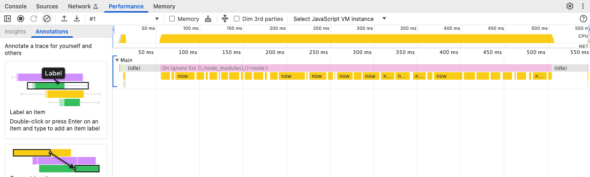
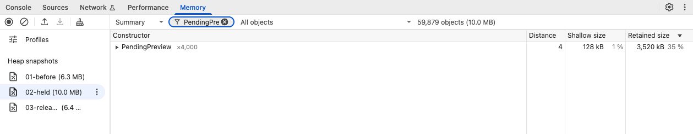
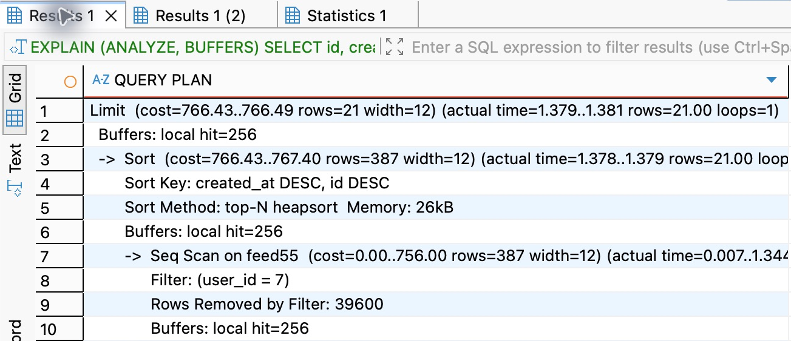
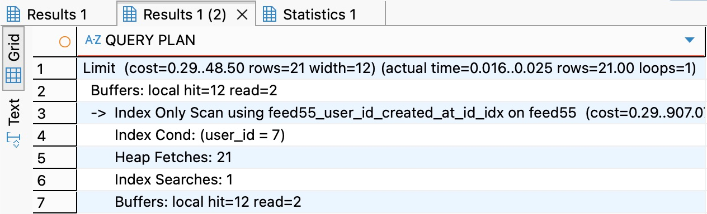

# 第 55 章　调试性能与资源问题

接班人用上一章的交付目录启动了服务。有两条登录记录格外慢：一条 247 毫秒，一条 244 毫秒，两条都是 200。库里也都多了一条有效会话。如果只能再取一次读数，你会在请求结束后查最慢的 SQL，还是在请求尚未结束时看它在等谁？这两次登录里，只有一次真的在数据库里等锁。

从[第 54 章代码](https://github.com/SamChowRock/epp-public/tree/part-08/chapter-54)继续。本章保留原接口、密码成本和数据结构，只在开发目录加[本机诊断实验](https://github.com/SamChowRock/epp-public/tree/part-08/chapter-55/examples/performance)。它用真实的 API 和 PostgreSQL 制造能解除的等待；另开一个只有虚构对象的 Node 进程做破坏时序的内存观察。两边的样本不能混算。

## 55.1 给耗时找一个起点和终点

若上章的练习服务仍在运行，可在 Postman 用集合 05 登录已开通的账号，再新建一个 GET 请求，向同一 baseUrl 的 /captures 查询，沿用同一 Cookie jar。手边没有旧服务或账号，直接做下段的独立实验即可。在响应 Headers 里复制 **X-Request-Id**，到这次 API 的输出里找同一个值。客户端的毫秒数从它开始发送算起；API 的计时从请求进入观察中间件开始，到响应流触发 finish 为止。后者表示服务端已把数据交给底层写出，不能证明客户端已经读完。若对端先关连接，日志可能是 http.aborted；这样的时间也不能当作成功请求的耗时。

为了能把现场留到下一节，在本机 PostgreSQL 18 新建由练习角色拥有的空库 `epp_ch55_lab`。在独立的配套项目目录执行 `nvm use`、`npm ci`、`npm run build`。从 54 章跟写只需把本章的 examples/performance 目录取到同一位置。在被 Git 忽略的 `.env.perf` 放 **DATABASE_URL**：沿用本机角色和端口，主机写回环，库名改为 epp_ch55_lab。不要复制上章整套生产环境变量。仅首次对空库运行第一条：

```bash
env -u DATABASE_URL node --env-file=.env.perf scripts/deploy-verify.mjs bootstrap epp_ch55_lab
umask 077
lablog=$(mktemp)
env -u DATABASE_URL node --env-file=.env.perf examples/performance/service.mjs epp_ch55_lab > "$lablog" 2>&1 &&
  rg '^LAB' "$lablog"
```

这次实验不用预先注册。程序核对连接的实际库名，创建一个随机练习账号，用真正的密码接口登录，把本次 Cookie 留在内存，随即发起列表请求。它只监听临时回环端口，另一个终端上的 API 不会收到这些请求。成功结束时释放自己创建的数据和连接；中途失败先看文件末尾。在自己的输出中取 **capture-list** 的 requestId，运行 `rg -F '换成本轮的请求ID' "$lablog"`。一次实际读数如下：

| 读数来自哪里 | 同一次 GET /captures |
| --- | --- |
| LAB capture-list | 客户端收到并读完响应，6 ms |
| http.completed | API 到响应写出，4 ms |
| store.completed，operation=list | 进入记录存储对象到它返回，1 ms |

这三只钟套在一起，不能相加成 11 ms。存储对象之外还有会话认证、查询参数解析和输出。那 1 ms 本身也可能包括等连接、数据库往返和结果转换。把 4 减去 1，只能得到粗略的「其他时间」，不能把差额命名为 JavaScript 计算。各次测量还分别取整；一条记录小到 0 ms 也不等于没有执行。学习记录首页用的是 LearningQueries，不经过这个 capture store；看到同样的 http.completed 却没有 store.completed，先看调用路径，再怪日志丢失。

沿着这个办法读另外三种记录，会发现「完成」指三件不同的事。登录先读密码凭据，再异步验密码，最后进事务建会话。一次登录慢，不能从总时间判断三段里的哪一段慢。注册申请的 **202** 则只覆盖邮件意图和任务的提交；寄信进程在另一条时间线上工作，要用本轮消息 ID 对齐领取、尝试和 SMTP 应答，不能用浏览器请求 ID 拼出寄达时间。SSE 连接可以一开就是十分钟；要量的是从连接到首个 inbox 帧、变化到重新取得列表，以及断开后名额何时归还。把十分钟的连接寿命放进普通查询的耗时分位数，会让健康的服务看似突然变慢。

## 55.2 同样过了半秒，Node 做了什么

先取两个除了工作内容以外相同的样本。在配套根目录运行：

```bash
umask 077
profiles=$(mktemp -d)
node examples/performance/runtime.mjs wait
node --cpu-prof --cpu-prof-dir="$profiles" --cpu-prof-name=cpu.cpuprofile examples/performance/runtime.mjs cpu
```

第一组等一个 450 ms 的定时器；第二组在 scoreCandidates 里反复计算直到相同时限。两组都让一个独立的采样定时器先跑起来，再比较它实际被唤醒的最长间隔。Node 的 monitorEventLoopDelay 以纳秒记值，除以一百万才是毫秒。一次实测的 **经过时间／进程 CPU 时间／最大循环延迟**：等待组为 **451／2／16 ms**；同步计算组为 **450／443／461 ms**。10 ms 的采样分辨率自身就会带来约一个采样间隔的读数；一次最大值只能描述这个窗口。CPU 时间按全进程各线程累计，多核一起工作时甚至可以大于经过时间。两组的墙钟几乎一样，只有第二组连本应及时运行的其他回调也耽搁了。

要用和图中相同的 Node 专用 DevTools，可另开终端运行一个空闲的调试目标：

```bash
node --inspect=127.0.0.1:9229 -e 'setInterval(() => {}, 60000)'
```

若 9229 正被自己的其他进程占用，换一个空闲端口并在 Chrome 的 `chrome://inspect/#devices` → Configure 加入对应的回环地址。在该页面选择新目标的 inspect，或点 **Open dedicated DevTools for Node** 连接它。这里的空闲目标只用于打开界面。切到 **Performance**，点工具栏向上的箭头 **Load profile**，选择刚才的 cpu.cpuprofile（终端用 `echo "$profiles"` 找目录）。这是把 Node 的录制载入界面；直接在网页点 Record 录到的是那个网页。看下图上方整段黄色，再对照下方 Main 随时间展开的栈。函数宽代表在这段采样中出现的时间份额，纵向是调用关系；不要把父子两层的宽度相加。工具可能折叠被忽略的框架栈，选择区间后可在 **Call tree** 展开调用者，或在 **Bottom-up** 从叶子向上追。这个例子在循环里频繁调用 performance.now 检查截止时间，看到 now 正是样本的一部分；业务服务没有因此就该优化读时钟。



图 55-1　上方横轴是整次录制，含启动、等待采样定时器和收尾。黄色长段与同步计算发生在同一个窗口。图表示观察到的调用栈，不是对真实登录密码开销的测量。

若换成真正的登录，Argon2 的工作在原生库和工作线程执行。JS 在 await 处让出了主线程；主线程的 CPU profile 上看不到一条很宽的 JavaScript 调用，仍可能有昂贵的原生计算或工作线程排队。先用同一台机器、同一密码参数，比较[第 32 章的成本实验](https://github.com/SamChowRock/epp-public/blob/part-08/chapter-55/examples/password-cost.mjs)：

```bash
for n in 1 4 8; do UV_THREADPOOL_SIZE=4 node examples/password-cost.mjs 19456 "$n"; done
```

每批都是新进程，Argon2id 使用 19456 KiB、两轮、并行度 1。一台机器上提交 1、4、8 项分别用了 25、26、49 ms，峰值 RSS 约 69、126、127 MiB。8 项中有些约 25 ms，有些约 48 ms，与四个工作线程分批完成吻合。这里测的是哈希；真实登录要验证已有编码，还要读库、核对资格、建会话，并受入口限流和每进程两个密码工作名额约束。保留这些保护，别用脚本吞吐量替代登录容量，也别为了缩短演示时间降低密码成本。

再换一个现象：压测已经结束，进程占用的内存没有马上降回起点。RSS 包含 V8 堆、原生分配和其他常驻页，分配器也可能保留已经可复用的页。要证明「请求已经结束，对象却还活着」，先在同一个进程比较同一种对象的出生和释放：

```bash
node --expose-gc examples/performance/runtime.mjs heap
```

它输出三份文件路径。在 DevTools 的 **Memory → Load profile** 依次载入 01-before、02-held、03-released。选中第二份，在 **Summary → Filter by class** 输入 PendingPreview。程序向名为 openPreviews 的 Map 添加了 4000 份临时预览。下图是添加之后、清空之前。展开类、选一份实例，再在下方 **Retainers** 里逆向找：谁还握着该对象，谁又握着那个容器？实例自己的 Shallow size 很小，Retained size 还会计入若它消失便可释放的私有数组等对象；多个对象共享的内存不能逐行简单相加。



图 55-2　选中的是 02-held。点左边第一份和第三份重新过滤同一个类。此轮从 0 到 4000，清空 Map 后剩 1；三份快照约 6.3、10.0、6.4 MB。最后一个实例仍须看它自己的持有者，不能凭总数断言它仍在已清空的 Map 里。

这也是排查泄漏时比「占用变大了」更强的证据：让同样的连接开、关多轮，观察停止新增且回收后**仍被谁保留**，比较剩余数量是否随轮次增长。堆快照会暂停该线程、需要额外内存，内存已吃紧的进程可能直接退出；文件里可能出现 Cookie、邮件令牌、路径和业务正文。本章只给无业务秘密的合成进程拍快照，不对登录实验拍。CPU profile 也可能带源码路径；在临时目录本机分析，不上传原件。看完关闭 DevTools，并在空闲调试目标的终端按 Ctrl-C。要估计正常响应时间，关闭 Inspector 和详细查询日志，另开一轮；采样、快照或断点所在轮次不能充当无观测开销的基准。

## 55.3 请求在等池、等锁，还是在读行

回到开头那两次登录。先盖住输出中的 phase 名称，只比「释放前」的两行。本章程序把 **API 自己的 pg.Pool** 限为两条连接，另开一条不占这个池的观察连接。total 是池里已建立的连接数，idle 是当前还可以借的，waiting 是正在等它发连接的调用数。不要另建一个空池去读这三个属性。

| 释放前的一次观察 | total | idle | waiting | 当前被观察会话挡住的 API 后端 |
| --- | ---: | ---: | ---: | ---: |
| 现场一 | 2 | 0 | 1 | 0 |
| 现场二 | 2 | 1 | 0 | 1 |

现场一先向池借出两条连接，不发 SQL，也不归还。真实登录连读取密码凭据都得排队。PostgreSQL 可能认为这两条连接空闲，Node 却认为它们已经借出：数据库的 idle 说的是「当前没有执行 SQL」，池的 idle 说的是「现在能交给别人」，不是同一个问题。还回连接后，原登录直接完成。把池从 2 改成 3 或许会让这一次成功，却不会修复某个异常分支忘记 release 的缺陷。要找借出点、持有多久、是否在 finally 归还；长期在事务里等外部 HTTP 也会产生类似的池读数。

现场二让观察连接开事务，用 `SELECT ... FOR UPDATE` 锁住**本轮账号**，再发同一个登录。普通读取能继续，密码验证也可以完成；登录要锁账号行核对资格并创建会话时才停住。取证必须在 ROLLBACK 前做。配套程序用 pg_blocking_pids 找到持锁者确实是自己的观察会话，才释放并等待原 HTTP 返回。要在 DBeaver 查另一个现场，用同库同角色的新 SQL 编辑器运行下面的查询，而不是复用正在等待的编辑器。独立编辑器要确认使用独立连接；ID 与等待关系随本轮改变，不要照抄上一轮的 PID。

```sql
SELECT pid, application_name, state, wait_event_type, wait_event,
       pg_blocking_pids(pid) AS blocked_by
FROM pg_stat_activity
WHERE datname = current_database() AND application_name = 'epp-api'
ORDER BY pid;
```

先看被挡的那行是否正在等 Lock，沿 blocked_by 找阻塞者；持锁者本身不一定叫 epp-api。按该 PID 在同一视图单查 state、xact_start、wait_event_type；看见 idle in transaction 就去问那段事务为什么没有结束，不能据此终止陌生会话。本实验的自动故障窗口只有约 200 ms，不要求手动抢拍；脚本在释放前已从数据库读回等待关系。练习手动观察可沿用[第 25 章的双连接操作](../../part-04-consistency/chapter-25-concurrency/chapter.md)，单独开第三个连接作观察者。如果锁了十秒才去测登录，登录自己的锁超时会先发生，你看到的是另一个现场。反过来，一次 blocked_by 为空也只说明采样时没看到这种锁阻塞，不能排除先前短暂等锁，更不能排除 IO。

两种等待都排除后，才问「拿到连接后，SQL 为得到这 21 行做了多少事」。学习记录首页按归属过滤、按创建时间和 ID 倒序取下一页的探针行；第 30 章已为它建立有序索引。不要先删那个索引来制造慢查询。打开配套的 [plan.sql](https://github.com/SamChowRock/epp-public/blob/part-08/chapter-55/examples/performance/plan.sql)，在一个 DBeaver 编辑器中按顺序执行：BEGIN、建临时表、ANALYZE、第一条 EXPLAIN。保存第一份结果，再执行建索引、ANALYZE 和第二条 EXPLAIN；最后 ROLLBACK。也可以在同一编辑器选择 **SQL Editor → Execute SQL script** 一次顺序执行整份；在下方两个 Results 标签之间切换，找列头为 QUERY PLAN 的网格。Statistics 显示的是脚本执行统计。psql 也可在指向练习库的会话用 `\i examples/performance/plan.sql` 执行整份。临时表只在创建它的连接可见，用简化的键重现首页的访问方式，没有模拟整条业务查询的关联和行宽。

```sql
EXPLAIN (ANALYZE, BUFFERS)
SELECT id, created_at FROM pg_temp.feed55 WHERE user_id=7
ORDER BY created_at DESC, id DESC LIMIT 21;
```

先看建索引前的 Results 1。从底部的 Seq Scan 往上读：40000 行中过滤掉 39600 行，留下 400 行交给 Sort。虽然父节点只要 21 行，数据库还得看完候选，才能确定哪些排在最前面。



图 55-3　把第 5 行的 Sort Method 和第 9 行的 Rows Removed by Filter 放在一起看。top-N 限制了排序时需要保留的候选数，没有省掉前面的扫描。

切到同轮的第二个结果。复合索引先按 user_id 定位，再按所需顺序读取；Limit 收到 21 行就能停，计划里没有独立的 Sort。



图 55-4　第一行的实际输出是 21 行；第 4 行的 Index Cond 是 user_id = 7。再看下一行的 **Heap Fetches: 21**：「Only」表示索引包含查询要返回的值，但执行器仍可能需要到表页确认可见性。

这次 DBeaver 实拍中，两份计划末尾的 Execution Time 分别为 1.390 和 0.032 ms。换一台机器时，先核对过滤行数、排序节点和提前停止的位置，不要求毫秒数相同。临时表此处报告 local buffers，不能把 hit 数当磁盘读次数，也不能把规划成本 cost 当毫秒。EXPLAIN ANALYZE 会真的执行语句；这里测的是隔离库上的 SELECT。

还有一种「越来越慢」与单条 SQL 无关。打开专用练习库的 SQL 编辑器，先运行配套 [mail.sql](https://github.com/SamChowRock/epp-public/blob/part-08/chapter-55/examples/performance/mail.sql)。保持本机 Mailpit 已启动、邮件 Worker 未启动（[本机邮件环境](../../environment-setup.md)有启动命令）。另一个终端从配套根目录启动正常 API；端口可换成空闲端口，两端 SMTP 必须一致：

```bash
env -u DATABASE_URL NODE_ENV=development PORT=3355 LOCAL_SMTP_PORT=1055 \
  node --env-file=.env.perf dist/src/server.js
```

Mailpit 的 SMTP 地址设为 `127.0.0.1:1055`，网页例如 `127.0.0.1:8055`；若沿用已有实例，就把命令里的 1055 改成它的实际回环 SMTP 端口。把集合 baseUrl 设为 `http://127.0.0.1:3355`，请求 01 向一个新的虚构地址申请注册。202 后重查：在原来为空的练习队列里，due_now 从 0 到 1，later 为 0，channel 为 open；再等几秒最老到期时长会增加。已有历史时以本轮前后差和具体消息为准。用下句把地址换成本轮值，得到 ID：

```sql
SELECT id, status FROM public.verification_outbox
WHERE recipient='perf55@example.test' AND status='pending'
ORDER BY available_at DESC, id;
```

在另一终端执行 `env -u DATABASE_URL LOCAL_SMTP_PORT=1055 node --env-file=.env.perf dist/src/send-one.js epp_ch55_lab 本轮消息ID`。本机实测回执 accepted，Mailpit 同一收件人新增一封邮件，due_now 回到 0，oldest_wait 为空。202 耗时没有包含中间故意空等的这段时间，SMTP 接受也不保证互联网收件箱送达。用 SQL 的有效领取时间 COALESCE(lease_until, available_at) 区分已经到期和还在退避或有租期的任务；单看 pending 总数会把它们混在一起。若 channel 为 busy，先看当前尝试和租期；若为 paused，回到[第 45 章的事故处置](../../part-06-background/chapter-45-retries/chapter.md)，加 Worker 不会解除停发。实验完关闭本次启动的 API 与 Mailpit。

## 55.4 一次只改变并发，把成功和代价一起记下

同一个尚无学习记录的账号、同一条学习记录查询，实验程序先预热一轮，再按 1、2、4 个客户端分别读 12 次；每个客户端读完一条才发下一条。上轮代码、数据库和池上限都没变。一轮实际读数如下：

| 同时最多在途 | 成功／请求 | 整批毫秒 | 单次中位毫秒 | 最慢毫秒 |
| ---: | ---: | ---: | ---: | ---: |
| 1 | 12／12 | 41 | 3 | 6 |
| 2 | 12／12 | 22 | 4 | 5 |
| 4 | 12／12 | 17 | 6 | 7 |

整批结束得更早，但单个请求的典型等待反而变长。「并发 4 最快」缺了主语：是这一批最快做完，不是每个用户最快拿到回应。每档只有 12 项，不能用最慢一次宣称线上 P99。真实排查时先固定版本、数据分布、响应大小、账号及预热条件，按档重复并换序；按状态单列超时与拒绝，观察单位时间成功完成数和延迟分布。这个客户端在服务慢时也会变慢发，不能用它推断外部流量仍按固定速率到达时的队长。需要持续流量模型时，给发生器设总时长、最大在途、最大请求数与停止条件，记录原计划发起却未能发起的次数。当错误上升、等待持续增长或邻近服务受影响，就停止升档回看资源。

把同一办法用到 SSE 时要改分母。实验以同一个已登录账号开四条连接，每条都读到首个 **inbox** 帧才开下一条，再试第五条。实测第五条 429／STREAM_LIMIT，同时池的 total=2、idle=2、waiting=0。四个浏览器连接没有各自永久占住一个数据库连接：每条流周期性查询、还回连接、再等下次轮询。断开四条后再建一条返回 200，才说明名额又可借；只截某一刻的 idle=2 不能排除 HTTP 名额没有归还。若有在途查询，释放也可能稍晚。反过来，很多流同一时刻重查会短暂占池，在两轮之间抽样会漏看，需连同查询频率和等待时间观察。页面上的帧与断线回查可对照[第 47 章](../../part-06-background/chapter-47-sse/chapter.md)。

以后把等待对象换成模型供应商，仍先固定一份代表性输入和输出预算。分开记本地排队、发出到首个输出、首个输出到结束、取消后的实际结算；重试要按尝试计次数与费用，再按一次用户任务汇总。相同响应时间可能对应截然不同的生成长度和花费；吞吐改善也可能只是多发了付费尝试。本章没有向模型发请求，这些是引入下一种依赖时要增加的测量边界。

## 55.5 根据证据选择改动

接到那张「登录约 245 ms」的报障单，现在可以给出两种不同的处理。若所有客户端都借出且 waiting 持续抬升，就查调用路径在借出后做了什么，缩短持有时间并确保失败也归还。若数据库明确表示某事务在挡目标账号，先缩小事务范围、排除人在事务中停留，再按资格和密码版本的要求重新核对；把 FOR UPDATE 去掉也会变快，但可能让刚被暂停的账号建立新会话。两种改动都要带回原并发、原账号与原正确性条件再测。

若计划显示为了同一页读了几万行，补适合筛选与排序的索引，比让四个 API 重复做相同的大扫描更直接。代价是占空间，写入、更新和维护该索引也要工作；已有第 30 章索引时先查是否用得上，别建第二份重复索引。若主线程长时间在做可拆的 CPU 工作，少量任务可先分片让出事件循环；总工作量并未减少。要让一个慢任务不阻塞其他 HTTP 可用有上限的 Worker 线程池，预算包括每个线程的内存、输入复制或转移、排队和退出。已有 Argon2 原生线程再包一层线程不自动增加核数；入口限制在途，拒绝时给出重试语义，比允许无限请求在内存里排队更可控。

缓存只有在足够多的请求能复用同一份**仍然有权读取**的结果时才有意义。例如学习记录首页按账号、排序、筛选和分页参数区分，接受新记录后旧首页可能漏第一行；会话或 Web 资格刚撤销，旧的 200 更不能替你授权。删缓存、等 TTL、按版本重建的差别，直接决定写完何时读到新值。还要限制条目和字节，考虑大量键同时过期时回源，不然省下的 SQL 会换成进程内存增长。对本章测出来的锁和被借走的连接，给登录结果加缓存都偏离了原因。

多个进程能用更多核、隔开故障，但各自拥有数据库池、密码工作和 SSE 名额、来源限流计数。四个实例各开五条池连接，API 一项的预算已是二十条，之外还有 Worker、CLI 与运维连接；把单进程限流简单复制四份，同一个人切实例也可能得到更多机会。共享约束要有共享的原子状态或明确按实例分割的预算。先写下要改善哪条曲线、哪些保护必须保持，把改动前后的错误、延迟、资源消耗都留在同一份记录里。这样交给下一位维护者的才是能复查的判断。

[支线 55A　写后删缓存，为什么还会读回旧页](side-01-cache-race.md)

## 附录：本章必要技术点速查

| 名称 | 用途与边界 |
| --- | --- |
| X-Request-Id、store.completed | 在同一请求内区分 API 与 capture 存储的计时范围，不能关联整个异步邮件生命周期。 |
| --cpu-prof、monitorEventLoopDelay | 观察线程栈与定时器迟到，区分进程 CPU 时间与经过时间，不用暂停时长作基准。 |
| --expose-gc、writeHeapSnapshot、Retainers | 在合成进程的几个稳定阶段比较可达对象；快照不含所有原生内存，也不能安全地当普通附件分享。 |
| totalCount、idleCount、waitingCount | 要取被调查进程的池；池排队发生在 SQL 到达数据库之前。 |
| pg_stat_activity、pg_blocking_pids | 在释放前找阻塞关系，要有可观察目标会话的权限；不要打印所有会话的 SQL 与参数。 |
| EXPLAIN (ANALYZE, BUFFERS) | 实际执行，比较行数、循环次数、排序、访问页和停止位置；估算成本没有毫秒单位。 |

[Node 24 的 CPU 采样参数](https://nodejs.org/docs/latest-v24.x/api/cli.html#--cpu-prof) · [事件循环延迟](https://nodejs.org/docs/latest-v24.x/api/perf_hooks.html#perf_hooksmonitoreventloopdelayoptions) · [Node 堆快照注意事项](https://nodejs.org/en/learn/diagnostics/memory/using-heap-snapshot) · [Chrome DevTools 的堆快照](https://developer.chrome.com/docs/devtools/memory-problems/heap-snapshots) · [pg.Pool 的计数](https://node-postgres.com/apis/pool) · [PostgreSQL 18：读执行计划](https://www.postgresql.org/docs/18/using-explain.html) · [数据库活动视图](https://www.postgresql.org/docs/18/monitoring-stats.html)

阅读约 35～48 分钟；已有 PostgreSQL 18 和本机 Mailpit 时，跟做登录、两类采样、执行计划和投递对照另加 45～65 分钟。按四幅界面图与实际操作估算，首次安装与下载另计。

[本章完成代码](https://github.com/SamChowRock/epp-public/tree/part-08/chapter-55) · [上一章](../chapter-54-build-ci/chapter.md) · [第八篇导读](../README.md) · [全书目录](../../README.md)
