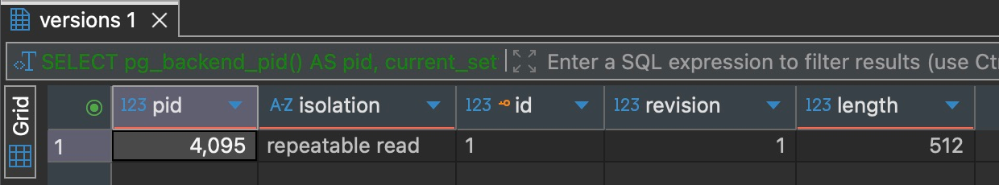
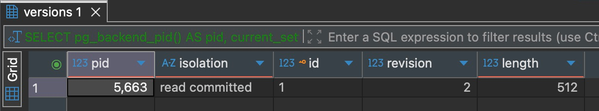
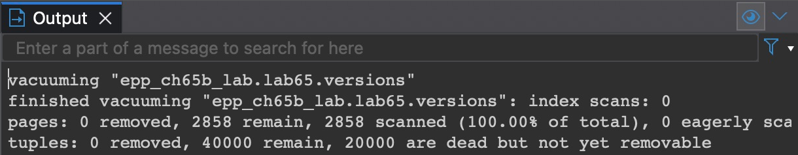
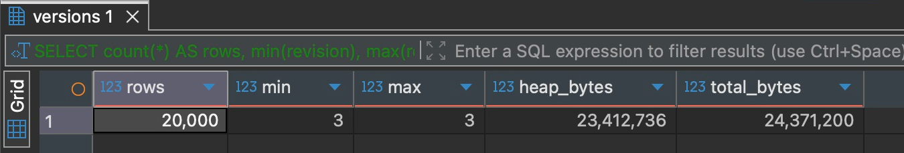
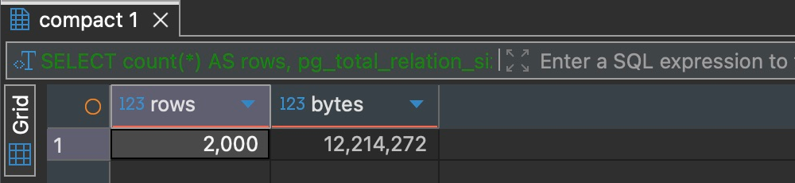
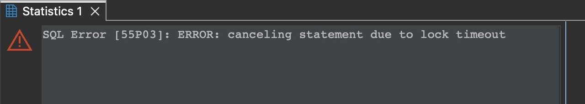
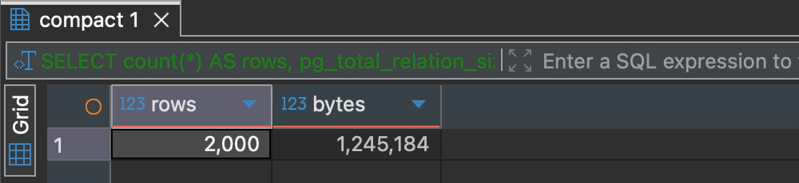

# 65B　长事务结束以后，PostgreSQL 怎样回收旧行占用的空间

第 65 章已经区分了池排队、锁等待和查询扫描。还有一种现场不会立刻报错：更新一直成功，业务行数几乎不变，表文件却越来越大。有人建议每晚执行一次 `VACUUM FULL`。先别把这条命令放进定时任务。我们要回答三个不同的问题：旧值为什么还需要保留，哪些空间可以再用，以及什么时候值得为了缩小文件暂停访问。

本支线沿用 PostgreSQL 18 和 DBeaver，不修改 EPP 的表、迁移或应用代码。按[环境说明](../../environment-setup.md)准备专用空库 `epp_ch65b_lab`，使用拥有该库及练习表的本机练习角色。它不需要 EPP 的 bootstrap，也不要把本章 SQL 放进业务迁移。所有写入集中在 `lab65` schema；下面给出全部 SQL，可按小节保存为自己的脚本。

## 65B.1 让两个会话看到同一行的不同版本

在 DBeaver 新建指向这个库的连接，核对 Host、Port、Database 和用户，连接名可写 `65B 实验`。为 A、B、C 分别建立独立连接并打开 SQL 编辑器：A 留住快照，B 写数据，C 观察和维护。复制编辑器标签不一定会新建连接；三处先分别执行：

```sql
SELECT current_database(), current_user, inet_server_addr(),
       inet_server_port(), pg_backend_pid();
```

三个 PID 必须不同，目标库都必须是 `epp_ch65b_lab`。若不同标签返回同一 PID，使用独立连接重新打开，不能继续。三个编辑器先保持自动提交；只有 A 在指定位置显式开启事务。每次只选中当前步骤执行，不要把全文当成一份脚本一口气运行。

在 B 建普通表：临时表只能由创建它的会话看到，无法承担这次双会话对照。

```sql
CREATE SCHEMA lab65;
CREATE TABLE lab65.versions (
  id integer PRIMARY KEY,
  revision integer NOT NULL,
  payload text NOT NULL
) WITH (autovacuum_enabled = false);

INSERT INTO lab65.versions
SELECT g, 1, repeat(md5(g::text), 16)
FROM generate_series(1, 20000) AS g;
ANALYZE lab65.versions;
```

两万行各有 512 字节的合成正文，后面只更新 revision，让行宽与主键保持不变。`md5` 在这里产生可重复的合成字符串，不用于密码。仅对这张短期练习表关闭自动清理，是为了由 C 控制清理时点；不要照搬到业务表，也不要关闭实例级 autovacuum。若 schema 已存在，先确认是不是上次未收尾的练习，不要用 `IF NOT EXISTS` 把旧数据悄悄当作新基线。

在 C 保存第一份大小读数：

```sql
SELECT pg_relation_size('lab65.versions') AS heap_bytes,
       pg_indexes_size('lab65.versions') AS index_bytes,
       pg_total_relation_size('lab65.versions') AS total_bytes;
```

这里分别量主表主文件、索引和包含附属存储的总量，单位都是字节。总量还包括空闲空间映射、可见性映射及可能的 TOAST 存储，不能简单要求前两列之和等于第三列。它们也不是整个实例或文件系统已用空间。

在 A 执行下面这一组，然后停住：

```sql
SET application_name = 'lab65-A';
BEGIN ISOLATION LEVEL REPEATABLE READ;
SELECT id, revision, length(payload)
FROM lab65.versions WHERE id = 1;
```

结果为 `1 / 1 / 512`。这里必须真正执行 SELECT；只写 BEGIN 还不足以建立我们要保留的数据快照。REPEATABLE READ 让后续读取沿用同一事务快照。接着在 B 自动提交一次更新，再查询同一主键：

```sql
UPDATE lab65.versions SET revision = revision + 1;
SELECT id, revision, length(payload)
FROM lab65.versions WHERE id = 1;
```

B 看到 `1 / 2 / 512`；切回 A，只重发 SELECT，仍是 `1 / 1 / 512`。这不是客户端缓存。数据库保存了行的多个版本，按照各次读取的快照判断哪个版本可见，这就是 MVCC 在眼前的作用。B 已成功提交不等于所有读者都应立刻看到新值；若把旧版本马上抹掉，A 的一致读取便无法继续。

下面两张 DBeaver 实图是在 B 提交之后取得的。查询多加了 `pg_backend_pid() AS pid` 与 `current_setting('transaction_isolation') AS isolation`，便于核对连接与隔离级别：A 的 PID 为 4095，仍读到第 1 版；独立观察会话 C 的 PID 为 5663，读到已经提交的第 2 版。PID 是当次值，不要照抄。这次拍图由独立 psql 会话承担 B 的写入，A、C 的读取与后续维护在 DBeaver 执行；判断依据仍是不同后端与明确的提交顺序。





改变一个条件就能检验理解：A 若用默认 READ COMMITTED，第二条 SELECT 会取得新语句快照，通常能看到已经提交的第 2 版。因此“连接开得久”“事务开得久”“旧快照还需要哪些版本”不能当成同一件事。READ COMMITTED 下仍在执行的长查询也可能保留旧快照，不能反过来认为这种隔离级别不会妨碍清理。

## 65B.2 在快照仍有效时检查清理结果

A 继续保持事务。在 C 的自动提交编辑器，**单独执行**：

```sql
VACUUM (VERBOSE, ANALYZE, TRUNCATE FALSE) lab65.versions;
```

VACUUM 不能放进 BEGIN/COMMIT 包裹的事务块。若 DBeaver 报此错误，在 C 回滚它自己的事务，切回自动提交后重发；不要为了修 C 顺手提交 A。`VERBOSE` 输出过程信息，`ANALYZE` 更新规划器统计。`TRUNCATE FALSE` 暂时禁止裁去文件末尾空页，让这轮专门观察内部复用；它没有禁用行版本清理。

在 SQL 编辑器打开 Output／服务器消息面板（本次 DBeaver 26.2.4 的菜单为 SQL Editor → Panels → Show server output），找到 `lab65.versions` 对应的输出；可能还会看到附属 TOAST 表的一组消息。此次 PostgreSQL 18.6 的主表读数是：

```text
tuples: 0 removed, 40000 remain, 20000 are dead but not yet removable
```



业务查询仍只有两万行。这里的四万描述物理行版本；其中两万个已经被更新替代，却还不能移除。VACUUM 返回成功，表示完成了本次能够完成的工作，并没有承诺把所有旧版本清掉。接着在 C 查持有者：

```sql
SELECT pid, application_name, state, xact_start,
       backend_xmin, wait_event_type, wait_event
FROM pg_stat_activity
WHERE datname = current_database()
  AND application_name = 'lab65-A';
```

本轮 A 是 `idle in transaction`，`backend_xmin` 非空。xact_start 给事务开始时间；backend_xmin 提供这个后端当前快照的保留边界，不是“有多少脏行”。A 没在执行 SQL，却仍欠着一次事务结束。对比主章的行锁现场：此时 B 的更新可以成功，普通 VACUUM 也能执行，受限制的是哪些旧版本能移除。`pg_blocking_pids` 没列出阻塞者不能证明不存在这种保留。

如果想看统计估计，在 C 另发一条语句：

```sql
SELECT n_live_tup, n_dead_tup, last_vacuum, last_autovacuum
FROM pg_stat_user_tables
WHERE schemaname = 'lab65' AND relname = 'versions';
```

这些数适合观察趋势，受统计刷新和采样影响；不要用 `n_dead_tup` 精确倒推出每次更新产生了几个版本。保持观察连接自动提交，重新执行查询，并把采样时点写在记录旁。判断本次限制，要把 A/B 的实际读取、维护输出及快照状态放在一起。

到这里先预测：如果 A 结束，表文件会马上减半吗？事务结束只解除保留条件，没有替你搬动表里的其他行，更没有自动要求操作系统缩小文件。

## 65B.3 结束快照后重复同一组写入

回到 A，由原持有者执行 `COMMIT;`。这是只读事务，ROLLBACK 也能释放本轮快照。回到 C，再执行同一条 VACUUM，然后重查大小。此轮输出变为：

```text
tuples: 20000 removed, 20000 remain, 0 are dead but not yet removable
```

在 B 再执行一次 `UPDATE lab65.versions SET revision = revision + 1;`，C 再清理并读取大小。下面是同一轮、同一张表的实际字节数：

| 时点 | 主表主文件 | 索引 | 总量 |
| --- | ---: | ---: | ---: |
| 初始两万行 | 11706368 | 466944 | 12206080 |
| A 保留快照，更新并清理后 | 23412736 | 917504 | 24371200 |
| A 结束，再清理后 | 23412736 | 917504 | 24371200 |
| 第二次更新并清理后 | 23412736 | 917504 | 24371200 |

最后在 B 查询 `SELECT count(*), min(revision), max(revision) FROM lab65.versions;`，本轮为 `20000 / 3 / 3`。同样两万次更新确实发生，主表却没再增长：先前释放的空间已经可以承担后续写入。文件仍大不构成清理失败；反过来，只看文件不增长也不能单独证明发生了清理，还要核对写入量、当前值与过程输出。



图中在 C 合并读取了行数、revision 范围与大小；这轮界面复验的最终读数与上表一致。核对时要看 `rows`、`min/max` 和两个大小字段，不能只盯着文件大小。

实际业务未必得到完全相同的字节数。行宽、页内空位、索引变化和并发写入都会影响复用。如果更新没有改变索引引用的列（BRIN 等汇总索引有例外），且同页有空间，PostgreSQL 还可能通过 HOT 减少新索引项；不能把“每次更新必定让所有索引增长一份”当规律。这里保持工作量和行宽，是为了先看清回收与复用的关系。

普通 VACUUM 默认在条件允许时也可能裁去末尾连续空页，所以“普通清理永远不会缩文件”同样不成立。我们显式用了 TRUNCATE FALSE，真实维护时应按尾部截断的锁需求和服务约束选择。位于文件中间的空洞若要归还文件系统，通常需要重排仍活着的数据。

若 A 已结束，仍报告不能移除，不要继续盲目重复 VACUUM。先重新查询同库其他后端的 backend_xmin 和 backend_xid，确认还有没有长查询或未结束事务；再由有相应可见性权限的维护身份检查 prepared transactions、复制槽的 xmin/catalog_xmin 与副本反馈。复制槽的 restart_lsn 保留的是 WAL，不能把 WAL 文件增长与本表旧版本保留混为一谈。先确认保留者承担什么工作，再决定等待、修复事务范围或由工作拥有者取消；不要仅按“最老 PID”终止陌生服务。

日常 autovacuum 会做相应的清理与统计维护，也承担防止事务 ID 环绕的职责，不能因为磁盘还有余量就长期关闭。若清理速度持续落后于写入，应先排除保留条件，再根据表规模、变化率和维护进度调整触发阈值与资源预算。加大清理力度会增加 I/O；没有清除保留条件时，多开清理工作也无法越过快照边界。

## 65B.4 需要把空间还给文件系统时怎样取舍

假设一张表永久删掉九成记录，后面也不会重新长回来，而宿主机确实需要空间。这时才值得比较重写。为避免改变上面的样本，在 B 建第二张小副本：

```sql
CREATE TABLE lab65.compact (LIKE lab65.versions INCLUDING ALL);
INSERT INTO lab65.compact SELECT * FROM lab65.versions;
DELETE FROM lab65.compact WHERE id > 2000;
SELECT count(*) AS rows,
       pg_total_relation_size('lab65.compact') AS bytes
FROM lab65.compact;
```

本次界面复验在重写前读到 2000 行、12214272 字节。字节数会随采样时点与附属存储变化，保存自己这一轮的读数作前后对照。



先在 A `BEGIN;`，再执行 `SELECT count(*) FROM lab65.compact;` 并停住。即使只读，这个事务也持有访问表所需的锁直到结束。

在 C 自动提交模式先分别设置：

```sql
SET application_name = 'lab65-C';
SET lock_timeout = '2s';
SET statement_timeout = '30s';
```

然后**单独执行**下面这一句，预期先失败：

```sql
VACUUM (FULL, ANALYZE) lab65.compact;
```

本轮两秒后返回 `55P03`，原因是等待锁超时。lock_timeout 只约束取锁等待，statement_timeout 才给整条语句设置上限；两者不是重写耗时估算。FULL 要取得 ACCESS EXCLUSIVE 锁，A 的读事务就能挡住它。若希望自己从 B 观察等待，可先把 C 的 lock_timeout 改为 `15s`，在 C 执行期间于 B 查询：

```sql
SELECT pid, wait_event_type, wait_event, pg_blocking_pids(pid) AS blocked_by
FROM pg_stat_activity
WHERE datname = current_database() AND application_name = 'lab65-C';
```

应在超时前看到 Lock、relation 以及 A 的 PID；本轮自动化在释放前也取得了这个关系。若已经超时，空等待只是现场结束，重新建立有界窗口再观察。不要无限等锁：排队的强锁请求还可能影响后来访问这张表的请求，使一次维护拖住原本能正常工作的业务。



由 A 执行 `ROLLBACK;`，C 再发同一条 VACUUM FULL。随后 B 重查行数和大小：本轮仍为 2000 行，总量降为 1245184 字节。FULL 把仍然可见的记录重写到新文件并重建相关索引；旧文件在完成前还得保留。因此“磁盘快满了，先执行 FULL”可能正好缺少它所需的额外空间。



图中由 C 重查同一张表。行数相同只是第一层核对；本次另按全部主键检查了这 2000 行的 `revision = 3` 与原始 payload，全部保持。自己复做时，也应按保留记录的身份和值比较，不能把“行数没变”当成数据完全相同。

本练习的预期值可以从主键重建，因此在 C 用下面的查询核对，结果应为 `2000 / 1 / 2000 / true`。主键唯一、行数与首尾范围共同确认没有缺号，最后一列再检查每行内容；业务数据没有这种生成规律时，应与重写前保存的记录比较。

```sql
SELECT count(*) AS rows, min(id), max(id),
       bool_and(revision = 3 AND payload = repeat(md5(id::text), 16))
         AS all_values_valid
FROM lab65.compact;
```

要作维护决定，还需在数据库宿主机检查数据所在文件系统。以能读取练习实例配置的身份运行 `SHOW data_directory;`，再在**宿主机终端**执行 `df -h '实际数据目录'`，读 Available 一列。若表空间或 WAL 位于另一卷，分别检查它们。远程库的路径不能拿到自己笔记本执行；托管数据库应读取供应商的存储容量指标。表大小减少与 df 可用量变化未必逐字节一致，其他表、WAL、文件系统快照与同时写入都可能影响后者。

小副本证明了锁冲突和空间变化，没有证明生产库能在 30 秒内完成。实际安排应保存已验证可恢复的备份，明确目标表及索引、重写余量、预计 WAL 与复制积压、允许中断的窗口，并先在接近真实规模的副本测量。取消后要检查语句结果和表是否仍可读，不凭客户端弹窗认定整个维护成功。若没有可接受的访问中断窗口，就先限制增长、缩短事务并保持常规清理，再评估分区归档或需要额外工具与验证的在线重组方案；不要把 FULL 当成更彻底的日常清理按钮。

收尾时在 A 执行 `ROLLBACK;`（若已无事务，提示无事务是正常的），C 执行 `RESET lock_timeout; RESET statement_timeout;`。在 B 恢复练习表设置：

```sql
ALTER TABLE lab65.versions RESET (autovacuum_enabled);
```

最后把三份编辑器保存为自己的 A／B／C SQL 文件，保留执行顺序和读数；不要把含本机连接信息的工作区配置提交到书稿或代码仓库。保存读数后，若不再需要本轮合成数据，由表拥有者在 B 依次执行 `DROP TABLE lab65.compact; DROP TABLE lab65.versions; DROP SCHEMA lab65;`，不用 CASCADE。中途退出过则先确认三个连接的事务状态；不要从中间的一次 UPDATE 猜现在是第几版，核对后清理自己的练习对象，再从初始数据重做。断开三个练习连接不会停止 PostgreSQL 服务，也不应停止日常数据库。

回到第 65 章，长事务同时可能延长锁占用和阻止旧版本回收，却需要不同证据。回到第 68 章交接时，留下的应是“哪个快照仍有效、哪些空间已经能复用、是否真的需要停机归还空间”，而不只是一条待执行的 VACUUM FULL 命令。

## 附录：本支线必要技术点速查

| 名称 | 本次用途与边界 |
| --- | --- |
| REPEATABLE READ | 首次数据读取建立事务快照；事务结束释放，不等于关闭连接 |
| backend_xmin | 观察后端的快照保留边界；不是死版本计数 |
| VACUUM VERBOSE | 看实际清理与尚不可移除的版本，自动提交执行 |
| ANALYZE | 更新规划统计，不承担文件压缩 |
| pg_relation_size / pg_indexes_size / pg_total_relation_size | 分别量主文件、索引和总量，不代表文件系统空闲容量 |
| TRUNCATE FALSE | 本轮保留文件末尾以观察内部复用；不禁止清理旧版本 |
| VACUUM FULL | 重写、强锁、额外磁盘及 WAL 预算，先验证副本与恢复路径 |
| lock_timeout / statement_timeout | 分别限制锁等待与语句时间，实验后恢复会话设置 |

[PostgreSQL 18：事务隔离](https://www.postgresql.org/docs/18/transaction-iso.html) · [常规清理](https://www.postgresql.org/docs/18/routine-vacuuming.html) · [VACUUM 参数](https://www.postgresql.org/docs/18/sql-vacuum.html) · [活动与统计视图](https://www.postgresql.org/docs/18/monitoring-stats.html) · [HOT](https://www.postgresql.org/docs/18/storage-hot.html)

阅读约 30～40 分钟，已有 PostgreSQL 18 与 DBeaver 时，三连接对照另加 30～45 分钟；均为按本支线篇幅及操作估算。

[返回第 65 章](chapter.md) · [第八篇导读](../README.md)
