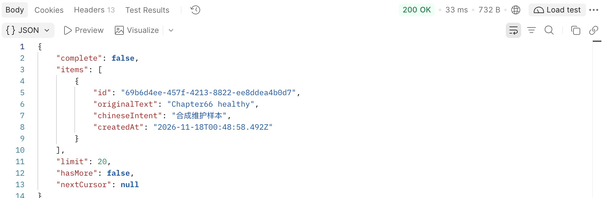
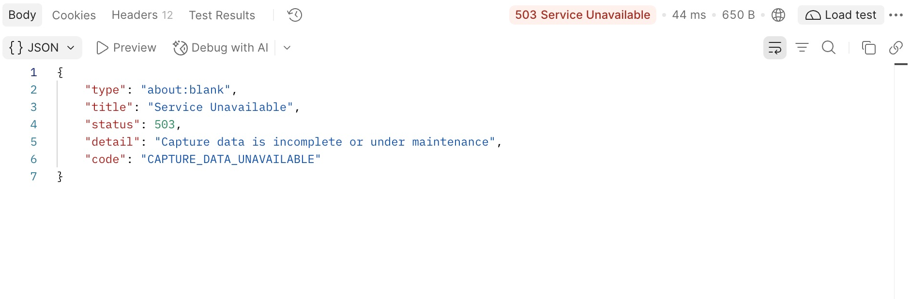
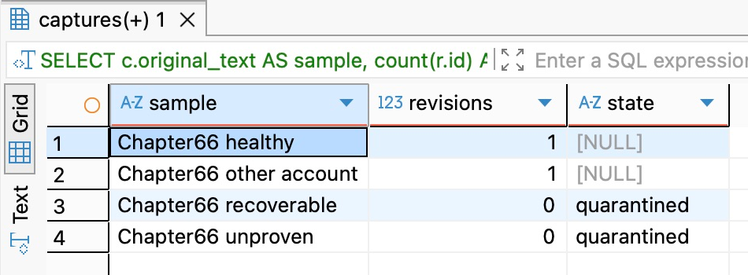
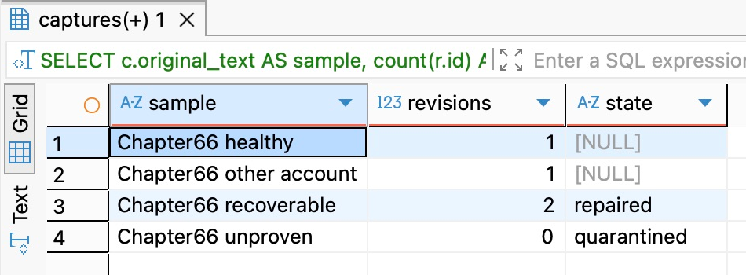
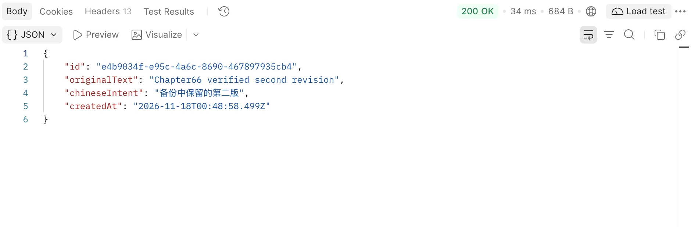

# 第 66 章　一条历史坏记录应该让多少服务停下来

第 65 章让我们找到一条请求为何等待，也区分了旧快照留下的空间和仍在使用的数据。现在遇到另一种维护现场：素材列表返回 200，却少了两条；拿其中一个旧 ID 查详情，得到 500；重启之后，连旁边的正常素材也读不了了。同一份坏数据，为什么会在三条路径上产生三种结果？

从[第 65 章代码](https://github.com/SamChowRock/epp-public/tree/part-08/chapter-65)的非空练习库副本继续。本章只处理一个明确规则：**素材父记录存在，但全部修订都不见了**。我们会保留健康操作，告诉调用者结果是否完整，记录维护进度，再凭可信历史恢复一条素材。另一条暂时没有获准使用的依据，继续隔离；把错误提示消掉不算恢复。

[完成代码](https://github.com/SamChowRock/epp-public/tree/part-08/chapter-66)包含新增迁移、维护 CLI、API 接线、[Postman 集合](https://github.com/SamChowRock/epp-public/blob/part-08/chapter-66/requests/chapter-66-integrity.postman_collection.json)和[操作材料](https://github.com/SamChowRock/epp-public/tree/part-08/chapter-66/database/chapter-66)。跟写者从 65 继续，按下文增加文件和接线；只核对现场者另开目录检出 66，先完成下面的旧版对照，再切新目录运行。不要在运行着的 API 目录切分支，也不要把同一个数据库当成能随 Git 自动回退的文件。

## 66.1 先解释漏行，再决定怎样停用

准备一个由练习维护角色拥有的独立库 `epp_ch66_source`。从第 64 章已经核对过的非空副本复制，沿用原账号、密码、Cookie 和配置；先按[已有非空副本步骤](https://github.com/SamChowRock/epp-public/blob/part-08/chapter-65/database/chapter-22/backup-restore.md)复制历史库，下面再给出本轮故障前备份与恢复命令。这里不会对日常库注入故障。若刚从空库开始，先在 **65 章代码目录**完成下方的 nvm use、npm ci、npm run check，配好 .env.ch66-api，再执行 `env -u DATABASE_URL node --env-file=.env.ch66-api scripts/deploy-verify.mjs bootstrap epp_ch66_source` 完成该版基线，再沿第 50 章密码登录路线准备两个已开通的合成账号。不要直接从最终 66 章空库启动来代替旧版对照。

在本轮私有 API 配置 `.env.ch66-api` 中保存 source 的 DATABASE_URL，以及沿用的 APP_ORIGIN、会话和游标签名等配置。固定一个回环端口，例如 3366，并令 APP_ORIGIN 与实际入口一致；在新终端运行时清除 Shell 的同名 DATABASE_URL，避免外层环境覆盖文件：

```bash
nvm use
npm ci
npm run check
env -u DATABASE_URL NODE_ENV=development \
  TSC_WATCHFILE=DynamicPriorityPolling TSC_WATCHDIRECTORY=DynamicPriorityPolling \
  node --env-file=.env.ch66-api scripts/dev.mjs
```

这个入口按 tsconfig.dev.json 编译到 .dev，开启回环 Inspector 9229，保存源码后重新编译并重启；VS Code 使用已有的 dev 附加配置。这里为反复停启的本机实验选择 TypeScript 轮询监听，代价是定期检查文件。等 app.ready 再请求；生产交付仍使用 dist 和显式 production。

用 Postman 原密码登录集合登录账号甲，保持其 Cookie jar。通过原 `POST /captures` 创建 `Chapter66 healthy`、`Chapter66 recoverable`、`Chapter66 unproven` 三条素材，分别保存返回的 ID。给 recoverable 用不带幂等键的 `POST /captures/:id/revisions` 追加一版，文本设为 `Chapter66 verified second revision`。这些合成样本不提交候选、不做采纳，也不使用操作键，所以没有其他表引用待删除的修订。账号乙再建一个 `Chapter66 other account`，保存两边的身份和正常结果。样本正文只是帮助辨认，维护时始终以返回的 ID 定位。

先在 DBeaver 建 source 连接，主机、端口、数据库、用户分别填本机实例对应值。打开 SQL 编辑器，确认顶部连接就是 source，保持自动提交；每次只选中要执行的一条语句。首先查 `SELECT current_database(), current_user, inet_server_addr(), inet_server_port();`，将结果与**事先记录**的实例和库名对照。然后查父记录与修订数：

```sql
SELECT c.id, c.original_text AS sample, count(r.id) AS revisions
FROM public.captures c
LEFT JOIN public.capture_revisions r ON r.capture_id = c.id
WHERE c.original_text LIKE 'Chapter66 %'
GROUP BY c.id, c.original_text ORDER BY c.original_text;
```

首次练习应看到甲的三条和乙的一条，其中 recoverable 两版，其余各一版。若副本中已有同名的历史练习样本，将本章观察查询的名称条件替换为 `c.id IN ('本轮healthy UUID', '本轮recoverable UUID', '本轮unproven UUID', '本轮乙的UUID')`，只比较这次保存的四个 ID；名称相同不是同一条记录。LEFT JOIN 保留没有子行的父记录；`count(r.id)` 只数非空子 ID，不能改成 `count(*)`，否则连占位的父行也会算作一版。这里是全库维护身份查询；API 查询还必须有当前用户条件。

停写并备份。以下命令在**本机维护终端**执行，使用 PostgreSQL 18 自带工具，角色与 DBeaver 相同；host/port/user 按刚核对的实际值设置。若需要密码，让工具在终端交互提示时输入，不把密码拼进连接串或命令历史。先执行 `pg_dump --version` 与 `pg_restore --version` 确认来自 PostgreSQL 18；命令未找到时，将本机 PostgreSQL 18 的 bin 目录加入当前终端 PATH。备份只读 source，恢复写入事先新建且为空的 verify：

```bash
umask 077
CH66_BACKUP_DIR=$(mktemp -d)
export PGHOST=127.0.0.1 PGPORT=5432 PGUSER=你的练习维护角色
pg_dump --format=custom --dbname=epp_ch66_source --file="$CH66_BACKUP_DIR/before.dump"
pg_restore --exit-on-error --no-owner --dbname=epp_ch66_verify "$CH66_BACKUP_DIR/before.dump"
```

5432 是常见端口，若实例使用别的端口必须改；图中独立实例用的是 55666。`--no-owner` 让目标对象由恢复角色拥有，不改变备份行内容。若目标不是空库，不加 `--clean` 硬覆盖，另建一个空 verify。任一命令失败都停在这里，修正后重新取得完整备份。给 verify 单独建 DBeaver 连接，按四个 ID 对照父字段、每一版的 ID、序号、内容、来源、chunks 和时间；只比较总行数不足以证明能恢复同一条历史。若导出 JSON 作逐值比较，先在两边观察会话执行 `SET TIME ZONE 'UTC';`；同一 timestamptz 在不同会话时区会显示成不同字符串，先统一表示，再判断数据是否变化。记下备份路径，重开终端后仍要指向存放这份备份的目录。

旧版目录里还没有本章故障脚本。先从另开的 66 完成代码目录取得 [failure.sql](https://github.com/SamChowRock/epp-public/blob/part-08/chapter-66/database/chapter-66/failure.sql) 与 Postman 集合，旧 API 仍运行 65；不提前复制新业务代码或应用新迁移。现在回到 **source**，在 DBeaver 打开这份 `failure.sql`，把两个占位 UUID 换成本轮 recoverable/unproven 的 ID。它检查库名、两条固定合成文本、两版加一版的前提，锁住两个父记录，再只删除这两个 ID 的修订。不要绕过外键；若旧样本已有候选或回执，删除应失败。单独执行 `ROLLBACK`，另建干净的合成样本并重新备份，不能用 CASCADE 清掉其他业务。

故障提交后再次查左连接：两条父记录仍在，修订数为零。甲的旧 `GET /captures` 仍返回 200，但本轮三条样本只剩 healthy，其他原有健康素材仍应保留；甲的坏 ID 详情返回 500，乙查询甲的同一 ID 仍为 404。保留这个 Cookie，停止并重启旧 API，会发现启动直接拒绝。此时还没有新维护表，下面的新状态查询不能提前执行。

沿三条源码路径查原因。旧列表用 `JOIN LATERAL (...) latest ON true` 为每条素材挑最新修订；子查询空了，内连接顺便把父记录滤掉。详情先找到了属于当前用户的父记录，再发现没有最新版，走存储错误。启动则曾全库找任意一条没有修订的素材，发现一条就拒绝整个服务。三者都在回答自己的问题，却没有共同说明“这部分数据不可用”。重复重启不能补回修订，只会把局部内容故障扩散为全站不可用。

## 66.2 把部分可用写进真实接口

跟写时先读完 66.2～66.4，把下文的新文件和已有文件接线补齐，再构建、迁移并执行新版本操作。CLI 会同时导入扫描、隔离、导出和修复函数，只写到扫描函数时还不是可运行阶段。原 65 目录留作旧版对照，新实现放在另一个目录；运行中的目录不要切换分支。

能否继续服务，要看仍然可信的事实是什么。本例 `captures.user_id` 与用户外键仍成立，我们知道坏素材属于谁，健康素材的完整历史也还在。因此可继续服务健康条目，把坏条目的内容读取和写入停住。反过来，若归属字段被错误覆盖，或者维护者拆掉归属约束，服务不能确定数据是否属于当前调用者，就不能用“跳过几个坏行”安慰自己：需要停止相关读取、保存现场并恢复可信归属。范围由受损承诺决定，不由“只坏了一行”决定。

先为局部不可用定义 `CaptureDataUnavailableError`，通过现有异常映射返回 503 和 `CAPTURE_DATA_UNAVAILABLE`。这个错误可区分于数据库失联，也不把维护原因、备份路径或其他账号信息放进响应。503 表示当前操作不能完成，不许客户端用定时重试制造新的历史；维修完成后再读。API 仍然先查当前身份的归属，外人得到原来的 404，不能借不同错误码探测别人的隔离记录。

在 `database-errors.ts` 增加以下错误类，并在 `http.ts` 原有 statusCode 与 code 分支分别映射成 503、CAPTURE_DATA_UNAVAILABLE；保留原 404 与认证错误顺序：

```ts
export class CaptureDataUnavailableError extends Error {
  constructor() { super('Capture data is incomplete or under maintenance'); }
}
```

还要在 `DatabaseService.run` 的 catch 内、调用 databaseFailure **之前**加入 `if (error instanceof CaptureDataUnavailableError) throw error;`，并同步 import。否则底层发现的是局部数据问题，却在通用存储包装层被重新变成500。跟写时先确认抛出位置，再沿整条异常路径查到最终响应，不能只改 HTTP 映射。

旧列表客户端只认识响应里的 items，并把成功列表当成完整结果。即使加一个 complete 字段，未升级的客户端也可能忽略它，继续把漏行当删除。因此旧 `GET /captures` 遇到当前用户任意不可用条目就拒绝。新分页及其示例客户端在本章一起升级，给响应增加 `complete`：健康条目照常分页，当前账号存在缺修订或隔离记录时为 false。即使带了文本筛选，也不能因健康结果不匹配就断言完整，因为丢掉的修订可能恰好包含筛选词。

新增 `src/capture-integrity.ts`，完整性查询如下。它按用户范围查缺失，隔离状态来自下一节的案件表：

```ts
import { Prisma } from './generated/prisma/client.js';

// The same transaction snapshot must cover completeness and the actual result page.
export async function captureListComplete(tx: Prisma.TransactionClient, userId: string): Promise<boolean> {
  const [row] = await tx.$queryRaw<{ complete: boolean }[]>`
    SELECT NOT EXISTS (
      SELECT FROM public.captures c WHERE c.user_id = ${userId}::uuid AND (
        NOT EXISTS (SELECT FROM public.capture_revisions r WHERE r.capture_id = c.id)
        OR EXISTS (SELECT FROM public.capture_integrity_cases q WHERE q.capture_id = c.id AND q.state = 'quarantined')
      )
    ) AS complete`;
  return row?.complete === true;
}
```

在 `PrismaCaptureStore.list` 的同一个 REPEATABLE READ 只读业务事务中，先调用此函数，false 时抛上述错误，再执行原列表 SQL；在 `CapturePages` 中也把完整性查询和分页 SQL 放进同一短事务。若分成两次独立 READ COMMITTED 查询，第一次判完整后恰好有修订被删除，第二次会漏行却仍带 true。同一快照避免这种自相矛盾，但没有跨多次 HTTP 翻页冻结全库；第 34 章的实时遍历边界仍然存在。

旧列表的完整方法如下；在文件顶部导入 captureListComplete、CaptureDataUnavailableError，Prisma 沿用原导入。保留原筛选和排序，只把取数与完整性判断纳入同一事务：

```ts
async list({ text, limit }: CaptureListOptions): Promise<Capture[]> {
  const rows = await this.database.run('list', () => this.database.client.$transaction(async tx => {
    if (!await captureListComplete(tx, this.userId)) throw new CaptureDataUnavailableError();
    return tx.$queryRaw<Row[]>(Prisma.sql`
    SELECT c.id, r.original_text AS "originalText", r.chinese_intent AS "chineseIntent", c.created_at AS "createdAt"
    FROM public.captures c
    JOIN LATERAL (SELECT original_text, chinese_intent FROM public.capture_revisions
      WHERE capture_id = c.id ORDER BY revision_no DESC LIMIT 1) r ON true
    WHERE c.user_id = ${this.userId}::uuid
      ${text === undefined ? Prisma.empty : Prisma.sql`AND strpos(r.original_text COLLATE "C", ${text}) > 0`}
    ORDER BY c.created_at ASC, c.id ASC
    ${limit === undefined ? Prisma.empty : Prisma.sql`LIMIT ${limit}`}
  `);
  }, { isolationLevel: Prisma.TransactionIsolationLevel.RepeatableRead, timeout: 5000 }));
  return rows.map(project);
}
```

分页 SQL 除了现有用户条件，再排除对应 `state='quarantined'` 的案件。`items`、`hasMore`、`nextCursor` 描述**可读取的子集**；`complete` 描述这一页取数时当前账号的完整性。因此下面这份真实响应同时出现 `hasMore:false` 和 `complete:false`：已到可读末页，不代表原本就只有一条。



图 66-1　甲仍能读 healthy，但两条历史素材暂不可用。乙的正常列表仍为 complete:true；完整性状态不能跨账号共享。

把 `complete: z.boolean()` 加入分页响应 schema，返回 `{ complete, items, limit, hasMore, nextCursor }`，同时更新 OpenAPI。现有分页观察页 `examples/paging-upgrade/pager.mjs` 在每次重开时设 `complete=true`，接收页面时累积 `this.complete = this.complete && result.complete !== false`。任一页出现 false，本轮翻页就一直提示“部分记录暂不可用”；修复后的新页返回 true 也不能抹掉已经漏过数据的事实，须重新从第一页取。为对照旧版观察页，省略字段仍可接收；66 版服务器必须返回布尔字段。页面不再把末页写成“已取得全部数据”。

同样的拒绝要接到所有素材操作。`find` 先找到当前用户的父记录，再检查是否有修订或隔离案件；历史列表要分别检查**全部修订数**和本次 before 条件的结果，没有第 1 版以前的记录是正常空页，不能误报损坏。追加和 PATCH 保留父行锁，在插入前检查无修订与隔离状态，拒绝凭空造一个 revision 1。带操作键的命令还要在返回旧回执之前检查当前素材是否可用：历史成功收据证明当年提交过，不证明今天内容健康。这些接线分别在 `prisma-capture.store.ts`、`capture-commands.ts` 和 `capture-pages.ts`；跟写时一起修改，不能只有列表过滤。

以带操作键的命令为例，将原来的归属查询换成下面这段，位置仍在 `if (target !== null || previous)` 内、读取 previous 回应之前。没有自己的父记录先走原 missing 分支；属于本人但不可用才抛 503。

```ts
const owned = await tx.$queryRaw<{ id: string; usable: boolean }[]>`
  SELECT id, EXISTS (SELECT FROM public.capture_revisions r WHERE r.capture_id = c.id)
    AND NOT EXISTS (SELECT FROM public.capture_integrity_cases q WHERE q.capture_id = c.id AND q.state = 'quarantined') AS usable
  FROM public.captures c WHERE id = ${captureId}::uuid
  AND user_id = ${this.userId}::uuid FOR SHARE`;
if (!owned.length) return 'missing' as const;
if (!owned[0]?.usable) throw new CaptureDataUnavailableError();
```

无键追加的 `previous` CTE 同样查询是否存在 quarantined 案件，命名为 blocked；INSERT 的条件改为 `revision_no IS NOT NULL AND NOT blocked`，结果带回 blocked，随后用 `row.previousNo === null || row.blocked` 抛同一错误。历史查询则在 select 同时取 `_count: { select: { revisions: true } }` 与隔离案件，先判断总数为零或存在隔离，再返回按 before 筛出的历史页。这样“完整历史本来存在，但当前页为空”仍能返回成功。



图 66-2　本人详情返回 503/CAPTURE_DATA_UNAVAILABLE；另一账号仍得到 404。响应不包含案件内容或恢复证据。

启动不再扫全库找坏素材，但没有删掉结构检查：原数据库连接、必需字段、唯一约束、角色权限仍要核对，新增案件表的状态列也必须可读，归属外键必须存在、经过验证，且确实从 captures.user_id 指向 users.id；只认约束名称会漏过同名但列错误的约束。删掉坏行探针后必须补上请求局部保护，否则只是把启动时的确定拒绝变成请求时的随机失败。外键的存在也不能证明一个有效 user_id 没被写错；若事故涉及合法但错误的归属值，仍需从可信备份或审计事实重建，不能靠启动通过来洗清嫌疑。

将 DatabaseService.onModuleInit 原来全库查找缺修订记录的两行替换为下面的探针，其他角色分支和结构检查保持原位：

```ts
// Probe the API's isolation metadata access; individual bad rows are handled by reads.
await this.client.$queryRaw`SELECT id, capture_id, state FROM public.capture_integrity_cases LIMIT 0`;
const ownership = await this.client.$queryRaw<{ convalidated: boolean }[]>`
  SELECT convalidated FROM pg_constraint
  WHERE conrelid = 'public.captures'::regclass AND conname = 'captures_user_id_fkey'
    AND contype = 'f' AND confrelid = 'public.users'::regclass
    AND conkey = ARRAY[(SELECT attnum FROM pg_attribute
      WHERE attrelid='public.captures'::regclass AND attname='user_id' AND NOT attisdropped)]::smallint[]
    AND confkey = ARRAY[(SELECT attnum FROM pg_attribute
      WHERE attrelid='public.users'::regclass AND attname='id' AND NOT attisdropped)]::smallint[]`;
if (ownership.length !== 1 || !ownership[0]?.convalidated) throw new StorageFailureError();
```

这种检查有成本：每页确认当前账号完整性，需要对其父记录做反连接，而不只是取本页 20 行。当前靠 `capture_revisions(capture_id, revision_no)` 与案件索引支撑；大账号先按第 65 章测计划和耗时，再考虑可信的完整性投影或更强写入不变量。只加一个可能过期的“健康=true”缓存，会重新带回本章正要消除的假完整。

## 66.3 让巡检能中断，让隔离有实际作用

请求告诉我们“这条现在不能用”，维护者还需要知道谁曾发现什么、扫到哪里、哪条已确认隔离。只把 ID 打进日志，下次重跑既难找首次发现时间，也不能解释一次批处理到底提交到哪。将它们拆成三个持久事实：案件是一条素材的一次事故；扫描是一轮巡检的位置；修复收据保存这次恢复用了哪份依据。重复故障另建案件，旧案件与依据不能被新一次覆盖。

新增迁移 `prisma/migrations/20261118010000_capture_integrity/migration.sql`：

```sql
CREATE TABLE public.capture_integrity_cases (
  id uuid PRIMARY KEY,
  capture_id uuid NOT NULL REFERENCES public.captures(id) ON DELETE RESTRICT,
  rule text NOT NULL DEFAULT 'missing-revisions/v1' CHECK (rule = 'missing-revisions/v1'),
  state text NOT NULL DEFAULT 'observed' CHECK (state IN ('observed','quarantined','repaired')),
  first_seen_at timestamptz(3) NOT NULL DEFAULT statement_timestamp(),
  last_seen_at timestamptz(3) NOT NULL DEFAULT statement_timestamp(),
  quarantined_at timestamptz(3),
  repaired_at timestamptz(3),
  CHECK ((state = 'observed' AND quarantined_at IS NULL AND repaired_at IS NULL)
      OR (state = 'quarantined' AND quarantined_at IS NOT NULL AND repaired_at IS NULL)
      OR (state = 'repaired' AND quarantined_at IS NOT NULL AND repaired_at IS NOT NULL))
);
CREATE UNIQUE INDEX capture_integrity_open_key ON public.capture_integrity_cases(capture_id)
  WHERE state <> 'repaired';
CREATE INDEX capture_integrity_lookup_idx ON public.capture_integrity_cases(capture_id, state);
CREATE TABLE public.capture_integrity_scans (
  id uuid PRIMARY KEY,
  database_name text NOT NULL,
  upper_id uuid,
  after_id uuid,
  started_at timestamptz(3) NOT NULL DEFAULT statement_timestamp(),
  finished_at timestamptz(3),
  scanned bigint NOT NULL DEFAULT 0 CHECK (scanned >= 0),
  CHECK (after_id IS NULL OR (upper_id IS NOT NULL AND after_id <= upper_id))
);
CREATE TABLE public.capture_integrity_repairs (
  case_id uuid PRIMARY KEY REFERENCES public.capture_integrity_cases(id) ON DELETE RESTRICT,
  source_ref text NOT NULL CHECK (length(source_ref) BETWEEN 1 AND 200),
  evidence_sha256 text NOT NULL CHECK (evidence_sha256 ~ '^[0-9a-f]{64}$'),
  evidence jsonb NOT NULL,
  applied_by text NOT NULL DEFAULT current_user,
  applied_at timestamptz(3) NOT NULL DEFAULT statement_timestamp()
);
```

部分唯一索引只约束尚未修复的案件。同一素材反复扫描只更新 last_seen_at，保留原案件 ID 和 first_seen_at；已修复后再次丢失修订，允许新建另一案件。状态与时间的 CHECK 防止出现“repaired 却没有修复时间”的组合。状态流是 observed → quarantined → repaired，修复依据含原文，所以只给维护身份读取；API 仅读案件 id、capture_id、state。这里不是通用软删除，不提供随意“解除隔离”按钮。

在已有 Capture 模型增加 `integrityCases CaptureIntegrityCase[]`，schema 末尾加入下面三张表的模型。部分唯一索引和 CHECK 仍由上面的 SQL 管理；不要把部分唯一改成普通 captureId 唯一，否则第二次事故无法另建案件。

```prisma
/// Partial unique index for open cases and state checks are in migration SQL.
model CaptureIntegrityCase {
  id String @id @db.Uuid
  captureId String @map("capture_id") @db.Uuid
  rule String @default("missing-revisions/v1") @db.Text
  state String @default("observed") @db.Text
  firstSeenAt DateTime @default(now()) @map("first_seen_at") @db.Timestamptz(3)
  lastSeenAt DateTime @default(now()) @map("last_seen_at") @db.Timestamptz(3)
  quarantinedAt DateTime? @map("quarantined_at") @db.Timestamptz(3)
  repairedAt DateTime? @map("repaired_at") @db.Timestamptz(3)
  capture Capture @relation(fields: [captureId], references: [id], onDelete: Restrict, onUpdate: NoAction)
  repair CaptureIntegrityRepair?
  @@index([captureId, state], map: "capture_integrity_lookup_idx")
  @@map("capture_integrity_cases")
}
model CaptureIntegrityScan {
  id String @id @db.Uuid
  databaseName String @map("database_name") @db.Text
  upperId String? @map("upper_id") @db.Uuid
  afterId String? @map("after_id") @db.Uuid
  startedAt DateTime @default(now()) @map("started_at") @db.Timestamptz(3)
  finishedAt DateTime? @map("finished_at") @db.Timestamptz(3)
  scanned BigInt @default(0)
  @@map("capture_integrity_scans")
}
model CaptureIntegrityRepair {
  caseId String @id @map("case_id") @db.Uuid
  sourceRef String @map("source_ref") @db.Text
  evidenceSha256 String @map("evidence_sha256") @db.Text
  evidence Json @db.JsonB
  appliedBy String @default(dbgenerated("CURRENT_USER")) @map("applied_by") @db.Text
  appliedAt DateTime @default(now()) @map("applied_at") @db.Timestamptz(3)
  case CaptureIntegrityCase @relation(fields: [caseId], references: [id], onDelete: Restrict, onUpdate: NoAction)
  @@map("capture_integrity_repairs")
}
```

完成本章所有文件与接线后运行 `npm run check`，按第 64 章生成并比较契约：`npm run contracts:update`、`npm run ci:check`。最后一条会重新构建 dist，后面的维护 CLI 才有编译入口。检查改动确实只含本章结构和响应，不接受无关生成漂移。不要修改历史迁移，也不要用 db push 替代可重复部署。

维护者在新目录的 `.env.ch66` 只保存 source 的 DATABASE_URL，私有文件不要提交；`.env.ch66-verify` 保存独立 verify 的连接。旧 API 已停止，先升级**非空 source**：

```bash
env -u DATABASE_URL node --env-file=.env.ch66 scripts/deploy-verify.mjs deploy epp_ch66_source
```

命令独立核对实际库名、旧基线和迁移记录，再应用新迁移。应用前后对照原表行值、账号、会话与旧迁移 checksum；新维护表最初为空，不能因为表建好了就说旧坏行已经被隔离。新 API 用原配置重启，Postman 用原 Cookie 查询本人资料应继续成功，健康素材可读，坏素材依上一节规则拒绝。若启动提示案件表不可读，先查连接目标、迁移和权限，不删除探针绕过去。

CLI 使用 `pg.Client`，不依赖 API 启动，也不从当前登录账号推导维护身份。每次显式传预期库名，并核对 current_database；连接 3 秒超时，每条 SQL 30 秒，事务锁等待 2 秒、闲置事务 10 秒。这些是单条 SQL 与闲置事务的限制，不是整批任务的总时限；每批仍须按实际耗时选小批量。长时等待须先按 65 章查阻塞者，不是把超时无限延长。批次发生异常就 ROLLBACK，结束总会关闭连接。

新增 `src/capture-integrity-maintenance.ts`。先放入下面的导入、证据校验与连接／事务函数，随后把本节扫描、隔离和下一节导出、修复函数依次放进同一个文件。字段校验复用业务契约，UTC 毫秒字符串让父字段与历史比较不受会话时区影响。

```ts
import pg from 'pg';
import { randomUUID, createHash } from 'node:crypto';
import { z } from 'zod';
import { OriginalTextSchema, StoredChineseIntentSchema, ChunksSchema } from './capture-contract.js';
import { parseDatabaseConfig } from './database-config.js';

const uuid = z.uuid().regex(/^[0-9a-f-]+$/);
const stamp = z.iso.datetime({ precision: 3 });
const ParentSchema = z.object({ id: uuid, user_id: uuid, original_text: OriginalTextSchema,
  chinese_intent: StoredChineseIntentSchema.nullable(), created_at: stamp }).strict();
const RevisionSchema = z.object({ id: uuid, capture_id: uuid, revision_no: z.number().int().positive(),
  original_text: OriginalTextSchema, chinese_intent: StoredChineseIntentSchema.nullable(),
  input_source: z.enum(['manual', 'unknown']), chunks: ChunksSchema, created_at: stamp }).strict();
export const CaptureEvidenceSchema = z.object({ version: z.literal(1), sourceRef: z.string().trim().min(1).max(200),
  sourceDatabase: z.string().min(1).max(63), exportedAt: stamp, parent: ParentSchema,
  revisions: z.array(RevisionSchema).min(1).max(10000) }).strict().superRefine((e, ctx) => {
  if (e.revisions.some((r, i) => r.capture_id !== e.parent.id || r.revision_no !== i + 1)
    || new Set(e.revisions.map(r => r.id)).size !== e.revisions.length) {
    ctx.addIssue({ code: 'custom', message: 'Evidence must contain a contiguous complete history for one parent' });
  }
});
type Evidence = z.infer<typeof CaptureEvidenceSchema>;
export class MaintenanceRefused extends Error {}
const refuse = (message: string): never => { throw new MaintenanceRefused(message); };
export const evidenceDigest = (bytes: Buffer) => createHash('sha256').update(bytes).digest('hex');
const parentColumns = `id, user_id, original_text, chinese_intent,
  to_char(created_at AT TIME ZONE 'UTC', 'YYYY-MM-DD"T"HH24:MI:SS.MS"Z"') AS created_at`;
const revisionColumns = `id, capture_id, revision_no, original_text, chinese_intent, input_source, chunks,
  to_char(created_at AT TIME ZONE 'UTC', 'YYYY-MM-DD"T"HH24:MI:SS.MS"Z"') AS created_at`;

export async function withMaintenanceDatabase<T>(expected: string, work: (client: pg.Client) => Promise<T>): Promise<T> {
  if (!expected || !expected.trim()) refuse('Pass the independently recorded expected database name');
  const client = new pg.Client({ connectionString: parseDatabaseConfig(process.env).url,
    connectionTimeoutMillis: 3000, statement_timeout: 30000, application_name: 'epp-integrity-maintenance' });
  try {
    await client.connect();
    if ((await client.query('SELECT current_database() AS name')).rows[0].name !== expected) {
      refuse('Database differs from the expected name');
    }
    return await work(client);
  } finally { await client.end(); }
}
async function transaction<T>(client: pg.Client, work: () => Promise<T>, readOnly = false): Promise<T> {
  await client.query(readOnly ? 'BEGIN ISOLATION LEVEL REPEATABLE READ READ ONLY' : 'BEGIN');
  try {
    await client.query("SET LOCAL lock_timeout = '2s'");
    await client.query("SET LOCAL idle_in_transaction_session_timeout = '10s'");
    const result = await work(); await client.query('COMMIT'); return result;
  } catch (error) { await client.query('ROLLBACK').catch(() => {}); throw error; }
}
```

本练习写事务沿用 PostgreSQL 默认的 READ COMMITTED；导出才采用 REPEATABLE READ READ ONLY。维护目标的独立库名在连接成功后核对，任何路径最终都会关闭 Client。证据的连续序号检查只能证明格式完整，来源是否涵盖最后一次合法写入仍要人工判断。

在维护终端保存一个新 UUID，开始一轮扫描。下面的 `SCAN_ID` 是扫描 ID；随后 findings 中 `id` 是案件 ID，`capture_id` 才是素材 ID，三者不能混用。

```bash
SCAN_ID=$(node -e 'console.log(crypto.randomUUID())')
env -u DATABASE_URL node --env-file=.env.ch66 dist/src/manage-capture-integrity.js start epp_ch66_source "$SCAN_ID"
env -u DATABASE_URL node --env-file=.env.ch66 dist/src/manage-capture-integrity.js scan epp_ch66_source "$SCAN_ID" 1
```

先用批次 1 看清进度，每次命令只扫一批且退出。`scanned` 是本轮累计检查的父记录数，`findings` 是本批发现的案件，空数组只说明这批没发现问题，不说明整轮完成；只有 finished:true 才走完。打印出的 bigint 用字符串表示。实际维护可在测过批时延后调到100～1000，不能把整库放进一个长事务。

核心扫描实现如下；startCaptureScan 为本轮保存当前最大主键 upper_id，scan 每次锁住该扫描行，避免两个进程推进同一检查点：

```ts
export async function startCaptureScan(client: pg.Client, scanId: string) {
  uuid.parse(scanId);
  return transaction(client, async () => {
    await client.query(`INSERT INTO public.capture_integrity_scans(id, database_name, upper_id)
      SELECT $1, current_database(), (SELECT id FROM public.captures ORDER BY id DESC LIMIT 1)
      ON CONFLICT (id) DO NOTHING`, [scanId]);
    return (await client.query('SELECT * FROM public.capture_integrity_scans WHERE id=$1', [scanId])).rows[0];
  });
}
export async function scanCaptureBatch(client: pg.Client, scanId: string, take: number) {
  uuid.parse(scanId); z.number().int().min(1).max(1000).parse(take);
  return transaction(client, async () => {
    const scan = (await client.query(`SELECT * FROM public.capture_integrity_scans WHERE id=$1 FOR UPDATE`, [scanId])).rows[0];
    if (!scan) refuse('Scan does not exist');
    if (scan.database_name !== (await client.query('SELECT current_database() AS name')).rows[0].name) refuse('Scan belongs to another database');
    if (scan.finished_at) return { scanId, scanned: scan.scanned, finished: true, findings: [] };
    const rows = (await client.query(`SELECT c.id,
      NOT EXISTS (SELECT FROM public.capture_revisions r WHERE r.capture_id=c.id) AS missing
      FROM public.captures c WHERE c.id <= $1::uuid AND ($2::uuid IS NULL OR c.id > $2::uuid)
      ORDER BY c.id LIMIT $3`, [scan.upper_id, scan.after_id, take])).rows;
    const findings = [];
    for (const row of rows.filter(r => r.missing)) {
      // A repair may have committed since the batch observation. Serialize on the
      // parent, then take a new READ COMMITTED snapshot before recording a case.
      const parent = await client.query('SELECT id FROM public.captures WHERE id=$1 FOR UPDATE', [row.id]);
      if (!parent.rowCount || (await client.query(
        'SELECT 1 FROM public.capture_revisions WHERE capture_id=$1 LIMIT 1', [row.id])).rowCount) continue;
      // Findings and the checkpoint commit together; a repeated batch cannot replace first_seen_at.
      const item = (await client.query(`INSERT INTO public.capture_integrity_cases(id,capture_id)
        VALUES($1,$2) ON CONFLICT (capture_id) WHERE state <> 'repaired'
        DO UPDATE SET last_seen_at=statement_timestamp()
        RETURNING id,capture_id,state,first_seen_at,last_seen_at`, [randomUUID(), row.id])).rows[0];
      findings.push(item);
    }
    const finished = rows.length < take || rows.at(-1)?.id === scan.upper_id;
    const progress = (await client.query(`UPDATE public.capture_integrity_scans
      SET after_id=COALESCE($2,after_id), scanned=scanned+$3,
        finished_at=CASE WHEN $4 THEN statement_timestamp() ELSE NULL END
      WHERE id=$1 RETURNING scanned`, [scanId, rows.at(-1)?.id ?? null, rows.length, finished])).rows[0];
    return { scanId, scanned: progress.scanned, finished, findings };
  });
}
```

候选记录还要先锁父行，再用下一条 READ COMMITTED 查询重新确认零修订。否则扫描看到缺失后，另一事务恰好修复并关闭旧案件，扫描会按过期观察再建一个永远不能隔离的新案件。锁后重查把“发现时坏”推进为“写入案件时仍坏”。发现记录和 after_id 在一个事务提交。如果提交前进程消失，二者都回滚，下次同 ID 会重扫这一批；如果已经提交只是输出丢了，再跑同 ID 从新检查点继续。退出后在 DBeaver 查 `capture_integrity_scans` 的 after_id、scanned、finished_at，不能仅凭终端没输出重建新扫描。要验证再次发现保留首次时间，完成本轮后用**新** SCAN_ID 从头扫，对照同一案件的 first_seen_at 不变、last_seen_at 更新。

这个范围不是整库瞬时快照。UUID 随机排序，下一秒插入的新 ID 可能小于已过检查点，旧记录也可能在扫描经过后才损坏。固定 upper_id 只防止扫描无休止追逐尾部，不是持续增量水位。日常周期巡检须新建一轮从头开始；需要证明某一时点全库一致时，另行停写并取同一快照，或设计变更日志。不能把“本轮 finished”写成“此刻全库无坏数据”。

扫描只记录观察，不自动决定隔离。维护者核对案件的 capture_id、所属账号、当前修订数，再逐项执行：

```bash
CASE_ID=换成该素材的案件UUID
env -u DATABASE_URL node --env-file=.env.ch66 dist/src/manage-capture-integrity.js quarantine epp_ch66_source "$CASE_ID"
```

命令按“父行 → 案件行”顺序取锁，重新确认没有任何修订才转 quarantined；若扫描之后已有修订，拒绝处置并保留原 observed 观察，不能拿过期发现覆盖新状态。相同隔离重复执行保留最初 quarantined_at。不要在一个 SQL 窗口保持 BEGIN 后等人工决定：先读完、结束读事务，再让短命令重新核对并提交。

把取锁与隔离函数接在扫描函数后面。先按案件找到父 ID，再取父锁，最后取案件锁；修复复用完全相同的顺序：

```ts
async function lockCase(client: pg.Client, caseId: string) {
  // Consistent parent -> case lock order; readers keep normal MVCC snapshots.
  const found = (await client.query('SELECT capture_id FROM public.capture_integrity_cases WHERE id=$1', [caseId])).rows[0];
  if (!found) refuse('Case does not exist');
  const parent = (await client.query(`SELECT ${parentColumns} FROM public.captures WHERE id=$1 FOR UPDATE`, [found.capture_id])).rows[0];
  if (!parent) refuse('Parent is missing');
  const issue = (await client.query('SELECT * FROM public.capture_integrity_cases WHERE id=$1 FOR UPDATE', [caseId])).rows[0];
  return { parent, issue };
}
export async function quarantineCapture(client: pg.Client, caseId: string) {
  uuid.parse(caseId);
  return transaction(client, async () => {
    const { parent, issue } = await lockCase(client, caseId);
    if (issue.state === 'repaired') refuse('This case was repaired; a new incident needs a new scan');
    if ((await client.query('SELECT 1 FROM public.capture_revisions WHERE capture_id=$1 LIMIT 1', [parent.id])).rowCount) {
      refuse('Revisions exist; this rule cannot quarantine this capture');
    }
    await client.query(`UPDATE public.capture_integrity_cases SET state='quarantined',
      quarantined_at=COALESCE(quarantined_at,statement_timestamp()) WHERE id=$1`, [caseId]);
    return { caseId, captureId: parent.id, state: 'quarantined' };
  });
}
```

DBeaver 新开查询，连接 source，执行以下语句查看本次状态。单个素材若经历多次事故会显示多条历史案件；本轮新样本各只有一条：

```sql
SELECT c.original_text AS sample, count(r.id) AS revisions, q.state
FROM public.captures c
LEFT JOIN public.capture_revisions r ON r.capture_id=c.id
LEFT JOIN public.capture_integrity_cases q ON q.capture_id=c.id
WHERE c.original_text LIKE 'Chapter66 %'
GROUP BY c.id,c.original_text,q.id,q.state ORDER BY c.original_text;
```



图 66-3　隔离没有删除父记录，也没有补造修订。图中另外两条的 NULL 表示没有案件，不是未知用户或空修订。

回到 Postman 逐条试：甲坏详情、坏历史、不带键和带新操作键的追加、PATCH 都应503，且库里仍零修订；甲 healthy 详情200，正常历史 before=1 是合法空页；乙读甲坏 ID 是404，读乙自己的列表仍完整。本章集合提供这些入口，先填本轮 ID、账号密码并登录获取 CSRF，不用 Runner 把写请求全跑一遍。若返回401/403，先修正身份、Origin和CSRF，不能把认证拒绝当作隔离已生效的证据。

## 66.4 恢复历史，而不是制造一条看起来正常的新行

最诱人的“修复”是拿 captures.original_text 补 revision 1。它会让详情重新200，却把 recoverable 的第二版抹掉；生成新修订 ID 还会改变历史身份。父表保留的是创建时字段，不能证明完整修订内容或最后序号。故障来源可能是误删、错误导入或旧脚本，每种都需要能解释当时历史的证据。

本例 verify 是停写后、注入前的完整备份恢复副本，且我们核对了四条样本的全部版本。实际接班时还要问：这份备份是否早于最后一次合法追加？备份以后到误删之前有无新写入？是否需要按第九篇的恢复方法连同后续日志恢复到正确时点？若只能找回两版却不能排除原来已有第三版，本工具会接受形式上连续的两版，但维护者**不能批准**它。格式校验与摘要不能证明历史完备。

本轮只批准 recoverable 的证据；unproven 暂未批准，继续隔离。实图中的备份也含 unproven，但没有把“备份里能搜到一行”自动视为批准。若你的实际事故连可信来源都没有，更不能用名称相近、时间相近的记录猜配。可以继续提供其他健康素材，向受影响用户说明暂不可用，保全现场后决定进一步恢复或人工重建的业务方案；人工新建是新事实，不能伪装成原历史。

从 verify 导出时使用同一 REPEATABLE READ 只读事务，取得父记录和全部有序修订，记录 sourceDatabase、来源说明和导出时间。格式规定 version=1、一个父 ID、从1开始连续的序号、互不重复的原修订 ID；每条的 capture_id 必须等于父 ID。最多10000版且文件8MiB，超限停止并另审大数据恢复方案。这个限制保护单次维护成本，不表示超过它的合法历史可以截断。

导出函数也放进同一维护模块。多取一条到 10001，交给最多 10000 条的 schema 拒绝超限；如果先截成 10000 条，导出结果缺了记录也看不出来。

```ts
export async function exportCaptureEvidence(client: pg.Client, captureId: string, sourceRef: string): Promise<Evidence> {
  uuid.parse(captureId);
  return transaction(client, async () => {
    const parent = (await client.query(`SELECT ${parentColumns} FROM public.captures WHERE id=$1`, [captureId])).rows[0];
    const revisions = (await client.query(`SELECT ${revisionColumns} FROM public.capture_revisions
      WHERE capture_id=$1 ORDER BY revision_no LIMIT 10001`, [captureId])).rows;
    const sourceDatabase = (await client.query('SELECT current_database() AS name')).rows[0].name;
    return CaptureEvidenceSchema.parse({ version: 1, sourceRef, sourceDatabase, exportedAt: new Date().toISOString(), parent, revisions });
  }, true);
}
```

在维护终端指定 recoverable 的**素材 ID**，来源说明写本轮备份的可回查位置或编号，不放密码。目标证据目录在 Git 外，权限只对当前维护者开放：

```bash
umask 077
EVIDENCE_DIR=$(mktemp -d)
CAPTURE_ID=换成本轮recoverable素材UUID
env -u DATABASE_URL node --env-file=.env.ch66-verify dist/src/manage-capture-integrity.js export epp_ch66_verify "$CAPTURE_ID" '本轮已核对的故障前备份' "$EVIDENCE_DIR/revisions.json"
```

命令只读 verify，文件用独占创建写入，已有同名文件就拒绝；失败先确认目标和文件来源，不能覆盖掉已批准依据。打开 JSON 对照父记录所有字段、两版 ID、revision_no、text、intent、input_source、chunks、created_at。这里创建时间按数据库毫秒精度保留，不用修复时刻替代历史时刻。审查后另记命令输出的 sha256：它把**已检查的这份字节**绑定到随后操作，不能由修复程序现场重新算一个值就自动算批准。

在 source 的同一个案件执行修复。此处 CASE_ID 必须是 recoverable 对应的案件 ID；若终端曾关闭，从 DBeaver 依 capture_id 查回，再核对状态。

```bash
APPROVED_SHA256=换成已核对文件的64位摘要
env -u DATABASE_URL node --env-file=.env.ch66 dist/src/manage-capture-integrity.js repair epp_ch66_source "$CASE_ID" "$EVIDENCE_DIR/revisions.json" "$APPROVED_SHA256"
```

修复用相同的父行 → 案件行锁顺序。先比较当前父记录与批准文件，任一字段变化都拒绝；再确认案件 quarantined 且仍无修订。原历史插入、修复收据与状态 repaired 全部在同一事务中。任何一版冲突或约束失败，前面已经插入的版本也回滚，隔离仍在。下面是完整修复函数，transaction、lockCase 和证据 schema 与扫描共用一个维护模块：

```ts
export async function repairCapture(client: pg.Client, caseId: string, bytes: Buffer, expectedSha256: string) {
  uuid.parse(caseId);
  if (bytes.length > 8 * 1024 * 1024 || !/^[0-9a-f]{64}$/.test(expectedSha256) || evidenceDigest(bytes) !== expectedSha256) {
    refuse('Evidence size or approved digest does not match');
  }
  const evidence = CaptureEvidenceSchema.parse(JSON.parse(new TextDecoder('utf-8', { fatal: true }).decode(bytes)));
  return transaction(client, async () => {
    const { parent, issue } = await lockCase(client, caseId);
    if (parent.id !== evidence.parent.id || JSON.stringify(parent) !== JSON.stringify(evidence.parent)) {
      refuse('Current parent differs from the approved evidence');
    }
    const existing = (await client.query(`SELECT ${revisionColumns} FROM public.capture_revisions
      WHERE capture_id=$1 ORDER BY revision_no LIMIT 10001`, [parent.id])).rows;
    if (issue.state === 'repaired') {
      const receipt = (await client.query('SELECT evidence_sha256 FROM public.capture_integrity_repairs WHERE case_id=$1', [caseId])).rows[0];
      // Later normal appends are allowed; the restored prefix must still be identical.
      if (receipt?.evidence_sha256 !== expectedSha256 || existing.length < evidence.revisions.length
        || JSON.stringify(existing.slice(0, evidence.revisions.length)) !== JSON.stringify(evidence.revisions)) {
        refuse('Repair replay conflicts with its receipt or restored history');
      }
      return { caseId, captureId: parent.id, state: 'repaired', replay: true };
    }
    if (issue.state !== 'quarantined' || existing.length) refuse('Expected a quarantined parent with no revisions');
    for (const revision of evidence.revisions) {
      await client.query(`INSERT INTO public.capture_revisions
        (id,capture_id,revision_no,original_text,chinese_intent,input_source,chunks,created_at)
        VALUES($1,$2,$3,$4,$5,$6,$7::jsonb,$8::timestamptz)`,
      [revision.id, revision.capture_id, revision.revision_no, revision.original_text, revision.chinese_intent,
        revision.input_source, revision.chunks === null ? null : JSON.stringify(revision.chunks), revision.created_at]);
    }
    await client.query(`INSERT INTO public.capture_integrity_repairs(case_id,source_ref,evidence_sha256,evidence)
      VALUES($1,$2,$3,$4::jsonb)`, [caseId, evidence.sourceRef, expectedSha256, JSON.stringify(evidence)]);
    await client.query("UPDATE public.capture_integrity_cases SET state='repaired',repaired_at=statement_timestamp() WHERE id=$1", [caseId]);
    return { caseId, captureId: parent.id, state: 'repaired', replay: false };
  });
}
```

最后新增命令入口 `src/manage-capture-integrity.ts`，将参数路由到上述函数。命令用独占写入保护导出的证据，修复前检查文件大小，错误输出只保留可识别的拒绝码与维护原因。它沿用现有 TypeScript 构建配置，不需要注册进 HTTP AppModule：

```ts
import { open, writeFile } from 'node:fs/promises';
import { z } from 'zod';
import { withMaintenanceDatabase, startCaptureScan, scanCaptureBatch, quarantineCapture,
  exportCaptureEvidence, repairCapture, evidenceDigest, MaintenanceRefused } from './capture-integrity-maintenance.js';
import { databaseFailure } from './database-errors.js';

// No target is inferred from a default database name or an API user identity.
const [command, expected, id, ...args] = process.argv.slice(2);
process.umask(0o077);
try {
  if (!expected || !id) throw new MaintenanceRefused('Usage: <start|scan|quarantine|export|repair> <expected-database> <scan/case/capture-uuid> [arguments]');
  const result = await withMaintenanceDatabase(expected, async client => {
    if (command === 'start' && args.length === 0) return startCaptureScan(client, id);
    if (command === 'scan' && args.length === 1 && /^(?:[1-9][0-9]{0,2}|1000)$/.test(args[0]!)) return scanCaptureBatch(client, id, Number(args[0]));
    if (command === 'quarantine' && args.length === 0) return quarantineCapture(client, id);
    if (command === 'export' && args.length === 2) {
      const evidence = await exportCaptureEvidence(client, id, args[0]!);
      const bytes = Buffer.from(JSON.stringify(evidence, null, 2) + '\n');
      if (bytes.length > 8 * 1024 * 1024) throw new MaintenanceRefused('Evidence exceeds 8 MiB; use a reviewed larger recovery procedure');
      await writeFile(args[1]!, bytes, { flag: 'wx', mode: 0o600 });
      return { captureId: id, revisions: evidence.revisions.length, sha256: evidenceDigest(bytes) };
    }
    if (command === 'repair' && args.length === 2) {
      const file = await open(args[0]!, 'r');
      let bytes: Buffer;
      try {
        if ((await file.stat()).size > 8 * 1024 * 1024) throw new MaintenanceRefused('Evidence exceeds 8 MiB');
        bytes = await file.readFile();
      } finally { await file.close(); }
      return repairCapture(client, id, bytes, args[1]!);
    }
    throw new MaintenanceRefused('Invalid command or arguments');
  });
  console.log(JSON.stringify(result));
} catch (error) {
  console.error(JSON.stringify({ status: 'refused', code: error instanceof z.ZodError ? 'INVALID_EVIDENCE_OR_ID'
    : error instanceof MaintenanceRefused ? 'MAINTENANCE_REFUSED' : databaseFailure(error).code,
    ...(error instanceof MaintenanceRefused ? { reason: error.message } : {}) }));
  process.exitCode = 1;
}
```

至此新模块可完整编译。回到 66.3 的 check、contracts:update、ci:check 和 deploy 步骤，再按扫描、隔离、导出、批准、修复的顺序操作；不要在代码还缺函数时先运行旧 dist 里的命令。已有模块的整文件上下文可对照 [API 接线](https://github.com/SamChowRock/epp-public/blob/part-08/chapter-66/src/prisma-capture.store.ts)、[分页接线](https://github.com/SamChowRock/epp-public/blob/part-08/chapter-66/src/capture-pages.ts)与[操作键接线](https://github.com/SamChowRock/epp-public/blob/part-08/chapter-66/src/capture-commands.ts)。

这里不能先提交 INSERT，再单独解除隔离。如果第二步失败，就出现“有可派生的修订却仍隔离”的中间状态，其他按修订关联的候选和采纳路径也必须重新定义行为。本章避免提交这个状态：从零修订直接原子变成完整修订与 repaired。现有候选外键指向修订，所以本例缺全部修订的父记录原先没有可引用的候选；本规则不覆盖“有修订但内容损坏”的一般隔离。将来扩展规则时，应逐个核对候选、采纳、学习页、缓存、导出和后台消费者，不能复制一个状态列就宣称处置完毕。

若 CLI 的成功输出丢失，不要换案件或换证据重做。同一案件、同一文件、同一摘要再执行：读取已有修复收据，并确认当前恢复前缀仍逐值相同，返回 replay:true。修复后正常追加第3版可以存在，重放不会把它删掉；若有人又改了已恢复的原版，重放拒绝，需要调查新的事故。每一次修复都保留当前数据库角色、执行时刻和依据，不能用最后一次成功覆盖此前来源。

在 DBeaver 重新执行上一节状态查询，recoverable 应有两版且为 repaired，unproven 仍零版且 quarantined；健康甲乙样本不变：



图 66-4　解除隔离只作用于经过核对的那条记录，不能用一次批量 UPDATE 把所有案件改成 repaired。

Postman 重发同一个 recoverable 详情请求，返回原第二版文本；沿历史端点逐项比较两版 ID、时间、内容。当前账号还有 unproven，所以新分页仍 complete:false，旧列表仍503，这些不是修复失败。换乙的账号查询自己的完整列表仍成功。



图 66-5　200 的正文来自恢复后的原第二版；完整历史还须回查修订端点和数据库，不能只用这一屏证明所有历史相同。

再改变一个条件：用独立合成案件做约束失败实验，使第二版插入失败。第一版也应消失、案件仍隔离、修复收据零条；解除本轮临时约束后用同一已批准文件恢复。配套真实数据库回归覆盖这一中途失败，以及错误摘要、父字段变化、重复执行和修复后正常追加。另用错误的预期库名运行扫描，应在任何写入前拒绝；把 API 的案件状态读取权限暂时撤回，应启动拒绝，恢复后原账号可继续。维护身份的权限失败不能靠给 API 所有者权限解决。

交付时还要保留原服务的连续性：在非空副本升级前后逐值比较未参与故障的旧表和原迁移，拿原 Cookie 读本人资料与健康素材；独立生产目录按锁安装运行依赖，从构建产物启动，再保存一次开发源码触发重启，确认同一状态和历史仍在。迁移、维护命令和进程生命周期分别验证，不能用一次测试全绿代替真实旧数据接续。开发复验沿用 66.1 的监听入口，保存及恢复源码各触发一次重启；Ctrl-C 后确认本轮业务端口和 Inspector 都已关闭。维护命令退出并不表示旁边的开发服务也已停止，分别核对进程。涉及邮件、头像或异机部署的交付，还须沿相应章节验证外部依赖和目标平台。

完成后断开 DBeaver 的本轮连接，停止本轮 API，删除临时明文登录凭据；备份、未决案件与已批准依据按既有保留策略保存。维护交接写明剩余案件、已证明的事实、缺的证据和下一次检查入口。下一章从这份完整程序制作候选归档，在两套隔离环境核对制品与数据目标；第 68 章再把未决记录与验收证据一起交给接班人。

## 附录：本章必要技术点速查

| 技术点 | 本章用途 | 回查时注意 |
| --- | --- | --- |
| LEFT JOIN / NOT EXISTS | 区分没有子修订的父记录，保留损坏现场 | count(*) 会计入外连接占位行；API 必须限定当前用户。 |
| complete 与 hasMore | 分开表示数据完整性和可读子集分页 | 任一页 false，本轮显示不完整；重新从头取才能重建结果。 |
| REPEATABLE READ | 同次完整性检查与列表取数使用一个快照 | 不替多次 HTTP 翻页或多批扫描提供统一快照。 |
| 部分唯一索引 | 每条素材最多一个未修复案件 | 修复后新事故另记，保留旧依据。 |
| FOR UPDATE | 串行推进扫描；修复时重新核对父记录与案件 | 固定锁顺序、短事务、有限等待，不在事务里等人工审批。 |
| scan / quarantine | 分离“观察到”与“决定隔离” | SCAN_ID、CASE_ID、capture_id 是三种身份。 |
| export / repair | 从独立可信来源恢复原历史 | SHA 证明文件一致性，人工审批承担来源与完整性判断。 |
| 事务与重放收据 | 全部修订、依据、解除隔离一起提交 | 输出丢失重跑原案件与原依据，不生成替代历史。 |

PostgreSQL 18 官方文档：[事务隔离](https://www.postgresql.org/docs/18/transaction-iso.html)、[行锁](https://www.postgresql.org/docs/18/explicit-locking.html)、[部分索引](https://www.postgresql.org/docs/18/indexes-partial.html)、[pg_dump](https://www.postgresql.org/docs/18/app-pgdump.html)、[pg_restore](https://www.postgresql.org/docs/18/app-pgrestore.html)。Node 24：[crypto.createHash](https://nodejs.org/docs/latest-v24.x/api/crypto.html#cryptocreatehashalgorithm-options)、[文件创建标志](https://nodejs.org/docs/latest-v24.x/api/fs.html#file-system-flags)。

[上一章 · 调试性能与资源问题](../chapter-65-performance/chapter.md) · [下一章 · 把验过的那份运行制品从验收环境交给发布环境](../chapter-67-artifact-promotion/chapter.md) · [本篇导读](../README.md) · [全书目录](../../README.md)
