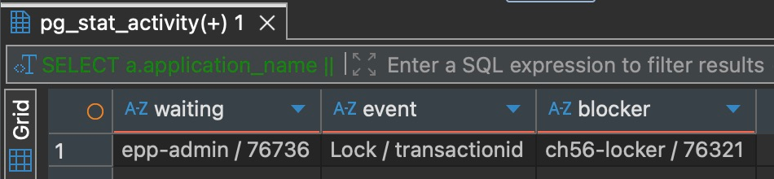
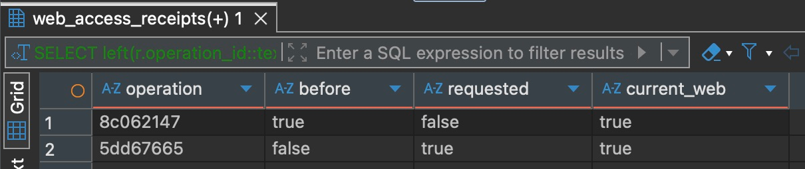

# 第 69 章　第八篇回顾：从维护动作到可交付产物

> 值班交接单：上午暂停了一个练习账号的 Web 资格，下午另一位同事按新决定恢复。晚班为了补回上午丢失的终端输出，用原操作 ID 重发暂停，命令等了几秒，以 1 退出。有人提议换一个 ID 再发。与此同时，准备用来接替服务的目录能跑账号预览，API 启动却退出了。现在能把这个目录交给下一班吗？账号该留在哪个状态？

先完成第 63～68 章。拿出账号管理命令、验过的运行制品和数据库观察记录，给交接单写两句答复：准备对账号做什么，准备凭什么切换 API。下面三份材料可以按你自己的顺序打开。如果还缺证据，先记下从哪个进程、哪个库、在什么时候取。后面的操作可用同一份[第 66 章配套代码](https://github.com/SamChowRock/epp-public/tree/part-08/chapter-66)在本机重建这两处现场。

## 69.1 接手一张尚未结案的维护单

<details>
<summary>查看账号与原会话</summary>

报障人给出了库名、账号 UUID 和两项决定的完整操作 UUID。下文用 A 指上午的暂停，B 指下午的恢复。维护者按原键查到 A 的 requestedEnabled 为 false，B 为 true。起初能读本人资料的那个会话，在 A 后得到 403 和 WEB_ACCESS_DENIED，在 B 后得到 200，晚班命令失败后又得到 200，返回的是同一个 userId。旧命令的终端只剩一句 “For apply, query the receipt.”。

</details>

<details>
<summary>查看命令仍在运行时的数据库读数</summary>

观察者在同一个库看到 epp-admin 的 wait_event_type 为 Lock，wait_event 为 transactionid。pg_blocking_pids 返回一个 PID，恰好等于同事在练习 SQL 窗口里读出的 pg_backend_pid()。过几秒再查，等待的那行已经消失。期间另起一次 receipt 命令，仍能读回上午那张收据。

</details>

<details>
<summary>查看准备接替服务的交付目录</summary>

同一个只装生产依赖的目录里，账号 CLI 返回 preview。API 的启动日志是 app.start_failed，code 为 CONFIG_INVALID，field 为 `config/service.json: unreadable`，退出码 1。同事在旧服务上读到的 200 仍在，新进程的日志里没有 app.ready。

</details>

接班人现在可以答复：保留下午的恢复决定，用 A 的收据补回上午的结果。那次失败发生在**晚班重发**，数据库仍保有上午的事实。临时目录暂缓接替，沿新进程日志检查交付文件。读账号的 200 来自一份已经运行的服务，没法替新进程证明它能启动。

API 与 CLI 都用同一套账号状态和 Web 资格判断。API 还要从请求的 Cookie 认出会话和属主，因此 401 要回查会话，403 要看具体拒绝码。维护命令凭数据库身份进入，一次性建立上下文，按预期库名和账号操作，输出后关池退出。它没有 HTTP 登录这一关。共用资格规则，使 preview 给出的拒绝原因能和接口响应对上。两条入口各自负责的授权、配置和退出行为，仍要分别验证。[第 63 章的两个入口](../chapter-63-account-cli/chapter.md#632-把命令接进一次性应用上下文)

## 69.2 在副本重建一次超时的重放

**准备两个不同用途的库。** 将第 63～66 章任一已完成版本中含已开通练习账号和迁移历史的本机库备份，恢复到新建的 `epp_ch56_handoff`。这是下面真正改资格的副本。若手边没有旧库，先完成下方的源码构建并配好 .env.handoff，执行 `env -u DATABASE_URL -u SHADOW_DATABASE_URL node --env-file=.env.handoff scripts/deploy-verify.mjs bootstrap epp_ch56_handoff`，再按第 63 章的账号准备步骤创建一个有密码、active、Web 已开通的练习账号。另建一个 public schema 为空的 `epp_ch56_delivery`，留给下节会实际启动 Worker 的交付检查。两库使用独立的本地配置文件。分别按建库记录核对实例、端口、库名和角色；同名库也可能在另一台机器上。[备份与独立恢复](https://github.com/SamChowRock/epp-public/blob/part-08/chapter-66/database/chapter-22/backup-restore.md) · [第 63 章账号准备](../chapter-63-account-cli/chapter.md#631-给一次暂停分配身份)

从第 66 章干净代码副本的项目根开始。将指向历史副本的 DATABASE_URL 放进仅自己可读的 `.env.handoff`，将空库的放进 `.env.delivery`。这两个文件都只写各自的数据库连接。在一个终端执行以下命令，每步成功再继续，记下输出的临时目录。后面一直用这套产物。

```bash
umask 077
nvm use
npm ci
npm run ci:check
source_dir=$PWD
release=$(mktemp -d)
cp -R dist package.json package-lock.json .npmrc "$release/"
(cd "$release" && npm ci --omit=dev)
printf '%s\n' "$release"
```

另开终端进入同一源码根，把 release 设为刚打印的路径。在交接副本上启动一个本机练习 API。密钥只供这次练习进程使用。下列写法只把本次配置传给子进程，避免旧终端里导出的 DATABASE_URL 把请求带回日常库。端口 3357 如已占用，一并改端口、Origin 和 Postman 的 baseUrl。

```bash
release='填入上一步的绝对路径'
handoff_env=$PWD/.env.handoff
cd "$release"
env -i PATH="$PATH" NODE_ENV=production PORT=3357 \
  APP_ORIGIN=http://127.0.0.1:3357 CURSOR_HMAC_KEY="$(openssl rand -hex 32)" \
  node --env-file="$handoff_env" dist/src/server.js
```

等**这个进程**打印 app.ready。在 Postman 打开沿用的[第 60 章请求集合](https://github.com/SamChowRock/epp-public/blob/part-08/chapter-66/requests/chapter-51.postman_collection.json)，将生效的 baseUrl 设为 `http://127.0.0.1:3357`，用 05 登录该练习账号，再单发 20 读本人资料。记下返回的 userId，之后都在这个客户端用同一 Cookie 单发 20。05 默认按邮箱登录。只有旧用户 ID 和密码时，复制 05，在副本的前置脚本把取 email 的字段改为 userId，保留密码与序列化。可直接对照[第 58 章的登录副本](https://github.com/SamChowRock/epp-public/blob/part-08/chapter-66/database/chapter-49/README.md)。

在 DBeaver 连交接副本，把下列 SQL 里的账号占位换成该 ID，记下本轮以前的收据数量。第一次练习可能是零。

```sql
SELECT current_database(), u.id, u.status, u.web_enabled,
       (SELECT count(*) FROM public.web_access_receipts r WHERE r.user_id = u.id) AS receipts
FROM public.users u WHERE u.id = '本轮账号UUID';
```

回到第一个终端。预期库名取自建库记录。只在这个独立副本里，依次扮演提出暂停、批准恢复的两人。生成两个 ID 后就记下来，重开终端时用记录里的原值。

```bash
db=epp_ch56_handoff
account='填入20返回的userId'
a=$(node -p 'crypto.randomUUID()')
b=$(node -p 'crypto.randomUUID()')
printf '%s\n' "$db" "$account" "$a" "$b"
admin() {
  env -i PATH="$PATH" NODE_ENV=production node --env-file="$source_dir/.env.handoff" \
    "$release/dist/src/account-admin.js" "$db" "$@"
}
admin preview "$account" off
```

preview 应读到 active、true，并预告 WEB_ACCESS_DENIED。此刻单发 20 仍应为 200。执行 `admin apply "$account" off "$a"`，等 applied 后单发 20，保留 403 的拒绝码。集合 20 原本断言成功响应，此时断言变红正好标出了资格拒绝。接着执行 `admin preview "$account" on`，核对是同一人、原值 false，再执行 `admin apply "$account" on "$b"`。这次同一会话应读回 200。若中途得到 401，先检查主机、Cookie 与有效期，重新取得会话后重新记录一轮前后对照。具体控件和拒绝响应见[第 63 章的双窗口操作](../chapter-63-account-cli/chapter.md#633-让事实与收据一起提交)。

**现在改变一个条件。** 下午恢复已经提交，一位同事随后打开检查账号的事务，没有结束它。在两个终端分别运行 `psql -X -h 127.0.0.1 -p 55432 -U epp_owner -d epp_ch56_handoff -W`，把端口和角色换成你建库时的值，在提示处输入密码。分别运行 `SELECT current_database(), pg_backend_pid();`，确认库名正确、两个 PID 不同。窗口一执行下面三条，停在此处。保留最后一条的单行结果和窗口一的 PID。

```sql
SET application_name = 'ch56-locker';
BEGIN;
SELECT id, web_enabled FROM public.users WHERE id = '本轮账号UUID' FOR UPDATE;
```

如果上一步没有查到一行，先回滚并核对账号。窗口二保持自动提交。先执行下面的查询，随后在 psql 单独输入 `\watch 0.2`，让它每 0.2 秒刷新。用 DBeaver 时也可以在**独立连接**的 SQL 编辑器执行同一条查询。手动点得太迟会错过命令等待的这几秒。

```sql
SELECT a.application_name || ' / ' || a.pid AS waiting,
       a.wait_event_type || ' / ' || a.wait_event AS event,
       b.application_name || ' / ' || b.pid AS blocker
FROM pg_stat_activity a
CROSS JOIN LATERAL unnest(pg_blocking_pids(a.pid)) AS p(pid)
JOIN pg_stat_activity b ON b.pid = p.pid
WHERE a.datname = current_database() AND a.application_name = 'epp-admin';
```

回到定义了 admin 的终端，重发 `admin apply "$account" off "$a"`。让窗口一继续持锁，直到命令退出，立即用 `echo $?` 记退出码。窗口二在等待期间捕获 epp-admin 和挡住它的 PID。按 Ctrl-C 停止窗口二刷新。下图是同一练习账号用原 A 再次复现时的 DBeaver 网格。你要对上的是自己窗口一的 PID。



图 69-1　这一刻数据库已经收到了管理命令。顺着 waiting 读到 blocker，能把超时关联到一个仍未结束的事务。命令退出后再刷新，这行会消失。

此时**先别结束窗口一**。在命令终端执行 `admin receipt "$account" "$a"`，对照第一次暂停的 userId、operationId、requestedEnabled 和 recordedAt。为什么一条命令超时，另一条却立刻能答？apply 为了让并发决定按顺序生效，先取账号行锁，再查这个键有没有收据。即使最终只需返回 replayed，它也要经过取锁这一步。本实现给数据库语句设置约三秒的超时。receipt 只读已经提交的收据，窗口一持有的账号行锁不会挡住这次读取。一次退出码 1 本身无法告诉你发生了锁等待，图中的现场才把原因缩到这里。[命令事务的实际顺序](https://github.com/SamChowRock/epp-public/blob/part-08/chapter-66/src/manage-web-access.ts) · [PostgreSQL 的行锁](https://www.postgresql.org/docs/18/explicit-locking.html#LOCKING-ROWS)

窗口一执行 `ROLLBACK;`。在这次可控复现中再发同一个 A、同一个 off，应得 replayed，收据时间和第一次相同。单发 20 仍是 200。把两个操作 ID 和账号代入下面的查询；只在显示时缩短 UUID，筛选始终使用完整值。

```sql
SELECT left(r.operation_id::text, 8) AS operation,
       r.before_enabled::text AS before, r.requested_enabled::text AS requested,
       u.web_enabled::text AS current_web
FROM public.web_access_receipts r JOIN public.users u ON u.id = r.user_id
WHERE u.id = '本轮账号UUID'
  AND r.operation_id IN ('本轮暂停UUID', '本轮恢复UUID')
ORDER BY r.recorded_at, r.operation_id;
```



图 69-2　第一行记录 A 当时从 true 改为 false，最后一列来自现在的账号行。两行都连到同一个账号，所以两行的 current_web 都是 true。再跑基线查询，收据总数只比起点多两张。

若把 A 留着、把目标改成 on，命令会拒绝 Operation ID conflict，退出 2。若临时生成一个从未用过的 ID 单查 receipt，会得到 Receipt not found，退出 2。这个查询只证明在该库、该账号、查询当时还看不到那张收据。原请求可能还在执行，也可能连错了副本。真实交接中，查到 A 就可结束追查，无须为拿一行输出继续重发。查不到时先核实目标、原操作是否结束及决定是否仍然有效。下午已经批准恢复，擅自换新 ID 发 off 就会把人再次停用。若审批只对预览时的状态有效，还要在执行事务内核对版本，这正是第 63 章预览本身给不了的保证。

## 69.3 用同一份产物逐个启动入口

收据找回了，仍有一个独立问题：准备接替的 API 为什么起不来？先正常停止上节启动的练习 API。在第一个终端，从你新建的 release 目录暂时挪开一份随构建复制的文件，保留同一构建的原件。

```bash
mv "$release/dist/config/service.json" "$release/dist/config/service.saved"
admin preview "$account" off
(cd "$release" && env -i PATH="$PATH" NODE_ENV=production node dist/src/server.js)
echo $?
mv "$release/dist/config/service.saved" "$release/dist/config/service.json"
```

preview 能读到当前资格；API 在检查数据库之前就报 `config/service.json: unreadable`，退出 1。若只根据 CLI 推断交付完整，或重新给账号办理一次，这个目录还是起不来。若在源码根用开发入口测试，读到的还可能是另一份文件。把同次构建的原件放回后，用**这个 release**在刚建的空库核验各个角色。在源码根执行，第一条只对空库运行一次，成功后再运行第二条。

```bash
env -u DATABASE_URL -u SHADOW_DATABASE_URL node --env-file=.env.delivery \
  scripts/deploy-verify.mjs bootstrap epp_ch56_delivery
env -u DATABASE_URL EPP_CHECK_PORT=3356 node --env-file=.env.delivery \
  scripts/check-runtime.mjs "$release" epp_ch56_delivery
```

选一个空闲的检查端口。脚本从源码侧核对实际库名，在已引导且还没有用户和待处理工作的库中插入固定练习用户，随后以 release 为工作目录启动生产程序。API 报 app.ready 后，无 Cookie 请求本人资料得到 401／AUTH_REQUIRED，生产默认的 `/docs` 得到 404。邮件执行者和通知执行者用同一个入口文件、不同参数分别报 worker.ready，再各自正常退出。最后 CLI 预览固定用户，直接回查资格仍为 true。脚本保留数据，再做完整一轮要新建空库。历史副本则保留了 A、B 和原账号，交接后还能按原键核对。[交付检查实际发出的请求和启动参数](https://github.com/SamChowRock/epp-public/blob/part-08/chapter-66/scripts/check-runtime.mjs)

这次能证明的是产物在本机目标平台按锁安装后，各角色能启动、完成上述探测并收尾。空队列上的 ready 没有检验 SMTP 接受信件、对象字节可读或备份可恢复。需要核对投递时，回到第 66 章用本机 Mailpit 跟踪一条练习消息，带着同一个消息 ID 查队列和接受结果。部署到另一种系统或 CPU，还要在对应目标安装生产依赖并复验，尤其要确认 sharp 等原生包能加载。[第 64 章的干净交付目录](../chapter-64-build-ci/chapter.md#642-交付目录里究竟要有什么)

## 69.4 把资源判断交给下一班

这张单子里的三秒耗在已进入数据库的事务上。如果把池从五条加到十条，多出来的连接仍会在同一行后面排队。有效的处置是由持锁者结束已经核实的检查事务，把人的思考时间移出事务。若一位同事只需看当前值，可以在自动提交里做普通 SELECT。办理资格的 apply 仍要在事务内核对账号、重放键和收据，直接拿掉那把锁会改变并发时的办理顺序。

把这个判断移到登录接口，症状变成“两次都慢，放开后都成功”。用上章留下的 `epp_ch55_lab` 和对应的 `.env.perf`，在源码根复跑下面的[本机对照](https://github.com/SamChowRock/epp-public/blob/part-08/chapter-66/examples/performance/service.mjs)。没有这个库时先按[第 66.1 节](../chapter-66-performance/chapter.md#661-给耗时找一个起点和终点)在独立空库引导。程序创建自己的练习账号，分别在释放连接和释放账号锁之前取样。

```bash
umask 077
lablog=$(mktemp)
env -u DATABASE_URL node --env-file=.env.perf examples/performance/service.mjs epp_ch55_lab \
  > "$lablog" 2>&1 && rg '^LAB.*(before-pool-release|pool-login|before-lock-release|lock-login)' "$lablog"
```

| 本轮登录 | 成功耗时 | API 池 total / idle / waiting | 被实验观察者阻塞的 API 会话数 |
| --- | ---: | --- | ---: |
| 第一笔 | 250 ms | 2 / 0 / 1 | 0 |
| 第二笔 | 240 ms | 2 / 1 / 0 | 1 |

第一笔在借连接，优先找谁借走后一直持有、异常路径有没有归还。第二笔已经拿到连接，多开连接不能唤醒它。若两类等待都没观察到，再沿一次请求拆时间：CPU profile 里某段计算反复占主线程，就评估移出主线程后输入复制、排队和内存的成本。拿到连接后查询才慢，就在练习副本看执行计划里实际读了多少行、排序后留下几行。有序索引若能让目标查询读到第 21 行就停，收益来自减少读取，代价是新增存储和每次写入的索引维护。改动后用同样输入和并发重测成功、延迟与资源，并保留资格校验和结果顺序。[第 66 章的采样、执行计划与负载对照](../chapter-66-performance/chapter.md)

下一班接手本机部署，应能凭交接记录重启正确的进程，也能知道哪份数据必须一起保全。以本轮为例，可交出这样一段记录：

> 同一构建已在本机安装生产依赖。API 使用约定端口、Origin、稳定的游标签名密钥和目标库，接班人从运行环境取得值。邮件 Worker 要知道库名与 SMTP 目的地，通知 Worker 用 notifications 角色，账号 CLI 按需运行。历史练习库保留旧收据及本轮 A、B，账号已恢复，原会话回查为 200。另一个交付检查库有探测用的固定账号。性能对照的两条池连接只属于实验 API。部署时应给每个常驻进程的池、短时 CLI 以及恢复操作预留连接。

练习 API 临时生成的游标签名密钥适合这次新登录。真实交接如果每次启动都随机换密钥，已有签名游标将无法继续使用。交接里写密钥从哪里注入、由谁维护，值留在受控环境。涉及头像时还要交接私有桶、对象键与访问配置；数据库的引用、桶里的字节要在恢复演练中相互核对。把 Worker 指到还原的业务库也有后果：历史待办可能开始投递。现在可以关闭本轮的 SQL 会话和练习进程，保留已核对的收据与构建来源。第九篇从第 70 章的本机部署开始，要在停机、重新启动、迁移和恢复后，再证明这些条件仍然成立。

## 附录：本章必要技术点速查

| 交接时要回答的问题 | 重查入口 |
| --- | --- |
| 上午那次决定办过吗？现在还能访问吗？ | 在原库按 userId 与完整 operationId 查 receipt，再用同一账号的有效会话读取当前资料。 |
| 谁挡住了这次重发？ | 在命令仍在等的时候，从同库另一连接读 pg_blocking_pids，核对持锁窗口自己的 PID。 |
| 哪份文件、哪个进程经过验证？ | 对照构建来源、dist/config、生产安装目录和各子进程的 ready、探测结果及退出状态。 |
| 需要扩池、优化查询还是移出计算？ | 先对齐成功条件与取样时刻，再查被调查进程的池、数据库等待或计划、CPU 采样。 |

[PostgreSQL 18 的会话信息函数](https://www.postgresql.org/docs/18/functions-info.html#FUNCTIONS-INFO-SESSION)

阅读约 24～34 分钟。已准备好本机 PostgreSQL 18 和练习账号时，独立判断、恢复副本、干净构建和双连接复现另加 40～55 分钟。首次安装与下载另计。

[本章沿用的完成代码](https://github.com/SamChowRock/epp-public/tree/part-08/chapter-66) · [上一章：一条历史坏记录应该让多少服务停下来](../chapter-68-bad-data/outline.md) · [第八篇导读](../README.md) · [下一章：在本机直接部署服务](../../part-09-operations/chapter-70-native-deployment/chapter.md) · [全书目录](../../README.md)
