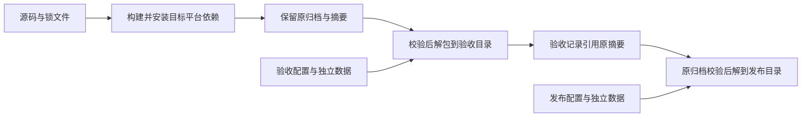
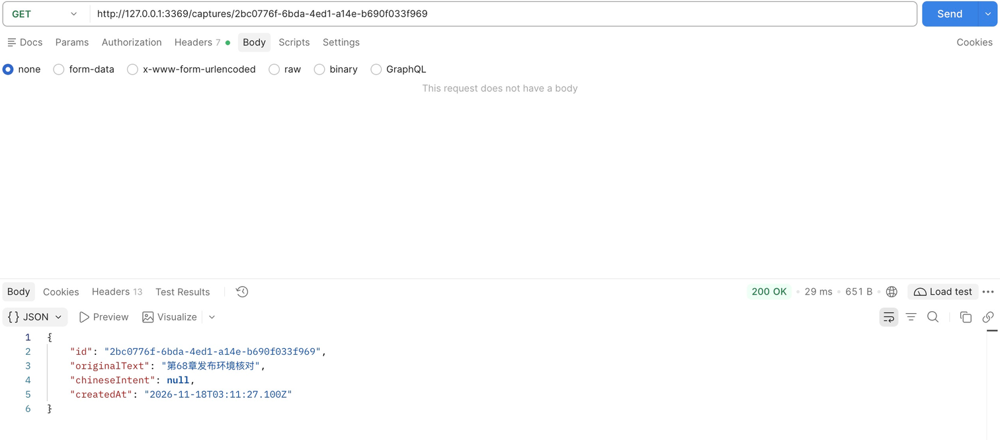
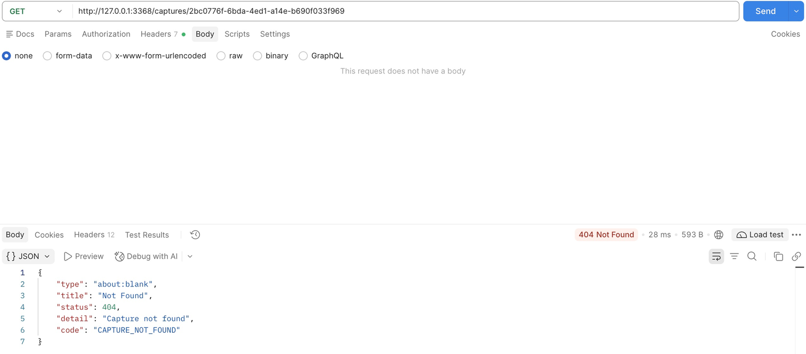
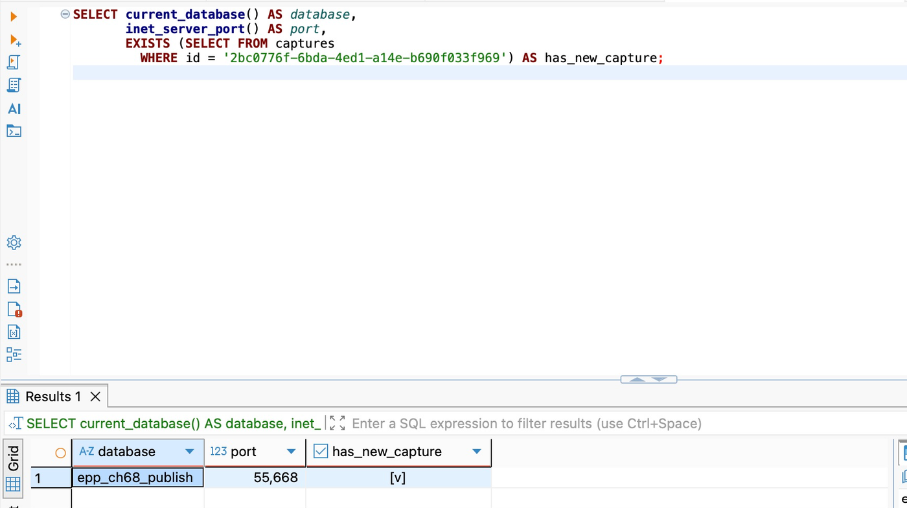

# 第 68 章　把验过的那份运行制品从验收环境交给发布环境

第 67 章的接班人已经核对过程序、旧账号和操作收据。假设你把源码提交号发给另一位同事，他重新安装、构建，告诉你“也是这个版本，可以发布了”。这句话还缺一段证据：你验过的是自己目录里的程序，他准备运行的是另一次安装和构建的结果。源码相同，不保证运行目录里的每个文件相同，更不能证明它连接了正确的数据。

本章把这段交接补起来。先在本机制作一份完整运行归档，从归档解出验收目录；验过之后，把原归档交给第二套隔离环境。这个动作叫**制品晋级**：改变它被允许使用的环境，保持验过的程序内容不变。这里的“发布环境”是本机第二套练习环境，不是日常服务。第 69 章才进入 Debian，建立跨主机运行条件；第 78 章再展开数据规则变化后的兼容发布。

从[第 66 章完成代码](https://github.com/SamChowRock/epp-public/tree/part-08/chapter-66)的独立副本开始，保留完整性迁移和维护入口。本章不修改业务实现。开发时仍在源码目录使用前章的 Inspector 与自动编译入口；下面验证的则是独立生产目录，不监听源码，不开放调试端口。先按[本章环境准备](../../environment-setup.md#第-68-章准备两套本机制品验收环境)检查工具，并保留第 67 章交接的非空数据库、桶和非秘密核对记录。

## 68.1 一次构建，封出一个明确的候选

### 提交、锁文件与运行包各自回答什么

Git 提交号能帮助你找到源码，package-lock.json 能约束安装时选择的包版本和完整性。但安装还受操作系统、CPU、可选依赖和安装脚本影响。sharp 的图像处理依赖本机二进制；Mac arm64 的 node_modules 不能直接当作 Debian arm64 的运行依赖。即使在同一平台，两次 tar 的时间戳或压缩元数据不同，也可能产生不同摘要。

因此我们不要求“重做一次总能得到相同包”，而是先保存一次实际验过的包。可重复构建有助于审计构建过程；晋级解决的是接收端究竟拿到了哪一份结果。两者可以同时采用，但不能相互代替。只有一个环境、一次临时运行时，直接从源码安装很方便；要让另一个环境沿用已经作出的验收决定，保留完整候选通常比重新解释每次构建的差异更简单。

在源码根目录开 Bash，先选择项目固定的 Node 版本，再检查工作区。下面的 `source_dir` 只保存路径，不包含配置值。`git status --short` 应没有输出；有本地修改时，先保存自己的工作，不能把它们打进包却只记录旧提交号。

```bash
nvm use
bash
```

进入 Bash 后，Node 仍由继承的 PATH 选中。继续在源码根目录执行：

```bash
set -e
source_dir="$PWD"
node_bin=$(command -v node)
node --version
git status --short
npm ci
npm run ci:check
umask 077
lab=$(mktemp -d)
release="$lab/payload"
mkdir "$release"
cp -R dist package.json package-lock.json .npmrc "$release/"
(cd "$release" && npm ci --omit=dev)
```

ci:check 包含格式、Lint、类型、构建和生成契约检查。生产目录安装只负责运行依赖：Prisma 客户端已经生成并编译进 dist，不在接收端重新 generate。验收时直接运行已有的编译入口，不在 payload 重新构建来“修缺件”；缺件应回到源码构建步骤修正，形成新候选。

第 64 章已经解释默认配置相对模块定位：dist/src/config.js 读的是 dist/config/service.json。这里复制整个 dist，同时包含 API、邮件、通知、账号维护和坏记录维护入口。额外的数据库迁移材料属于受控的管理操作输入，保留在来源明确的源码目录；本章沿用已经完成第 66 章迁移的数据副本，不在归档解包时自动运行迁移。

检查 payload 的实际内容。`.npmrc` 在本章只有 `engine-strict=true`；若自己加入过私有 registry 凭据，先移到安装环境的秘密注入位置，不能把令牌封进包。运行用 env、Cookie、上传暂存、CPU 和堆快照都放在 payload 外。不要为省事打包整个开发目录。

```bash
ls "$release/dist/config/service.json" \
  "$release/dist/src/server.js" \
  "$release/dist/src/mail-worker.js" \
  "$release/dist/src/account-admin.js" \
  "$release/dist/src/manage-capture-integrity.js"
(cd "$release" && node -e "require('sharp'); require('argon2'); console.log('native modules loaded')")
node -p 'JSON.stringify({os:process.platform,arch:process.arch,node:process.version,libc:process.report.getReport().header.glibcVersionRuntime ?? null})'
git rev-parse HEAD
```

Mac 的 libc 字段为 null，这不表示没有系统运行库，只是该字段描述的是 glibc。把系统版本也记下来，Mac 可用 `sw_vers -productVersion`。以后制作 Linux 包，要另核对 glibc 或 musl、版本与架构，不能只比较“都是 arm64”。本章的 Node 可执行文件由环境提供，并未包含在归档里，因此 Node 版本是验收条件的一部分。

现在封包。COPYFILE_DISABLE 避免 Mac 的附加元数据文件混入归档。`-C` 让包顶层从 payload 内部开始；`-t` 只列内容，`-x` 才解包。

```bash
COPYFILE_DISABLE=1 tar -czf "$lab/release.tgz" -C "$release" .
tar -tzf "$lab/release.tgz" > "$lab/contents.txt"
head -30 "$lab/contents.txt"
shasum -a 256 "$lab/release.tgz"
```

SHA-256 把文件字节映射为 256 位摘要，以 64 个十六进制字符表示。它用于识别这份归档，不用于证明业务正确。把输出中的摘要、归档位置、源码提交、平台、Node 版本、构建检查结果保存到独立交接记录。归档从这时起不再修改；要调整任何随包文件，就生成新候选并重新验收。不要把尚未包含摘要的记录追加进已经计算摘要的归档，这样追加本身就改变了对象。

可以在这里中断。恢复时按记录找到原归档和 Node；不需要重新 npm ci 或重新压缩。临时目录路径务必记下，需要长期保存时复制到自己的私有交付目录，并再次核对复制后摘要。

## 68.2 从归档验收，不从开发目录借文件

### 先把程序与环境分开

沿用[第 62 章配对副本的准备方法](../../part-07-profiles/chapter-62-review/chapter.md)，在同一停写窗口保留数据库与桶的对应关系，再建立两套非空副本。本章可将库命名为 epp_ch68_accept 和 epp_ch68_publish，API 分别使用 3368、3369。名称只是示例，实际端口以未被占用且记录在案为准。

两套环境的数据库与对象存储必须独立。数据库引用相同的头像 ID，两个桶副本就应分别保留同一对象键和字节；不能只复制数据库，却让两套 API 都写入原来的桶。按第 61 章清单和精确 HEAD 方法复核。原库与原桶保留，实验只操作两套副本。已有同名库时先查看内容和上次记录，不覆盖后重来。

在 DBeaver 分别为两套副本保存连接，给连接取清楚的名字，打开 SQL 编辑器执行：

```sql
SELECT current_database() AS database,
       current_user AS role,
       inet_server_addr() AS server,
       inet_server_port() AS port;
```

把数据库、主机和端口与建库记录对照。连接显示名可以随意改，它不是真正的库身份。同名数据库也能存在于不同实例，只有库名相同不够。先核对原账号、原素材和第 63 章的操作收据；对于本轮复制来的坏记录案件，保留隔离状态，不以删除案件或清空表换取启动成功。

为两套环境各建 config 与 work 目录，配置文件使用绝对路径。沿用第 67 章 .env.handoff 中的配置项，分别设置 DATABASE_URL、PORT、APP_ORIGIN 和桶连接；游标签名密钥按交接约定保留，值不进入交接记录。邮件配置只指向本机练习收件箱，不能让复制来的待办投递到真实用户。启动 Worker 前先按原任务 ID 查看待办、unknown 与暂停状态，保留它们的处理边界。

```bash
mkdir -m 700 "$lab/accept-config" "$lab/accept-work" \
  "$lab/publish-config" "$lab/publish-work"
```

用编辑器分别准备 api.env、mail.env、notify.env。API 配置沿用前章；mail.env 沿用邮件角色的数据库和本机 SMTP 配置；notify.env 沿用通知角色配置。文件权限设为 0600。它们不声明另一种 NODE_ENV，也不使用 `${其他变量}` 期待 Node 自动展开。第 70 章才拆分数据库运行身份，本章使用前章练习角色。

### 校验决定能否解包

回到刚才的 Bash。`archive` 指向原归档；expected 从独立保留的构建记录抄入，不能临时对待检查文件算一次就作为期望值。下面函数的退出码会被调用者检查；拒绝时不创建目标目录。

```bash
archive="$lab/release.tgz"
expected='填交接记录里的64位SHA256摘要'
digest() {
  shasum -a 256 "$1" | awk '{print $1}'
}
unpack_checked() (
  set -euo pipefail
  test "${#expected}" -eq 64 || exit 1
  case "$expected" in *[!0-9a-f]*) exit 1 ;; esac
  actual=$(digest "$1") || exit 1
  test "$actual" = "$expected" || {
    echo '归档摘要不符：停止解包' >&2
    exit 1
  }
  mkdir "$2" || exit 1
  tar -xzf "$1" -C "$2"
)
unpack_checked "$archive" "$lab/accept"
```

函数内为摘要计算、比较和建目录显式检查失败。后面把函数放进 `if` 条件中时，Bash 对 `set -e` 的处理会改变；不能依赖它自动在每个失败处退出。pipefail 则让 shasum 读取失败不会被后面的 awk 成功掩盖。

此处处理的是自己制作、存放在私有目录的归档。摘要匹配并不使未知来源的 tar 自动安全；如果连期望摘要也来自不可信发送方，就不能据此决定解包。传输过程中要保护原包和记录，避免校验之后文件被替换。解包中断留下的半成品目录不作为运行目录；保留故障现场，改用另一个不存在的目录从原包重做，不能对已有目录覆盖解压后假定没有旧文件残留。

从 accept 启动，而不是从 payload 或源码目录启动。新开一个 Bash，按记录填入 lab 和 node_bin 的绝对路径。先检查配置文件位置，再在前台运行：

```bash
(cd "$lab/accept-work" &&
  env -i NODE_ENV=production "$node_bin" \
  --env-file="$lab/accept-config/api.env" \
  "$lab/accept/dist/src/server.js")
```

`env -i` 去掉外层 Shell 的 DATABASE_URL 等变量，避免 Node 的环境文件被旧导出值覆盖；显式的 production 同时固定默认文档策略。cwd 选择可写暂存位置，脚本绝对路径选择程序，env 文件选择配置。三个位置分开后，换包不会顺便丢失配置或上传暂存。

在 Postman 复制前章请求，保存两套环境变量 baseUrl，验收环境设为 `http://127.0.0.1:3368`。先发送登录与 CSRF 请求，再读取 `/profile/me` 和已记录 ID 的素材详情；同一个账号也要验证别人素材返回 404。登录请求真正执行了 argon2 密码校验，比 require 成功更接近运行条件。旧会话仍在有效期内时应沿用它验证；自然过期则重新登录并记为新会话，不能把重新登录成功写成“旧会话保持”。

接着发送前章保存的头像预览请求，使用已知可用 PNG，在响应 Preview 看 WebP；再读原头像签名地址并实际取得字节，与副本准备时的摘要比较。前者经过本机解码，后者经过对象存储；其中一个成功不能代替另一个。`/docs` 在默认生产配置下应为 404，没有文档页不代表 API 没启动。

维护入口也要从 accept 运行。在另一页 Bash 设置 user_id 与 operation_id 为交接记录中的完整 UUID，用验收库名作独立参数：

```bash
env -i NODE_ENV=production "$node_bin" \
  --env-file="$lab/accept-config/api.env" \
  "$lab/accept/dist/src/account-admin.js" \
  epp_ch68_accept receipt "$user_id" "$operation_id"
```

对照输出里的 database、userId、operationId 与原收据内容。正常查询退出码为 0；参数或目标库不符时为 2，配置或数据库故障为 1。非零时先读错误，不把“没有收据输出”解释为操作从未发生。若预期库名写成 epp_ch68_publish，命令应拒绝；不要为了让检查通过，直接把预期值改成程序碰巧连到的库。回到配置和建库记录找原因。

邮件、通知在另外两个终端启动，共同使用同一份 accept 程序：

```bash
(cd "$lab/accept-work" &&
  env -i NODE_ENV=production "$node_bin" \
  --env-file="$lab/accept-config/mail.env" \
  "$lab/accept/dist/src/mail-worker.js" epp_ch68_accept)
```

```bash
(cd "$lab/accept-work" &&
  env -i NODE_ENV=production "$node_bin" \
  --env-file="$lab/accept-config/notify.env" \
  "$lab/accept/dist/src/mail-worker.js" epp_ch68_accept notifications)
```

worker.ready 说明初始化完成。按第 51、55 章创建本轮任务，分别保存 outbox ID 与 notification job ID；在练习收件箱检查邮件，在通知请求中检查结果，并在 DBeaver 按同一 ID 查状态。仅看到 ready 或队列为空不能证明投递、通知创建成功。unknown 仍按既有流程核对外部结果，不为了完成验收盲目重发。

验收记录引用归档摘要，同时写明环境身份、实际使用的配置版本、样本 ID、观察结果和时间；只写“200、通过”无法让接班人重查。秘密值不入记录。每个前台进程按 Ctrl-C 停止后，在原终端执行 `echo $?`，核对退出状态为 0，再继续下一环境。

## 68.3 改一个字节，再交接原包

如果接收端从包旁边随手取一份 SHA 文件，两者都被替换时仍能“校验通过”。摘要解决内容相等，信任来自期望摘要的来源。团队可以把通过验收的摘要登记在有权限控制的发布记录中，由接收方独立读取；后续镜像仓库中的摘要也遵循同样的区别。需要抵御记录被篡改时，还应验证签名、签名者身份和批准范围，而不是把普通摘要称为签名。

先做一个可见的反例。在独立副本改变默认配置资源，重新压缩；保留原归档和 expected。下例只改 JSON 排版，业务含义不变，但字节已不同。它检验的是身份判断，不是程序报错能否碰巧拦住坏包。

```bash
mkdir "$lab/changed"
tar -xzf "$archive" -C "$lab/changed"
printf '\n' >> "$lab/changed/dist/config/service.json"
COPYFILE_DISABLE=1 tar -czf "$lab/changed.tgz" -C "$lab/changed" .
if unpack_checked "$lab/changed.tgz" "$lab/rejected"; then
  echo '错误：变化后的归档被接受' >&2
  exit 1
else
  test ! -e "$lab/rejected"
  echo '候选已在解包和启动之前被拒绝'
fi
```

应看到“归档摘要不符”和随后的一行确认。原包不需要跟着重打。若收到的包传输不完整，同样拒绝并重新传输；若发送方有意修正了内容，则给它新的摘要并重做验收。不能在校验失败后自动更新 expected，这会把保护变成“总是接受当前文件”。

现在解开原归档：

```bash
unpack_checked "$archive" "$lab/publish"
```

publish 内不运行 npm ci，不再编译，不更改 dist/config。用 publish-config 和 publish-work 按 68.2 的命令启动 publish/dist 下的相同入口，Worker 的预期库名换成 epp_ch68_publish；Postman baseUrl 切换为 `http://127.0.0.1:3369`。Cookie 按主机而非端口隔离，因此同机练习不要把“客户端自动带了 Cookie”当作连对环境的证据。每次发送前查看最终 URL、当前账号和环境变量。



图中两条配置箭头落在运行环境，而不是归档里；第二环境接受的是原包，不是重新构建的结果。

### 复制来的收据为什么还不够

两套副本原本就包含同一个 userId 和 operationId。即使发布 API 错连到验收库，查旧收据也可能成功。现在在发布环境通过正式 POST `/captures` 新增一笔文本为“第68章发布环境核对”的素材，保存响应中的新 ID，再按这个 ID 读详情。

正常停止发布进程，按记录切回验收环境，从同一账号请求这个新 ID。预期是 404。再回发布环境，预期是 200 且内容相同。不要仅比较两边列表总数：数据量相同或分页未显示都无法证明这笔记录不存在。

下面两幅是同一笔素材的实际 Postman 响应。先看完整 ID 相同，再看 URL 的端口：3369 返回 200 和新文本，3368 返回 404。请求使用各自环境中同一账号的有效会话；不能拿未登录的 401 或另一个账号的 404 代替隔离证据。





在 DBeaver 的两个连接分别执行下列查询，把 UUID 换成本轮新 ID：

```sql
SELECT current_database() AS database, id, user_id
FROM captures
WHERE id = '填发布环境刚创建的UUID';
```

发布库一行，验收库零行；零行时再执行 68.2 的身份查询，因为这个 SELECT 没有匹配行时也不会输出 database 列值。如果希望零行时仍能看到连接身份，可在同一个 SQL 编辑器执行下面的一行结果查询。EXISTS 只回答这笔 ID 是否存在，不读取或修改素材内容。

```sql
SELECT current_database() AS database,
       inet_server_port() AS port,
       EXISTS (SELECT FROM captures
         WHERE id = '填发布环境刚创建的UUID') AS has_new_capture;
```



这幅实际结果里，database 为 epp_ch68_publish，端口显示为带分组符的 55,668，即 55668；has_new_capture 的勾表示 true。换到验收库重发相同 SQL，应得到 false。SQL 编辑器上方的连接和结果里的库名要一起核对。

结合实际 API 请求、连接参数与数据库查询，才能区分“连错库”和“客户端发错地址”。对象存储同样要核对实际端点与新对象归属，不能凭复制来的同一头像证明桶独立。

到这里，归档相同与环境正确形成了两条不同证据。若有人把 `publish` 改名为 `accept`，它的字节不会变，摘要也不会变化；目录名不承担程序身份。反过来，包摘要完全一致，数据库地址错误仍会产生错误业务结果。发布记录必须同时保留这两条证据。

## 68.4 退回的是程序，历史不会跟着倒转

“保留旧版本”不能只留下一个 Git 提交号。要能退回，至少需要那一平台验过的旧包、摘要、配置约定，以及它能读写当前数据的证据。发布操作可能已经改变了数据；将目录换回去不会撤销新写入，也不会逆转迁移或已发送的邮件。

先用同一包演练目录切换：停止当前 API 与两个 Worker，从另一个已验目录启动，沿用同一发布配置和 work，再查本轮新素材与原收据。这能证明切换路径、停止顺序和数据连接，但不能证明两个不同程序版本兼容。

要验证真正的旧版，使用此前保留的已验包。若还没有，可在另一个干净源码目录取得[第 63 章代码](https://github.com/SamChowRock/epp-public/tree/part-08/chapter-63)，执行该版的 npm ci 与 npm run check，再按 68.1 的生产安装与封包步骤制作旧候选。旧版只检查该版已有的 server、mail-worker、account-admin 和配置资源，不执行新版本 manage-capture-integrity.js 的存在性检查，也不向旧包补入新文件。给它自己的来源、平台和摘要，先在独立的数据副本完成 68.2 的适用入口验收。63 尚无第 66 章完整性隔离能力，不得把缺修订数据交给它后，仅凭进程能启动就判断兼容。

在一轮同平台对照中，健康非空副本经新包→第 63 章旧包→新包切换，原有效 Cookie 读取资料与新建素材均为 200，原操作收据仍可查询；把旧包指向仍有隔离坏记录的副本，则在监听前以 1 退出，日志为 database.start_failed / DATABASE_FAILURE。这个错误码本身不唯一指向坏记录，需要结合目标库、缺修订查询与旧版启动检查定位。

另一轮读写对照在健康副本中先由新包创建一笔素材，切到旧包后用同一个有效会话读回，再由旧包新建第二笔；切回新包，两笔素材的 ID 与内容都能读回，迁移记录没有变化。这验证了本轮数据和写入规则下的兼容性，不能据此外推到以后新增约束或变更字段的版本。

尤其要保留这个反例：新版本能在隔离一条坏记录后继续提供健康查询，旧版本却可能因同一条坏数据启动拒绝，或在列表中漏行。此时“磁盘里有旧包”和“可以恢复业务”是两件事。应先停在仍能安全服务的版本，按第 66 章处理已证实的坏记录，或选择已验证兼容隔离规则的旧包；不要为回退清空真实历史。第 78 章会把这种判断扩展到新字段、新约束与旧客户端。

在允许回退的练习副本中，先记录新版本新建的素材和原账号状态，正常停止所有新版本进程，再启动旧包。核对旧会话（若未过期）、原素材、新素材、原收据与一次明确允许的写入；退出后重新启动当前包，回查同一 ID。新增表没有被旧版访问，并不自动说明新规则没有被旧写入破坏。任何失败都记录具体入口、样本与错误，不能把整个数据库恢复到发布前快照当作普通程序回退，因为那会丢失发布后的合法写入。

同平台练习结束，停止本轮全部 API 和 Worker，保留原包、摘要、非秘密记录与配对数据。第 69 章从 Mac 前往 Debian 时，若没有已验过的 Linux 包，就在目标兼容环境为原 dist、清单与锁安装 Linux 生产依赖，重新封包、计算新摘要并验收。那是一个新的平台候选；之后在兼容的 Linux 环境之间，才沿同一摘要晋级。第 72 章的镜像会固定更多运行文件，但外部数据库、秘密配置与业务兼容判断仍然需要这些证据。

## 附录：本章必要技术点速查

| 名称 | 本章用途 | 必要注意点 |
| --- | --- | --- |
| `npm ci --omit=dev` | 在候选目录按锁安装运行依赖 | 安装仍受平台和脚本影响；验收之后不在接收目录重装 |
| `tar -czf / -tzf / -xzf` | 创建、列出、解开归档 | `-C` 决定目录起点；只解到新目录；来源与摘要先核对 |
| `shasum -a 256` | 识别归档的实际字节 | 摘要不是签名，不证明业务、来源或环境正确 |
| `env -i`、`--env-file` | 排除外层配置污染并选择环境 | Node 用绝对路径，明确 production；配置文件放包外 |
| 归档摘要与源码提交 | 分别定位验收对象与源码 | 重新编译、安装或封包都可能形成新对象 |
| 独有样本 ID | 区分复制历史相同的两个环境 | 用实际新写入和另一环境的按 ID 查询判断，不看总数 |
| 程序回退 | 从保留的旧包恢复运行入口 | 先验证数据与配置兼容，外部副作用不随目录切换撤销 |

官方参考：[npm ci](https://docs.npmjs.com/cli/v11/commands/npm-ci)、[Node 24 环境文件](https://nodejs.org/docs/latest-v24.x/api/cli.html#--env-filefile)、[Node 诊断报告](https://nodejs.org/docs/latest-v24.x/api/report.html)、[sharp 跨平台安装](https://sharp.pixelplumbing.com/install/#cross-platform)、[PostgreSQL 18 会话信息](https://www.postgresql.org/docs/18/functions-info.html#FUNCTIONS-INFO-SESSION)。Mac 上 tar 与 shasum 的随系统版本用法可用 `man tar`、`man shasum` 查阅。

阅读约 32～42 分钟；已有非空配对副本时，封包、双环境核对和退回演练另加 55～80 分钟。首次复制数据、安装下载与准备旧包另计。估时按正文推理、命令阅读和实际操作步骤分别估算。

[本章沿用的完成代码](https://github.com/SamChowRock/epp-public/tree/part-08/chapter-66) · [上一章 · 第八篇回顾：从维护动作到可交付产物](../../part-08-maintenance/chapter-67-review/chapter.md) · [下一章 · 把应用和数据交给目标环境](../chapter-69-target-environment/chapter.md) · [本篇导读](../README.md) · [全书目录](../../README.md)
