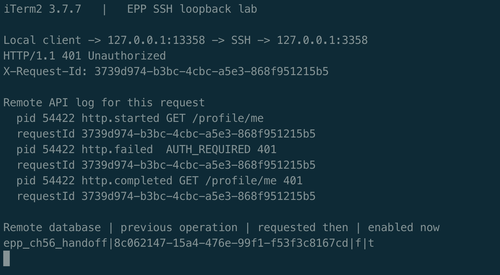

# 第 69 章　把应用和数据交给目标环境

第 67 章交出了程序和带历史的练习数据，第 68 章把制品摘要、验收结果与发布内容对应起来。现在把它们交给 Debian。源码相同，原生依赖可能属于另一个平台；配置中的回环地址到了另一台机器，也会指向另一份服务。先在目标机前台运行同一个入口，确认程序能读取交接的数据，下一章再建立专用运行身份并交给系统托管。

按第 68 章验收并交付与目标平台相符的 release，保留第 67 章的非空数据与配置，从[部署配套](https://github.com/SamChowRock/epp-public/tree/part-09/chapter-70)取得授权与存储工具。Mac 是操作端，Debian 13 是部署端。首次安装按[Debian 环境说明](../../environment-setup.md#准备-debian-13-部署端)核对系统、架构和 sudo，再按[两端 SSH 准备](../../environment-setup.md#从-mac-建立-ssh-连接)取得参数。保留独立控制台。

## 69.1 先识别将要接手的主机

SSH（Secure Shell）让本机客户端通过加密连接在另一台机器上登录、执行命令。iTerm2 里的标签页负责显示输入输出，本机的 ssh 发起连接，远端的 sshd 在指定端口接入。先从部署端控制台或交接人处取四项资料：能从操作端到达的地址、SSH 服务监听的端口、获准登录的系统账号，以及 SSH 服务端使用的主机公钥指纹。假定这台主机用 Ed25519 密钥，在控制台执行：

```bash
hostname
id -un
ssh-keygen -lf /etc/ssh/ssh_host_ed25519_key.pub
```

`hostname` 显示系统给自己起的名字，后面要用它辨认窗口；id -un 打印当前控制台用户，获准远程登录的账号要与交接人另行确认。第三行对一个**公钥文件**计算短得多的摘要；记下 `SHA256:` 开头的整段和末尾的算法名。若管理员给 sshd 指定过 HostKey 路径，让管理员从实际启用的公钥取指纹。你可以通过已经确认身份的渠道收到这项资料。第一次连接时，屏幕上的指纹是对方出示的；只把它抄回去和它自己比较，地址即便指向了别人也会“吻合”。

还有一把钥匙，方向相反。主机密钥让你认出机器；你的登录私钥用来向机器证明你可以用交接的账号登录。先确认该账号已有可用的登录方式。第一次做密钥登录，可在本机运行 `ssh-keygen -t ed25519 -f ~/.ssh/epp71_login`，选择一个尚未使用的文件名，交互设置口令（若还没有 .ssh，先执行 `mkdir -p -m 700 ~/.ssh`）。把生成的 **.pub** 文件交给有权限的管理员，将完整一行追加到部署端该账号的 `~/.ssh/authorized_keys`，保留原条目；目录和文件归该账号所有，权限分别用 700、600。自己管理新机时，可在控制台以该登录账号执行 `install -d -m 700 ~/.ssh`，再用 `cat >> ~/.ssh/authorized_keys` 追加完整公钥行，按回车后 Ctrl-D 结束，执行 `chmod 600 ~/.ssh/authorized_keys`。私钥留在本机。部署端要已启用 SSH 服务并允许这个账号向部署端回环 API 和头像端口做本地转发；从 Debian 控制台用 `sudo ss -lntp` 确认 sshd 在交接端口监听。

在 iTerm2 保留一页本地 Shell。为了把这台练习机的连接参数和主机记录单独保存，在本机新建专用配置文件 `~/.ssh/epp71.conf`。下面的地址为文档示例，把地址、端口、账号、私钥路径都换成你的值；假定交接的是 Ed25519 主机公钥。

```sshconfig
Host epp-lab
    HostName 192.0.2.71
    Port 2222
    User operator
    IdentityFile ~/.ssh/epp71_login
    IdentitiesOnly yes
    HostKeyAlgorithms ssh-ed25519
    UserKnownHostsFile ~/.ssh/epp71_hosts
    StrictHostKeyChecking ask
    UpdateHostKeys no
    ControlMaster no
    ControlPath none
```

若虚拟机用 NAT 并将宿主的 2222 转到来宾的 22，HostName 和 Port 填操作端实际拨到的宿主地址和 2222，主机指纹仍从来宾的 sshd 取得。本章后面的 API 转发以这个已登录的来宾为起点。

Host 给本机操作起一个短名。IdentityFile 选择你自己的登录钥匙；HostKeyAlgorithms 让本次握手展示交接单上那一种主机钥匙。UserKnownHostsFile 是本次练习的记忆，下次连接时用这里保存的公钥识别对端。UpdateHostKeys no 让练习只采用你核实过的钥匙。最后两行让各次连接独立握手，断开其中一个窗口时，其他窗口仍可单独验证。先从本机看一下配置如何生效：

```bash
ssh -F ~/.ssh/epp71.conf -G epp-lab | grep -E '^(hostname|port|user|identityfile) '
```

`-F` 指向刚写的文件，`-G` 展开配置就退出，还没有登录。核对四项输出，再按 ⌘T 新开一页（如果新页沿用了远端会话，先回到操作端），执行 `ssh -F ~/.ssh/epp71.conf epp-lab`。遇到首次询问，逐字比对算法和 SHA256 指纹，若提示末尾是 yes/no/[fingerprint]，可以直接粘贴从控制台取得的完整 SHA256 指纹，客户端会检查是否一致。随后若出现私钥口令提示，是本机需要解开你的私钥；若出现 Permission denied (publickey)，连接已走到用户认证，回查 User、IdentityFile 和远端该用户的 authorized_keys。连接超时则应先从独立控制台查地址、端口、网络和监听。

现在在新页执行：

```bash
hostname
id
pwd
uname -s
```

与本地页分别对照。id 给出当前系统账号和组；pwd 是这一页的工作目录；Mac 应为 Darwin，Debian 应为 Linux。两台机器可以使用同样的用户名，甚至同样的主机名。指纹负责认证，以上读数帮助你在认证以后认出操作位置。可以双击 iTerm2 标签标题给两页分别标上“本地”和“远端”。断开 SSH 后，这一页会回到本地提示符；标签名不会替你判断命令在哪儿执行。

## 69.2 把已验程序送到空主机

现在 SSH 已能登录。部署端还没有 EPP，先取第 67 章验收的程序路径、实际提交和平台。若已有同系统、同架构、同 libc 和同 Node 版本的 Linux 运行归档，按[第 68 章的制品约定](../chapter-68-artifact-promotion/outline.md)核对交接摘要，把原包解到新 release。归档根应有 dist、package.json、package-lock.json、.npmrc 和 node_modules。从 Mac 起步时，sharp 和 argon2 的原生模块属于 Darwin，下面在 Debian 为同一程序安装 Linux 生产依赖。

**如果手头已经有验过的 Linux 完整包**，在 Mac 的 Bash 先将 `artifact` 设为归档绝对路径。执行 `ssh -F ~/.ssh/epp71.conf epp-lab 'umask 077; mkdir "$HOME/epp71"'`，成功后用 `scp -F ~/.ssh/epp71.conf "$artifact" epp-lab:epp71/linux.tgz` 传输。在 Debian 的 Bash 进入 `cd "$HOME/epp71"`，用 `sha256sum linux.tgz` 对照交接摘要，匹配后执行 `umask 077; mkdir release work && tar -xzf linux.tgz -C release`。按下文的环境说明取得同版 Node，在 release 中用下方 require 命令验证模块，然后跳到“让部署端自己找到原数据”。回到 Mac 后仍需设置下面的 api_env 和 stage，供编辑运行配置使用。

**从 Mac 产物交付时。** 取上章的 release、配置文件位置与构建来源。下面先传程序，库与桶另在同一次停写窗口交接。在 Mac 开新 Bash 页，若部署目录与示例不同，将 release 换为自己记录的路径。

```bash
release='填第69章已验收的release绝对路径'
api_env='填第69章源码目录中.env.handoff的绝对路径'
stage=$(mktemp -d)
COPYFILE_DISABLE=1 tar -czf "$stage/portable.tgz" -C "$release" dist package.json package-lock.json .npmrc
shasum -a 256 "$stage/portable.tgz"
ssh -F ~/.ssh/epp71.conf epp-lab 'umask 077; mkdir "$HOME/epp71"' &&
  scp -F ~/.ssh/epp71.conf "$stage/portable.tgz" epp-lab:epp71/
```

记下摘要。远端 mkdir 若报告目录已存在，先核对上次安装，另取空路径。运行时也要匹配目标平台。首次在 **Debian** 安装时按[目标架构选择和验证 Node 24.22.1](../../environment-setup.md#安装部署端共用的-linux-node)操作。在部署端运行下面的命令，将 digest 填成 Mac 取得的 64 位摘要。

```bash
cd "$HOME/epp71"
umask 077
digest='替换为操作端记录的SHA256'
printf '%s  portable.tgz\n' "$digest" | sha256sum -c -
```

看到 portable.tgz: OK 才解包。在同一 SSH 页继续：

```bash
(
  set -eu
  export PATH="/opt/epp72/node/bin:$PATH"
  mkdir release work
  tar -xzf portable.tgz -C release
  cd release
  npm ci --omit=dev
  node -e "require('sharp'); require('argon2'); console.log(process.version, process.platform, process.arch)"
  tar -czf ../linux.tgz dist package.json package-lock.json .npmrc node_modules
  cd ..
  sha256sum linux.tgz
)
```

第一份摘要核对送来的 dist 与清单，第二份标识含 Linux 依赖的完整包。记下原提交、平台、Node 与两个摘要。同平台再次部署时可按同一摘要接手。

**让部署端自己找到原数据。** 一次从 Mac 回环转到 Debian 的连接，能让你访问 API。若反过来让 Debian 通过 Mac 接数据库，Mac 一离线，API 即使还有 PID 也读不到账号。先停第 67 章副本的写入者，按[在 Debian 接手已有的数据库、桶和收件箱](../../environment-setup.md#在-debian-接手已有的数据库桶和收件箱)，在同一个停写窗口迁移配对的数据，在部署端启动并核对 PostgreSQL（127.0.0.1:55471）、S3（127.0.0.1:18633）和练习 SMTP（127.0.0.1:1025）。安装程序和仅创建同名空桶都不会带回旧数据。数据服务启动后，在 69.3 用运行身份查原收据并从客户端实际取图；Mac 的旧桶随后保持停止，给客户端要用的本地 18633 留出端口。保留两端的恢复材料。

第41章的 `auth_rate_buckets` 也随原库和迁移交付。旧副本若尚未应用 `20261116170000_shared_auth_rate_limit`，先由迁移身份追加，再执行本章运行授权；`epp57_run` 需要这张表的SELECT、INSERT、UPDATE、DELETE，最后一项用于有界过期清理。更换主机不清空计数表；保持相同的来源解析时，原来源窗口继续生效。代理或地址表示改变可能命中另一来源键，两个API接到不同数据库副本也不会共享额度。

第50章统一版本还包含 `wechat_identities`、`users.mini_enabled` 和 `sessions.channel`。未配置微信也要先应用这一迁移，因为API启动探针会确认模型；本章 `epp57_run` 另获映射表SELECT、INSERT，不为平台开关扩大到UPDATE、DELETE。原Cookie仍是web渠道，历史mini资格默认关闭。

第 30 章的素材写入回执也随原库交付。确认目标库已经应用 `20261116160000_capture_write_receipts`；若是补学第 30 章前保存的旧库，先由迁移身份对该副本执行正式 `migrate deploy`，不能只复制新应用。再以表所有者在目标库执行配套 `examples/deployment/runtime-grants.sql`（先设置脚本要求的 `expected_db`）。其中 `epp57_run` 对 `capture_write_receipts` 仅取得 SELECT、INSERT，与两张既有收据表一样没有 UPDATE、DELETE。否则 API 启动读表或首次带键写入会失败。不要通过恢复成表所有者运行来消除错误。

已有独立常开的数据机时，可以沿用其私网通路；只有需要跨机转发的部署才另做[独立数据连接](../chapter-70-service-runtime/side-02-private-data-link.md)。以下步骤按三项依赖已在 Debian 上运行。

回到 Mac 的打包页，从第 67 章的 .env.handoff 复制数据库连接。该文件原来只有 DATABASE_URL，需在副本补上下面的生产运行配置。在配置副本内将 DATABASE_URL 的主机端口改为 127.0.0.1:55471，使用 Debian 恢复时选定的库名和刚设置的 epp57_run 口令，特殊字符按 URL 分量编码。使用本轮配对桶的应用凭据；签名密钥沿用已保存的部署值，若此前只用过临时值，用 openssl rand -hex 32 新建并保存，旧游标需重新获取。确认 AVATAR_S3_ENDPOINT 为 `http://127.0.0.1:18633`，设 PORT=3358、APP_ORIGIN=`http://127.0.0.1:13358`。编辑完成后单独传输私有配置。

部署配置除了刚替换的 DATABASE_URL，还应包含以下项目。占位值在私有文件中填写，用本轮桶的 app.env 取得四项存储值，生产密钥留在该文件。

```dotenv
NODE_ENV=production
DB_POOL_MAX=2
PORT=3358
APP_ORIGIN=http://127.0.0.1:13358
CURSOR_HMAC_KEY=<64个十六进制字符>
AVATAR_S3_ENDPOINT=http://127.0.0.1:18633
AVATAR_S3_BUCKET=avatars
AVATAR_S3_ACCESS_KEY=<应用访问键>
AVATAR_S3_SECRET_KEY=<应用秘密>
```

PORT 是部署端监听，APP_ORIGIN 是稍后在操作端访问的来源，两者通过 SSH 相连。

```bash
install -m 600 "$api_env" "$stage/api.env"
vi "$stage/api.env"
scp -F ~/.ssh/epp71.conf "$stage/api.env" epp-lab:epp71/api.env
```

在 Debian 登录页前台启动。保留这个窗口，等 app.ready 再从另一张 SSH 页查监听。若启动失败，查配置能否打开、原生模块能否加载，再用数据库角色直接连 55471 验证。启动前在 SSH 页记录 `id -un`，本轮只以前台方式验证，下一章换为专用运行身份。

```bash
chmod 600 "$HOME/epp71/api.env"
cd "$HOME/epp71/work"
env -i /opt/epp72/node/bin/node --env-file="$HOME/epp71/api.env" "$HOME/epp71/release/dist/src/server.js"
```

## 69.3 从原客户端验证远端服务

先在另一张 **Debian SSH 页**查监听，用 `ss -ltn 'sport = :3358'`。看本地地址列，交接的监听应是远端的 127.0.0.1:3358；端口若改过，下面各处随之替换。在这页试一次：

```bash
curl -sS -o /dev/null -D - http://127.0.0.1:3358/profile/me
```

这里访问回环能打到部署端，因为运行 curl 的进程就在部署端。`-o /dev/null` 丢弃正文，`-D -` 把响应头留在终端。匿名读本人资料应得到 401 和 X-Request-Id。若此处已经连接失败，先查部署；现在改本机 Postman 的地址没有用。

回到**本地页**。让本地应用能接近这个只对远端本机开放的入口，需要有人接住本机连接，把字节送过已经认证的 SSH 连接，再由远端发起最后一次 TCP 连接。给本地入口另取端口 13358，保留本机原来的 3358。先分别运行 `lsof -nP -iTCP:13358 -sTCP:LISTEN` 和 `lsof -nP -iTCP:18633 -sTCP:LISTEN`。若 API 入口被占用，换一个空闲端口，同步修改 APP_ORIGIN、重启 API 并改客户端 URL；若 18633 被占用，先从 PID 核实旧桶或旧转发，安全停止本轮旧监听后再继续。另开一张本地标签页，专门运行：

```bash
ssh -F ~/.ssh/epp71.conf -N -o ExitOnForwardFailure=yes \
  -L 127.0.0.1:13358:127.0.0.1:3358 \
  -L 127.0.0.1:18633:127.0.0.1:18633 epp-lab
```

从左到右读 `-L` 的四段：本机绑定哪个地址、本机接哪个端口、从 SSH 服务器看要去哪个地址、最后接哪个端口。两个 127.0.0.1 分属两端。左边绑定回环，附近其他电脑不能通过你的网卡使用这条转发。`-N` 让 SSH 专心转发，不打开远端 Shell；认证后窗口安静地停住是预期表现。第一条转发给 Postman 访问 API，第二条给浏览器取签名头像。API 在 Debian 签出的 URL 带有 127.0.0.1:18633；浏览器在 Mac 打开时会连接 Mac 自己的 18633。第二条转发把这股流量送回签名时所用的桶，也保留了签名里的原始主机和端口。

到本地 Postman 桌面端新建一次 GET，地址填 `http://127.0.0.1:13358/profile/me`，选 No Auth，**在这条请求的 Settings 中禁用 cookie jar**。Cookie 的主机匹配跨端口，本机此前登录 3358 留下的 Cookie 可能被带到 13358。发送，在响应 Headers 里复制 X-Request-Id。终端等效操作就是将前面的 curl 命令改为端口 13358，不加任何 Cookie。每次发送都会产生新 ID，下面要抄刚收到的那一个。[Postman 的 Cookie 设置](https://learning.postman.com/docs/use/send-requests/response-data/cookies/)

从仍运行前台 Node 的远端页找到同一 ID 的 http.completed 和 401。再用第 60 章的请求集合，把 baseUrl 改成 `http://127.0.0.1:13358`。保留集合正常的 cookie jar，05 登录已开通的旧账号，20 读本人资料，比对 userId。发 26 获取原头像，立刻在操作端打开返回的完整 URL，比较原对象的字节与摘要。若账号没有头像，在本轮配对桶发布一张，记下此时基线。资料能读而图片打不开时，核对 API 所用的桶、URL 中的端点和 S3 的监听。示例旧图是 2056 字节。长度相同仍可能是另一张图，用相同 URL 立即下载，拿 SHA-256 与迁移前的基线比较。保留这个会话供托管后复读。

接下来查部署端的数据身份。在**另一张 Debian SSH 页**用 `psql -X -h 127.0.0.1 -p 55471 -U epp57_run -d 交接库名` 连接刚恢复的库，库名替换为交接值，输入该运行角色的口令。要用原来的 DBeaver 图形界面，可在 Mac 的新终端执行 `ssh -F ~/.ssh/epp71.conf -N -o ExitOnForwardFailure=yes -L 127.0.0.1:15471:127.0.0.1:55471 epp-lab`（先确认本机 15471 空闲且服务端允许转发至 55471）。复制原观察连接，将主机、端口改为 127.0.0.1、15471，选择恢复的库并用它的观察身份，在 SQL 编辑器执行同一查询。先执行 `SELECT current_database(), current_user, inet_server_addr(), inet_server_port();`，确认端口、库名与账号，再查已知的一笔暂停。两个 UUID 抄自交接单：

```sql
SELECT current_database() AS db, r.operation_id,
       r.requested_enabled AS requested_then, u.web_enabled AS enabled_now
FROM public.web_access_receipts r
JOIN public.users u ON u.id = r.user_id
WHERE r.operation_id = '本轮暂停UUID'::uuid
  AND r.user_id = '本轮账号UUID'::uuid;
```

若这笔暂停之后已经恢复，预期同一行里左边 false、右边 true。查询零行时先比对库和两项 ID。另一个空库里也能运行同样的 API，也会对匿名请求返回 401。反过来，克隆库能保留整张收据，所以还要对齐服务器和库名。用 `\q` 回到 Shell。若在此中断，先结束前台 API 与访问转发，保留数据服务和交接记录。回来时按 69.2、69.3 重开前台进程及客户端转发，确认旧账号仍能读取，再继续托管。



图 69-1　在同机隔离的回环练习中，沿 13358 转到 3358。先用响应头里的 ID 找同一次 http.completed，再读最后一行。末尾的 f 与 t 分别是旧暂停收据上的决定和账号当前的资格。换到两台机器时，左侧端口要在操作端查，右侧端口要登录部署端查。

<details>
<summary>选做：13358 正在监听，为什么还会连接失败？</summary>

在隧道页按 Ctrl-C。确认远端 3359 没有监听，仅把 API 那一条 -L 的目标端口 3358 改为 3359，再从本机请求原来的 13358。若服务端准许这个转发目标，SSH 可以照常启动，本地也有监听；直到 curl 发来数据，隧道页才会显示 `connect failed: Connection refused`，客户端收不到 HTTP 状态。若服务端按目标限制转发，可能会先看到 `administratively prohibited`。两种情况分别检查目的端口与服务器的转发授权。恢复 3358 再发一次。若在已有隧道时又原样启动第二条，第二条会因本地地址已占用而退出。ExitOnForwardFailure 能及时报告本地绑定失败，目标程序是否接受连接则要发请求才能知道。[OpenSSH 转发选项](https://man.openbsd.org/ssh.1)

</details>

前台验证结束后，在运行 API 的 SSH 页按 Ctrl-C，等 app.stopped、退出码 0 和端口释放。保留目标机的 release、api.env、work 与成对数据，记录本轮客户端来源、账号和当前头像摘要。下一章直接从这些文件为服务分配身份。中断后按 69.2 的绝对路径重新运行，再接回 69.3 的客户端转发。

主机密钥变化的诊断在[支线 70A](side-01-host-key.md)。目前 SSH 转发供部署者检查回环服务，使用者的入口在 HTTPS 一章建立。

## 附录：本章必要技术点速查

| 眼前的问题 | 查什么 | 能判断什么 |
| --- | --- | --- |
| 别名到底连哪里 | 本机 ssh -F 配置 -G 别名 | 生效的地址、端口、登录账号、私钥路径 |
| 第一次见到这把主机钥匙 | 控制台 ssh-keygen -lf 主机公钥 | 算法与 SHA256 指纹，供首次连接独立核对 |
| 13358 有监听却访问失败 | 隧道页的错误和远端对 3358 的 curl | 本地绑定、转发授权、最后一跳或应用响应落在哪一步 |
| 一笔 HTTP 是哪台 API 处理的 | 响应头 X-Request-Id 与远端 http.completed | 关联该笔请求的 PID、路由和状态 |
| 换钥后该修哪一项 | ssh-keygen -F 与 -R，显式指定 known_hosts | 按实际主机及端口查询、移除已独立核实的旧记录 |

本机用 `ssh -V` 看 OpenSSH 版本，`man ssh`、`man ssh_config` 和 `man ssh-keygen` 对应本机安装版本。[SSH 客户端](https://man.openbsd.org/ssh.1) · [客户端配置](https://man.openbsd.org/ssh_config.5) · [主机记录与指纹](https://man.openbsd.org/ssh-keygen.1) · [sshd 启动参数](https://man.openbsd.org/sshd.8)

阅读约 20～28 分钟。已有 Debian 和交接数据时，传包、配置与前台验证另加 30～45 分钟。空机安装数据服务和迁移另加 45～85 分钟，下载与复制等待按实际数据量另计。

[沿用配套](https://github.com/SamChowRock/epp-public/tree/part-09/chapter-70) · [上一章 · 把验过的那份运行制品从验收环境交给发布环境](../chapter-68-artifact-promotion/outline.md) · [下一章 · 让 API 和后台进程以各自身份持续运行](../chapter-70-service-runtime/chapter.md) · [本篇导读](../README.md) · [全书目录](../../README.md)
