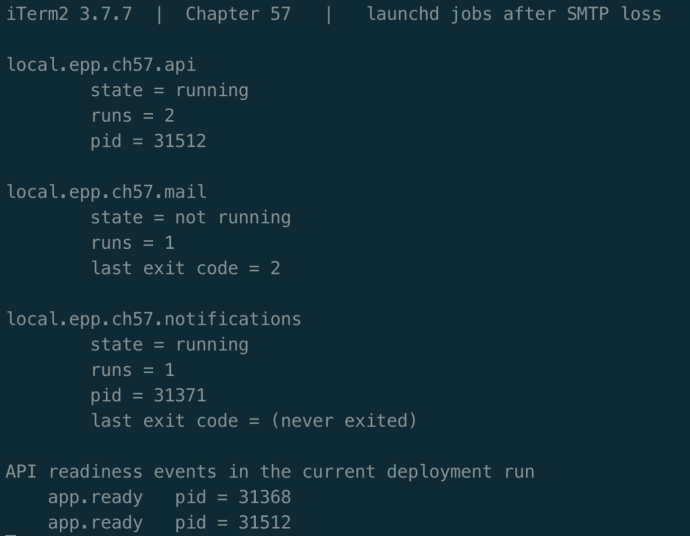
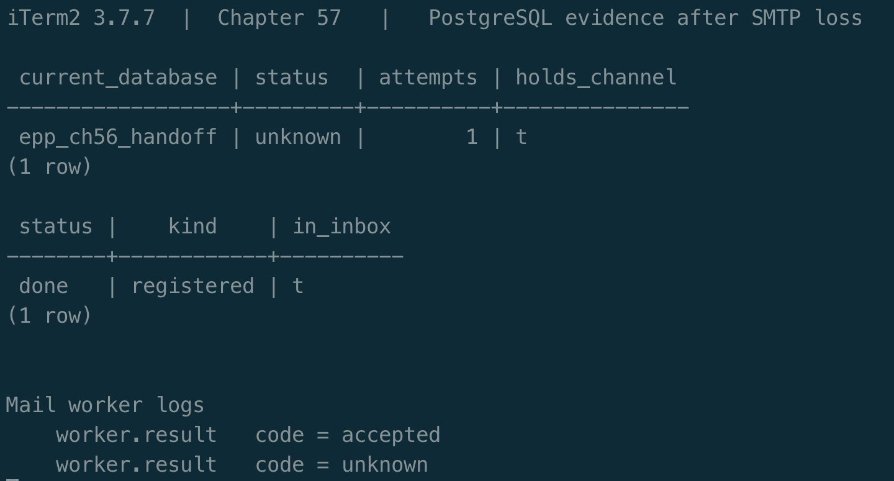

# 支线 69B　在 Mac 托管服务并追查意外退出

部署目标是 Mac 时，在本机准备运行身份、配置和工作目录，然后把实际启动命令交给 launchd。以下从第 67 章已验的 release 起步，所需变量都在本支线建立。首次按[Mac 环境说明](../../environment-setup.md#用-bash-启动服务选做-mac-托管)确认 Bash、launchctl、plutil 可用。

## 为已验程序准备独立工作目录

拿出第 67 章的交接记录，保留原 release 的绝对路径、构建来源、交接库的地址和库名、已开通账号的 userId 和暂停收据的 operationId。若原目录已清理，有同平台已验的包就按记录核摘要并解开；两者都没有时才按[67.2 的装配和 67.3 的入口核验](../../part-08-maintenance/chapter-67-review/chapter.md#672-在副本重建一次超时的重放)重建。本次再查原收据，是为了验证稍后换上的数据库登录也能从目标库读到它。

在 Mac 的[本章配套](https://github.com/SamChowRock/epp-public/tree/part-09/chapter-70)根目录，普通练习账号先运行 `nvm use`，再输入 `/bin/bash`。系统终端或 iTerm2 均可。配套根用于取授权脚本，下面的 release 指向**上章实际验过的程序**。先恢复变量，重开 Bash 窗口时也从这一段接起。[本机运行环境](../../environment-setup.md#用-bash-启动服务选做-mac-托管)

```bash
umask 077
src=$(pwd -P)
release='填第69章已验收的release绝对路径'
deploy="$HOME/Library/Application Support/EPP/ch57"
db=epp_ch56_handoff  # 换成独立建库记录上的值
node_bin=$(command -v node)
"$node_bin" --version
ls -ld "$release/dist/src/server.js" "$release/dist/config/service.json" "$release/node_modules"
```

Node 应与交付记录同版（本例 v24.22.1），三个路径均可读。第 67 章版本的监听固定在 127.0.0.1，正合本章与下一章的回环入口。如果你已经验过可配置 LISTEN_HOST 的第 69 章版本，也可沿用那份 release，记录实际版本。初次准备时，在 release **以外**建立私有的工作目录和配置目录：

```bash
mkdir -p "$(dirname "$deploy")"
mkdir -m 700 "$deploy" && mkdir -m 700 "$deploy"/{config,work}
ls -ld "$deploy/config" "$deploy/work"
```

在 `ls -ld` 中对照当前账号与 `drwx------`。若报告部署根已存在，先核对属主、两个目录和配置是否属于原练习，接续原部署即可。work 给这个账号写头像暂存，config 保存连接与签名材料，已验的 release 仍留在原位置。

## 为运行账号授予数据库权限

本机账号决定进程能否打开配置、能否在 work 写文件；PostgreSQL 则按配置中的登录角色检查 SQL。如果直接把第 67 章用于迁移的表所有者交给 API，它也就有能力改写昨天的收据。现在为应用准备一个普通登录，给两张收据表上的读与追加权限，保留原记录不被改写。第 70 章在这个基础上再把 API 与两个 Worker 分权。

角色属于整个 PostgreSQL 实例，表权限则落在某一个库的具体对象上，所以这里要连接两次。先在 Bash 的源码根填入建库记录，再用有创建角色权限的管理员连接练习实例的 postgres 库：

```bash
pg_port='替换为练习实例端口'
pg_admin='替换为该实例的管理员角色名'
pg_owner='替换为练习库的业务表所有者'
psql -X -h 127.0.0.1 -p "$pg_port" -U "$pg_admin" -d postgres
```

`-h`、`-p` 选择主机与端口，`-U` 选择数据库角色，`-d` 选择库。`-X` 跳过个人 psql 启动配置，保证练习不受自定义命令影响。进入 psql 后先输入 `\conninfo` 回车，与交接单核对。带分号的 SQL 由服务器执行，行首反斜杠是 psql 自己解释的命令，回车即执行。下列 SQL 创建能登录的普通角色，禁止超级用户、建库和建角色能力。第二行会提示交互输入新密码。已存在同名角色时先核对其归属、成员关系和对象所有权。

```text
CREATE ROLE epp57_run LOGIN NOSUPERUSER NOCREATEDB NOCREATEROLE;
\password epp57_run
```

在 psql 输入 `\q` 回到刚才的 Bash。这次连接业务表所有者及**目标库**，仍从配套源码根运行：

```bash
psql -X -h 127.0.0.1 -p "$pg_port" -U "$pg_owner" -d "$db"
```

进入 psql 后逐行执行，第二行的库名抄自独立建库记录：

```text
\conninfo
\set expected_db epp_ch56_handoff
\i examples/deployment/runtime-grants.sql
```

`\set` 只设置 psql 变量，不会切换连接。`\i` 从启动 psql 的当前目录读取脚本，按**当前连接身份**执行。若报找不到文件，用 `\! pwd` 查看 psql 的本地工作目录；若报 Wrong deployment database，重新核对主机、端口和库名，再连到正确的库。把 expected_db 改成眼前的错误库名会失去这次保护。[psql 的命令与选项](https://www.postgresql.org/docs/18/app-psql.html)

读[授权脚本](https://github.com/SamChowRock/epp-public/blob/part-09/chapter-70/examples/deployment/runtime-grants.sql)时，沿一条查收据的请求看三层授权。CONNECT 允许进入该库，USAGE 允许在 public 模式中按名找到对象，表上的 SELECT 才允许读行。脚本给两张收据表另授 INSERT，办理新操作可追加记录；它没有授 UPDATE。上述授权在同一事务中完成，预期输出以 BEGIN 开始，中间是各条 GRANT，最后是 COMMIT。看到 COMMIT 后再换运行角色验证。GRANT 会追加权限，角色以前从所有权、其他角色或 PUBLIC 得到的能力仍可能生效。

从所有者的 psql 用 `\q` 回到 Bash，再执行 `psql -X -h 127.0.0.1 -p "$pg_port" -U epp57_run -d "$db"`。先用 `\conninfo` 看清这次的角色，再执行下句。第一项应为 false，第二项为 true，第三项为 false。若 public 仍允许 PUBLIC 建对象，或旧角色继承了所有者权限，先在练习库清理旧授权再测。连接的数据库账号和操作系统登录账号可以不同。

```sql
SELECT has_schema_privilege(current_user,'public','CREATE') AS can_create,
       has_table_privilege(current_user,'public.web_access_receipts','INSERT') AS can_issue,
       has_table_privilege(current_user,'public.web_access_receipts','UPDATE') AS can_rewrite;
```

还可以在运行角色的连接里试一次没有匹配行的更新。请在自动提交的 SQL 编辑器里单独执行 `UPDATE public.web_access_receipts SET requested_enabled = false WHERE false;`。这里没有一行能被改动，数据库仍先检查 UPDATE 权限。本轮收到 `permission denied for table web_access_receipts`。如果自己的结果是“更新 0 行”，语句已经获得执行许可，应回查 current_user 及其继承权限。单靠观察数据有没有变，无法区分这两种结果。[PostgreSQL 的对象权限](https://www.postgresql.org/docs/18/ddl-priv.html)

输入 `\q` 退出 psql，回到 Bash。下节的路径和变量由 Shell 解释。

在当前 Bash 执行 `touch "$deploy/config/api.env" && chmod 600 "$deploy/config/api.env"`。以同一账号在编辑器里打开它。将连接目标、口令、原桶的四项 AVATAR_S3 配置，以及游标签名密钥填入。用户名或密码含特殊字符时须按 URL 分量编码。签名密钥沿用原部署受控配置。如果上章只为临时进程生成过一次且没有保留，现在用 `openssl rand -hex 32` 生成一份，后续交接保留这份密钥，旧游标需重新获取。

```dotenv
NODE_ENV=production
DATABASE_URL=postgresql://epp57_run:<编码后的密码>@127.0.0.1:<PG端口>/<副本库>
DB_POOL_MAX=2
PORT=3358
APP_ORIGIN=http://127.0.0.1:3358
CURSOR_HMAC_KEY=<64个十六进制字符>
AVATAR_S3_ENDPOINT=http://127.0.0.1:18633
AVATAR_S3_BUCKET=avatars
AVATAR_S3_ACCESS_KEY=<应用访问键>
AVATAR_S3_SECRET_KEY=<应用秘密>
```

DB_POOL_MAX=2 限制每个进程的数据库连接数，给同时运行的 CLI 也留出连接。用 `ls -l "$deploy/config/api.env"` 检查属主及 `-rw-------`，再确认文件里填的是配对的练习库与桶。

## 用同一份配置查收据并启动 API

按[私有桶启动步骤](https://github.com/SamChowRock/epp-public/blob/part-09/chapter-70/database/chapter-51/README.md)让配对的 SeaweedFS 在原端点监听。

假设旧终端还导出了 PORT=3999，文件里明明写着 3358，接班人该去哪个端口找 API？先用公开的端口号做一次无网络的小实验。下面两个进程只读取配置并打印端口，其他环境值不会输出。

```bash
PORT=3999 "$node_bin" --env-file="$deploy/config/api.env" -p 'process.env.PORT'
/usr/bin/env -i "$node_bin" --env-file="$deploy/config/api.env" -p 'process.env.PORT'
```

命令前的 `PORT=3999` 只给这一次启动传值；Node 的 `-p` 求值并打印后面的表达式，所以两行都不会启动监听。第一行得到 3999，第二行才得到文件里的值。同样的优先级也适用于 DATABASE_URL，只是连错库时程序依然可能成功启动。下面的函数先在子 Shell 进入 work，清空外层环境，再让 Node 从固定的 api.env 读取配置。子 Shell 结束后，操作终端仍在原目录。[Node 的环境文件加载规则](https://nodejs.org/docs/latest-v24.x/api/cli.html#--env-filefile)

回到 Bash，填入交接单的两个 ID。node_bin 沿用 前面的目录准备 保存的绝对路径，清空 PATH 后仍能找到同一个解释器。

```bash
user_id='交接单里的账号UUID'
op_id='历史暂停操作的UUID'
run_with_api_config() {
  (cd "$deploy/work" && /usr/bin/env -i "$node_bin" \
    --env-file="$deploy/config/api.env" "$@")
}
run_with_api_config "$release/dist/src/account-admin.js" "$db" receipt "$user_id" "$op_id"
```

函数里的 `"$@"` 把脚本路径及余下的参数逐个交给 Node。上面调用管理命令，明确传入预期库名、账号和操作 ID。下面启动 API 时，函数改为执行 server.js，工作目录和数据库凭据都沿用刚验过的值。

先把 CLI 回读的操作 ID 和原决定与交接单逐项对上。若查无收据，按交接记录核对实例、库名和这两个 ID。核对成功后才启动 API：

```bash
run_with_api_config "$release/dist/src/server.js"
```

等 app.ready 出现，在 Postman 把[原集合](https://github.com/SamChowRock/epp-public/blob/part-09/chapter-70/requests/chapter-51.postman_collection.json)的 baseUrl 设为 `http://127.0.0.1:3358`。用 05 登录交接单上的旧账号，再发 20，核对返回的 userId。接着用 15 取本会话的写令牌，发 24，binary body 选 `examples/avatar-preview/harbor.png`，Content-Type 用 image/png；若手工填写 Origin，用 api.env 中的 APP_ORIGIN。这个请求预览头像，不替换当前头像。

收到 200、image/webp 后，在另一个 Bash 页恢复 前面的目录准备 的变量，执行 `ls -ld "$deploy/work/.avatar-tmp"`。用配套 PNG 预览时，这次得到 2062 字节 WebP；工作目录里留下运行账号拥有的 0700 临时根，本次上传的子目录已清理。这两处结果分别说明图片处理成功、暂存发生在预期位置。若 20 成功而 24 返回 500，从该响应的 X-Request-Id 在 API 输出找到同一笔请求，再核对启动命令的 cd、work 的属主和写权限。

最后发 26，在浏览器打开刚签出的完整地址，核对原 avatarId 与实际对象。旧账号还没有头像时，可先在独占练习桶用 25 发布一张，再做 26，并把它记为本次新建的基线。若能预览而旧图打不开，此时已经验证了 work 能写，应沿原键、桶和签名端点继续查。

在第二个 Mac 终端用 `lsof -nP -iTCP:3358 -sTCP:LISTEN` 看谁在接请求。-iTCP 与 -sTCP 选择该端口的监听，-nP 保留数字地址和端口。将输出中的 127.0.0.1:3358 和 PID 对照本次 app.ready。若端口一开始便被占用，先核对原进程；选新端口时一起修改 PORT、APP_ORIGIN 和客户端 baseUrl。记下原 userId、操作 ID 和头像摘要。要比较原字节，打开集合 26 刚返回的完整 URL 并下载文件，在 Mac 上用 `shasum -a 256 文件路径` 取摘要。

## 停止进程并交出启动条件

在运行 API 的前台按 Ctrl-C。终端会向前台进程组发送 SIGINT。等到 app.stopped 和提示符返回，立即执行 `echo $?` 读取退出码，再在观察页用相同的 lsof 查监听。本次正常收尾应为 0，原端口不再有这个 PID；原 Postman 地址此刻应连接失败。若仍能收到 HTTP，回到端口和响应头核实是谁在服务。

让下一班从新终端起步。把本机账号、Node 版本及绝对路径、构建来源、release、work、配置文件位置和预期库名交给他。让他按 前面的目录准备 恢复变量，在 前面的启动命令 的函数中先查原收据，再运行同一条 server.js，用原 Cookie 重发 20。在 Postman 的响应头抄下 X-Request-Id，到这次前台输出中找同一 ID 的 http.completed。两次前台启动用同一 Cookie 读回同一个人，旧头像都是 2056 字节，SHA-256 相同。换用自己的头像时比较自己的原始摘要。正常停下这个 API，保留相配的库与桶，为下一章迁移准备停写窗口。

后台待办也会随库迁移。在 DBeaver 查本次交接库，记下会影响下次启动邮件进程的那笔工作：

```sql
SELECT current_database() AS db, c.paused_by, o.status, o.attempts, o.lease_until
FROM public.verification_mail_control c
LEFT JOIN public.verification_outbox o ON o.id = c.paused_by
WHERE c.id = 1;
```

paused_by 有值时，按该消息 ID 和租期查明是仍在发送，还是投递结果未知。结果为 unknown 时保持停发并保留原尝试；API 启动成功并没有赋予重投这封邮件的依据。[第 53 章的未知投递](../../part-06-background/chapter-53-retries/chapter.md)


托管跨越终端会话，需要让 launchd 在下次启动时仍能找到程序。这里的生成器约定 release、work、config、logs 同级。如果上面的准备仍在使用临时位置的 release，只在本支线首次执行以下两行，把已验产物复制到持续保留的位置，检查文件后再登记任务。若已有该布局，对照原路径及构建记录后直接沿用。

```bash
mkdir -m 700 "$deploy/logs"
test ! -e "$deploy/release" && cp -R "$release" "$deploy/release"
ls -l "$deploy/release/dist/src/server.js" "$deploy/release/dist/config/service.json"
```

## 从刚才那条前台命令做出第一个任务

刚才按 Ctrl-C，API 就停了。如果只在命令末尾加一个 `&`，iTerm2 会立刻还你一个提示符。可进程退出以后，谁记得用哪个 Node、带哪份配置再跑一次？macOS 的 launchd 可以记住一份任务定义。先只把前台命令交给它，观察它究竟接手了什么。

展开刚才的 `run_with_api_config …/server.js`：实际执行的是 /usr/bin/env；它收到 -i、Node 的绝对路径、环境文件参数、脚本路径这四个参数。函数中的 cd 做的是另一件事，设置进程的工作目录。把命令拆开，正好能填出任务的两个字段 ProgramArguments 和 WorkingDirectory。再给任务取一个跨进程仍能使用的名字 Label，把原来显示在窗口里的输出写到文件。

在前台 API 已退出、原端口已释放后，回到配套源码根（cd "$src"），在保有 deploy、node_bin 的 Bash 里运行下面这段。先用熟悉的 JavaScript 对象写出任务。ProgramArguments 里每一项都是一个完整参数，即使部署路径带空格，也能完整地交给进程。process.execPath 给出当前这份 Node 可执行文件的绝对路径，launchd 以后会用它启动 API。

```bash
"$node_bin" --input-type=module - "$deploy" <<'JS'
import { launchPlist } from './examples/deployment/launch-plist.mjs';
import { writeFileSync } from 'node:fs';
import { join } from 'node:path';

const root = process.argv[2];
const job = {
  Label: 'local.epp.ch57.first',
  ProgramArguments: [
    '/usr/bin/env', '-i', process.execPath,
    '--env-file=' + join(root, 'config', 'api.env'),
    join(root, 'release', 'dist', 'src', 'server.js'),
  ],
  WorkingDirectory: join(root, 'work'),
  StandardOutPath: join(root, 'logs', 'first.log'),
  StandardErrorPath: join(root, 'logs', 'first.err'),
};
const plist = launchPlist(job);
writeFileSync(join(root, 'first.plist'), plist, { flag: 'wx', mode: 0o600 });
JS
plutil -lint "$deploy/first.plist"
```

第一行的 `-` 让 Node 从标准输入读程序，`--input-type=module` 让这段程序可以使用 import。Bash 将 `<<'JS'` 与结尾 JS 之间的内容原样送入 Node，部署根路径作为单独的参数传给 process.argv[2]。

配套的 launchPlist 用 JavaScript 将字段写成 XML。路径作为字符串处理，遇到 & 等 XML 特殊字符时转义。Node 用 wx 新建文件。若报告 EEXIST，先用 macOS 的 `plutil -p "$deploy/first.plist"` 查看已有定义。这里的 `-lint` 供 Mac 操作者检查文件语法，程序启动时只执行 ProgramArguments 中的命令。

**文件路径**告诉 launchd 从哪里读定义。**域和标签**一起定位一项已登记任务。**PID** 只标识某一次正在运行的进程。先单独运行 `id -u`，它打印当前系统账号的数字编号。假设得到 501，下面的 domain 就是 gui/501；再拼上 local.epp.ch57.first，就精确指向这个登录会话中的练习任务。后文沿用变量，所以无需抄示例编号。先运行 `launchctl print "gui/$(id -u)/local.epp.ch57.first"`；首次练习应当查无这个标签。若已存在，先按输出里的 path 核对来源。

```bash
domain="gui/$(id -u)"
first="$domain/local.epp.ch57.first"
show_job() {
  launchctl print "$1" | grep -E $'^\t(state|pid|runs|last exit code|last terminating signal) ='
}
launchctl bootstrap "$domain" "$deploy/first.plist"
show_job "$first"
```

bootstrap 的两个参数分别回答“登记到哪个域”和“从哪个文件读定义”。随后 show_job 收到的参数是**域加标签**。函数里的竖线把 print 的标准输出交给 grep，`-E` 启用含多选项的表达式，开头的 `^\t` 在这段 Bash 写法里匹配行首一个制表符，只留下任务本层的那几项。grep 只改变显示。不同 macOS 版本若缩进有别、筛选为空，先原样运行 `launchctl print "$first"` 看返回的任务或错误。

这时能查到标签，读数却是 `state = not running`、`runs = 0`。任务已经登记，文件里还没有指定什么事件应当启动它。执行 `launchctl kickstart "$first"`，明确要求已登记的这项任务启动一次。再执行 `show_job "$first"`。看到 runs 从 0 变 1，只能说明启动过；PID 告诉你这次在观察哪个进程。用下面两步把这个 PID 与就绪日志、HTTP 请求对起来。示例端口换成 api.env 中的 PORT。

```bash
tail -n 8 "$deploy/logs/first.log"
curl -sS -o /dev/null -w '%{http_code}\n' http://127.0.0.1:3358/profile/me
```

`tail -n 8` 取文件最后八行，找带**本次 PID** 的 app.ready。若几条 HTTP 日志已经把就绪行挤出了末尾八行，运行 `grep -F '"event":"app.ready"' "$deploy/logs/first.log"` 按固定文本查就绪事件，再对 PID。若未找到本次 PID，重新用 show_job 查它是否还在启动；若任务已退出，再看 `tail -n 8 "$deploy/logs/first.err"`。这两个路径来自 plist 中的标准输出和标准错误字段。想边启动边看，可在观察窗口用 `tail -f "$deploy/logs/first.log"` 等新行；在这扇窗口按 Ctrl-C，只会结束跟读日志的 tail。

curl 默认发 GET。这里 `-sS` 隐藏进度条并保留连接错误，`-o /dev/null` 丢弃响应体，`-w` 单独打印 HTTP 状态码。没有带 Cookie，本轮得到 401，表示受保护接口已返回响应。若看到连接失败和 **000**，客户端还没收到 HTTP 状态码，这时先回到 lsof 查监听，再看进程与日志。在 Bash 紧接着运行 `echo $?` 可看上一条命令的退出码；本例未用 curl 的 `--fail`，收到 401 时退出码仍为 0，连接被拒时为 7。HTTP 状态码与工具退出码回答的是两个问题。

现在停止向这份副本发请求，单独执行 `launchctl kill SIGKILL "$first"`。kill 的参数是**信号名和任务目标**，由 launchd 找到此刻的进程并发信号。SIGKILL 立即终止进程，应用没有清理机会。等十余秒再查 `show_job "$first"`：本轮仍能找到任务，runs 仍是 1，最后信号是 Killed: 9，lsof 已看不到原监听。**没有 PID 与没有任务，在这里会得到不同的输出。**

最后执行 `launchctl bootout "$first"`，从该域卸载本轮任务；它仍在运行时，卸载也会请求它停止。再用 `launchctl print "$first"`，这回才会报告找不到服务。磁盘上的 first.plist 仍在，需要重做时可用同一文件 bootstrap。此时原样重发刚才的 curl：本轮显示连接失败、000，退出码为 7。与启动时的 401 对照，同一条命令已经能区分“服务拒绝匿名访问”和“这个端口无人接连接”。正式 API 现在可以接管原端口。

<details>
<summary>选做：在正式任务启动前轮转练习日志</summary>

### 切换日志文件以后还能找到哪一笔请求

如需为本机文件日志安排轮转，在装入正式任务前做本实验。刚才已卸载最小任务。用同一份 first.plist 再执行 bootstrap、kickstart，向它发一次匿名资料请求，抄下响应的 X-Request-Id，在 first.log 按该 ID 找到请求。记录 `ls -li "$deploy/logs/first.log"` 第一列的文件编号。把日志改名并不会让已经打开它的进程自动改写新路径；原进程持有打开的文件。练习中选择可控制的短暂停机，使新旧日志边界清晰。

执行 `launchctl bootout "$first"`，确认旧进程和监听已经退出，再运行：

```bash
archive=$(mktemp -d "$deploy/logs/rotation.XXXXXX")
mv "$deploy/logs/first.log" "$archive/first.log"
launchctl bootstrap "$domain" "$deploy/first.plist"
launchctl kickstart "$first"
```

mktemp 创建本次专用目录，避免覆盖上一轮。等新的 app.ready 出现，再发同一请求并记下新 ID。用 `ls -li "$archive/first.log" "$deploy/logs/first.log"` 核对两个文件编号，用两次请求的 ID 分别检查旧、新文件。保留归档的访问权限，把标准错误文件纳入同一保留范围。最后卸载这次任务，确认端口释放再继续部署。若旧 PID 仍在，先查看它打开的日志路径，不能只根据目录里出现新文件就宣告轮转成功。

给练习日志约定一个保留期限和空间上限，例如保留七天并每天检查剩余空间。用 `du -sk "$deploy/logs"` 读取 KiB，记录一天内增长量；用 `find "$deploy/logs" -type f -mtime +7 -print` 预览超过七个完整日龄的文件（按该平台 find 的日龄取整），核对归档才能决定清理。Linux 若把标准输出交给 journal，用 journalctl -u 加本机的实际 unit 名和 --since 查看这两次启动的证据，再用 journalctl --disk-usage 核对整个 journal 的容量。系统日志共用配额时，这个总量包含其他服务。

</details>

## 三个角色各自需要怎样的重启策略

先给 API 加上两项决定。第一，用户域加载任务时就需要有服务可用，打开 RunAtLoad。第二，像刚才那样意外退出要有人接手，但计划排空并正常退出后，希望它等下一次明确启动。用 KeepAlive 的 SuccessfulExit=false 表示后一个条件。反过来想，如果无论结果如何都重启，维护者刚做完的正常停机会被管理器撤销。系统还为频繁启动留间隔；这只能降低反复失败的频率，修复配置仍得读第一次错误。

通知 Worker 可以沿用这个选择：重启后从库里找该做的工作。邮件 Worker 多了一方，SMTP 对端。进程退出时，远端可能已收完信，数据库里却还没有最终应答。当前实现会保留发送占用并退出，重新运行也不能替对端补出一份回执。本章允许先恢复 API 和站内通知，让维护者查过通道再明确开邮件。代价是普通配置错误导致的邮件退出也要人来处理。一次办完就退出的管理 CLI 继续按需运行。

启动后台角色之前，在练习账号的 Bash 核对 [Mailpit 的 SMTP 与网页端口](../../environment-setup.md#在本机收取注册邮件)。为两份私有配置准备文件：先执行 `touch "$deploy/config/"{mail,notifications}.env`、`chmod 600 "$deploy/config/"{mail,notifications}.env`，再从 api.env 只抄 NODE_ENV、DATABASE_URL、DB_POOL_MAX 到两份文件。mail.env 加 LOCAL_SMTP_PORT 指向 Mailpit 的 SMTP 端口，本练习收件端在 Mac 回环。通知只需公共三项。已有事故占用的库可以观察原状态；要试投新邮件，选通道开放且允许消耗待办的独立练习副本。

<details>
<summary>同一台 Mac 再启动一版，连接和磁盘够用吗？</summary>

第 65 章把实验 API 的池调小到两席，看到过第三个调用在池外排队。部署时每个进程各建自己的池。假设 API、两个 Worker 和一条短时 CLI 都配 2，最多可为这四个进程申请 8 条连接；从同一扇终端启动两个进程，它们也各有自己的池。现在再开一个 API 做版本切换，还可能多用 2 条。池按需取连接，闲时在 DBeaver 只看到两三行也很正常。未设置时，这个版本的程序每池默认上限是 5。

```sql
SHOW max_connections;
SHOW reserved_connections;
SHOW superuser_reserved_connections;
SELECT datname, application_name, state, count(*)
FROM pg_stat_activity WHERE backend_type='client backend'
GROUP BY datname, application_name, state ORDER BY datname, application_name, state;
```

这台练习实例的三个设置依次是 100、0、3。对普通角色，按实例上限先算出 97 席，还要扣掉其他库与其他程序的需求。一次安静时刻，结果网格中只看到一条 idle 的通知连接和正在查询的 psql。前一个数是天花板，后一个数是快照。idle 连接仍占一个库内席位；一个池还没建出来的第二条连接则没有出现在视图里。

现在做一次发布决定。**假设**其他调用方在同一时段会用 83 席，维护者要给观察和应急操作留 5 个普通席位。还剩几个席位可分给 EPP？如果新旧 API 要重叠一分钟，你会允许现在发布吗？先按自己预计同时运行的进程数算一遍。

<details>
<summary>展开一种算法，再和自己的发布条件比较</summary>

普通角色共 97 席，扣掉 83 和 5，EPP 可安排 9 席。平时 API、邮件、通知和短时 CLI 共四个池，按上限算是 8 席。旧 API 还在时再加一个就是 10 席。此刻即使快照里有空位，也无法保证峰值还拿得到连接。若这段维护窗口可以暂停 CLI，重叠期间是两个 API 加两个 Worker，仍为 8 席；若 CLI 必须随时可用、服务允许短暂停机，可以先排空旧 API 再起新版。若两项条件都不能放宽，就需要重算池配置并验证峰值表现，或增加可用容量。这里的 83 和 5 要换成自己环境的需求。

</details>

若本来等的是同一账号上的锁，加池只会允许更多连接进库等待。可用[第 65 章的池与锁对照](../../part-08-maintenance/chapter-65-performance/chapter.md)在释放前判断。

再检查替换版本的磁盘空间。在部署终端执行：

```bash
du -sh "$deploy/release" "$deploy/work" "$deploy/logs"
df -h "$deploy"
```

du 显示各目录的实际占用，df 的 Avail 是所在卷的可用空间。本轮 release 占 438 MiB，同时保留两份时还要计入安装临时文件。数据库、桶或备份在别的卷时，分别查各自容量。在本支线的托管 API 就绪期间，可用活动监视器按 app.ready 的 PID 观察真实登录时的内存压力。图片解码会展开压缩输入，估算进程内存还要考虑像素尺寸和并行请求。

</details>

现在用[配套生成器](https://github.com/SamChowRock/epp-public/blob/part-09/chapter-70/examples/deployment/launch-agents.mjs)把刚才的决定写到三份文件里。先只生成和查看，特别比较 api 与 mail 的 RunAtLoad 和 KeepAlive。生成器只写新目录；重做时可查看已有 agents，或在核对已注册任务的路径后归档旧目录再生成。

```bash
cd "$src"
"$node_bin" examples/deployment/launch-agents.mjs "$deploy" "$db"
for f in "$deploy"/agents/*.plist; do plutil -lint "$f"; done
plutil -p "$deploy/agents/local.epp.ch57.api.plist"
plutil -p "$deploy/agents/local.epp.ch57.mail.plist"
```

用选好的 Node 运行生成器，两个位置参数依次是部署根、独立记下的预期库名。三个任务都从 process.execPath 取得同一份 Node 的绝对路径。循环中的 `*.plist` 由 Shell 展开为实际文件名，plutil 逐份检查语法。打开两份配置后看 Label、ProgramArguments 和 KeepAlive。两者都把环境、工作目录和日志写明，给正常退出预留 40 秒。通知与邮件使用同一个 mail-worker.js，只有通知在预期库名后多传一个 notifications 参数。launchd 按数组逐项传参；如果把整条 Shell 命令写进数组的一项，系统会把连空格在内的整串文字当成文件名。

先用 show_job 分别查三个标签，确认没有其他部署占用，再逐个注册。循环会把 role 依次换成 api、notifications、mail。`|| break` 表示某一次登记失败就停止继续登记，之前已成功的任务仍在。先用下一段的 print 结果查清哪个已经存在；若报加载失败，先查完整目标的 path，再用 plutil 核对文件及参数，修好后只 bootstrap 缺的角色。

```bash
for role in api notifications mail; do
  launchctl bootstrap "$domain" "$deploy/agents/local.epp.ch57.$role.plist" || break
done
for role in api notifications mail; do
  show_job "$domain/local.epp.ch57.$role"
done
```

预期 API 和通知各有 PID，邮件 runs 为 0。一个没有 PID 的邮件任务，此刻符合配置。先保留这个读数。若已决定在隔离副本试投，再用前面的邮件通道 SQL 核对通道开放，并确认 Mailpit 正在指定端口接信，然后执行 `launchctl kickstart "$domain/local.epp.ch57.mail"`，从 mail.log 核对 worker.ready。

### 关窗、注销和开机分别改变了什么

记下 API 的 PID 和 runs，关闭发出 bootstrap 的 iTerm2 标签页。新开一个标签页，重新设 `domain="gui/$(id -u)"`，执行 `launchctl print "$domain/local.epp.ch57.api"`，用原 Cookie 再发 20。只要用户仍然登录，关闭终端没有销毁这个域。读回同一 PID 和账号资料，说明原进程在这个已登录的用户域继续服务。

要让下次图形登录自动恢复，可把经检查的 plist 由专用账号安装到 `~/Library/LaunchAgents/`（0644）。若主机重启后仍停在登录页，图形域还没建立，此时需要 root 管理的系统域 LaunchDaemon、非特权运行用户，以及能在该阶段使用的库、桶和配置。两项分别在重新登录后、图形登录前用独立管理通道核对启动日志和同一旧账号。完整的远端主机托管接到下一章。[Apple 对系统守护进程与登录代理的说明](https://developer.apple.com/library/archive/documentation/MacOSX/Conceptual/BPSystemStartup/Chapters/CreatingLaunchdJobs.html)

## 同样少了一个进程，下一步可以相反

接班时看到两个角色各少了一个 PID。同事建议一起重启。你会先要什么证据？下面先做熟悉的 API，再把同样的办法拿去处理邮件，看看哪一步开始需要额外的事实。

**API 消失时，原会话还能认出原用户吗？** 在 Postman 保留已登录的 Cookie，用 20 记下 userId。记录通知 PID。若按前段关闭了原窗口，回到配套源码根，恢复 deploy、db、node_bin 和 domain，再继续。在这份空闲的专用副本上，先确认 API 的运行身份，随后只终止这次 API 进程。使用前节 macOS 任务时，在 iTerm2 运行下面两句。

```bash
domain="gui/$(id -u)"
launchctl print "$domain/local.epp.ch57.api" | grep -E '^[[:space:]]*(pid|runs) ='
launchctl kill SIGKILL "$domain/local.epp.ch57.api"
```

在 Mac 重复上面的 print 命令。竖线后的 grep 只保留 PID 和启动次数，去掉筛选可以看全字段。再看新的 app.ready，最后用原 Cookie 再发 20。跟 本支线的第一个任务比较，两次都以同一个信号结束，正式配置这次给出了新 PID。我们这轮是 31368 换成 31512，通知 PID 31371 保持；同一用户仍得到 200。更换的是提供服务的进程，仍认得会话的原因可以沿数据库中的会话记录解释。倘若被中断的是一笔写入，新 PID 与 200 都不能告诉你旧请求是否已提交；那要沿那笔操作的 ID 回查。

**邮件消失时，对端已经收到了什么？** 再看同一次演练中的两笔邮件。A 已送入 Mailpit。B 的接收端收完整个正文后断开，发送者没有拿到最终应答。练习副本如果已有未知占用，直接拿它的消息 ID 对照前面的邮件通道查询。希望自己制造一次断连时，按[第 53 章的 SMTP 断连实验](../../part-06-background/chapter-53-retries/chapter.md)在独立收件端操作。



图 70B-1　API 启动过两次，通知仍在第一次运行。邮件从未启动变成启动一次、退出码 2。仅凭这几项还无法决定能不能再发。



图 70B-2　库里 B 的消息为 unknown，尝试一次，通道的 paused_by 指向 B。收件人可能已经收过，留住 ID 并保持停发。A 已经收到了信，完成注册后，通知任务变成 done，收件箱有同 ID 的一行。交接人可以继续启动 API 和通知，在投递查清前让邮件等待明确处置。

计划停机时用 SIGTERM，观察 app.stopped 与监听释放。要研究半途上传如何清理暂存，沿[第 59 章的分块上传](../../part-07-profiles/chapter-59-avatar/chapter.md)复现；本次交付只需保留原账号、收据、头像和通道占用。

离开练习时，在 Mac 用加载任务的账号逐一 bootout。先确认标签的配置路径属于本轮，再运行下列命令。这个循环逐个卸载完整标签。结束后再对 API 标签执行 print，并用前面检查监听的 lsof 核对端口。若另做了投递实验，停止本次故障端。关闭本轮的依赖，保留库、桶、构建、配置与交接记录。下次从本支线记录的已知收据、头像和邮件占用开始。带上这份交接记录，进入[第 69 章](chapter.md)，从 iTerm2 经 SSH 接手另一台主机。

```bash
for role in mail notifications api; do
  launchctl bootout "$domain/local.epp.ch57.$role"
done
```

阅读约 28～40 分钟，首次准备配置、托管与核对另加 50～75 分钟。自行轮转日志或演练容量另加 10～20 分钟。

[继续第 69 章](chapter.md)
