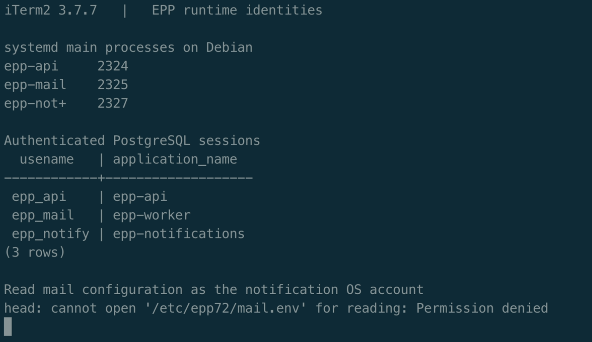
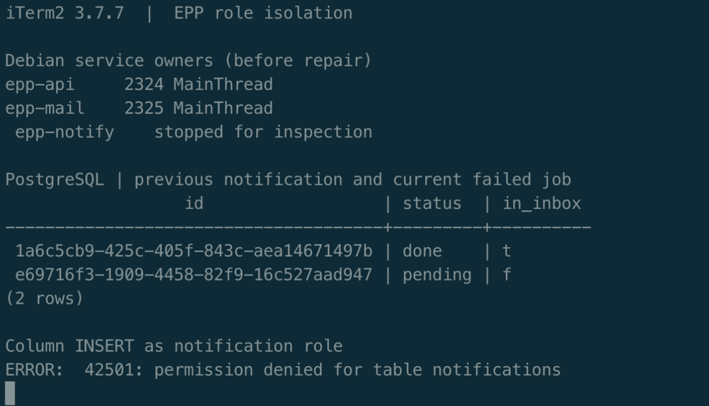

# 第 70 章　让 API 和后台进程以各自身份持续运行

第 69 章已经把程序、配置和数据接到 Debian，API 在 SSH 页的前台处理请求。现在要让服务在操作员离线后持续运行，同时让邮件与通知各自承担自己的工作。程序由哪个用户启动、能读哪份配置、在哪个目录写文件，以及退出以后谁决定重启，必须一起确定。

我们用 systemd 托管三个入口，并分别分配 Linux 用户与数据库角色。操作员保留安装程序和修改配置的权限，服务只取得运行所需的权限。API 与通知可以在普通故障后重新启动；邮件若留下结果未知的投递，自动重试会违背第 53 章的停发约定。下面从这三种工作的差别推导身份和生命周期。

沿用[第 69 章的非空练习库、配对桶和已验程序](../chapter-69-target-environment/chapter.md)。本章的应用调整以[前置配套](https://github.com/SamChowRock/epp-public/tree/part-09/chapter-70)为起点，完成版使用 `git switch part-09/chapter-71`，增加分权所需视图并收窄注册、入队和通知读取。构建和迁移之后才替换前台程序，原账号、头像与收据继续留在这套数据中。

操作端仍用 Mac 上的 Postman 和 DBeaver。在已核对的 [Debian 13 部署端](../../environment-setup.md#准备-debian-13-部署端)，由能安装系统服务和设定属主的管理员建立三个运行身份。数据库沿用 PostgreSQL 18，邮件只投到自己的 Mailpit。

## 70.1 从三笔工作推导各自的权限

先留一份能回去比对的现场。DBeaver 沿用已有的独立观察连接；数据库只允许远端回环且操作端尚无此连接时，可以在 SSH 远端页运行 psql，或按第 69 章的方法把另一个空闲本地端口转发到远端 PostgreSQL 端口，再让 DBeaver 连本地入口。在原部署记录 API 的程序、工作目录、当前库与端口，按第 69 章用一个**已开通**的旧账号登录并读取本人资料，记下 userId。取一张已有的账号处置收据，按 operationId 查出当时的决定。用 DBeaver 的独立观察连接执行下面的查询，发送一次请求后刷新结果。闲置连接会释放，暂时缺一行时，要在对应进程做事时再看。

```sql
SELECT usename, application_name, count(*) AS connections
FROM pg_stat_activity
WHERE datname = current_database()
  AND application_name IN ('epp-api','epp-worker','epp-notifications')
GROUP BY usename, application_name ORDER BY application_name;
```

application_name 是程序给连接填的标签，usename 是 PostgreSQL 实际认证的身份。若只部署了第 69 章的 API，此时应去找的是 epp-api 的连接，另两个标签要等本章启动 Worker 后才会出现。做过 Mac 托管支线的人可能已经见过三个不同的标签共用 epp57_run。现在分别沿一笔工作看谁真的要碰什么。

| 从哪里发起 | 接下来由谁做什么 | 由什么结果认出这笔工作 |
| --- | --- | --- |
| 旧账号登录，再读自己的资料 | API 核验密码，锁住账号检查准入，创建会话，再凭会话读本人资料。预览头像还要在自己的工作目录写暂存文件 | 请求 05、20 返回同一个旧 userId；请求 24 返回 WebP |
| 新邮箱请求注册验证 | API 写验证意图和待发消息；邮件进程锁通道、认领消息、更新令牌摘要、联系 SMTP，再记录投递结果 | Mailpit 收到寄给本轮地址的邮件，数据库同一 recipient 的消息为 accepted |
| 用信里的令牌确认注册 | API 在一笔事务里建立用户、凭据、已验证邮箱和通知任务；通知进程锁定任务、核对账号、插入通知并将任务置为 done | 响应返回新 userId；按这个人找到任务，收件箱的通知与任务同 ID |

这里有四类身份。启动 Linux 服务时提供的 User 决定内核准许它打开哪些文件。DATABASE_URL 里的登录角色决定 PostgreSQL 接受哪些读写。对象存储使用 API 配置里的应用访问密钥。练习 SMTP 使用回环或隔离网络中的免认证 Mailpit，只有邮件进程需要配置其端点；若以后改成认证 SMTP，凭据也应只交给发送者。**文件权限管谁能读文件，免认证的网络监听仍由能到达它的进程使用。** 仅把端口号从通知配置中拿掉，无法阻止它主动连接一个已知端口。

每个角色得到的授权要覆盖它真正执行的 SQL。通知处理需要在检查账号状态时持锁，而 PostgreSQL 对直接锁表行还有更新权限要求。因此完成版使用由表所有者定义的带锁视图，让通知角色经过该入口读取状态。API 注册时则只提交允许自己决定的字段，将初始资格留给数据库默认值。权限收窄与访问代码必须同时交付；只换密码、换启动用户，运行的仍是原来的权限范围。

这些改动在[支线 71C](side-03-database-roles.md)逐段实现，解释列授权、视图权限、并发锁及 ORM 默认列之间的关系。跟写应用时先完成该支线，再回这里构建。部署练习可直接检出完成版，并沿下节给同一程序分配身份。

在操作端本章快照 `part-09/chapter-71` 或已完成上述修改的构建目录，执行 `nvm use`、`npm ci`、`npm run ci:check`。完成版的构建包含新的访问代码，旧库仍需追加视图。下一节先升级练习副本，再启动新版消费者。

## 70.2 把运行身份、目录和配置交给系统

先留住第 69 章前台 API 对应客户端的旧会话、账号 ID、原收据和头像摘要。后续将保持客户端来源和原签名密钥。使用第 69 章的独立练习库、配对桶，或按[既有备份恢复步骤](https://github.com/SamChowRock/epp-public/blob/part-09/chapter-70/database/chapter-22/backup-restore.md)另取带旧账号和收据的独立库、配对桶。下文示例库名 epp_ch72_handoff 来自建库记录。保存旧收据、头像引用、邮件通道的 paused_by 和现有 pending 队列。若交接时有 unknown 占用，沿[第 53 章人工放行步骤](https://github.com/SamChowRock/epp-public/blob/part-09/chapter-70/database/chapter-45/README.md)在练习副本内先查明原消息、停止所有发送者、确认本轮允许继续哪些待办。保留原行、尝试次数和结果。仍无依据放行时可先部署 API 与通知，推迟寄信实验。

沿用 70.1 验过的本版构建。沿 69.2 的办法，只打包这版 dist 和三份安装文件，核对摘要后传到 Debian 新的私有暂存目录。若第 69 章服务已停，先恢复它和数据通路，在原客户端用 20 核实旧会话、用 15 取写令牌，用 26 新签地址立即下载原图（无头像时先发布一张），记下 userId、avatarId、文件的 SHA-256。若会话已过期，在切换前用旧账号重新登录，记录这次基线。停止本轮全部写入者，等在途操作结束。回到上一章运行 API 的 SSH 页按 Ctrl-C，等待 app.stopped 和退出，核对原 3358 监听释放。保留旧 release 与库的备份。

若迁移从 Mac 的源码目录执行，在单独的本地窗口运行 `ssh -F ~/.ssh/epp71.conf -N -o ExitOnForwardFailure=yes -L 127.0.0.1:15471:127.0.0.1:55471 epp-lab`。如果上一章已留下同一条转发，核对目标后直接复用。用 DBeaver 连本地 15471，按原收据 ID 核实连接落在 Debian 的库。保持此窗口，将有开发依赖的源码根中的 `.env.database-verify` 指向这个本地端口和本轮副本的迁移所有者。清除外层同名配置，传入单独记录的库名：

```bash
db=epp_ch72_handoff
env -u DATABASE_URL node --env-file=.env.database-verify scripts/deploy-verify.mjs deploy "$db"
```

有历史的副本只追加一个视图，不回填用户、邮件或收据。回到 DBeaver 按原 operationId 核对旧值。若只有空练习库，上面的 deploy 换成 bootstrap，再按第 63 章准备一个已开通账号和一张已知收据；这样能验证操作，不能用来判断旧库升级。新旧通知程序切换前停妥旧消费者，避免它抢先办完你要观察的任务。

### 建立三个数据库登录角色

在独立实例中，使用有建角色权限的管理员登录 psql，先用 `\conninfo` 对上实例，连接本次库。角色名属于整个实例；先用 `\du` 确认以下三个名字尚未占用。用事务一次建立三名普通登录者，再用 psql 的口令提示各设不同口令。若重做已完成的安装，先核对角色属性、成员关系与对象所有权，不重复建角色。

```sql
BEGIN;
CREATE ROLE epp_api LOGIN;
CREATE ROLE epp_mail LOGIN;
CREATE ROLE epp_notify LOGIN;
COMMIT;
```

```text
\password epp_api
\password epp_mail
\password epp_notify
```

三个角色均不拥有业务表、不能建角色，也不继承旧的 epp57_run、表所有者或预定义的全库读写角色。连接规则应要求这些服务登录者独立认证，例如 PostgreSQL TCP 的 scram-sha-256；若一个本地服务账号能借 trust 规则冒充任意库角色，就能绕过下面的分工。先按本章实际连接地址核对 pg_hba.conf；涉及 Unix socket 时也要核对 local 规则。管理员、迁移与备份继续使用各自入口。可先在观察连接查下列三行，预期四项均为 false。schema_create 为 true 时先追查是否来自 PUBLIC 或继承角色：能在 public 安装新对象，会扩大运行角色可以改变的范围。对象所有权和旧表 ACL 还要单独核对。

```sql
SELECT rolname, rolsuper, rolcreaterole, rolcreatedb,
       has_schema_privilege(rolname, 'public', 'CREATE') AS schema_create
FROM pg_roles WHERE rolname IN ('epp_api','epp_mail','epp_notify')
ORDER BY rolname;
```

下面是 `examples/service-roles/grants.sql`。从源码根用业务表及视图所有者连接**目标库**，在 psql 先输 `\set expected_db epp_ch72_handoff`，再输 `\i examples/service-roles/grants.sql`。脚本先对库名才执行事务。看三组权限的动词：API 可以添加待发消息，邮件可以更新投递状态，通知可以添加收件箱行。启动探针也算读者，哪怕表里暂时零行，探测列的 SELECT 权限仍需满足。

执行后应看到 COMMIT。用三处关键授权与业务语句对照，完整的读表清单、列授权和目标库检查在[随书 grants.sql](https://github.com/SamChowRock/epp-public/blob/part-09/chapter-71/examples/service-roles/grants.sql)。以下是刚才已经应用的摘录：

```sql
GRANT INSERT (id) ON public.users TO epp_api;
GRANT UPDATE (paused_by) ON public.verification_mail_control TO epp_mail;
GRANT INSERT (id,user_id,kind,created_at) ON public.notifications TO epp_notify;
```

第41章的共享密码额度也由API身份执行。`grants.sql` 给 `epp_api` 对 `auth_rate_buckets` 的SELECT、INSERT、UPDATE、DELETE；DELETE用于每次最多100行的过期清理。邮件与通知不获这组权限，计数表探针只在API模块运行。两个API及第 76 章继承API权限的新登录仍指向同一个库和规则；仅能启动不能证明写计数已获授权，应复用41章的真实末格与定向撤权实验。

第50章统一的小程序映射只由API读取和建立，所以 `wechat_identities` 仅给 `epp_api` SELECT、INSERT；邮件、通知及只读工具的启动路径不探测该表。首次平台身份创建本地用户时也只执行 `INSERT INTO users(id)`，让数据库决定其他默认列，避免ORM附带默认资格列而越过INSERT(id)授权。MiniService原有用户FOR UPDATE锁仍保留：API已有资料字段的列级UPDATE足以支持该锁，不需增加修改mini资格的权力。第 76 章新的API登录继承同一基角色授权。

第 66 章的局部数据保护还要求 API 读取案件状态。更新后的 grants.sql 仅增加 `GRANT SELECT (id,capture_id,state) ON public.capture_integrity_cases TO epp_api`；扫描和修复表不对 API 开放，邮件和通知也不需要案件权限。先迁移再授权；定向撤回这三列权限应使新 API 启动拒绝，恢复后原 Cookie 及健康素材可读。第 76 章 API 新登录继承基角色的此项授权，不另复制成管理权限。

第 30 章的 `CaptureCommands` 现在也由 API 身份执行。授权脚本额外给予 `capture_write_receipts` 九列的 SELECT、INSERT，完整列为 `user_id, action, operation_id, capture_id, fingerprint, status_code, response, location, recorded_at`，不授 UPDATE、DELETE。读旧回执时，它先对当前归属的 captures 行 `FOR SHARE`；`GRANT UPDATE (chinese_intent) ON public.captures TO epp_api` 满足锁定查询至少可更新一列的要求，同时保留本来允许修改中文意图的业务。邮件、通知均不读素材写入回执，新表的启动检查放在它们专用启动路径的提前返回之后。第 76 章的新 API 登录通过原 API 角色继承这些授权，不能只换密码而漏执行基角色的新授权。

用独立练习库验证授权时，先按第 30 章保存一笔带键写入的原键、原正文与原结果；经本章 API 重放，应取得原 ID 或原修订号。以 API 数据库身份尝试 UPDATE、DELETE 回执应被拒绝。只在独立副本临时撤回新表 INSERT，再用新键写入，业务和回执应同时回滚；恢复原列授权后原键才可完成。不要拿生产历史回执测试删除，也不要把邮件、通知启动失败用授予新表权限来掩盖。

sessions 上的 UPDATE(label) 有一个代价。具体业务会校验并锁住会话行，PostgreSQL 要求能更新至少一列。这个授权让 API 能修改会话上的说明文字；它不能用 UPDATE 延长有效期。API 原本就必须能创建和撤销会话。通知身份却没有修改任何用户列的业务理由，所以才为它单独建立带锁视图。邮件也只获准更新验证意图的 token_digest；它不能更换收件邮箱或新建账号。以上权限在 SQL 层按表、列生效，拿到 API 登录凭据的人仍可操作其获准访问的多名用户，应用中的本人校验依然必要。[PostgreSQL 18 的列级授权](https://www.postgresql.org/docs/18/sql-grant.html)

### 让 Linux 内核也认出三个人

在 SSH 练习目标的管理 Shell 中执行，先用 `getent passwd epp-api` 等命令确认三名系统账号可新建，再运行下面的循环。这里连字符的是 Linux 用户，下划线的是数据库角色，二者通过各自的配置文件相连。

```bash
for role in api mail notify; do
  sudo useradd --system --user-group --no-create-home \
    --shell /usr/sbin/nologin "epp-$role" || break
done
sudo install -d -o root -g root -m 0755 /etc/epp72
```

useradd 为每个服务分配独立 UID 和同名组，不给交互 Shell。若中途失败，用 `id epp-api` 等逐个核对成功的账号，补齐所缺的，三者不得互为对方组成员。管理者保留配置目录的写权。如果服务用户能替换别人的配置、Node 可执行文件，或者在共同的 release 中改一行 JavaScript，光把 .env 设成只读挡不住它。

在目标平台准备相同版本的 Node 24.22.1 和构建产物。首次安装见[Linux 版 Node 的架构选择、安装与验证](../../environment-setup.md#安装部署端共用的-linux-node)。示例将目标平台、架构匹配的 Node 发行包展开到 root 管理的 `/opt/epp72/node`，以 `/opt/epp72/node/bin/node --version` 核对；已有其他系统级安装可把后面三个 ExecStart 的首项改为同一绝对路径。在新交付目录放入 dist、package.json、package-lock.json 和 .npmrc，用目标平台的 Node 按第 69 章在 Debian 执行 `npm ci --omit=dev`。Mac 的 node_modules 里有本机的 sharp、argon2 产物，要在 Linux 安装生产依赖。下面在部署端操作。先在私有暂存目录放好 dist 和三份安装文件，目录中只放交付所需文件。cd 进去，从该目录执行：

```bash
export PATH="/opt/epp72/node/bin:$PATH"
node --version
npm ci --omit=dev
sudo install -d -o root -g root -m 0755 /opt/epp72
sudo mkdir -m 0755 /opt/epp72/release
```

mkdir 成功表示本轮安装位置原先为空缺。若已经存在，停止复制，核对是否为上次交付；在另一个新路径准备发布，并同步调整 unit。以下 tar 逐项选取文件，避免把暂存目录里遗留的 .env 一起装入 release。在默认私有掩码下构建的文件可能只有构建者能读，a+rX 给服务补足读权、目录遍历和本来就可执行的文件的执行权：

```bash
(
  set -eu
  artifact_dir=$(mktemp -d)
  tar -czf "$artifact_dir/runtime.tgz" dist package.json package-lock.json .npmrc node_modules
  sha256sum "$artifact_dir/runtime.tgz" > "$artifact_dir/runtime.sha256"
  sha256sum -c "$artifact_dir/runtime.sha256"
  sudo tar --no-same-owner -xzf "$artifact_dir/runtime.tgz" -C /opt/epp72/release
  printf '待验归档与摘要目录：%s\n' "$artifact_dir"
)
sudo chown -R root:root /opt/epp72/release
sudo chmod -R a+rX,go-w /opt/epp72/release
```

把归档移入私有的制品保管位置，记下路径和 SHA-256。70.3 在解包位置验收后，将摘要与运行结果写进可信交接记录。同平台再交付时按[第 68 章](../chapter-68-artifact-promotion/chapter.md)核对原归档、解入空目录，省去安装和构建。

第 69 章交付的 Debian 已经拥有 PG、私有桶和练习邮箱。它们各自在本机回环的 55471、18633 和 1025 等连接。下面只改变 API 的内部监听（IPv6 回环的 3374），保留浏览器熟悉的来源和原来的签名密钥。关闭上一轮用于访问 API 的 SSH 转发，新开操作端 Bash 页；若本章还从 Mac 读签名头像，同一连接也转发 S3。原 Mac 上的旧存储应已停妥，两个本地端口均应空闲。

```bash
ssh -F ~/.ssh/epp71.conf -N -o ExitOnForwardFailure=yes \
  -L '127.0.0.1:13358:[::1]:3374' \
  -L '127.0.0.1:18633:127.0.0.1:18633' epp-lab
```

第一个监听把原 Postman 地址交给新 API，第二个用于浏览器读取短时 URL。两者关闭只会切断这台操作机上的访问，部署端的 API 和 Worker 仍能访问它们自己的依赖。邮件 Worker 从 Debian 发往 1025；要在 Mac 浏览器中查看 Debian 的 Mailpit，另开一页运行 `ssh -F ~/.ssh/epp71.conf -N -o ExitOnForwardFailure=yes -L 127.0.0.1:18025:127.0.0.1:8025 epp-lab`，访问 `http://127.0.0.1:18025/`。另一种现成环境是库桶在固定数据机上；此时保留从部署端已验通的私网通路并填实际端口。

在 Debian 管理员的私有暂存目录运行 `umask 077`。把第 69 章已用旧账号验过的 `$HOME/epp71/api.env` 复制为这里的 api.env，再修改监听和数据库身份。为首次部署的两个 Worker 分别新建 mail.env 和 notify.env，按下表填写。它们只继承运行模式、连接预算和数据库目的地，各自使用本次专门授权的口令。

| 文件 | 需要保留和替换的值 |
| --- | --- |
| api.env | NODE_ENV=production、PORT=3374、LISTEN_HOST=::1、APP_ORIGIN（保留原客户端来源，例 `http://127.0.0.1:13358`）、原 CURSOR_HMAC_KEY、配对桶的 AVATAR_S3_* 项、DB_POOL_MAX。DATABASE_URL 改成 epp_api 的口令与本轮库 |
| mail.env | NODE_ENV=production、DB_POOL_MAX、指向同一库的 epp_mail 连接串、本次 Mailpit 的 LOCAL_SMTP_HOST 与 LOCAL_SMTP_PORT |
| notify.env | NODE_ENV=production、DB_POOL_MAX、指向同一库的 epp_notify 连接串 |

数据库 URL 里的口令按 URL 用户信息规则编码。只改身份，核对主机、端口和库名与预期一致。上一章用 SSH 接手时，配置里的回环指的是**运行 Node 的系统**。数据库或 Mailpit 在另一主机时，需使用来宾能到达的私有入口或已验证的隧道。不要把本机回环值直接抄过去。每个进程有自己的连接池，容量要合计三个池以及同时运行的维护命令。

从含三个文件的私有目录运行。install 的 -o、-g、-m 分别指定目标拥有者、组与模式，0640 给 root 读写、对应服务组读取。目录 0755 让账号能按文件名到达入口，打开文件时内核再检查文件权限。

```bash
for role in api mail notify; do
  sudo install -o root -g "epp-$role" -m 0640 "$role.env" "/etc/epp72/$role.env" || break
done
ls -l /etc/epp72
```

从已确认权限的练习部署建立三个系统级 unit。以 `/etc/systemd/system/epp72-api.service` 为第一份：

```ini
[Unit]
Description=EPP api
After=network.target

[Service]
Type=exec
User=epp-api
Group=epp-api
StateDirectory=epp72-api
StateDirectoryMode=0700
WorkingDirectory=/var/lib/epp72-api
ExecStart=/opt/epp72/node/bin/node --env-file=/etc/epp72/api.env /opt/epp72/release/dist/src/server.js
UMask=0077
ProtectSystem=strict
ProtectHome=yes
NoNewPrivileges=yes
PrivateTmp=yes
Restart=on-failure
RestartSec=10s
TimeoutStopSec=40s

[Install]
WantedBy=multi-user.target
```

Type=exec 让启动过程至少走过执行 Node 这一步；应用是否就绪还得看 app.ready 和请求。管理器在切换到 User/Group 后运行 ExecStart，Node 自己打开 --env-file，所以文件必须对**该用户**可读。StateDirectory 让管理器在 /var/lib 建立 epp72-api 并授给这个账号，配合 WorkingDirectory，头像预览会在那里建立 .avatar-tmp。ProtectSystem=strict 让服务看到的文件系统大部分只读，StateDirectory 是为这项服务保留的可写例外。ProtectHome=yes 限制对普通用户主目录的访问，这也解释了为什么不能把 ExecStart 指向某个开发者家里的 nvm。PrivateTmp 隔离服务的临时目录；NoNewPrivileges 限制进程通过执行文件获得新特权。[systemd 服务身份与目录](https://manpages.debian.org/trixie/systemd/systemd.exec.5.en.html)

另外两份 unit 保留相同的 Unit、Service 和 Install 结构，按下表替换 Description、User、Group、WorkingDirectory 和 ExecStart。**移除**两项 StateDirectory 设置，Worker 使用只读 release 作为工作目录。在两个 Worker 的 Service 段都加一行 `Environment=EPP_DATABASE=epp_ch72_handoff`，从建库记录填预期名；每个文件写成自己的一份：

| 文件及身份 | WorkingDirectory | ExecStart |
| --- | --- | --- |
| epp72-mail.service，User 与 Group 均为 epp-mail | /opt/epp72/release | `/opt/epp72/node/bin/node --env-file=/etc/epp72/mail.env /opt/epp72/release/dist/src/mail-worker.js ${EPP_DATABASE}` |
| epp72-notify.service，User 与 Group 均为 epp-notify | /opt/epp72/release | `/opt/epp72/node/bin/node --env-file=/etc/epp72/notify.env /opt/epp72/release/dist/src/mail-worker.js ${EPP_DATABASE} notifications` |

邮件的 Service 段额外加入 `RestartPreventExitStatus=2`。这个退出码表示程序已经决定停发，沿用第 53 章人工处置的约定。普通失败按 RestartSec 间隔重试。ExecStart 里的 `${EPP_DATABASE}` 由 systemd 展开成一个参数，抄写 unit 文件时保留原样。unit 文件应由 root 管理、模式 0644，只写配置路径与预期库名。不要在里面粘贴数据库口令。若从配套目录安装，可在源码根运行 `sudo install -o root -g root -m 0644 examples/service-roles/epp72-*.service /etc/systemd/system/`，再在已安装的文件中调整实际库名。写好后依次执行：

```bash
sudo systemd-analyze verify /etc/systemd/system/epp72-{api,mail,notify}.service
sudo systemctl daemon-reload
sudo systemctl start epp72-api epp72-notify
sudo systemctl status epp72-api epp72-notify --no-pager
```

花括号在 Bash 展开成三个文件。verify 报错先修正字段和路径；daemon-reload 让管理器读到文件，start 才启动。旧 API 已在迁移前停妥。到这里先用切换前的旧 Cookie 在 Postman 单发 20，核对同一 userId。若会话已到期，才用 05 重登并记录这次新会话。通知没有任务时轮询为空，邮件仍未启动。确认配套的 Mailpit 已在指定入口监听，本轮的所有到期消息都允许投递，旧发送者已经停止，再执行 `sudo systemctl start epp72-mail`。这次只做 start，是否允许机器下次开机自动开始寄信另由通道交接决定。

## 70.3 先让需要的工作通过，再越权一次

先证明读这些文件的是什么进程。对三个活着的 unit 各取 MainPID，用 ps 查这个 PID 在 Linux 内核中的属主。在第二个终端或 DBeaver 重新运行 70.1 的 pg_stat_activity 查询。不要将 PostgreSQL 后端的 PID 与 Node 的 PID 比大小，它们标识的是不同进程。

```bash
for role in api mail notify; do
  pid=$(systemctl show "epp72-$role" -p MainPID --value)
  if [ "$pid" != 0 ]; then ps -p "$pid" -o user=,pid=,comm=; fi
done
```

PID 为 0 的任务先用 `systemctl status` 看状态，用 `journalctl -b -u epp72-notify -n 30 --no-pager` 看当前开机、本服务、最近三十行日志，替换 unit 名可查另两项。若连 Node 都未执行，查 User、目录遍历权和可执行文件；若 Node 报配置不可读，换成该 UID 打开文件试一次；若数据库拒绝认证或探针报错，再核对该角色自己的 URL、数据库授权和迁移。查看日志或配置时保留业务身份、角色、错误码，避开口令和令牌。

用[沿用的 Postman 集合](https://github.com/SamChowRock/epp-public/blob/part-09/chapter-70/requests/chapter-51.postman_collection.json)，把 baseUrl 指向本轮 API。保持 70.2 指向 [::1]:3374 的访问转发。按以下顺序跑，避免注册新账号时覆盖旧账号的环境变量：

1. 先用切换前的同一个客户端和 Cookie 发 20 读本人资料，补做时若会话已到期再用 05 重新登录并注明，保留返回的旧 userId。发 15 取本会话写令牌，给 24 的 binary body 选 `examples/avatar-preview/harbor.png`。响应应为 200、image/webp。目标主机用 `sudo -u epp-api stat -c '%a %U %G' /var/lib/epp72-api/.avatar-tmp` 看权限和拥有者。本次得到 700、epp-api、epp-api。预览没有改变当前头像指针。用 26 签发地址，立即在原客户端打开，与切换前的 avatarId、字节摘要逐项对上。API 直连部署机回环；操作 Mac 的浏览器通过本地转发到达同一个桶。
2. 复制一份本地环境给注册实验，换一个从未用过的练习邮箱，发 01，预期 202。在 Mailpit 的浏览器界面按完整收件地址筛选，打开本轮最新信，核对主题、地址，取 token 回 Postman。若远端的 Mailpit 页面只绑回环，和 API 一样用 SSH 转发其 **Web 端口**；SMTP 端口不提供网页。在观察库按收件地址查 verification_outbox 的 id、status、attempts，预期 accepted、一次。202 只说明 API 已接下这件事。
3. 在同一注册环境填 registrationToken 和符合既有策略的密码，发 02，预期 201，保留返回的新 userId。新账号的 webEnabled 仍是 false，不能用它的普通 Web 会话查看收件箱。观察连接可以直接查询，保留这个账号原有的准入结果。把实际 UUID 填入下面的 SQL。任务与通知要按 **同一个 id** 对上，别从列表末行猜。

```sql
SELECT j.id, j.status, j.kind, n.id IS NOT NULL AS in_inbox
FROM public.notification_jobs j
LEFT JOIN public.notifications n ON n.id=j.id AND n.user_id=j.user_id
WHERE j.user_id='本次注册用户UUID'::uuid;
```

异步处理期间可能先读到 pending；稍后再执行，预期同一笔 registered 为 done、in_inbox 为 true。这一行留给下一节作邻近样本。收据则仍按原先的账号和 operationId 查询。若 API 可登录但发信或通知失败，先看是哪个登录角色正在工作，不能因为 API 的连接成功就排除另一个角色缺权。

现在做两次不会改业务数据的越权尝试。先在**部署主机**执行，head 会尝试打开文件，-c 0 不输出文件内容：

```bash
sudo -u epp-notify head -c 0 /etc/epp72/mail.env
```

预期是打开时 Permission denied。若成功，查看文件的拥有者、组、模式、额外 ACL 和 epp-notify 的组成员关系。用管理员自己打开只能说明管理员能读。

再在 DBeaver 新建一条用 **epp_mail 实际登录**的练习连接，或在部署端用 `psql -X -h 数据库地址 -p 端口 -U epp_mail -d 本轮库` 交互输入它的口令。确认 current_user 和 current_database() 后执行：

```sql
SELECT current_user, current_database();
UPDATE public.users SET nickname='permission-probe' WHERE false;
```

WHERE false 保证即便误授也不会命中一行。数据库先检查执行该语句需要的权限；正确结果是 SQLSTATE 42501。若返回 UPDATE 0，语句其实获得了执行许可，应回查是否连成表所有者、是否继承旧角色或 PUBLIC 的授权。psql 可用 `\errverbose` 回看最近的 SQL 错误。再用 epp_notify 读 `SELECT token_digest FROM public.verification_intents LIMIT 0`，也应被拒；epp_api 执行 `UPDATE public.users SET web_enabled=true WHERE false` 同理。



图 70-1　上半按每个单元的 MainPID 查 Linux 用户，ps 的默认列宽把 epp-notify 缩为 epp-not+，可用 `ps -p 实际PID -o user:16,pid,comm` 读全名。中间按实际数据库连接查登录角色。末行是以 epp-notify 打开邮件文件时内核返回的拒绝。这三处读数分别来自托管器、数据库和文件系统。

需要确认收窄权限后仍保留账号停用与通知消费之间的互斥，可在[70C 的双会话对照](side-03-database-roles.md#用两个会话验证带锁视图)继续。

## 70.4 恢复漏授的权限并交接

给自己一张故障单：“第二个新用户收到了注册信，也成功设了密码，但收件箱查不到注册通知。”如果这时给三个角色都补上旧的整套权限，故障很快可能消失，却再也不能据此判断是哪一步少了权限。我们只改一个条件。

以**所有者**在同一练习库执行下面的 REVOKE。它针对前面授予的四列 INSERT；若角色还从别处继承整表 INSERT，这个对照不会生效。撤权前保存第一笔成功任务的 ID。用新的邮箱重复 01、收信、02，记录第二个注册用户的 ID。

```sql
REVOKE INSERT (id,user_id,kind,created_at)
ON public.notifications FROM epp_notify;
```

认证、收信、注册确认都能完成。按新 userId 查 70.3 的联表查询，得到 pending 和 false，同时上一笔仍是 done 和 true。通知进程在一笔事务里先锁任务再写收件箱，插入被拒后整笔回滚，任务的完成标记也没有提交。旧会话再发一次 20，仍应返回 200。到目标机看 `journalctl -u epp72-notify -b -n 30 --no-pager`；已经有 worker.ready，处理时却出现 WORKER_FAILURE。该通用日志不含表名，不能单由它断定缺哪项权限。

先用 `sudo systemctl stop epp72-notify` 停下反复启动的这个消费者，留下 pending 现场。到 PG 服务端日志按失败时间、数据库会话与语句核对 permission denied for table notifications；有详情权限时可查 SQLSTATE 42501。也可用 epp_notify 的实际连接在同库重现拒绝，不触发业务写入：

```sql
INSERT INTO public.notifications(id,user_id,kind,created_at)
SELECT id,user_id,kind,created_at FROM public.notification_jobs WHERE false;
```



图 70-2　停下通知进程后，API 和邮件仍在原来的 PID 上工作。中间是同一副本里两笔任务，末行用通知角色复现了 42501。补授权后要重新查 pending 的那个完整 ID。

以所有者只补回原四列 INSERT，再从部署端 `sudo systemctl start epp72-notify`。没有必要重启 API、邮件或重做 02。用新用户的同一条查询等它从 pending 变成 done，in_inbox 变为 true，并确认 ID 没变；用第一笔 ID 和旧收据各回查一次。两个角色原 PID、旧 Cookie 的资料响应以及 Mailpit 的邮件数量都可以独立复核。

```sql
GRANT INSERT (id,user_id,kind,created_at)
ON public.notifications TO epp_notify;
```

如果缺的是**发信后写回**所需的权限，不能照搬这次结论。数据库事务可以撤销本地写入，无法把已经交给 SMTP 的字节收回。先停止持续发送者，按消息 ID 看通道占用、attempting／unknown、租期与收件端事实，再决定可否放行。要验证单笔工具能在邮件身份下启动，可在通道已开放的练习库运行 `sudo systemctl stop epp72-mail`，确认该发送者已退出，再用从未分配给消息的随机 UUID 试查（通道应开放），预期 empty：

```bash
probe=$(/opt/epp72/node/bin/node -p 'crypto.randomUUID()')
sudo -u epp-mail env -i /opt/epp72/node/bin/node --env-file=/etc/epp72/mail.env \
  /opt/epp72/release/dist/src/send-one.js epp_ch72_handoff "$probe"
```

这里 env -i 清空调用者环境，只让 Node 从邮件文件读配置。若换成**已有且到期的**消息 ID，这条命令有实际发送能力。它仍会检查命令行预期库名和通道资格。如果只是做了这次 empty 检查，核对通道仍开放且允许消费待办后，运行 `sudo systemctl start epp72-mail` 恢复发送。

交接时记下三名宿主用户、三个数据库登录角色、unit 和配置文件的**路径**、各角色实际允许与拒绝的动作、两笔通知 ID、旧收据 ID，以及谁能运行授权 SQL。核实旧任务、watcher、单笔工具都已退出，不再让旧共享连接串留在服务可读目录。旧角色属于整个 PG 实例，先核对其他库和维护任务是否仍使用它；若这确是一套专用实例且旧角色已经退役，管理员可执行 `ALTER ROLE epp57_run NOLOGIN`，再在 pg_stat_activity 查旧会话并逐个按归属排空。NOLOGIN 会阻止新登录，已经建立的连接会继续。若需回退程序，先停新版消费者，保留数据库和积压事实，按旧版本实际所需的权限与可信配置恢复接手；别把旧口令加回三个服务文件。下一步请把已经收到请求的这些进程、配置和旧业务记录一起交给接班人。

## 70.5 交出能由下一班独立验证的部署

现在可以关闭管理连接了。在 Debian 记录 `systemctl show epp72-api -p MainPID -p ActiveState` 的 PID，关闭操作 Mac 上的 SSH 登录、API 访问转发和观察库连接。重新登录同一台 Debian，再执行该命令。PID 相同表明原进程仍在，PID 变化则要到 journal 查它是否退出、为什么重新启动。按 70.2 重建访问转发后，原 Cookie 应能继续读取本人资料；已经过期的会话需重新登录。管理连接关闭只影响操作员的通道，systemd 持有进程，部署端持有数据连接。

`start`、`enable` 和 `restart` 解决三个不同的问题。start 立即启动，enable 将服务接入相应开机目标，restart 先停止再启动。需要本机启动时自动运行 API 和通知，可执行 `sudo systemctl enable epp72-api epp72-notify`。启用前须确认本机数据库与桶同样已有开机安排。邮件是否加入开机启动由待办和通道处置决定，未知投递占用必须继续保留。启用了服务也可能启动失败，开机之后仍按进程日志和业务请求检查。

维护时执行 `sudo systemctl stop epp72-api`。这是管理器主动停止，Restart=on-failure 不会立即把它拉起。Node 收到 TERM 后停止接新请求并收尾；用 `systemctl show epp72-api -p ActiveState -p ExecMainStatus` 和 journal 的 app.stopped 核对退出，再用 `ss -lnt` 确认 3374 已释放。TimeoutStopSec 给正常收尾留出 40 秒，超过后管理器可强行终止，因此停止成功还需对照应用是否完成收尾。正常停止后执行 `sudo systemctl start epp72-api`，重发原会话请求。邮件和通知可分别 stop，停止邮件时还应检查当时在途那笔工作的持久状态。[systemd 启停与重启策略](https://manpages.debian.org/trixie/systemd/systemd.service.5.en.html)

交接记录写下三个 unit 的 User、WorkingDirectory、配置位置、实际库与桶，以及邮件是否允许继续投递。用已有观察连接按原 ID 读回收据即可。若接班人需要从命令行只读查收据，[70A 的独立观察身份](side-01-runtime-diagnostics.md#为只读收据命令分配身份选做)给出权限更窄的入口。

保持 `epp72-api` 使用原私有工作目录和 api.env 运行。在 Debian 上执行 `curl -g --noproxy '*' 'http://[::1]:3374/profile/me'`，匿名请求应得到 AUTH_REQUIRED。再从原客户端经 13358 的入口用旧会话读资料并打开头像。下一章就让 nginx 把带名 HTTPS 请求转给这个已经验证的 HTTP 监听。留下已恢复工作的通知进程；邮件按这次通道处置的结论交接，有 unknown 占用时保持停发并记录原 ID。

若数据库和桶必须留在另一台固定主机，[支线 71B](side-02-private-data-link.md)在同一组进程下换一种数据通路。

出现“能读资料，预览却失败”时，可转入[支线 71A](side-01-runtime-diagnostics.md)沿同一次请求分清来源、工作目录与存储端点。

## 附录：本章必要技术点速查

| 想判断什么 | 读数或命令 | 下一步 |
| --- | --- | --- |
| 谁打开文件，谁登录库 | MainPID → ps 的 user；pg_stat_activity.usename | 对照服务账号与库角色，application_name 再指明程序入口 |
| 服务能不能读别人的配置 | sudo -u 服务用户 head -c 0 文件 | 成功就回查组与 ACL，拒绝时原文件无须输出 |
| 通知是否能阻挡并发停用 | 查带 FOR SHARE 的视图，在另一事务更新同一账号 | 55P03 后回滚，对比无关账号与释放后的结果 |
| ORM 是否多写了默认列 | PG 拒绝的 INSERT 列表、表上的列授权 | 需要数据库决定资格时，只提交本次允许指定的列 |
| 缺权限还是缺数据 | SQLSTATE 42501；同一任务 ID 的 pending／done 与收件箱行 | 先缩小到身份、对象、动词，再按原 ID 复验 |
| 一次停发是否应该重启 | systemd 的 RestartPreventExitStatus、邮件占用及尝试记录 | 确认外部投递结果和通道处置后再启动 |

阅读约 35～48 分钟。已有上一章的 Debian 前台部署时，迁移、分权、托管、断线重连与一轮缺权恢复另加 65～95 分钟。70C 跟写实现和双会话实验另计。

本章使用第 70 章完成快照（`part-09/chapter-71`），配套目录为 `examples/service-roles/`，包含授权 SQL、三个完整 unit 和运行说明。

配套检出命令 `git switch part-09/chapter-71` · [上一章 · 让另一台主机在退出登录后继续提供服务](../chapter-69-target-environment/chapter.md) · [下一章 · 把 EPP 放到使用者能访问的 HTTPS 地址](../chapter-71-service-access/chapter.md) · [本篇导读](../README.md) · [全书目录](../../README.md)
