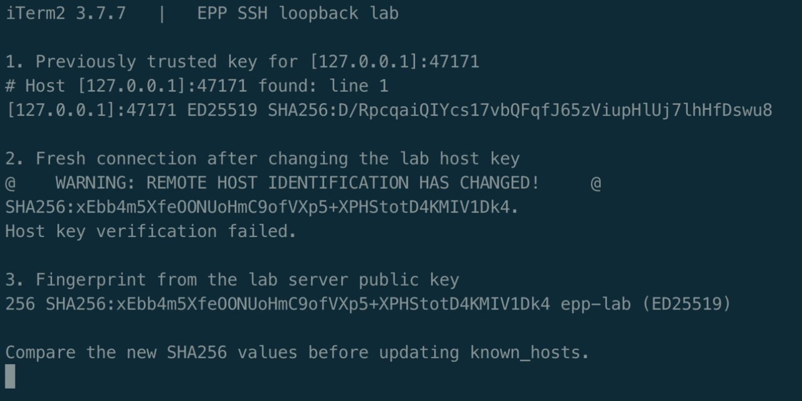

# 支线 70A　SSH 报主机密钥变化时怎样重新接手

从[70.1 的指纹与专用客户端配置](chapter.md#701-先识别将要接手的主机)起步。准备能直达部署机的可信控制台、已有公钥登录的 epp-lab、专用 epp71_hosts。先记下正常登录服务的地址、端口和指纹。若要做最后的业务复核，保留[70.2 的前台 API](chapter.md#702-把已验程序送到空主机)及启动它的原 SSH 会话，让库、桶通路继续在线；下面只在另一个练习监听上换钥。

考虑第二天的交接。你还记得这台机器的名字和端口，昨天留下的账号也还在。今天连接却出现 `REMOTE HOST IDENTIFICATION HAS CHANGED`。正常换钥、地址重新分给另一台主机、有人截走连接，都可能产生同一种现象。昨天的 known_hosts 是你手里还能用来发现变化的证据。

在自己的一次性练习目标上做一次可控制的换钥。若来宾使用 NAT，第二个练习端口也要有从操作端可达的私网路径，或单独建立宿主回环端口到来宾练习端口的映射。以下客户端命令中的 22271 均指操作端实际连接的 SSH 端口。下面给出一条保留原登录服务的办法。在目标的**独立控制台**，选择该机仅操作端可访问的练习地址，选一个未占用的高端口（例如 22271）。启动第二个前台 sshd，它与正常登录服务各用各的监听和主机钥匙。以下使用获准登录的普通练习账号，系统须支持该账号运行独立 sshd；若系统把服务启动交给管理员，由管理员在一次性目标的控制台完成这一步。

```bash
umask 077
keydir=$(mktemp -d)
ssh-keygen -q -t ed25519 -N '' -f "$keydir/first"
ssh-keygen -q -t ed25519 -N '' -f "$keydir/second"
ssh-keygen -lf "$keydir/first.pub"
```

空口令用于这两把临时**主机**钥匙，使前台服务能读入它们；目录只对练习账号可读。在同一控制台设好地址、账号并定义启动命令。两轮只换 -h 指定的钥匙文件：

```bash
lab_ip='替换为目标机的私有练习地址'
lab_user=$(id -un)
start_lab_sshd() {
  /usr/sbin/sshd -D -e -f /dev/null -h "$1" -p 22271 \
    -o "ListenAddress=$lab_ip" -o "AllowUsers=$lab_user" \
    -o "PidFile=$keydir/sshd.pid" -o PasswordAuthentication=no \
    -o KbdInteractiveAuthentication=no -o AuthenticationMethods=publickey \
    -o AllowAgentForwarding=no -o X11Forwarding=no
}
start_lab_sshd "$keydir/first"
```

-D 留在前台，-e 把错误送到控制台，-f /dev/null 让这个临时监听使用单独给定的配置及程序默认值。账号需已按 70.1 在默认 authorized_keys 登记练习公钥。读端口监听成功的输出；若使用管理员代为启动，AllowUsers 填入已配置公钥的普通练习账号。若账号、密钥目录权限或系统对独立 sshd 的限制导致拒绝，从控制台查原因，保留原服务供管理。

在本机用 `ssh -F ~/.ssh/epp71.conf -p 22271 epp-lab` 连接**同一地址的新端口**，按控制台提供的 first.pub 指纹首次登记，再用 exit 退回本机。若地址也换了，可加 `-o HostName=实际私有地址`，后面每次都用相同地址。回控制台 Ctrl-C 停掉刚才的练习监听，运行 `ssh-keygen -lf "$keydir/second.pub"` 记录新指纹，再运行 `start_lab_sshd "$keydir/second"`。这期间不必重启 API 或搬库。

本机再次连接该端口，应被拒绝。保留报错中的目标、端口、旧条目所在文件和新指纹。先在控制台核实该地址仍分给预期主机、练习监听确实加载了 second，对照新指纹。遇到未经安排的变化，就在此停止登录，用同样的独立渠道查明原因；从同一个可疑地址再抓一次公钥，仍然只知道“它这次给了我什么”。



图 70A-1　回环演练的 SSH 端口为 47171。第一段是客户端原先信任的记录，第二段是被拒绝的连接，第三段直接取自练习服务的公钥文件。比较第二、三段的完整指纹；在双机练习中，第三段要在独立控制台取得。

确认是本轮更换后，在本机定位旧记录。下面 target 中的地址换成生效的 HostName；非默认端口要连同方括号和端口一起传，默认 22 则只用主机名或地址。

```bash
known=~/.ssh/epp71_hosts
target='[192.0.2.71]:22271'
ssh-keygen -F "$target" -f "$known"
ssh-keygen -R "$target" -f "$known"
```

-F 会打印已保存条目（包括可匹配的散列主机名）。在 `ssh-keygen -F "$target" -f "$known"` 末尾再加 `-l`，只看指纹更方便。先核对命中的条目，匹配本轮目标才执行 -R。它会从指定文件移除属于这个主机与端口的记录，通常留下 .old 备份；正常登录端口的记录应仍在。重新连接 **22271**，在新的首次提示里再比一次 second.pub 的完整指纹，再接受。进入后运行 hostname、id，重查服务的 PID、启动时刻、旧收据和 API 日志。先在旧隧道页按 Ctrl-C 释放 13358，再从本机执行下面的命令。保持这个窗口，从本机客户端发一次请求并去远端按 ID 找到它。

```bash
ssh -F ~/.ssh/epp71.conf -p 22271 -N -o ExitOnForwardFailure=yes \
  -L 127.0.0.1:13358:127.0.0.1:3358 epp-lab
```

钥匙变了而原收据、原进程都在，才符合这次只换 SSH 主机身份的实验条件。若实际发生的是重装恢复，新的 PID 合理，数据却仍须与交接目标核对。


## 速查

用 ssh-keygen -lf 从可信公钥读指纹，-F 查询指定 known_hosts 中某个地址与端口，-R 只移除已确认换钥的目标。退出临时监听与转发，复查正常端口仍可登录。[OpenSSH 主机记录](https://man.openbsd.org/ssh-keygen.1)

阅读约 8～12 分钟，另做换钥与恢复约 15～25 分钟。

[返回第 70 章](chapter.md) · [继续第 71 章](../chapter-71-service-runtime/chapter.md)
