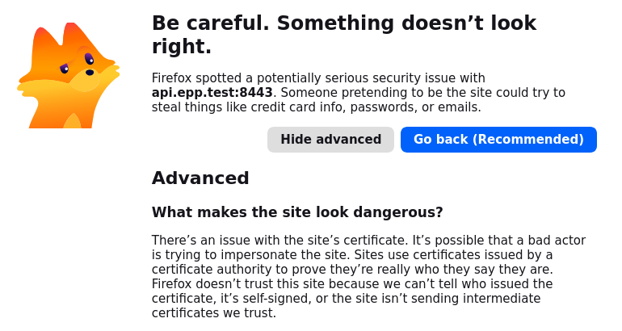
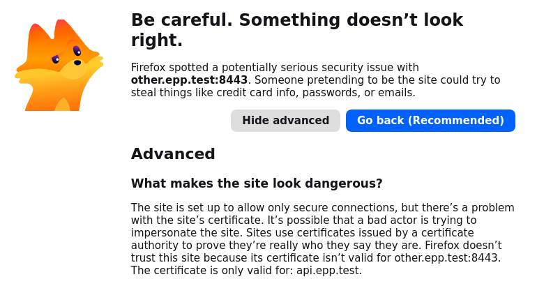

# 支线 71A　定位浏览器的证书错误

一台机器的 curl 收到 401，另一台的浏览器在发送 HTTP 请求前就拒绝连接。先保留两台的 URL、目标地址、握手时间、错误详情和可信根指纹。读图和判断可直接从下面的两个现场开始。要复现实图里的故障，请选可中断的练习部署。71.2 的签发端保留 lab、src，部署端保留 edge、nginx_bin 和 slot-a。本支线使用配套原样的回环配置，操作端要能独占回环 8443。若已交给使用者，在另一次隔离练习中进行会改变线上链的步骤。若本次仍在 71.2，先在部署端执行下方命令启动独立入口，然后在操作端单开 Bash 保持转发。主线只执行部署候选配置一次，无须先做这轮。

```bash
cd "$edge"
readlink active.conf  # 应为 slot-a/tls.conf
"$nginx_bin" -t -p "$edge/" -c nginx.conf && "$nginx_bin" -p "$edge/" -c nginx.conf
```

```bash
ssh -N -o ExitOnForwardFailure=yes -L 127.0.0.1:8443:127.0.0.1:8443 epp-lab
```

在原操作端 Bash 设置 `site=https://api.epp.test:8443`，定义 `probe=(curl -q --noproxy '*' --max-time 8 -sS -w '\nHTTP %{http_code}\n')`。若部署 API 尚未启动，按主线 71.1 启动同机上游。之后从浏览器观察下文两份现场。



**图 72A-1**　新建的 Firefox 配置打开正确名称时，Advanced 的末句同时提到未知签发者和服务端可能缺少中间证书。光凭这一页，还无法决定去改哪个进程或哪台客户端。

下面两轮实验的第一条 curl 记录相同，都是 `60 / HTTP 000 / unable to get local issuer certificate`。手上各有一份当时签发端交接的根证书。如果只能在客户端重试一次，你会保留哪些条件，改变哪一个？什么结果会让你转去查 nginx？

<details>
<summary>看操作端对甲、乙的请求记录</summary>

两轮都保留原 URL、端口和目标 IP。新开的 curl 显式使用各自签发端的根，未带 Cookie。

| 同样的重试 | 握手之后收到了什么 |
| --- | --- |
| 甲 | HTTP 401，EPP 回 AUTH_REQUIRED |
| 乙 | curl 60，HTTP 000，仍找不到签发者 |

</details>

<details>
<summary>看入口在握手中实际交给客户端的文件</summary>

在操作端用 URL 里的名字向当前入口发起新握手。下面列出两个现场各自留下的结果，可以和自己的输出对照。-showcerts 列出对端送来的证书。筛出 Certificate chain 中每份证书的主体 s 和签发者 i。这个命令只检查对方出示了什么，随后仍须用带根的 curl 验证。

```bash
openssl s_client -connect 127.0.0.1:8443 -servername api.epp.test -showcerts </dev/null 2>/dev/null |
  awk '/Certificate chain/,/Server certificate/ {if (/^ *[0-9]+ s:/ || /^ *i:/) print}'
```

甲有序号 0 和 1，叶的签发者是 EPP Practice Issuing CA，序号 1 的签发者是 EPP Practice Root。乙只见序号 0，主体是 api.epp.test。这份清单来自线上连接；服务器磁盘上即使存着两张，进程也可能只装载其中一张。

</details>

<details>
<summary>看客户端使用的根及部署端的预检记录</summary>

甲的 Firefox 专用配置刚创建，信任列表里查不到练习根。操作端从签发端拿来的根与交接单指纹一致。乙的 curl 同样显式指定本轮签发端的根，指纹也吻合。两处部署的 nginx -t 都通过。

</details>

<details>
<summary>对照你给甲、乙选的修复位置</summary>

甲已经有人用完整校验读到了业务响应，先保留这个工作的入口。给那个 Firefox 配置导入经核实的根，它也读到了 401。乙的对照 curl 手里有根，却缺少连接叶与根的中间证书。只让 nginx 重新提供 fullchain.pem，原 curl 命令就从 60 变为 401。只看错误字符串就让两处用户都装根，会在乙白忙一场。

</details>

要亲眼看到乙，先保证是自己可中断的独立入口，记录当前活动链接。在部署端进入 edge，单独复制叶证书，把候选配置指到叶，再检查配置并重载。在操作端用已核实的根请求，观察错误和线上证书数量；随后恢复原链接。

```bash
cd "$edge"
saved=$(readlink active.conf)
slot=$(dirname "$saved")
openssl x509 -in "$slot/fullchain.pem" -out "$slot/leaf-only.crt"
sed 's@fullchain.pem@leaf-only.crt@' "$slot/tls.conf" > "$slot/leaf-only.conf"
switch_chain() (
  set -eu
  test ! -e active.next && test ! -L active.next
  sed "s@include active.conf;@include $1;@" nginx.conf > check-chain.conf
  "$nginx_bin" -t -p "$edge/" -c check-chain.conf
  ln -s "$1" active.next
  mv -Tf active.next active.conf
  "$nginx_bin" -s reload -p "$edge/" -c nginx.conf
)
switch_chain "$slot/leaf-only.conf"
```

在操作端按下面的 curl 对照，指定正确根仍应得 60/000，再按上方 s_client 读链，应只剩序号 0。若仍见完整链，等新 worker 接手后重新握手。在部署端执行 `switch_chain "$saved"`，用同一 URL 和同一根重试，直至线上重新出现两张证书并读回 401。恢复成功后再做浏览器对照。

如果信任列表里已经有一个叫 EPP Practice Root 的条目呢？用同一个脚本另建一套 CA，两张根都显示 EPP Practice Root；把第二套根拿来验第一套签的链，仍报找不到签发者。两份根的 SHA-256 指纹不同，第二把公钥验不过原来的签名。实际交接要通过已知的签发端核对完整指纹。

<details>
<summary>在自己的入口复现甲，再换一个名字试同一 IP</summary>

回到原操作端 Bash。第一条用默认信任，第二条只为本次调用指定根，均不带 Cookie。观察 curl 退出码和 HTTP 状态；此处没有 --fail，故收到 HTTP 401 时命令成功退出。若收到 502，握手已通过，回部署端检查 3374 和本次 nginx 的 error.log。

```bash
map=api.epp.test:8443:127.0.0.1
"${probe[@]}" --resolve "$map" "$site/profile/me"
echo "curl=$?"
client=(curl -q --noproxy '*' --max-time 12 -sS --resolve "$map" --cacert "$lab/ca/root.crt")
"${client[@]}" -w '\nHTTP %{http_code}\n' "$site/profile/me"
echo "curl=$?"
```

接下来目标地址和根保持原样，只有 URL 中的名字改为 other.epp.test。练习入口是这个套接字的 default_server，所以对两个 SNI 都出示 A。

```bash
"${probe[@]}" --cacert "$lab/ca/root.crt" --resolve other.epp.test:8443:127.0.0.1 \
  https://other.epp.test:8443/profile/me
echo "curl=$?"
```

</details>

同一地址现在分别称作 api.epp.test 和 other.epp.test，入口对两个名字都送来同一张证书。已信任的根可以验过它的签名。用第二个名字访问，仍然过不去。这一次 curl 的退出码也为 60，详细原因变成了名称不匹配。Firefox 的详情更直观，能在一句话里看见请求的名字与证书列出的名字。



**图 72A-2**　沿用图 72A-1 的浏览器配置，导入练习根后访问 other.epp.test。读末句 *The certificate is only valid for: api.epp.test.*，再看地址中的 other.epp.test。

这时修哪一处取决于一件运维工具无法替你决定的事：对外交付的名字究竟是哪一个？若交接单只承诺 api.epp.test，改正客户端地址即可。若 other.epp.test 确实也是服务承诺的入口，就要核实这个名字的归属，为两个名字签发含相应 SAN 的证书，并从两个 URL 各作一次新握手。签发者可信，只说明它签的内容可以相信；这张证书实际写了哪个名字，仍须逐个核对。[curl 的客户端验证](https://curl.se/docs/sslcerts.html)

<details>
<summary>选做：在独立 Firefox 配置中重现两张图</summary>

在 Debian 练习机的图形会话中操作。首次使用时，先按[Firefox 与 NSS 的准备步骤](../../environment-setup.md#用-firefox-查看证书错误选做)安装 Firefox ESR 和 libnss3-tools。操作端先执行 `scp "$lab/ca/root.crt" epp-lab:epp75-edge/root.crt`。两端分别对自己这份文件执行 `openssl x509 -in 文件名 -noout -fingerprint -sha256`，与签发时记下的值核对。部署端新建配置，使这两个名字只在本次浏览器映到回环，禁用该配置的代理与加密 DNS。若从第三台机器打开，先给那台机器建立到入口的本地转发。

```bash
profile=$(mktemp -d)
certutil -N --empty-password -d "sql:$profile"
cat > "$profile/user.js" <<'PREF'
user_pref("network.dns.localDomains", "api.epp.test,other.epp.test");
user_pref("network.trr.mode", 5);
user_pref("network.proxy.type", 0);
PREF
firefox-esr --no-remote --profile "$profile" 'https://api.epp.test:8443/profile/me'
```

在错误页展开 Advanced 保留第一次读数。退出这一个 Firefox 后再编辑它的证书库。certutil 的 -d 选中刚才的配置，C,, 允许这个根签发 TLS 服务证书。

```bash
certutil -A -d "sql:$profile" -n EPP75-Practice-Root -t 'C,,' -i "$HOME/epp75-edge/root.crt"
certutil -L -d "sql:$profile"
firefox-esr --no-remote --profile "$profile" 'https://api.epp.test:8443/profile/me'
```

打开正确名称，看 EPP 的 JSON。再把同一地址栏改为 `https://other.epp.test:8443/profile/me`，观察图 72A-2 的两处名称。保留配置目录，收尾时还要从它撤掉信任。

</details>
做过 Firefox 对照的读者，还可以趁入口在线验证撤去信任的效果。退出练习 Firefox，执行 `certutil -D -d "sql:$profile" -n EPP75-Practice-Root`，用 `certutil -L -d "sql:$profile"` 确认练习根已移除。用同一配置重新打开正确 URL。本轮它又回到图 72A-1 的拒绝页。若先停 nginx，这个实验就只能得到连接失败，区分不了是谁撤回了信任。


完成回环故障实验后，在部署端执行 `"$nginx_bin" -s quit -p "$edge/" -c nginx.conf`，等监听释放，再关闭本次 SSH 转发。若回到主线，保留已生成的 active.conf 链接、签发材料和 API。

## 速查

客户端的同名根可能公钥不同，比较 SHA-256 指纹。openssl s_client -showcerts 读线上实际出示的链；curl --cacert 对照签发端的根；Firefox 专用配置中的 certutil -L 检查它自己的信任。关闭本次 Firefox 后再清理专用配置，保留正常客户端所用的可信根。[curl 的证书验证](https://curl.se/docs/sslcerts.html) · [Firefox 的证书信任](https://support.mozilla.org/en-US/kb/setting-certificate-authorities-firefox)

阅读约 10～15 分钟，另做两轮浏览器与证书对照约 18～30 分钟。

[回到 71.3 接通页面、API 和头像存储](chapter.md#713-接通同源页面api-和头像存储) · [本章速查](chapter.md#附录本章必要技术点速查)
