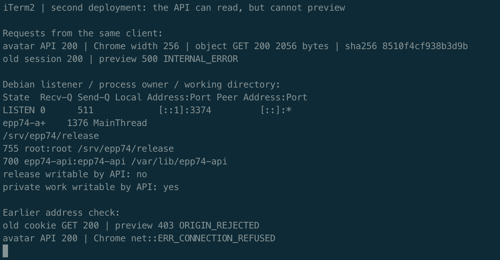
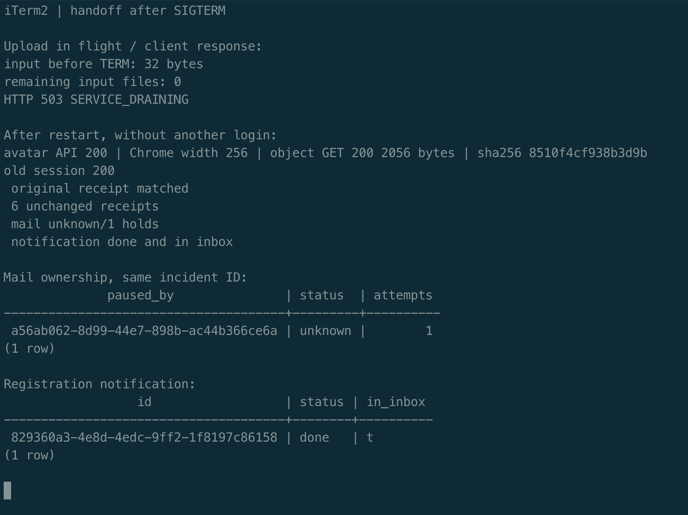

# 支线 71A　能读资料，为什么预览头像仍会失败

在[第 71 章交出的非空练习部署](chapter.md#715-交出能由下一班独立验证的部署)，先在 Postman 用原会话取得写令牌，给 24 准备同一张 PNG，用 26 新签地址并下载原头像，留下基线。主线的 epp72-api 一直在处理请求。只有进入本支线时才需要暂时替换它。下面三轮一次只运行一个临时 API，PG、S3 与客户端转发继续工作。部署端为 Debian，Postman 与浏览器在操作端。

<a id="受限-api-启动命令"></a>

## 用服务自己的身份试另一份配置

希望只改变工作目录时，若顺手用管理员身份启动，原本写不了的目录也可能写得进，实验就无法解释。用 Debian 自带的 systemd-run 启动一个临时服务，让进程继续使用同一 epp-api 用户和组。在部署端 Bash 定义函数，重开终端时重新定义。参数依次为本轮临时单元名、已存在且该用户能进入的绝对工作目录、/etc/epp72 中它能读的配置文件名。

```bash
start_api() {
  sudo systemd-run --unit="$1" --service-type=exec \
    --property=User=epp-api --property=Group=epp-api \
    --property="WorkingDirectory=$2" --property=UMask=0077 \
    --property=TimeoutStopSec=40s \
    /opt/epp72/node/bin/node "--env-file=/etc/epp72/$3" \
    /opt/epp72/release/dist/src/server.js
}
```

这个临时单元复用常驻服务的 UID、组和掩码。它没有启用常驻 unit 的 ProtectSystem、ProtectHome 和 PrivateTmp；本实验比较的是同一 UID 对两个目录的实际写权。日常部署仍由原来的完整 unit 运行。

在本支线三轮里，API 都要占用原来的 3374。先用 `systemctl cat epp74-network epp74-cwd epp72-diag-ok` 检查这些临时单元名没有被使用；再执行 `sudo systemctl stop epp72-api`，用 `ss -ltn 'sport = :3374'` 确认监听释放。每轮启动后从 `systemctl show 单元名 -p MainPID`、journal 中的 app.ready 和一笔实际请求确认进程身份。结束每轮用 `sudo systemctl stop 单元名` 释放端口。

**先诊断两条网络路径。** 用 `sudo install -o root -g epp-api -m 0640 /etc/epp72/api.env /etc/epp72/bad.env` 复制练习配置，再用 `sudoedit /etc/epp72/bad.env` 编辑，只改两个练习值。把 APP_ORIGIN 设成后端端口 `http://127.0.0.1:3374`，把 AVATAR_S3_ENDPOINT 设成客户端确认没有监听的回环端口，如 `http://127.0.0.1:18674`。保留原 api.env。执行 `start_api epp74-network /var/lib/epp72-api bad.env`，在另一部署端终端运行 `sudo journalctl -u epp74-network -n 12 --no-pager -o cat` 找 app.ready。

在同一个 Postman 客户端，从下面三次操作分别定位故障。临时编辑 24 的 Headers 时显式设置 `Origin` 为**真实客户端来源**，保留原 Cookie、写令牌和 `X-EPP-Request: 1`；Postman 不一定会像浏览器那样自动附 Origin。24 的 binary 选择练习文件 harbor.png，Content-Type 为 image/png。

| 操作 | 这一轮得到什么 | 下一步看哪里 |
| --- | --- | --- |
| 原样发 20 | 200，同一 userId | 会话仍被这个 API 接受，保留该会话继续查 |
| 带真实 Origin 发 24 | 403，`ORIGIN_REJECTED` | 比较客户端来源和 APP_ORIGIN；请求在读取图片前已被拒绝 |
| 发 26，立即在 Chrome 打开返回的完整 URL | 26 返回 200 和原 avatarId，Chrome 报 `ERR_CONNECTION_REFUSED` | 签名可以在 API 本地完成，签发当时并没有从浏览器连接存储。查 URL 的主机、端口与客户端实际监听 |

停 `sudo systemctl stop epp74-network`。下一轮用正确的 api.env，**工作目录故意指向只读 release**：`start_api epp74-cwd /opt/epp72/release api.env`。再发 20、26 并在浏览器打开新签的地址。这次能读回原图。仍用同一令牌、同一 Origin、同一个文件发 24，这次得到 500 和 `INTERNAL_ERROR`。先抄下响应头 X-Request-Id，在该轮 journal 按它找 http.started、http.failed 与 http.completed。500 的公共错误码不会透露服务器文件路径。签名取旧图、读取资料都能成功，下一处应查这次**预览**才用到的资源。

从 `src/avatar-upload.ts` 看文件路径怎么来的。`resolve('.avatar-tmp')` 以进程当前工作目录为起点，和 `server.js` 放在哪里无关。程序创建或复用私有目录，检查属主与模式，再为本次请求单独开子目录。相反，`src/config.ts` 里的 `new URL('../config/service.json', import.meta.url)` 跟随编译后的模块。换 cwd 会改变前一个位置，移动整份 dist 才会改变后一个位置。

```ts
// src/avatar-upload.ts，privateDirectory 中
const root = resolve('.avatar-tmp');
await mkdir(root, { recursive: true, mode: 0o700 });
const stat = await lstat(root);
if (!stat.isDirectory() || (process.getuid &&
  (stat.uid !== process.getuid() || (stat.mode & 0o077) !== 0))) {
  throw new Error('Avatar temp root must be a private directory owned by the API');
}
return mkdtemp(join(root, 'upload-'));
```

在**部署端**查正处理请求的进程。MainPID 应是大于 1 的活进程，若为 0，先回到该 unit 的日志。下面的 /proc 是 Linux 接口。stat 打印八进制权限、属主、属组与路径；最后两条特意让服务自己的用户做权限判断。用管理员测试能写，回答不了 API 能不能写。

```bash
pid=$(systemctl show epp74-cwd -p MainPID --value)
ps -p "$pid" -o user=,pid=,comm=
sudo readlink "/proc/$pid/cwd"
stat -c '%a %U:%G %n' /opt/epp72/release /var/lib/epp72-api
sudo -u epp-api test -w /opt/epp72/release && echo writable || echo read-only
sudo -u epp-api test -w /var/lib/epp72-api && echo writable || echo read-only
```



**图 71A-1**　iTerm2 中，服务已在 [::1]:3374 监听，旧头像可读且内容与基线一致。图中实验在另一份同平台目录 /opt/epp72/release，处理请求的进程正从该 release 工作：root 拥有、模式 755，API 用户在这里建不了 .avatar-tmp。私有 work 已经存在、模式 700，只是进程没有从那里启动。图底的 403 与 Chrome 连接失败来自前一轮地址配置，可以和这一轮的 500 对照。

保持 release 的属主和模式，停 `sudo systemctl stop epp74-cwd`，再运行 `start_api epp72-diag-ok /var/lib/epp72-api api.env`。在 Postman **只重发 24**。同一请求现在得到 200，响应类型 image/webp，本轮 PNG 样本得到 2062 字节。用 `sudo stat -c '%a %U:%G %n' /var/lib/epp72-api/.avatar-tmp` 看临时根的实际属主；完成过的那次上传子目录应已移除。若 work 本身可写仍失败，检查早已有的 .avatar-tmp 是否属于上一个 UID、是否为目录、是否开放了组或其他用户权限。用新的私有 work 对照，保留原故障目录供核查。

复验后 `sudo systemctl stop epp72-diag-ok`，确认 3374 释放，`sudo systemctl start epp72-api` 恢复常驻配置。用原客户端再发 20、24、26，确认三条业务路径都恢复。图中的路径和系统账号来自另一份同平台安装；复现时以正文交出的 unit、实际 UID 和目录为准。



**图 71A-2**　另一轮交接又选了一笔只送出 32 字节的在途预览。在该 API 排空后，客户端收到 503，暂存文件消失；原会话和旧头像在新进程中仍能读回。下半按各自 ID 查询：邮件保持 unknown、一次尝试，通知已 done 并入箱。接班时，这两笔工作的处置依据各自的持久记录。

## 为只读收据命令分配身份（选做）

接班人需要一条只读命令，能从这一版程序取回原收据。API、邮件和通知继续用刚验过的三个 systemd 单元。在独立 Debian 部署端，再给按需运行的收据命令一个系统用户：

```bash
sudo useradd --system --user-group --no-create-home --shell /usr/sbin/nologin epp-receipt
```

在**本次隔离实例**由管理员执行 `CREATE ROLE epp_receipt74 LOGIN;`，在 psql 用 `\password epp_receipt74` 设置口令。若这些账号已经存在，先核对归属和已有权限。由表所有者连目标库，以 `SELECT current_database();` 对照建库记录，再按本次库名授权：

```sql
GRANT CONNECT ON DATABASE epp_ch72_handoff TO epp_receipt74;
GRANT USAGE ON SCHEMA public TO epp_receipt74;
GRANT SELECT ON public.web_access_receipts TO epp_receipt74;
```

在部署端私有目录以 `umask 077` 建 receipt.env，填写只读角色自己的 DATABASE_URL，主机、端口和库与 api.env 相同，DB_POOL_MAX=1。以下命令从该目录执行。预期库名和两项 UUID 从原交接单取得，示例中的 epp_ch72_handoff 在授权 SQL、配置、unit 和命令中都须换成实际库名。括号内先切到所有账号都能进入的 /，再换运行身份：

```bash
sudo install -o root -g epp-receipt -m 0640 receipt.env /etc/epp72/receipt.env
db=epp_ch72_handoff
user_id='替换为原账号UUID'
operation_id='替换为原操作UUID'
(cd / && sudo -u epp-receipt env -i /opt/epp72/node/bin/node \
  --env-file=/etc/epp72/receipt.env /opt/epp72/release/dist/src/account-admin.js \
  "$db" receipt "$user_id" "$operation_id")
```

对照原收据的 requestedEnabled、recordedAt 及记录原操作的 dbActor。克隆库也会带着同一行，必须再比对实例、库名。将归档摘要、已验的旧 userId、头像摘要、原收据 ID、通知 ID 和邮件通道当前状态交给下一班。写清每个 unit 的 User、WorkingDirectory、配置路径以及库、桶、SMTP 从哪台机器可达。凭据留在各自的私有配置。

## 速查

| 在同一会话中观察 | 沿哪段路径继续查 |
| --- | --- |
| 资料 200、带写令牌的预览报 ORIGIN_REJECTED | 比对浏览器的真实来源和 API 的 APP_ORIGIN |
| 签发成功、打开 URL 时连不上 | 从客户端解析签名里的主机和端口；保留签名原值 |
| 可取旧图、预览报 500 | 用该请求 ID 找应用日志，以实际 UID 检查工作目录的写权限 |

阅读约 8～12 分钟；已有运行副本时，三轮对照另加 20～35 分钟。

[回到第 71 章交接](chapter.md#715-交出能由下一班独立验证的部署)
