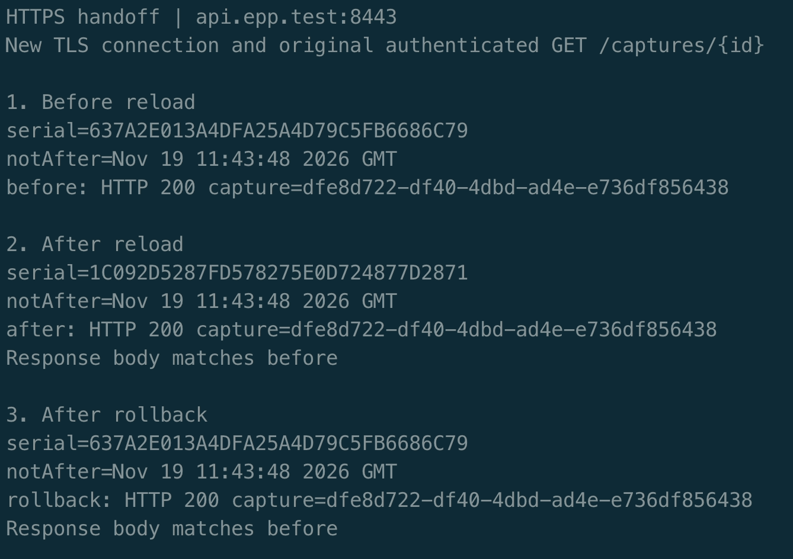

# 支线 72B　验证签发链并演练换证回退

主线已用一套证书交付。此处复用同一份签发目录、部署目录及 [72.4](chapter.md#724-从可信入口登录并核对业务) 的 curl 对照留下的登录会话与素材。候选与回退会影响两个 HTTPS 端口，仅在可以短暂调整的练习环境进行。沿用签发端的 lab、src、site、client、id 和两个终端中的 issue、new_key、read_capture 函数；账户和证书仍须有效。若要核对主线首次签发的机制，先读下面的证书对照。

## 验证服务公钥和签发链

假设运维把 api.epp.test 的证书从 nginx 上复制下来发给你。任何能连接这台服务的人也能拿到同一份文件。另一台机器若把它原样展示给浏览器，凭什么不能冒充你的服务？

证书把一个名字和一把**公钥**放在了一起。在本例的完整握手里，nginx 用配对的**私钥**给本次握手的数据签名，浏览器用证书中的公钥验签。每次握手有新的随机数据，上一次的签名也不能直接搬过来。拷走公开证书的人做不到这一点。但他可以自己造一对新密钥，在新证书里也写 api.epp.test，并用自己的私钥完成证明。这里少了一个判断依据：**谁有权说这把公钥可以代表这个名字？**

如果只有你一台客户端，经独立渠道核实一张自签证书并直接信任它，就能开工。下周服务换密钥时，你得再去每台这样配置过的客户端交接新证书。本次希望接班人只换入口，原来已经信任服务的客户端都继续工作。为此，可以提前把一个签发机构（CA）的公钥证书交给客户端，此后由这个签发者确认新服务公钥的归属。这份事先接受的证书就是这里的**信任根**。把它从待验证的网站临时下载下来就直接信任，会让冒充者连“该信谁”也一起决定。

根 CA 也可以直接签服务证书。练习多留一级，是为了让根私钥只在授权签发者时使用，平时发七天期服务证书只用中间 CA 的私钥。客户端因此多需要一份证据。沿着本例的三份证书从服务端往回看，每份各回答一句话：

```text
叶证书       中间 CA 签名：这把服务公钥可以代表 api.epp.test。
中间证书     根 CA 签名：这个中间 CA 的公钥可以用来验证它签发的证书。
根证书       客户端事先核过指纹，已决定信任这份根。
```

这就决定了文件归属。叶私钥在 nginx 所在机器生成，部署端把公钥装进签名请求（CSR）交给签发端。CSR 上的签名只能证明生成请求时有人持有对应私钥。签发端还要通过已核实的 SSH 通道确认申请来自负责该名字的部署，并自己决定准许哪个名称。配套 `issue-leaf.sh` 把它写为 `subjectAltName=DNS:api.epp.test`。这一字段简称 SAN，客户端稍后就在这里找地址栏中的名字。签发成功后 nginx 拿回叶证书和中间证书，两把 CA 私钥都留在签发端。[OpenSSL 证书扩展](https://docs.openssl.org/3.0/man5/x509v3_config/)

怎样知道中间这一级真的派上了用场？操作端此刻拥有三张证书，可以让验证器只看其中两张，再把第三张还给它。下面两条 verify 都按同一个名称、同一种服务用途校验。第一条只给根和叶，第二条再给中间证书。`-untrusted` 把中间证书交给验证器当作候选材料，它自己的签名仍要被检查。

```bash
leaf="$lab/slot-a-issued/leaf.crt"
openssl x509 -in "$leaf" -noout -serial -dates -ext subjectAltName
openssl verify -purpose sslserver -verify_hostname api.epp.test -CAfile "$lab/ca/root.crt" "$leaf"
openssl verify -CAfile "$lab/ca/root.crt" -untrusted "$lab/ca/issuer.crt" \
  -purpose sslserver -verify_hostname api.epp.test "$leaf"
```

第一条 verify 在叶处找不到签发者，第二条返回 OK。要是入口只把叶发给用户，一台手里只有根的新客户端就会遇到第一次的情形。这解释了 `examples/tls-trust/issue-leaf.sh` 最后一行的来历，`cat "$out/leaf.crt" "$ca/issuer.crt" > "$out/fullchain.pem"`。nginx 先送叶，再送中间证书；客户端沿签名关系走回自己信任的根。即便对端把根也送来，最后那个信任决定仍由客户端作出。[nginx 证书链配置](https://nginx.org/en/docs/http/configuring_https_servers.html)

## 换证后回到原业务请求

到了换证窗口。刚签出的 B 和正在用的 A 都写着 api.epp.test，都是同一个中间 CA 签的。更麻烦的是，图中的两张证书同一秒签发，连到期时刻都相同。假如你把 B 复制到机器却漏了重载，用户刷新后还能读到原素材吗？在 A 仍有效、API 和数据都没变的情况下，这次刷新仍会得到 200。

接班人给你三样东西：B 的证书文件、原来那条素材的地址、一个还登录着的客户端。你会留哪几项换证前的读数？可以先拟一句交接回执，试着用“B 已复制但 A 仍在服务”推翻它。再换一种情形：B 确实上线了，API 却接到一份空库。你的回执还能分辨吗？

<details>
<summary>取换证前后的证据，并演练可回退的切换</summary>

在 A 仍服务时，操作端带原 Cookie 保存的 before.json 能认出原业务。还需要一项能认出实际证书的读数。同一签发者用不同序列号标识这两次签发；可在操作端执行 served。每次新起 s_client 触发新握手。-servername 是报给入口的名字，-verify_hostname 是客户端要验证的名字，-verify_return_error 让验证失败时退出。x509 输出实际收到的叶的序列号、起止时刻和 SAN，pipefail 保留前段错误。

```bash
served() (
  set -o pipefail
  openssl s_client -connect api.epp.test:8443 -servername api.epp.test \
    -CAfile "$lab/ca/root.crt" -verify_hostname api.epp.test -verify_return_error </dev/null |
    openssl x509 -noout -serial -dates -ext subjectAltName
)
served
```

部署端 `new_key slot-b`，操作端 `issue slot-b`。用 `openssl x509 -in "$lab/slot-b-issued/leaf.crt" -noout -serial -dates -ext subjectAltName` 记下预期 B。部署目录如果逐个覆盖文件，会短暂出现“A 的证书、B 的私钥”。在部署端把这个组合写进一份只供预检的配置，当前入口继续使用 A。

```bash
cd "$edge"
sed 's@include active.conf;@ssl_certificate slot-a/fullchain.pem; ssl_certificate_key slot-b/leaf.key;@' \
  nginx-private.conf > bad.conf
"$nginx_bin" -t -p "$edge/" -c bad.conf
```

预检报 key values mismatch。这时新建连接仍拿到 A。把成对的文件先放好，再一次切换指向整套文件的 active.conf，就能够避开这个中间状态。部署端下列函数先用候选配置做 -t 检查，再在同一目录创建临时链接，用 GNU mv -Tf 替换现行链接。一次由一位操作者执行；若上次留下 active.next，先核对当前指向和线上序列号。

```bash
activate() (
  set -eu
  slot=$1
  case "$slot" in slot-a|slot-b) ;; *) exit 2 ;; esac
  cd "$edge"
  sed "s@include active.conf;@include $slot/tls.conf;@" nginx-private.conf > candidate.conf
  "$nginx_bin" -t -p "$edge/" -c candidate.conf
  ln -s "$slot/tls.conf" active.next
  mv -Tf active.next active.conf
  "$nginx_bin" -s reload -p "$edge/" -c nginx-private.conf
)
activate slot-b
```

reload 把重新加载配置的请求交给本前缀的 nginx 主进程。旧 worker 可以继续处理原有连接。操作端另起连接核对线上序列号，与刚签出的 B 对照；再用保留下来的 Cookie 取同一素材。cmp 退出 0 表示两份响应逐字节相同。若短暂见到 A，再开新连接；持续是 A 时查本次前缀中的 nginx.pid、error.log 以及客户端实际接到的地址。[nginx 的重载行为](https://nginx.org/en/docs/control.html)

```bash
served
read_capture after && cmp "$lab/before.json" "$lab/after.json"
```

回退演练仅适用于 A 仍有效且私钥仍可信的情形。在部署端 `activate slot-a`，操作端再执行 `served` 和 `read_capture rollback && cmp "$lab/before.json" "$lab/rollback.json"`。泄露的私钥不能靠切回旧目录恢复可信。

</details>



**图 72B-1**　图中是同一轮回环入口实测，两证同秒签发，三组的 notAfter 完全一样。沿 serial 向下读，尾段依次为 6C79、2871、6C79。再沿 HTTP 行读，同一素材三次返回 200。换证后和回退后保存的正文分别与 before 逐字节一致。

**旧的 TLS 连接**已经完成握手，沿它再发一次 HTTP 请求，入口未必需要出示证书。**旧的应用会话**靠 Cookie 识别，同一用户可以带着它走一条全新的 TLS 连接。验收时恰好要新建前者、保留后者。如果换证后看到 B，却只能重新登录才能取到素材，入口更新已得到证明，用户接手仍有问题；应追这次请求有没有带原 Cookie、API 查的是哪份会话数据。若原素材照常返回，所有新握手却一直收到 A，则该回到 nginx 和实际流量去向。这两种交接需要的后续动作不同。


每次切换后都在独立使用端再对 9443 开新连接，用相同名称和根证书核对活动序列号，并重新请求当前头像的签名地址，下载字节核对原摘要。两个 server 各自加载 active.conf，旧 worker 上仍可能有未结束的连接。演练后留下当前证书的序列号和到期日。

阅读约 12～18 分钟，另做证书链对照与切换回退约 25～40 分钟。

[回到使用者的 HTTPS 入口](chapter.md) · [浏览器证书错误](side-01-certificate-diagnostics.md)
