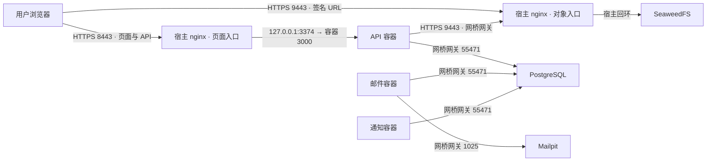
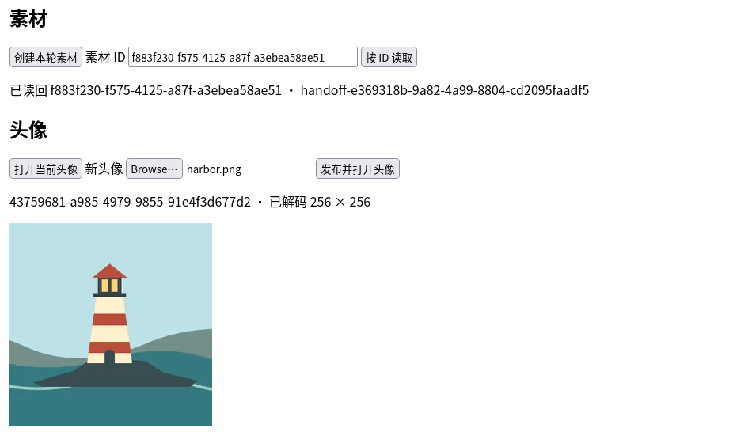

# 第 73 章　用 Compose 接管已有服务、数据与网络

第 70 章已经用 systemd 管住三个真实进程，第 71 章交出了可访问的 HTTPS 地址，第 72 章把同一套应用装进了镜像。现在，运行库和程序随镜像交付，启动时仍要决定角色、凭据、可写位置、网络和停止方式。如果把这些参数留在三条随手输入的 `docker run` 里，下一次换机器仍会漏掉配置。Compose 将它们保存为一份可检查、可重复应用的服务定义。

这次演进保持原账号、旧素材、头像与未决任务。先让容器接管 API、邮件和通知，继续使用已经托管的 PostgreSQL、SeaweedFS、Mailpit 与 nginx。数据库可以独立于应用维护，将来换成托管数据库也使用相同边界。需要把数据服务容器化时，本章的卷与恢复机制仍适用，但要另外迁移数据，不能靠换一个数据库镜像自动完成。

前置代码为[第 72 章镜像交付](https://github.com/SamChowRock/epp-public/tree/part-09/chapter-73)，本章完成配套为 `part-09/chapter-74`。本章在 Debian 部署端使用同一引擎、同一操作身份。若上一章先在 Mac 练习，先按[72.6 的镜像交接](../chapter-72-container-image/chapter.md#726-镜像完成之后服务还缺什么)把适合目标架构的镜像交给 Debian，并完成目标机运行检查；后文不使用 Mac Desktop 的本地镜像库。先用 `command -v docker` 确认官方软件包的客户端路径为 `/usr/bin/docker`，并按 72.2 核对 Server 属于本机。新开 Bash 时先定义 `docker() { sudo /usr/bin/docker "$@"; }`，后文的 Docker 调用都经该函数执行；Mac 只作管理端。[容器引擎安装与验证](../../environment-setup.md#为容器部署准备引擎与-compose)

## 73.1 数据为什么不能随应用一起替换

原生部署已把只读 release、可写工作目录与数据库目录分开。容器继续遵守这个边界：镜像层保存程序，每个容器另有自己的可写层。停止再启动原容器会保留可写层，删除重建则会失去它。把数据库放进可写层，即使重启实验成功，也不能证明发布新版时数据还在。

命名卷由引擎管理，绑定挂载将引擎主机上的指定路径接进容器，两者都独立于应用容器。tmpfs 将临时写入放在内存文件系统里，停止后丢弃；它占用内存预算，还可能进入宿主交换空间。记录服务的头像预览暂存适合限额 tmpfs，已经发布的对象和数据库需要持久存储。[存储类型](https://docs.docker.com/engine/storage/) · [tmpfs 边界](https://docs.docker.com/engine/storage/tmpfs/)

先用已构建的 `epp:chapter-73` 做一份文本收据，借此区分容器身份与数据身份。以下两条 run 都会创建临时容器，并在退出后删除它。镜像入口已经是 Node，命令从 `-e` 开始；卷实验临时以 root 写入新卷，真实应用继续使用 UID 10001。

```bash
data_volume=$(docker volume create)
docker run --rm --user 0:0 --mount "type=volume,src=$data_volume,dst=/data" \
  epp:chapter-73 -e 'require("node:fs").writeFileSync("/data/receipt","receipt-A\n")'
docker run --rm --mount "type=volume,src=$data_volume,dst=/data,readonly" \
  epp:chapter-73 -e 'process.stdout.write(require("node:fs").readFileSync("/data/receipt"))'
```

第二个容器应读出 `receipt-A`。删去第二条的整个 `--mount` 参数再执行，应得到 ENOENT，因为它没有接到原卷；这时数据仍保存在原卷。`docker volume inspect "$data_volume"` 可以核对卷名与驱动，确认实验结束后再 `docker volume rm "$data_volume"`。正式服务出现“空库”，先查挂载来源和程序真正的数据目录，不能立刻初始化新库。

镜像中的目录被挂载覆盖后，看到的是挂载内容，镜像原有的目录属主不会替已有卷改权限。Linux 按数值 UID/GID 判断读写；镜像的 USER 改成 10001，也不会自动把旧卷改成这个属主。配置绑定挂载标记只读只能限制修改，还要验证运行进程是否可读。本章会用真实身份执行这一检查。

数据服务容器化时必须查它的版本约定。例如 PostgreSQL 18 官方镜像将默认数据目录放到 `/var/lib/postgresql/18/docker`，卷应覆盖 `/var/lib/postgresql`；照抄旧版的 `/var/lib/postgresql/data` 可能没有保护实际数据。初始化脚本只在空数据目录起作用，换了环境变量不等于已有库改了密码。SeaweedFS 也必须保留对象内容、master/volume 相关状态和 Filer 元数据。迁移时沿后文备份与恢复章取得一致备份，在新卷恢复并按原 ID 验收，最后再切入口。[PostgreSQL 官方镜像的版本与数据目录](https://hub.docker.com/_/postgres)

## 73.2 把每条连接画到它实际发出的地方

原生 API 的 `127.0.0.1` 是 Debian 主机；桥接网络里的 API 容器用这个地址访问的是自己。Docker 网络提供容器之间的通信与名称解析，发布端口再把宿主的一个入口接到指定容器。`EXPOSE` 是镜像元数据，不会自动发布端口。

先在部署机查看 `ip route` 和 `docker network ls`。确认 `172.28.74.0/24` 不与已有局域网、VPN、其他 Docker 网络重叠后，创建本章专用网络；有冲突就选择自己的空闲私网段，并将后文网关、连接配置和防火墙一起调整。

```bash
docker network create --subnet 172.28.74.0/24 \
  --gateway 172.28.74.1 epp74-backend
docker network inspect epp74-backend --format '{{json .IPAM.Config}}'
```

输出中的 Subnet 与 Gateway 应对应本次选择。网络若已存在，先 inspect 核对，不要删除正在被使用的网络重来。Compose 会把这张网声明为 external：网络先由部署者准备，项目停止不会自动删除它，原生数据服务也能稳定绑定这个网关地址。

接着用两个容器对照网络名与宿主端口。服务监听 `0.0.0.0:8080`，`probe` 只在这张网络内作为别名。先执行 `ss -lnt 'sport = :18080'`，只有表头、没有监听行才继续。

```bash
probe_id=$(docker run -d --network epp74-backend --network-alias probe \
  -p 127.0.0.1:18080:8080 epp:chapter-73 -e \
  'require("node:http").createServer((q,s)=>{console.log("peer",q.socket.remoteAddress);s.end("network-A\n")}).listen(8080,"0.0.0.0",()=>console.log("ready"))')
docker logs "$probe_id"
```

等 ready 出现，再分别从另一容器和部署机读取：

```bash
docker run --rm --network epp74-backend epp:chapter-73 -e \
  'fetch("http://probe:8080",{signal:AbortSignal.timeout(3000)}).then(r=>r.text()).then(t=>process.stdout.write(t)).catch(()=>process.exit(1))'
curl --noproxy '*' --max-time 3 http://127.0.0.1:18080
```

两次应得到 `network-A`。再看 `docker logs "$probe_id"`：从宿主回环发布端口进入的那条请求，其 peer 是随后 nginx 到 API 路径的代理对端候选，记下具体 IP；不要把另一容器直连的地址填成代理地址。把第一条中的 probe 改为 `127.0.0.1`，请求容器自身没有监听 8080，连接应失败；把服务监听改成自己的回环，其他容器和发布端口也不能到达它。观察完执行 `docker stop "$probe_id"`、`docker rm "$probe_id"`，保留后面要用的网络。

沿一次页面请求和一次头像下载看流量去向。第 71 章的页面与对象入口都在宿主 nginx 上。浏览器通过部署机的私网地址访问，API 容器通过网桥网关访问同名对象入口。两边用同一 HTTPS 名称验证证书和签名。



图中是同机部署路线。若页面和素材能打开，头像却下载失败，先在浏览器开发者工具的 Network 中找端口 9443 的请求，查看实际响应和证书错误。如果 8443 上的上传请求已到达 API，而 API 报访问对象存储失败，则沿 API 容器到 9443 的路径检查网关解析、监听与容器信任的公开根。保留原签名 URL 供当前请求使用，交接记录只记状态、对象键和摘要。

默认省略发布地址可能把端口绑定到所有宿主接口。本章只向宿主回环发布 API，外部设备经过 nginx；数据库与存储管理端口不因容器化自动公开。Docker 的发布规则也会参与宿主防火墙转发，要从实际调用端复查边界。[端口发布](https://docs.docker.com/engine/network/port-publishing/)

## 73.3 让已有数据服务接受新位置的受限调用

原来只监听回环的数据服务不会因为添加一个 DNS 名就接受桥接网关上的连接。下面接续第 69 章的同机数据路线：PostgreSQL 为 Debian 的 `18/epp` 实例，端口 55471；Mailpit 为 `epp-inbox`，SMTP 1025。若此前选了独立数据机，应在那台数据机对实际容器出口地址授权，并使用其私网地址；不能把本部署机的网关当成远程数据库。这里先完成同机接管，再迁移到其他拓扑。

在部署端保存原配置和第 71 章的旧资料、收据、头像基线，安排短暂维护窗口。先记录三个原 unit 的启用状态，再停下所有写入者：

```bash
systemctl is-enabled epp72-api epp72-mail epp72-notify
sudo systemctl stop epp72-api epp72-mail epp72-notify
systemctl show epp72-api epp72-mail epp72-notify -p ActiveState -p MainPID -p ExecMainStatus
sudo pg_lsclusters
sudo -u postgres psql -X -p 55471 -d postgres -c 'SHOW data_directory' \
  -c 'SHOW config_file' -c 'SHOW hba_file' -c 'SHOW listen_addresses'
```

is-enabled 显示 disabled 可以正常，只是尚未设置开机启动。三个服务应已 inactive、MainPID 为 0；有强杀或在途邮件时先按原消息 ID 核对状态，不能把停机等同于外部发送撤销。pg_lsclusters 的版本、集群名、端口与 SQL 返回路径应属于原实例。复制实际配置文件到本次私有备份目录后，使用 `sudoedit` 编辑返回的 postgresql.conf，保留原回环并设置 `listen_addresses = '127.0.0.1,::1,172.28.74.1'`。

在返回的 pg_hba.conf 中，为实际库和三个运行角色加入下列规则，示例库名须替换为建库记录中的名字。规则按顺序匹配，放在会提前拒绝这组连接的规则之前，保留已有管理入口：

```text
host epp_ch72_handoff epp_api,epp_mail,epp_notify 172.28.74.0/24 scram-sha-256
```

先由管理员执行 `SELECT line_number,error FROM pg_hba_file_rules WHERE error IS NOT NULL;`，应无错误行，再执行 `sudo pg_ctlcluster 18 epp restart`。`listen_addresses` 只在服务器启动时生效，单纯 reload 不够；启动成功也可能只绑定了列表中的一部分地址。用 `ss -lnt 'sport = :55471'` 确认本次网关与原回环均在监听，再继续。[PostgreSQL 监听参数](https://www.postgresql.org/docs/18/runtime-config-connection.html)

接着用 `sudo systemctl edit epp-inbox` 写入下面的覆盖段。清空旧 ExecStart 后写新值，保留原数据库文件和网页入口：

```ini
[Service]
ExecStart=
ExecStart=/opt/epp-data/bin/mailpit --smtp 172.28.74.1:1025 --listen 127.0.0.1:8025 --database /var/lib/epp-inbox/mail.db
```

执行 `sudo systemctl daemon-reload`、`sudo systemctl restart epp-inbox`，用 `ss -lnt` 核对 SMTP 仅在本次网关，网页仍在回环。此次 SMTP 从回环移到了网关，原邮件配置保留用于回退，容器配置稍后使用新地址；没有开放免认证 SMTP 到所有网卡。[Mailpit 监听与持久文件参数](https://mailpit.axllent.org/docs/configuration/runtime-options/)

这些网关监听依赖 Docker 先恢复外部网络。对 `postgresql@18-epp`、`epp-inbox` 和第 71 章的 `epp74-https`，分别执行 `sudo systemctl edit 单元名`，在保留已有覆盖项的同时追加 `[Unit]` 下的 `Wants=docker.service`、`After=docker.service`。Wants 请求启动引擎，After 安排先后，并不证明网关和依赖已经可用。执行 daemon-reload；以后开机仍须核对网关接口、监听与实际业务，不能只看三个 unit 都为 active。若宿主已有防火墙，按原规则管理方式仅允许本网络访问本次网关的 55471、1025 和下文 9443，不改成全网放行。原生 SeaweedFS 继续监听回环，由 HTTPS 对象入口承接容器调用。

当前记录服务的 `AVATAR_S3_ENDPOINT` 同时承担上传、删除与生成浏览器签名 URL，非回环地址必须使用 HTTPS。填 `http://s3:8333` 会在应用启动时被拒，也不能让用户设备解析容器内部别名。因此本章继续使用第 71 章的带名 HTTPS 入口：容器将 api.epp.test 解析到本次宿主网关，用户设备解析到部署主机的私网地址；两端都验证同名证书。Node 通过 `NODE_EXTRA_CA_CERTS` 在进程启动前加载只读的公开根，浏览器按第 71 章保留自己的信任设置。

第 71 章 nginx 的对象 server 只监听部署机私网 IP，且只允许该私网段。仅把容器内名称映射到网关仍会连接拒绝；即使添加监听，也会被旧 allow/deny 拒绝。在原 `nginx-private.conf` 的 **9443 对象 server** 中保留原有 listen，再添加 `listen 172.28.74.1:9443 ssl;`，并在 `deny all;` 之前添加 `allow 172.28.74.0/24;`。8443 页面 server 不需要面向这张容器网增加监听。

在原部署账号的终端恢复第 71 章 `edge` 为自己的 nginx 前缀，例如 `edge="$HOME/epp75-edge"`；用 `systemctl show epp74-https -p WorkingDirectory` 核对。执行 `/usr/sbin/nginx -t -p "$edge/" -c nginx-private.conf`，通过后 `sudo systemctl reload epp74-https`。用 ss 确认两个 9443 地址都已监听。nginx 的访问规则按先后匹配，新增 allow 放在 deny 后面不会生效。[nginx 地址访问规则](https://nginx.org/en/docs/http/ngx_http_access_module.html)

对象代理继续保留原 `Host`（含端口）、路径与查询串。签名 URL 不能在生成后随手替换主机名；nginx 将 Host 改成内部服务名，也可能破坏签名。下一节从容器里实际检查 TLS 和 S3 响应，才能区分名称解析、监听、信任及对象鉴权四种故障。

## 73.4 把三个角色变成可重建的服务定义

在 Debian 已有配套仓库运行 `git fetch origin refs/heads/part-09/chapter-74`，成功后用 `git worktree add --detach ../epp-compose-73 FETCH_HEAD` 将完成快照放到新的空闲路径，再 `cd ../epp-compose-73`。上一章跟写的 Dockerfile 可保留在原工作目录。本节从完成快照取 Compose 定义，继续使用已验收镜像。首次创建时执行下面的命令；若 `/opt/epp74` 已存在，先检查是否为本轮配置，不要重复覆盖旧秘密。

```bash
sudo install -d -o "$(id -un)" -g "$(id -gn)" -m 0700 /opt/epp74
install -d -m 0700 /opt/epp74/secrets /opt/epp74/trust
install -m 0600 examples/container-deployment/compose.yaml /opt/epp74/compose.yaml
install -m 0600 examples/container-deployment/compose.env.example /opt/epp74/compose.env
for role in api mail notify; do
  sudo install -o "$(id -un)" -g "$(id -gn)" -m 0600 "/etc/epp72/$role.env" "/opt/epp74/secrets/$role.env"
done
install -m 0644 /etc/epp72/practice-root.crt /opt/epp74/trust/root.crt
cd /opt/epp74
dc() { docker compose --project-directory /opt/epp74 --env-file /opt/epp74/compose.env -f /opt/epp74/compose.yaml "$@"; }
```

dc 是本章固定选择部署目录与插值文件的简写，新开 Bash 要重新定义 docker 和 dc。在 `compose.env` 的 EPP_IMAGE 填第 72 章保存的完整本地镜像 ID，EPP_DATABASE 填真实库名，EPP_TRUST_PROXY_IP 填 73.2 实际观察的宿主代理地址。若换了网段，修改 compose.yaml 的 extra_hosts 与外部网络名；这些地址并非都从插值文件读取。Compose 的插值环境与应用的环境文件是两层：`--env-file compose.env` 为 `${...}` 提供值，容器 command 内的 Node `--env-file` 才读取角色秘密。Shell 同名环境可能覆盖插值文件；本章 sudo 默认清理调用者环境，仍用 `dc config --images` 核实最终镜像。[Compose 插值来源](https://docs.docker.com/compose/how-tos/environment-variables/variable-interpolation/)

三个副本此时属于部署账号，用前文已有的编辑器分别打开 secrets/api.env、mail.env、notify.env 修改。DATABASE_URL 保留各自账号、已编码的密码、真实库名、连接参数和实际数据库端口（同机示例为 55471），只把同机回环主机改为 `epp-data.internal`。mail.env 的 LOCAL_SMTP_HOST 改成该名称，LOCAL_SMTP_PORT 为 1025。API 保留原 APP_ORIGIN、CURSOR_HMAC_KEY、桶身份及 `AVATAR_S3_ENDPOINT=https://api.epp.test:9443`；不要把三份合并。公开根取自第 71 章已核指纹的 practice-root.crt，用 `openssl x509 -in trust/root.crt -noout -fingerprint -sha256` 与当时记录比较。

编辑后执行 `sudo chown root:10001 secrets/{api,mail,notify}.env` 和 `sudo chmod 0640 secrets/{api,mail,notify}.env`，收回部署账号的直接读权；后续修改先在私有目录准备候选，再以 install 按相同身份替换。普通 rootful Debian 中，三个秘密文件为 root:10001、0640，部署目录由操作者保管且为 0700。Engine 以管理员权限挂载单个文件；容器只需在自己的 `/run/epp` 路径以 UID/GID 10001 读取，不需要遍历宿主 `/opt/epp74`。rootless 或用户映射需按实际映射另行调整。只读挂载限制写入，不自动赋予读权。

先验证结构与每个角色的文件可读，检查不执行业务入口：

```bash
dc config --quiet
dc config --images
(
for role in api mail notify; do
  dc run --rm --no-deps "$role" -e \
    'require("node:fs").accessSync("/run/epp/"+process.argv[1]+".env",4)' "$role" || exit "$?"
done
)
```

循环在子 Shell 中执行，一项失败就带着该项的退出码返回当前终端。紧接着用 `echo $?` 看结果，只有三个角色都成功才继续。路径不存在查绑定挂载源，EACCES 查数值身份和文件权限。接着分别用三个角色做只读数据库连接检查，显式加载本角色 env，不启动任何消费者：

```bash
(
for role in api mail notify; do
  dc run --rm --no-deps "$role" "--env-file=/run/epp/$role.env" \
    --input-type=module -e '
import {createRequire} from "node:module";
const {Client}=createRequire("/opt/epp/package.json")("pg");
const client=new Client({connectionString:process.env.DATABASE_URL,connectionTimeoutMillis:3000});
try {
  await client.connect();
  console.log((await client.query("SELECT current_database() AS db,current_user AS role")).rows[0]);
} finally {await client.end();}' || exit "$?"
done
)
```

三次输出必须是原目标库及分别对应的角色。连接拒绝查网关监听，超时查路由与防火墙，认证失败查实际角色的口令与 HBA，不打印连接串。这次查询只证明身份和目标；第 70 章的逐项授权与后面的旧业务验收仍要保留。

用临时 API 进程检查对象入口的解析、CA 读权与握手。它不带 S3 签名，预期返回 S3 的鉴权拒绝，不能以匿名 200 作为目标：

```bash
dc run --rm --no-deps api --input-type=module -e '
const r=await fetch("https://api.epp.test:9443/",{signal:AbortSignal.timeout(3000)});
console.log(r.status,(await r.text()).slice(0,200));'
dc run --rm --no-deps mail -e '
const s=require("node:net").connect(1025,"epp-data.internal");
s.setTimeout(3000,()=>{s.destroy();process.exitCode=1});
s.once("data",b=>{console.log(b.toString().split("\r\n")[0]);s.end("QUIT\r\n")});
s.on("error",e=>{console.error(e.code);process.exitCode=1});'
```

第一条应得到对象服务的 XML 鉴权错误；若得到 nginx 的 HTML 403，先查 allow/deny。证书失败查公开根、名称与服务端证书链，不用关闭验证绕过。第二条只读取 Mailpit 的 220 问候再 QUIT，不发送邮件；失败先查 1025 监听和桥接网到宿主的规则。

配套 compose.yaml 顶部的 `name: epp74` 固定项目身份，移动部署目录时也继续使用它，否则另一个项目可能创建第二组消费者。Compose 中每个 service 是一项角色定义，image 相同，command、配置来源和重启策略可以不同。API 读取自己的 env；邮件运行 `mail-worker.js` 并传入期望库名；通知再传 `notifications`。这些都是第 70 章已经验证的程序入口，运行方式改变后仍须遵守原业务约定。


例如文件中 API 的关键配置如下，其余公共项由 `<<: *runtime` 合并进入：公共块固定普通身份、只读根、`/work` tmpfs、停止预算与 backend 网络。environment 是进程已经存在的环境，Node 再读角色文件时，同名值不会覆盖它；因此可复用旧文件而显式改变容器内监听。

```yaml
services:
  api:
    <<: *runtime
    command: ["--env-file=/run/epp/api.env", "/opt/epp/dist/src/server.js"]
    environment:
      NODE_ENV: production
      LISTEN_HOST: "0.0.0.0"
      PORT: "3000"
      NODE_EXTRA_CA_CERTS: /run/epp/root.crt
      TRUST_PROXY_IPS: ${EPP_TRUST_PROXY_IP:?Set the observed controlled proxy peer IP}
    volumes:
      - type: bind
        source: ./secrets/api.env
        target: /run/epp/api.env
        read_only: true
        bind: {create_host_path: false}
      - type: bind
        source: ./trust/root.crt
        target: /run/epp/root.crt
        read_only: true
        bind: {create_host_path: false}
    ports: ["127.0.0.1:3374:3000"]
    restart: unless-stopped
```

`create_host_path: false` 让源文件缺失直接失败，避免把打错的路径默默建成目录。API 的 command 不含 node，因为镜像 ENTRYPOINT 已经选择 Node；角色参数只是接到它后面。邮件和通知各挂自己的文件，再向相同 Worker 脚本传入真实库名；通知额外传入 `notifications`，邮件单独设 `restart: "no"`。权限边界由各自挂载和数据库授权落实，复用公共块不等于共享秘密。[Compose 服务配置](https://docs.docker.com/reference/compose-file/services/)

API 在容器里监听 `0.0.0.0:3000`，发布为宿主 `127.0.0.1:3374`；Compose 的 environment 覆盖角色文件里原来的 PORT 与 LISTEN_HOST。宿主 nginx 的 API location 将 `proxy_pass` 从 `http://[::1]:3374` 改成 `http://127.0.0.1:3374`。为了让限流读取真实客户端地址，这里还把原清空转发头的两行改成 `proxy_set_header X-Forwarded-For $remote_addr;` 与 `proxy_set_header X-Forwarded-Proto $scheme;`，继续清空 Forwarded。使用覆盖值而非拼接来访者传入的 X-Forwarded-For，防止用户自行伪造来源；TRUST_PROXY_IPS 只信任已经观察的网关 IP，不接受整个 CIDR。

第 41 章的登录限流按请求来源在数据库中计数。即使容器仍连原库，如果代理调整后 API 看到的地址变了，新请求也会计入另一个来源。用同一客户端从原 HTTPS 入口发请求，结合代理对端与转发配置核对来源，再比较限流结果。

第 71 章的 HTTPS unit 还用 Wants 关联原 API。编辑 `/etc/systemd/system/epp74-https.service`，从 Wants 和 After 中去掉 `epp72-api.service`，保留其余依赖；否则以后重启入口可能重新拉起旧 API。执行 `sudo systemctl disable epp72-api epp72-mail epp72-notify`，保存之前记录的启用状态供回退，然后 daemon-reload。确认原三个 unit 仍 inactive、3374 已释放。nginx 配置检查通过后 reload；短暂维护期间 API 上游未启动，502 属于这段切换窗口，下一节启动后必须消失。

## 73.5 就绪、重启和停止为什么必须分开

原生三个进程已经在 73.3 停妥，用容器启动 API 与通知，暂不启动邮件：

```bash
dc up -d api notify
dc ps -a
dc logs --since 5m --tail 100 api notify
```

`up -d` 创建或更新指定服务后返回终端，Engine 继续运行容器。HTTP 探针要求匿名 `/profile/me` 返回 401，且 JSON 的 `code` 为 `AUTH_REQUIRED`，因为此处预期就是鉴权拒绝；它不能证明数据库里的旧记录存在，也没有检查通知积压。notify 的 ready 也只是启动证据，随后必须让一笔有效任务成为 done 并被原用户读取。

本例数据服务在外部，Compose 不会代它们等待数据库授权或完成迁移。把依赖也纳入 Compose 后，普通 `depends_on` 只安排启动顺序，`service_healthy` 才等待定义的健康检查；启动后依赖掉线仍由应用处理错误与重连。迁移应由独立身份完成，再放行普通应用，不让每个副本都带管理员凭据改表。[依赖就绪](https://docs.docker.com/compose/how-tos/startup-order/)

API 与通知按既有恢复约定使用 unless-stopped。邮件配置为 `restart: "no"`：现有 Worker 遇 unknown、paused 或发送后失去占用会退出 2，原生 systemd 用 RestartPreventExitStatus=2 保留人工核对。Docker 的 on-failure 会将非零退出纳入重启，不能原样表达这个排除条件。邮件停止后，接班人必须按原消息 ID、尝试次数与占用查明外部结果，再决定是否运行 `dc up -d mail`。宿主重启后的寄信恢复也遵守同一约定。

`restart: "no"` 控制引擎自动重启。操作者执行不带服务名的 `dc up -d` 时，Compose 会把 mail 也列入启动范围，即使它上一轮已退出 2。邮件待核对期间，只恢复 API 和通知就执行 `dc up -d api notify`，再用 `dc ps -a` 查看三个角色的实际状态。

健康检查失败会把状态标为 unhealthy，普通 Engine 不因此自动重启；重启策略依据进程退出工作。把“还活着”“能接 HTTP”“依赖可用”“一笔业务完成”混成一种健康状态，会让通知积压与未知投递被掩盖。[重启策略](https://docs.docker.com/engine/containers/start-containers-automatically/)

停止时，Node 直接接到 TERM，40 秒等待预算覆盖当前 API 排空与 Worker 退出期限。在一个客户端保持原上传请求，另开部署终端，恢复 docker 和 dc 函数，先执行 `old_api=$(dc ps -q api)` 记录正在服务的容器 ID，再执行 `dc stop api`。趁旧容器仍在，用 `docker logs --tail 30 "$old_api"` 核对排空过程，并用 `docker inspect --format '{{.State.Status}} {{.State.ExitCode}} {{.State.OOMKilled}}' "$old_api"` 核对停止结果。正常排空应为 `exited 0 false`。留下请求结果与日志后执行 `dc start api`，等匿名探针再次通过。

`restart` 沿用已有定义，改变镜像、环境或挂载来源要用 `up` 重新核对和创建；若只把新的 api.env 原子改名到原路径，Compose 定义可以完全相同，普通 `dc up -d api` 可能沿用正在运行的旧容器。此时执行 `dc up -d --no-deps --force-recreate api`，让新进程重新挂载并读取文件。随后用受修改项影响的一次实际请求核对效果，避免在日志中打印配置秘密。

## 73.6 从重建结果判断演进是否完成

用原生部署留下的同一账号和旧会话，经原 HTTPS 来源读素材、预览并发布头像，按原对象键和摘要对照旧头像。先按前节检查原邮件已退出、旧 unknown 占用仍按原 ID 保留；只有本轮通道允许发送且现有待办都允许交给本次 Mailpit，才执行 `dc up -d mail`。有未知投递时先完成原处置，不用新消息覆盖它。然后申请一次改密，在私有 Mailpit 取得令牌并完成确认，验证旧会话失效、新密码登录、通知按同一 ID 入箱。第 71 章的客户端验收继续适用，容器名称和日志不能替代它。

随后只重建 API，先记下当前容器 ID：

```bash
before=$(dc ps -q api)
dc up -d --no-deps --force-recreate api
dc ps -a api
after=$(dc ps -q api)
printf 'before=%s\nafter=%s\n' "$before" "$after"
```

确认两次 ID 都非空且不同。用 `dc ps api` 等到新容器 healthy，在浏览器刷新原 HTTPS 页面，用改密后取得的新会话打开同一条素材和当前头像。在开发者工具的 Network 中核对素材 ID，取回头像文件与重建前记录的对象键及内容摘要对照。容器 ID 改变后仍读回同一份内容，才能把这次重建与业务数据保留对应起来。



图 73-1　这次对照在原生 API 上创建素材并发布灯塔头像。Compose 接管后，以及单独重建 API 后，都在同一个 Firefox 会话点击“按 ID 读取”和“打开当前头像”。图中是最后一次读回，素材 ID 和原文与基线相同，当前头像 ID 仍以 `43759681` 开头，浏览器解码为 256 × 256。三次分别用当时的签名地址下载 WebP，对象路径与文件 SHA-256 均相同。

`down` 删除项目容器与它管理的网络；`down -v` 还会删除项目管理的命名卷及附属匿名卷，本章 external 网络不在它的删除范围。日常修复应先按角色处理，保留可用于判断故障的现场。

回退从切换实际停下的位置开始。在 73.3 就遇到故障时，Compose 项目可能尚未创建。先用 `systemctl show epp72-api epp72-mail epp72-notify -p ActiveState -p MainPID` 核对原进程，按备份恢复已经改过的数据监听和入口。若 PostgreSQL 重启失败，先恢复原配置并确认原实例能从回环连接。

若已执行过 Compose 启动，则在原部署目录恢复 dc 函数，用 `dc ps -a` 确认已创建的角色，再 `dc stop` 并核对在途邮件。用 `ss -lnt 'sport = :3374'` 确认端口释放后，恢复原 nginx upstream、转发头和 unit 依赖，撤回本轮 epp-inbox 的 SMTP 覆盖并重启到原回环，按保存记录恢复原生 API、通知配置及开机状态。配置检查通过后重新加载 nginx，启动原生 API、通知，用同一数据验收；邮件仍按通道核对结果启动。

PG 的回环入口已可用时，可以先恢复应用。完全撤回桥接通路时，按备份移除 nginx 对网关 9443 的监听及对应 allow，检查配置并 reload。再在维护窗口撤回 PG 网关监听和 HBA，复查原页面、对象入口和回环服务。网关仍被宿主服务监听期间保留 external 网络。数据若已经发生迁移，则先按后文发布章判断旧程序是否仍兼容，不能仅凭旧 unit 能启动就放行。完成这一轮后，交接单同时记录镜像摘要、Compose 定义、各角色配置来源、网络、数据位置及邮件接手条件，后续进入有人使用时的运维。

## 附录：本章必要技术点速查

| 机制或命令 | 本章用途与边界 |
| --- | --- |
| 可写层、卷、bind、tmpfs | 区分程序替换时哪些状态保留；挂载不代替备份 |
| 外部网络、网关、发布端口 | 分清容器内部通信、原生依赖入口与客户端入口 |
| `compose.env`、environment、`--env-file` | Compose 插值、进程环境与 Node 配置读取分别核对 |
| `run --rm --no-deps` | 临时检查身份与配置，不启动全部消费者 |
| `up`、`stop`、`restart`、`down` | 创建更新、停止、沿用定义重启、删除项目资源 |
| healthcheck、restart、stop_grace_period | 观察、退出后策略、正常退出预算各自负责不同阶段 |

阅读约 45～55 分钟；已有原生部署与镜像时，数据通路、角色接管和一轮重建验收另加 60～90 分钟，镜像下载与数据迁移另计。

[上一章 · 镜像交付](../chapter-72-container-image/chapter.md) · [下一章 · 观察运行中的服务](../chapter-74-observability/chapter.md) · [本篇导读](../README.md) · [本章完成代码](https://github.com/SamChowRock/epp-public/tree/part-09/chapter-74)
