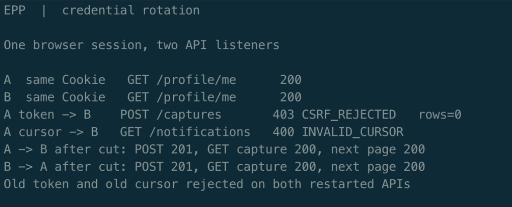

# 支线 76A　固定来源，让两个实例交叉签发与验证

当两个 API 都能识别会话，用户却偶尔写不进去或翻不了页时，可以把故障限制在一个请求往返里。以下使用**另起的隔离 HTTP 练习环境**和它自己的 Cookie。原 HTTPS 名称、代理、配置与 Cookie 继续留给正式路径。这里检验的是后端之间的 HMAC 协议；HTTPS 证书、Secure Cookie 和代理的真实流量还要回主文验。

沿用 Node 24.22.1、PostgreSQL 18、DBeaver、Bash、curl 和私有 Mailpit。用专供本支线的停机集群副本，保留原账号、非空库和配对桶。角色在整个 PostgreSQL 集群共享，只在日常实例新建一个数据库仍会改到日常身份。记录实例地址、端口和库名，另留一个已验证的管理员入口。配置位置与两台机器的归属见[实践环境](../../environment-setup.md#让两个实例接到同一份练习数据)。

在配套代码检出 `part-10/chapter-77`。复制的是已完成轮换的库时，请回到轮换前的独立基线。首次准备按配套说明（`examples/credential-rotation/README.md`）执行一次 `identities.sql`，用交互式 `\password` 给五个登录分别设置新口令。运行角色通过 TCP 密码认证；本机管理员可以用独立的本地连接观察。在支线专用目录中复制各角色配置，另行准备新版，仅改数据库登录信息，保留限制性文件权限、预期库名和其他依赖地址。缺权通知角色的完整投递对照见主文 76.3。

给两个 API 分配独立、属于各自运行用户的可写工作目录和回环监听端口，示例为 A 的 3376、B 的 3377。两者使用同一 release、同一库和 `APP_ORIGIN=http://127.0.0.1:13376`。数据库试切时，两者先使用原签名密钥。远程操作时另设支线数据库转发、练习 SMTP 通路；另开操作端 SSH 页把本地 13386、13387 分别转到部署端的 3376、3377。同机直接访问两个监听即可。沿用第 70 章的前台启动方式，例如在部署端先用 `sudo install -d -o epp-api -g epp-api -m 0700 /var/lib/epp76-a /var/lib/epp76-b` 给两者准备目录。以 root 为配置属主、服务组只读安装配置文件，例如使用 /etc/epp82a/a.env（B 用同目录 b.env）；确认两份文件只指向支线的库与端点，再启动 A：

```bash
sudo -u epp-api env -i /bin/sh -c '
  cd /var/lib/epp76-a || exit 1
  exec /opt/epp72/node/bin/node --env-file=/etc/epp82a/a.env /opt/epp72/release/dist/src/server.js
'
```

B 的命令换工作目录与配置文件。两端应各出现一次 `app.ready`。本章同时开两个 API 是为了定向探测，它们的进程内登录限额也各自计数；练习入口只在回环提供。

在操作端 Bash 进入配套根目录，按配套说明设置 `site`、`port_a`、`port_b` 和私有临时目录 `lab`，载入 `client.sh`。后面的 `hit A` 或 `hit B` 使用 curl 的 `--connect-to` 改变实际连接目标，URL、Host 和公开来源都保持一致。用第 55 章的账号准备至少两条尚未清除的站内通知，确保 `GET /notifications?limit=1` 给出非空 `nextCursor`。若需要重置密码来产生第二条通知，先完成重置与投递，再用新密码登录。若旧邮件仍占用通道，配套说明另有在隔离库创建通知分页样本的做法，可保留邮件现场。按配套说明把本次登录的 Cookie 仅存入私有文件；随后执行 `save_proofs B old` 保存一份原 CSRF 令牌与未过期的游标。

还要找出第二个秘密的使用者。沿 `src/config.ts` 读 `cursorKey` 的去向：列表用它给页边界和查询范围做 HMAC；`src/browser-security.ts` 用同一把密钥给“用途前缀 + 会话 ID”做 HMAC，生成 CSRF 令牌。Cookie 中的会话令牌另由数据库摘要匹配。由此可以先写下一个预测：只换 HMAC，旧登录应继续成立，但客户端上一次取回的两种签名值都可能失效。下面用可以指定由 A 或 B 接收的请求来检验。

先只换 A 的数据库登录。让 B 承接读取，在 A 的前台终端正常停止进程（托管时停止对应服务），等到 `app.stopped`。用受限的新配置重新启动 A，等 `app.ready`，立即让 A、B 各处理一次原来的 `GET /profile/me`。两端都是 200。此时刷新会话查询：本轮两个 `epp-api` 下同时出现了 `epp_api_v2` 与 `epp_api`。A 的连接建立在重启后，B 的登录尚旧。如果只有一个角色出现，再分别发一次请求立即查询，避免把已回收的空闲连接或另一进程的连接当作证据。

现在让 A 再多走一步，在它的配置中换签名密钥，而 B 保留旧值。先将这两个监听隔离在练习通路，正常流量不参与故障实验。新值在操作端执行一次下列命令生成；沿已核对身份的 SSH 通路将文件送入部署管理员的私有目录，或在同机直接使用。把同一行内容写入这一代各份 API 配置的 `CURSOR_HMAC_KEY`。各自生成一次会制造两把不同的密钥。不要把值写入截图、启动参数或工单。

```bash
(umask 077; openssl rand -hex 32 > "$lab/hmac-v2")
```

重启 A，保持 B 原样。用原 Cookie 向两端分别读本人资料。假如你仅看到两次 200，接下来会用哪一个请求检验自己的预测？先保留失败的响应，尤其是业务码。客户端这次可以控制**谁签发、谁验证**，不用猜负载均衡把它送去了哪一台。

```bash
hit A /profile/me me-a.json -b "$lab/cookies"
hit B /profile/me me-b.json -b "$lab/cookies"
save_proofs A candidate
write_capture B candidate failed-write.json
next_page B candidate failed-page.json
next_page A candidate control-page.json
```

`save_proofs` 向 A 取 CSRF，又取只有一条通知的第一页。`write_capture` 使用同一个 Cookie、正确 Origin、`X-EPP-Request: 1` 和刚取得的 CSRF 头，发送私有 `capture.json` 中带本轮标记的素材。`next_page` 始终保持原账号、资源和 `limit=1`。在本地打开两份失败响应，别把含游标或会话标识的成功响应贴到共享日志里。在 DBeaver 选本轮副本查这笔写入：

```sql
SELECT count(*) FROM public.captures
WHERE user_id = '换成本轮账号 UUID'::uuid
  AND original_text = '换成这次失败请求的唯一标记';
```



图 76-1　先看前四行。B 能识别原会话；写入回了 `403 CSRF_REJECTED`，标记计数为零。相同游标在签发它的 A 能续页，在 B 回了 `400 INVALID_CURSOR`。后两组成功的交叉请求来自修复之后。

两种报错能否只用“密钥不一致”解释？单看 403，也可能是 Origin 或显式请求头填错；这里业务码已走到 CSRF 校验。单看 400，换筛选条件、改页大小或原游标超过 30 分钟都会被拒。即时将同一游标送回 A 可以翻页，又在 B 用旧游标成功，才把范围缩到两个实例的验证条件。两边的数据库登录名也不同；让同一个 B 在修复时只改签名密钥、保留 B 当时的数据库登录，如果这两条路一起恢复，就能把两项变化区分开。多次点击首页或重新登录，都没有改变 B 加载的密钥。

排空也能拿一笔请求来量。本轮在隔离库的观察事务内锁住素材表，让 A 的一笔创建停在 INSERT；先从 `pg_blocking_pids` 看见它确实在等，再给 A 发 TERM。A 已记录 `app.draining` 时，B 仍用原 Cookie 读回资料 200。立即在观察端 ROLLBACK 释放锁，A 完成原请求并返回 201，随后记录 `app.stopped`、退出 0。这里读写落在不同的表。若 B 也写这张素材表，两台 API 都会等同一个锁，多开一台进程不能消除数据库的阻塞。复现时用第 65 章的两个独立 SQL 会话观察等待，事先准备释放操作，应用 SQL 超时后该笔请求就无法完成这组对照。

若刚做过排空对照，先按原配置重启 A、查 app.ready，再从 A 取一份当前有效的令牌和游标。在隔离探针里，先只把 B 切到与 A 相同的新密钥，沿用 B 已经读写成功的数据库登录。用 A 的令牌和游标在 B 验证 201 和 200。然后只改 B 的数据库配置、重新启动，在会话查询中确认 B 也以新身份接入。正式恢复流量前，先用 `old` 在 A、B 各重放一次写入和续页，预期分别是 403、400。原 Cookie 无需重新登录。运行 `save_proofs A anew` 和 `save_proofs B bnew`，从 A 取的值交给 B，反向再做一次：

```bash
write_capture B anew created-on-b.json
next_page B anew page-on-b.json
# 在私有 capture.json 中换一个本轮标记，再做相反方向
write_capture A bnew created-on-a.json
next_page A bnew page-on-a.json
```

两个写请求应各得 201，两个续页各得 200。取两份创建响应的 `id`，将其中一笔带到另一端做 `GET /captures/实际ID`，应读回同一标记。另起的 HTTP 探针到此可以关闭。旧页面遇到 CSRF 拒绝可以先重新获取令牌；旧游标须从第一页重新取得。若写请求的结果根本没收到，先按业务标识查明是否落库，再决定重发。本章计数为零的证据只属于那次明确被拒绝的请求。

## 回查这次交叉请求

| 观察 | 再查哪一个条件 |
| --- | --- |
| 两端 GET /profile/me 都是 200 | 会话共享成立，仍须从 A 签发后交给 B 写入和续页 |
| CSRF_REJECTED，写入标记零行 | 先固定来源、Cookie 和显式请求头，再只换 B 的密钥 |
| INVALID_CURSOR | 保持查询范围和 limit，用同一未过期游标立即回到签发端 |
| 原请求仍在等待，另一端读 200 | 查阻塞 PID、原请求退出和 app.stopped，才能判断是否排空 |

阅读约 10～15 分钟；在已有双实例隔离副本上定向复现另加 25～40 分钟。

[回到 HTTPS 入口验收](chapter.md#762-先切一个进程并迫使它新建连接)
