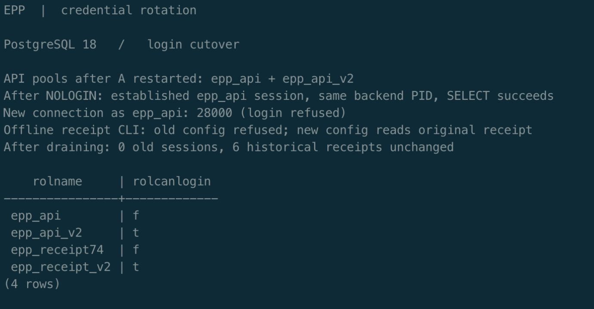

# 支线 76B　让旧会话跨过禁止登录的时刻

在独立集群从主文 76.4 撤权前分出这条路径，保留一个管理员连接和一个明确可辨认的旧连接。只在已核对来自本轮的集群执行。

还剩一条停着的收据查询命令。先用它的**旧配置**查回原收据，保存结果。另开一个终端，在数据库可达的一端执行 `psql -X -h 127.0.0.1 -p 55476 -U epp_api -d epp_ch73_handoff -W`，把端点和库名换为应用实际访问的练习副本，交互输入旧口令。执行下列两条并保留窗口。记下数据库 PID，这条连接专供下面辨认。

```sql
SET application_name = 'epp76-held';
SELECT session_user, pg_backend_pid(), count(*) FROM public.captures;
```

现在可以做一个区分原因的实验。如果禁止旧登录就会踢掉在线连接，上面的窗口下次查询应失败；如果只在登录时拦截，那么原窗口与刚打开的窗口会有不同结果。先在管理员窗口重新执行会话查询，核对**整个练习集群**中的使用者。确认工作进程均已换好，保留这一个已知对照连接，再在这个隔离集群执行：

```sql
BEGIN;
ALTER ROLE epp_api NOLOGIN;
ALTER ROLE epp_mail NOLOGIN;
ALTER ROLE epp_notify NOLOGIN;
ALTER ROLE epp_cleanup NOLOGIN;
ALTER ROLE epp_receipt74 NOLOGIN;
COMMIT;
```

回原窗口重跑 SELECT。再用同一地址、库名、旧 API 用户及口令**新开连接**。本轮前者仍能读表，PID 不变；后者连第一条业务 SQL 都没执行就被拒绝，PG 报 SQLSTATE `28000`。若你关掉旧窗口再开两次，就观察不到这个差别。再运行刚才的收据命令：旧配置失败且没有业务输出，换成新收据配置就读回原值。在部署端沿用交接单的三个变量，切换的只是下面的配置文件：

```bash
sudo -u epp-receipt env -i /opt/epp72/node/bin/node \
  --env-file=/etc/epp72/receipt-v2.env /opt/epp72/release/dist/src/account-admin.js \
  "$db" receipt "$user_id" "$operation_id"
```

收据内部的 `dbActor` 记录当年操作时的身份，可以一直是旧值；当前登录另用实际新连接核实。



图 76-2　下半部两对角色的 `rolcanlogin` 分别为 f 和 t。上半部的同 PID 查询发生在撤销登录之后，零条旧连接则是在关闭最后的对照连接之后。二者之间还差一次排空。

正常维护时让已知客户端关闭旧连接，再刷新会话查询。如果演练的是密码泄露，旧身份被禁后还要查清并终止仍可能受控的连接，包括别的数据库中的会话。先按登录名、库、启动时刻定位，辨认 PID。下面只处置自己保留的那条练习连接：在管理员 psql 中将 `held_pid` 设为刚才的数字，例如输入 `\set held_pid 12345`，换成实际值。

```sql
SELECT pg_terminate_backend(pid, 3000) AS stopped
FROM pg_stat_activity
WHERE pid = :held_pid AND usename = 'epp_api'
  AND datname = current_database() AND application_name = 'epp76-held';
```

零行说明读数或目标已变，重新观察；返回 true 表示在指定等待内终止。原窗口的连接随即不再可用。重新运行会话查询，确认五种旧登录均无连接，再逐一用新配置建立连接。用第 70 章的预期库、用户 ID 与原操作 ID 执行 `account-admin.js "$db" receipt "$user_id" "$operation_id"`，把输出与撤销前保存的那一份做 `cmp`。本轮五组旧登录逐一新连均被拒；五个新登录均能查到预期库名，仍都无权 DELETE 用户表。六张旧收据逐值一致。不要删除用来承载权限的原角色，否则也会影响依赖它的新成员。

## 回查撤权和排空

| 观察 | 如何解释 |
| --- | --- |
| 同一 PID 仍能 SELECT，旧身份新连报 28000 | 前者在禁登录之前已认证，后者在认证阶段被拦截 |
| rolcanlogin 为 false，活动视图仍有旧身份 | 核对整个集群里的数据库、登录、PID 与建立时刻 |
| pg_terminate_backend 查询返回零行 | 指定条件没有选中目标，刷新活动视图再决定 |
| 旧收据 dbActor 是旧名字 | 它记录历史操作人，当前登录以新建连接的 session_user 为准 |

阅读约 5～8 分钟；撤销前留好对照连接时，复现另加 10～15 分钟。

[回到撤销后的业务核对](chapter.md#764-撤掉旧登录后验证故障边界)
